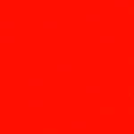
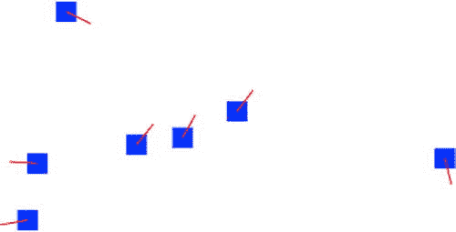
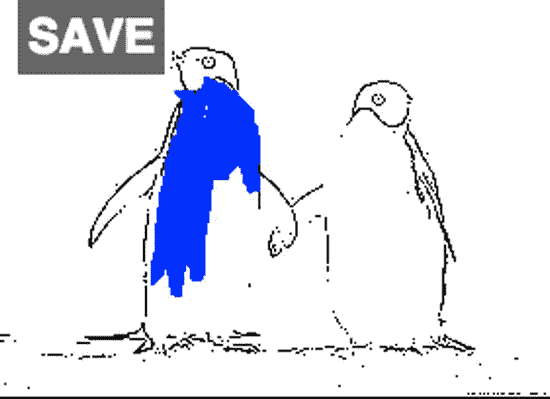

# 2. Canvas 与动画基础

在交互的世界里，一个简单的动画既可以成为一个很好的入门学习内容，也能有效地向用户传达信息。许多人认为网站上所有的交互功能都是游戏，但事实并非如此！我希望通过本章，你能了解到如何做一些与众不同的事情——如何通过专业的动画从标准网站中脱颖而出。

如今，我们可以通过多种方式添加动画，配合日益强大的 HTML 和 CSS 技术，包括：变换、画布和 SVG。我重点关注画布，因为它在本书中被大量使用，不过你也应该能自如地使用这三种技术，并理解它们各自的优缺点。简而言之，你可以将画布视为光栅图，将 SVG 视为矢量图，而变换则用于操作 DOM 元素。


## 什么是 Canvas？

`Canvas` 这个名字起得很贴切，因为它可以比作画家的画布——在开始绘制之前，它是一片空白。`canvas` 本身和 `div` 并无区别，都是一个空白的无语义块级元素。然而，不同之处在于 `canvas` 拥有一个可用于通过 JavaScript 绘制的上下文，这个上下文可以通过 `var ctx = canvas.getContext('2d')` 来获取；其中 `canvas` 是一个包含对 `canvas` 元素引用的变量。你可能已经注意到了，我指定了一个 2d 上下文，`getContext` 允许你在多种上下文之间进行选择，目前 2d 上下文是最常见且最成熟的；不过，`WebGL` 和其他技术可以用于 3d 上下文。

由于旧版浏览器不支持 `canvas`，可以声明一个后备方案，以便显示其他内容——例如静态图像或 Flash 动画。要添加后备内容，只需在 `canvas` 标签之间编写 HTML 即可。我建议你避免编写“你的浏览器不支持 Canvas”这样的提示，因为网站体验应该根据设备/浏览器的能力进行调整，而不是批评用户的浏览习惯；不过，为了简化，我在本书的许多练习中会打破这条规则。

```
<canvas id="animation">
    
</canvas>
```

一旦你获得了上下文，就可以开始绘制了。上下文的所有绘制功能都使用笛卡尔坐标系，其中包含 x 轴和 y 轴。需要注意的是——与大多数基于计算机的图形一样——上下文使用右下象限，因此左上角是它的原点 (0,0)。

```
var ctx = canvas.getContext('2d');
//fillRect(x, y, width, height);
ctx.fillRect(10, 10, 50, 50);
```

前面的代码在距左上角 x 轴和 y 轴各 10px 的位置绘制了一个 50px × 50px 的正方形。请注意，在 canvas 中，任何四边形都称为矩形。默认情况下，这个矩形是黑色的。由于绘制到上下文的过程是程序化的，因此我们需要在绘制对象之前更改颜色。更改颜色后，所有对象将使用相同的颜色，直到再次更改为止。

```
// 这将填充颜色设置为红色
ctx.fillStyle = "#ff0000";
// fillRectangle(x, y, width, height);
ctx.fillRect(10, 10, 50, 50);
```

如图 2-1 所示，前面的代码只是绘制了一个红色的相同矩形。



图 2-1. 一个简单的红色矩形

那么现在，既然我们关心的是动画，就让这个方块动起来吧！

## RequestAnimationFrame

如果你曾经需要在 JavaScript 中执行重复性任务（例如轮询），那么你可能对 `setInterval` 和 `setTimeout` 有所了解。这两个函数都不可靠，因为它们可能在超时后的任何时间触发，而不是正好在超时时触发，如果你需要它们立即触发（这对于流畅动画来说非常重要），这就会导致问题。此外，许多浏览器的最小计时器分辨率约为 16ms，这可能会造成延迟，尤其是在意料之外的情况下。使用超时的另一个问题是，你需要手动设置超时时间；因此任何测试都将只针对该特定计算机。另一方面，`requestAnimationFrame` (rAF) 可以在其运行的计算机的最佳时机触发。它不是固定时间，而是以每秒最多 60 帧的速度运行，但触发频率较低（例如，当浏览器标签页在后台时）。另一个可以使用的优化是第二个参数，它可以是一个 `DOM` 元素来约束 rAF。

由于在撰写本文时，某些浏览器对 `requestAnimationFrame` 的支持不足，建议使用一个 shim，以便在实现了其某种版本的浏览器中正常工作。我不会在代码示例中包含这一点，但在所有浏览器都正确支持该标准之前，你应该将其视为必需的。

```
// RequestAnimationFrame 的 Shim
(function() {
  var requestAnimationFrame = window.requestAnimationFrame || window.mozRequestAnimationFrame ||
                              window.webkitRequestAnimationFrame || window.msRequestAnimationFrame;
  window.requestAnimationFrame = requestAnimationFrame;
})();
```

我发现分离代码很重要，因此虽然我暂时不会使用任何特定的设计模式（因为代码量还很小），但我鼓励你恰当地组织代码。对于本节，我认为 `logic()` 和 `draw()` 是合适的函数名称。

```
// 这是一种选择元素的方式
var ele = document.querySelector("#animation");
var ctx = ele.getContext('2d');
var x = y = 10;
var width = height = 50;

function logic () {
    x += 10;
    if (x < ele.width - width) requestAnimationFrame(draw);
}

function draw()  {
    ctx.clearRect(0, 0, ele.width, ele.height);
    // 这将填充颜色设置为红色
    ctx.fillStyle = "#ff0000";
    // fillRectangle(x, y, width, height);
    ctx.fillRect(x, y, 50, 50);
}

requestAnimationFrame(draw);
setInterval(logic, 1000/60);
```

你会注意到我同时使用了 `requestAnimationFrame` 和 `setInterval`，这是因为你很少希望动画以全速运行（取决于计算机），因此这允许在仍然使用 `requestAnimationFrame` 来提高渲染性能的同时设置速度。现在，我提到动画不必全速运行，但我还没有向你展示如何轻松更改该速度——为此，我们将使用线性插值。

## 线性插值

线性插值 (lerp) 用于定义特定路径的子坐标。这可以比作进行长途旅行并在途中停下来吃饭。在动画中，它用于平滑路径，因此它不是从一个点跳到另一个点，而是看起来在它们之间滑动（当然，实际上它只是进行了更小的跳跃）。

```
n = start + (end - start) * speed
```

上面的代码方程用于计算下一个插值点。这应该被迭代，这样每一帧的起始变量都是前一帧的 `n`，因为它逐渐向终点移动（现在取决于设置的速度，而不是每秒帧数）。

```
var ele = document.querySelector("#animation");
var ctx = ele.getContext('2d');
var startX = 10;
var startY = 10;
var endX = ele.width - 50;
var x = startX;
var y = startY;
var duration = 0;
var width = height = 50;

function lerp(start, end, speed) {
    return start + (end - start) * speed;
}

function logic () {
    duration += 0.02;
    x = lerp(startX, endX, duration);
    if (x < ele.width - width)
        requestAnimationFrame(draw);
}

function draw()  {
    ctx.clearRect(0, 0, ele.width, ele.height);
    // 这将填充颜色设置为红色
    ctx.fillStyle = "#ff0000";
    // fillRectangle(x, y, width, height);
    ctx.fillRect(x, y, 50, 50);
}

requestAnimationFrame(draw);
setInterval(logic, 1000/60);
```

这与之前的版本差别不大，只是我们现在有一个 `lerp()` 函数，几乎与之前的方程相同。我还定义了 `duration`、`startX` 和 `startY` 变量以便传入函数。最大的变化是 `logic()`。我没有调整 `x`（这会导致跳跃），而是将 `duration` 增加了一小点，然后我将其简单传入 `lerp()` 函数，以获得 `x` 的新值（该值位于通往最终 x 目的地的路径上的某处）。


### 跟随鼠标

很多时候，你需要的是交互式动画，而不仅仅是视频。在 Canvas 中添加交互性的一种常见方式是使用鼠标。首先，我将向你展示如何让你的红色小方块跟随鼠标移动。

鼠标由操作系统处理，因此会触发一个所有程序都能访问的事件，这当然意味着“鼠标”这个术语实际上指的是任何能够触发该事件的设备。对于这种情况，我们需要监听 `'mousemove'` 事件。为此，我们使用 `addEventListener` 将监听器添加到特定元素。

`element.addEventListener(type, listener, useCapture boolean optional);`

`Type` 是事件的名称（请参阅下面跟随的鼠标特定事件列表）。`Listener` 可以通过两种方式实现：作为实现 `EventListener` 接口的对象，或者作为简单的回调函数。`useCapture` 是一个布尔值，如果事件应在捕获阶段触发，则为 `true`；否则，它将在目标和冒泡阶段触发。在现代浏览器上，`useCapture` 默认为 `false`，但一些较旧的浏览器可能需要它。

-   `click`
-   `dblclick`
-   `mousedown`
-   `mouseenter`
-   `mouseleave`
-   `mousemove`
-   `mouseover`
-   `mouseout`
-   `mouseup`

要使方块跟随鼠标移动，你需要一个回调函数，根据鼠标位置设置新的起点和终点，如下所示：

```javascript
ele.addEventListener('mousemove', function(evt) {
    startX = x;
    endX = evt.clientX;
});
```

这为方块设置了新的路径，所以现在我们只需要稍作修改使其平滑。我决定添加一些约束，以确保如果鼠标将 x 设置为方块已经前往的位置时，方块不会试图移出 Canvas 或出现闪烁。如果不符合此约束，则持续时间被设置为 0。

```javascript
function logic (evt) {
    var max = ele.width - width;
    duration += 0.02;
    var l = lerp(startX, endX, duration);
    if (l < max && l > 0 && endX != x)
    {
        x = l;
        requestAnimationFrame(draw);
    }
    else {
        duration = 0;
    }
}
```

这应该可以向你展示，仅仅一些微小的改变就能完全改变整个动画以及用户与之交互的方式。请参阅清单 2-1，了解所有部分如何整合在一起。

**清单 2-1.**

```html
<!DOCTYPE html>
<html>
    <head>
        <title>Chapter 2 - Basics of Canvas</title>
    </head>
    <body>
        <canvas id="animation">
            <p>Fallback not supported.</p>
        </canvas>
        <script src="script.js"></script>
    </body>
</html>
```

```javascript
// Polyfill for RequestAnimationFrame
(function() {
  var requestAnimationFrame = window.requestAnimationFrame || window.mozRequestAnimationFrame ||
                              window.webkitRequestAnimationFrame || window.msRequestAnimationFrame;
  window.requestAnimationFrame = requestAnimationFrame;
})();

var ele = document.querySelector("#animation");
var ctx = ele.getContext('2d');
var width = height = 50;
var startX = 10;
var startY = 10;
var endX;
var x = startX;
var y = startY;
var duration = 0;

function logic (evt) {
    var max = ele.width - width;
    duration += 0.02;
    var l = lerp(startX, endX, duration);
    if (l < max && l > 0 && endX != x)
    {
        x = l;
        requestAnimationFrame(draw);
    }
    else {
        duration = 0;
    }
}

function draw()  {
    ctx.clearRect(0, 0, ele.width, ele.height);
    // This sets the fill colour to red
    ctx.fillStyle = "#ff0000";
    // fillRectangle(x, y, width, height);
    ctx.fillRect(x, y, 50, 50);
}

function lerp(start, end, speed) {
    return start + (end - start) * speed;
}

ele.addEventListener('mousemove', function(evt) {
    startX = x;
    endX = evt.clientX;
});

requestAnimationFrame(draw);
setInterval(logic, 1000/60);
```

### 弹跳方块

既然我们已经了解了如何进行静态动画（从左向右移动）以及如何使用输入进行动画，我想再做一个使用方块的示例，为其添加一个动态元素。动画的工作方式有很多种选择。最常见的是让物体在 Canvas 的边界上弹跳。这个示例的难度相比上一个并没有提升太多，但它将很好地衔接下一个示例（这将是一个简单的群体模拟实现）。

为了弹跳方块，我们不是在当前和期望位置之间进行“lerp”（线性插值），而是需要让它沿特定方向移动，直到碰到边缘。这意味着我们需要使用基础三角学，根据一个角度（起始为 360 度内的随机角度）来找到位置。正如你从 lerp 中了解到的，最好采用许多小步骤而不是一个大步骤来移动，所以我们可以让三角函数计算一个距离。为了找到 x 方向，我们计算角度（弧度制）的余弦值乘以距离，对于 y 方向，我们做同样的操作，但是使用角度的正弦值。

```javascript
function degreesToRadians(degrees) {
    return degrees * (Math.PI / 180);
}

function dir_x(length, angle) {
    return length * Math.cos(degreesToRadians(angle));
}

function dir_y(length, angle) {
    return length * Math.sin(degreesToRadians(angle));
}
```

一旦我们实现了这些函数，剩下的就与之前的示例类似了。我们需要为 x 和 y 轴初始化距离和方向变量。距离应从 0 开始，方向需要是 0 到 360 度之间的随机角度。在逻辑函数中，最好从一个简单的检查开始，确保两个 `heading` 变量都在 -360 到 360 之间。然后我们需要检查物体是否在边界内，如果不在，则将其反弹回来。之后，我们只需在当前坐标和通过上述角度与方向函数计算出的坐标之间进行 lerp 插值。

```javascript
var ele = document.querySelector("#animation");
ele.height = window.innerHeight;
ele.width = window.innerWidth;
var ctx = ele.getContext('2d');
var x = 10;
var y = 10;
var duration = 0;
var width = height = 50;
var heading_x = heading_y = Math.random() * 360;
var distance_x = distance_y = 0;

function logic () {
    if (heading_x > 360 || heading_x < -360) heading_x = 0;
    if (heading_y > 360 || heading_y < -360) heading_y = 0;

    if (x <= 0 || x >=ele.width - width) {
        heading_x = heading_x + 180;
    }
    if (y <= 0 || y >=ele.height - height) {
        heading_y = -heading_y;
    }

    distance_x = dir_x(2, heading_x);
    distance_y = dir_y(2, heading_y);

    if (duration < 10) duration += 0.05;
    x = lerp(x, x + distance_x, duration);
    y = lerp(y, y + distance_y, duration);

    requestAnimationFrame(draw);
}
```

就是这样。你可以在 Apress 网站 [`www.apress.com/9781430259442`](http://www.apress.com/9781430259442) 或我的个人网站 [`www.shanehudson.net/javascript-creativity`](http://www.shanehudson.net/javascript-creativity) 上提供的本书配套下载资源中找到所有示例的完整代码清单。


## “聪明”的动画

接下来我们将创建一个“聪明”的动画——也就是说，在弹跳盒子示例中动态动画概念的基础上进行扩展，让物体能够感知周围环境。1986 年，克雷格·雷诺兹创建了一个令人惊叹的鸟群模拟程序，他称之为“Boids”。它仅基于三条规则构建，使得每只虚拟鸟能够自主运动，同时也能看到附近的同伴并向它们移动。我找到的关于每条规则的最佳解释如下：

*   **分离**：转向以避免与附近的鸟群成员拥挤
*   **对齐**：转向朝向附近鸟群成员的平均方向
*   **凝聚**：转向朝附近鸟群成员的平均位置（质心）移动

我们的动画基于 Boids，不过为了简洁起见，某些部分会进行简化（我鼓励你修改我的代码来改进它——为此你可能需要使用向量）。我们将从通常的设置代码开始，比如 `getContext` 等，同时为 Boid 创建一个对象，用于存储其位置、方向和大小数据。完成后，我们创建一个名为 `setup()` 的函数，它会将每只虚拟鸟（无论我们设置了多少只）以随机位置和随机方向添加到画布上。我编写了一个简单的函数来包装 JavaScript 的 `Math.random`，只是为了让代码更整洁一些。

```
(function()  {
var canvas = document.querySelector("#flocking");
var ctx = canvas.getContext('2d');
canvas.height = window.innerHeight;
canvas.width = window.innerWidth;
var flock = [];
var flockRadius = 250;
var neighborRadius = 10;
var Boid = function(x, y, heading, size) {
this.x = x;
this.y = y;
this.heading = heading
this.size = size;
};
function setup()  {
for (var i = 0; i < 50; i++)
{
flock.push(new Boid(rand(canvas.width), rand(canvas.height), rand(360), 15));
}
setInterval(logic, 1000/60);
}
function logic () {
for (var i = 0; i < flock.length; i++)  {
// 对每只虚拟鸟执行某些操作
}
requestAnimationFrame(draw);
}
function draw()  {
// 绘制部分在此进行
}
function rand(max)  {
return Math.random() * max;
}
setup();
})();
```

你可能注意到，我们没有使用“向上”或“向右”来表示方向，而是使用了 0 到 360 度。这使动画更加流畅，也便于我们之后使用弧度计算。我们使用变量 `flockRadius` 来控制虚拟鸟互相可视的距离（也用于统一方向等）。现在让我们为绘制方法添加一些代码。为此，我们首先需要清除每一帧的画布（如果不这样做，就会直接在上一帧上绘制）。画布清除后，就该绘制虚拟鸟了！因此我们需要遍历鸟群数组，将当前虚拟鸟存储在名为 `b` 的变量中，并将每一只绘制到画布（即画布上下文）的正确位置上。要找到位置，我们取 `b.x` 和 `b.y`，但需要加上其大小的一半，因为位置是虚拟鸟的中心，而不是其左上角。

```
function draw()  {
ctx.clearRect(0,0,canvas.width, canvas.height);
for (var i = 0; i < flock.length; i++)
{
var b = flock[i];
ctx.fillStyle = "blue";
ctx.fillRect(b.x,b.y, b.size, b.size);
ctx.beginPath();
ctx.moveTo(b.x + (b.size / 2),b.y + (b.size / 2));
ctx.lineTo((b.x + (b.size / 2)) + dir_x(20,flock[i].heading),(b.y + (b.size / 2)) + dir_y(20,flock[i].heading));
ctx.strokeStyle = "red"
ctx.stroke();
}
}
```

在 `lineTo` 中，我使用了两个函数，用于在给定距离和方向时获取位置。这里我用这些函数画了一条线，指向每只虚拟鸟朝向的方向，长度为 20 像素。下面是辅助函数的代码。它们使用了基本的三角学和勾股定理，因此应该很容易理解。

```
function distanceBetween(a, b)  {
var dx = a.x - b.x;
var dy = a.y - b.y;
return Math.sqrt(dx * dx + dy * dy);
}

function angleBetween(x1, y1, x2, y2)
{
```


```javascript
function angleBetween(x1, y1, x2, y2)
{
    return Math.atan2(y1 - y2, x1 - x2) * (180.0 / Math.PI);
}

function angleDifference(a1, a2)
{
    return ((((a1 - a2) % 360) + 540) % 360) - 180;
}

function degreesToRadians(degrees){
    return degrees * (Math.PI / 180);
}

function dir_x(length, angle){
    return length * Math.cos(degreesToRadians(angle));
}

function dir_y(length, angle){
    return length * Math.sin(degreesToRadians(angle));
}
```

别被这些数学计算吓到——它们恰好能让我们更轻松地编写逻辑函数，我们现在就开始吧！首先，需要在 for 循环中设置一些变量，用以记录仿生鸟要飞往的位置。这些变量叫做`centerx`和`centery`，但它们并不是画布的中心（我将它视为“关注中心”）。我还提供了一个变量 `b`，以便更轻松地访问 `flock[i]`。变量设置完毕后，我们就可以再次遍历仿生鸟群来寻找邻居了，也就是距离小于`flockRadius`的任何仿生鸟。有了这些，我们就能找出平均位置（将每只仿生鸟的`x`和`y`坐标加到`centerx`和`centery`上，然后除以该半径内的仿生鸟数量）。当然，如果鸟群里只有一只仿生鸟，那我们不妨给它一个随机的位置作为目标点。

```javascript
for (var i = 0; i < flock.length; i++)  {
    var centerx = 0;
    var centery = 0;
    var count = 0;
    var b = flock[i];
    for (var j = 0; j < flock.length; j++)
    {
        var distance = distanceBetween(b, flock[j]);
        if (distance < flockRadius)
        {
            centerx += flock[j].x;
            centery += flock[j].y;
            count++;
        }
    }
    if (count > 1) {
        centerx = centerx / count;
        centery = centery / count;
    }
    else  {
        centerx = Math.random() * canvas.width;
        centery = Math.random() * canvas.height;
    }
    // 设置航向和 x/y 位置
}
```

现在我们已经得到了关注中心/重力中心（我想“重力”这个词更贴切），就可以计算出仿生鸟为了朝正确方向飞行所需转动的角度了。我们通过使用 `angleBetween` 和 `angleDifference` 这两个辅助函数来得到所需角度，然后进行线性插值，让它在每次迭代中都更接近目标点。当然，由于我们代码的设计方式，它的目标点可能会根据与邻居的接近程度而变化（请记住，我们是在嵌套循环中改变中心点的）。最后，为了防止仿生鸟飞出画面，我们需要定义一个“环绕”机制，这样当仿生鸟离开画布时，它会出现在对面一侧（就像《小行星》或《贪吃蛇》游戏那样）。

```javascript
if (count > 1) {
    centerx = centerx / count;
    centery = centery / count;
}
else  {
    centerx = Math.random() * canvas.width;
    centery = Math.random() * canvas.height;
}
var angleToCenter = angleBetween(b.x,b.y,centerx,centery);
var lerpangle = angleDifference(b.heading, angleToCenter);
b.heading += lerpangle * 0.01;
headingx = dir_x(2,b.heading);
headingy = dir_y(2,b.heading);
b.x += headingx;
b.y += headingy;
if (b.x < 0) b.x = canvas.width;
if (b.y < 0) b.y = canvas.height;
if (b.x > canvas.width) b.x = 0;
if (b.y > canvas.height) b.y = 0;
```

如果你将上述代码放在上一段代码中注释所在的位置，你会发现现在画布上有了蓝色仿生鸟，它们带有表示方向的红色线条，在画布上四处飞行并聚集在一起。图 2-2 展示了应有的效果。这个动画可以通过多种方式改进，例如增加分离行为，让它们彼此并列飞行而不是互相穿过。



**图 2-2.** 此图显示每只仿生鸟朝着特定方向飞行。另请注意，中间的三只仿生鸟正朝着同一方向飞行，形成一个鸟群

在代码清单 2-2 中，你可以看到这个示例的完整代码，与之前的示例一样，该代码可在线下载。

**代码清单 2-2.**

```javascript
(function()  {
    var canvas = document.querySelector("#flocking");
    var ctx = canvas.getContext('2d');
    canvas.height = window.innerHeight;
    canvas.width = window.innerWidth;
    var flock = [];
    var flockRadius = 250;

    var Boid = function(x, y, heading, size) {
        this.x = x;
        this.y = y;
        this.heading = heading
        this.size = size;
    };

    function setup()  {
        for (var i = 0; i < 50; i++)
        {
            flock.push(new Boid(Math.random() * canvas.width, Math.random() * canvas.height, Math.random() * 360, 15));
        }
        setInterval(logic, 1000/60);
    }

    function logic () {
        for (var i = 0; i < flock.length; i++)  {
            var centerx = 0;
            var centery = 0;
            var count = 0;
            var b = flock[i];
            for (var j = 0; j < flock.length; j++)
            {
                var distance = distanceBetween(b, flock[j]);
                if (distance < flockRadius)
                {
                    centerx += flock[j].x;
                    centery += flock[j].y;
                    count++;
                }
            }
            if (count > 1) {
                centerx = centerx / count;
                centery = centery / count;
            }
            else  {
                centerx = Math.random() * canvas.width;
                centery = Math.random() * canvas.height;
            }
            var angleToCenter = angleBetween(b.x,b.y,centerx,centery);
            var lerpangle = angleDifference(b.heading, angleToCenter);
            b.heading += lerpangle * 0.01;
            headingx = dir_x(2,b.heading);
            headingy = dir_y(2,b.heading);
            b.x += headingx;
            b.y += headingy;
            if (b.x < 0) b.x = canvas.width;
            if (b.y < 0) b.y = canvas.height;
            if (b.x > canvas.width) b.x = 0;
            if (b.y > canvas.height) b.y = 0;
        }
        requestAnimationFrame(draw);
    }

    function draw()  {
        ctx.clearRect(0,0,canvas.width, canvas.height);
        for (var i = 0; i < flock.length; i++)
        {
            var b = flock[i];
            ctx.fillStyle = "blue";
            ctx.fillRect(b.x,b.y, b.size, b.size);
            ctx.beginPath();
            ctx.moveTo(b.x + (b.size / 2),b.y + (b.size / 2));
            ctx.lineTo((b.x + (b.size / 2)) + dir_x(20,flock[i].heading),(b.y + (b.size / 2)) + dir_y(20,flock[i].heading));
            ctx.strokeStyle = "red"
            ctx.stroke();
        }
    }

    function distanceBetween(a, b)  {
        var dx = a.x - b.x;
        var dy = a.y - b.y;
        return Math.sqrt(dx * dx + dy * dy);
    }

    function angleBetween(x1, y1, x2, y2)
    {
        return Math.atan2(y1 - y2, x1 - x2) * (180.0 / Math.PI);
    }

    function angleDifference(a1, a2)
    {
        return ((((a1 - a2) % 360) + 540) % 360) - 180;
    }

    function degreesToRadians(degrees){
        return degrees * (Math.PI / 180);
    }

    function dir_x(length, angle){
        return length * Math.cos(degreesToRadians(angle));
    }

    function dir_y(length, angle){
        return length * Math.sin(degreesToRadians(angle));
    }

    setup();
})();
```


好的，作为高级文档工程师和翻译员，我将严格遵循您的注意事项和示例格式，将给定的英文文本翻译成中文。


## 介绍拖放功能

你经常会想要将拖放功能用作动画的一部分，或者作为应用程序的组成部分。这可能用于在页面上拖动元素来触发事件，也可能用于将文件从系统拖入浏览器。我将介绍一个使用相对高级的应用，它类似于一本涂色书，你可以将图像拖到画布上，它会生成用户可以上色的线条画。这两个例子都很好地说明了我们如何使用现代 HTML 创建令人印象深刻的界面，并证明这些技术不仅仅用于游戏开发！

正如前面提到的，我将通过创建一个小的涂色书网页应用来演示将本地文件拖入浏览器的技术。在该应用中，将图像拖到画布上会将其转换为线条画，然后可以使用画笔进行着色。我制作这样一个应用的原因，一方面是让你思考一些略微高级的技术，例如边缘检测，但更重要的是，我希望你有一个可以摆弄的东西，并随心所欲地扩展其功能——学习唯一的方法就是实践。因此，在整个这个迷你项目以及整本书中，我都会提供一些想法并提及一些算法，供你思考并实现。

对于我们的涂色书，我们需要从一个全尺寸的画布开始。这是通过 JavaScript 完成的，因为通过 CSS 设置 100% 的宽度和高度会缩放画布，而不是增加其尺寸。我们还需要为 `'dragover'`、`'dragenter'` 和 `'drop'` 事件设置事件监听器。对于前两个事件，我们需要阻止浏览器的默认行为，因此我创建了一个名为 `preventDefault` 的简单函数，它在事件上调用同名方法。在清单 2-3 中，你可以看到用于设置画布以启用拖放功能的样板代码。

**清单 2-3.**

```
<!DOCTYPE html>
<html>
<head>
<title>涂色书</title>
</head>
<body style="margin:0">
<canvas id="drop"></canvas>
</body>
<script>
(function() {
var drop = document.querySelector("#drop");
var ctx = drop.getContext('2d');
/* 将画布设置为全宽 */
drop.height = window.innerHeight;
drop.width = window.innerWidth;
drop.addEventListener('dragover', preventDefault);
drop.addEventListener('dragenter', preventDefault);
drop.addEventListener('drop', handleDrop);
function preventDefault(e) {
if (e.preventDefault) {
e.preventDefault();
}
return false;
}
function handleDrop(e) {
e.stopPropagation();
e.preventDefault();
e.dataTransfer.dropEffect = "copy";
// 放置处理的代码将写在此处
}
})();
</script>
</html>
```

如清单 2-3 所示，这提供了一个良好的起点，但现在我们需要实际将图像放到画布上。我们需要使用的所有数据都存储在 `handleDrop` 的事件变量 `e` 中，因此我们可以使用 `e.dataTransfer.files[0];` 将文件本身移动到它自己的变量中——我恰当地将其命名为 `'file'`——这为我们提供了第一个被放置的文件（在此示例中，我们只使用一个）。当然，你可以扩展此功能，让每个放置的文件都在单独的画布中打开，就像 Photoshop 那样。

由于实现方式的原因，要将图像绘制到画布上，必须首先将其放入一个 HTML 元素中；这有点奇怪，但一旦你了解了它，就很容易处理，幸运的是，该元素不需要添加到 DOM 中。我们还需要一个 `FileReader` 来完成两件事：首先将文件转换为 base 64 数据 URL，其次在文件加载后将数据 URL 添加到图像元素的 `src` 属性中。

```
var file = e.dataTransfer.files[0];
var image = new Image();
var reader = new FileReader();
reader.readAsDataURL(file);
reader.onload = (function() {
return function(e)  {
image.src = e.target.result;
};
})();
```

所以现在图像存在了，并且位于 `image.src` 中，但我们还看不到它，因为它还没有被添加到 DOM 或绘制到画布上。是时候解决这个问题了！与 `reader` 有 `onload` 事件处理属性一样，`image` 也有。所以我们只需要编写一个函数，将图像绘制到画布左上角（即 `(0,0)`）的上下文中。实现如下：

```
function handleDrop(e) {
e.stopPropagation();
e.preventDefault();
e.dataTransfer.dropEffect = "copy";
var file = e.dataTransfer.files[0];
var image = new Image();
var reader = new FileReader();
reader.readAsDataURL(file);
reader.onload = (function() {
return function(e)  {
image.src = e.target.result;
};
})();
image.onload = function() {
ctx.drawImage(image, 0, 0);
};
}
```

现在如果你将其复制到模块中，应该能够将图像放到页面上，并让它们出现在画布上！

接下来，我们将编写一个“朴素”的边缘检测滤镜，它大致基于 Sobel 算子。此滤镜的实现基于 HTML 规范中关于像素操作的一个示例（我们的版本将颜色减少为黑白线条）。还有一个更高级的基于 Sobel 的版本，称为 Canny 边缘检测（由 John F. Canny 于 1986 年开发）。这是你可能想要自己添加的一个特性，因为它包含了降噪功能，因此可以生成质量更高的线条画。

让我们首先创建一个名为 `findEdges` 的新函数，它接受一个名为 `originalData` 的参数，该参数应保存上下文的图像数据；即，画布上显示的内容的当前上下文状态副本（在本例中，是我们的图像）。在函数内部，我们应该创建一个变量，我们称之为 `output`，用于保存我们将写入每个像素的临时图像数据，以便随后将其放回上下文。现在，你需要记住另一件奇怪的事情：要将像素写入图像数据，你必须有两个变量，一个用于 `ImageData`（我们的 `output` 变量），一个用于 `ImageData.data`（我们称之为 `outputData`），这听起来很蠢，但两者紧密耦合，因此你写入 `outputData`，然后将 `output`（自动包含正确的数据）放到画布上下文中。在我们进入边缘检测算法之前，我将向你展示所有这些设置代码。

```
function findEdges(originalData) {
var output = ctx.createImageData(drop.width, drop.height);
var w = originalData.width, h = originalData.height;
var inputData = originalData.data;
var outputData = output.data;
var threshold = 100;
// 边缘检测代码写在此处
// 操作后将图像数据放回
ctx.putImageData(output, 0, 0);
}
```

要编写算法，你首先需要理解数据结构，它是一个 `Uint8ClampedArray`。虽然这个名字听起来很吓人，但它是一个 8 位无符号（仅正数）整数数组（或者我更喜欢的说法——字节大小的元素！），其组织方式非常简单，遵循“红、绿、蓝、Alpha”的模式，然后重复自身，因此每个像素由四个数组元素组成。

要计算像素的位置 (`i`)，我们需要两个循环，一个用于图像的高度 (`y`)，另一个用于宽度 (`x`)。然后，我们可以通过计算 `y` 乘以画布的宽度来得到每个像素的第一个颜色（红色），因为数组是按行存储的，然后加上 `x` 来找到该行中的位置。当然，由于组成像素的颜色（包括 Alpha）数量，这需要乘以 4。

```
for (var y = 0; y < h; y += 1) {
for (var x = 0; x < w; x += 1) {
var i = (y * w + x) * 4;
}
}
```


现在我们已经确定了每个像素的位置，需要计算加权平均值。具体做法是将所有相邻像素（包括水平、垂直和对角线方向）的颜色相加，然后减去当前颜色的 8 倍（因为共有 8 个邻居）。完成后，根据阈值将像素的所有颜色（包括 Alpha 通道）设置为`255`或`0`。我之前将阈值设为`100`，但你可以自由调整数值以获得最佳效果。最后，我们将输出（`ImageData`）绘制到画布的上下文中。

```javascript
image.onload = function() {

    ctx.drawImage(image, 0, 0);

    var originalData = ctx.getImageData(0, 0, drop.width, drop.height);

    findEdges(originalData);

};

function findEdges(originalData) {

    var output = ctx.createImageData(drop.width, drop.height);

    var w = originalData.width, h = originalData.height;

    var inputData = originalData.data;

    var outputData = output.data;

    var threshold = 100;

    // 边缘检测

    for (var y = 0; y < h; y += 1) {

        for (var x = 0; x < w; x += 1) {

            var i = (y * w + x) * 4;

            outputData[i] = inputData[i - w*4 - 4]  +   inputData[i - w*4]  + inputData[i - w*4 + 4] +

            inputData[i - 4]           - 8 * inputData[i]           + inputData[i + 4] +

            inputData[i + w*4 - 4] + inputData[i + w*4] + inputData[i + w*4 + 4];

            if (outputData[i] < threshold)

            {

                outputData[i] = 255;

                outputData[i+1] = 255;

                outputData[i+2] = 255;

            }

            else

            {

                outputData[i] = 0;

                outputData[i+1] = 0;

                outputData[i+2] = 0;

            }

            outputData[i + 3] = 255; // alpha

        }

    }

    // 处理后将图像数据放回

    ctx.putImageData(output, 0, 0);

}
```

现在，当你将图像拖拽到画布上时，应该能得到一个粗略的轮廓。如果你愿意接受挑战，可以尝试改进轮廓的质量。正如我之前提到的，最好的方法可能是实现 Canny 边缘检测，但也有一些更简单的调整可以改善效果。如果尝试优化算法，请务必通过 Twitter 或电子邮件告知我！

## 制作画笔

接下来要制作一支画笔——一支圆形的笔刷，而不是包含所有刷毛的现代 Photoshop 风格画笔。

与之前一样，我们需要确定要触发哪些事件。我认为应该使用`mousedown`来触发绘图，`mouseup`停止绘图，`mousemove`在鼠标按住时绘制。我们可以通过一个名为`drawing`的布尔变量来检查状态。在`mousedown`中，我们需要调用一个函数（我将其命名为`startPath`）来开始路径；这一步需要与路径的其他部分分开处理，以避免每次鼠标移动时都尝试开始新路径。在`startPath`中，我们需要使用`ctx.beginPath()`开始路径，然后将画笔移动到鼠标的当前位置。在 Canvas（以及大多数其他计算机图形库）中，`moveTo`用于在不绘制的情况下移动画笔，而`lineTo`用于从当前位置绘制到新位置。我还在`startPath`中设置了画笔的大小和颜色。

```javascript
drop.addEventListener('mousedown', startPath);

drop.addEventListener('mouseup', function() {

    drawing = false;

});

drop.addEventListener('mousemove', handleDrawing);

function startPath(e)  {

    ctx.strokeStyle = "#0000ff";

    ctx.lineWidth   = lineWidth;

    ctx.beginPath();

    ctx.moveTo(e.clientX + lineWidth, e.clientY + lineWidth);

    drawing = true;

}
```

从代码中可以看出，`mousemove`触发了一个名为`handleDrawing`的函数。该函数使用之前提到的`lineTo`绘制路径，并通过`stroke`使其具有`startPath`中指定的大小和颜色。

```javascript
function handleDrawing(e)  {

    if (drawing == true)

    {

        ctx.lineTo(e.clientX + lineWidth, e.clientY + lineWidth);

        ctx.stroke();

    }

}
```

最后一项任务是让这张图片可以下载。为此，我们需要回到在链接的`href`中使用`toDataURL`的方法。要使链接可下载，可以使用`download`属性——这是某些现代浏览器支持的新功能。在其他浏览器上，用户需要右键单击并手动保存图片。如果需要，你可以将其添加到替代文本中，以方便使用。

```javascript
var save = document.querySelector("#save");

save.addEventListener('click', saveCanvas);

function saveCanvas()  {

    var img = drop.toDataURL("image/png");

    save.href = img;

    save.download = "colouringBook.png";

}
```

`<a id="save" class="button">保存</a>`

你可以在下面的清单 2-4 中查看完整的示例。

**清单 2-4.**

```html
<!DOCTYPE html>

<html>

<head>

<title>涂色书</title>

<style>

body  {

    margin: 0;

    padding: 0;

}

#drop  {

    display: block;

    position: absolute;

    right: 0;

    top: 0;

    z-index: 0;

}

.button  {

    background-color: rgba(0,0,0,0.6);

    color: #fff;

    display: inline-block;

    font-family: sans-serif;

    font-size: 24px;

    font-weight: bold;

    margin: 10px 0 0 10px;

    padding: 5px;

    position: relative;

    text-transform: uppercase;

    z-index: 1;

}

</style>

</head>

<body>

<a id="save" class="button">保存</a>

<canvas id="drop"></canvas>

<script src="script.js"></script>

</body>

</html>
```

```javascript
var colouringBook = (function() {

    var drop = document.querySelector("#drop");

    var save = document.querySelector("#save");

    var ctx = drop.getContext('2d');

    var drawing;

    var lineWidth = 5;

    /* 将画布设置为全宽 */

    drop.height = window.innerHeight;

    drop.width = window.innerWidth;

    drop.addEventListener('dragover', preventDefault);

    drop.addEventListener('dragenter', preventDefault);

    drop.addEventListener('drop', handleDrop);

    drop.addEventListener('mousedown', startPath);

    drop.addEventListener('mouseup', function() {

        drawing = false;

    });

    drop.addEventListener('mousemove', handleDrawing);

    save.addEventListener('click', saveCanvas);

    function preventDefault(e) {

        if (e.preventDefault) {

            e.preventDefault();

        }

        return false;

    }

    function handleDrop(e) {

        e.stopPropagation();

        e.preventDefault();

        e.dataTransfer.dropEffect = "copy";

        var file = e.dataTransfer.files[0];

        var image = new Image();
```


好的，作为一名高级文档工程师和翻译员，我将严格遵循您提供的注意事项和示例，将给定的英文文本翻译成中文。请注意，原文中的代码块和链接地址将保持原样，但其中的描述性文字和标题将被翻译。

以下是翻译结果：


```javascript
var reader = new FileReader();

reader.readAsDataURL(file);

reader.onload = (function() {

return function(e)  {

image.src = e.target.result;

};

})();

image.onload = function() {

ctx.drawImage(image, 0, 0);

var originalData = ctx.getImageData(0, 0, drop.width, drop.height);

findEdges(originalData);

};

}

function findEdges(originalData) {

var output = ctx.createImageData(drop.width, drop.height);

var w = originalData.width, h = originalData.height;

var inputData = originalData.data;

var outputData = output.data;

var threshold = 100;

// 边缘检测

for (var y = 0; y < h; y += 1) {

for (var x = 0; x < w; x += 1) {

var i = (y * w + x) * 4;

outputData[i] = inputData[i - w*4 - 4] +   inputData[i - w*4] + inputData[i - w*4 + 4] +

inputData[i - 4]       -   8*inputData[i]     + inputData[i + 4] +

inputData[i + w*4 - 4] +   inputData[i + w*4] + inputData[i + w*4 + 4];

if (outputData[i] < threshold)

{

outputData[i] = 255;

outputData[i+1] = 255;

outputData[i+2] = 255;

}

else

{

outputData[i] = 0;

outputData[i+1] = 0;

outputData[i+2] = 0;

}

outputData[i + 3] = 255; // alpha 通道

}

}

// 操作后，将图像数据放回

ctx.putImageData(output, 0, 0);

}

function startPath(e)  {

ctx.strokeStyle = "#0000ff";

ctx.lineWidth   = lineWidth;

ctx.beginPath();

ctx.moveTo(e.clientX + lineWidth, e.clientY + lineWidth);

drawing = true;

}

function handleDrawing(e)  {

if (drawing == true)

{

ctx.lineTo(e.clientX + lineWidth, e.clientY + lineWidth);

ctx.stroke();

}

}

function saveCanvas()  {

var img = drop.toDataURL("image/png");

save.href = img;

save.download = "colouringBook.png";

}

})();
```

**注意：**

你可以在 Apress 网站 [`www.apress.com/9781430259442`](http://www.apress.com/9781430259442) 或我个人的网站 [`www.shanehudson.net/javascript-creativity/`](http://www.shanehudson.net/javascript-creativity/) 上，下载与本项目配套的本书完整源代码。

现在，你就拥有了如图 2-3 所示的涂色书。



**图 2-3.** 这张图展示了一张企鹅照片，它被转换为线条艺术，并使用 canvas 进行了绘制

## 总结

现在，你应该对动画背后的一些数学原理（如线性插值）感到自信了。你也应该感觉自己理解了 `requestAnimationFrame`，并且大体上了解了如何搭建一个动画框架。我加入了一些拖放功能，因为我发现纯粹的“画几条线”这类绘图示例很无聊。我希望这能使其内容更丰富一些，并且对你有所帮助。涂色书和 boids 的例子都有很大的改进空间（以及优化空间），我鼓励你去探索。

在本章结束之际，我想让你思考一下动画，以及你通常可以用 canvas 和动画做些什么。我们生活在一个充满数据的世界里。充满噪音。无论是统计数据还是推文，都很难分辨哪些重要，哪些不重要。网络不必是线性的。以 Twitter 的时间线为例……现在想象一下这些推文以 boids 的形式呈现，它们根据作者或主题，或者也许是根据话题标签的热度来进行分组。动画并非所有场景都需要，但它们既可以作为装饰，也可以非常有用。我期待看到你的创作！

