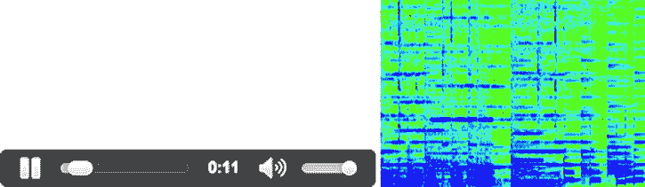
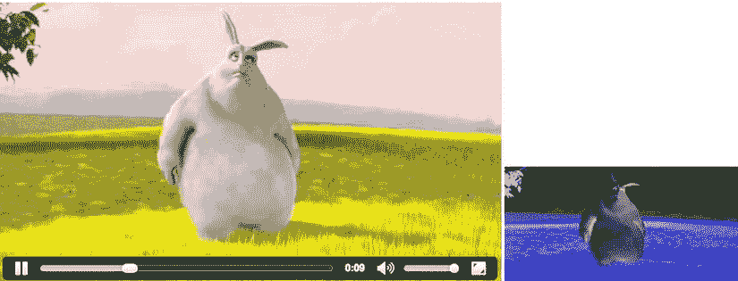

# 3. 音频与视频基础

如果我们谈论交互性，我们就会想要使用音频和视频。多年来，我们不得不使用诸如 Flash 或 Silverlight 之类的“权宜之计”来将这些关键元素添加到网络，但现在，音频和视频直接内置于 HTML 中。在本章中，我们将深入探讨这两个元素（即 `<audio>` 和 `<video>`）的来龙去脉，以便你能毫无顾虑地使用它们。我还会向你介绍一些新技术，例如操作，我们也会涉及优化技术。在后面的章节中，我们将探索音频创作的深度，并在这个过程中创建一个媒体播放器。本章为你提供了实现这些目标所需的基础。

## 容器与编解码器

在涉及使用音频和视频时，我们将处理各种浏览器实现和支持。每种格式通常都有一系列优点和缺点，有些经过了很好的优化，有些则拥有自由许可。因此，在我们深入探讨如何实现的具体细节之前，最好先了解一些关于容器和编解码器、它们的局限性以及它们是否获得许可的知识。

### 容器

容器是一种文件格式，用作一系列编解码器的封装格式。你可以把容器想象成包含已用编解码器编码的音频，以及关于使用哪种编解码器的数据的文件。许多编解码器都受到多种容器的支持。

#### WebM

`WebM` 是一个由谷歌赞助的音频-视频容器。它免版税，包含基于 Matroska 容器的 VP8 视频流和 Vorbis 音频流。它根据 BSD 许可证发布，所有用户都被授予全球性的、非独占的、免费的、免版税的专利许可。

#### MP4

运动图像专家组（MPEG）已经标准化了许多容器和编解码器。他们最著名的可能是 MP3 音频编解码器，但 MP4 是最常用的视频格式之一。MP4 通常使用 H.264 作为视频编解码器，使用 AAC 或 MP3 作为音频编解码器。MP4 格式受专利限制，这导致了浏览器之间关于非免版税格式在网络上是否适用的讨论。

#### QuickTime 文件格式

Safari 使用 QuickTime 来播放浏览器本身不支持的格式，例如 QuickTime 文件格式（称为 Mov）。`MP4` 基于 Mov 规范，因此支持与 `MP4` 相同的编解码器，但支持度较低，因为 `MP4` 是标准化的，而 Mov 不是。

#### AVI

微软于 1992 年发布了音频视频交错格式（AVI）；它是仍被广泛使用的最古老的容器格式之一（与 Mov 并列）。由于 AVI 非常古老，与更新的容器（如 `MP4` 和 `Ogg`）相比，它有很多缺点。一些缺点包括缺乏元数据和压缩。由于这些缺点，AVI 在网络上不被原生使用，但可以与 Flash 视频播放器一起使用。

#### ASF

高级系统格式（ASF）是由微软专门为流媒体创建的一种容器。ASF 通常包含 Windows Media Video (WMV) 或 Windows Media Audio (WMA)。该规范是免费提供的（就像免费啤酒一样），但受专利限制。

#### Ogg

`Ogg` 是一种开源容器格式，由 Xiph.Org 基金会维护，并根据 BSD 许可证发布。由于其开放性，该格式受到高度赞扬，但在撰写本文时，Internet Explorer、Safari 和许多移动浏览器都不支持它。话虽如此，通常建议将 `Ogg` 与其他格式一起使用。`Ogg` 支持许多编解码器，但通常音频使用 Vorbis，视频使用 Theora。

#### Matroska

另一种完全开放的容器格式是 Matroska。它是一种通用格式，旨在（在可能的情况下）支持所有编解码器。WebM 是 Matroska 的一个子集。这使得媒体播放器（包括浏览器）可以声明它们支持 WebM，而无需完全支持 Matroska 支持的每种编解码器。

#### WAV

波形音频文件格式（以其文件扩展名 WAV 而闻名）是一种由微软和 IBM 开发的容器。它无专利且无损。通常，WAV 用作未压缩格式，但也可以与无损脉冲编码调制（LPCM）一起用于压缩。


### 编解码器

编解码器用于对数据进行编码，即处理原始数据流（信号）。大多数编解码器会尝试压缩原始数据，有些是有损的（意味着压缩会损失质量），另一些则是无损的。容器格式中存储的正是由编解码器生成的编码数据。

#### MP3

这可能是最广为人知的音频格式，因此可能是一个很好的入门编解码器。`MP3` 被称为有损格式，与无损格式相对，这意味着在原始录音被压缩时，声音会损失质量。然而，它经过了良好的优化，并且由于带宽占用低，可以成为网络音频的不错选择。`MP3` 最大的缺点是它受专利保护，这意味着许多人（尤其是过去曾拒绝支持该格式直至 Firefox 21 的 Mozilla）反对使用该格式，转而选择使用免费开放的格式。

#### Vorbis

`Vorbis` 是最受欢迎的开源、无专利音频编解码器，受到许多浏览器的支持。它通常被称为 `Ogg Vorbis`，尽管 `Ogg` 是一个容器，`Vorbis` 常与它一起使用，而非该格式本身的名称。`Vorbis` 有许多其他容器，但通常使用的容器是 `Ogg`、`QuickTime MOV` 或 `WebM`。

#### AAC

`高级音频编码` (`AAC`) 特别有趣，因为它常与 `H.264` 配合提供音频，并且是 `3GP`（常用于移动设备）容器中使用的主要音频编解码器（`AMR` 除外）。`AAC` 受到大多数浏览器的支持（除 OSX 上的 Opera 和 Firefox，以及某些 Linux 发行版外，原因在于许可协议）。

#### AC-3

`AC-3` 是由杜比实验室创建的音频编解码器，通常被称为 `杜比数字`。它很少用于网络，但广泛应用于高清电影。

#### H.264

`H.264` 是由视频编码专家组 (`VCEG`) 和动态图像专家组开发的视频编解码器。该编解码器用于蓝光光盘，在网络上也十分流行，因为浏览器支持度良好（由于许可问题，除 Opera 外的所有浏览器在可能的情况下都支持 `H.264`）。思科发布了一个开源的 `H.264` 实现，试图解决许可问题。

#### VP8

这是 `WebM` 中用于视频的编解码器。它归谷歌所有，但谷歌已做出不可撤销的专利承诺，允许任何人实现 `VP8`。

#### Theora

基于 `VP3`（`VP8` 的前身），`Theora` 是一种开源的、有损视频编解码器，由 Xiph.Org 基金会维护。它常与 `Ogg` 容器格式一起用于网络。

### 编码视频

现在，你可能想知道如何编码视频。遗憾的是，浏览器无法自动完成此操作，因此你需要使用转换器。市面上有很多转换器，但最流行的似乎是 `Handbrake` 和 `Miro`。我个人使用 `Miro`，因为它设计精良、简单易用且开源。`Miro` 可在 [`www.mirovideoconverter.com`](http://www.mirovideoconverter.com/) 获取。

### 浏览器兼容性

在撰写本文时，Firefox 尚未添加对 `MP3` 的支持，而 Internet Explorer 和 Safari 都不支持 `OGG` 或 `WebM`。移动端的支持则更加缺乏。

与 `<audio>` 类似，我们可以使用相当多的编解码器和容器。Chrome 和 Firefox 都致力于 `WebM`，尽管 Internet Explorer 和 Safari 不支持它。一些旧版本的浏览器会支持某些格式，但不支持 `WebM`，因此同时使用 `OGG` 和 `MP4` 是值得的。之前我提到过，`Vorbis` 常被称为 `OGG Vorbis`，对于视频，我们使用 `OGG` 容器，其中音频采用 `Vorbis`，视频采用 `Theora`。由于前面描述的专利原因，`OGG` 和 `WebM` 都优先于 `MP4`。要了解浏览器支持的最新状态，请查看 [`www.docs.webplatform.org/wiki/html/elements/audio`](http://www.docs.webplatform.org/wiki/html/elements/audio)。

## 使用 `<audio>` 和 `<video>` 元素

现在我们已经了解了容器、编解码器以及可能遇到的文件，我们可以看看如何将它们应用到我们的网页中。

注意

本章使用的音频来自 [`www.incompetech.com/music/royalty-free`](http://www.incompetech.com/music/royalty-free)，视频来自 [`www.bigbuckbunny.com`](http://www.bigbuckbunny.com/)。

### `<audio>`

让我们从音频元素开始，这是我们在现代浏览器中用来听声音的。这个声音可以是任何东西，从播客到音乐。在开始之前，我需要强调一点——请谨慎使用。不要在用户加载网站时突然播放声音。当 Flash 能做到这一点时，我们就讨厌它，现在依然如此。在最基本的形式中，`audio` 元素可以像 `img` 元素一样接受一个 `src` 属性：

`<audio src="audio.mp3" >`

只需将此代码添加到你的 HTML 文档中即可。这样做的缺点是我们无法提供一个文件列表，因为我们需要根据浏览器兼容性提供不同的音频编解码器。为了解决这个问题，我们使用嵌套在 `<audio>` 中的 `<source>` 元素。这个元素允许你提供不同的文件，并让浏览器自动选择最佳方案。它像往常一样接受 `src` 属性，以及 `type` 属性。在 `type` 属性中，我们给出 MIME 类型（可能如你所料），这需要包括容器作为主类型，并在分号后包含编解码器。如果你认为有必要针对旧版浏览器，你也可以在 `source` 元素旁边提供 Flash 备选方案。以下是一个例子，音频文件可以在上面链接的 Incompetech 网站上找到，也可以在本书的下载文件中找到：

```
<audio>
   <source src='audio.ogg' type='audio/ogg; codecs=vorbis'>
   <source src='audio.mp3' type='audio/mpeg'>
</audio>
```

由于浏览器有一个用来选择源的算法，因此源的顺序和数量都不是问题。目前大多数人只使用 `Vorbis` 和 `MP3`，但随着时间的推移，这种情况可能会改变。`WebM` 容器格式很可能会比 `Ogg` 容器格式更受欢迎，因为许多浏览器供应商正大力将其推行为专为网络设计的开放视频格式。同样值得注意的是，`WebM` 正在与一种名为 `WebP` 的图像格式一同开发。

### `<video>`

视频元素 (`<video>`) 的实现方式与 `<audio>` 类似。与 `<audio>` 一样，你可以只指定一个视频文件，也可以使用 `<source>` 指定多个文件：

```
<video>
    <source src='../video.ogv' type='video/ogg;'>
    <source src='../video.mp4' type='video/mp4'>
    <source src='../video.webm' type='video/webm'>
</video>
```

同样，与音频类似，浏览器会根据浏览器和操作系统的能力，通过算法选择源。拥有多个源且顺序任意都是没有问题的。示例中的三种格式：`Ogg`、`MP4` 和 `WebM`，是撰写本文时支持度最好的。

## 属性和属性特性

那么，现在我们知道了如何在 HTML 文档中实现音频和视频，让我们来看看这些元素可用的属性和属性特性。`audio` 和 `video` 元素之间有很多重叠之处，大多数属性适用于两者，因此我将一起解释，而不是分章节说明。


### 控件

好了，现在我们的页面上有了音频——但我们可以做得更多。目前浏览器可以选择要播放的文件，但我们无法告诉它开始播放。当我们想用 JavaScript 来控制音频或视频时，它当前的状态很有用，但理想情况下，它应该有一个媒体播放器。大多数浏览器都有内置播放器，只需在元素中添加 `controls` 即可触发。就像这样：

```
<audio controls>
  <source src='audio.ogg' type='audio/ogg; codecs=vorbis'>
  <source src='audio.mp3' type='audio/mpeg'>
</audio>
```

同样，对于视频，我们会使用以下代码：

```
<video controls>
  <source src='../video.ogv' type='video/ogg;'>
  <source src='../video.mp4' type='video/mp4'>
  <source src='../video.webm' type='video/webm'>
</video>
```

如果你在浏览器中运行这段代码，现在应该会看到一个基本的音频（或视频）播放器。如果你想提供自定义播放器以配合网站的样式，那么最好的方法可能是自己创建 DOM 元素并按需设置样式，然后将其挂载到一个未启用 `controls` 的 `<audio>`/`<video>` 元素上。

**注意**

有些浏览器使用 Shadow DOM，因此理论上你可以用 CSS 设置默认控件的样式，但在撰写本文时，每个浏览器的实现都大相径庭，而且 Shadow DOM 仍处于初期阶段。我建议查看 [www.caniuse.com](http://www.caniuse.com/) 了解当前各浏览器的实现状态。

### 自动播放

有时你可能有正当理由希望音频或视频自动播放。虽然这种做法通常不讨喜，但实现起来很简单。与 `controls` 类似，你只需在元素中添加 `autoplay` 属性即可。你也可以使用 JavaScript 通过 `element.autoplay = true` 来设置，就像这样：

```
<audio autoplay>
  <source src='audio.ogg' type='audio/ogg; codecs=vorbis'>
  <source src='audio.mp3' type='audio/mpeg'>
</audio>
```

视频的工作方式也大致相同：

```
<video autoplay>
  <source src='../video.ogv' type='video/ogg;'>
  <source src='../video.mp4' type='video/mp4'>
  <source src='../video.webm' type='video/webm'>
</video>
```

### 预加载

与前两个属性相比，`preload` 的作用不太明显，它用于在页面加载时尝试加载整个音频或视频文件，或者仅加载元数据（如时长）；这取决于属性的值。如果未设置 `preload`，则由浏览器决定（默认值通常是 `metadata`）。话虽如此，即使设置了该属性，它也只是个提示，浏览器会根据不同浏览器之间变化的多种条件，将其作为首选考虑。

`preload` 有三个可接受的值。分别是：

- `auto`：如果条件合适，则让浏览器优先处理。例如，如果连接状况良好，它可能会尝试下载整个文件。当 `preload` 设置为 `auto` 时，`readyState` 变量会从 0（未下载任何内容）递增到 4（可无中断播放），一个完全预加载的文件的 `readyState` 为 4。
- `metadata`：这是最常用的值，因为它是一种“折中方案”。它基本上让浏览器知道，了解文件信息（例如时长）会很好，但在用户点击播放之前，不需要整个文件。当 `preload` 设置为 `metadata` 时，一旦元数据下载完成，`readyState` 将被设置为 1（拥有元数据），并且可能根据获取的积极程度变为 2 或 3。
- `none`：通过告诉浏览器在用户点击播放之前不需要任何信息，来减轻服务器压力。当然，正如我之前所说，这只是一个提示，因此浏览器可能仍会决定提供元数据或整个文件。

该属性的工作方式与其他示例类似，对于音频：

```
<audio preload='metadata'>
  <source src='audio.ogg' type='audio/ogg; codecs=vorbis'>
  <source src='audio.mp3' type='audio/mpeg'>
</audio>
```

对于视频：

```
<video preload='metadata'>
  <source src='../video.ogv' type='video/ogg;'>
  <source src='../video.mp4' type='video/mp4'>
  <source src='../video.webm' type='video/webm'>
</video>
```

**注意**

该属性在大多数浏览器中支持良好，但基于 Presto 的 Opera 浏览器除外，它们使用的是旧的名称 `autobuffer`。

### 循环

这是一个强制音频或视频文件在播放完毕后从头开始循环的属性。它可以作为属性（直接在 HTML 中设置）或属性（通过 JavaScript 设置）来使用。将 `loop` 作为属性使用，你可以检查当前状态（是 `true` 还是 `false`）。

```
<audio loop>
  <source src='audio.ogg' type='audio/ogg; codecs=vorbis'>
  <source src='audio.mp3' type='audio/mpeg'>
</audio>
```

视频也可以这样做：

```
<video loop>
  <source src='../video.ogv' type='video/ogg;'>
  <source src='../video.mp4' type='video/mp4'>
  <source src='../video.webm' type='video/webm'>
</video>
```

### 已播放部分

你通常需要知道媒体的哪些部分已被播放，尤其是在创建媒体播放器或某种广告时。`Played` 是一个属性，可以与 JavaScript 一起使用来获取一个 `TimeRanges` 对象，该对象包含已播放的每个片段的开始和结束时间。例如，如果我听了开头大约 20 秒，那么调用 `ele.played.start(0)` 将返回 0，因为这是开头，而 `ele.played.end(0)` 将返回 20；参数是索引，因此 0 表示第一个收听的片段，1 表示第二个。你可以使用 `ele.played.length` 来查找已收听的独立片段的数量。

```
var ele = document.querySelector('audio');

function log() {
  for (var i = 0; i < ele.played.length; i++)
  {
      console.log("片段 " + i);
      console.log("  开始: " + ele.played.start(i));
      console.log("  结束: " + ele.played.end(i));
  }
}
```

要将其改为适用于视频，你只需选择视频而不是音频：

```
var ele = document.querySelector('video');
```

在这个例子中，如果你从控制台运行 `log()`，那么你将看到你已播放的音频或视频的每个片段，以及以秒为单位的开始和结束时间。除了纯粹的演示或调试目的之外，`played` 属性在媒体播放器中很有用，它可以让用户看到他们已经听过的部分。

### 缓冲

与 `played` 类似，我们可以获取一个代表文件中已缓冲部分的 `TimeRanges` 对象。在制作媒体播放器时（我们将在后续章节中实现），了解文件的缓冲部分很有帮助，我们可以不使用 `controls` 属性，而是创建显示音频文件缓冲区域的自定义控件。与 `played` 不同，`buffered` 可能有多个索引，例如，如果用户移动了播放头。

```
var ele = document.querySelector('audio');
// 或： var ele = document.querySelector('video');

function log() {
    for (var i = 0; i < ele.buffered.length; i++)
    {
      console.log("片段 " + i);
      console.log("  开始: " + ele.buffered.start(i));
      console.log("  结束: " + ele.buffered.end(i));
    }
}
```


### 时长

要获取音频或视频文件的长度，我们可以使用 `duration` 属性，它以秒为单位返回持续时间。如果音频或视频元素正在流式传输文件，那么除非流式传输停止，否则持续时间将被设置为无穷大（具体来说，根据规范，是正无穷大）。在这种情况下，持续时间将返回已流式传输内容的长度（以秒为单位）。如果持续时间发生变化（例如在流式传输的情况下），则会触发 `durationchange` 事件，您可以使用事件监听器来触发样式或 DOM 更改，以让用户知道文件已停止流式传输。

```
var ele = document.querySelector('audio');

// 或者：var ele = document.querySelector('video');

console.log(ele.duration);
```

### 音量

`volume` 属性可用于获取和设置音量；它通过 0.0 到 1.0 之间的数字进行控制。默认情况下，初始音量为 1.0，这是浏览器允许的最大值（不一定是扬声器的最大值）。音量只是一个设置/获取属性，使得访问和修改音量变得容易：

```
var ele = document.querySelector('audio');

// 或者：var ele = document.querySelector('video');

var vol = 0.5; // 您想要设置的目标音量

console.log(ele.volume);

ele.volume = vol;

console.log(ele.volume);
```

### 播放速率

`playbackrate` 是音频/视频播放的速度。原始速度为 1.0，该速率是初始速度的倍数。例如，如果您将 `playbackrate` 更改为 0.5，那么音频或视频将以慢动作播放。另一方面，如果您将速率更改为 1.5，音频或视频将会快进。

```
var ele = document.querySelector('audio');

// 或者：var ele = document.querySelector('video');

function slowMotion()  {
    ele.playbackrate = 0.5;
}

function fastForward()  {
    ele.playbackrate = 1.5;
}
```

### 网络状态

此属性用于确定网络活动。它返回 0 到 3 之间的 4 个数字，对应以下状态：

- `0. NETWORK_EMPTY` – 表示元素尚未初始化。
- `1. NETWORK_IDLE` – 表示已选择正确的音频/视频文件，但当前未使用网络。
- `2. NETWORK_LOADING` – 正在下载音频/视频。
- `3. NETWORK_NO_SOURCE` – 要么给定的文件都不兼容，要么没有提供文件。

与许多前面的属性不同，`networkState` 是一个只读属性。此代码展示了如何使用它：

```
var ele = document.querySelector('audio');

// 或者：var ele = document.querySelector('video');

function logNetworkState()  {
    console.log(ele.networkState);
}
```

## Web 音频 API

接下来让我们深入音频分析的领域，我们将在后面的章节中利用它来创建音频的可视化效果。为此，我们将使用 Web 音频 API。

该 API 基于节点的概念，每个节点接收当前的音频（可以是原始版本，也可以是已经经过任意数量节点处理后的音频），然后对其进行处理。我说“处理”是为了故意模糊其定义，节点可以按照您希望的任何方式进行编码。一些默认用途包括：声道分离与合并、振荡和增益控制。我特别喜欢的一个类比是 Stuart Memo 在他的《Web 音频 API 简介》文章中提出的，他解释了 API 节点的工作原理就像给吉他添加失真效果器和放大器一样，您可以移除任何一个节点或添加新节点，而无需做任何其他事情，只需改变连接线即可。目前，我们只打算使用 `AnalyserNode` 来精确查看音频内部的情况。然后，我们将开始使用其他节点来理解发生了什么变化。

### 分析音频

首先，我们需要创建一个音频上下文和一个分析器，然后将它们连接起来。上下文是一个接口，可以访问音频的所有属性，以及用于创建和连接节点的方法。

```
var ele = document.querySelector('audio');

var ctx = new AudioContext();

var analyser = ctx.createAnalyser();

var source = ctx.createMediaElementSource(ele);

source.connect(analyser);

analyser.connect(ctx.destination);
```

您会注意到我在一个“源”变量中使用了 `createMediaElementSource`。这只是将来自 `<audio>` 元素的音频重新路由到 API 中。这意味着您现在通过该元素播放的音频将受 API 上下文图（节点相互连接的方式）控制并被用作其中的一个节点。这也意味着，是 Web 音频 API 而不是元素本身在控制音量和其它属性（除了控制音乐的播放时间）。因此，如果您仍然想使用元素控件，则需要使用一个 `GainNode` 将其连接起来，如下所示：

```
var ele = document.querySelector('audio');

var ctx = new AudioContext();

var analyser = ctx.createAnalyser();

var source = ctx.createMediaElementSource(ele);

var volumeControl = ctx.createGainNode();

source.connect(volumeControl);

volumeControl.connect(analyser);

analyser.connect(ctx.destination);

ele.addEventListener('onvolumechange', volumeControl, false);

function volumeChange()  {
    volumeControl.gain.value = ele.volume;
}

function log()  {
    freqData = new Uint8Array(analyser.frequencyBinCount);
    analyser.getByteFrequencyData(freqData);
    console.log(freqData);
}
```

注意

在编写本文时，`onvolumechange` 事件不能作为动态事件监听器工作，因此您需要在 `<audio>` 元素上包含 `onvolumechange="volumeChange();"`。

现在回到分析器。这个节点让我们能够访问快速傅里叶变换（FFT）的数据，这是一种用于多种用途（包括音频分析）的复杂算法。有两种可用的数据类型：频域数据和时域数据。可以使用 `getFloatFrequencyData` 或 `getByteFrequencyData` 获取频率数据（取决于您想要的数据类型，我们将使用第二种方法将数据存储在字节数组中），这两种方法都返回一个归一化频率的数组。之所以有两种方法，是因为浮点数组的分辨率（即精度）远高于字节数组。由于归一化的方式，我们需要遍历数组的每个索引，并将其乘以采样率除以 FFT 的大小。要查看结果，我们将其记录到控制台：

```
function log()  {
    freqData = new Uint8Array(analyser.frequencyBinCount);
    analyser.getByteFrequencyData(freqData);
    for (var i = 0; i < freqData.length; i++) {
        console.log(freqData[i] * ctx.sampleRate / analyser.fftSize);
    }
}
```

您现在应该会看到各种数字，这些数字取决于您正在播放的音频。每个数字代表一个频率（440Hz 是最容易记住的频率，这是中央 C 上方的 A 音），我们将在后面的章节中更详细地介绍（届时我会介绍一些音乐理论）。现在，只需查看这些数据并思考您可以用它做些什么（甚至可以尝试实现它们）。当然，一串看似随机的数字对任何人都没有意义，可视化是理解任何类型数据的关键，因此我们现在将使用前一章学到的知识来创建可视化音乐播放的二维图形。


### 频率可视化

我们可以用整本书来制作看起来很棒但不太实用的有趣游戏或随机动画；相反，让我们来看看将 Web Audio API 和 canvas 结合使用时，我们能制作出什么样的工具。这个示例将展示频率可视化，下一个示例将是声谱图。首先，我们使用 `getByteFrequencyData` 的原始输出来创建一个简单的条形图风格的可视化效果，展示归一化后的频率（由于数值上限为 255，这使其易于绘图）。为此，我们需要设置变量来引用音频和 canvas 元素，以及它们各自的上下文和一个分析器节点。我还建议像之前一样设置音量控制，这样你就能看到可视化效果如何随音量变化（同时也方便你调低音量！），我觉得这相当有趣。对于节点，我们需要将音频源连接到音量节点，音量节点再连接到分析器，最后输出到扬声器（目标设备）。

```
var audioEle = document.querySelector('audio');
var audioCtx = new AudioContext();
var canvasEle = document.querySelector('canvas');
var canvasCtx = canvasEle.getContext('2d');
var analyser = audioCtx.createAnalyser();
var source = audioCtx.createMediaElementSource(audioEle);
var volumeControl = audioCtx.createGainNode();
source.connect(volumeControl);
volumeControl.connect(analyser);
analyser.connect(audioCtx.destination);
```

现在，我们需要在之前使用的 `volumeChange` 函数旁边，添加 `logic` 和 `draw` 两个函数。在 `logic` 函数中，我们只需获取频率数据并将其传递给 `draw` 函数，由它绘制到 canvas 上。我认为使用细线进行可视化效果不错，但你可以通过修改 x 位置（我选择了 `i` 表示当前频率，这意味着它们彼此相邻）和宽度（我保持为 1 以保持细线）来改变。当然，你需要记得调用 `logic`，为此我使用了 `setInterval`。

```
function volumeChange()  {
  volumeControl.gain.value = audioEle.volume;
}

function logic()  {
  var freqData = new Uint8Array(analyser.frequencyBinCount);
  analyser.getByteFrequencyData(freqData);

  requestAnimationFrame(function() {
    draw(freqData);
  });
}

function draw(freqData)  {
  canvasCtx.clearRect(0, 0, canvasEle.width, canvasEle.height);
  canvasCtx.fillStyle = "#ff0000";
  for (var i = 0; i < freqData.length; i++) {
    canvasCtx.fillRect(i, canvasEle.height, 1, canvasEle.height - freqData[i]);
  }
}

setInterval(logic, 1000/60);
```

图 3-1 展示了音频播放时频率可视化的结果。


图 3-1.

这是频率可视化效果

> **注意**  
> 你可能会看到一面红色；这很可能是由于音量被静音了。调高音量以获得正确的可视化效果。

这些内容应该都很好理解，因为我们已经讲解过每一个概念，比如音频处理节点和 canvas 绘制。你可以在清单 3-1 以及本书附带的文件中找到这段代码。

### 清单 3-1. 频率可视化代码

```
<!DOCTYPE html>
<html>
<head>
<title>Chapter 3 – Frequency Visualisation</title>
</head>
<body>
<audio controls onvolumechange="volumeChange();">
<source src='../audio.ogg' type='audio/ogg; codecs=vorbis'>
<source src='../audio.mp3' type='audio/mpeg'>
</audio>
<canvas>Canvas is not supported by your browser</canvas>
<script src="script.js"></script>
</body>
</html>

// Pollyfill for AudioContext
(function() {
  window.AudioContext = window.AudioContext || window.webkitAudioContext;
  var requestAnimationFrame = window.requestAnimationFrame || window.mozRequestAnimationFrame ||
    window.webkitRequestAnimationFrame || window.msRequestAnimationFrame;
  window.requestAnimationFrame = requestAnimationFrame;
})();

var audioEle = document.querySelector('audio');
var audioCtx = new AudioContext();
var canvasEle = document.querySelector('canvas');
var canvasCtx = canvasEle.getContext('2d');
var analyser = audioCtx.createAnalyser();
var source = audioCtx.createMediaElementSource(audioEle);
var volumeControl = audioCtx.createGainNode();

source.connect(volumeControl);
volumeControl.connect(analyser);
analyser.connect(audioCtx.destination);

//audioEle.addEventListener('onvolumechange', volumeControl, false);

function volumeChange()  {
  volumeControl.gain.value = audioEle.volume;
}

function logic()  {
  var freqData = new Uint8Array(analyser.frequencyBinCount);
  analyser.getByteFrequencyData(freqData);

  requestAnimationFrame(function() {
    draw(freqData);
  });
}

function draw(freqData)  {
  canvasCtx.clearRect(0, 0, canvasEle.width, canvasEle.height);
  canvasCtx.fillStyle = "#ff0000";
  for (var i = 0; i < freqData.length; i++) {
    canvasCtx.fillRect(i, canvasEle.height, 1, canvasEle.height - freqData[i]);
  }
}

setInterval(logic, 1000/60);
```


### 声谱图

通过之前的可视化方式，你可以轻松看到音频的频率及其变化方式，但这仅限于在任意给定时刻。现在我们要使用声谱图，它能展示音频随时间的变化过程，其中 x 轴代表时间，y 轴代表音频部分，颜色代表频率。这种技术用途广泛，小到呈现优美图案，大到实现语音识别。由于声谱图与之前的可视化方式类似，只是多了一个时间维度，我们不妨基于现有代码进行开发。这里我要介绍一个新事件：`onaudioprocess`。该事件属于`JavaScriptNode`，使用下面这行代码创建：

```
var logger = audioCtx.createJavaScriptNode(analyser.frequencyBinCount, 1, 1);
```

`onaudioprocess`事件与音频播放速度同步运行，使其成为音频逻辑中`setInterval`的完美替代方案（类似我们使用`requestAnimationFrame`以更精确、动态的速度进行动画渲染）。我们还需要创建一个名为`x`的变量来保存当前的时间位置，以便知道需要绘制多少次才能到达当前位置。

```
var logger = audioCtx.createJavaScriptNode(analyser.frequencyBinCount, 1, 1);

logger.onaudioprocess = function () {
  logic();
}

var x = 0;

function logic() {
  if(!audioEle.paused) {
    x += 1;
    var freqData = new Uint8Array(analyser.frequencyBinCount);
    analyser.getByteFrequencyData(freqData);
    requestAnimationFrame(function() {
      draw(freqData);
    });
  }
}
```

以下是相关代码，你可以看到它与我们之前的代码非常相似，只是使用了`onaudioprocess`并检查元素是否暂停。这两个改进点都可以应用于之前的代码；我只是不想一次性把所有内容都塞进去。现在我们只需要绘制可视化图形！但从何开始呢？简单——我们首先明确要做什么。在这个案例中，我们希望绘制单个列，每个像素代表标准化后的频率（以颜色表示）。为此，我们将使用 HSL 而非 RGB，因为 HSL 允许我们将色相设置为 0 到 255 之间的数值（这正是`getByteFrequencyData`返回的值），而无需指定每种颜色。每在画布上绘制完一列，我就会清空并从起点继续绘制，如同翻新一页。你可能想通过滑动而不是清空的方式来改进此功能。

```
function draw(freqData) {
  if (x > canvasEle.width) {
    canvasCtx.clearRect(0, 0, canvasEle.width, canvasEle.height);
    x = 0;
  }
  for (var i = 0; i < freqData.length; i++) {
    canvasCtx.fillStyle = "hsl(" + freqData[i] + ",100%, 50%)";
    canvasCtx.fillRect(x, canvasEle.height - i, 1, 1);
  }
}
```

现在你应该已经理解如何利用频率数据生成各种可视化效果了，而且这些效果并非仅仅是装饰性的。图 3-2 展示了播放一些音频后声谱图的外观。完整代码一如既往地可以在本书的下载资料中找到。



**图 3-2.** 声谱图展示

> **注意** 与之前的示例一样，你可能会看到一片红色；这很可能是因为音量被静音了。请调高音量以获取正确的可视化效果。

清单 3-2 展示了声谱图所需的完整代码，同样可以在本书的下载资料中找到。

**清单 3-2. 声谱图代码**

```
<!DOCTYPE html>
<html>
<head>
<title>Chapter 3 - Spectrogram</title>
</head>
<body>
<audio controls onvolumechange="volumeChange();">
<source src='../audio.ogg' type='audio/ogg; codecs=vorbis'>
<source src='../audio.mp3' type='audio/mpeg'>
</audio>
<canvas>Canvas is not supported by your browser</canvas>
<script src="script.js"></script>
</body>
</html>

// Pollyfill for AudioContext
(function() {
  window.AudioContext = window.AudioContext || window.webkitAudioContext || window.mozAudioContext;
  var requestAnimationFrame = window.requestAnimationFrame || window.mozRequestAnimationFrame ||
  window.webkitRequestAnimationFrame || window.msRequestAnimationFrame;
  window.requestAnimationFrame = requestAnimationFrame;
})();

var audioEle = document.querySelector('audio');
var audioCtx = new AudioContext();
var canvasEle = document.querySelector('canvas');
var canvasCtx = canvasEle.getContext('2d');
var analyser = audioCtx.createAnalyser();
analyser.smoothingTimeConstant = 0;
var logger = audioCtx.createJavaScriptNode(analyser.frequencyBinCount, 1, 1);
var source = audioCtx.createMediaElementSource(audioEle);
var volumeControl = audioCtx.createGainNode();
source.connect(volumeControl);
volumeControl.connect(analyser);
analyser.connect(audioCtx.destination);
logger.connect(audioCtx.destination);
//audioEle.addEventListener('onvolumechange', volumeControl, false);
logger.onaudioprocess = function () {
  logic();
}
function volumeChange() {
  volumeControl.gain.value = audioEle.volume;
}
var x = 0;
function logic() {
  if(!audioEle.paused) {
    x += 1;
    var freqData = new Uint8Array(analyser.frequencyBinCount);
    analyser.getByteFrequencyData(freqData);
    requestAnimationFrame(function() {
      draw(freqData);
    });
  }
}
function draw(freqData) {
  if (x > canvasEle.width) {
    canvasCtx.clearRect(0, 0, canvasEle.width, canvasEle.height);
    x = 0;
  }
  for (var i = 0; i < freqData.length; i++) {
    canvasCtx.fillStyle = "hsl(" + freqData[i] + ",100%, 50%)";
    canvasCtx.fillRect(x, canvasEle.height - i, 1, 1);
  }
}
```

### Web Audio API 节点

我们已经使用过几个 Web Audio API 节点，例如`MediaElementSource`、`GainNode`和`Analyser`。以下是其他可用节点和方法的概述。

| 节点名称 | 描述 |
| --- | --- |
| `AnalyserNode` | 获取音频当前状态的数据，例如频率。 |
| `AudioBufferSourceNode` | 缓冲短音频资源，用作临时但易于访问的存储。 |
| `BiquadFilterNode` | 处理基本滤波器（即低级滤波器），例如低通/高通滤波器，用于截断低于或高于给定值的频率。 |
| `ChannelSplitterNode` | 分离每个声道，以便在处理图中单独使用它们进行更精细的控制。 |
| `ChannelMergerNode` | 使用此合并节点合并已分离（或需要合并）的任何声道。 |
| `ConvolverNode` | 应用线性卷积效果，通过模拟声学空间或高质量效果来操控声音。 |
| `DelayNode` | 将输出（到处理图中的下一个节点）延迟特定时间量。 |
| `GainNode` | 通过将音频乘以增益属性来改变音频音量。 |
| `MediaElementAudioSourceNode` | 允许你将媒体元素连接到 Web Audio API。 |
| `PannerNode` | 在三维空间中定位声音。这通常大量用于游戏中，但在其他场景也可能有用。 |
| `WaveShaperNode` | 用于非线性失真。 |


## 处理视频

遗憾的是，目前并没有类似 Web Audio API 那样专门用于视频的 API，因此你需要自行处理视频。当然，以分析音频的方式分析视频，远比使用 Web Audio API 要困难得多。不过，创建一个基础滤镜并非难事。为了避免陷入复杂的数学运算，我将介绍一个简单的反色滤镜。本章不会涉及复杂滤镜，因为第 9 章和第 10 章将在此基础上，利用实时视频中的物体检测作为输入，来控制我们将在第 5 章创建的键盘。

反色滤镜的原理是：遍历每一个像素，用 255 减去该颜色的当前值，从而将其反转。处理后的结果会被绘制到画布上并显示出来。在这个示例中，我会同时显示画布和视频元素，但你也可以选择完全隐藏视频元素。

> **注意：** 由于跨域资源共享策略的限制，你可能需要在服务器（或 `localhost`）上运行此示例。

我们照常先设置元素和上下文的变量。完成后，即可开始编写处理视频源的函数。首先，需要将视频的当前帧绘制到画布上。

```javascript
var canvasEle = document.querySelector('canvas');
var canvasCtx = canvasEle.getContext('2d');
var videoEle = document.querySelector('video');
var w = videoEle.clientWidth;
var h = videoEle.clientHeight;
canvasEle.width = w;
canvasEle.height = h;
```

然后，我们需要获取图像数据并遍历每个像素（记住，每个像素由 RGBA 四个独立的值组成）。如前所述，我们用 255 减去当前值来进行反色处理。完成后，将图像数据放回，并使用 `requestAnimationFrame` 再次调用绘制函数。

```javascript
drawInvertedFrame();

function drawInvertedFrame() {
    canvasCtx.drawImage(videoEle, 0, 0, w, h);
    var manip = canvasCtx.getImageData(0, 0, w, h);
    var data = manip.data;
    // 遍历每个像素，进行反色处理
    for (var i = 0; i < data.length; i += 4) {
        var r = data[i],
            g = data[i+1],
            b = data[i+2];
        data[i] = 255 - r;
        data[i+1] = 255 - g;
        data[i+2] = 255 - b;
    }
    canvasCtx.putImageData(manip, 0, 0);
    requestAnimationFrame(drawInvertedFrame);
}
```

下图（图 3-3）展示了反色视频与原始视频的实时对比效果。



**图 3-3.** 该图展示了视频上应用反色滤镜的效果，并与原始视频进行了对比

与往常一样，完整的代码清单可在本书配套的下载文件中找到。

## 本章小结

本章让你探索了网络中的音频和视频。你现在应该对各种可用的编解码器及其优缺点有了扎实的理解。我也尝试深入探讨了 Web Audio API。我希望通过将它与前一章的可视化内容（而不是给你一堆数字）相结合，能够帮助你理解它，并发现它更有用。

我鼓励你多尝试 Web Audio API 以及视频处理——你可以创造出许多非常有趣的效果，这些效果在一般的网页设计和开发中可能会很有用（尤其是作为视觉辅助和精致的细节）。除了简单的网站，还有许多空间可以开发更像网络应用的东西，比如我们即将创建的媒体播放器。

