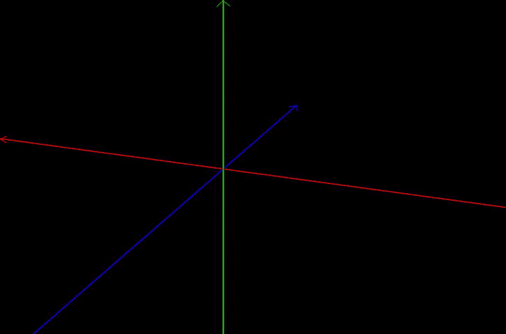
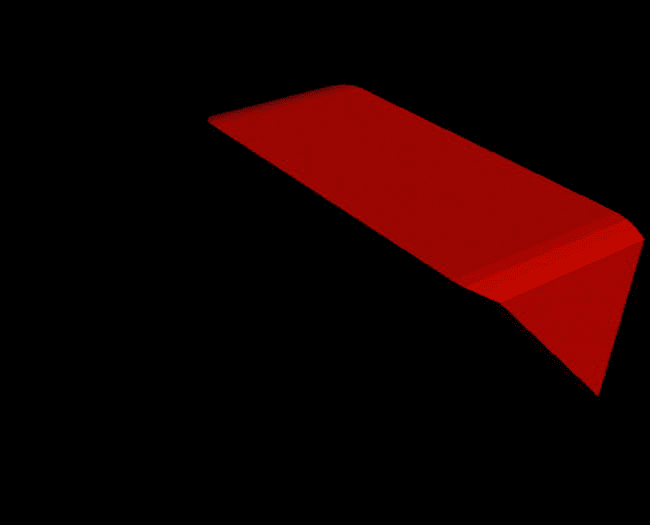
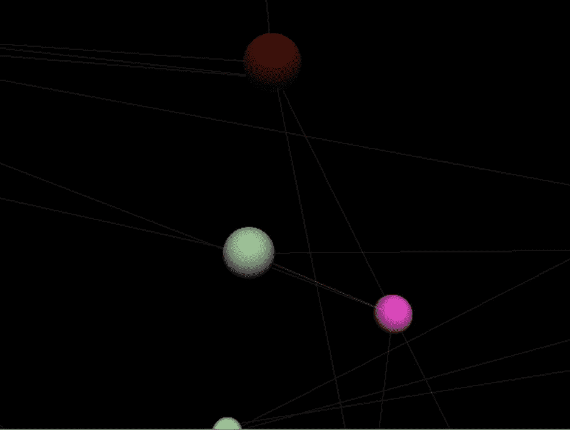
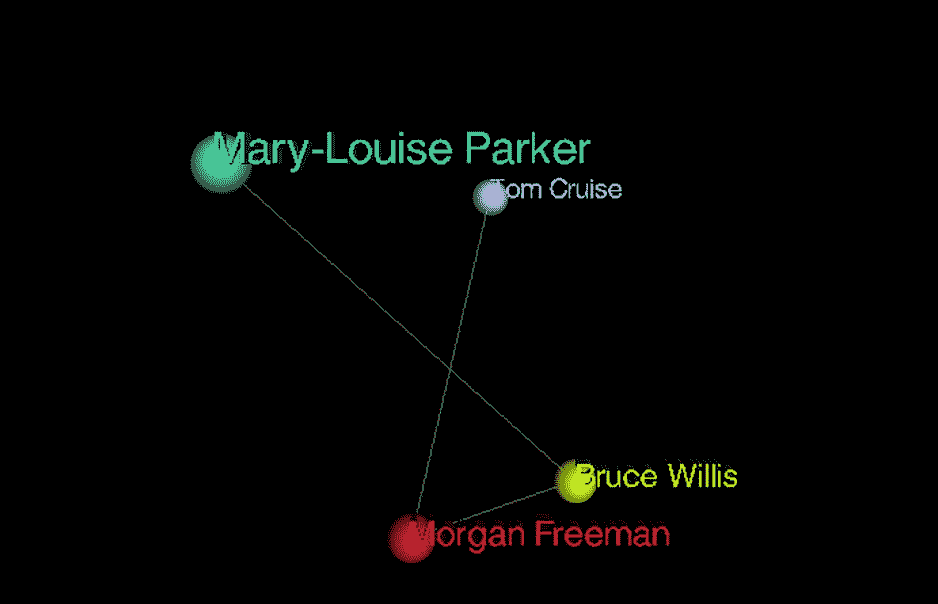

# 4. 3D 入门

在开始创建媒体播放器之前，我想花一章的时间来讲解 3D，从基础形状到可视化。在接下来的章节中，我们将创建音乐可视化作为媒体播放器的一部分，但你应能自如地运用各种 3D 场景，尤其是数据可视化。首先，让我们从整体上了解一下 3D 图形，然后再使用一个名为 Three.js 的库。很多基础知识你会熟悉，但我还是希望从头开始讲起，以确保我讲得足够全面。

## 3D 基础

如你所知，一个 3D 世界（很像我们的世界）由三个维度组成：`x`、`y` 和 `z`。可以简单地通过一个标准的笛卡尔坐标图来想象这些维度：有一个指向右方的轴表示 `x`，另一个指向上方的轴表示 `y`，还有一个表示深度的轴，那就是 `z` 轴。我说 `z` 表示深度，因为感觉如此，但实际上，正 `z` 朝向您，负 `z` 则远离您。你可以在图 4-1 中看到一个示例。



图 4-1. 3D 坐标轴

在 3D 世界中，物体和形状是通过网格（Mesh）来创建的。网格可以像简单的立方体那样简单，也可以像你用 3D 建模软件设计出的物体那样复杂（我们不会涉及那么深入，但我会解释如何导入模型）。要赋予网格外观，可以使用材质（Material），这类似于现实世界，每种材质都有其自身的属性集，例如颜色和不透明度。我们将在本章后面学习如何定义自己的材质。

除了网格和材质，我们还有相机和灯光。在 2D 动画中，我们经常移动形状；而在 3D 动画中，我们可以选择移动相机（即用户可以看到的内容）来围绕场景旋转。我提到了灯光，它的作用显而易见，但你可能会惊讶于灯光的种类之多。灯光和相机各自在本章后面有专门的章节介绍。仅仅通过改变灯光的类型或位置就能改变一个场景的氛围，这往往令人印象深刻。

### Three.js

Three.js 是一个库，它让在浏览器中渲染 3D 变得容易得多。它允许你使用多种渲染器，包括 canvas 和 WebGL。我通常建议避免使用库，但要在没有库的情况下使用 WebGL，你需要用一种叫 GLSL 的语言来编写着色器（由于依赖 GPU，使用 WebGL 必须有着色器），其语法类似于 C 语言。为了本书的目标而学习 GLSL 有些大材小用，而且花费的时间会超过一个章节！我将使用 Three.js 的 56 版本，该版本也包含在可下载的源代码中，但你可以在 [`http://www.mrdoob.github.com/three.js/`](http://mrdoob.github.com/three.js/) 找到最新版本。

#### 构建场景

你可以像在电影中一样理解“场景”——它是你放置网格（物体）、光源和摄像机的地方。场景就是你的舞台。设置一个场景非常简单，因为你只需要场景本身、一台摄像机和渲染器。当然，那将是一个空场景！一个简单的场景对象可以使用 `THREE.Scene()` 创建，让我们继续创建一个基础的（空）场景。之后，我们可以开始添加基础几何体，例如立方体或球体。

首先，我们可以创建用于存储渲染器（即我们的视口）尺寸的宽度和高度变量。在本例中，我将设置它们为内部窗口的尺寸。与之前几章我们自己创建画布不同，我们还需要一个容器来放置渲染器；我们可以让 Three.js 根据我们选择的渲染器来创建 DOM。现在我们需要选择渲染器，Three.js 的构建方式允许你创建自己的渲染器或使用第三方渲染器，但你真正需要了解的只有 `CanvasRenderer` 和 `WebGLRenderer`。两者的区别在于：Canvas 的兼容性更广，但 WebGL 效率更高。这是因为 WebGL 原生支持 3D（OpenGL ES 2），其 3D 运算在 GPU 上运行；而 Canvas 没有 3D 支持（需要自行编写），其 3D 运算在 JavaScript 中运行（速度慢得多）。因此，我们暂时坚持使用 `WebGLRenderer`，不过你也可以尝试两者，以感受它们的差异（通常差异很细微）。选定渲染器后，我将其存储在名为 `renderer` 的变量中，我们可以设置其尺寸并将其添加到 DOM 中。

```
var width  = window.innerWidth,
    height = window.innerHeight;
var container = document.querySelector('#container');
var renderer = new THREE.WebGLRenderer();
renderer.setSize(width, height);
container.appendChild(renderer.domElement);
```

接下来我们需要创建一台摄像机。本章稍后我会介绍如何使用多台摄像机，但一开始我们先只使用一台。与渲染器类似，有几种默认的摄像机类，并且通过继承抽象的 `Camera` 类很容易编写自己的摄像机类型。内置的摄像机有 `OrthographicCamera` 和 `PerspectiveCamera`，它们可用于提供场景的不同视图；通常你可以认为透视视图显示的是 3D 视角，而正交视图显示的是 2D 视角。在本例中，我们选择透视摄像机，因为我们只想看到场景中的内容（初始情况下一无所有），而不是某个特定视角（例如俯视图）。对于我们的 `PerspectiveCamera`，有四个参数，根据文档说明，它们是：

*   `fov`：摄像机视锥体的垂直视野
*   `aspect`：摄像机视锥体的宽高比
*   `near`：摄像机视锥体的近截面
*   `far`：摄像机视锥体的远截面

如果你了解“视锥体”的含义，那么这些参数就不难理解；在这里，它就是指视图的一部分。通常这些参数会存储为变量，但由于目前其他地方用不到它们，我决定直接将值作为参数写入，以减少代码行数。创建摄像机后，我们可以为其定位，目前只需将摄像机的 `z` 坐标设置为 300，这样当我们添加一些网格后，场景就能很好地呈现在视野中。

```
var camera = new THREE.PerspectiveCamera(45, width / height, 1, 1000);
camera.position.z = 300;
```

一旦场景中有了物体，你可能会通过调整这些数值来感受它们如何影响场景的视角，这会很有帮助。正如我前面提到的，要创建场景本身，你只需要创建 `Scene` 类的一个实例。场景创建后，我们可以将摄像机添加到其中。要渲染场景，我们使用 `renderer.render(scene, camera)`，这自解释性很强。我决定将其放在一个与第 2 章类似的设置中。这非常适合作为开发更复杂动画和渲染的模板。

```
var scene = new THREE.Scene();
scene.add(camera);

function logic() {
    requestAnimationFrame(render);
}

function render() {
    renderer.render(scene, camera);
}

setInterval(logic, 1000/60);
```

### 添加网格

一个基础场景相当乏味，而且坦率地说，没什么用处。因此，让我们通过研究可以使用的各种网格来让情况变得有趣一些。不过首先，我们需要一些光线，这样才能实际看到物体（这真的就像在黑暗的房间里——物体就在场景中，但你看不到它们）。稍后我会解释光的类型，但目前我们只需使用一个简单的 `DirectionalLight`（平行光），它的用法就像一盏台灯，指向特定方向，而不是照亮整个场景。我选择使用这种类型的光，因为它能让我们立刻轻松地看到阴影。默认的平行光是白色的，强度为 1；默认情况下，光指向场景中心 (0,0,0)。需要注意的是，尽管平行光有一个名为 `position` 的属性，但这表示光指向的方向，而光源本身并没有实际位置（它是无限远的）。我决定将光放置在更靠近摄像机的位置，这样我们就能看到物体周围漂亮简单的阴影了。

```
var directionalLight = new THREE.DirectionalLight();
directionalLight.position.z = 10;
scene.add(directionalLight);
```

让我们从一个球体开始（类似于 Three.js 官方文档中的示例）。要创建任何原始对象，我们需要创建一个包含几何体类型和材质的网格。对于球体，我们可以使用 `THREE.SphereGeometry` 搭配任何类型的材质，在这个例子中，我将使用一种名为 `THREE.MeshLambertMaterial` 的材质（稍后会详细介绍）。

# Three.js 几何体创建与示例

```
var radius = 100,
    segments = 50,
    rings = 50;

var sphereMaterial = new THREE.MeshLambertMaterial({
    color: 0xFF0000
});

var sphere = new THREE.Mesh(
    new THREE.SphereGeometry(
        radius,
        segments,
        rings),
    sphereMaterial);

scene.add(sphere);
```

如你所见，我首先设置了三个变量来控制球体的属性。你会知道半径是球体大小/直径的一半。`segments` 和 `rings` 用于指定球体的质量——数值越低，质量越差。尝试将它们从 50 改为 10，你会看到锯齿状的边缘，并且可能能够看到构成环和段的线条。你可以把它们想象成纬度和经度；`rings` 水平环绕球体，`segments` 则是垂直的。

**注意**

如果你熟悉位图图像或数学几何，你会明白不存在完美的曲线，因此对于应该有多少环和段，并没有正确的答案。只需选择一个在质量和优化之间感觉合适的折中数值即可。

如果运行以下代码，你应该会看到一个红色的球体。

```
<!DOCTYPE html>
<html>
<head>
    <title>场景中的形状</title>
    <style>
        * { margin: 0; }
        canvas { background: #000;}
    </style>
</head>
<body>
    <div id="container"></div>
    <script src="../three.min.js"></script>
    <script src="script.js"></script>
</body>
</html>
```

```
var width  = window.innerWidth,
    height = window.innerHeight;
var container = document.querySelector('#container');
var renderer = new THREE.WebGLRenderer();
renderer.setSize(width, height);
container.appendChild(renderer.domElement);

var VIEW_ANGLE = 45,
    NEAR = 0.1,
    FAR = 10000;
var camera =  new THREE.PerspectiveCamera(45, width / height, 1, 1000);
camera.position.z = 300;

var scene = new THREE.Scene();
scene.add(camera);

var directionalLight = new THREE.DirectionalLight();
directionalLight.position.z = 10;
scene.add(directionalLight);

var radius = 100,
    segments = 50,
    rings = 50;
var sphereMaterial = new THREE.MeshLambertMaterial({
    color: 0xFF0000
});

var sphere = new THREE.Mesh(
    new THREE.SphereGeometry(
        radius,
        segments,
        rings),
    sphereMaterial);

scene.add(sphere);

function logic()  {
    requestAnimationFrame(render);
}

function render() {
    renderer.render(scene, camera);
}

setInterval(logic, 1000/60);
```

创建每个原始形状的方法类似，因此我不逐一引导你创建每种形状，而是提供表 4-1 来展示形状类型。请注意，除非我特别说明，构造函数的每个参数都是可选的。许多几何体基于 `PolyhedronGeometry`，因此参数 `detail` 用于决定创建形状所使用的三角形数量。另外请记住，所有构造函数都应加上 `THREE` 前缀。

**表 4-1.** 展示 Three.js 中可用的几何体

| 名称 | 构造函数 | 备注 |
| --- | --- | --- |
| `CircleGeometry` | `CircleGeometry(radius, segments, thetaStart, thetaLength)` | `theta` 参数用于创建分段；通过改变它们，可以指定特定的弧线。 |
| `ConvexGeometry` | `ConvexGeometry(vertices)` |  |
| `CubeGeometry` | `CubeGeometry(width, height, depth, widthSegments, heightSegments, depthSegment)` |  |
| `CylinderGeometry` | `CylinderGeometry(radiusTop, radiusBottom, height, radiusSegments, heightSegments, openEnded)` |  |
| `ExtrudeGeometry` | `ExtrudeGeometry(shapes, options)` | 这个有很多选项，我将在本表之后进行说明。 |
| `IcosahedronGeometry` | `IcosahedronGeometry(radius, detail)` |  |
| `LatheGeometry` | `LatheGeometry(points, segments, phiStart, phiLength)` |  |
| `OctahedronGeometry` | `OctahedronGeometry(radius, detail)` |  |
| `ParametricGeometry` | `ParametricGeometry(parametricFunction, uSegments, ySegments, useTris)` |  |
| `PlaneGeometry` | `PlaneGeometry(width, height, widthSegments, heightSegments)` |  |
| `PolyhedronGeometry` | `PolyhedronGeometry(vertices, faces, radius, detail)` |  |
| `RingGeometry` | `RingGeometry(innerRadius, outerRadius, thetaSegments, phiSegments, thetaStart, thetaLength)` |  |
| `ShapeGeometry` | `ShapeGeometry(shapes, options)` |  |
| `SphereGeometry` | `SphereGeometry(radius, widthSegments, heightSegments, phiStart, phiLength, thetaStart, thetaLength)` | 我们已经介绍过球体，但和圆一样，还有一些额外选项偶尔可能有用。 |
| `TetrahedronGeometry` | `TetrahedronGeometry(radius, detail)` |  |
| `TextGeometry` | `TextGeometry(text, parameters)` | 用于创建 3D 文本，我将在本章后面部分介绍。 |
| `TorusGeometry` | `TorusGeometry(radius, tube, radialSegments, tubularSegments, arc)` |  |
| `TorusKnotGeometry` | `TorusKnotGeometry(radius, tube, radialSegments, tubularSegments, p, q, heightScale)` |  |
| `TubeGeometry` | `TubeGeometry(path, segments, radius, radiusSegments, closed, debug)` |  |

### 拉伸（Extrusion）

## ExtrudeGeometry

这些形状中的大多数你都能理解；然而 `ExtrudeGeometry`（拉伸几何体）的使用方式不同，并且具有许多选项。其目的是扩展一个形状，例如将 2D 形状转化为 3D，或者在 3D 形状的某个面上进行构建。在这个示例中，我们将从一些点作为路径开始，这些点代表一个基本的 2D 直角三角形，我们将由此生成一个 2D 形状（即，由路径中的点创建的平面）。形状创建完毕后，我们需要对其进行拉伸以形成一个棱柱。

**提示：** 为了简单起见，我使用了三角形。路径通常用于创建复杂的形状。

该路径是一个点数组，这些点使用 2D 向量（表示图形的坐标）创建。Three.js 提供了一个处理向量的实用库，使得计算两点之间的距离以及执行类似功能变得非常简单。要将路径转换为形状，只需将路径作为参数传递给 `THREE.Shape` 构造函数即可。

```
var path = [];
path.push( new THREE.Vector2 (   0,  50 ) );
path.push( new THREE.Vector2 (  50,  50 ) );
path.push( new THREE.Vector2 (  50,  0 ) );
var shape = new THREE.Shape( path );
```

正如我之前提到的，`ExtrudeGeometry` 有许多选项用于定义所需的拉伸类型，如表 4-2 所示。

### 表 4-2. `ExtrudeGeometry` 的可用选项

| `curveSegments` | 路径上的点数，默认为 12。 |
| --- | --- |
| `steps` | 每次拉伸中的细分数量，默认为 32。 |
| `amount` | 拉伸的数量，基本上是形状的尺寸，默认为 100。 |
| `bevelEnabled` | 启用倒角，它会使连接拉伸边缘与形状面的顶点变得圆滑。默认值为 `true`。 |
| `bevelThickness` | 倒角的厚度，默认为 6。 |
| `bevelSize` | 倒角开始的边缘距离，默认值为 `bevelThickness` 减去 2。 |
| `bevelSegments` | 倒角的段数，类似于球体的分段数，用于控制倒角的质量。默认为 3。 |
| `extrudePath` | 形状中需要被拉伸的特定路径。 |
| `frames` | 一个 Frenet 框架数组，用于显示样条曲线的切线、法线和副法线。这超出了本书的范围，但默认情况下会自行生成框架。 |
| `material` | 前后面材质的索引，无默认值。 |
| `extrudeMaterial` | 拉伸面材质的索引，无默认值。 |
| `uvGenerator` | 允许你指定 UV 生成器。默认情况下使用 `THREE.ExtrudeGeometry.WorldUVGenerator`。 |

**提示：** 这些选项（尤其是默认值）在不同版本的库中可能会有所变化。

下面的代码创建了一个拉伸几何体，以展示如何使用这些不同的设置来生成一个相当复杂的形状。

```
var extrusionSettings = {
  size: 30, height: 4, curveSegments: 3,
  bevelThickness: 1, bevelSize: 2, bevelEnabled: false,
  material: 0, extrudeMaterial: 1
};
var extrude = new THREE.ExtrudeGeometry( shape, extrusionSettings );
var extrudedShape = new THREE.Mesh( extrude, material );
scene.add(extrudedShape);
```

现在，你可能会看这段代码，再看屏幕上显示的内容，感到有点困惑。它本应看起来像一个三角形，别担心！由于相机的视角，它看起来像那样，所以我们让这个形状旋转，这样你就能看到它的 3D 效果。我非常喜欢在 x 轴和 y 轴上旋转的效果。它产生了一种类似“8”字形的运动，这对于观察形状的所有侧面非常有用。这段代码为形状添加了旋转：

```
function logic()  {
  extrudedShape.rotation.y += 0.05;
  extrudedShape.rotation.x += 0.05;
  requestAnimationFrame(render);
}
```

图 4-2 展示了添加旋转后的拉伸形状。



**图 4-2.** 拉伸效果

## 文本（Text）

有时你可能会需要 3D 文本。这不是一个常见的用例，但也许你在制作类似电影标题或广告的东西。这也是许多人不意识到可以轻松实现的功能，所以我想简要地看一下。`TextGeometry` 构建在 `ExtrusionGeometry` 之上，因此大部分内容都是熟悉的。让我们创建一段显示“Hello World!”的 3D 文本——因为每个人都喜欢 Hello World——它像我们的棱柱一样以相同的方式旋转，以展示它们有多么相似（而且我觉得这种旋转看起来非常迷人）。

**警告：** 默认情况下，Three.js 使用一种名为 Helvetiker（这不是拼写错误）的字体，必须包含该字体，或者你应该使用不同的字体，否则会出现错误。该字体可以从 [`www.typeface.neocracy.org/`](http://www.typeface.neocracy.org/) 下载，也包含在本书的源代码中。

我正在修改我们用于拉伸的代码，因此将重复使用光照、材质以及其余设置代码。`TextGeometry` 与其他几何体没有什么不同，因此在添加到场景之前，需要将其传递给 `Mesh`（网格）；这似乎显而易见，但我总是忘记！让我们从默认文本开始：

```
var text = new THREE.Mesh(new THREE.TextGeometry("Hello World!", {}), material);
scene.add(text);
```

如表 4-3 所示，还有许多其他选项可用于自定义文本。

### 表 4-3. `TextGeometry` 的可用选项

| `size` | 文本的大小，默认为 150。 |
| --- | --- |
| `height` | 拉伸文本的厚度，默认为 50。 |
| `curveSegments` | 曲线上的点数，默认为 12。 |
| `font` | 字体名称，默认为 Helvetiker。 |
| `weight` | 字体粗细。可以是任何有效的 CSS `font-weight`，例如 `normal` 和 `bold`。默认为 `normal`。 |
| `style` | 与 weight 类似，style 允许任何有效的 CSS `font-style`，例如 `normal` 和 `italic`。默认为 `normal`。 |
| `bevelEnabled` | 启用倒角，它会使连接拉伸边缘与形状面的顶点变得圆滑。默认值为 `false`。 |
| `bevelThickness` | 倒角的厚度，默认为 6。 |
| `bevelSize` | 倒角开始的边缘距离，默认值为 `bevelThickness` 减去 2。 |

这些选项应该很容易理解，因为它们大多来自 CSS 字体选项或我们已经讨论过的 `ExtrudedGeometry`。不过，我将向你展示一个关于如何使用这些选项的简单示例：

```
var options = {
  size: 20,
  height: 20,
  bevelEnabled: true,
  bevelThickness: 25
};
var text = new THREE.Mesh(new THREE.TextGeometry("Hello World!", options), material);
scene.add(text);
```

如你所见，如果你将文本视为另一种形状，添加文本是非常容易的。

## 照明

照明是我认为真正能够“设定场景”的一个要素（请原谅我的双关语），因为整个场景都依赖于照明来决定显示什么（以及同样重要的，隐藏什么阴影），以及整体的氛围。就像在电影中一样，照明可以用来彻底改变用户的感受。我不会深入探讨用户体验设计，但这一点值得铭记和思考！

> **注意**
>
> 由于照明依赖于物体的材质，你需要确保材质设置正确。这将在下一节中解释，但现在请确保使用 `MeshLambertMaterial` 或 `MeshPongMaterial`，因为它们被设置为可以与灯光配合使用。

我将介绍一些更常用的照明类型；当然还有其他类型，你也可以创建自己的照明，我们稍后可能会简单提及。每种类型的灯光都有许多属性和参数，尽管有些比其他的更多，以下是你应该熟悉的一些内容：

# 灯光

- **强度（Intensity）**：灯光的强度是指它的亮度，数值范围可以从 0 到 1，其中 1 是灯光的实际颜色，0 是不可见（就像关闭了一样）。默认值通常为 1。有些灯光没有强度属性（至少在撰写本文时是如此），但你总是可以通过将每个 RGB 颜色乘以一个强度变量来模拟。

- **十六进制颜色（Hex）**：这是一种必须采用十六进制形式的颜色（例如白色为`0xffffff`）。通常默认值为白色。

- **阴影（Shadows）**：关于阴影有不少属性，例如灯光是否投射阴影。我将在解释完每种灯光类型后再讨论这些属性。

在整个章节中，我们一直使用`DirectionalLight`作为场景中唯一的光源。如前所述，`DirectionalLight`是一种朝特定方向投射的光源，并且会影响该方向上所有物体，无论它们与光源的距离如何。我还应该提醒你之前关于`DirectionalLight`的说法：它实际上并没有具体的位置，相反，你设置的位置是它向场景原点投射光线的起始位置。`DirectionalLight`的语法如下：

```
THREE.DirectionalLight(hex, intensity)
```

另一方面，`PointLight`会向所有方向发射光线，但如果设置了距离，它对物体的影响会因物体与光源的距离而有所不同。当距离设置为 0（默认值）时，灯光会像`DirectionalLight`一样影响所有物体。`PointLight`的语法如下：

```
THREE.PointLight(hex, intensity, distance)
```

还有一种名为`SpotLight`的灯光，它可以像`DirectionalLight`一样使用，但可以更精确地控制。`SpotLight`和`DirectionalLight`的一个区别是角度。`DirectionalLight`的光线朝大致方向发射，而`SpotLight`则在指定的角度范围内（默认为`pi/2`）定向发射光线。它也可以像`PointLight`一样覆盖指定的距离。如果你只是想照亮一个场景，通常可以使用前两种灯光，但如果你想仔细引导光照，那么这是理想的光源。`SpotLight`的语法如下：

```
THREE.SpotLight(hex, intensity, distance, angle, exponent)
```

我之前提到过照明可以营造氛围。有一种专门用于此目的的灯光，正如你所料，叫做`AmbientLight`。这种灯光会影响到场景中所有能被光源影响的物体。因为它用于增强照明，所以应只与其他灯光配合使用。`AmbientLight`的语法如下：

```
THREE.AmbientLight(hex)
```

你可能会发现`AmbientLight`会优先于所有其他灯光，要解决这个问题，只需调整其强度，使其成为弱光（环境光）。改变强度的示例如下：

```
var light = new THREE.AmbientLight();
var intensity = 0.025;
scene.add(light);
light.color.setRGB(20 * intensity, 0 * intensity, 255 * intensity);
```

很多时候，你会想确切地了解灯光在做什么、它们的位置以及光线投射的方向。有很多方法可以实现这一点——你可以使用控制台查看每个灯光的属性，但我建议采用更图形化的方式。对于许多灯光，Three.js 提供了辅助对象，可以用线条显示方向。如果你有一个`DirectionalLight`，那么可以使用`DirectionalLightHelper`，它会以虚线形式显示其指向的方向。你可以通过更改材质来改变线条的类型，例如颜色或虚线样式。大多数灯光也都有辅助工具，例如`SpotLightHelper`可用于显示光线的角度。

另一种查看光源的方法是（例如在灯光的位置创建一个球体对象），如下所示：

```
var lightDebug = new THREE.Mesh(new THREE.SphereGeometry(5), new THREE.MeshBasicMaterial());
lightDebug.position = light.position;
scene.add(lightDebug);
```

使用这种方法的一种方式——我更喜欢这种方式，而且我知道很多其他人也经常使用这种技术——是将球体做得非常小，这样你既能看到它，它又看起来更像是动画的一部分，而不是调试模式。

## 材质

你已经见过了几种被使用和提及的材质，例如`Phong`、`Lambert`和`Basic`——但它们到底是什么呢？每种材质都指定了所使用的着色类型。这是基于真实世界中的材质及其差异而来的，例如，一个塑料瓶和一个闪亮的罐子在相同的光照下，由于反射、透明度等因素，会呈现出不同的外观。我们无法完全模拟真实世界中的精确条件，但可以通过修改某些属性以及使用不同的着色器来非常接近。在撰写本书时，Three.js 为我们提供了表 4-4 中所示的内置材质。

表 4-4. 展示了 Three.js 中可用的内置材质。

| `LineBasicMaterial` | `LineBasicMaterial` 用于创建直线，默认颜色为白色，宽度为 1 像素。 |
| --- | --- |
| `LineDashedMaterial` | 此材质与 `LineBasicMaterial` 类似，但用于创建虚线，在调试时非常有用（但不限于此），因为你知道它并不打算成为场景的一部分。 |
| `MeshBasicMaterial` | 根据 `wireframe` 属性（默认为 `false`），此材质用于绘制平面或线框面，并且不受光照影响。通常在其他材质之上使用它来绘制线框，因为它的开销最小。它也常用于应用纹理（图像）。 |
| `MeshDepthMaterial` | 此材质用于显示深度，通常在后处理中使用。 |
| `MeshFaceMaterial` | 很多时候一个形状的每一面都需要不同的材质，`MeshFaceMaterial` 实际上就是一个材质数组。 |
| `MeshNormalMaterial` | 这是一种非常有用的材质，尤其适用于原型设计，因为它能确保每个面都有独特的颜色，并且不需要光照。 |
| `ParticleBasicMaterial` | 这是粒子系统使用的材质。颜色默认为白色。 |
| `ShaderMaterial` | 如果你想编写自己的着色器（本书不会涉及），那么可以使用这种材质。它提供了 GLSL 的属性，例如 `fragmentShader`、`vertexShader` 和 `uniforms`。 |

表 4-4 中缺少了两种材质：`MeshLambertMaterial` 和 `MeshPhongMaterial`。我会将这两种材质与列表分开处理，因为它们有些相似，并且涉及大量的渲染技术（远非一个列表所能涵盖）。我们之前已经将 `Lambert` 用作通用的 3D 材质，但我没有解释它是什么。根据当前的 Three.js 文档，对这两种材质区别的简单解释是：

- **Lambert**：用于非光泽（朗伯）表面的材质，逐顶点计算。
- **Phong**：用于光泽表面的材质，逐像素计算。

这通常足以让你决定在每种情况下使用哪一种，但我认为更全面的理解很重要，因此我将简要解释它们的技术差异，并鼓励你进行更深入的研究。

在计算机图形学中，有两种模型（可以结合使用）来决定对象的着色方式：光照模型和着色模型。光照模型使用环境光、漫反射和镜面高光来显示从表面反射（或折射）的光线。着色的数学计算很复杂，因为它无法简化为简单的组件，基本上，它使用平面着色或插值着色来为面着色（即计算亮度）。`MeshLambertMaterial` 使用 Gouraud 着色和朗伯光照模型，默认情况下在每个顶点处进行光照计算，然后在面片上进行插值。`MeshPhongMaterial` 使用 Phong 着色和 Phong 光照模型，默认情况下，顶点法线在表面进行插值，并且在每个像素（更准确地说，是纹素）处进行光照计算。

**注意：** Three.js 并未完全按照算法标准实现，因此如果你对这些数学模型特别感兴趣，请将这一点考虑在内。

## 数据可视化

关于文档的介绍就到这里，让我们继续前进，制作一些有用的东西。数据可视化的类型有很多，从基本的条形图和饼图，到详细的地球仪，甚至太阳系模型。所有这些都有其用途，通常用作向公众展示数据的方式，也可用于数据分析。这是一个广阔的学科领域，因此我们仅会触及你可以可视化的内容以及如何实现它的皮毛。

我们可以在任何地方开始，比如用基本 3D 图形显示政府的财务数据，但这很快就会变得枯燥，所以让我们制作一个 3D 节点图，展示曾经合作过的男女演员（灵感来源于“凯文·贝肯六度分隔”理论）。在这个例子中，我们的节点是演员/女演员，连线是电影。我提供了一些示例数据（JSON 格式），以免你需要注册 API。这也意味着我可以对数据进行更有选择性的筛选，因为大部分数据并非必需。

### 3D 节点图

# Three.js 随机图形绘制示例

## 介绍与基础设置

与其直接使用数据，不如先从图形开始。在本节中，所有节点和边都是随机生成的，并且两个节点之间完全有可能存在多条相同的边。目前我们无需担心这个问题（一旦有了真实数据，处理起来会容易得多）。

我们从所有场景都具备的基础设置开始，这次同时使用了方向光和环境光，以便每个节点（我们将用随机颜色的球体表示）呈现出良好的效果。

```javascript
var width  = window.innerWidth,
    height = window.innerHeight;
var container = document.querySelector('#container');
var renderer = new THREE.WebGLRenderer();
renderer.setSize(width, height);
container.appendChild(renderer.domElement);
var VIEW_ANGLE = 45,
    NEAR = 0.1,
    FAR = 10000;
var camera =  new THREE.PerspectiveCamera(45, width / height, 1, 1000);
camera.position.z = 600;
var ambient = new THREE.AmbientLight( 0x050505, 2 );
directionalLight = new THREE.DirectionalLight( 0xffffff, 1 );
directionalLight.position.set( 2, 1.2, 10 ).normalize();
var scene = new THREE.Scene();
scene.add(ambient);
scene.add(directionalLight);
scene.add(camera);
// 本节其余代码将放在此处。
function logic()  {
    requestAnimationFrame(render);
}
function render() {
    renderer.render(scene, camera);
}
setInterval(logic, 1000/60);
```

## 节点对象与随机边生成

你知道如何创建球体，而且我相信你很快就能想出让它们随机定位的方法。然而，我们需要做的是随机定位球体，还需要用线条将它们随机连接起来形成边。为此，我们创建了一个 `Node` 对象，用于存储名称和位置，然后生成随机的边。由于我们目前没有使用数据，名称默认为“随机节点”，并且有一个通过属性 `edges` 访问的 `getEdges()` 函数，该函数返回两个随机节点用于连接边。要在 `getEdges` 中生成随机边，我们只需将 `Math.random()` 乘以节点数量，然后向下取整（`floor`），因为索引是从 0 而不是 1 开始的。

```javascript
var amount_nodes = 20;
var Node = function() {
    name = "随机节点",
    position = new THREE.Vector3();
    function getEdges() {
        return [Math.floor(Math.random()*amount_nodes), Math.floor(Math.random()*amount_nodes) ];
    }
    return {
        name: name,
        edges: getEdges()
    }
}
```

## 绘制节点函数

要绘制图形，我们需要三个函数：一个绘制单个节点，一个绘制节点的所有边，还需要一个函数利用前两个函数来绘制整个图形。我们先从 `drawNode(n)` 开始，将节点作为参数传入，这样就能方便地访问我们刚创建的节点对象。在函数内部，我们使用之前教过的相同技术创建一个球体，材质为随机颜色的朗伯材质。随机颜色的实现出乎意料地简单，因为十六进制（例如 `0xffffff`）与任何其他数字的处理方式相同（毕竟它只是数字在不同进制下的表示），我们可以对其进行数学运算，这里就是将其乘以一个随机数。为了确定位置，我们选择一个在指定区域边界内的随机数，然后减去该区域的数值，以使图形保持在中心位置。

```javascript
function drawNode(n)  {
    var radius = 10,
        segments = 50,
        rings = 50;
    var node = new THREE.Mesh(
        var material = new THREE.MeshLambertMaterial( {  color: Math.random() * 0xffffff } );
        var draw_object = new THREE.Mesh(
            new THREE.SphereGeometry(
                radius,
                segments,
                rings),
            material);
        );
    var area = 300;
    node.position.x = Math.floor(Math.random() * (area * 2 + 1) - area);
    node.position.y = Math.floor(Math.random() * (area * 2 + 1) - area);
    node.position.z = Math.floor(Math.random() * (area * 2 + 1) - area);
    n.position = node.position;
    scene.add(node);
}
```

## 绘制边函数

现在，节点已经绘制到场景中，是时候用边将它们连接起来了。由于这些边是随机生成的，正如我之前所说，有些边可能会重叠，导致线条变粗。一旦我们添加了数据，这种情况就不会发生，因为我们可以利用数据来检查某条线是否已经存在。从环境光中你已经知道，要实现透明度，需要将 `transparent` 设置为 `true`，所以我在这里的 `LineBasicMaterial` 中也这么做了，因为如果边是 100% 白色且不透明，会显得过于密集。要确定线条的走向，我们需要遍历 `node.edges`（在创建新节点时随机生成），并创建一个几何体，其顶点位于当前节点的位置和其他节点（`nodes[node.edges[i]]`）的位置。创建完成后，我们只需使用这个几何体创建一条新线，然后将其添加到场景中。

```javascript
function drawEdges(node)  {
    var line_material = new THREE.LineBasicMaterial( { color: 0xffffff, transparent: true, opacity: 0.1, linewidth:0.5 } );
    for (var i = 0; i < node.edges.length; i++)  {
        var tmp_geo = new THREE.Geometry();
        tmp_geo.vertices.push(node.position);
        tmp_geo.vertices.push(nodes[node.edges[i]].position);
        var line = new THREE.Line( tmp_geo, line_material );
        scene.add(line);
    }
}
```

## 绘制整个图形

最后，为了完成这部分项目，我们只需使用刚才编写的两个函数来绘制图形。你可能已经注意到，我们使用了一个名为 `nodes` 的数组，节点是在 `drawGraph()` 函数中创建的。该函数的第一部分会循环遍历节点数量（`amount_nodes`），并在数组中创建一个新的 `Node` 对象，然后使用 `drawNode()` 绘制它。由于 `drawEdges()` 需要使用节点数组来确定哪些边是连接的，因此边必须在一个单独的循环中创建。

```javascript
var nodes = [];
drawGraph();
function drawGraph()  {
    // 绘制节点
    for (var i = 0; i < amount_nodes; i++)  {
        nodes[i] = new Node();
        drawNode(nodes[i]);
    }
    // 绘制边，必须在节点就位后才能进行
    for (var i = 0; i < amount_nodes; i++)  {
        drawEdges(nodes[i]);
    }
}
```

## 节点图实现

如果现在将所有代码组合起来，你应该会看到一个颜色随机的漂亮 3D 节点图，但它并不代表任何实际数据（参见图 4-3）。这对于各种可视化来说是一个良好的起点，并且应该能让你自如地使用这些工具（即 Three.js）来生成比简单形状更复杂的图形。



**图 4-3.** 节点图

我鼓励你修改代码，使其成为你自己的作品。以下是一些扩展图形的思路：

*   使用 API 可视化实时数据（Twitter、政府开放数据等）。
*   根据数据改变节点的大小和/或颜色。
*   为悬停或点击节点和/或边添加文本叠加层。
*   优化导航。在拥有数千个节点的图形中进行导航是很困难的。哪种方式效果最好——方向键？鼠标？点击移动？这是一个探索缩放的好方法。

你可以通过多种方式使用相机（本章前面已经解释了一些方法）来浏览图形。目前，我只是使用了简单的相机旋转技术，该技术已包含在代码中。

### 添加数据

我们有一个显示随机节点的节点图，看起来不错，但背后其实没有任何意义。我创建了一个名为 `data.js` 的 JavaScript 文件（其中包含一个名为 `data` 的 JSON 变量，便于访问），里面包含了四位演员和三位电影。我们将用它来创建一个微型节点图，将电影显示为连接演员节点的边。虽然数据不多，但这能让你很好地了解如何将图用于数据可视化。以下是我们将使用的数据：

```javascript
var data = {

"People": [

{

"Id" : 0,

"Name": "Tom Cruise",

"Films": [1, 2]

},

{

"Id" : 1,

"Name": "Morgan Freeman",

"Films": [1,3,5]

},

{

"Id" : 2,

"Name": "Bruce Willis",

"Films": [3, 4]

},

{

"Id" : 3,

"Name": "Mary-Louise Parker",

"Films": [3]

}

],

"Films": [

{

"Id": 0,

"Name": "Oblivion",

"Cast": [0, 1]

},

{

"Id": 1,

"Name": "Mission: Impossible",

"Cast": [0]

},

{

"Id": 2,

"Name": "RED",

"Cast": [1, 2, 3]

},

{

"Id": 3,

"Name": "Die Hard",

"Cast": [2]

},

{

"Id": 4,

"Name": "The Shawshank Redemption",

"Cast": [1]

}

]

}
```

要创建这个图，我们使用之前编写的代码，但需要对其进行修改，以读取 `data` 对象，从而根据演员共同出演的电影在他们之间建立连接。虽然显示所有连接可能更有用，但我决定在这个示例中最好只显示他们之间有连接的情况，而不是为每部电影都画一条单独的线。我通过检查节点是否已在另一个节点的边数组中来实现了这一点。

这段代码与之前代码的主要区别在于 `drawGraph()` 函数，我们现在将人物数据分配给每个节点。绘制节点后，我们需要遍历每部电影，在影片对应的每个节点上为参演演员列表中的每个人创建一条边，将其连接到列表中的前一个人（前提是他们尚未连接）。

```javascript
drawGraph();

function drawGraph()  {

var people = data["People"];

var films = data["Films"];

for (var i = 0; i < people.length; i++)  {

nodes[i] = new Node();

nodes[i].name = people[i].Name;

nodes[i].films = people[i].Films;

drawNode(nodes[i]);

}

for (var i = 0; i < films.length; i++)  {

var cast = films[i]["Cast"];

console.log(cast);

if (cast.length > 1)  {

for (var j = 1; j < cast.length; j++)  {

if (nodes[cast[j-1]].edges.indexOf(cast[j]) == -1)  {

console.log(j)

console.log(nodes[cast[j-1]]);

nodes[cast[j-1]].edges.push(cast[j]);

}

}

}

}

for (var i = 0; i < nodes.length; i++)  {

drawEdges(nodes[i]);

}

}
```

最后，需要显示每个节点对应的人物名字。由于我们已经为每个节点创建了一种材质，赋予了节点自身的颜色，我们可以利用这一点，让文本颜色与节点颜色匹配。我设置了文本的尺寸和高度（拉伸）为 10，但这只是一个看起来不错的随意数值——你可以随意更改。另外，正如我之前提到的，或许可以考虑在点击节点时才显示文本，因为随着节点增多，文本会变得难以辨认。这部分应添加到 `drawNode` 函数的末尾：

```javascript
var text_object = new THREE.Mesh(new THREE.TextGeometry(node.name, { size : 10, height: 10}), material);

text_object.position.x = draw_object.position.x;

text_object.position.y = draw_object.position.y;

text_object.position.z = draw_object.position.z;

scene.add(text_object);
```

图 4-4 展示了本章的最终成果：一个表示数据并在节点旁显示名字的节点图。



**图 4-4.** 表示数据的最终节点图

与往常一样，完整的代码可在 Apress 网站 [`www.apress.com/9781430259442`](http://www.apress.com/9781430259442) 或我自己的网站 [`www.shanehudson.net/javascript-creativity`](http://www.shanehudson.net/javascript-creativity) 上找到。

## 小结

在本章中，你从让物体出现的 3D 基础知识起步，逐步发展到将其用于数据可视化。仅仅在数据可视化领域，你就能做许多事情，更别提在 3D 世界中还能做的其他事情了。希望你现在对 Three.js 已经得心应手。我鼓励你扩展本章中的示例，并动手摆弄它们，尤其是节点图。在第 5 章中，我们将使用 Web Audio API 和 SVG 在浏览器中创作音乐（至少是声音！）。