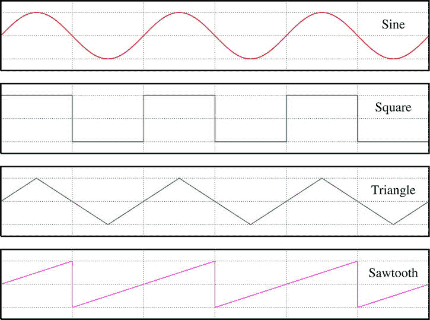
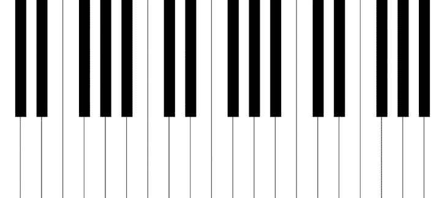
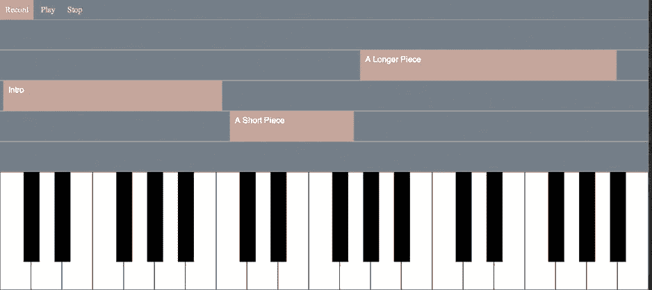

# 在浏览器中创作音乐

在第 3 章中，我们使用 Web Audio API 通过创建简单的可视化和频谱图来分析音频。本章是对第 3 章的扩展，将使用该 API 来创作音乐。为此，我将介绍一些音乐理论知识，并给出几个示例，然后创建一个 Web 应用，让用户使用基本的合成器创作音乐片段，并且能够在音轨上移动这些片段以创作自己的音乐。这个项目潜力巨大，因此你可以通过多种方式来修改它，使其成为你自己的作品，比如打造一个功能完整的基于 Web 的数字音频工作站。


## 音乐理论

本书并非关于音乐理论，但为了完成本项目并理解（或至少使用）`Web Audio API`，掌握音乐理论的基础知识至关重要。音乐是声音，而随机的声音只是噪音，但音乐并非噪音，那么音乐的特殊之处何在？区分音乐与噪音的要素有很多，包括节奏和速度，但更重要的是（至少从我们的角度而言），音高和音色是音乐的核心，它们构成了乐器本身。我们无需成为出色的音乐家就能创造出一款可用于创作非凡音乐的工具，只需专注于乐器本身的特性即可——在本例中，我们的乐器使用`Web Audio API`构建，而音高就是音符的频率。

那么，让我们从最基础的问题开始：什么是音符？简单来说，音符是特定波长的声波（即决定音高的频率）。音符按照音高从 A 到 G（嗯……大致如此）以字母顺序命名，所以 D 比 C 高。我之所以说“大致如此”，是因为音符实际上以八度为单位循环，从 C 到 C，因此同一八度内的 A 比 C 高，但比更高八度的 C 低。每个频率都可以用赫兹（`hz`）来表示（无论从语言上还是实践上）。由于在钢琴上的位置，频率为`261.63hz`的 C 被称为中央 C，通常作为计算基准的音符。例如，一个容易记忆的频率是“中央 C 上方的 A”，即`440hz`。

由于每个八度都包含相同名称的音符，只是频率不同，而我们已经知道音符本身就是一个频率，因此各八度之间必然存在联系，否则它们从根本上就不可能是相同的音符。这种联系就是比率；每个八度的比率是`2:1`，因此音符的波长是前一个八度的两倍。所以，要从中央 C 上方的 A 到中央 C 下方的 A，我们只需计算`440/2 = 220hz`。这种关系是和声背后的基本概念。每个音符都可以用代表八度的数字来标记，原因显而易见，例如，中央 C 就是`C3`。

如果你想象一架钢琴，你会记得黑键以特定模式分布在白键上方；这些琴键用于演奏音符之间的半音（或半音阶），其比率为`2^(1/12)`。音符上方的半音称为升音，音符下方的半音称为降音。因此，`466.16`被称为`A#`（升 A）或`Bb`（降 B）。这些半音是“等音”最常见的例子，因为从技术上讲，它们是两个完全相同的音符，唯一的区别在于音乐的方向。

我们没有钢琴、吉他或任何其他乐器，那么我们计划如何制作音乐呢？当我解释什么是音符时，我将其频率称为波长，因为它是由声波产生的。正如你可能所知，所有声波都是通过振动产生的。因此，我们只需要拼图的最后一块：振荡器；这是所有声音合成的基础，因为它让我们仅通过扬声器就能产生声波。声音包络是声音合成中常用的术语，“用于定义声音波形，该术语涵盖声音的四个组成部分：起音、衰减、延音和释音。通过操控声音包络，你可以开始控制声音。想想钢琴和三角铁的区别，它们都有相当长的延音（即共鸣持续时间较长），但三角铁的声音像“叮”的一声，而钢琴的声音持续时间更长（当然取决于你弹奏音符的时间长短），因此钢琴的起音比三角铁更强。在实践中，由于涉及大量物理因素（例如木质钢琴的特性），要完美合成任何乐器都很难，但通过操控每个音符，你可以尝试仅通过振荡所选波形来复现音乐的声音。

每个声波都有一个形状（波形），它在视觉上表示音符振幅随时间的变化。这涉及很多我们无需关注的物理知识，但基本上，振幅决定了扬声器需要如何移动来产生声音。有四种基本波形，它们构成了所有声音的基础（见图 5-1）。



图 5-1. 波形示例。[`https://en.wikipedia.org/wiki/File:Waveforms.svg`](https://en.wikipedia.org/wiki/File:Waveforms.svg)

四种波形分别是：

*   正弦波：这条曲线遵循数学函数正弦的形状。
*   方波：方波类似于二进制，它要么处于一个频率，要么处于另一个频率。
*   三角波：三角波类似于正弦波，但不够平滑。这导致声音相当尖锐。
*   锯齿波：这些波是前述所有波的组合。这种波具有三角波的缓慢尖锐音色，直到达到峰值，然后重置为原始频率，很像方波。


## 创建键盘

在掌握了基础理论之后，让我们着手创建一个键盘。实现方式有很多种，比如使用 DOM 或 Canvas，但由于琴键都是基本的矩形，我认为最佳方案是使用基于矢量的 SVG。为了更便捷地创建 SVG 并将事件绑定到琴键（使其真正可用），我们将使用一个名为 `svg.js` 的库（可在 `www.svgjs.com` 找到）。一架钢琴有 88 个琴键（52 个白键和 36 个黑键），由于屏幕键盘容纳这么多键位过于拥挤，我决定只包含中间的 3 个八度，这样我们就有了 21 个白键。此外，仅允许鼠标操作并不合理，因为除非使用多点触控屏，否则你无法同时按下多个琴键。当然，标准 QWERTY 键盘中排只有九个字母键，因此我决定将 S 到 K 这七个键定义为可演奏的白键，并使用 A 和 L 键来分别降低或升高一个八度。这并非完美方案，因为你可能需要同时演奏多个八度，但对于本项目而言已经足够了。

让我们从定义一个 SVG 开始：`var keyboard = SVG('keyboard')`；这将创建一个 id 为 keyboard 的 SVG，可以通过同名变量进行访问。创建好 SVG 后，我们就可以开始添加琴键了。白键是最简单的，因为我们只需将 SVG 的宽度（以及位置）除以所需琴键的数量来创建即可。由于这些是白键，我们需要设置属性，使其填充色为白色，描边色为黑色。我们还需要设置 id 属性，以便后续可以修改琴键的背景（用于按键反馈），id 将被设置为 `"key"+i`，这样我们就可以通过遍历这 21 个键轻松访问每个键。

```
var keys = [];

for (var i = 0; i < 21; i++)  {
    keys[i] = keyboard.rect(width/21, height);
    keys[i].move(width/21 * i, 0);
    keys[i].attr({ fill: '#fff', stroke: '#000', id: "key"+i });
    // 事件处理程序添加在此处
}
```

我们还需要为黑键添加矩形，但它们并非直接相邻，而是分成 2 个和 3 个一组的组合，并且黑键的高度仅为键盘高度的一半多一点。为了将这些键分组，我选择简化处理：只需检查 `i` 是否是某组中的最后一个键。如果是，则将一个白键的宽度（`width/21`）加到名为 `prevKey` 的变量中，该变量用于计算黑键的位置。

```
var bkeys = [];
var prev = 0;

for (var i = 0; i < 15; i++)  {
    bkeys[i] = keyboard.rect(width/42, height / 1.7);
    bkeys[i].attr({ fill: '#000', stroke: '#000', id: "bkey"+i });
    bkeys[i].move(prev + (width/(21*1.3)), 0);
    prev = prev + width/21;
    if (i == 1 || i == 4 || i == 6 || i == 9 || i == 11)  {
        prev += width/21;
    }
    // 事件处理程序添加在此处。
}
```

现在，一个键盘已经绘制到了屏幕上，如图 5-2 所示。



**图 5-2.** 键盘布局，包含三个八度

键盘布局创建完成后，我们需要添加事件处理程序，以便能够播放声音并高亮显示被按下的键。由于我们有两种输入方式（键盘和鼠标），因此需要不少事件处理程序。`SVG.js` 使我们能够轻松地将事件处理程序绑定到每个键，通过将 `mousedown` 和 `mouseup` 事件绑定到琴键，可以方便地处理鼠标操作。`keypress` 和 `keyup` 事件则通过向窗口添加事件监听器来处理，这是事件处理的常规方式。为了将琴键与音符绑定，我们需要为黑键（上排）和白键（中排）设置数组。由于 `keypress` 和 `keyup` 事件中每个键的键码不同，因此每种键都需要两个数组。为了获得正确的音符（因为计算机键盘没有足够的键对应所有音符），我们需要将音符位置（将 S 到 K 视为一个八度）加上该八度内的键数乘以当前八度数；这意味着黑键使用 `i + octave * 5`，白键使用 `i + octave * 7`。对于鼠标事件，我们需要使用闭包来保存计数器，因为我们必须在刚才创建的 for 循环内部为每个键绑定事件，但如果不用闭包，循环结束后 `i` 的值会是 `21` 而不是正确的值。当一个键被按下时，它需要改变颜色，并在键被释放后恢复原色（无论使用鼠标还是键盘都是如此）。对于声音，我们将使用名为 `playSound(n)` 和 `stopSound(n)` 的函数，其中 `n` 是闭包创建时的原始 `i` 值。这些更改如示例 5-1 所示。

**示例 5-1.**

```
var keyboardKeys = [83,68,70,71,72,74,75];
var blackKeys = [69,82,89,85,73];
var keyboardPressKeys = [115,100,102,103,104,106,107];
var blackKeyPress = [101, 114, 121, 117, 105];
var octave = 1; // 其中八度 1 = 中央 C

var keys = [];

for (var i = 0; i < 21; i++)  {
    keys[i] = keyboard.rect(width/21, height);
    keys[i].move(width/21 * i, 0);
    keys[i].attr({ fill: '#fff', stroke: '#000', id: "key"+i });
    keys[i].mousedown ((function(n) {
        return function()  {
            var key = SVG.get("key"+n);
            key.fill({ color: '#f06' });
            playSound(n, false);
        }
    })(i));
    keys[i].mouseup((function(n)  {
        return function() {
            keys[n].fill({ color: '#fff' });
            stopSound(n, false);
        }
    })(i));
}

var bkeys = [];
var prev = 0;

for (var i = 0; i < 15; i++)  {
    bkeys[i] = keyboard.rect(width/42, height / 1.7);
    bkeys[i].attr({ fill: '#000', stroke: '#000', id: "bkey"+i });
    bkeys[i].move(prev + (width/(21*1.3)), 0);
    prev = prev + width/21;
    if (i == 1 || i == 4 || i == 6 || i == 9 || i == 11)  {
        prev += width/21;
    }
    bkeys[i].mousedown ((function(n) {
        return function()  {
            var key = SVG.get("bkey"+n);
            key.fill({ color: '#f06' });
            playSound(n, true);
        }
    })(i));
    bkeys[i].mouseup((function(n)  {
        return function() {
            bkeys[n].fill({ color: '#000' });
            stopSound(n, true);
        }
    })(i));
}

window.addEventListener('keypress', function(e) {
    for (var i = 0; i < keyboardPressKeys.length; i++)  {
        if (e.keyCode == keyboardPressKeys[i]) {
            var n = i + octave * 7;
            var key = SVG.get("key"+n);
            key.fill({ color: '#f06' });
            playSound(n, false);
        }
    }
    for (var i = 0; i < blackKeyPress.length; i++)  {
        if (e.keyCode == blackKeyPress[i]) {
            var n = i + (octave * 5);
            var key = SVG.get("bkey"+n);
            key.fill({ color: '#f06' });
            playSound(n, true);
        }
    }
    if (e.keyCode == 97 && octave > 0) --octave;
    if (e.keyCode == 108 && octave < 2) ++octave;
});

window.addEventListener('keyup', function(e) {
    console.log(e.keyCode);
    for (var i = 0; i < keyboardKeys.length; i++)  {
        if (e.keyCode == keyboardKeys[i]) {
            var key = SVG.get("key"+(i+octave*7));
            key.fill({ color: '#fff' });
            stopSound(i+octave*7, false);
        }
    }
    for (var i = 0; i < blackKeys.length; i++)  {
        if (e.keyCode == blackKeys[i]) {
            var n = i + octave * 5;
            var key = SVG.get("bkey"+n);
            key.fill({ color: '#000' });
            stopSound(n, true);
        }
    }
});
```


要播放每个音符，我们需要两个振荡器数组，一个用于黑键，一个用于白键。我们将每个振荡器连接到一个单独的增益节点上，这样我们就有了一个节点可以用来录制音乐，以及实现音量调节的潜力。显然，每个振荡器需要以正确的频率运行，我们可以自动生成这些频率，但由于我们确切知道将使用哪些按键（并且考虑到黑键之间的间隔，生成这些频率特别麻烦），我们可以像这样在数组中指定它们：

```javascript
var whiteNotes = [130.82, 146.83, 164.81, 174.61, 196, 220, 246.94, 261.63, 293.66, 329.63,
349.23, 392, 440, 493.88, 523.25, 587.33, 659.26, 698.46, 783.99, 880, 987.77];
var blackNotes = [138.59, 155.56, 185, 207.65, 233.08, 277.18, 311.13, 369.99, 415.3, 466.16, 554.37, 622.25, 739.99, 830.61, 932.33];
```

正如你在设置按键的代码中看到的，`playSound`和`stopSound`函数都将`i`和`black`作为参数，这样我们就可以知道正在播放音符的位置和包含其频率的数组。在`playSound`内部，我们选择振荡器，设置频率和类型，然后当然使用`osc.noteOn(0)`将其开启。

- `Sine`波 = 0
- `Square`波 = 1
- `Sawtooth`波 = 2
- `Triangle`波 = 3

我根据个人偏好选择了锯形波，但请全部尝试一下，看看你更喜欢哪个！修改后的代码如下所示：

```javascript
function playSound(i, black) {
    stopSound(i, black);
    var freq;
    if (black) freq = blackNotes[i];
    else freq = whiteNotes[i];
    if (black) osc = ob[i];
    else osc = o[i];
    osc.type = 3;
    osc.frequency.value = freq;
    console.log(freq);
    osc.connect(gainNode);
    osc.noteOn(0);
    if (black) ob[i] = osc;
    else o[i] = osc;
}

function stopSound(i, black)  {
    if (black) osc = ob[i];
    else osc = o[i];
    if (typeof(o[i]) != "undefined") {
        osc.noteOff(0);
        osc.disconnect();
        osc = ctx.createOscillator();
    }
    if (black) ob[i] = osc;
    else o[i] = osc;
}
```

这就是创建可弹奏键盘所需的全部内容！`Web Audio API`处理了大部分底层声音管理，所以你只需要连接节点并播放音符即可。我使用了`SVG.js`，但你可以使用任何其他内容，从头开始创建，甚至可以使用矢量程序（如`Adobe Illustrator`）来导出`SVG`。

### 录制音乐

现在我们有了一个可用的键盘，我们希望能够录制并回放输出。在本章的后面，我们将添加在轨道上移动音乐片段的功能，因此我们需要存储音乐。为了将其作为独立应用使用，无需服务器或让用户下载和上传音乐而使事情复杂化，我们将使用本地存储作为轻松存储和检索音乐的方式。本地存储使用键值对工作，因此我们需要为音乐命名（可以通过用户输入或基于本地存储大小生成），并且还需要将音乐存储为值——这是比较棘手的地方。

我不喜欢重新发明轮子（而且正如我所说，这相当棘手），因此为了将音乐录制为`wav`编码的`blob`，我决定使用`Matt Diamond`的`Recorder.js`（可以在[`http://www.github.com/mattdiamond/Recorderjs`](http://www.github.com/mattdiamond/Recorderjs)找到）。这个库通过监听指定的`Web Audio API`通道工作，而不是正常连接，然后启用多种方法，包括我们将用来将音频作为`blob`获取的方法（`exportWAV`）。

> **注意**
> 要使用`Recorder.js`，你必须在`web`服务器上，因为它使用`web workers`来提高性能。在电脑上实现此目的的一种方法是运行`python -m SimpleHTTPServer`。

让我们开始设置记录器，让它监听我们之前创建的增益节点。在构造函数中完成此操作后，我们开始录制。

```javascript
var recorder = new Recorder(gainNode, { workerPath: "../recorderWorker.js"});
recorder.record();
```

如你所见，这使得监听从`gainNode`到输出硬件的任何音频变得非常容易。现在，我们需要创建一个录制声音以及播放声音的函数。当我们调用`recordSound`方法时，我们需要将`blob`（即音频）存储为文本（因为`localStorage`不允许直接存储对象），因此我们使用`window.URL.createObjectURL`转换对象。要播放音乐，我们动态创建一个新的`Audio`元素（尽管无需将其附加到`DOM`），其`src`链接到`localStorage`中存储的`URL`。为了使其可扩展，以便我们可以拥有许多音乐片段，每个函数都有一个名为`name`的参数，该参数成为`localStorage`的键（其中对象`url`是值）。由于对象`URL`的创建方式，要以任何方式使用它们，你需要将它们添加为音频元素的`src`。由于为每个片段这样做效率低下，因此更好的方法是在录制期间计算出持续时间，并将其与对象`URL`一起作为一个对象，然后使用`JSON`将其转换为字符串。

```javascript
function recordSound(name)  {
    recorder.exportWAV(function(blob) {
        var object =  {
            file: window.URL.createObjectURL(blob),
            size: recordEnd - recordStart
        }
        localStorage[name] = JSON.stringify(object);
        drawTimeline();
    });
}

function playAudio(id)  {
    var audio = new Audio(JSON.parse(localStorage[localStorage.key(id)]).file);
    audio.play();
}
```

使用`Recorder.js`，我们可以轻松录制`Web Audio API`能够产生的任何音频，无论是生成的音符还是吉他等输入。这使得在客户端存储录音并播放它们变得很容易。


## 时间线

现在键盘已经可以正常工作，录制音频的一切也已准备就绪，接下来让我们创建界面。为了避免项目过于复杂，我们将保持设计简洁：只需一个包含时间线的键盘，用于放置音乐片段，以及用于录制、播放和停止时间线的按钮。页面加载时，`localStorage` 中的片段需要显示为矩形，其宽度与片段的时长成正比。

```html
<!DOCTYPE html>
<html>
<head>
<title>音乐理论</title>
<style>
* { margin: 0; }
body { background-color: #747e88; }
a { color: #d4dfcf; cursor: pointer;}
a:hover, a:focus  { color: #E4eee3; }
.controls a { display: inline-block; padding: 10px; }
.recording { background-color: #d68189; }
#tracks  { height: 300px; width: 100%; }
#keyboard  { height: 300px; position: relative; width: 100%; }
</style>
</head>
<body>
<div class="controls">
<a id="record">录制</a>
<a id="play">播放</a>
<a id="stop">停止</a>
</div>
<div id="tracks"></div>
<div id="keyboard"></div>
<script src="../svg.js"></script>
<script src="../svg.draggable.js"></script>
<script src="../recorder.js"></script>
<script src="../recorderWorker.js"></script>
<script src="script.js"></script>
</body>
</html>
```

从页面顶部的按钮开始，每个按钮都需要一个点击事件监听器，其回调函数负责执行指定任务。播放和停止按钮只需切换一个 `play` 变量，用于判断当前时间的时间线指示条是否应该移动。录制按钮则需要切换录制状态，包括使用录制器录制增益节点、切换按钮上的录制类，以及设置用于计算时长的 `recordStart` 和 `recordEnd` 变量。我们使用提示框来获取音乐片段的名称。虽然可以在界面内实现，但为了简洁起见，我直接使用了提示框。

```javascript
var toggleRecord = false;
var recordStart;
var recordEnd;
var recorder;

document.querySelector("#record").addEventListener('click', function() {
  if (!toggleRecord) {
    recorder = new Recorder(gainNode, { workerPath: "../recorderWorker.js"});
    recorder.record();
    recordStart = Date.now();
    document.querySelector("#record").className = "recording";
    toggleRecord = !toggleRecord;
  }
  else {
    recordEnd = Date.now();
    document.querySelector("#record").className = "";
    toggleRecord = !toggleRecord;
    recordSound(prompt("声音片段名称："));
  }
});

document.querySelector("#play").addEventListener('click', function() {
  play = true;
});

document.querySelector("#stop").addEventListener('click', function() {
  play = false;
});
```

按钮准备就绪后，我们开始构建实际的时间线。与键盘一样，这里使用 SVG。空的时间线仅包含代表每个音轨的线条，因此我们需要一个变量来定义音轨数量（便于调整所需数量）。绘制线条时，需要绘制（音轨数量 + 1）条线，以便形成底部边框。`trackPos` 变量用于确定每个音轨的高度，并将每个音轨定位在正确的位置。

```javascript
var timelineWidth = document.querySelector("#tracks").clientWidth;
var timelineHeight = document.querySelector("#tracks").clientHeight;
var tracks = SVG('tracks');
var play = false;
var numOfTracks = 5;
var track = [];
var trackPos = timelineHeight / numOfTracks;
var clippings = [];

drawTimeline();

function drawTimeline() {
  tracks.clear();
  for (var i = 0; i <= numOfTracks; i++) {
    track[i] = tracks.line(0, timelineHeight / numOfTracks, timelineWidth, trackPos);
    track[i].move(0, trackPos * i);
    track[i].attr({ stroke: '#DAC8B0', id: "track" + i });
  }
  // 此处放置片段
}
```

音乐片段是与时间线位于同一 SVG 中的矩形，因为它们属于时间线的一部分，并根据音乐片段的时长来表示它。每个矩形都需要可拖动，以便在音轨间移动。我们可以像第 2 章那样使用事件监听器，但由于我们使用了 SVG.js，可以直接使用其插件，该插件位于 [`https://github.com/wout/svg.draggable.js`](https://github.com/wout/svg.draggable.js)。要使矩形可拖动，只需包含脚本，然后在矩形上调用 `.draggable()` 方法即可。由于矩形位于时间线 SVG 内部，使其可拖动意味着它只能在该 SVG 内拖动，而不会越过应用程序的其他组件。尽管如此，它仍然可以被拖出 SVG 边界，但会不可见，因此我们需要阻止它超出范围。我们还需要让矩形在音轨之间吸附。为此，需要检查矩形是否在每个音轨的边界内；如果不在，则取位置的天花板值，使其吸附到某个音轨。每个矩形还需要一些跟随其移动的文本，用于标注音乐的名称。在图 5-3 中，你可以看到录制并放置几个音频片段到时间线后的效果。



**图 5-3.** 完成后的项目，显示时间线中不同音轨上放置了预先录制的音乐

在代码清单 5-2 中，你可以看到使矩形可拖动并在时间线上吸附所需的最终修改。

**代码清单 5-2.**

```javascript
var clippings = [];

drawTimeline();

function drawTimeline() {
  tracks.clear();
  for (var i = 0; i <= numOfTracks; i++) {
    track[i] = tracks.line(0, timelineHeight / numOfTracks, timelineWidth, trackPos);
    track[i].move(0, trackPos * i);
    track[i].attr({ stroke: '#DAC8B0', id: "track" + i });
  }
  for (var i = 0; i < localStorage.length; i++) {
    var clipping = JSON.parse(localStorage[localStorage.key(i)]);
    clippings[i] = tracks.rect(timelineWidth / 120 * clipping.size / 120, trackPos);
    clippings[i].attr( { fill: "#C6A49A" } );
    clippings[i].move(150, trackPos * 3);
    var text = tracks.text(localStorage.key(i)).move(clippings[i].x() + 10, clippings[i].y() + 10).front();
    text.attr( { fill: "#fff", id: "text" + i });
    clippings[i].draggable();
    clippings[i].dragend = (function(text) {
      return function() {
        if (this.y() < 0)
          this.move(this.x(), 0);
        if (this.y() > timelineHeight - trackPos)
          this.move(this.x(), height - trackPos);
        else
          this.move(this.x(), Math.ceil(this.y() / trackPos) * trackPos);
        text.move(this.x() + 10, this.y() + 10);
      }
    })(text);
    clippings[i].dragmove = (function(text) {
      return function() {
        text.move(this.x() + 10, this.y() + 10);
      }
    })(text);
  }
}
```

本章的最终代码可以在常规位置找到，即 Apress 网站 [`www.apress.com/9781430259442`](http://www.apress.com/9781430259442) 上本书的可下载配套资源，或我自己的网站 [`www.shanehudson.net/javascript-creativity`](http://www.shanehudson.net/javascript-creativity)。

## 总结

现在我们拥有了一个音乐创作网页应用的雏形。从这里出发，有许多方向可以探索，例如改变音符的音调或增加静音音轨的功能。我们将在下一章把这个音乐创作应用集成到将要创建的媒体播放器中。希望本章能让你充分领略 Web Audio API 的能力，并积累一些使用 SVG 和本地存储的经验。


