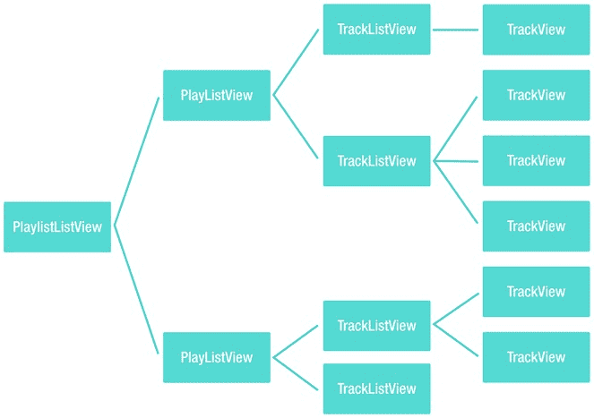

# 6. 音乐播放器

到目前为止，我们已经简要游览了声音与图形的蜿蜒之路。我们从 Canvas 起步，探索了二维世界与动画的世界；随后跨越到视频和音频 HTML 元素以及 Web Audio API，利用 Canvas 创建了频谱图等工具来可视化音乐。接着我们又一头扎进三维图形世界，在那里摆弄各种光照与材质，学习它们之间的相互作用。第 5 章看似完全放弃了图形（当然除了使用 SVG），纯粹聚焦于音乐，通过 JavaScript 生成音符，无需任何插件或音频文件，只需一个实现了 Web Audio API 的浏览器即可。不过，我想在第 3 章（我们研究了所用编解码器并介绍了 Web Audio API）的基础上更进一步，专注于音频文件，并构建那个我一直提及的媒体播放器。

本章将收束前几章的所有未尽之处。我们将制作一个媒体播放器，它既包含前一章的音乐创作功能，又集成了一个 3D 可视化器（基于 Steven Wittens 的 js1k 演示）。这个可视化器不像频谱图那样偏向工具性，而更像你可能在 Winamp 等媒体播放器上见过的艺术效果。

## 媒体播放器

我想采用与前面章节不同的方式来切入。之前我是向你分块教授某个主题领域（比如声音）的知识。但本章我更希望它像一个待完成的项目，而非单纯的讲授。构建这样一个大型应用有众多方法，可添加的功能也五花八门，因此我将先定义应用的规格说明，至于你是按照我的方式还是另辟蹊径，都悉听尊便。

### 规格说明

我们的音乐播放器必须完全运行在客户端，因此除了通过 URL 播放托管音乐所需的服务器之外，不应依赖任何其他服务器。必须提供多种音乐来源选项，包括本地机器以及可能的服务（如 Tomahawk）。当然，与任何媒体播放器一样，必须有暂停、播放和停止按钮，并且至少支持一个播放列表的功能。正如我前面提到的，我们将把音乐创作应用和 3D 可视化器集成到播放器中。这些功能会融入应用，但仍有很大的扩展空间，比如开发一个插件系统来解耦各项功能。

### 从何入手

现在，我们需要思考如何最佳地组织数据和界面，使它们既不过度耦合，又能相互影响。实现方式有很多种，但由于 Backbone 在这方面非常流行，我建议使用 Backbone。我不会假定你已具备相关背景知识（尽管这也不是它的使用教程），因此我会在用到每个部分时快速加以解释。

### 播放列表

音乐播放器的主要功能是播放列表中的曲目。因此，从这个功能入手是合理的：我们可以拥有多个命名的播放列表（示例中使用了拉丁和雷鬼），每个列表中存储着曲目。曲目应包含名称、艺术家名称和 URL。URL 可用于播放本地和远程来源的音乐，以及我们在第 5 章中用于存储音乐的 Data URI。

#### 模型

在 Backbone 中，分别使用 `Backbone.Model.extend()` 和 `Backbone.Collection.extend()` 来创建模型类和集合类。模型本质上是一个经过 Backbone 特性增强的数组，而集合则是存储多个模型的一种方式（这是许多编程语言中常见的概念，但在 JavaScript 中并非原生）。每个模型都可以有默认值（defaults），它们是一些简单的对象，用于在数据不完整时提供默认内容。集合有一个名为 `model` 的属性，用于指定应使用的模型类。我决定使用一个名为 `backbone.localstorage.js` 的 Backbone `localStorage` 插件，只需在集合中添加属性 `localStorage: new Backbone.LocalStorage("playlists")` 即可启用。

为此，我们需要将实体分离为模型：`Playlist` 模型包含一个名称以及一个 `Tracks` 数组，这样我们就可以拥有一系列播放列表，每个播放列表各自包含曲目和名称。每个 `Track` 模型则包含名称、艺术家和 URL，如前所述。之所以需要为每个播放列表建立一个模型，而不仅仅是一个曲目集合，是因为集合无法命名，而播放列表的目的正是将曲目归类到有意义的列表中（例如按音乐流派）。

```
var Track = Backbone.Model.extend({
  defaults: {
      title: "Unknown", // 标题：未知
      artist: "Unknown", // 艺术家：未知
      url: "Unknown" // 链接：未知
  }
});

var Playlist = Backbone.Model.extend({
  defaults: {
      title: "Untitled Playlist", // 标题：未命名播放列表
      tracks: [] // 曲目：空数组
  }
});

var Playlists = Backbone.Collection.extend({
  model: Playlist,
  localStorage: new Backbone.LocalStorage("playlists")
});

var playlists = new Playlists();
```

### 视图

我们使用 `Backbone.View.extend()` 创建视图来展示模型和集合。视图是一种封装模型所有方法和事件处理程序的方式，使得每个视图能够自行管理其所关联的数据，而不必操心众多不同的数据。更重要的是，视图还是一种将模型中的数据与模板连接起来的方式，这些模板用于生成渲染数据到页面的 HTML。通常，一个视图会处理单个模型，因此你需要定义一个模型和一个视图。不幸的是，视图可以处理集合，但只能将其视为一个整体模型。我们需要创建处理模型视图的列表视图，这样每个模型视图可以附加一个事件，而不是让整个集合来处理事件。因此，为了拥有一个既显示播放列表名称列表又显示播放列表本身的界面，我们需要为每个列表创建一个列表视图，并为每个单独的模型创建一个视图。我将列表视图命名为 `PlaylistListView` 和 `TrackListView`，这样它们的含义就一目了然了。当然，我选择 `TrackList` 而不是 `Playlist` 是为了避免名称重复，并且这样命名更清晰一些。每个列表都有其对应模型的视图，即 `PlaylistView` 和 `TrackView`，每个列表视图中可以根据需要创建任意多个此类视图。图 6-1 以图形方式展示了这些视图之间的关系。



图 6-1. 一个展示了具有两个可点击列表项的列表的界面所需的视图

`PlaylistListView` 是一个按名称列出每个播放列表的视图，因此它可以直接绑定到一个 `id` 为 `playlists` 的 `div`。这个视图不负责渲染到模板的任何数据，因此我们可以直接进行下一步：在初始化方法中，将 `playlists` 集合中的每个模型绑定到一个名为 `renderItem` 的函数上，该函数为集合中的每个播放列表模型创建一个 `playlistView` 并将其渲染到屏幕上。当然，视图还需要一个 `render` 函数，以便对每个模型调用 `renderItem`。我通过使用 Underscore 的 `_.each` 遍历模型，获取每个模型的 JSON 数据，然后将其传递给 `renderItem` 函数来实现这一点。`TrackListView` 的工作原理相同，它为播放列表的 `tracks` 数组中的每个 `Track` 模型渲染一个 `TrackView`。

# Backbone.js 应用示例

```javascript
var PlaylistListView = Backbone.View.extend({
    el: "#playlists",
    model: playlists,
    initialize: function() {
        this.listenTo(this.model, "change", this.render);
        this.bind('render', this.render);
        _.bindAll(this, "renderItem");
    },
    renderItem: function(model) {
        var playlistView = new PlaylistView({model: model});
        playlistView.render();
        $(this.el).append(playlistView.el);
    },
    render: function() {
        $("#playlists").html('');
        var self = this,
            html = '';
        _.each(this.model.toJSON(), function(mod) {
            self.renderItem(mod);
        });
    }
});

var TrackListView = Backbone.View.extend({
    el: $("#tracks"),
    initialize: function() {
        this.bind('changePlaylist', this.changePlaylist);
        _.bindAll(this, "renderItem");
    },
    renderItem: function(model) {
        var trackView = new TrackView({model: model});
        trackView.render();
        $(this.el).append(trackView.el);
    },
    render: function() {
        $("#tracks").html('');
        if (this.model) {
            var self = this,
                html = '';
            _.each(this.model.toJSON().tracks, function(mod) {
                self.renderItem(mod);
            });
        }
    },
    changePlaylist: function(current) {
        if (!this.model && current) {
            this.model = current;
        }
        this.render();
    }
});
```

单个视图的工作方式类似，但显然它们只需要渲染自身，而不需要渲染整个集合的内容。这些视图还使用 Underscore 模板将数据渲染到页面上。每个视图都有双击事件，这些事件会触发一个名为`play`的函数。在`PlaylistView`中，`play`函数会触发一个事件，使得`App`播放播放列表中的第一首曲目；而在`TrackView`中，`play`函数用于播放特定的曲目。

```javascript
var PlaylistView = Backbone.View.extend({
    tagName: "li",
    template: _.template($('#playlist-template').html()),
    events: {
        "dblclick": "play"
    },
    render: function() {
        var html = this.template(this.model);
        $(this.el).html(html);
        return this;
    },
    play: function() {
        this.trigger('play');
    }
});

var TrackView = Backbone.View.extend({
    tagName: "li",
    template: _.template($('#track-template').html()),
    events: {
        "dblclick": "play"
    },
    render: function() {
        if (this.model) {
            var html = this.template(this.model);
            $(this.el).html(html);
        }
        return this;
    },
    play: function() {
        console.log("Playing " + this.model.title);
        player.trigger("play", this.model);
    }
});
```

## 播放器对象

你会注意到我调用了一个`player`上的函数，这个对象负责管理声音。默认情况下，该对象存储`el`作为快速访问`$("#player")`（一个音频元素）的方式，同时它将当前曲目 ID 存储为`track`并默认为`null`。状态默认为`"paused"`，用于判断曲目是否正在播放。要切换曲目，我们只需要一个`setTrack`函数，将`track`设置为新的曲目 ID。当然，播放器需要能够播放音乐，因此需要一个`play`函数；它需要接受一个可选的曲目 ID 作为参数，以便将其添加到音频元素的`src`中。

```javascript
var Player = Backbone.View.extend({
    el: "#player",
    track: null,
    state: "paused",
    initialize: function() {
        this.bind('play', this.play);
        this.bind('pause', this.pause);
    },
    setTrack: function(track) {
        this.track = track;
    },
    play: function(track) {
        // 如果设置了曲目，则播放新歌。否则播放当前的 src（用于暂停恢复）。
        if (track) {
            this.setTrack(track);
            $(this.el).attr("src", track.url).appendTo($(this.el).parent());
        }
        $("#togglePlaying").html("Pause");
        this.state = "playing";
        this.el.play();
    },
    pause: function() {
        $("#togglePlaying").html("Play");
        this.state = "paused";
        this.el.pause();
    }
});

var player = new Player();
```

## 主应用视图

好的，我们已经有了大量构成应用基础的代码，但目前它实际上不会执行任何操作，因为没有任何代码被关联起来。正是这个视图负责了解当前播放列表，以及管理所有视图之间（以及任何不在视图内的元素）的交互。由于页面上的每个列表视图都只有一个实例，`AppView` 将列表视图作为单例来处理，因此每个列表视图在应用中最多只能有一个实例在使用。

到目前为止，我们需要的只是一个基础界面，包含每个视图的元素以及用于触发新建播放列表和添加曲目提示的两个链接。这些元素就是普通的 HTML 元素，其使用方法与不使用 Backbone 时相同，唯一的区别是我们还需要引入依赖关系（包括 Backbone）作为脚本。

```html
<div id="app">
    <a id="new-playlist">新建播放列表</a>
    <a id="new-track">添加曲目</a>
    <ul id="playlists"></ul>
    <ul id="tracks"></ul>
    <div id="player-controls">
        <a id="togglePlaying">播放</a>
    </div>
</div>
<audio id="player"></audio>
<script src="../vendor/jquery.min.js"></script>
<script src="../vendor/underscore.min.js"></script>
<script src="../vendor/backbone.min.js"></script>
<script src="../vendor/backbone.localStorage.js"></script>
<script src="js/app.js"></script>
```

数据使用 Underscore 的模板引擎进行处理。模板定义在主 HTML 文件的 script 标签内。

```
<script type="text/template" id="playlist-template">
  <li><%= title %></li>
</script>
<script type="text/template" id="track-template">
  <li>
    <%= title %>
    <%= artist %>
  </li>
</script>
```

## AppView 的定义与结构

`AppView` 负责处理与 DOM 的交互；在 Backbone 中，通过定义事件类型，后跟用于查找元素的选择器，再跟一个值（即应触发的函数名称）来处理事件。`AppView` 将使用我们本章前面创建的模型（例如 `playlists`）。您可以在下面的代码中看到事件监听器是如何设置的，以及我们将用于开发 `AppView` 的结构。

```
var AppView = Backbone.View.extend({
  el: $("#app"),
  currentPlaylist: -1, // 播放列表的索引
  trackListView : new TrackListView(),
  playlistListView : new PlaylistListView(),
  events: {
    "click #clear-completed": "clearCompleted",
    "click #toggle-all": "toggleAllComplete",
    "click #new-playlist":  "createPlaylist",
    "click #new-track":  "createTrack",
    "click #togglePlaying" : "togglePlay"
  },
  initialize: function() { },
  changePlaylist: function(id)  { },
  createPlaylist: function(e) { };
  createTrack: function(url) { },
  handleDrop: function(e) { },
  play: function()  { },
  preventDefault: function(e) { },
  render: function()  { },
  renderTracks: function() { },
  renderPlaylists: function() { },
  togglePlay: function()  { }
});
var App = new AppView;
```

在 `initialize` 函数内部，我们将设置 Backbone 事件（与 DOM 事件相对），这些事件在模型上触发事件时触发函数。第一个函数是 `renderPlaylists`，其目的是每当播放列表需要更改时，它可以在 `playlistListView` 上进行渲染以更新页面上的播放列表。还有一个用于渲染的函数叫做 `render`，它被用作一个全捕获函数来同时渲染播放列表和曲目。`render` 函数会调用 `renderPlaylists` 和 `renderTracks`。后者通过确保要渲染的播放列表（即播放列表中的实际曲目）具有存储在 `currentPlaylist` 中的当前 id 来工作。然而，它应该始终是正确的，因为要更改播放列表，我们首先有一个 `changePlaylist` 函数，该函数既更改 `currentPlaylist` id，也更改 `trackListView` 的播放列表模型。

```
changePlaylist: function(id)  {
  this.currentPlaylist = id;
  this.render();
},
render: function()  {
  this.renderTracks();
  this.renderPlaylists();
},
renderTracks: function() {
  if (this.currentPlaylist != -1)  {
    var current = playlists.get(this.currentPlaylist);
    this.trackListView.trigger('changePlaylist', current);
  }
},
renderPlaylists: function() {
  this.playlistListView.trigger('render');
}
```

现在我们只剩下两个函数需要创建——用于添加新播放列表和曲目的函数。创建一个新播放列表非常简单，因为我们可以通过一个提示框获取播放列表名称，然后只需在 `playlists` 集合上使用 Backbone 的 `create` 函数创建一个新的播放列表即可。然而，对于 `createTrack` 函数，我们需要做更多的工作。我们需要获取 `trackName`、`trackArtist` 和 `trackUrl`，所有这些我们都可以通过提示框来请求，除非有 URL 被传递给该函数（例如用于我们稍后将添加的拖放功能），在这种情况下，该 URL 被用作 `trackUrl`。然后，我们需要检查是否存在一个有曲目的播放列表。如果尚未设置 `currentPlaylist`，那么如果存在任何播放列表，我们就只使用第一个。由于曲目存储在模型内的一个数组中，我们需要稍微绕开默认的 Backbone 行为，因为你可以替换数组，但不能向其中添加。为此，我们检索当前的曲目数组，然后将新曲目添加到该数组中。将新曲目添加到数组后，我们可以用包含该曲目的“新”数组覆盖模型中的数组。完成后，现在是将曲目渲染到页面上的时候了。

```
createPlaylist: function(e) {
  var playlistName = prompt("播放列表名称");
  playlists.create({title: playlistName});
},
createPlaylist: function(e) {
  var playlistName = prompt("播放列表名称");
  playlists.create({title: playlistName});
},
createTrack: function(url) {
  var trackName = prompt("曲目名称");
  var trackArtist = prompt("曲目艺术家");
  var trackUrl = (typeof(url) === "string") ? url : prompt("曲目 URL");
  if (trackName && playlists.models[0]) {
    if (this.currentPlaylist===-1) this.currentPlaylist = playlists.models[0].id;
    var tracks = playlists.get(this.currentPlaylist).get("tracks");
    tracks.push({ title: trackName, artist: trackArtist, url: trackUrl });
    playlists.get(this.currentPlaylist).save({ tracks : tracks});
    this.renderTracks();
  }
},
```

### 拖放功能

如果你回忆一下第 2 章的内容，应该还记得我们在涂色书应用中使用过拖放功能。拖拽文件是让文件进入应用最直观的方式之一，因此将其用于添加新音轨也合情合理。当前版本会将拖入的音轨添加到当前播放列表中，但我建议你进行修改，尝试通过将音轨拖放到播放列表名称上来将其添加到指定列表。我重构了第 2 章中的原始代码，旨在展示在其他类型文件上使用拖放功能的相似性。首先，我们设置事件监听器，按需调用 `preventDefaults` 和 `handleDrop`。`handleDrop` 函数用于从拖放的文件中选取第一个文件，并转发给 `createTrack`——即主 `App` 视图中负责将音轨添加到播放列表的函数。这是利用已有代码轻松添加新功能的一个绝佳范例！遗憾的是，我们无法直接使用 Backbone 事件，因为（在撰写本文时）尚无法阻止事件冒泡。为获取音轨名称和艺术家信息，我认为使用提示框是最简单的方法。此处代码还有两处可优化之处，建议你尝试实现：一是支持拖放多个文件，二是改进界面，避免使用提示框（或者你也可以尝试从文件的元数据中获取信息）。

在 `AppView` 的初始化函数中，我们放置事件监听器：

```markdown
## 集成音乐创作功能

我们还需要在 `AppView` 中添加 `handleDrop` 和 `preventDefault` 函数：

```javascript
window.addEventListener('dragover', this.preventDefault, false);
window.addEventListener('dragenter', this.preventDefault, false);
window.addEventListener('drop', this.handleDrop, false);
```

```javascript
handleDrop: function(e) {
      e.stopPropagation();
      e.preventDefault();
      var file = e.dataTransfer.files[0];
      reader = new FileReader();
      reader.readAsDataURL(file);
      reader.onload = (function(theFile) {
        return function(e) {
          App.createTrack(e.target.result);
        };
      })(file);
    },
    preventDefault: function(e) {
      if (e.preventDefault) {
        e.preventDefault();
      }
      return false;
    },
```

现在我们来集成上一章中的音乐创作功能，这样我们就可以创建自己的音轨并添加到播放列表中。这听起来像是简单的任务，事实也基本如此，但之前我们让创作者的工作方式导致包含播放列表的 `localStorage` 会出问题（因为它使用计数器而非哈希值作为 ID）。所以我们需要先修复这个问题！

当前，音乐创作应用中每条 `localStorage` 记录的键是通过计数器来遍历和查找特定剪贴片段的。这种方法通常很糟糕，因为如果某个 ID 被移除，可能会破坏循环；而且，正如我刚才提到的，当存储中存在其他类型的键值对时，它也无法很好地工作。如果你查看使用 Backbone 插件生成的 `localStorage`，会发现所有键都带有一个作为命名空间前缀的字符串。此外，还有一个与命名空间同名的键，其值是一个列表（即经过 `JSON.stringify` 处理的数组），包含所有剪贴片段的名称，这样我们就可以通过遍历数组中的每个名称来找到对应的键，从而实现对所有键的迭代。

在 `recordSound` 函数中，我们需要进行修改，使得对象在存储时键前面正确带上命名空间。同时，还需要像之前解释的那样，将键添加到命名空间的值中。因此我们需要检查命名空间是否存在，以便追加新键或创建新的命名空间。当需要访问数据时，可以使用 `JSON.parse(localStorage["clippings-" + clippingNames[i]])`。

```javascript
function recordSound(name)  {
    recorder.exportWAV(function(blob) {
        var object =  {
            file: window.URL.createObjectURL(blob),
            size: recordEnd - recordStart
        }
        if (localStorage["clippings"]) {
            var clippings = JSON.parse(localStorage["clippings"]);
            clippings.push(name);
            localStorage["clippings"] = JSON.stringify(clippings);
        }
        else  {
            localStorage["clippings"] = JSON.stringify([name]);
        }
        localStorage["clippings-"+name] = JSON.stringify(object);
        drawTimeline();
    });
}
```

包含上述修改的最终版键盘代码，可在 Apress 网站 [`www.apress.com/9781430259442`](http://www.apress.com/9781430259442) 或我个人的网站 `www.shanehudson.net/javascript-creativity` 提供的在线下载资源中找到。

## 音乐可视化

到目前为止，我们讨论的大部分内容（例如设计模式或乐理）都有规则可循。但这一步没有。你可以将音乐可视化视为一门艺术，我们所使用的大部分数学知识都只是松散地基于三角函数等概念，我们可以调整这些数值使视觉效果变得有趣。我深受 Steven Wittens 的启发（[`http://www.acko.net`](http://www.acko.net/)），他在这个领域非常活跃，通过撰写文章、在会议上演讲以及创建演示项目，全部使用数学来创造有趣的视觉效果。在本节中，我修改了 Steven 的 js1k 参赛作品，使其能与音乐播放器配合使用，因为他已经就此写了一篇深入的文章（[`http://acko.net/blog/js1k-demo-the-making-of`](http://acko.net/blog/js1k-demo-the-making-of)），我强烈推荐阅读！

图 6-2 中展示的可视化效果，是一个带有曲线的 2D 画布，方块会随着音乐的节奏在曲线上移动。由于它基于 Steven 的文章，因此我不会深入细节，但我想挑出一些关键点，这些点通常可用于其他项目。首先，请查看 `visualizer.js` 的完整代码清单。我试图清理代码，但由于它最初是为了高度优化而创建的，因此某些部分可能仍未使用最佳实践。


*图 6-2. 播放 Kevin MacLeod 创作的 Bassa Island Game Loop 时的音乐可视化效果*
```

## 代码实现

```javascript
// Polyfill for RequestAnimationFrame
(function() {
var requestAnimationFrame = window.requestAnimationFrame || window.mozRequestAnimationFrame ||
window.webkitRequestAnimationFrame || window.msRequestAnimationFrame;
window.requestAnimationFrame = requestAnimationFrame;
})();

function visualizer() {
w = $('#visualizer').width();
h = $('#visualizer').height();
g = $('#visualizer')[0].getContext("2d");
ratio = w / h;
g.globalCompositeOperation = "lighter";
g.scale(w / 2 / ratio, h / 2);
g.translate(ratio, 1);
lw = 45 / h;
a = r = d = 0;
Xt = Yt = Zt = Xi = Yi = Zi = x = y = z = X = Y = Z = frames = 0;
lastPointVisible = false;
time = u = -8;
requestAnimationFrame(draw);
}

function draw() {
freqData = new Uint8Array(analyser.frequencyBinCount);
analyser.getByteFrequencyData(freqData);
if (!$("#player")[0].paused)  {
var average = getAverage(freqData);
console.log(average);
//console.log(freqData);
if (average > 0)  {
for (frames = 0; frames < 70; frames++) {
Xt = (average/100) * 18 - 9;
Yt = (average/100) * 18 - 9;
Zt = (average/100) * 18 - 9;
}
Xi = interpolate(Xi, Xt);
Yi = interpolate(Yi, Yt);
Zi = interpolate(Zi, Zt);
X  = interpolate(X,  Xi);
Y  = interpolate(Y,  Yi);
Z  = interpolate(Z,  Zi);
yaw   = Math.atan2(Z, -X * 2);
pitch = Math.atan2(Y * 2, Math.sqrt(X * X + Z * Z));
time += 0.05;
g.clearRect(-ratio, -1, 2 * ratio, 2);
for (i = 16; i; --i) {
v = 0;
for (pointIndex = 45; pointIndex;) {
pointIndex--;
offset = time - pointIndex * 0.03 - i * 3;
longitude = Math.cos(offset + Math.sin(offset * 0.31)) * 2
+ Math.sin(offset * 0.83) * 3 + offset * 0.02;
latitude = Math.sin(offset * 0.7) - Math.cos(3 + offset * 0.23) * 3;
distance = Math.sqrt(pointIndex+.2);
z = Math.cos(longitude) * Math.cos(latitude) * distance;
y = Math.sin(longitude) * Math.cos(latitude) * distance;
z = Math.sin(latitude) * distance;
x -= X; y -= Y; z -= Z;
x2 = x * Math.cos(yaw) + z * Math.sin(yaw);
y2 = y;
z2 = z * Math.cos(yaw) - x * Math.sin(yaw);
x3 = x2;
y3 = y2 * Math.cos(pitch) + z2 * Math.sin(pitch);
z3 = z2 * Math.cos(pitch) - y2 * Math.sin(pitch);
h = !pointIndex;
g.lineWidth = lw * (2 + h) / z3;
x = x3 / z3;
y = y3 / z3;
g.lineTo(x,y);
distance = Math.round(45 - pointIndex) * (1 + h + Math.max(0, Math.sin(time * 6 - pointIndex / 8) - .95) * 70);
g.strokeStyle = "rgb(" + Math.round(distance * (Math.sin(h + i + time * .15) + 1)) + "," + Math.round(distance * (h + Math.sin(i - 1) + 1)) + "," + Math.round(distance * (h + Math.sin(i - 1.3) + 1)) + ")";
if (z3 > 0.1) {
if (lastPointVisible) {
g.stroke();
}
else {
lastPointVisible = true;
}
}
else {
lastPointVisible = false;
}
g.beginPath();
g.moveTo(x,y);
}
}
}
requestAnimationFrame(draw);
}

function getAverage(freqData)  {
var average = 0;
for (var i = 0; i < freqData.length; i++)  {
average += freqData[i];
}
average = average / freqData.length;
return average;
}

function interpolate(a,b) {
return a + (b-a) * 0.04;
}
```

## 技术解析

开头部分只是我们通常在 canvas 中使用的设置代码，用于获取上下文和尺寸。然而，在这些行之后，有一行非常强大的代码：`g.globalCompositeOperation = "lighter"`。如果你在技术层面有计算机图形学的经验，或者使用过 Photoshop（或其他图形软件）中的混合模式，那么你就会明白它的作用。合成操作是一种合成形式（与裁剪一起），用于根据多个形状的重叠方式（基于许多常见算法）来操作它们。合成操作符本身被称为 `Porter-Duff` 操作符（以发明者命名），但在 canvas 中使用时名称略有不同。合成操作有很多种。这里我们使用的是 `lighter`，它只会让形状重叠的区域颜色变得更亮，是重叠形状颜色的混合结果。默认操作是 `source-over`。表 6-1 是所有可用操作符的完整列表（来自 canvas 规范）：

*表 6-1.*

| 操作名称 | Porter-Duff 操作符 | 描述 |
| --- | --- | --- |
| `source-atop` | A atop B | 在源图像和目标图像都不透明的地方显示源图像。在目标图像不透明但源图像透明的地方显示目标图像。其他地方显示透明。 |
| `source-in` | A in B | 在源图像和目标图像都不透明的地方显示源图像。其他地方显示透明。 |
| `source-out` | A out B | 在源图像不透明且目标图像透明的地方显示源图像。其他地方显示透明。 |
| `source-over` | A over B | 在源图像不透明的地方显示源图像。其他地方显示目标图像。这是默认操作。 |
| `destination-atop` | B atop A | 与 `source-atop` 相同，但使用目标图像代替源图像，反之亦然。 |
| `destination-in` | B in A | 与 `source-in` 相同，但使用目标图像代替源图像，反之亦然。 |
| `destination-out` | B out A | 与 `source-out` 相同，但使用目标图像代替源图像，反之亦然。 |
| `destination-over` | B over A | 与 `source-over` 相同，但使用目标图像代替源图像，反之亦然。 |
| `lighter` | A plus B | 显示源图像和目标图像的总和，颜色值以 255（100%）为上限。 |

| `copy` | A (B 被忽略) | 显示源图像，而不是目标图像。 |
| --- | --- | --- |
| `xor` | A xor B | 源图像和目标图像的异或操作。 |

代码的下一部分使用一个比例来缩放和平移画布。严格来说，这并不是必需的，但我决定保留它，因为这是一种有趣的优化方法。基本上，我们不会绘制整个画布的坐标，而是将坐标绘制在 `-1` 到 `1` 之间，从而提升性能，因为转换画布比逐个绘制整个画布更简单、更快捷。`lastPointVisible` 布尔值是另一个微小的优化，它仅用于渲染前景，这样背景中不可见的部分就不会被渲染。接下来，我们需要使用 `requestAnimationFrame`，原因与之前相同：保持动画流畅，并且只在需要时进行处理（这显然是非常耗费资源的代码）。`RAF` 调用一个 `draw` 函数来绘制每一帧。顺便说一句，你是否已经看到了其中的模式？每个项目都可以简化为几个模式，这就是为什么我使用一些你可能永远不需要构建的示例——这些概念本身就很有用！

在 `draw` 函数内部，我们获取频率数据。现在我们面临一个小困境……如何使用这些数据？在这个例子中，我决定只使用平均频率来移动可视化中的线条，但还有很多其他方式可以尝试。一个好主意可能是计算每分钟的节拍（BPM），或者使用独立的线条来表示不同的频率范围。

完整的代码列表一如既往地可以在 Apress 网站 [`www.apress.com/9781430259442`](http://www.apress.com/9781430259442) 和我自己的网站 [`www.shanehudson.net/javascript-creativity`](http://www.shanehudson.net/javascript-creativity) 上找到。

## 总结

那是一个特别长的项目，所以我确保只解释那些不太明显的概念或代码；希望你没有在这个过程中迷失方向。当然，音乐播放器的范围非常广泛，本章只是触及了你能实现的功能的皮毛，因此我选择了那些能让你在其他项目中学习到最多技能的功能。我强烈鼓励你探索项目的其他方向，例如添加插件系统或将音乐可视化器转换为 3D（目前它给人以 3D 的效果，但仅以 2D 显示）。我略过了可视化中的大量数学内容，因为我旨在探索使用 JavaScript 可以创作的创意内容，而不是教授数学。但我强烈推荐阅读 Steven Wittens 关于其 js1k 演示制作的文章，网址为 [`http://acko.net/blog/js1k-demo-the-making-of`](http://acko.net/blog/js1k-demo-the-making-of)。