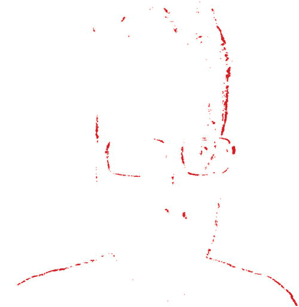

# 8. 使用 WebRTC 进行视频到视频通信

我们的聊天室的自然演进是视频对视频通信，就像 Skype 和 Google Hangouts 使用的那种，但直到最近，这比听起来要困难得多。为什么呢？是的，你猜对了……需要插件（也就是 Flash）。直到 2012 年，也就是 Web 诞生近 20 年后，来自网络摄像头的原生视频流才开始进入浏览器。现在 WebRTC 开始得到良好支持，学习如何使用它是值得的。我不会假装它很简单——它确实不简单——但是，一旦你理解了它的工作原理，一切就都说得通了。

## WebRTC 简介

好了，我们知道 WebRTC 用于实现浏览器之间的通信，但它到底是什么？WebRTC 实际上是一组规范，这些规范通常一起使用来创建实时通信链路。这组规范也包括用于数据的规范，所以它不仅限于视频和音频（尽管在撰写本文时，数据规范的支持还不够好，但正在积极开发中）。WebRTC 的形成方式与 TCP 服务器非常相似，它需要使用正确的协议进行握手，而不是像你习惯使用的普通 API 那样。还应注意，WebRTC 是点对点的，而不是客户端/服务器模式，这就是为什么它需要客户端额外的网络支持。由于大多数 Web 开发者可能从未需要编写 TCP 服务器，我认为我们应该从头开始。

### `GetUserMedia()`

在 WebRTC 出现之前，创建原生视频通信最困难的问题之一，其实并非通信本身难以实现（尽管缺乏点对点能力确实让这件事变得非常困难）。不，最棘手的难题是访问摄像头！

幸运的是，我们现在有了 `navigator.getUserMedia()`，这个函数能让我们从输入设备获取视频和音频，并通过回调函数对这些内容进行处理。

```
navigator.getUserMedia( {audio: true, video: true},
    function(s) {
        vid.src = URL.createObjectURL(s);
        vid.play();
    }, function(error) {throw error;}
);
```

第一个参数是一个配置对象，用于选择你想要使用的输入类型。接着是两个回调函数：第一个定义了成功从输入设备获取媒体流时的处理逻辑，第二个则定义了失败时的处理逻辑。

就是这样。很简单，对吧？曾经网页开发中最令人头疼的问题之一，现在只需要一个方法就能解决。

虽然我们现在纯粹是在讨论 `getUserMedia`，但我想指出的是，你可以用它来实现任何普通视频能做的事情（因为它通过 video 元素传输）。在接下来的几章中，我们将探讨计算机视觉——一个通常被认为与 Web 无关的庞大主题，我们将以 `getUserMedia` 作为整个项目的基础，这将向您展示视频不仅仅能用于视频会议。

## 规范

正如我在本章开头提到的，WebRTC 是一套规范。它包含以下三个 API：

- `Media Stream API`

- `PeerConnection API`

- `DataChannel API`

`Media Stream API` 主要涵盖了我之前解释过的 `getUserMedia()` 方法。它需要单独的规范，因为尽管使用起来非常简单，但对浏览器实现者来说却很复杂。Peer Connections 也很复杂，因为 HTML API 中以前从未有过任何形式的点对点网络。它为我们提供了一个简单的 API 来使用，而无需陷入网络通信的繁杂细节中。

使用这个 API，我们创建一个 Peer Connection 对象来处理所有点对点通信。该对象包含一个 ICE（交互式连接建立）代理、连接状态和 ICE 状态。幸运的是，这些也是通过 API 来处理的！所以我们不需要自己计算正确的状态等，只需使用 `new RTCIceCandidate` 创建对象，它就会自行处理状态。

`Data Channel API` 在撰写本文时是集成度最低的，因为与实时传输视频和音频相比，传输简单数据（使用服务器）已经容易得多。数据通道可能比媒体流更重要，因为它允许数据在点对点之间发送，这有无数可能性，比如制作不需要服务器的多人游戏（或者至少，服务器不需要承担全部负载）。正如我们将在后续章节中看到的，媒体流可以非常强大，但数据的常见用途更多，因此能够无需服务器传输数据是非常令人兴奋的！

## 服务器

很抱歉。是的，WebRTC 不需要服务器——但它确实需要。简单想想，你总是需要一种方式找到对方。没有服务器，除非你手动输入 IP 地址，否则 Peer Connections 根本无法知道在哪里连接。所以我们使用服务器，在我们的例子中是 Node.js，这样消息才能到达正确的客户端。这被称为信令（signaling）。服务器的复杂性取决于你的需求。我们将编写一个相当基础的服务器，用于处理 Offer 和 Candidate，但只限于两个客户端。扩展服务器以支持更多连接是相当简单的。我鼓励你尝试一下，因为这是理解 WebRTC 复杂性及其网络结构的绝佳方式。

## 从何开始？

如你所见，我们面前的任务相当繁重。我认为我们应该从服务器开始，因为它是代码中最小的部分，同时也充当我们的测试套件。我们将对第 7 章中的代码进行扩展，此处附上代码供你回忆和对比。

```
var app = require('express')(),
server = require('http').createServer(app),
io = require('socket.io').listen(server);

io.set('log level', 1); // 移除调试日志

server.listen(8080);

app.get('/:id', function (req, res) {
    res.sendfile(__dirname + '/index.html');
});

io.sockets.on('connection', function (socket) {
    var room = socket.handshake.headers.referer;
    socket.join(room);
    socket.on('message', function (data) {
        io.sockets.in(room).emit('message', data);
    });
    socket.on('leave', function (room) {
        socket.leave(room);
    });
});
```

我们需要保留所有这些代码，不过部分内容将会被编辑。在此类可能相当复杂的应用中，我倾向于为每个套接字赋予一个唯一标识符。为此我使用了 `node-uuid`，因此我们需要在文件顶部导入它。然后，在连接新套接字时运行的代码中，我们将 `uuid.v1()` 的输出赋值给 `socket.id`。当然，我们需要让客户端知道它被分配了一个 ID，因此我们发送一个 `'assigned_id'` 消息，将 ID 发送给客户端。

```
var express = require('express'),
http = require('http'),
uuid = require ("node-uuid"),
app = express(),
server = http.createServer(app),
io = require('socket.io').listen(server);

io.sockets.on('connection', function (socket) {
    var room = socket.handshake.headers.referer;
    console.log('JOINED', room);
    socket.join(room);
    socket.id = uuid.v1();
    socket.emit('assigned_id', socket.id);
    // 其他所有代码写在这里
});
```

客户端需要监听发出的消息，并将其存储在客户端的 socket 中。

```
socket.on('assigned_id', function(data)  {
    console.log('assigned id' + data);
    socket.id = data;
});
```

现在我们需要为信令创建结构。当客户端的摄像头成功启动后，它会将媒体流添加到自己的 `Peer Connection` 中，然后创建一个 `Offer`。在回调函数中，`Peer Connection` 被赋予本地描述（`local description`）。我们从回调中获取描述作为参数。该描述保存了关于客户端的所有数据（以 `SDP` 格式），例如 `IP` 地址。我们将在编写完服务器后解释描述的确切格式；这些信息大部分是为浏览器准备的复杂数据，但其中一部分对理解很有帮助。现在，客户端需要让服务器知道是时候将 `Offer` 发送给另一个客户端了。为了避免混淆，我们称原始客户端为 `c1`，与之连接的客户端为 `c2`。因此，服务器需要将任何 `'received_offer'` 消息发送到正确的套接字 `c2`。最终，服务器对 `'received_candidate'` 和 `'received_answer'` 也要做同样的处理；这三条消息是基本信令切换所需的全部内容。

```
socket.on('received_offer', function(data) {
    console.log("received_offer %j", data);
    io.sockets.in(room).emit('received_offer', data);
});

socket.on('received_candidate', function(data) {
    console.log(" received_candidate %j", data);
    io.sockets.in(room).emit('received_candidate', data);
});

socket.on('received_answer', function(data) {
    console.log(" received_answer %j", data);
    io.sockets.in(room).emit('received_answer', data);
});
```

## WebRTC 连接与信令流程

你必须记住，整个代码在两个客户端上运行，因此 `c1` 会发送 `received_offer` 给 `c2`，但 `c2` 也会将其发送给 `c1`。这是我们知道两者都已就绪的方式。当 `c2` 收到 `offer` 时，它会将其对等连接的远程描述设置为 `c1` 发送的描述（`c1` 的本地描述成为 `c2` 的远程描述，反之亦然）。然后它创建一个 `answer`，并将其本地描述发送回去（同样通过回调处理）；这一步可能看起来不是必需的，因为双方已经拥有彼此的描述，但这可以视为一种确认。它还会在客户端设置一个名为 `connected` 的布尔变量为 `true`，以防止此过程重复并导致无限循环。每个客户端的对等连接在本地描述设置完成后会注册一个 `ICE` candidate 就绪事件；这会触发一个由客户端通过 `pc.onIceCandidate()` 处理的事件，该事件随后用于通过发送之前提到的 `'received_candidate'` 消息来向服务器发送更多数据（以 `SDP` 形式，稍后将解释）。当然，`c2` 现在接收到 `SDP` 并将其用于将 `c1` 添加为对等连接的 `ICE` candidate。

如果一切按计划进行，`c1` 和 `c2` 现在将能够看到彼此。当然，前提是我们已经实现了客户端部分。我的解释可能显得有些混乱，但这是因为我想准确解释其工作原理，而不仅仅是服务器需要处理几条消息。这与我们在第 7 章中所学的概念基本相同，也是编写 `Node.js` 代码时经常使用的模式。清单 8-1 是服务器的代码，包括用于平滑关闭连接的消息以及用于获取房间内客户端数量的消息：

**清单 8-1.** `Server.js`

```javascript
var express = require('express'),
    http = require('http'),
    uuid = require ("node-uuid"),
    app = express(),
    server = http.createServer(app),
    io = require('socket.io').listen(server);

io.set('log level', 1); // 移除调试日志

app.use(express.static('public'));

server.listen(8080);

app.get('/:id?', function (req, res) {
    res.sendfile(__dirname + '/index.html');
});

io.sockets.on('connection', function(socket) {
    var room = socket.handshake.headers.referer;
    console.log('JOINED', room);
    socket.join(room);
    socket.id = uuid.v1();
    socket.emit('assigned_id', socket.id);

    socket.on('debug_clients', function(data) {
        socket.emit('room_count', io.sockets.manager.rooms['/' + room].length);
    });

    io.sockets.in(room).emit('room_count', io.sockets.manager.rooms['/' + room].length);

    socket.on('received_offer', function(data) {
        console.log(" received_offer %j", data);
        io.sockets.in(room).emit('received_offer', data);
    });

    socket.on('received_candidate', function(data) {
        console.log(" received_candidate %j", data);
        io.sockets.in(room).emit('received_candidate', data);
    });

    socket.on('received_answer', function(data) {
        console.log(" received_answer %j", data);
        io.sockets.in(room).emit('received_answer', data);
    });

    socket.on('close', function() {
        console.log("closed %j", room);
        io.sockets.in(room).emit('closed', room);
    });
});
```

## WebRTC 背后的技术

好了，让我们暂时从代码中抽身。我已经描述了 WebRTC 客户端之间相互连接的流程，但其中有很多术语你可能之前没见过。因此，在编写客户端代码之前，我想介绍一下 WebRTC 背后的技术及其工作原理。这些内容有点超出本书的范围，所以我鼓励你进一步阅读相关资料。如果你不太感兴趣，可以跳过本节，直接进入实现客户端的下一节。

### ICE

我之前多次提到 `ICE`。它代表 `Interactive Connectivity Establishment`（交互式连接建立），根据 `RFC 5245`（[`www.ietf.org/rfc/rfc5245.txt`](http://www.ietf.org/rfc/rfc5245.txt)）的定义，它是“一种用于提供/应答模型的网络地址转换（`NAT`）遍历协议”。该 `RFC` 文档非常详细，部分人可能会觉得很有趣，但我认为摘要已经很好地概括了其目的。对某些人来说，这些内容听起来可能完全像天书，但希望在你阅读完我关于 `ICE` 及其他技术的简短总结后，能够理解它。

> 本文档描述了一种用于基于 `UDP` 的多媒体会话的网络地址转换（`NAT`）遍历协议，该会话通过提供/应答模型建立。此协议称为交互式连接建立（`ICE`）。`ICE` 利用了用于 `NAT` 的会话遍历工具（`STUN`）协议及其扩展——使用中继进行 `NAT` 遍历（`TURN`）。任何使用提供/应答模型的协议（如会话发起协议 `SIP`）都可以使用 `ICE`。——`RFC 5245` 摘要

正如我在本章“规范”部分所解释的，每个 WebRTC 客户端必须具备的对等连接由多个组件构成，包括 `iceConnectionState`、`iceGatheringState` 以及 ICE 代理。ICE 代理是重要（且简单）的部分。它是每个客户端上 WebRTC 的端点，负责使用信令协议与其他端点通信。我们使用 ICE 的原因是（正如摘要所述）它是用于 UDP 通信 NAT 遍历的标准化协议。这基本上意味着它能够在不被阻止的情况下穿越安全机制（如防火墙）。ICE 通过并行检查所有可能的通信路径来工作，从而快速找到最优路径。状态（显而易见）用于查找 ICE 代理的状态，并且它们是只读的。

`iceGatheringState` 的可能状态包括：
*   `new`
*   `gathering`
*   `complete`

`iceConnectionState` 的可能状态包括：
*   `starting`
*   `checking`
*   `connected`
*   `completed`
*   `failed`
*   `disconnected`
*   `closed`

### NAT 遍历

NAT 是硬件路由器（以及部分商用交换机）背后的技术，它允许一台路由器后面的多台机器使用同一个 IP 地址工作。它接收传入的数据包，并根据数据包的来源将其发送到正确的设备。它将内部网络地址（例如 `192.168.1.123`）转换为外部 IP，反之亦然。出于多种原因（包括安全性），入站通信通常受到限制，并且通常涉及一个端口白名单表，NAT 设备使用该表将内部地址与入站端口关联起来（通常称为防火墙）。

NAT 遍历是一组方法的统称，用于以用户友好的方式绕过这些限制。如果没有 NAT 遍历技术，用户将不得不手动在防火墙上打开端口以允许入站流量，并将这些端口信息提供给其他连接方。一些常见的 NAT 遍历技术包括：反向代理、套接字安全（SOCKS）、通用即插即用（UPnP）和 UDP 打洞。

### STUN/TURN

STUN（用于 NAT 的会话遍历工具）和 TURN（围绕 NAT 使用中继进行遍历）都是信令协议，通常被 ICE 用作 NAT 遍历的工具。如果你希望运行自己的服务器，每种协议都有开源实现。我在本章中使用的两个服务器（你只需要一个，但可以配置多个作为备份）分别由 Google 和 Mozilla 运行，地址为 `stun:stun.l.google.com:19302` 和 `stun:stun.services.mozilla.com`。你会注意到这两个服务器都是 STUN 服务器。这主要是因为它们是我找到的第一个可靠的免费服务器。两者之间的主要区别在于，TURN 使用中继技术，因此数据通过中继服务器传输到客户端。然而，TURN 的优点是它构建在 STUN 之上，因此它始终首先尝试使用 STUN，如果失败，则使用中继。TURN 的另一个优点是它适用于对称 NAT，而 STUN 无法做到这一点。

#### SDP

如果我用“天书”来形容 ICE 协议的抽象内容，那么我的词汇量无法描述 SDP。乍一看（可能第二眼和第三眼也是），它看起来难以理解。但别担心，重要的部分相当容易理解，其余部分都有文档说明（主要在 `RFC4566` 中）。`SDP` 代表会话描述协议（Session Description Protocol），是在客户端之间发送的数据形式。以下是一个 SDP 示例，本例在 `localhost` 下运行本章代码，并在两个 Google Chrome 标签页之间建立连接。SDP 内容范围很广，很大程度上取决于通信阶段，因此如果你查看自己的 SDP 数据，不要期望它看起来完全相同。我只包含了前 11 行，因为大部分内容对我们调试来说通常没什么用，而且主要与加密有关。

```
v=0
o=- 6888311506875211333 2 IN IP4 127.0.0.1
s=-
t=0 0
a=group:BUNDLE audio video
a=msid-semantic: WMS YuWoij3TGBXIt0Ud2iqCWMbt7FnkBqSNpP96
m=audio 1 RTP/SAVPF 111 103 104 0 8 107 106 105 13 126
c=IN IP4 0.0.0.0
a=rtcp:1 IN IP4 0.0.0.0
a=ice-ufrag:qbj6LYoXCSHnUUuq
a=ice-pwd:C/eziXfWhziBTVpMylTLU2M3
```

这看起来令人生畏，我知道。让我们从等号前面的字母开始。这被称为“类型”，它始终只是一个字符，并且区分大小写。类型的顺序是预定义的，主要是为了减少错误，并使得解析器更容易实现。当然，这也方便调试，因为我们始终知道要找的数据应该在哪里！我只解释前四行，因为它们是最可能出错的行，其余的都是可选的，因此不太可能出问题（如果出了问题，更可能是浏览器中的 bug，而不是你的代码）。请注意，属性采用`<type>=<attribute>:<value>`的形式。如果你有兴趣了解大多数属性，可以很容易地在网上搜索到，我可能会在我的网站上写一篇文章来配合本章内容。

```
会话描述
v=  (协议版本)
o=  (发起者和会话标识符)
s=  (会话名称)
i=* (会话信息)
u=* (描述的统一资源标识符)
e=* (电子邮件地址)
p=* (电话号码)
c=* (连接信息 —— 如果包含在所有媒体中则不需要)
b=* (零行或多行带宽信息)
一个或多个时间描述 ("t=" 和 "r=" 行；见下文)
z=* (时区调整)
k=* (加密密钥)
a=* (零行或多行会话属性行)
零个或多个媒体描述

时间描述
t=  (会话激活时间)
r=* (零个或多个重复时间)

媒体描述（如果存在）
m=  (媒体名称和传输地址)
i=* (媒体标题)
c=* (连接信息 —— 如果在会话级别包含则为可选项)
b=* (零行或多行带宽信息)
k=* (加密密钥)
a=* (零行或多行媒体属性行)

* 表示可选项
```

本类型指南摘自 `RFC 4566`，因此感谢互联网协会（The Internet Society）。你可以很容易地看到 `SDP` 对象如何分为三个部分。在撰写本文时，所有 SDP 对象都以 `v=0` 开头，因为没有其他可用版本。在我的示例中，第二行（发起者和会话标识符）是 `o=- 6888311506875211333 2 IN IP4 127.0.0.1`。连字符表示没有用户名，因为我没有使用私有的 `TURN` 服务器。长数字是会话的唯一标识符。接下来，我们找到这一行的关键部分，至少对于调试来说，那就是会话版本；这是会话数据更改的次数（每次我们发送包含数据的新消息时，此数字都会增加）。你可以使用会话版本绝对确定会话描述已更新。`IN` 代表互联网（Internet），它在那里是为了使协议具有前瞻性。然后我们有 IP 类型，在这种情况下是 IP 版本 4。第二行最后是 IP 地址。我在本地运行，因此它报告 IP 地址为 `127.0.0.1`（`localhost`）。

你可能注意到我的示例直接跳到了时间部分，这是一个实现决策（在本例中由 Chrome 决定），因为中间的行都是可选的。第一个 `0` 表示开始时间，后面的 `0` 表示停止时间。由于两者都是 `0`，这意味着会话是永久性的。

## 客户端代码

好吧，这是从代码中解脱出来的一个不错休息，但我认为我们都准备好重新投入，并对 `WebRTC` 实际工作原理以及我们发送的数据到底是什么有了更坚实的理解。还记得信令如何工作的概述吗？这里再次以列表形式呈现，以便更容易实现：

1.  启动摄像头。
2.  将流添加到 `Peer Connection`。
3.  发送带有本地描述（Local Description）的 `received_offer` 消息。
4.  将本地描述添加到 `Peer Connection`。
5.  将接收到的描述作为远程描述（Remote Description）添加到 `Peer Connection`。
6.  创建应答（Answer）。
7.  设置 `connect` 为 `true` 以防止无限循环。
8.  添加 `ICE Candidate`。
9.  加载摄像头。

你可能还记得本章开头，启动摄像头的正确方法是使用 `navigator.getUserMedia()`。不幸的是，由于在撰写本文时浏览器中的不同实现，我们使用了 `Adapter.js`，它去掉了供应商前缀，以便跨浏览器使用 `RTC`。为了快速加载视频，无需担心用户界面等，我们将 `getUserMedia` 放入一个名为 `broadcast()` 的函数中，并在 `window.onload` 中调用它。在 `getUserMedia` 的回调中，我们需要将流添加到 `Peer Connection`，然后使用 `URL.createObjectURL()`（我们在第 2 章中使用过）将流添加到 `video` 元素并播放视频。一旦服务器发送消息表明房间人数超过 1，就该向服务器发送 offer 了。

```markdown
```javascript
var socket = io.connect('http://localhost');
var pc = new RTCPeerConnection(servers, mediaConstraints);
var initConnection = false;

socket.on('room_count', function(data) {
  room_count = data;
  console.log('ROOM COUNT', data);
  if (room_count > 1)
    initConnection = true;
});

function broadcast() {
  getUserMedia({audio: true, video: true}, function(s) {
    pc.addStream(s);
    console.log("GOT MEDIA");
    vid1.src = URL.createObjectURL(s);
    vid1.play();
    if (initConnection) start();
  }, function(error) {throw error;});
};

window.onload = function() {
  broadcast();
};
```

在 `start()` 中，我们需要创建 offer，这通过 `Peer Connection` 的 `pc.createOffer()` 发生。该方法本身提供了 `SDP` 作为参数，我们可以使用它来设置本地描述（Local Description），并向服务器发送一条包含 `SDP` 的 `'received_offer'` 消息。

```javascript
function start() {
  console.log('STARTING');
  // 这将初始化 peer connection
  pc.createOffer(function(description) {
    console.log(description);
    pc.setLocalDescription(description);
    socket.emit('received_offer', JSON.stringify(description));
  }, null, mediaConstraints);
};
```

你会注意到两个额外的参数，第二个是用于错误处理的回调（为了简单起见，我省略了它），第三个是我称为 `mediaConstraints` 的变量。这个变量包含强制数据，用于说明视频和/或音频是否可用，以及可选数据，在本例中是 `DtlsSrtpKeyAgreement`，它用于为默认不启用它的浏览器（例如旧版 Chrome）启用数据报传输层安全性（Datagram Transport Layer Security）。

```javascript
var mediaConstraints = {
  'mandatory': {
    'OfferToReceiveAudio':true,
    'OfferToReceiveVideo':true
  },
  'optional': [{'DtlsSrtpKeyAgreement': 'true'}]
};
```

### 建立对等连接的步骤

这就引出了步骤 4，将远程描述添加到对等连接中。我们从之前发送的 `"received_offer"` 消息中获取此描述（请记住，客户端 1 和 2 都会互相发送该消息）。首先，解析 SDP 的 JSON 字符串化数据，并将其存储在一个名为 `data` 的变量中。然后，通过访问 `type` 属性来确认数据确实是一个 offer，以此防范可能出现的边界情况。接着，我们将对等连接的远程描述设置为数据的 `RTCSessionDescription`。完成这一步后，我们以与使用 `createOffer()` 类似的方式，使用对等连接的 `createAnswer()` 方法。首先，将本地描述设置为与提供的数据相同，然后向服务器发送一条 `"received_answer"` 消息。

```javascript
socket.on('received_offer', function(data) {
    data = JSON.parse(data);
    console.log('received offer');
    if (data.type == "offer") {
        pc.setRemoteDescription(new RTCSessionDescription(data));
        pc.createAnswer(function(data) {
            console.log('sending answer', data);
            pc.setLocalDescription(data);
            socket.emit('received_answer', data);
        }, null, mediaConstraints);
    }
});
```

当然，我们现在要检查 `"received_answer"`（当你把整个过程拆解成小部分时，一切就没那么复杂了，对吧？）。我们现在需要一个名为 `connected` 的变量，以确保只尝试连接一次。如果该变量被设置为 `false`，并且数据确实是一个 answer，那么我们将再次使用 SDP 创建一个远程描述，并将其添加到对等连接中。然后，我们只需将 `connected` 设置为 `true`，这样就不会反复重连（再次强调，这是一种很少出现的边界情况）。

```javascript
socket.on('received_answer', function(data) {
    console.log('received answer', data);
    if(!connected && data.type == "answer") {
        var description = new RTCSessionDescription(data);
        console.log("Setting remote description", description);
        pc.setRemoteDescription(description);
        connected = true;
    }
});
```

现在，对等连接知道它有一个 ICE 候选项，因为一旦设置了本地描述，对等连接就会开始“收集候选项”。当它获得一个 ICE 候选项时，我们将其自己的候选项（包括 ID 和标签）作为 `"received_candidate"` 消息发送回去。因此，我们现在需要监听 `"received_candidate"`，并将该候选项添加到对等连接中。这个过程主要只是为了确认每个候选项，当客户端数量超过两个时，这会更成问题。清单 8-2 显示了 `client.js` 文件的当前状态。

**清单 8-2.** `Client.js`

```javascript
socket.on('received_candidate', function(data) {
    console.log('received candidate', data);
    data = JSON.parse(data);
    var candidate = new RTCIceCandidate({
        sdpMLineIndex: data.label,
        candidate: data.candidate
    });
    pc.addIceCandidate(candidate);
});

pc.onicecandidate = function(e) {
    console.log("oniceCandidate", e);
    if(e.candidate) {
        socket.emit('received_candidate', JSON.stringify({
            label: e.candidate.sdpMLineIndex,
            id: e.candidate.sdpMid,
            candidate: e.candidate.candidate
        }));
    }
};
```

既然两个对等连接都已拥有所需的所有候选项，我们基本上就完成了。一切都准备就绪后，`addstream` 事件将被触发，让我们可以将远程视频流放入一个视频元素中（在本例中为 `vid2`）。

```javascript
pc.onaddstream = function(e) {
    console.log('start remote video stream');
    console.log(e);
    vid2.src = URL.createObjectURL(e.stream);
    vid2.play();
};
```

值得注意的是，未关闭连接的用户会看到远程视频停留在最后传输的那一帧上。你可以通过为`'close'`消息添加事件处理程序，使其显示连接已断开。代码的最终版本可以在 Apress 网站 [`www.apress.com/9781430259442`](http://www.apress.com/9781430259442) 或我的个人网站 shanehudson.net/javascript-creativity 的下载资源中找到。

## 总结

我希望你喜欢这一章。`WebRTC` 是一种起初令人困惑，且在浏览器实现层面（如 `SDP`）非常复杂的技术，但一旦你掌握了它，实际上相当简单。它也极其强大。我们在这里演示了最显而易见的用例，因为作为入门介绍它最为有用，但 `WebRTC`（特别是如果你想放弃信令机制并采用其他方法来寻找其他客户端）作为一种通用的点对点技术也非常有用；例如，如果你希望用户在没有服务器开销的情况下进行连接，可以开发一个游戏或原型应用。访问用户摄像头的功能也非常强大，正如你将在下一章中看到的，我们将开始探索计算机视觉领域。

# 运动检测

## 运动检测简介

到目前为止，在整本书中，我们已经研究了许多技术，它们具有明显的应用场景，无需太多创造力即可实现，有些是以前无法实现但现在却很容易做到的事情，例如上一章中的视频聊天。现在，我想深入探讨计算机视觉领域，这是我个人的兴趣之一，并且拥有多种多样的应用方式。由于本书既不涉及高级计算机视觉，也不针对学术/研究实验室，我们将坚持使用相对简单的算法，并避免任何需要训练的人工智能技术，例如面部识别。

在本章中，我们专注于运动检测，因为它与 `WebRTC` 结合得很好，并且可能是基础计算机视觉中最有用的方面之一。在下一章中，我们将创建一个可以通过运动检测来演奏，并通过 `WebRTC` 与他人合奏的乐器，这将很好地贯穿整本书。不过现在，请思考一下运动检测还能用于哪些其他类型的应用，例如家庭安防，甚至仅仅是视觉效果。

### 视频处理样板代码

到目前为止你可能会注意到，大多数此类项目都遵循类似的模式。这里我快速介绍本章中视频处理代码（即便不是全部，也是绝大部分）将要使用的模式。我们首先为 `window.URL` 和 `navigator.getUserMedia` 编写一个 shim，本章我决定使用一个变量来调用与浏览器兼容的方法，而不是像上一章那样使用完整的 polyfill（因为完整的 `WebRTC` 技术栈比 `getUserMedia` 的浏览器支持度更差）。

```
window.URL = window.URL || window.webkitURL;

navigator.getUserMedia  =  navigator.getUserMedia ||
                           navigator.webkitGetUserMedia ||
                           navigator.mozGetUserMedia ||
                           navigator.msGetUserMedia;

if (navigator.getUserMedia === undefined) {
    throw new Error("Browser doesn't support getUserMedia");
}
```

现在我们需要设置页面，在本例中，要让视频和 canvas 元素在浏览器窗口内全屏显示。只需将 video 元素设置为自动播放，获取 canvas 的上下文，并初始化视频流。为了绘制帧，我们连接视频流并添加一个事件监听器，一旦视频准备就绪（例如 `'canplay'` 事件），就调用 `draw()`。现在有一个小问题：通常情况下这可以正常工作，但某些版本的 Firefox（编写本书时，这些版本都相当常用）存在一个 bug，会导致 `drawImage` 在视频帧大小尚未设置之前运行。错误是 `NS_ERROR_NOT_AVAILABLE`，为了避免这个错误，我们可以使用 try catch。当然，在生产代码中，无论如何都建议进行彻底的错误处理，所以这不应该是个大问题。

在 try catch 块内，我们需要将 video 元素的图像绘制到 canvas 上下文。为了获取可操作的数据，我们需要使用 `ctx.getImageData(0, 0, w, h)` 来获取帧，它有一个 data 属性可用于检索和修改帧。以下是样板代码。请注意其中有一个注释，指示在何处操作数据。

```
function setup()  {
  videoElement = document.querySelector("video");
  videoElement.width = w = window.innerWidth;
  videoElement.height = h = window.innerHeight;
  videoElement.autoplay = true;
  canvas = document.querySelector('canvas');
  canvas.width = w;
  canvas.height = h;
  ctx = canvas.getContext('2d');
  navigator.getUserMedia({video: true}, function (stream) {
      videoElement.src = window.URL.createObjectURL(stream);
      videoElement.addEventListener('canplay', draw);
  }, function() {});
}

function draw() {
  if (videoElement.paused || videoElement.ended) {
      return;
  }
  try  {
      ctx.drawImage(videoElement, 0, 0, w, h);
      manip = ctx.getImageData(0, 0, w, h);
      var data = manip.data;
      // Manipulate the frame by modifying data
      ctx.putImageData(manip, 0, 0);
      requestAnimationFrame(draw);
  }
  catch (e)  {
      if (e.name == "NS_ERROR_NOT_AVAILABLE") {
          setTimeout(draw, 0);
      }
      else  {
          throw e;
      }
  }
}
```

### 基础视频处理

你应该还记得，在第 3 章中，我们曾通过简单地遍历像素来处理视频，但由于那是本书的开头部分，这里我将快速回顾一下。这次，让我们直接反转像素，这样我们就可以轻松看到处理过程是如何工作的，而不必担心用于创建效果的具体算法。

用于反转帧的函数是 `invertFrame`，它接受 `data` 作为参数。对 `invertFrame` 的调用应放置在样板代码中注释所在的位置，data 参数应来自 `data` 变量。请注意，我们将返回 `data` 变量，以便它直接影响样板代码中的 `manip.data`（因为这是实际的帧）。我们首先得到的数据格式是 `Uint8ClampedArray`。这意味着该数组包含无符号整数（即正数），并且它们被限制为 8 位（一个字节），由于 2⁸ 是 256，因此数组任何索引处的最大值是 255（当然，这是从 0 开始计数的结果）。

**注意**

该数组由 RGBA 颜色值组成，因此您应该每遍历四个索引，以获取每种颜色的起始位置。

因此，在遍历数组时，我们从每种颜色的起始位置开始，因此需要（通常，除非您只想查找红色）同时检查绿色和蓝色的索引（分别通过检查 `data[i+1]` 和 `data[i+2]`）。要反转颜色，我们需要用 255 减去每种颜色的当前值（例如，使白色变成黑色）。

```
function invertFrame(data)  {
  // Iterate through each pixel, inverting it
  for (var i = 0; i < data.length; i += 4) {
    var r = data[i],
        g = data[i+1],
        b = data[i+2];

    data[i] = 255 - r;
    data[i+1] = 255 - g;
    data[i+2] = 255 - b;
  }
  return data;
}
```

请参阅列表 9-1，了解如何将其与样板代码结合使用。

**列表 9-1.**

## 示例代码

```javascript
window.URL = window.URL || window.webkitURL;

navigator.getUserMedia  =  navigator.getUserMedia ||
navigator.webkitGetUserMedia ||
navigator.mozGetUserMedia ||
navigator.msGetUserMedia;

if (navigator.getUserMedia === undefined) {
  throw new Error("Browser doesn't support getUserMedia");
}

var videoElement, canvas, ctx, manip, w, h;
window.addEventListener('DOMContentLoaded', setup);

function setup()  {
  videoElement = document.querySelector("video");
  videoElement.width = w = window.innerWidth;
  videoElement.height = h = window.innerHeight;
  videoElement.autoplay = true;
  canvas = document.querySelector('canvas');
  canvas.width = w;
  canvas.height = h;
  ctx = canvas.getContext('2d');
  navigator.getUserMedia({video: true}, function (stream) {
    videoElement.src = window.URL.createObjectURL(stream);
    videoElement.addEventListener('canplay', draw);
  }, function() {});
}

function draw() {
  if (videoElement.paused || videoElement.ended) {
    return;
  }
  try  {
    ctx.drawImage(videoElement, 0, 0, w, h);
    manip = ctx.getImageData(0, 0, w, h);
    var data = manip.data;
    data = invertFrame(data);
    ctx.putImageData(manip, 0, 0);
    requestAnimationFrame(draw);
  }
  catch (e)  {
    if (e.name == "NS_ERROR_NOT_AVAILABLE") {
      setTimeout(draw, 0);
    }
    else  {
      throw e;
    }
  }
}

function invertFrame(data)  {
  // Iterate through each pixel, inverting it
  for (var i = 0; i < data.length; i += 4) {
    var r = data[i],
        g = data[i+1],
        b = data[i+2];
    data[i] = 255 - r;
    data[i+1] = 255 - g;
    data[i+2] = 255 - b;
  }
  return data;
}
```

## 运动检测

现在你已经刷新了视频操作的知识，让我们深入第一个演示：在视频中检测运动。这是一个有用的计算机视觉技术，尽管（在此例中）它完全基于朴素的方法，不涉及人工智能，也没有特别复杂的算法。仔细想想，运动检测其实就是在显示帧与帧之间的差异。我们可以通过优化、跨多帧检测或跟踪运动来让它变得更复杂，但目前我们只需找出差异。

实现这一点相当容易：你获取当前数据并存储起来，这样在下一帧时，你就能同时拥有新数据和旧数据。一旦你有了这两组数据，就可以进行比较，找出不同的像素。然而，如果你这样做，很快就会注意到摄像头每一帧捕捉到的画面并不完全相同，因此背景看起来会像有许多运动。为了解决这个问题，你可以使用一个阈值来调整精度。因为我们没有使用任何人工智能，所以这个阈值可以是一个效果良好的任意数值（我在测试时，15 的效果就不错）。在图 9-1 中，你可以看到我头部运动的检测结果，这正是因为我使用了任意的阈值。如果我们创建一个 AI，它会尝试找出最可能属于我们寻找的那种运动的像素，比如手的轮廓，或者更简单地说，是一群像素而不是单个点的运动（因为我们感兴趣的任何物体都不可能只有一个像素那么大！）。

在 `try` 块中，我们略微修改了样板代码，使其检查 `oldData` 是否为 `null`（这应该是它的初始值）。如果它不为 `null`，则进行操作；如果为 `null`，则将来自 `data.manip` 的当前数据赋值给它。



**图 9-1.** 屏幕截图显示了我移动时被检测到的面部大致轮廓

```javascript
bctx.drawImage(videoElement, 0, 0, w, h);
manip = bctx.getImageData(0, 0, w, h);
var data = manip.data;
if (oldData != null) {
    data = motionDetection(data, oldData);
    ctx.putImageData(manip, 0, 0);
    oldData = null;
}
else  {
    oldData = manip.data;
}
requestAnimationFrame(draw);
```

`motionDetection()` 函数的工作原理如前所述：它接收当前帧的数据和上一帧的数据（尽管这可以通过多种方式优化或变得更高级，所以不一定非得是上一帧），然后比较它们，并为每一个发生了移动且在阈值范围内的像素绘制一个红色像素。

```javascript
function motionDetection(data, oldData)  {
    // 遍历每个像素，如果未发生变化则设为 255
    for( var y = 0 ; y < h; y++ ) {
        for( var x = 0 ; x < w; x++ ) {
            var indexOld = (y * w + x) * 4,
                    oldr = oldData[indexOld],
                    oldg = oldData[indexOld+1],
                    oldb = oldData[indexOld+2],
                    olda = oldData[indexOld+3];
            var indexNew = (y * w + x) * 4,
                    r = data[indexNew],
                    g = data[indexNew+1],
                    b = data[indexNew+2],
                    a = data[indexNew+3];
            if (oldr > r - 15 || oldg > g - 15 || oldb > b - 15)
            {
                data[indexNew] = 255;
                data[indexNew+1] = 255;
                data[indexNew+2] = 255;
                data[indexNew+3] = 255;
                detected = true;
            }
            else
            {
                data[indexNew] = 255;
                data[indexNew+1] = 0;
                data[indexNew+2] = 0;
                data[indexNew+3] = 255;
            }
        }
    }
    return data;
}
```

## 运动跟踪

# 运动检测与物体跟踪

好了，检测运动是一回事，但除非你在创建报警系统或进行艺术创作，否则单独使用它并不是很有用。你通常要么想让计算机足够聪明，能够识别出物体是什么（这对机器人尤其重要），要么更常见的是，仅仅知道同一个物体在哪里——这被称为跟踪。我们已经生成了一个显示运动的图像，但它并没有尝试将运动归为一个物体。实现这一目标的方法有很多种，例如基于颜色进行校准，并寻找具有正确平均颜色的区域，或者你可以使用人工智能并实际训练它来寻找某个物体。

虽然颜色校准比使用人工智能更容易，但它可能会导致很多问题，而且如果你希望它可靠，涉及的数学很快就变得过于复杂，不适合在一本书的单独一章中讲解。因此，我们将采取介于两者之间的方法，使用一个名为 `js-objectDetect` 的库（由 Martin Tschirsich 编写，可在 github 上找到：[`https://github.com/mtschirs/js-objectdetect`](https://github.com/mtschirs/js-objectdetect)），它基于 OpenCV 目标检测器，并且可以使用已训练好的分类器。在我们开始看代码之前，让我们先了解一下这个库实际的工作原理。

## 类 Haar 特征

大多数图像处理算法都需要一种检测图像中特征的方法，而有相当多的不同方法可以做到这一点。最常用的方法（由于它们在 Viola-Jones 算法中的应用）被称为类 Haar 特征。它们基于 Alfréd Haar 在 1909 年提出的原始 Haar 小波。小波是一种数学函数，它将数据切割成不同的频率，然后缩放并分析数据的模式。它是信号处理的基本工具，并且提供了一种可以缩放数据的备选方案，以替代傅里叶变换（我们在第 3 章中使用过）。类 Haar 特征可以被视为 Haar 小波的一种更具体的形式，因为你可以使用不同大小的黑白矩形（如图 9-2 所示）来可视化它们。


**图 9-2.** 类 Haar 特征示例，以黑白矩形形式可视化

它们之所以是黑白矩形，而不是类似于它们正在寻找的特征的形状，是因为大多数物体都有共同的阴影模式（例如在眼睛和鼻子之间）。它们通过使用积分图（summed area tables）来高效工作，以生成所谓的积分图像（integral image），从而可以快速查找矩形内所有像素的总和，而无需每次都重新计算。单独来看，类 Haar 特征并不是特别有用，但当它们作为 Viola-Jones 算法（该算法使用滑动窗口进行搜索）的一部分时，它们就变得至关重要了。

## Viola–Jones

正如你从上一节可能猜到的，驱动 `js-objectDetect` 和 OpenCV 目标检测器的算法，基于保罗·维奥拉和迈克尔·琼斯在 2001 年撰写的一篇论文（后来由莱纳·林哈特改进），通常简称为 Viola–Jones 算法。我不会详细介绍该算法，因为它相当复杂，但如果你对计算机视觉或人工智能有浓厚的兴趣，那么它或许值得一读。原论文确实包含了一些相当高级的数学内容，但它的写作方式应该不会太难理解。该算法的工作原理大致是：获取两组图像——正匹配和负匹配；通过用一个试图匹配图像窗口内容与哈尔特征的小窗口遍历每一张图像，来训练算法。与所有训练一样，样本集越大，结果就应该越准确。

这篇论文将该算法描述为一个“视觉目标检测框架”，因此它可以以多种不同的方式实现。该论文包含了三个主要贡献，它们可以被视为任何基于 Viola–Jones 的人脸检测算法的主要组成部分。第一个组成部分是积分图像，正如我之前所解释的，这是哈尔特征如此高效的原因。第二个组成部分是基于 AdaBoost 的学习算法。他们提出的最后一个对人脸检测很重要的组成部分是级联分类器，它用于快速丢弃图像的背景。值得注意的是，用于检测的算法与用于训练的算法是相同的，因此使用分类器不需要额外的步骤。分类器是训练的结果，我们将使用预定义的级联，这样就不需要训练了（因为这需要大规模数据集，且可能耗时很长）。`js-objectDetect` 库包含了一些作为示例的分类器（包括嘴部、眼睛和手部的分类器，而不仅仅是人脸），因此本章我们将使用这些分类器。级联分类器有两种类型：桩和树。桩是树的一个单一节点，由于其在准确性和效率之间的平衡，通常是最佳选择，因此 `js-objectDetect` 库只处理以 JSON 格式存储的桩级联。

## 使用 `js-objectDetect`

这个库使得使用极其强大的 Viola–Jones 算法变得非常容易，甚至无需安装 OpenCV（一个大型的 C++ 计算机视觉框架）。它采用 GPL 许可证，因此你可以自由阅读和修改其代码。它也有很好的注释，所以如果你对 Viola–Jones 算法的实现细节感兴趣，这绝对是一个好的起点。在下一章中，我们将使用目标检测作为输入，但在本章中，为了演示追踪，我们将改为在人脸周围绘制一个矩形框。人脸检测是计算机视觉的常见用途，因为它是大多数更高级计算机视觉主题（如人脸识别或眼球追踪）的基础。

**注意：** 与运动检测一样，追踪仍然依赖于网络摄像头生成的 2D 图像，因此它可能不是完全准确的，并且需要良好的照明条件以及只能追踪一张人脸。

实际上，使用 `js-objectDetect` 进行人脸检测非常容易；只需引入该库并运行一小段 JavaScript 代码即可。它不使用 canvas，因此可以直接将 `getUserMedia` 与视频元素配合使用，而无需考虑 canvas 上下文。该库当然包含在本书附带的下载文件中。我加入了一个带有 `cursor` 类的 div；这是包围检测到人脸的框。

```html
<!DOCTYPE html>
<html>
<head>
<title>网络摄像头应用</title>
<style>
html, body { margin: 0; padding: 0; }
video { position: absolute; top: 0; left: 0;  }
</style>
</head>
<body>
<video></video>
<div class="cursor"></div>
<script src="js-objectDetect/compatibility.js"></script>
<script src="js-objectDetect/smoother.js"></script>
<script src="js-objectDetect/objectdetect.js"></script>
<script src="js-objectDetect/objectdetect.frontalface.js"></script>
<script src="js-objectDetect/jquery.js"></script>
<script src="js-objectDetect/jquery.objectdetect.js"></script>
<script src="script.js"></script>
</body>
</html>
```

所需的 JavaScript 代码（位于 `script.js` 内）包含一个设置函数，用于处理视频元素的尺寸以及 `getUserMedia`，该函数会调用绘制函数在每一帧上运行检测。还有一个 jQuery 函数用于实际在人脸周围绘制方形框。它通过从库中获取尺寸，并修改 div 的 CSS 来适应它。

```javascript
window.URL = window.URL || window.webkitURL;
navigator.getUserMedia  =  navigator.getUserMedia ||
navigator.webkitGetUserMedia ||
navigator.mozGetUserMedia ||
navigator.msGetUserMedia;
if (navigator.getUserMedia === undefined) {
if (console !== undefined) {
console.log("浏览器不支持 getUserMedia");
}
}
window.addEventListener('DOMContentLoaded', setup);
function setup()  {
videoElement = document.querySelector("video");
videoElement.width = w = window.innerWidth;
videoElement.height = h = window.innerHeight;
videoElement.autoplay = true;
navigator.getUserMedia({video: true}, function (stream) {
videoElement.src = window.URL.createObjectURL(stream);
videoElement.addEventListener('canplay', draw);
}, function() {});
}
$.fn.highlight = function(rect, color) {
$('.cursor').css({
"border":   "2px solid " + color,
"position": "absolute",
"left":     ($(this).offset().left + rect[0]) + "px",
"top":      ($(this).offset().top  + rect[1]) + "px",
"width":    rect[2] + "px",
"height":   rect[3] + "px",
"z-index": 2
});
}
function draw()  {
$("video").objectdetect("all", {classifier: objectdetect.frontalface}, function(faces) {
for (var i = 0; i < faces.length; ++i) {
$(this).highlight(faces[i], "red");
}
});
requestAnimationFrame(draw);
}
```

我希望通过本章，你对如何实时处理视频并利用它产生实用的解决方案有了更深入的理解。运动检测和目标追踪是计算机视觉的两个关键起点。虽然目前网络上计算机视觉的应用场景可能还不多，但我们开始看到越来越多的应用，例如在照片中检测人脸以便标记人物。一些公司（*咳咳* 脸书）甚至在推进人脸识别，而这正是基于人脸检测的。许多人认为计算机视觉极其复杂，只有学术界才需要关注，但事实并非如此。我强烈建议你进一步探索这个主题，其中很多内容超出了本书的范围，但如果你查看附录，你会找到一些额外的信息和有用的资源以便进一步阅读。下一章将基于本章的一些概念进行构建，尽管我们将使用一个相当简单的算法来检测手指的运动，以便我们可以用它来在本书前面构建的键盘上弹奏一个音符。希望你能看到，无论是通过编写简单算法还是利用他人已有的库，入门计算机视觉并不像大多数人想象的那么困难，而且现在通过使用 HTML5 和 JavaScript 就能实现，甚至更加容易，无需依赖 C++或其他更复杂的语言！