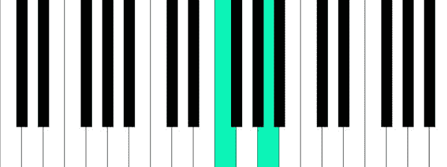
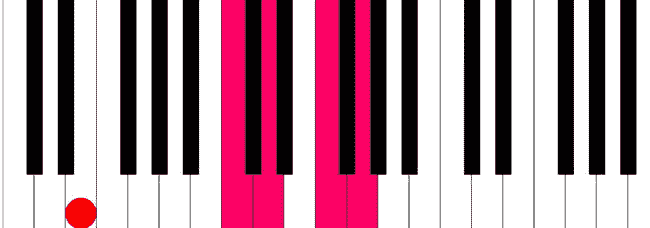

# 10. 使用手势与浏览器交互

本章旨在将你目前学到的所有知识融会贯通，构建一个雄心勃勃的音乐创作 Web 应用，它允许多人使用计算机生成的音频，通过 JavaScript、Node.js 和一些 HTML5 API 同时演奏乐器。哦，对了，它还需要利用网络摄像头，让你能通过手指在空中进行输入。

我相信你也能想象，这是一项艰巨的任务。本章将带你实现其基础版本，并允许你按照自己的意愿进行扩展。例如，与其追踪所有手指以便正确弹奏键盘，不如改为使用一个光标，你可以通过指向左侧或右侧来移动它，或者指向中间来模拟按键。

## 将键盘移至服务器端

我们将基于第 5 章的键盘来构建这个项目。目前，键盘的设置允许你同时演奏多个音符（这是一个好的开端），但我们需要修改它，以使多人能够同时演奏多个音符。当然，即使两个人演奏同一个音符，也应该只播放一次。这非常理想，因为这意味着我们每个人只需要一组振荡器，所以当 B 开始演奏某个音符时，它将使用 A 正在使用的同一组振荡器来播放。

之前我们在 `stopSound` 函数中关闭了振荡器，但这可能会导致竞态条件问题（即，操作不一定会按照你期望的顺序发生），而且由于无法播放已停止的振荡器，更好的做法是删除它（在本例中，我们会将其设为 null）并创建一个新的（反正我们之前也是这么做的）。为了更容易检查振荡器是否存在，我修改了数组初始化循环，将索引初始值设为 null，而不是一开始就创建新的振荡器。

```
// 白键
var o = new Array(21);
for (var i = 0; i < 21; i++)  {
    o[i] = null;
}

// 黑键
var ob = new Array(15);
for (var i = 0; i < 15; i++)  {
    ob[i] = null;
}

function stopSound(i, black)  {
    var osc;
    if (black) {
        osc = ob[i];
    } else {
        osc = o[i];
    }
    if ((black && ob[i] !== null) || (!black && o[i] !== null)) {
        osc.noteOff(0);
        osc.disconnect();
        if (black) {
            ob[i] = null;
        } else {
            o[i] = null;
        }
    }
}
```

现在，`playSound` 函数需要在对应键上没有正在使用的振荡器时才播放新声音；否则会导致问题，比如无法停止播放，或者声音只会播放很短的时间。我还对它进行了一些清理，避免在不需要的情况下重复检查相同的条件。注意，我将 `ctx` 改为了 `actx`，这样做是为了明确它是一个音频上下文（Audio Context），并避免与用于计算机视觉的画布上下文（Canvas Context）混淆。

```
var gainNode = actx.createGainNode();
gainNode.connect(actx.destination);

function playSound(i, black) {
    if ((black && ob[i] === null) || (!black && o[i] === null)) {
        var osc = actx.createOscillator();
        var freq;
        if (black)  {
            freq = blackNotes[i];
        }
        else  {
            freq = whiteNotes[i];
        }
        osc.type = 3;
        osc.frequency.value = freq;
        osc.connect(gainNode);
        osc.noteOn(0);
        if (black) {
            ob[i] = osc;
        } else {
            o[i] = osc;
        }
    }
}
```

现在键盘的设置好了一些，我们可以编写服务器代码了。Socket.IO 允许你以一种非常优雅的方式定义客户端和服务器之间所有通信的结构；每条消息都是一个任务，通常会被传递给其他客户端。键盘有两个任务：播放声音和停止播放声音。我们只需要一些监听器来处理播放或停止声音的消息即可。

```
socket.on('play_sound', function (data) {
    data.color = socket.color;
    console.log("play sound %j", data);
    socket.broadcast.to(room).emit('play_sound', data);
});

socket.on('stop_sound', function (data) {
    console.log("stop sound %j", data);
    socket.broadcast.to(room).emit('stop_sound', data);
});
```

你可能注意到了，我们会向房间内的每个人发送一个颜色值；这样他们就能轻松看到其他人按下了哪些键。我没有使用数据库或其他方式为它们创建唯一标识，而是在 socket 初始连接时创建一个随机颜色。我通过生成一个随机数并乘以 16777215 来实现这一点，这本质上等同于对白色（`#ffffff`）的十六进制颜色进行位运算左移。

```
socket.color = '#'+ ('000000' + Math.floor(Math.random()*16777215).toString(16)).slice(-6);
```

就是这样！其余的服务器端代码与我们在第 7 章中的代码相同。

`server.js`

```
var express = require('express'),
    http = require('http'),
    uuid = require ("node-uuid"),
    app = express(),
    server = http.createServer(app),
```


```javascript
io = require('socket.io').listen(server);
```

```javascript
io.set('log level', 1); // 移除调试日志
```

```javascript
app.use(express.static('public'));
```

```javascript
server.listen(8080);
```

```javascript
app.get('/:id', function (req, res) {
  res.sendfile(__dirname + '/index.html');
});
```

```javascript
io.sockets.on('connection', function (socket) {
  var room = socket.handshake.headers.referer;
  console.log('已加入', room);
  socket.join(room);
  socket.id = uuid.v1();
  socket.color = '#'+ ('000000' + Math.floor(Math.random()*16777215).toString(16)).slice(-6);
  io.sockets.in(room).emit('room_count', io.sockets.manager.rooms['/' + room].length);

  // WebRTC 信令
  socket.on('received_offer', function(data) {
    console.log("收到 offer %j", data);
    io.sockets.in(room).emit('received_offer', data);
  });

  socket.on('received_candidate', function(data) {
    console.log("收到 candidate %j", data);
    io.sockets.in(room).emit('received_candidate', data);
  });

  socket.on('received_answer', function(data) {
    console.log("收到 answer %j", data);
    io.sockets.in(room).emit('received_answer', data);
  });

  // 聊天室消息
  socket.on('message', function (data) {
    io.sockets.in(room).emit('message', data);
  });

  // 音乐
  socket.on('play_sound', function (data) {
    data.color = socket.color;
    console.log("播放声音 %j", data);
    socket.broadcast.to(room).emit('play_sound', data);
  });

  socket.on('stop_sound', function (data) {
    console.log("停止声音 %j", data);
    socket.broadcast.to(room).emit('stop_sound', data);
  });

  // 关闭 socket 并通知其他人
  socket.on('close', function () {
    console.log("已关闭 %j", room);
    io.sockets.in(room).emit('closed', room);
    socket.leave(room);
  });
});
```

在客户端，我们既需要发送消息，也需要处理接收的消息。首先，让我们设置颜色。当收到`'color'`消息时，我们设置一个名为`color`的变量（如果你一步步分解来看，这真的很简单！）。

```javascript
socket.on('color', function(data) {
  color = data;
})
```

当接收到播放或停止消息时，我们需要调用相应的函数；播放时还需要将特定按键的颜色设置为与发送者对应的颜色。停止时，颜色应恢复为黑色或白色。

```javascript
socket.on('play_sound', function(data) {
  if (data.black) {
    bkeys[data.i].fill({ color: data.color });
  } else {
    keys[data.i].fill({ color: data.color });
  }
  playSound(data.i, data.black);
});

socket.on('stop_sound', function(data) {
  if (data.black) {
    bkeys[data.i].fill({ color: '#000' });
  } else {
    keys[data.i].fill({ color: '#fff' });
  }
  stopSound(data.i, data.black);
});
```

要发送消息，我们只需发出`i`、`black`以及`color`变量。每次按下按键时都需要发送这些数据——包括通过鼠标、键盘和摄像头输入。请注意，我们不仅仅在`playSound`或`stopSound`时发送，因为它们在收到消息时被调用，会导致循环。加上发送的消息后，所有输入的代码如下所示：

```javascript
var keys = [];
var cursor = [];
for (var i = 0; i < 21; i++) {
  keys[i] = keyboard.rect(width/21, height);
  keys[i].move(width/21 * i, 0);
  keys[i].attr({ fill: '#fff', stroke: '#000', id: "key"+i });
  keys[i].mousedown ((function(n) {
    return function() {
      var key = SVG.get("key"+n);
      key.fill({ color: '#f06' });
      socket.emit('play_sound', { "i":n,"black":false});
      playSound(n, false);
    }
  })(i));
  keys[i].mouseup((function(n) {
    return function() {
      keys[n].fill({ color: '#fff' });
      socket.emit('stop_sound', { "i":n,"black":false});
      stopSound(n, false);
    }
  })(i));
  cursor[i] = keyboard.circle(width/21);
  cursor[i].attr({ fill: '#ff0000' });
  cursor[i].move(width/21 * i, height / 1.5);
  cursor[i].hide();
}

var bkeys = [];
var prev = 0;
for (var i = 0; i < 15; i++) {
  bkeys[i] = keyboard.rect(width/42, height / 1.7);
  bkeys[i].attr({ fill: '#000', stroke: '#000', id: "bkey"+i });
  bkeys[i].move(prev + (width/(21*1.3)), 0);
  prev = prev + width/21;
  if (i == 1 || i == 4 || i == 6 || i == 9 || i == 11) {
    prev += width/21;
  }
  bkeys[i].mousedown ((function(n) {
    return function() {
      var key = SVG.get("bkey"+n);
      key.fill({ color: '#f06' });
      socket.emit('play_sound', { "i":n,"black":true});
      playSound(n, true);
    }
  })(i));
  bkeys[i].mouseup((function(n) {
    return function() {
      bkeys[n].fill({ color: '#000' });
      socket.emit('stop_sound', { "i":n,"black":true});
      stopSound(n, true);
    }
  })(i));
}

window.addEventListener('keypress', function(e) {
  for (var i = 0; i < keyboardPressKeys.length; i++) {
    if (e.keyCode == keyboardPressKeys[i]) {
      var n = i + octave * 7;
      var key = SVG.get("key"+n);
      key.fill({ color: '#f06' });
      socket.emit('play_sound', { "i":n,"black":false, "color":color});
      playSound(n, false);
    }
  }
  for (var i = 0; i < blackKeyPress.length; i++) {
    if (e.keyCode == blackKeyPress[i]) {
      var n = i + (octave * 5);
      var key = SVG.get("bkey"+n);
      key.fill({ color: '#f06' });
      socket.emit('play_sound', { "i":n,"black":true, "color":color});
      playSound(n, true);
    }
  }
  if (e.keyCode == 97 && octave > 0) {
    --octave;
  }
  if (e.keyCode == 108 && octave < 2) {
    ++octave;
  }
});

window.addEventListener('keyup', function(e) {
  console.log(e.keyCode);
  for (var i = 0; i < keyboardKeys.length; i++) {
    if (e.keyCode == keyboardKeys[i]) {
      var key = SVG.get("key"+(i+octave*7));
      key.fill({ color: '#fff' });
      socket.emit('stop_sound', { "i":i+octave*7,"black":false, "color":color });
      stopSound(i+octave*7, false);
    }
  }
  for (var i = 0; i < blackKeys.length; i++) {
    if (e.keyCode == blackKeys[i]) {
      var n = i + octave * 5;
      var key = SVG.get("bkey"+n);
      key.fill({ color: '#000' });
      socket.emit('stop_sound', { "i":n,"black":true, "color":color });
      stopSound(n, true);
    }
  }
});
```

这样一来，每次键盘上的按键被按下时，房间里的每个人都会听到声音。这是一个很好的例子，展示了如何从简单的聊天室这样的事物，演变为更高级的功能，而实际工作原理上的差异却微乎其微。图 11-1 展示了一个示例，其中两个音符正在播放，按键填充了用户独有的颜色。



**图 11-1.** 键盘弹奏时按键显示用户自定义颜色


## 用摄像头控制音乐

为键盘添加动作控制只需实现前一章中的步骤即可。我们首先捕捉摄像头中的两帧画面并进行分析，以找出两帧之间的运动。请记住，我们并未使用任何人工智能技术，因此你可能需要调整一些数值，使其能根据你的光照条件、与屏幕的距离（以及身后的移动情况）来准确识别。

要检测运动，我们遍历第二帧画面的每个像素，并将其与前一帧的对应像素进行比较。如果像素值不同，就将其颜色变为黑色，否则变为白色。在这个示例中，我们只需要检测 X 轴方向上的运动：因此每当检测到运动时，我们就会根据运动发生的 X 位置，累加其对应的宽度百分比数值。例如：`motionX += 100*(x/w);`。遍历检查完毕后，将总和除以计数即可得出平均的 X 位置。由于运算方法简单，结果并不完全精确，但足以指示运动的大致方向。根据画布的朝向，你可能需要反转数值才能正确镜像运动：`motionX = 100 - motionX;`。

现在，我们可以检查 `motionX` 是否位于我们关注的特定运动范围之内。在本例中，我们希望光标能左右移动，并在中间三分之一的区域检测到运动时按下按键。因此，如果 `motionX` 小于 `100/3`，则向左移动；如果介于 `100/3` 和 `(100/3)*2` 之间，则按下按键；如果大于 `(100/3)*2`，则向右移动。

本例仅适用于白键，但你完全可以通过额外检测 Y 轴上的运动，将其轻松扩展以涵盖黑键。

```javascript
function motionDetection(data, oldData)  {
  var motionX = 0;
  var count = 0;

  // 遍历每个像素，若未改变则设为 255
  for( var y = 0 ; y < h; y++ ) {
    for( var x = 0 ; x < w; x++ ) {
      var indexOld = (y * w + x) * 4,
          oldr = oldData[indexOld],
          oldg = oldData[indexOld+1],
          oldb = oldData[indexOld+2],
          olda = oldData[indexOld+3];

      var indexNew = (y * w + x) * 4,
          r = data[indexNew],
          g = data[indexNew+1],
          b = data[indexNew+2],
          a = data[indexNew+3];

      if (oldr > r - 30 || oldg > g - 30 || oldb > b - 30) {
        data[indexNew] = 255;
        data[indexNew+1] = 255;
        data[indexNew+2] = 255;
        data[indexNew+3] = 255;
      } else {
        data[indexNew] = 0;
        data[indexNew+1] = 0;
        data[indexNew+2] = 0;
        data[indexNew+3] = 255;
        motionX += 100*(x/w); // motionX = X 位置对应的宽度百分比
        count++;
      }
    }
  }

  motionX = motionX / count;
  motionX = 100 - motionX;

  if (motionX > 0)  {
    if (motionX > 100/3 && motionX < (100/3)*2)  {
      if (o[i] === null)
        playSound(currentCursor, false);
      console.log('2');
    }

    if (motionX > (100/3)*2)  {
      if (currentCursor + 1 < keys.length)  {
        cursor[currentCursor].hide();
        stopSound(currentCursor, false);
        currentCursor++;
        cursor[currentCursor].show();
      }
      console.log('3');
    }

    if (motionX < 100/3) {
      if (currentCursor - 1 >=0)  {
        cursor[currentCursor].hide();
        stopSound(currentCursor, false);
        currentCursor--;
        cursor[currentCursor].show();
      }
      console.log('1');
    }
  }

  return data;
}
```

光标是一个与琴键同时创建的红色圆点；它不会沿着琴键移动，而是隐藏自身并仅显示正确位置的那个。

```javascript
cursor[i] = keyboard.circle(width/21);
cursor[i].attr({ fill: '#ff0000' });
cursor[i].move(width/21 * i, height / 1.5);
cursor[i].hide();
```

现在，整个项目应该可以正常工作了。你可以在下面的代码清单 11-1 中找到完整代码，也可以从 Apress 网站 [www.apress.com/9781430259442](http://www.apress.com/9781430259442) 或我自己的网站 [www.shanehudson.net/javascript-creativity](http://www.shanehudson.net/javascript-creativity) 提供的下载文件中获取。

```javascript
// 清单 11-1. server.js

var express = require('express'),
    http = require('http'),
    uuid = require ("node-uuid"),
    app = express(),
    server = http.createServer(app),
```


```javascript
io = require('socket.io').listen(server);
io.set('log level', 1); // 移除调试日志
app.use(express.static('public'));
server.listen(8080);
app.get('/:id', function (req, res) {
    res.sendfile(__dirname + '/index.html');
});
io.sockets.on('connection', function (socket) {
    var room = socket.handshake.headers.referer;
    console.log('JOINED', room);
    socket.join(room);
    socket.id = uuid.v1();
    socket.color = '#'+ ('000000' + Math.floor(Math.random()*16777215).toString(16)).slice(-6);
    io.sockets.in(room).emit('room_count', io.sockets.manager.rooms['/' + room].length);
    // WebRTC 信令
    socket.on('received_offer', function(data) {
        console.log("received_offer %j", data);
        io.sockets.in(room).emit('received_offer', data);
    });
    socket.on('received_candidate', function(data) {
        console.log("received_candidate %j", data);
        io.sockets.in(room).emit('received_candidate', data);
    });
    socket.on('received_answer', function(data) {
        console.log("received_answer %j", data);
        io.sockets.in(room).emit('received_answer', data);
    });
    // 聊天室消息
    socket.on('message', function (data) {
        io.sockets.in(room).emit('message', data);
    });
    // 音乐
    socket.on('play_sound', function (data) {
        data.color = socket.color;
        console.log("play sound %j", data);
        socket.broadcast.to(room).emit('play_sound', data);
    });
    socket.on('stop_sound', function (data) {
        console.log("stop sound %j", data);
        socket.broadcast.to(room).emit('stop_sound', data);
    });
    // 关闭套接字并通知其他人
    socket.on('close', function () {
        console.log("closed %j", room);
        io.sockets.in(room).emit('closed', room);
        socket.leave(room);
    });
});
```

```javascript
script.js
var socket = io.connect('http://localhost:8080');
try {
    if (! window.AudioContext) {
        if (window.webkitAudioContext) {
            window.AudioContext = window.webkitAudioContext;
        }
    }
    actx = new AudioContext();
}
catch(e) {
    console.log('Web Audio API is not supported in this browser');
}
window.URL = window.URL || window.webkitURL;
navigator.getUserMedia  =  navigator.getUserMedia ||
    navigator.webkitGetUserMedia ||
    navigator.mozGetUserMedia;
if (navigator.getUserMedia === undefined) {
    if (console !== undefined) {
        console.log("Browser doesn't support getUserMedia");
    }
}
var videoElement, canvas, ctx, manip, w, h;
var oldData = null;
window.addEventListener('DOMContentLoaded', setup);
function setup()  {
    videoElement = document.querySelector("video");
    videoElement.width = w = window.innerWidth;
    videoElement.height = h = window.innerHeight;
    videoElement.autoplay = true;
    canvas = document.createElement('canvas');
    canvas.width = w;
    canvas.height = h;
    ctx = canvas.getContext('2d');
    bcanvas = document.createElement('canvas');
    bcanvas.width = w;
    bcanvas.height = h;
    bctx = bcanvas.getContext('2d');
    navigator.getUserMedia({video: true}, function (stream) {
        videoElement.src = window.URL.createObjectURL(stream);
        videoElement.addEventListener('canplay', draw);
    }, function() {});
}
var width = window.innerWidth;
var height = window.innerHeight;
var keyboard = SVG('keyboard');
var keyboardKeys = [83,68,70,71,72,74,75];
var blackKeys = [69,82,89,85,73];
var keyboardPressKeys = [115,100,102,103,104,106,107];
var blackKeyPress = [101, 114, 121, 117, 105];
var octave = 1; // 其中八度 1 代表中央 C
var currentCursor = 10;
var color;
var keys = [];
var cursor = [];
for (var i = 0; i < 21; i++)  {
    keys[i] = keyboard.rect(width/21, height);
    keys[i].move(width/21 * i, 0);
    keys[i].attr({ fill: '#fff', stroke: '#000', id: "key"+i });
    keys[i].mousedown ((function(n) {
        return function()  {
            var key = SVG.get("key"+n);
            key.fill({ color: '#f06' });
            socket.emit('play_sound', { "i":n,"black":false});
            playSound(n, false);
        }
    })(i));
    keys[i].mouseup((function(n)  {
        return function() {
            keys[n].fill({ color: '#fff' });
            socket.emit('stop_sound', { "i":n,"black":false});
            stopSound(n, false);
        }
    })(i));
    cursor[i] = keyboard.circle(width/21);
}
```

```javascript
cursor[i].attr({ fill: '#ff0000' });
cursor[i].move(width/21 * i, height / 1.5);
cursor[i].hide();
}

var bkeys = [];
var prev = 0;
for (var i = 0; i < 15; i++)  {
    bkeys[i] = keyboard.rect(width/42, height / 1.7);
    bkeys[i].attr({ fill: '#000', stroke: '#000', id: "bkey"+i });
    bkeys[i].move(prev + (width/(21*1.3)), 0);
    prev = prev + width/21;
    if (i == 1 || i == 4 || i == 6 || i == 9 || i == 11)  {
        prev += width/21;
    }
    bkeys[i].mousedown ((function(n) {
        return function()  {
            var key = SVG.get("bkey"+n);
            key.fill({ color: '#f06' });
            socket.emit('play_sound', { "i":n,"black":true});
            playSound(n, true);
        }
    })(i));
    bkeys[i].mouseup((function(n)  {
        return function() {
            bkeys[n].fill({ color: '#000' });
            socket.emit('stop_sound', { "i":n,"black":true});
            stopSound(n, true);
        }
    })(i));
}

window.addEventListener('keypress', function(e) {
    for (var i = 0; i < keyboardPressKeys.length; i++)  {
        if (e.keyCode == keyboardPressKeys[i]) {
            var n = i + octave * 7;
            var key = SVG.get("key"+n);
            key.fill({ color: '#f06' });
            socket.emit('play_sound', { "i":n,"black":false, "color":color});
            playSound(n, false);
        }
    }
    for (var i = 0; i < blackKeyPress.length; i++)  {
        if (e.keyCode == blackKeyPress[i]) {
            var n = i + (octave * 5);
            var key = SVG.get("bkey"+n);
            key.fill({ color: '#f06' });
            socket.emit('play_sound', { "i":n,"black":true, "color":color});
            playSound(n, true);
        }
    }
    if (e.keyCode == 97 && octave > 0) --octave;
    if (e.keyCode == 108 && octave < 2) ++octave;
});

window.addEventListener('keyup', function(e) {
    console.log(e.keyCode);
    for (var i = 0; i < keyboardKeys.length; i++)  {
        if (e.keyCode == keyboardKeys[i]) {
            var key = SVG.get("key"+(i+octave*7));
            key.fill({ color: '#fff' });
            socket.emit('stop_sound', { "i":i+octave*7,"black":false, "color":color });
            stopSound(i+octave*7, false);
        }
    }
    for (var i = 0; i < blackKeys.length; i++)  {
        if (e.keyCode == blackKeys[i]) {
            var n = i + octave * 5;
            var key = SVG.get("bkey"+n);
            key.fill({ color: '#000' });
            socket.emit('stop_sound', { "i":n,"black":true, "color":color });
            stopSound(n, true);
        }
    }
});

var gainNode = actx.createGainNode();
gainNode.connect(actx.destination);

// White Keys
var o = new Array(21);
for (var i = 0; i < 21; i++)  {
    o[i] = null;
}

// Black Keys
var ob = new Array(15);
for (var i = 0; i < 15; i++)  {
    ob[i] = null;
}

var PI_2 = Math.PI*2;
var SAMPLE_RATE = 44100;
var whiteNotes = [130.82, 146.83, 164.81, 174.61, 196, 220, 246.94, 261.63
, 293.66, 329.63, 349.23, 392, 440, 493.88, 523.25, 587.33, 659.26, 698.46, 783.99, 880, 987.77];
var blackNotes = [138.59, 155.56, 185, 207.65, 233.08, 277.18, 311.13, 369.99, 415.3, 466.16, 554.37, 622.25, 739.99, 830.61, 932.33];

function playSound(i, black) {
    if ((black && ob[i] === null) || (!black && o[i] === null)) {
        var osc = actx.createOscillator();
        var freq;
        if (black)  {
            freq = blackNotes[i];
        }
        else  {
            freq = whiteNotes[i];
        }
        osc.type = 3;
        osc.frequency.value = freq;
        osc.connect(gainNode);
        osc.noteOn(0);
        if (black) ob[i] = osc;
        else o[i] = osc;
    }
}

function stopSound(i, black)  {
    var osc;
    if (black) osc = ob[i];
    else osc = o[i];
    if ((black && ob[i] !== null) || (!black && o[i] !== null)) {
        osc.noteOff(0);
        osc.disconnect();
        if (black) ob[i] = null;
        else o[i] = null;
    }
}

socket.on('color', function(data)  {
    color = data;
});

socket.on('play_sound', function(data) {
    if (data.black)
        bkeys[data.i].fill({ color: data.color });
    else
        keys[data.i].fill({ color: data.color });
    playSound(data.i, data.black);
});

socket.on('stop_sound', function(data) {
    if (data.black)
        bkeys[data.i].fill({ color: '#000' });
    else
        keys[data.i].fill({ color: '#fff' });
    stopSound(data.i, data.black);
});

function draw() {
    if (videoElement.paused || videoElement.ended) {
        return;
    }
    try  {
        bctx.drawImage(videoElement, 0, 0, w, h);
        manip = bctx.getImageData(0, 0, w, h);
        var data = manip.data;
        if (oldData != null) {
            data = motionDetection(data, oldData);
            ctx.putImageData(manip, 0, 0);
            oldData = null;
        }
        else  {
            oldData = manip.data;
        }
        requestAnimationFrame(draw);
    }
    catch (e)  {
        if (e.name == "NS_ERROR_NOT_AVAILABLE") {
            setTimeout(draw, 0);
        }
        else  {
            throw e;
        }
    }
}

function motionDetection(data, oldData)  {
    var motionX = 0;
    var count = 0;

    // Iterate through each pixel, changing to 255 if it has not changed
    for( var y = 0 ; y < h; y++ ) {
        for( var x = 0 ; x < w; x++ ) {
            var indexOld = (y * w + x) * 4,
                oldr = oldData[indexOld],
                oldg = oldData[indexOld+1],
                oldb = oldData[indexOld+2],
                olda = oldData[indexOld+3];
            var indexNew = (y * w + x) * 4,
                r = data[indexNew],
                g = data[indexNew+1],
                b = data[indexNew+2],
                a = data[indexNew+3];
            if (oldr > r - 30 || oldg > g - 30 || oldb > b - 30)
            {
                data[indexNew] = 255;
                data[indexNew+1] = 255;
                data[indexNew+2] = 255;
                data[indexNew+3] = 255;
            }
            else
            {
                data[indexNew] = 0;
                data[indexNew+1] = 0;
                data[indexNew+2] = 0;
                data[indexNew+3] = 255;
                motionX += 100*(x/w); // motionX = The percentage of W than X is at
                count++;
            }
        }
    }

    motionX = motionX / count;
    motionX = 100 - motionX;

    var key = SVG.get("key"+currentCursor);
    if (motionX > 0)  {
        if (motionX > 100/3 && motionX < (100/3)*2)  {
            if (o[i] === null)  {
                key.fill({ color: '#f06' });
                playSound(currentCursor, false);
            }
            console.log('2');
        }
        if (motionX > (100/3)*2)  {
            if (currentCursor + 1 < keys.length)  {
                cursor[currentCursor].hide();
                key.fill({ color: '#fff' });
                stopSound(currentCursor, false);
                currentCursor++;
                cursor[currentCursor].show();
            }
            console.log('3');
        }
        if (motionX < 100/3) {
            if (currentCursor - 1 >=0)  {
                cursor[currentCursor].hide();
                key.fill({ color: '#fff' });
                stopSound(currentCursor, false);
                currentCursor--;
                cursor[currentCursor].show();
            }
            console.log('1');
        }
    }
    return data;
}
```

在图 11-2 中，你可以看到一个通过摄像头进行运动检测来控制光标（圆形）按下键盘按键的示例。



**图 11-2.** 通过摄像头使用光标控制的键盘

## 总结

本章主要是将所有内容整合在一起，因为前面的章节已经解释了相关技术。我希望它不仅对你有所帮助，也让你看到，只要循序渐进，就能够轻松实现一些相当令人印象深刻的功能。你从让一个方块在画布上滑动，一步步走到了可以挥动双手让浏览器发出声音。

这个项目有很多可以改进的地方，例如让摄像头也能与黑键配合工作（或许你可以通过在 X 轴和 Y 轴上同时检测运动来实现）。或者你也可以直接去创造别的东西——但请记住，真正的学习来自于动手实践代码，而不仅仅是阅读一本书。希望你喜欢阅读这本书。附录提供了一些被认为超出本书主要内容范围外的额外信息，以及一些推荐阅读的资料。

