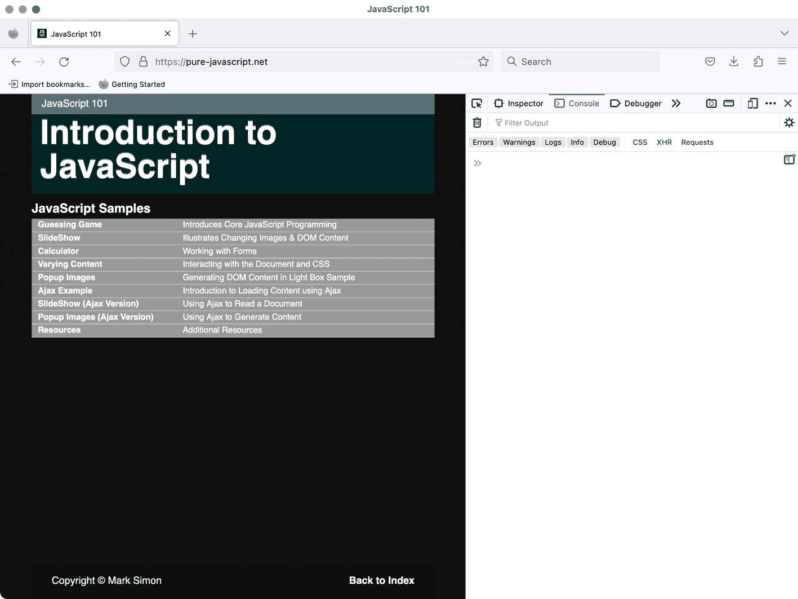
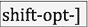
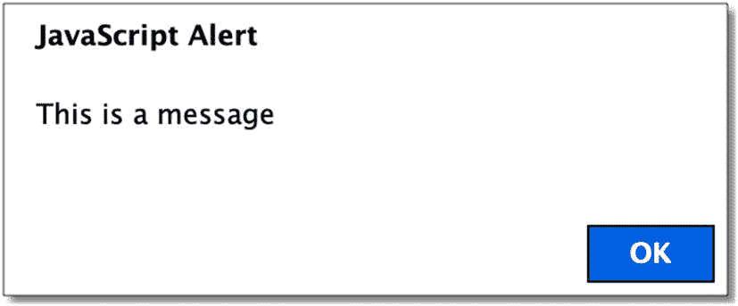
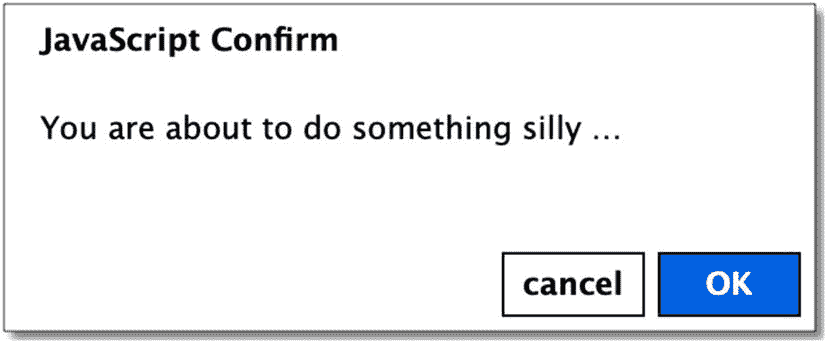
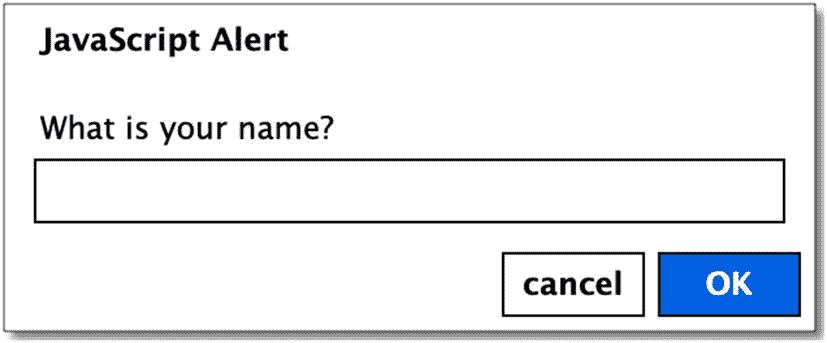
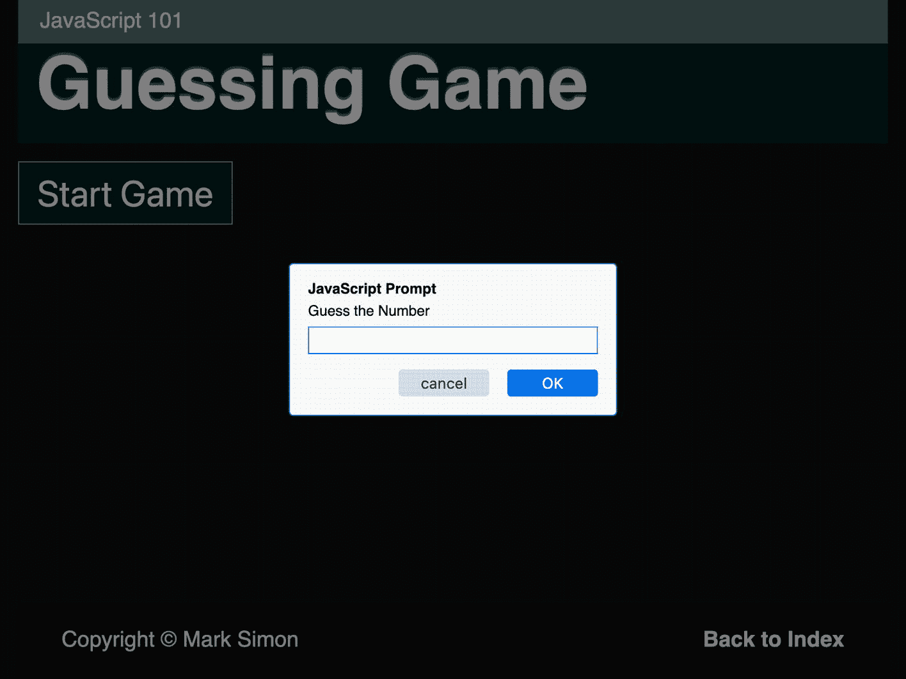
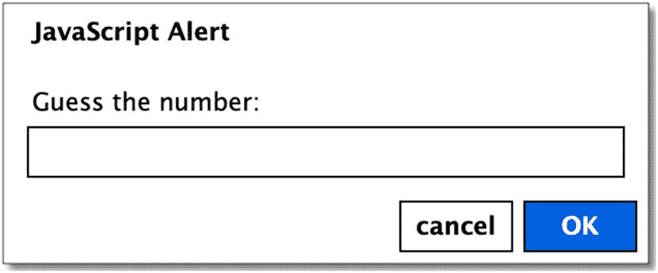
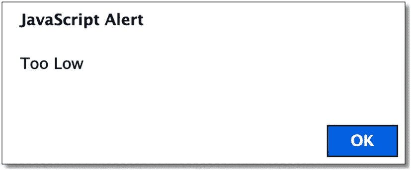
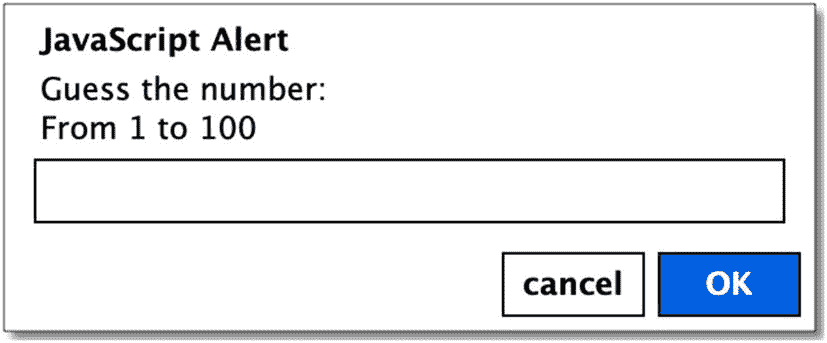

# 1. 使用 JavaScript 工作

如果你是完全的 JavaScript 新手，或者编程新手，那么你需要了解一些基本概念。其中许多概念是其他编程语言共有的，但每种语言都有其独特之处。

在本章中，我们将初步了解以下概念：
- 如何编写 JavaScript 语句
- 使用变量
- 使用不同类型的基本数据
- 函数
- 为代码添加注释
- 特殊值

即使你从其他语言中熟悉了这些概念，也值得浏览一下本章，以防与你自己的经验有显著不同。

接着，你将了解如何为你的网页添加 JavaScript 的基本框架。

当然，在后面的章节中，我们将研究更高级的概念，例如：
- 在第 2 章及后续章节中使用 JavaScript 控制结构
- 在第 3 和第 4 章中使用 HTML 元素
- 在第 5 和第 6 章中使用表单和数据
- 在第 7、8 和 9 章中与用户交互并操作样式
- 在第 10 章中使用 Ajax

但首先，我们先来看一下 JavaScript 是如何工作的。

## 使用开发者工具

本章将具有很强的交互性，因此你需要一个交互性很强的 JavaScript 工具。幸运的是，大多数现代浏览器的开发者工具中都提供了你所需的工具。

你会发现开发者工具不仅对本章有帮助，对调试 JavaScript 乃至 CSS 和 HTML 也很有用。你可以通过某个菜单访问开发者工具，也可以使用以下快捷键之一：

| 操作系统 | 快捷键图示 | 按键组合 |
| --- | --- | --- |
| MacOS |  用于在 Mac O S 中访问开发者工具的 option + command + I 组合键图示。 | `option-command-I` |
| Windows |  用于在 Windows 中访问开发者工具的 control + shift + I 组合键图示。 | `control-shift-I` |

你会看到类似图 1-1 的内容。



一个 JavaScript 101 窗口的截图。控制台选项已被选中。

**图 1-1**

开发者工具

在图中，开发者工具箱已停靠在右侧。

你不需要打开这个特定的页面：任何页面都可以。但稍后，你将使用控制台来处理特定的页面。

使用控制台时，你会注意到一些特殊之处：
- 每当你按下回车键时，所有表达式和值都会自动输出。也就是说，你不会换行，但会得到一个值。
- 如果你想要新的一行代码，你需要按下 `shift-enter`。

虽然我们将交互式地使用控制台，但你也可以从 JavaScript 代码中向控制台写入内容。当然，你通常看不到这些输出，但可以在排查问题时打开控制台。

在控制台窗口中，你会看到一个简单的提示符：`»`。我们将在后续的代码示例中包含这个提示符，但你当然不需要自己输入。例如：

```
»   3+5
```

如果你按下回车键，你会看到经过求值的结果，前面有一个类似左箭头的符号：

```
»   3+5
←   8
```

控制台会始终显示你刚刚输入的表达式或语句的值。

现在，这里有一个容易混淆的地方。有时，你会使用一个特殊的语句，例如 `console.log()`。按下回车键后，你会看到类似下面的内容：

```
»   console.log('Hello');
Hello
←   undefined
```

你实际上看到了*两个*结果。第一个是 `console.log()` 命令的*输出*：如你所料，是 `Hello`。第二个是这条语句的*值*，由于技术原因，它是一个名为 `undefined` 的特殊值。如果你觉得这很令人困惑，嗯，确实如此。好消息是你可以忽略它。

在示例中，有时你会在双斜杠 (`//`) 后面看到一些额外的文本：

```
»   console.log('Hello');   //  向控制台打印 Hello
```

我们稍后会详细说明，但这部分文本被称为`注释`，会被 JavaScript 忽略。它只是为了给阅读代码的人提供帮助。

本书其余的大部分内容涉及真正的代码，你将编写这些代码并将其保存在自己的文档中。然而，我们偶尔会再次需要控制台来试验一些想法。作为提醒，我们会在那时显示提示符。

在本章的其余部分，除非特别要求，你可以在每个示例后按下回车键。在某些情况下，我们会告诉你输出应该是什么样子，但大多数情况下，我们会留给你自己去尝试。

## 上手 JavaScript

尽管 JavaScript 旨在被编写为脚本，并在之后随网页一起运行，但控制台将让你有机会以更交互的方式使用 JavaScript。这意味着我们可以进行实验并尝试新的想法。

但是，在此之前，我们需要了解一些基本概念。

### 基本概念

JavaScript 以文本文件形式编写，由浏览器负责读取、解释并运行代码。将文本代码转换为可执行代码有若干种方式。

- **编译**是指解释代码并将其转换为二进制代码，该代码可直接在计算机上原生运行。编译后的代码一旦保存，即可随时执行。编译器还会借此机会检查错误，并寻找更高效的代码执行方式，这个过程称为优化。有时，这也被称为 AOT（预先）编译。
- **解释**是指在运行代码时逐行解释代码。这种方式通常速度较慢，因为它需要在运行时解释所有内容，并且经常需要重新解释相同的代码。解释器没有机会进行大量优化。解释相比于编译的主要优势在于，我们可以轻松地即时编写和测试代码，因为每次修改后无需等待代码重新编译。

如今，JavaScript 采用了一种介于两者之间的方法，称为 JIT（即时）编译。代码在运行时由浏览器编译，通常是在代码执行到特定部分时分段进行。这种方式既保留了代码的文本形式，又能快速高效地运行。

所有编程语言都遵循一些核心原则。这些原则包括：
- 编写 JavaScript 语句
- 计算
- 数据与变量
- 函数
- 控制结构，如测试和循环
- JavaScript 对象

在本章中，我们将介绍前几个概念。随着后续章节中我们开始编写更多代码，将再继续学习其他概念。

在开始之前，我们需要先厘清一些术语。JavaScript 与大多数其他编程语言一样，对你输入的内容非常严格，因此为了避免歧义，我们需要了解一些字符的正确名称：

| 字符 | 名称 | 部分用途 |
| --- | --- | --- |
| `;` | 分号 | 语句结束 |
| `( )` | 圆括号 | 算术运算 / 组合值 |
| `{ }` | 花括号 | 代码块 / 定义对象（见后文） |
| `[ ]` | 方括号 | 定义数组（见后文）/ 选取集合中的成员 |
| `` ` `` | 反引号 | 在 JavaScript 中用于特殊字符串（见后文） |
| `&#124;` | 竖线，也称“管道符” | 用于逻辑表达式 |
| `&` | 与号 | 用于逻辑表达式 |

你将在后续学习中了解这些字符的更多用法。此处仅为了确保我们知道它们如何称呼。

#### 语句

JavaScript 由许多`语句`和语句块构成。语句有不同类型。

最简单的 JavaScript 语句只是调用某个预定义的代码块：

```
»   console.log('Hello');
```

`console.log` 命令实际上是对一个预定义代码块（称为 `console.log()` `函数`）的调用。在此例中，`console.log()` `函数`向控制台输出一个值。在后续编写实际代码时，你可以使用这个函数来打印值以进行故障排查。

函数是 JavaScript 开发的基础，我们将在整个课程中使用和创建函数。

#### 语句块

有时需要将多条语句放在一个块中。通常是为了让一组语句能够一起被执行或跳过（可能是在某个测试之后）。有时，仅仅是为了将这些语句与其余代码隔离开来。

语句块被包裹在花括号内。例如：

```
»   {
console.log('Hello');
console.log('Goodbye');
}
```

要在控制台日志中获得多行输出，可能需要使用快捷键 `Shift + Enter`。

在这个例子中，将语句分组并没有实际效果。但后续这将是一项重要技术。

你可能已经注意到，在代码示例中，块内的语句都有缩进。JavaScript 不关心代码是否缩进，但缩进能让我们更清晰地看到代码块的结构。本书中的所有代码都会进行明确的缩进，并且*强烈*建议你也这样做，以使你的代码更易于阅读和维护。

#### 表达式

`表达式`是由若干项组合而成、最终得出一个单一值的结果。表达式的示例如下：

```
1 + 2
12 / 3
```

在控制台中，所有表达式一旦按下快捷键 `Enter`，都会自动求值并输出结果，因此你无需特意请求。例如：

```
»   3 + 5
←   8
```

表达式本身并无实际用途。你通常会将其用作语句的一部分。例如：

```
»   a = 12/3;
»   console.log(a + 5);

←   undefined
```

加法、除法等操作被称为算术运算，所使用的符号被称为算术运算符。

还有其他操作，例如布尔运算、字符串运算以及对象运算。在学习了更多数据类型之后，我们将进一步了解这些运算。

### 空格

在表达式中通常不必包含空格。例如：

```
»   console.log(1+2+3);
»   console.log(1 + 2 + 3); // 同样效果
```

然而，有时需要用空格来消除歧义，例如减号的情况：

```
»   console.log(1--2);      //  错误
»   console.log(1 - -2);    //  1 减负 2
```

### 分号

在学术圈中，关于分号的使用有很多争论！本书中，我们推荐使用分号。

传统上，JavaScript 语句以分号（`;`）结尾：

```
»   a = 3;
»   console.log(a + 4);
```

如果能够推测出分号的位置，JavaScript 对缺失分号的情况是宽容的：

```
»   a = 3
»   console.log(a + 4)
```

如果分号本该出现在行末，通常可以推测出来。这种推测机制被称为自动分号插入。

如果分号预期出现在一行中间，则无法被推测出来：

```
»   a = 3 console.log(a + 4)    //  错误
```

在这种情况下，你只能使用分号将语句分隔开：

```
»   a = 3; console.log(a + 4)   //  正常运行
```

关键在于，如果语句的结束位置同时也是行的末尾（通常情况下都是这样），那么行末的分号通常是可选的。

然而，有些人认为，始终用分号标记语句结束是一种良好的做法。

在本书中，所有代码的每条语句末尾都会包含分号。

### 变量与赋值语句

变量是所有编程语言的基石。变量是数据的容器。它们实际上是内存中某处用于存储数据的命名引用。

变量可以有简单的名称，例如 `x` 或 `a`，也可以有更长的名称，例如 `element`。

要将值存入变量，需要使用赋值语句：

```
[变量] = [表达式]
```

这将等号右侧的值放入左侧命名的变量中。例如：

```
»   a = 3;
```

这将值 3 放入名为 `a` 的变量中。

尽管你可能将其读作“a 等于 3”，但更好的理解是“a 的新值是 3”，或者“a 被赋值为 3”，又或者“a 变成 3”。例如：

```
»   a = 0;
»   a = 3;
```

第一个赋值将 `0` 放入 `a`。第二个语句并不声明 `a` 是 `3`；只是说新值是 3。

### 赋值语句两侧的变量

JavaScript 赋值语句的等号两侧可能包含同一个变量。在这种情况下：

*   右侧的变量是表达式的一部分：将使用其当前（旧）值。
*   左侧的变量正在被赋予一个新值。

以下语句进一步说明了这一点：

```
»   a = 3;
»   a = a + 1;  //  a 的新值等于旧值加 1
»   console.log(a);
```

这条语句最好解读为“`a` 的新值是 `a` 的旧值加上 `1`”。虽然没人会这么说，但我们至少应该记住这就是它的含义。

### 递增与递减

将变量增加或减少 1 是很常见的操作。JavaScript 使用递增或递减运算符来实现：

```
++a 或 a++：递增
--a 或 a--：递减
```

单独作为一条语句时，使用前置递增（`++a`）还是后置递增（`a++`）运算符并无区别；递减运算符也是如此。例如：

```
»   a=3; a++; console.log(a);
»   a=3; ++a; console.log(a);
```

会得到相同的结果。

然而，你也可以将这些运算符用在表达式中间。在这种情况下，前置运算符会在值被使用之前生效，而后置运算符会在值被使用之后生效。例如：

```
»   a=3; console.log(++a); console.log(a);  //  前置递增
»   a=3; console.log(a++); console.log(a);  //  后置递增
```

在第一种情况下，变量 `a` 会在被显示之前递增为 `4`。在第二种情况下，变量 `a` 会在被显示之后递增，因此 `console.log()` 会显示旧值 `3`。在这两种情况下，第二个 `console.log()` 都会显示新值 `4`。

请注意，如果只是单独使用这条语句，通常会更倾向于使用后置递增运算符，但并无特殊理由。

### 链式赋值

你可以将多个赋值操作链接到一条语句中。像下面这样的语句很常见：

```
»   a = b = c = 0;
»   console.log(a);
»   console.log(b); // 等等
```

从右侧开始解读，这会将 `0` 赋给 `c`，然后赋给 `b`，最后赋给 `a`。

### 赋值运算符

JavaScript 也有组合算术赋值运算符。它们允许你对变量的旧值执行运算，并将结果作为新值赋给它。实际上，它们仅仅是独立运算符的简写形式。

例如：

```
»   value = 2;
»   value = value + 3;
```

可以写成：

```
»   value = 2;
»   value += 3;
```

这看起来可能改进不大，但 JavaScript 程序员通常更喜欢第二种格式，我们在这里也会使用它：

```
»   a = 5;
»   a += 10;
»   console.log(a);
```

赋值运算符包括以下内容：

| 运算符 | 含义 |
| --- | --- |
| `+=` | 加上旧值 |
| `-=` | 减去旧值 |
| `*=` | 乘以旧值 |
| `/=` | 除以旧值 |
| `%=` | 旧值取余…… |
| `+=` | 拼接至旧值 |

最后一种拼接操作是指连接字符串，这在 JavaScript 程序员中非常常见。本章后面会介绍拼接操作。

现在我们有三种方法让变量递增 1。它们分别是：

```
»   a = a + 1;
»   a += 1;
»   a++;
```

按推荐程度递增排列。

### 变量的命名

纯粹出于懒惰，我们一直使用单字母变量 `a`。如前所述，变量名可以（更）长。JavaScript 变量必须遵循一系列规则。主要规则如下：

1.  变量名必须是单个词（不能有空格）。如果需要使用多个词，可以用驼峰命名法（将每个新词的首字母大写来连接它们）。

    例如：`familyName`

2.  变量名必须以字母开头，但可以包含数字，只要不是以数字开头即可。大多数 JavaScript 程序员以首字母小写开头。

    例如：`big2small`

3.  变量名不应包含特殊字符，但下划线（`_`）除外。你也可以使用一两个其他特殊字符，但这并不常见。

    例如：`part_one`（然而，大多数 JavaScript 程序员会更倾向于使用 `partOne`。）

命名 JavaScript 变量的另一个主要规则是，不应使用 JavaScript 语言中保留的名称。但这并不排除使用已有的函数或变量名，你有权替换它们（有时需自担风险）。

### 大小写敏感性

JavaScript 变量以及 JavaScript 语言的其余部分都是区分大小写的。这意味着你不能用一种大小写形式定义它们，而用另一种形式使用。例如：

```
»   thing = 'Hello';
»   console.log(Thing); //  哎呀
```

`console.log()` 函数会尝试显示 `Thing` 变量的内容。然而，这个变量在前一条语句中并未定义，那条语句只是将值赋给了 `thing`（小写）变量。因此，如果你愿意，你可以有 32（`2`⁵）个拼写与 `thing` 相同但大小写不同的变量。如果不小心，这可能会引起混乱。

### 声明变量

使用和赋值变量是一回事，但 JavaScript 首先需要知道你要使用哪些变量，以便为它们准备存储空间。当你为变量做准备时，就是在声明变量。

在 JavaScript 中，有四种方式可以声明变量：

*   传统上，你可以通过 `var` 语句声明它们。

这里的控制台输出可能有点令人困惑。`var` 语句的输出是 `undefined`。这并不意味着它没有生效，只是没有输出值。另一方面，赋值语句的输出是刚赋的值。这就是为什么你可以进行链式赋值。

现代 JavaScript 为 `var` 提供了两种替代方案：

*   `let` 语句与 `var` 类似，但有一些重要区别，我们稍后会讨论。

    ```
    »   let a;
    »   a = 3;
    ```

*   `const` 语句允许你声明一个常量。常量只能设置一次，因此更稳定。

    ```
    »   const a = 3;
    »   a = 4;  //  错误
    ```

# 变量声明

```
注意，`const` 语句在声明的同时就赋值了。你必须这样做，因为 `const` 之后无法再赋值。

你也可以对 `var` 和 `let` 这样做：

```

```
»   var a = 3;

»   let a = 3;

```

第四种方法是一种遗留方法：

*   当你给一个新变量赋值时，该变量可能会自动声明。例如：

    ```
    »   b = 3;    // 创建一个新变量
    ```

这最后一种方法正是我们目前一直在使用的，但现在必须停止了。我们稍后会解释原因。

你可以用一条语句声明多个变量。例如：

```
»   var a = 3, b = 4;
```

从 JavaScript 的角度来看，使用单条语句还是多条语句没有区别。然而，如果你试图在视觉上对新变量进行分组，使用单条语句可能会更方便。

特别是在 Firefox 控制台中，你无法重新声明使用 `let` 或 `const` 定义的任何变量，这可能会影响你的操作。如果需要重新声明它们，你应该重新加载页面并重新开始。

请记住，在实际的 JavaScript 中，你同样无法重新声明 `let` 或 `const` 变量。

## 变量声明类型的区别

现代 JavaScript 更倾向于使用 `let` 和 `const` 而非 `var`。

*   `let` 声明更适用于普通变量，因为它的行为更符合你的预期。

    `var` 的问题在于，你可以多次声明同一个变量，并且可以在首次赋值之后才声明它。`let` 语句不允许你做这些操作。

    除此之外，`let` 变量的作用域被限制在其所在的代码块内。我们稍后会详细讨论作用域，但它主要关乎变量在多大范围内仍然有效。

*   如果你希望确保变量的值不会（意外地）改变，`const` 声明是更好的选择。事实上，它们根本不是变量，而是被称为`常量`，原因显而易见。

    较旧的 JavaScript 没有这样的功能，所以你只能使用变量并小心操作。

当我们更认真地编写 JavaScript 时，我们会根据需要选择使用 `let` 或 `const`。

## 控制台中的变量

在本章中，所有操作都在控制台中进行，我们会稍微改变一下做法。

首先，作为对变量的温和介绍，我们之前没有事先声明它们。从现在开始，我们会进行声明。在下一节“严格模式”中，我们将了解如何禁止未声明就赋值变量，以及为什么要这样做。

其次，`let` 语句不能对一个变量使用两次。在某些示例中，我们会从头开始，并像第一次使用那样重新声明变量。因此，我们会使用 `var` 语句，这允许我们这样做。在后续的项目中，我们会优先使用 `let` 语句。

在编写函数时，使用声明语句至关重要，因为可以声明同名但不同数据的变量。然而，始终以这种方式声明变量是一个好习惯，这也是我们将在整个过程中遵循的做法。

## 严格模式

现代版本的 JavaScript 支持一个可选的`严格模式`，它有助于减少代码中的错误。最重要的变化是，它将禁止在未事先声明的情况下创建新变量。

这为什么有用呢？JavaScript 对声明变量的宽松态度可能会让你陷入麻烦。例如：

```
»   value = 5;

»   Value = value + 2;

»   console.log(value);
```

在这个例子中，第二个变量与第一个不同，因为它以大写字母开头。然而，它会被自动创建。这种简单的输入错误可能导致一些难以追踪的错误。

要启用严格模式，脚本必须将以下字符串作为第一条语句：

```
'use strict';
```

这条语句可以出现在空白行或注释行之后，但如果放在其他 JavaScript 语句之后，则不会生效。

> JavaScript 控制台可能会忽略 `use strict` 语句，因此我们在此处不会使用它。稍后，在编写真实代码时，我们肯定会使用它。

### 注释

JavaScript 允许你在文本中插入注释。注释是不会被 JavaScript 解释器解释的文本。

注释用于以下目的：

*   添加可能对开发者（或任何阅读代码的人）有用的信息

*   在不实际删除代码行的情况下禁用它们

第二个原因在开发过程中非常有用，当你想要临时禁用代码时。

JavaScript 支持两种类型的注释：

*   `// 单行注释`

    `//` 表示该行的剩余部分将被视为注释。你可以将其用于整行，或一行的最后部分。

*   `/* 块注释 */`

    这允许你将多行标记为注释块。或者，你也可以将一行中的一部分标记为注释。

例如：

```
/*  以下代码执行某些操作。

它是由我编写的。祝你愉快 ... */

console.log('你好');   //  打印出一条消息

//  以下代码执行更多操作：

console.log('再见');

//  以下行已被禁用：

//  console.log('你好');
```

请注意，JavaScript 字符串内部的注释只会被当作文本的一部分处理：

```
»   console.log('这不是/*不是*/注释！');
```

注释可以用于任何目的。之前你看到了三种非常常见的用途：

*   注释可以用来解释某些内容。

*   你可以通过注释（临时）禁用一行代码。这被称为`注释掉代码`。

*   注释块通常用作标题或引出代码。

在 JavaScript 文件的开头包含一个注释块来解释文件内容也是一个好主意。

### 嵌套注释

你不能嵌套块注释；也就是说，不能将一个块注释放在另一个块注释内部。这是因为第二个块注释的开始标记会被忽略，而第一个块注释的结束标记会终止整个注释。

例如：

```
/*  这不能正常工作：

/*  这不是真正的嵌套块 */

这一行将不会被忽略！ */
```

但是，在块注释或其他单行注释内部包含单行注释是完全可以的。

## 数据类型

部分出于历史原因，部分出于效率原因，还有其他一些原因，编程语言通常会对数据类型进行区分。在 JavaScript 中，有三种基本类型：

*   数字。

*   字符串，即字符序列。包括文本。

*   布尔值，它是两个值之一：`true` 和 `false`，用于逻辑计算。

JavaScript 将这些称为`基本`类型，不是因为它们已存在很长时间，而是因为它们是最基础的。这些数据类型有时也被称为标量。关键在于它们代表单一值。

除此之外，还有一些特殊的数据值，我们稍后会介绍。

其余的类型，也就是你在 JavaScript 中会大量接触到的，是`对象`形式。对象是一个包。同样，我们稍后会详细介绍。

现在，我们先看看基本类型。

### 数字

`数字`是 JavaScript 中的基本数据类型之一。许多语言区分不同类型的数字，例如整数和浮点数（小数），但 JavaScript 忽略了这种区别，将所有数字统一对待。

这确实导致了一个著名的怪异现象：

```
»   console.log(0.1 + 0.2);

0.30000000000000004
```

这是由于内部的舍入误差造成的。这种舍入误差在所有计算机语言中都会出现，但大多数其他语言会尽力隐藏这个误差，或提供处理小数的替代方法。

#### 编写数字

数字可以带小数或不带小数书写：

```
»   3

»   3.0

»   25.4
```

它们也可以用一种科学计数法形式书写：

```
»   1.2345e2    //  =1.2345 × 102

←   123.45
```

如果你愿意，也可以使用其他进制下的整数：

*   二进制数（基数为 2）以 `0b` 开头书写，例如 `0b101010`。

*   八进制数（基数为 8）以 `0o`（数字零后跟字母 `o`）开头书写，例如 `0o52`。历史上，它们只以零开头书写（`052`），但这种方式不推荐，因为它存在歧义。

*   十六进制数（基数为 16）以 `0x` 开头书写，例如 `0x2a`。

以下是表示同一个数字的不同方式：

```
»   console.log(42, 0x2a, 0o52, 0b101010);

42 42 42 42
```

即使你以其他进制输入了一个数字，JavaScript 通常也会将其恢复为标准十进制形式。

##### 算术运算

JavaScript 会按照标准规则执行算术运算。通常涉及数值和运算符。主要的算术运算符如下：

| 符号 | 运算 |
| --- | --- |
| `+` | 加法 |
| `-` | 减法 |
| `*` | 乘法 (×) |
| `/` | 除法 (÷) |
| `%` | 取余 |

JavaScript 遵循标准的算术运算规则。你在学校应该学过这些规则，但为了避免有人已经遗忘，我们还是再复习一遍。

##### 结合性

考虑以下表达式：

```
»   12 - 3 + 4
```

### 运算符

如果你倾向于先执行第二个运算，得出 `12 - 7` 即 `5`，那你就错了。JavaScript 会从左到右计算这个表达式，得出 `9 + 4` 即 `13`。

不过，结合性规则只在运算符优先级相同时适用。

#### 优先级

考虑以下表达式：

```
1 + 2 * 3
```

这个表达式的结果是 7，因为 JavaScript 遵循先乘后加的惯例。如果你希望先做加法，就需要用括号将表达式的那部分括起来：`(1 + 2) * 3`。这样结果就会是 9。

通常情况下，JavaScript 遵循以下优先级顺序：

1. `(...)`
2. `*` 或 `/`
3. `+` 或 `-`

如果有多个同级优先级的运算，则从左到右依次执行。很多人对这条规则的理解并不全面。不要被下面的例子迷惑：

```
12 / 2 * 3
```

在这个例子中，两个运算（`/` 和 `*`）处于同一优先级，所以你会先做除法再做乘法，结果是 18，而不是 2（如果错误地先做乘法就会得到 2）。

#### 取余 (%)

有时，当你对两个整数进行除法运算时，你并不想要完整的商。有时你想要的是余数。这个运算符写作百分号 (`%`)。例如：

```
100 % 7;
```

会得到 `100` 除以 `7` 后的余数（`2`）。

现在，这看起来可能是一种相当奇怪的运算需求，但在处理涉及循环模式的数据时，它非常有用。

例如，在 100 天后，星期几会比今天提前 2 天，因为其中包含多少个完整的星期（除以 7）并不重要，重要的是在完整星期之后还剩多少天。

循环值非常常见。例如，从现在起 100 小时后是几点？

```
h = 14  // 24 小时制下午 2 点
h = (h + 100) % 24;
console.log(h);
```

因为除法后的余数总是介于 0 到比除数小 1 之间的数字，所以你可能需要将数值从零开始计数。例如，虽然月份通常从 1 到 12 编号，但在进行取模运算时，你应该将其从 0 到 11 编号。之后可以在结果上加 1。

注意，我们把表达式 `h + 100` 放在了括号里。这是因为取余运算与乘除法优先级相同，高于加法。

你常常会看到这个运算符被称为**取模运算符**。严格来说这并不准确，因为涉及到负数时，取模（modulus）和取余（remainder）之间存在着细微的差别。我们这里坚持使用更准确的“取余”。

### 字符串

字符串是文本和其他字符的容器。也就是说，它们是字符序列。JavaScript 提供了一些简单的字符串操作，以及丰富的函数集合，用于处理字符串。还有一些函数用于处理字符串和数字之间的转换。

字符串对读者来说可能有意义，也可能没有：

```
'qwerty'
'Hello'
'23'
```

注意最后一个表达式。它*看起来*像数字，但实际上不是：它以不同的方式存储，在需要时也会被区别对待。不过，如果情况需要，JavaScript 也可能会将其转换为数字。

#### 字符串字面量

**字符串字面量** 是代码中定义字符串的部分。这个区别可能很微妙，但很重要。

假设有以下代码：

```
message = 'Hello';
```

字符串字面量 `'Hello'` 定义了存储在变量 `message` 中的字符串 `Hello`。字符串本身不包含用于定义它的引号。然而，之所以写出引号，是为了让 JavaScript 不会将字符串字面量与其他代码混淆。

JavaScript 允许你在字符串字面量中使用单引号或双引号，只要保持开头和结尾一致即可：

```
'Hello'
"Hello"
```

有时，选择哪种引号会受字符串内容的影响：

```
console.log('');
```

这里，使用单引号是为了在字符串中允许包含双引号。

有些用户使用双引号是为了允许在字符串中使用单引号作为撇号：

```
console.log("Don't Worry");
```

如果可能的话，最好使用规范的印刷体撇号，这样就不会与代码引号冲突：

```
console.log("Don't Worry");
console.log('Don't Worry');
```

你可以使用快捷键输入印刷体撇号：在 Macintosh 上使用  快捷键，shift + option + 右方括号；在 Windows 上使用  快捷键，alt + 0146。

本书偏好使用单引号，因为这样可以简化与 HTML 的交互，而 HTML 的属性偏向使用双引号。

需要注意的是，JavaScript *不会* 使用任何形式的印刷体单引号或双引号来定义字符串：

```
var a = "hello";    --  绝对不行
```

这使得在字符串内部使用印刷体引号完全安全。

JavaScript 控制台似乎偏好双引号。每当它需要向你展示一个字符串时，它会用双引号将字符串括起来。例如：

```
'hello'
←   "hello"
```

尽管如此，我们仍会使用单引号。

#### 空字符串

空字符串是一个长度为零、不含任何字符的字符串：

```
var a = '';
var a = "";
```

空字符串可用于初始化一个稍后会添加内容的变量。

请注意，空字符串字面量在视觉上可能造成混淆，尤其是在非等宽字体的情况下。

#### Unicode

JavaScript 字符串内部采用 Unicode 编码，具体来说是 UTF-16。

从实际角度来看，这意味着 JavaScript 字符串可以包含世界上任何语言的任何字符。这也意味着一个字符通常占用 2 字节，不过有些字符会占用更多。但这都不会影响我们正常使用字符串。

#### 字符串不可变

虽然你可以更改字符串变量的值，但你不能更改字符串本身。对字符串的任何更改都需要创建一个新字符串并丢弃旧字符串。例如：

```
var a = 'Wilma';
a = 'Betty';
```

这需要为变量 `a` 创建一个新字符串，并丢弃旧字符串。这个过程是自动发生的，所以我们通常无需担心。但这确实意味着字符串操作在后台做了大量工作，因此被认为是开销较大的操作。

### 转义字符

有时，字符串字面量需要包含一些不便直接输入的字符，例如引号或特殊字符。为了允许输入这些特殊字符，反斜杠字符（`\`）被用作所谓的转义字符。例如：

```
console.log('He said "Don\'t Worry"');
```

这里，转义序列 `\'` 用于嵌入一个单引号，否则该单引号会过早地终止字符串。（当然，使用印刷体撇号也能完全避免这个问题。）

请注意，反斜杠实际上并不是字符串的一部分。它仅仅用于修改下一个字符。如果你真的想要一个反斜杠，也需要对它进行转义：

```
console.log('This is a backslash: \\');
```

转义字符也可用于插入一些特殊字符，例如制表符（`\t`）或换行符（`\n`）：

```
console.log('Fruit:\tApple\nColour:\tRed');
←   Fruit:  Apple
Colour: Red
```

### 模板字面量

JavaScript *字符串* 可以包含任何字符，但 *字符串字面量* 存在限制。特别是，你不能包含换行符。例如，以下代码会报错：

```
var message = 'Hello there.
Enjoy today';   //  错误
```

通常，你可以通过包含转义换行符（`\n`）来解决这个问题：

```
var message = 'Hello there.\nEnjoy today';
```

或者，通过一种不太美观的转义字符用法，它允许在不终止语句的情况下换行：

```
message = 'Hello there.\
Enjoy today';
```

现代版本的 JavaScript 支持**模板字面量**，它比传统的字符串字面量更灵活。

其特点之一是模板字面量允许嵌入换行符：

```
message = `Hello there.Enjoy today`;
```

请注意，模板字面量使用反引号字符（`` ` ``）来引用字符串。

模板字面量的第二个特点是你可以包含表达式：

```
var price = 3;
var quantity = 4;
console.log(`Total: ${price*quantity}`);
```

任何在特殊代码 `${ }` 内的表达式都会被求值，就好像它写在字符串外面一样。

### 字符串拼接

在 JavaScript 中，对字符串只有一种直接操作：拼接。此操作会将字符串连接起来。

JavaScript 使用加号（`+`）进行拼接，这可能是错误的潜在来源，我们稍后会看到。

拼接的示例如下：

```
var a = 'Hello';
console.log(a + 'Fred');
```

请注意，拼接不会添加任何额外的空格。如果你需要空格，必须自己添加：

```
a = 'Fred'; b = 'Nurkk';
console.log(a + ' ' + b);
```

拼接使用与加法相同的符号，这可能导致两种操作结合时产生一些奇怪的结果。例如：

```
console.log('abc' + 1 + 2); //  abc12
console.log(1 + 2 + 'abc'); //  3abc
```

这是因为 JavaScript 从左到右读取表达式，并根据情况解释加号。

如果你确实想先进行数字相加，则需要用括号将它们分组：

```
console.log('abc' + (1 + 2));
```

稍后，我们需要从表单或对话框获取一些数字。由于所有数据都会被当作文本处理，如果我们试图对它们进行加法运算，就可能遇到这个问题。

### 字符串属性和方法

JavaScript 字符串具有许多包含字符串信息的属性。你可以使用点（`.`）表示法访问属性。例如：

```
var a = 'abcdefghijklmnop';
console.log(a.length);
```

`length` 属性是字符串中的字符数。有时它并不准确：`length` 属性假设每个 Unicode 字符占用 2 个字节，但这并不总是正确的。

你也可以对字符串字面量执行此操作：

```
console.log('abcdefghijklmnop'.length);
```

字符串还内置了用于处理字符串的函数，称为方法；更具体地说，它们返回由旧值生成的新值。例如：

```
var a = 'Hello';
console.log(a.toUpperCase());
// HELLO
console.log(a.toLowerCase());
// hello
```

这些方法不会改变原始字符串；它们返回一个新字符串。

## 布尔值

布尔值要么是 `true`，要么是 `false`。（布尔值是以数学家乔治·布尔的名字命名的，他是数理逻辑的先驱。）

你可以直接赋予布尔值：

```
var ok = false;
```

通常，它会是比较的结果：

```
var a = 3, b = 4;
var ok = a > b;
console.log(ok);
```

你经常在以下几种方式中使用布尔值：

```
var a = 3, b = 4;
var ok = a > b;
if (ok) console.log('bigger');
```

当你需要测试一个值来决定下一步做什么时，通常会用到布尔值。`if` 语句和 `while` 语句就是两个这样的例子。你之前看到了一个简单的 `if` 语句示例。

`while` 语句是迭代的一个例子：重复执行某个过程若干次。`while` 语句的一个简单示例如下：

```
var n = 0, finish = 10;
while(n<finish) {
    n++;                    //  递增 n
    console.log(n);
}
```

这里，变量 `n` 被初始化为 `0`。然后，在测试条件 `n<finish` 成立时，它被递增并打印出来。你会看到数字 `1` 到 `10` 被打印出来，每行一个。

我们稍后会用到 `while` 语句。

### 使用布尔值

通常，我们在没有意识到的情况下使用布尔值。例如：

```
var a = 3, b = 5;
if(a>b) console.log('a is bigger');
```

事实上，`if` 语句括号内的表达式，其值必须是布尔值，或者至少可以被解释为布尔值。将结果放入一个布尔变量中同样正确：

```
a = 3; b = 5;
ok = a>b;
if(ok) alert ('a is bigger');
```

为什么要这样做？如果你稍后需要再次使用相同的测试，这会很有用：

```
a = 3; b = 5;
ok = a>b;
if(ok) alert ('a is bigger');
...
if(ok) ...;
```

我们稍后会进一步研究 `if` 结构。

## 更改数据类型

大体上，JavaScript 会自动执行任何必要的数据类型转换，但前提是它能够转换。例如：

```
var a = '3';
console.log(2 * a);
// 6
```

由于你只能对数字进行乘法运算，JavaScript 会将字符串 `'3'` 转换为数字。

但这并不总是可行的。如果字符串不能被解释为数字，则无法转换。例如：

```
var a = 'hello';
console.log(2 * a);
// NaN
```

请注意，严格来说结果*不是*一个错误。它是一个特殊值。我们稍后会再次讨论 `NaN`。

有时，即使可以转换，JavaScript 也不会进行转换。例如：

```
var a = '3';
console.log(2 + a);
// 23
```

这将给你一个不同的结果。从某种意义上说，JavaScript 可以“相加”字符串，这实际上是在执行拼接。因此，是 `2` 被转换为字符串以进行拼接。

如果你想强制转换，可以手动将字符串转换为数字：

```
var a = '3';
console.log(2 + parseInt(a));
```

这将强制将 `a` 转换为整数，然后执行加法。

### `parseInt()` 与 `parseFloat()`

有两个函数用于将字符串转换为数字：`parseInt()` 和 `parseFloat()`。

`parseInt(string)` 函数将字符串转换为整数。该函数具有容错性：它会尽可能地进行转换；如果字符串中还包含无法转换的字符，它会在那里停止。例如：

```
var a = parseInt('123abc456');
console.log(a);
// 123
```

结果将是 `123`，忽略其余部分。

如果字符串完全无法转换，你又会得到一个特殊值 `NaN`（非数字）：

```
a = parseInt('ha ha');
console.log(a);
// NaN
```

通常，`parseInt()` 会将文本解释为十进制的数字，但这并不总是可靠的。如果你希望将字符串解释为其他进制的数字，可以为其提供可选的进制参数。例如：

```
a = parseInt('10110110', 2);
console.log(a);
// 182
```

这将把 `10110110` 解释为二进制（基数为 2）数字，并返回 `182`。

然而，即使你想要十进制，最可靠的方法是指定进制：

```
a = parseInt('0123', 10);
```

`parseFloat()` 函数也会将字符串转换为数字，但允许小数部分。不过，你不能将其用于其他进制。

如果可以并且必要时，JavaScript 会自动将字符串转换为数字。但是，自动转换的容错性不如 `parseFloat()` 或 `parseInt()`。

### `isNaN()`

如果你需要测试是否可以将某个值转换为数字，可以使用 `isNaN()` 函数，是的，函数名中有两个大写字母 N。该函数实际上测试的是转换的*失败*。例如：

```
var b = '456a';
var a = b*1;
if (isNaN(a)) console.log('oops');
```

表达式 `if(...) ...` 被称为条件表达式。它测试某事是否为真，如果为真，则继续执行语句的下一部分。我们将在第 2 章（当我们在一个简单的游戏项目中使用它时）看到更多关于这种结构的内容。

测试是否为数字是一个常见需求，可以使用非（`!`）运算符反转结果：

```
if (!isNaN(a)) console.log('ok');
```

`NaN` 的一个令人惊讶的特性是它本身不被认为等于自身。这提供了另一种测试方式：

```
if (a==a) console.log('ok');
```

`==` 运算符测试两个值是否相同。这个特性很巧妙，但可能会让其他程序员感到困惑。

## 变量与数据类型

与其他一些编程语言不同，JavaScript 变量不限于单一数据类型。在其他一些语言中，你不仅要声明名称，还要声明数据类型，例如整数或字符串。

JavaScript *确实*区分不同的数据类型。然而，数据类型由当前值决定，而不是任何预设的概念。

例如：

```
var a;
a = 3;
console.log(typeof(a));
// 输出: "number"
```

`typeof()` 函数返回当前值的数据类型。

如果你随后将值更改为不同的类型，`typeof()` 函数将返回新的类型：

```
a = 'hello';
console.log(typeof(a));
// 输出: "string"
```

在专业领域，我们说 JavaScript 是**动态类型**的。数据类型将取决于当前的值。

### 函数

函数是任何编程语言的另一主要支柱，在整个课程中，我们将使用和编写函数。

我们稍后将更深入地研究函数。不过，现在我们将建立对它们是什么以及如何使用它们的基本概念。

函数是一段可以重复使用的代码块。传统上，你可以像这样定义一个函数：

```
function twice(number) {
    var value = number * 2;
    return value;
}
// 输出: undefined
```

如果你发现控制台不允许你输入剩余的代码，你可能需要按下快捷键 `shift + enter` 来获取额外的行。

就像 `var` 语句（以及 `let` 和 `const`）一样，`function` 声明的输出是 `undefined`。这并不意味着函数未定义 —— 只是说明该定义没有输出值。

这个示例函数当然很简单，但你可以通过以下方式测试它：

*   变量 `number` 被称为**参数**变量。它被赋值为你调用函数时给出的值。
*   `twice(a)` 中的值 `a` 被称为**实参**。它是发送给函数的值。
*   函数末尾的 `return` 语句起到 1.5 个作用。首先，它提供了函数的结果。同时，它也结束了函数代码，在这种场景下并非必要，因为我们已经执行到了末尾；如果你需要在函数块结束前提前结束，第二个作用就更有用了。

```
var a = 3;
var b = twice(a);
console.log(b);
```

在定义或调用函数时，函数名总是带有一对括号，即使没有参数：

```
function thing() {
    //  ...
}
```

代码也总是包裹在花括号中，即使只有一行代码。

## 空函数

首先，JavaScript 没有空函数，因此这可能会有点误导。其他一些语言确实有空函数，有时被称为过程。

如果 JavaScript 确实有空函数，它们将是不返回结果的函数。它们仍然可以做些有用的事情，例如显示一条消息，但它们不会计算任何输出结果。

在 JavaScript 中，*所有*函数都会返回一个结果。然而，除非你另有指定，否则结果是特殊的神奇值 `undefined`。

每当你看到没有值的 `return`，它始终意味着 `return undefined;`。每当你有一个没有 `return` 语句的函数，其末尾都有一个隐式的 `return undefined`。

你已经见过的一个这样做的函数是 `console.log()` 函数。每当你调用它时，控制台会显示输出，即 `undefined`。

## JavaScript 对话框

JavaScript 提供了三个函数，用于通过对话框与用户进行交互。

`alert()` 函数会显示一条消息，并附带一个“确定”按钮用于关闭。使用方法如下：

```
alert('这是一条消息');
// 输出: undefined
```

根据浏览器的不同，显示效果大致如图 1-2 所示。



图 1-2 JavaScript 警报

`alert()` 的返回结果是 `undefined`。这是一种所谓的 void 函数，但其实并非真正的 void 函数。

`confirm()` 函数同样会显示一条消息，但会为用户提供“取消”或“确定”两个按钮以供选择。通常情况下，你会将函数的结果赋值给一个变量，如下所示：

```
var response = confirm('你即将做一件傻事……');
console.log(response);
```

同样，根据浏览器的不同，显示效果大致如图 1-3 所示。



图 1-3 JavaScript 确认

该函数的返回结果是一个布尔值，即 `true` 或 `false`，具体取决于你选择了“确定”还是“取消”。

请注意，无论是 `alert()` 还是 `confirm()` 函数，你都必须先对对话框作出响应，才能在控制台中看到结果。这是这些对话框函数的一个特性：它们会暂停所有操作，直到用户处理完毕。我们会发现，这既有利也有弊。

`prompt()` 函数同样会显示一条消息，但允许用户在文本框中输入回复。同样，你需要将回复捕获到一个变量中：

```
var response = prompt('你叫什么名字？');
console.log(response);
```

显示效果大致如图 1-4 所示。



图 1-4 JavaScript 提示

如果你点击“确定”，那么结果将是你输入到文本框中的任何文本。如果没有输入文本，结果将是一个空字符串。另一方面，如果你点击“取消”，结果将是 `null`，这是一个表示“无”的特殊值。

如你所见，这些函数会暂停一切操作，直到用户作出响应。这对于测试和故障排查来说没问题，但在实际场景中会非常具有破坏性，因此应限制其使用。此外，你还会发现，由于其设计原因，你将无法更改它们的外观或按钮文本。

现代浏览器现在支持 `<dialog>` 元素，它允许你创建更复杂的对话框。不过，其设置和处理的步骤更多，因此我们暂时还是坚持使用传统的对话框。

## 数组与对象

你可能已经猜到，JavaScript 也能识别非简单类型的数据。这些被称为对象，本质上是用于存储更多数据和函数的更复杂的容器。

其中一种特定类型的对象是数组。数组是一个带编号的集合。在 JavaScript 中，创建数组非常简单：

```
var fruit = ['苹果','香蕉','樱桃','枣'];
```

数组项从零开始编号。在前面的示例中，这些项从 `0` 编号到 `3`。你可以使用 `.length` 属性获取数组中的项数：

```
console.log(fruit.length);
```

要获取数组中的某一项，需要使用方括号并指定项编号：

```
console.log(fruit[2]);
// 输出: 樱桃
```

(请记住，项编号从 0 开始。) 项编号通常被称为索引。

你也可以使用赋值语句来修改某一项：

```
fruit[2] = '哈密瓜';
```

你还可以添加新项或删除项。稍后，我们会更多地使用数组。

正如我们所说，数组是专门化的对象。一般来说，对象是数据和函数的集合。然而，在 JavaScript 中，你会发现函数也被当作数据处理，所以你可以简单地说，JavaScript 对象是数据的集合。

这些数据可以是：

*   原始值，例如数字和字符串
*   函数
*   其他对象

在 JavaScript 中，一些非常重要的对象将与网页内容相关。

我们稍后会进一步探讨对象。

## 未定义还是未声明？

尽管 JavaScript 可能会主动或被动地自动声明变量，但你不能使用一个没有值的变量。

这里有三种可能性：

1.  变量是**已定义**的。

    这意味着该变量有值。这通常是赋值语句的结果，尽管其他一些 JavaScript 语句也会给变量赋值。

    例如：

    ```
    var x = 3;
    console.log(x);
    ```

2.  变量是**未定义**的。

    这种情况可能发生在变量已被声明但尚未赋值时。这样的声明可以通过 `var` 语句实现：

    ```
    var x;
    console.log(x);
    ```

这将输出 `undefined` 的结果。

3. 变量是 `未声明` 的。

   请不要与 `undefined`（未定义）混淆，后者描述的是一个存在但没有值的变量。如果你尝试使用一个甚至尚未声明的变量，则会导致错误。例如：

   `console.log(y);`

   将会导致一个错误。

如果你觉得这些术语有些令人困惑，那么，你的感觉很可能是对的。

### 未定义并非错误

与其他编程语言不同，`undefined` 是一个特殊的值，而不是一个错误。你甚至可以故意将其赋值给一个变量：

```
var a = undefined;
```

当然，如果后续你计划使用这个变量并期望它拥有一个真正的值，那么你 `可能` 最终会遇到错误。

### 特殊值：null

即使一个值已被定义，它也可能指向“无”。这可能是因为还没有（暂时）一个有效的值。在 JavaScript 中，这个特殊值被称为 `null`。

`undefined` 和 `null` 之间的区别是 JavaScript 开发者困惑的一个来源，甚至一些专家对此也有些含糊其辞。有一点是明确的，即使它们都表示某种“无”，但它们并非 `完全` 相同。

不过，普遍认为 `undefined` 是指一个值 `默认` 为无，而 `null` 是指一个值被 `特意` 设置为无。然而，这并非一个硬性规则。

## JavaScript 脚本

每个网页都以 HTML 为基础。反过来，HTML 可能包含对图片和其他媒体内容，以及 CSS 和 JavaScript 的引用。

稍后你会看到，CSS 在我们的 JavaScript 项目中也扮演着重要角色，但眼下，我们将专注于 JavaScript 是如何添加到网页中的。

### 加载 JavaScript

将 JavaScript 加载到页面中有两种主要方法。第一种是将 JavaScript 放入 `<script>` 元素中。这通常位于 `<head>` 元素内：

```
...
//  JavaScript 代码写在这里
...
```

以这种方式添加到 HTML 中的脚本被称为 `内联` 脚本。

第二种方法是引用一个外部文件：

```
<script src="..."></script>
```

如你所见，`<script>` 元素同时充当了外部文件的链接。在 CSS 中，你会使用 `<link>` 元素来做同样的事情，如果 JavaScript 是在更近的年代发明的，那么 JavaScript 文件可能也会采用类似的方式。然而，事实并非如此。

用于链接的 `<script>` 元素的特点在于其包含 `src` 属性。该属性包含一个指向外部脚本的 URL（完整或部分），这与使用 `href` 属性来链接 CSS 样式表的方式非常相似。

请注意，如果存在 `src` 属性，那么 `<script>` 元素中任何额外的 JavaScript 代码都将被忽略。你不能在同一个 `<script>` 元素中同时使用两者。

### 其他脚本属性

简单的 `<script>` 标签就能完成工作，但还有一些属性可以添加以影响脚本：

- `非常` 旧的版本使用过 `language` 属性，但这已经过时了，因此不应再使用。如果你的浏览器仍然需要它，那么你可以忘记本书其余内容，直到更新到更新的版本。
- 更近期的版本中，有一个 `type="text/javascript"` 属性可使 `<script>` 更具体。从技术角度来说，你也不需要它，因为脚本类型默认就是 JavaScript，但它可以用来明确你的意图，并帮助将其与非 JavaScript 类型区分开来。
- `defer` 属性使 JavaScript 等待页面其余部分加载完成。你将在下一节中看到更多相关内容。
- `crossorigin` 属性影响如何处理来自不同来源的脚本。你将在后面看到这如何影响错误处理。

如果你不是在 Web 服务器上运行，`crossorigin` 属性很可能会导致错误。`如果你在没有服务器的情况下测试脚本，你应该省略该属性`。

还有一些其他属性，但我们的项目中不会用到它们。

通常，我们的 `script` 标签应该像这样：

```
<script src="..."></script>
```

我们所有的编码项目都将包含这一行。

### 内联脚本 vs. 外部脚本

内联脚本具有便利性的优势，因为你可以将所有内容写在一个文件中。

然而，在大多数情况下，最好使用外部脚本：

- 有时，你会在多个页面中使用相同的代码，因此最好将代码分离出来，然后后续再包含进来。
- 维护混合代码（HTML 和 JavaScript）更困难，并且可能导致额外的错误。
- 如果为不同的任务使用单独的文件，组织性会更好。
- 外部脚本允许更精确地控制它们的使用方式。

在我们的所有项目中，都将使用外部脚本。

### 延迟加载

在本书中，我们会将 `<script>` 元素放在较早的位置，即 `<head>` 元素内，这是标准做法。你也可以将元素放在更靠后的位置，甚至可能看到它被放在文件的末尾。

浏览器通常在遇到 `<script>` 元素时就会开始加载和处理 JavaScript。在处理 JavaScript 时，它会暂停加载和处理其余的 HTML。这有两个问题：

- 因为你 `很可能` 并不想立即运行 JavaScript，所以你不必要地延迟了 HTML 内容，用户可能会体验到页面的视觉停顿。
- 某些 JavaScript 代码需要引用页面上的某些元素。由于 JavaScript 在其余 HTML 之前被处理，这些元素当时尚不存在，整个事情将会崩溃。

现代浏览器都支持 `defer` 属性：

```
<script src="..." defer></script>
```

这将允许浏览器继续处理 HTML 的其余部分，并且浏览器实际上不会运行 JavaScript，直到 HTML 处理完成之后。

附录 B 描述了 `defer` 属性的旧替代方案。你不再需要那样做了，但你可能在旧代码中遇到过这些技术。

你不能将 `defer` 用于内联脚本（没有 `src` 属性的脚本）。如果你有内联 JavaScript，你将需要使用一种更旧的技术。

## 错误处理

你很可能会在你的 JavaScript 代码中犯一些错误，其中一些错误可能非常难以定位。从历史上看，JavaScript 对某些错误是相当沉默的，理由是访问用户对开发者的错误也无能为力。然而，作为开发者，这种沉默可能令人恼火，所以你希望错误能更明显。

以下代码将使 `某些` 错误更容易识别：

```javascript
window.onerror=function(message, url, line) {
    alert(`Error: ${message}\n${url}: ${line}`);
};
```

每当 JavaScript 遇到一个可报告的错误时，我们不希望 JavaScript 将其隐藏起来。这个简单的事件监听器监听 `error` 事件，并弹出一个包含错误消息、其位置（哪个文件）以及希望的行号的警报。如果错误发生在附加文件中，行号会存在一些问题，而这正是你将要做的事情。将 `crossorigin="anonymous"` 添加到脚本链接中应该可以解决这个问题。

请注意，这不会帮助你解决 `所有` 错误。例如，某些错误会完全阻止 JavaScript 运行，所以你永远不会收到此消息或任何其他消息。其他一些错误则不会被此代码捕获。但是，有一些帮助总比没有好。

## 严格模式

为了方便起见，JavaScript 对某些规则非常宽松。实际上如此宽松，以至于它让你犯了很多错误却不将其视为错误。现代 JavaScript 允许你对一些规则更加严格。

要将 JavaScript 置于严格模式下，请在你的脚本开头添加：

```javascript
'use strict';
```

`'use strict';` 语句只是一个 JavaScript 字符串。JavaScript 会允许你将任何字符串或其他表达式作为独立的语句，但大多数这样的语句本身是无用的，因为你没有说明如何处理这些值。然而，只要 `'use strict';` 语句是你的代码或函数中的第一个*真正*的语句，它就会做一些事情：

-   严格模式将禁止给未声明的变量赋值。这对于发现打字错误非常有用，这也是我们将使用它的主要原因。
-   严格模式会影响特殊变量 `this` 的行为。我们稍后会看到这到底是怎么回事。

这看起来可能是一种相当奇怪的更改设置的方式，但这样做仅仅是为了使其与旧浏览器兼容。不能期望旧浏览器理解新命令，但它们会愉快地忽略一个独立的字符串，因为它们一直以来都是这样做的。

如果你将别人的代码整合到你自己的代码中，如果他们对代码有点粗心，你可能会与严格模式发生冲突，你感到有些委屈可能是合理的。然而，在编写你自己的代码时，你应该*始终*使用严格模式。

注意，之前提到 `'use strict';` 语句应该是第一行*真正的*代码。从这个意义上说，空白行当然不是真正的代码，但注释也不是。换句话说，你可以在开头有任意多的空白行和注释，但 `'use strict';` 应该是所有这些之后的第一条语句。

## 一些模板

综上所述，这里为你提供一些推荐的 JavaScript 模板：

### HTML 模板

在 HTML 中，你需要包含或引用 JavaScript。如果脚本要内联包含，你可以添加：

如果脚本是外部的（这是常见情况），你可以像这样引用它：

在本书中，我们将使用外部脚本。在某些情况下，你将加载多个 JavaScript 文件，因此会有多个链接。

如果你在以下练习中没有使用某种 Web 服务器，`crossorigin` 属性可能会引起问题。你应该改用以下模板：`<script type="text/javascript" src="..." defer></script>`

### JavaScript 模板

在 JavaScript 文件中，你可以从以下内容开始：

```javascript
/*  something.js

================================================

Description ...

================================================ */

'use strict';

window.onerror=function(message,url,line) {

alert(`Error: ${message}\n${url}: ${line}`);

};

init();

function init() {

}
```

这个模板包括以下部分：

-   开头的注释块用作主标题，并允许包含任何额外的注释。
-   `'use strict'` 语句将脚本的其余部分置于严格模式。
-   `error` 函数将报告一些错误。
-   代码的主体部分位于一个名为 `init` 的函数内，以便于组织。由于整个脚本是延迟执行的，它将在适当的时候通过 `init();` 语句被调用。当然，它不一定非要叫 `init()`。

在接下来的项目中，我们将使用这种模式。

## 总结

-   **语句**：
    一个 JavaScript 程序由许多语句组成。
    语句通常写在单独的行上，并以单个分号结束。

-   **表达式**：
    表达式是术语的组合，结果是一个单一的值。

-   **变量和赋值语句**：
    变量是数据的命名容器。命名变量时：
    -   仅使用单个单词（或使用 `camelCase` 格式的多个单词）。
    -   以字母开头。
    -   不要使用特殊字符。
    -   注意大小写敏感。
    赋值语句将一个新值放入变量中：

    ```
    [variable] = [new value]
    ```

    如果一个变量在表达式中被使用，那么将使用其当前的（旧的）值。
    你不能在等号的左侧放置表达式。

-   **注释**：
    注释是不会被 JavaScript 解释的文本块。它们通常用于：
    -   注释你的代码
    -   禁用（隐藏）部分你的真实代码
    有两种编写注释的方式：
    -   `// 单行注释`
    -   `/* 块状注释 */`
    你不能嵌套块注释。

-   **函数**：
    函数是可以在代码中复用的、命名的语句块。JavaScript 有许多内置函数，但你也可以创建自己的函数。
    如果函数计算并返回一个值，那么该函数可以作为表达式的一部分使用。

## 即将到来

现在你已经了解了 JavaScript 的工作原理，我们将把所有知识付诸实践。
在接下来的章节中，我们将学习更多关于这门语言以及如何使用它的知识。我们还将学习更多关于如何使用 JavaScript 与网页交互的内容。
然而，首先，我们将更深入地研究一些 JavaScript 概念。在下一章中，我们将实现一个简单的猜数字游戏。在这个过程中，我们将学习更多关于条件、循环和函数等主要 JavaScript 结构的知识。我们还开始学习如何访问网页上的元素。

## 2. 项目：一个简单的猜数字游戏

JavaScript 可以用来编写一些非常复杂的游戏，但这里我们不打算这样做。相反，我们将编写一个非常简单的猜数字游戏。这将帮助我们培养 JavaScript 语言中一些重要概念的技能。

在本章中，我们将学习：

-   编写一个基本的 JavaScript
-   与用户交互
-   基本的 JavaScript 结构
-   函数
-   使用 `do ... while` 块进行循环
-   使用 `if ... then ... else` 块进行条件编码
-   完善脚本

# 排版后的文档

本练习的目的不是游戏，而是让我们在实际操作中观察一些重要的 JavaScript 原理和结构。

接下来的一些代码示例建议在控制台中尝试。如果是这样，它们会以控制台提示符 `»` 作为前缀。

## 预备代码

每个网页都从 HTML 开始。反过来，HTML 会加载 JavaScript，并且在大多数情况下，包含各种将与 JavaScript 交互的 HTML 元素。

在本例中，与 JavaScript 交互的主要元素是一个用于启动游戏的简单按钮：

```html
<button id="startgame">Start Game</button>
```

原则上，页面上可能有多个按钮，因此识别出这个特定的按钮非常重要。这可以通过 `id` 属性（一个唯一标识符）来实现。实际值可以是任何我们喜欢的内容，只要它是唯一的。在第 1 章中，我们开发了一些将 JavaScript 添加到网页的模板。我们将在此处使用它们。

JavaScript 代码本身可以放入 `scripts` 文件夹内的 `game.js` 文件中，这样我们就可以在此处链接它：

```html
<script src="scripts/game.js" crossorigin="anonymous"></script>
```

对于这个项目，最好运行某种 Web 服务器，如引言中所述。如果你直接在 Web 浏览器中加载文件，则应移除 `crossorigin="anonymous"` 部分。

对于 JavaScript 文件，我们可以从标准模板开始：

```javascript
/*  game.js
================================================
Guessing Game
================================================ */
'use strict';
window.onerror=function(message,url,line) {
alert(`Error: ${message}\n${url}: ${line}`);
};
init();
function init() {
}
```

在本章后面，我们会将一些代码移到另一个文件中。到那时，我们将编写一个生成随机数的函数，这种函数可能你会在其他项目中使用。在 `scripts` 文件夹中会有一个名为 `library.js` 的空文件。我们现在还用不到它，但先打开它也无妨。

## 开始游戏

游戏本身很简单：

-   游戏会从 1 到 100 中随机选择一个数字。
-   人类（你）将尝试猜出这个数字。
-   游戏报告猜测是太高、太低，还是正确。
-   如果猜测不正确，人类会再次尝试，直到猜对或人类感到厌倦并退出游戏。

交互将通过 JavaScript 弹窗的形式进行，特别是使用 `prompt` 函数，该函数会显示一条简单的消息并等待用户输入。

你将会看到游戏的效果，如图 2-1 所示。



*图 2-1 猜数字游戏*

对于游戏，我们将创建另一个名为 `playGame()` 的函数。思路是通过点击按钮来触发此函数。

第一步是识别按钮并将其链接到该函数：

```javascript
...
init();
function init() {
let button = document.querySelector('button#startgame');
button.onclick=playGame;
}
function playGame() {
}
```

JavaScript 有很多方法来定位 HTML 元素，但如今最有用的是 `document.querySelector()` 函数。此函数接受一个字符串，该字符串与 CSS 用来标识元素的字符串相同。在本例中，我们请求的是 `id` 为 `startgame` 的 `button`。在 CSS 中，`#` 字符指的是 `id` 属性。这就是为什么在 HTML 中正确标记按钮如此重要。

如前所述，游戏代码将放入 `playGame` 函数中。这里，我们有一个所谓的 **存根**，一个满足 JavaScript 语法但尚未执行任何操作的空函数块。

我们希望点击按钮时运行游戏。为此，我们需要一个 **事件监听器**，它会在事件发生时调用一个函数。在本例中，事件是 `click` 事件，分配事件监听器的最简单方法是使用 `onclick` 属性。处理该事件的函数当然是 `playGame` 函数，因此将其赋值给 `onclick` 属性。

此时，许多初学者会对括号的使用感到困惑。对于函数，函数名有三种用途：

-   当你 **定义** 一个函数时，它总是带有括号。有时，这些括号包含要在函数中使用的附加变量，但有时它们是空的。
-   当你 **调用** 一个函数时，你是在运行函数内部的代码。同样，你总是使用括号，可能还包含你想传递给定义中那些变量的值。有些函数会计算结果，因此函数的值就是结果的值。
-   当你 **引用** 一个函数时，你会省略括号。这意味着你计划稍后调用该函数，但不是现在。

对于 `onclick` 事件处理程序，你需要使用括号定义函数。然后，你分配一个对该函数的引用，以便稍后调用；也就是说，你赋值 `playGame` 时 *不带* 括号。该函数将在稍后响应 `click` 事件时被调用。

## 勾勒脚本大纲

游戏本身将在 `playGame()` 函数内进行。回顾本章开头的游戏描述，我们将游戏规划为以下步骤：

-   设置游戏数据。
-   重复：
    -   用户猜测数字。
    -   检查数字并告知用户。
-   ……直到猜对为止。

我们会在过程中思考更多的细节，但这是一个好的开始。我们可以用注释的形式来勾勒：

```javascript
function playGame() {
//  Set up the data
//  Initialise
//  Repeat
//  User guesses
//  Check and report
//  ... until correct
}
```

使用注释是勾勒计划的好方法。当你编写代码时，它们也可以作为标题。当你实际编写代码时，可能会发现计划需要调整，一些注释会改变或消失。这是开发过程的一部分。

## 初始化数据

现在来填充实际代码。首先，JavaScript 中的所有数据都在变量中，我们需要两个变量：一个用于正确答案，我们称之为 `answer`；另一个用于用户的猜测，我们称之为 `guess`：

```javascript
function playGame() {
//  Set up the data
let answer, guess;
...
}
```

我们将使用较新的 `let` 语句，而不是更传统的 `var` 语句。在这个阶段，这不会有什么区别，但这是一个好习惯，因为 `let` 更可预测。不过，在控制台中进行的任何操作仍会使用 `var` 语句，以便保持灵活性。

变量名可能听起来不太有创意，但很难误解它们的含义：

-   `answer` 将是用户必须猜出的数字。
-   `guess` 将是用户的猜测。

作为一个独立的步骤，我们将初始化 `guess` 为一个随机数：

```javascript
function playGame() {
//  Set up the data
let answer, guess;
//  Initialise
answer = 57;
}
```

## 随机数与游戏逻辑

`57` 可能不够随机，但在现阶段，我们需要使用已知的数值；当然，你可以使用任何想要的数字。在开发过程中，应当使用可预测的数据，以便验证其余代码是否正常运行。一旦确认代码工作正常，就可以改用未知值。后续我们会引入更随机的数字。

## 重复代码

接下来要处理的内容，至少在 JavaScript 中会显得重复。我们需要重复询问用户输入猜测结果，并报告猜测是否正确，直到猜中数字为止。

JavaScript 有多种用于重复代码的语句，其中最通用的是 `do ... while` 语句：

```javascript
do {

} while( ... );
```

有时你会看到重复语句被称为循环。更好的理解方式是把它看作重复操作，或者后续会提到的迭代。这里的语句块会在括号内的条件为 `true` 时重复执行。

在游戏中，我们希望重复代码 *直到* 猜对为止。有些语言确实提供了 `until` 条件语句，但 JavaScript 没有。我们需要将其转换为否定形式：在猜测 *不正确* 时重复执行：

```javascript
function playGame() {

...

do {

} while(guess != answer);

}
```

运算符`!=`表示“不等于”，JavaScript 使用感叹号（`!`）来表示“非”的逻辑。这个符号的灵感来自数学中的≠符号，不过你可能需要发挥一点想象力来理解。这种将条件判断放在代码块末尾的重复结构称为`后置测试`，意味着代码至少会执行一次，然后才决定是否继续重复。

## 主要游戏逻辑

在重复结构内部，我们将获取用户猜测、与正确答案比较，并报告结果。

### 获取用户输入

要获取用户输入，我们使用`prompt`函数：

```javascript
do {
    guess = prompt('Guess the number:');
} while(guess != answer);
```

`prompt`函数接收一条显示给用户的消息，并等待用户响应。它的实际外观因浏览器和操作系统而异，但大致如图 2-2 所示。



**图 2-2** 猜数字游戏的输入提示

这里的消息略显突兀，但你可以自定义任何消息。请注意，你无法控制`prompt`的外观以及按钮的内容，这是为了防止网站伪造系统消息而采取的安全措施。这也意味着你需要设计消息措辞，让“确定”和“取消”按钮的含义清晰易懂。

`prompt`的响应有三种可能：

*   **用户输入的字符串**：当用户点击**确定**按钮时返回。
*   **空字符串**：用户点击**确定**按钮但未输入任何内容时返回。
*   **`null`**：表示用户点击了**取消**按钮，此时用户输入将被忽略。

该响应存储在变量`guess`中。

### 测试响应

假设我们已经在`prompt`中输入了有意义的内容，接下来需要将其与正确答案进行比较。可以使用`if`语句实现：

```javascript
do {
    guess = prompt('Guess the number:');
    if(guess < answer) {        //  太小
        //  方案 A
    }
} while(guess != answer);
```

`if`语句检查括号内的条件。通常条件结果为`true`或`false`，但后续你会发现 JavaScript 对条件判断的处理更灵活。如果条件满足，则执行花括号（`{ ... }`）内的代码；否则不执行。

如果条件代码只有一行，可以省略花括号。例如：

```javascript
var a = 4, b = 3;
if(a > b) {
    alert('更大');
}
if(a > b) alert('更大');  // 效果相同
```

事实上，如果不使用不必要的结构来堆砌代码，代码会更易于理解和维护。此处的 `if` 子句使用了花括号，是因为稍后会有更多代码。

当然，条件判断的取值情况可能不止一种，因此你可以在 `if` 后面跟一个 `else if` 子句：

```javascript
do {
    guess = prompt('猜数字：');
    if(guess > answer) {   // 太大
        // B 计划
    }
} while(guess != answer);
```

只有当最初的 `if` 条件不成立时，才会评估 `else if` 子句；否则，其代码将被忽略。你可以根据需要添加任意多个 `else if` 语句，但务必牢记：

*   它们不能与其他语句交叉。
*   它们会按顺序依次判断。

本例中，只有另一种取值情况，因此我们可以使用 `else` 子句来捕获剩余的情况：

```javascript
do {
    guess = prompt('猜数字：');
    if(guess > answer) {   // 太大
        // B 计划
    }
    else {                      // 正确
        // Z 计划
    }
} while(guess != answer);
```

这是一个相当完整的 `if` 语句示例。实际上，并非所有 `if` 语句都会有 `else if` 子句，也并非都会有 `else` 子句。但如果确实存在，则必须按照正确的顺序排列。

## 报告结果

目前，我们可以简单地使用 `alert` 函数弹出一条消息，让用户知道测试结果：

```javascript
do {
    guess = prompt('猜数字：');
    if(guess > answer) {   // 太大
        alert('太高了');
    }
    else {                      // 正确
        alert('正确');
    }
} while(guess != answer);
```

`alert` 函数与 `prompt` 类似，它会弹出一条消息并等待用户响应。在这种情况下，只有一个选项，如图 2-3 所示。



**图 2-3** 猜数字游戏的提示框

目前，每个条件块只有一个语句（`alert()` 函数），我们通常会去掉花括号。不过，为了将来的改进，我们暂时保留它们。

## 测试你的代码

现在可以测试你的代码了。不过，因为答案最初是硬编码的，所以看到正确答案时不必惊讶。为了正确测试，你应该尝试以下值：

*   输入一个太小的数字。
*   输入一个太大的数字。
*   取消 `prompt` 对话框。
*   输入 0。
*   输入一个负数。
*   输入一个非数字的字符串。
*   最后，输入正确的答案（57）。

你会注意到一些情况，其中部分情况会开始变得令人困扰：

*   取消操作不会停止游戏，而是被当作另一个数字处理。
*   输入字符串会被当作数字处理。
*   你需要点击很多次“确定”：一次用于输入猜测，另一次用于关闭消息对话框。

当我们开始随机生成数字时，你还会看到其他一些问题。

## 整合消息

目前，每次猜测都会出现两个对话框：一个用于 `prompt`，另一个用于显示结果的 `alert`。将结果与下一次猜测的 `prompt` 结合起来会方便得多。为此，我们需要另一个变量 `message`。这是因为提示消息会随着每次猜测而改变。

首先，添加新变量并初始化：

```javascript
function playGame() {
    // 设置数据
    let answer, guess;
    let message;
    // 初始化
    answer = 57;
    message = '猜数字';
    ...
}
```

现在，你可以在 `prompt` 函数中使用 `message` 变量：

```javascript
guess = prompt(message);
```

这样应该能得到完全相同的行为，所以你可能会想我们何必多此一举。即使没有其他改动，将消息文本移到初始化部分，我们已经提高了代码的可维护性。这样一来，所有任意设定的、灵活的值都集中在了一处，而不是散布在代码中。

但真正的好处在于，我们将根据猜测结果来更新消息：

```javascript
do {
    guess = prompt(message);
    if(guess > answer) {   // 太大
        message = '太高了';
    }
    else {                      // 正确
        alert('正确');
    }
} while(guess != answer);
```

在这里，我们将消息替换为“太小了”或“太高了”。它不会立即显示，但 `while` 语句会继续循环，因此新的消息会在下一轮显示在 `prompt` 中。另一方面，如果猜测正确，就不会有下一轮了，所以“正确”消息会像之前一样立即通过 `alert()` 函数显示。现在测试代码时，就不会那么繁琐了。

## 随机化数字

现在你可以来真的了。为此，你需要将硬编码的数字替换为随机数。JavaScript 有一个生成随机数的函数，它是 `Math` 包的一部分。要使用这个函数，你需要调用 `Math.random()`。`Math` 包实际上是一个内置的 JavaScript 对象。其目的是为数学处理提供一系列有用的函数和值。与所有对象一样，你使用所谓的点号表示法来引用其中的一项。在这里，`Math.random()` 就是指 `Math` 对象中的 `random()` 函数。出于技术原因，任何作为对象一部分的函数都被称为`方法`。这其实是一回事。`Math` 对象中其他一些有用的方法包括 `Math.sqrt()` 和 `Math.log10()`。一些有用的值包括 `Math.PI` 和 `Math.E`，它们是数学中重要的常数。

从技术上讲，`Math.random()` 函数生成的是一个`伪随机`数，因为它并非真正随机——这个数字是通过一个极其复杂的过程生成的，以至于我们无法猜测结果。不幸的是，`Math.random()` 的结果并不是整数；它是一个 `0–0.999...` 范围内的小数。也就是说，最小值可能是 `0`，而最大值则*小于* `1`。数学上，我们会写作 `0 ≤ r < 1`。

我们需要做的是将这个数字缩放为 1 到 100 之间的值。这需要以下步骤：

| 步骤 | 操作 | 最小值 | 最大值 |
| --- | --- | --- | --- |
| 获取随机数 | `Math.random()` | 0 | 0.999… |
| 乘以 100 | `Math.random()*100` | 0 | 99.99… |
| 截断结果 | `Math.floor(Math.random()*100)` | 0 | 99 |
| 加 1 | `Math.floor(Math.random()*100)+1` | 1 | 100 |

`Math.floor()` 函数会截断小数部分，这种操作也称为截尾；无论小数部分距离下一个整数有多近，都会被截断。

如果你觉得这个过程有些繁琐，你可以将其封装到一个便捷函数中：

```javascript
/*  game.js

================================================

猜数字游戏

================================================ */

'use strict';

function random(max) {

    //  返回一个 1 到 max 之间的随机数

    return Math.floor(Math.random()*max)+1;

}

...
```

你会注意到，我们给函数起的名字*几乎*和原始函数一样。不同之处在于，原始函数是 `Math` 对象的一部分，而我们的函数不是。只要它们在不同的上下文（作用域）中，且哲学上执行相同类型的操作，这样命名函数是没问题的。JavaScript 允许你创建一个与另一个函数完全同名的函数，在这种情况下，新函数会替换旧函数。这并不总是一个好主意，但有时会意外发生。

函数是构建代码的重要组成部分。我们已经将游戏代码包装在 `playGame()` 函数中，现在又添加了另一个函数来支持它。创建函数有很多理由，其中包括：

*   代码可以被重复使用。这里，`random()` 函数虽小，却是一段可以重复使用的有用代码。

一旦编写了函数代码，程序的其余部分就可以直接使用它，而无需关心函数内部的实现细节。这让你能够一次专注于一个任务。

- 函数帮助你通过更小的步骤来开发更大的程序。实际上，函数成为了构建模块。

对于这个`random()`函数，我们没有硬编码最大值`100`，而是使用了一个参数变量`max`，使函数更具通用性。
你会注意到，我们将这个新函数放在了最开头（当然，是在`'use strict';`语句之后）。这样做是为了提醒我们，这是一个支持性函数，可能是一个库的一部分。以后，我们甚至可以将此函数移动到一个公共库脚本中，以便在其他项目中使用。

现在，我们可以在游戏中使用这个随机数：

```javascript
function playGame() {

    //  Setup the data

    let answer, guess;

    let message;

    //  Initialise

    //  answer = 57;

    answer = random(100);

    message = 'Guess the Number'

    // ...

}
```

如果你想现在测试这个游戏，你必须进行有策略地猜测；否则，你可能要猜很久。最简单的方法是二分法猜测：从`50`开始，然后根据结果向上或向下减半。这被称为`二分查找`，因为你将可能性一分为二。
从技术上讲，这个数字并不是真正的随机数，但就我们的目的而言，它是不可预测的，这就足够了。
随机数（或接近随机的数）的一个特点是它们可能是任何值。如果这个数字恰好是`1`或`100`，嗯，那是可能发生的，但这（还）不是怀疑某些功能不正常的理由。在你开始惊慌之前，多试几次。

### 取消游戏
为了实现接下来的改进，你将不得不进行大量的猜测，只是为了看看你的下一个功能是否正常工作。一旦你确定下一个功能正常工作后，你应该能够取消游戏。

请记住，如果你点击**取消**，`prompt`函数会返回`null`。这会取消提示框，但 JavaScript 目前还不知道你同时也想取消游戏。
你必须告诉它：

```javascript
do {

    guess = prompt(message);

    if(guess === null) return;

    // ...

} while(guess != answer);
```

是的，这是三个`=`字符。你将在下一节中理解原因。

请记住，整个游戏是在一个函数内部进行的。`return`语句完成两项工作：

- 退出函数。
- 设置一个特定的值作为函数的返回结果。

要设置一个返回值，你可以使用类似`return 'goodbye';`这样的语句。在这个案例中，我们没有设置任何特定的值，但 JavaScript 仍然会设置一个值；默认的返回值是`undefined`。
对于这个游戏，我们实际上并不关心返回值。我们只关心函数被退出这一事实。
请注意`if`条件：`if(guess === null) ...`。这是一个例子，说明简单的单行`if`语句比使用语句块更具表达力。

### 比较相等的值
这是给新手的一个陷阱。部分困惑来自于我们对“等于”这个词的随意使用。

JavaScript 有**三个**使用`=`字符的运算符。第一个是赋值运算符：

```javascript
var a, b;

a = 3; b = 4;                   //  assignment
```

下一个运算符是`等值`运算符，用于比较两个值：

```javascript
if(a == b) console.log('yes');  //  comparison

else console.log('no');

//  ← no
```

比较运算符使用两个`=`字符：`==`。这里，我们会得到`no`，因为这两个值不相同。

现在，这是陷阱 1。如果你错误地使用了赋值运算符而不是比较运算符，它确实会做一些事情，但你不是在比较值。相反，你是在重新赋值给一个变量：

```javascript
if(a = b) console.log('yes');   //  assign b to a

else console.log('no');

//  ← yes
```

在这个例子中，`a`变成了 4，你会得到`yes`。但这并不是你可能以为的原因。让我们用不同的值再试一次：

```javascript
var a, b;

a = 3; b = 0;

if(a = b) console.log('yes');

else console.log('no');

//  ← no
```

这次，你会得到一个`no`。正如你所见，唯一不同的是`b`现在是`0`。
在控制台中实验时，你会注意到，像`a = 3`这样的语句会有一个结果，这个结果就是你刚刚赋的值。
在表达式`if(a = b) ...`中，发生了**两**件事。首先，变量`a`获得了一个新值。其次，这个新值在`if()`中被测试：如果这个值是 truthy（例如非零数字），测试通过；如果这个值是 falsy（例如零），测试失败。
有很多开发者会提供各种避免这个陷阱的建议，但这些都是糟糕的建议。习惯它就好。你*会*犯这个错误，并且你最终会变得更擅长识别它。

至于陷阱 2，它没那么严重，但仍然可能让你犯错。让我们将其中一个值改为字符串，并进行一次正确的比较：

```javascript
var a, b;

a = 3; b = '3';

if(a == b) console.log('yes');

else console.log('no');

//  ← yes
```

数字`3`和字符串`'3'`是相同的值吗？答案取决于你对等值的宽松程度。在 JavaScript 中，其中一个可以轻易地被解释为另一个，所以这已经足够接近了。

如果这还不够好，你可以严格一点：

```javascript
if(a === b) console.log('yes');

else console.log('no');

//  ← no
```

第三个运算符是**恒等**运算符，使用**三个**字符：`===`。基本上，它测试值是否相同，而不进行重新解释。
你不会经常看到恒等运算符，但在比较 falsy 值时，它可能特别重要。有很多值会被解释为`false`，偶尔你可能需要区分它们。这就是恒等运算符的用武之地。

### 更有意义的返回值
如前所述，我们并不真正关心函数的返回值，因为它只是为了取消游戏。在更宏大的方案中，你实际上可能会用到这个返回值。以下是它的用法：

首先，将返回值设置为有意义的内容：

```javascript
guess = prompt(message);

if(guess === null) return 'game cancelled';
```

其次，为函数设置一个备选返回值：

```javascript
function playGame() {

    // ...

    return 'game over';

}
```

我们设置`startgame`按钮的方式使得利用返回值有些困难，但至少我们生成了一些指示游戏结束原因的标志。

### 显示猜测范围
如果你已经测试了这个游戏几次，你可能会发现自己记不清已经猜过哪些数字。我们现在可以做的是，以猜测范围的形式添加一些反馈。
一开始，数字在 1 到 100 之间。如果第一次猜的数字太高，那么正确数字将在 1 到你猜测的数字减 1 之间；如果第一次猜的数字太低，那么正确数字将在你猜测的数字加 1 到 100 之间。
你可以通过调整猜测范围的最小值和最大值来继续这个过程，直到你锁定正确的值。无论如何你都应该这样做，但现在我们将让 JavaScript 帮助我们进行追踪。

首先，我们需要两个新的变量：

```javascript
function playGame() {

    //  Setup the data

    let min, max;

    let answer, guess;

    let message;

    //  Initialise

    [min, max] = [1, 100];  //  or: min=1; max=100;

    answer = random(max);

    message = 'Guess the Number';

    // ...

}
```

这两个新变量`min`和`max`，首先像通常一样声明，然后分别初始化为`1`和`100`。
这种写法有几个值得注意的特点：

- 我们有三条`let`语句用于五个变量。你可以根据需要设置任意多条`let`语句。这里将它们用于在单个语句中对逻辑相关的变量进行分组。
- 新变量`min`和`max`在其他变量之前声明，更重要的是，它们在其他变量之前初始化。这是因为我们将在下一条语句中使用`max`的初始值。
- 我们不再生成最大值为`100`的随机值，而是使用`max`。这样得到的数值相同，并且通过使用已初始化的变量来强调这一点。如果我们决定改用最大值为`1000`，只需要设置一次，这样更安全。
- 我们在单条语句中同时初始化了`min`和`max`变量。

表达式`[min, max] = [1, 100]`被称为**解构**赋值，它允许你一次性赋值多个值。方括号`[ ... ]`定义了一个称为**数组**的集合，我们将在后面详细讨论。其思想是，左侧的每个变量都获取右侧对应的值。解构赋值并非 JavaScript 的原生特性，因此你需要像相关注释中所示那样，在两个单独的语句中完成赋值。将两条语句放在同一行并用分号分隔，这是一种合理的方式。这也是强化“你在赋值两个相关值”这一概念的一种方法。

接下来是在提示信息中使用这些新变量：

```javascript
do {

  guess = prompt(`${message}\n 从${min}到${max}`);

  if(guess === null) return '游戏已取消';

  ...

} while(guess != answer);
```

该消息已嵌入到较新类型的字符串字面量——**模板字面量**中。其最直接的特征是使用反引号（`` `...` ``）而不是通常的单引号或双引号。这告诉 JavaScript 它可以查找内部的表达式。字符串内部是表达式和普通文本的混合。表达式被包裹在特殊的代码`${ ... }`中。在这个例子中，表达式只是变量。这是将字符串与值混合的最简单方式。你还会看到字符串中的`\n`。这在普通字符串中也能工作，它是一个表示换行的代码。

刚开始时，你会看到类似图 2-4 的内容。



JavaScript 提示对话框的截图。其中包含以下文本字段：“从 1 到 100 猜数字”。

图 2-4 带有最小值和最大值的提示框

随着游戏进行，范围会改变。这可以在测试猜测时实现：

```javascript
if(guess < answer) {

  message = '太小了';

  min = guess + 1;

}

else if(guess > answer) {

  message = '太大了';

  max = guess - 1;

}

else {

  alert('正确');

}
```

这就是为什么我们在`if`语句的每个部分都使用花括号：以便我们可以包含额外的语句。如果猜测太小，你需要下一次猜得更大；新的最小值应该比上一次的猜测大 1。如果猜测太大，你下一次应该猜得更小，新的最大值应该比上一次的猜测小 1。

现在测试时，它会工作一会儿，但你会看到另一个问题。你可能会收到类似“从 501 到 100”的消息。这里，我们遇到了 JavaScript 的另一个问题。回想一下，JavaScript 使用`+`运算符进行字符串拼接和数字加法，并且优先进行拼接。事实证明，`prompt`的所有输入都是字符串。到目前为止这还没问题，因为像我们使用`<`和`>`比较数字和字符串时，会导致`guess`临时转换为数字以供比较。对于表达式`guess - 1`也没问题；你不能对字符串进行减法运算，所以 JavaScript 再次临时将`guess`转换了。

然而，对于`guess + 1`操作，JavaScript 会将它们都视为字符串并进行拼接；这就是像`501`这样的结果出现的原因。解决方案是强制将`guess`值转换为数字。最简单的方法是使用`parseInt()`函数，它会将`guess`变量转换为整数：

```javascript
do {

  guess = prompt(`${message}\n 从${min}到${max}`);

  if(guess === null) return '游戏已取消';

  guess = parseInt(guess);    // 转换为数字

  ...

} while(guess != answer);
```

只要字符串以数字开头，例如`23`、`23.5`或`23etc`，`parseInt()`函数通常就能从字符串中生成一个整数。但是，如果字符串不是以数字开头，例如`hello`，它就会失败；在这种情况下，你会得到`NaN`，即“非数字”。

与其传播这样的错误，我们可以为无效数字替换为`0`：

```javascript
do {

  guess = prompt(`${message}\n 从${min}到${max}`);

  if(guess === null) return '游戏已取消';

  guess = parseInt(guess) || 0;    // 转换为数字

  ...

} while(guess != answer);
```

`||`运算符在 JavaScript 中表示`或者`。它通常用于组合多个条件，但在这里用作备选：如果第一个值没有意义，就使用下一个值。出于这个目的，`NaN`以及`undefined`和`null`都没有意义。

## 函数库

在开发代码时，我们添加了一个`random()`函数，作为 JavaScript 内置`Math.random()`函数的便捷封装。它没有与当前项目特别相关的内容，所以我们把它放在开头，以提醒我们可以在任何地方使用它。现在一切正常，我们可以将函数移动到单独的库文件中，从而完成代码的组织。

在`scripts`文件夹中，有一个名为`library.js`的文件。名称本身无关紧要——只要你能记住你叫它什么，可以用任何名称。我们将把`random()`函数移动到该文件中。

1.  打开`scripts/library.js`文件。
2.  从`game.js`文件中剪切`random()`函数，并粘贴到`library.js`中。
3.  在`random()`函数上方添加另一个注释块来描述该函数。类似下面这样即可：

```
/*  random(max)

================================================

返回一个介于 1 和 max 之间的随机整数

================================================ */
```

4.  在你的`game.html`文件中添加一个脚本链接：

注意，这里不需要包含`defer`属性，因为加载该文件不会干扰页面其余部分的加载。我们可以在未来的项目中使用`library.js`文件。

## 最终代码

以下是`playGame`函数的完整实现：

```
function playGame() {
  //  设置数据
  let min, max;
  let answer, guess;
  let message;

  //  初始化
  [min,max] = [1,100];
  answer = random(100);
  message = '猜数字';

  do {
    guess = prompt(`${message}\n 从${min}到${max}`);
    if(guess === null) return '游戏已取消';
    guess = parseInt(guess) || 0;

    if(guess < answer) {          //  太小
      message = '太小了';
      min = guess + 1;
    }
    else if(guess > answer) {     //  太大
      message = '太大了';
      max = guess - 1;
    }
    else {                        //  正确
      alert('正确');
    }
  } while(guess != answer);

  return '游戏结束';
}
```

# 排版后的文档

## 总结

在本章中，我们通过一个简单的猜数字游戏项目，探索了一些重要的编程概念。

### 注释

注释可用于解释代码的各个部分，以及勾勒代码的章节。它们还可以用于禁用部分代码以进行测试。

### 组织

当然，最好能够预先规划好所有代码。然而，在构建项目时，我们遵循了一些组织原则：

-   **尽早声明变量。**

    我们使用了多条`let`语句并带有多个变量，以体现变量的分组感。

-   **接下来初始化数据。**

    有时，你可以一步完成变量的声明和初始化。

## 编写可重用代码

* 寻找编写可重用代码的机会。如果可能，将该代码放入一个库中。

我们使用`random()`函数做到了这一点。

## 重复

`while`语句用于在条件为真时重复执行一个代码块。

## 条件块

`if`语句用于条件性地运行代码——当条件测试为`true`时。
`if`后面可以跟一个或多个`else if`块，并且可以跟一个`else`块。
多行代码块用花括号括起来。对于单条语句，花括号不是必需的，但如果认为这样可读性更好，或者认为以后可能需要添加更多语句，也可以使用花括号。
在测试相等性时，需要使用相等运算符（`a == b`）。一个常见的错误是使用赋值运算符（`a = b`），这不会测试相等性，而是改变第一个变量的值。

## 对话框

`prompt()`函数可用于获取用户输入，而`alert()`函数可用于发送消息。
取消`prompt()`对话框并不会取消所有操作。如果你希望它执行更多操作，例如退出游戏，则必须编写相应的代码。
从`prompt()`返回的值是字符串，并且永远不会是数字。虽然 JavaScript 通常会在需要时将字符串重新解释为数字，但如果使用加法运算符（`+`），则不会重新解释；相反，它会进行字符串拼接。有时，你需要使用类似`parseInt()`的方法自行转换字符串。

## 后续内容

这个游戏作为一个 Web 项目来说相当枯燥。网页的唯一参与是通过页面上的一个按钮来启动游戏。
在下一章中，我们将仔细研究如何与网页进行交互。我们将学习如何定位页面上的元素，以及如何更改它们的内容或其他属性。我们甚至将创建一些元素来添加到页面中。
在第 4 章中，我们将把所有这些付诸实践。

---
