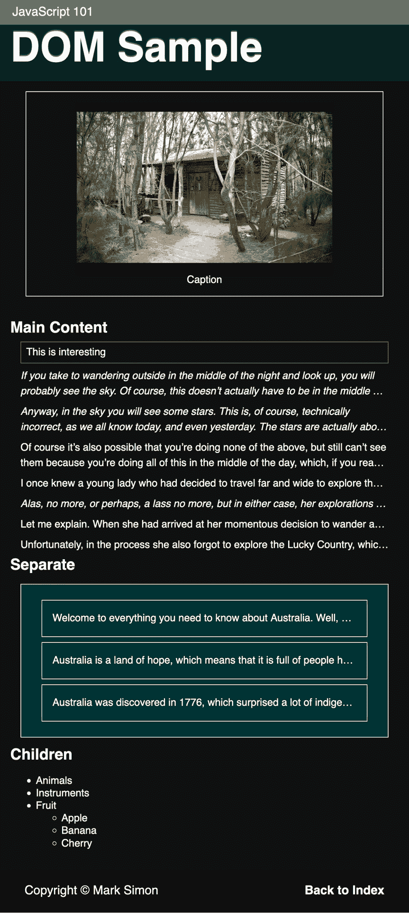
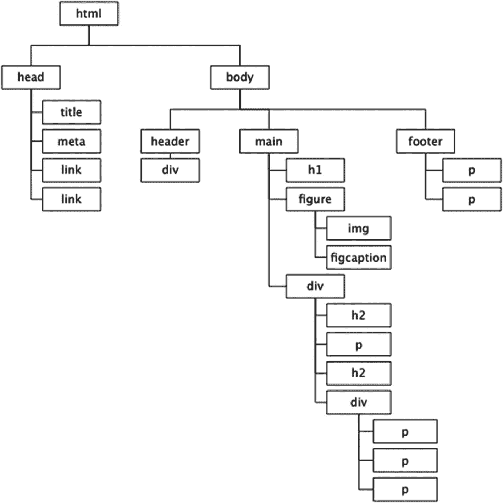
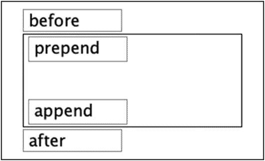
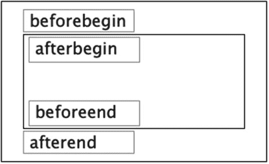

# 3. 操作 HTML 元素

所有网页最初都是用 HTML 编写的，但这些代码最初只是文本。浏览器获取这些 HTML 代码以及任何关联的 CSS，并使用它们生成页面的可见内容。
当浏览器加载并实现 HTML 时，它还会为 JavaScript 创建一个文档的内部表示。这被称为`文档对象模型`，简称`DOM`。我们可以使用 DOM 在 JavaScript 中操作网页的各个部分。

在本章中，我们将探讨：

* 选择页面上的单个和多个元素
* 访问和添加内容到 HTML 元素
* 创建额外的元素
* 操作元素属性
* 操作 HTML 元素的 CSS 样式

要真正掌握这些内容，这里有一个供您实验的示例页面：

* 在浏览器中加载页面`sample-dom.html`。
* 打开开发者工具控制台。
* 同时在代码编辑器中加载该页面，以便查看底层的 HTML。

首先，页面看起来类似于图 3-1。



图 3-1 示例 DOM 页面

随着本章的深入，您将对页面的内容和外观进行各种更改。
为了提醒我们是在控制台中进行实验，代码示例将以控制台提示符（`»`）开头。

## DOM 树

HTML 文档本质上是层次化的：元素位于其他元素内部。如果您查看示例页面的 HTML，将会看到类似这样的结构：

实际上，还有更多内容。

当页面加载时，DOM 是根据 HTML 创建的。这被表示为一个`树状结构`，其中元素分支到它们内部嵌套的元素，如图 3-2 所示。



## DOM 树结构

一个 DOM 树结构从`html`开始，后面跟着`head`和`body`。`head`包含`title`、`meta`和两个`link`。`body`由`header`、`main body`和`footer`组成。

**图 3-2**  
**DOM 树**

用于描述树结构元素的术语往往混合了多种隐喻：

- 在树结构中，元素被称为`节点（node）`，它们是分支上的连接点。
- 一个分支到其他元素的元素称为`父（parent）`节点。
- 父节点分支出的元素称为`子（child）`节点。
- 具有相同父节点的节点称为`兄弟（sibling）`节点。
- 树结构的起点称为`根（root）`节点。你会注意到，整个树结构通常被绘制成倒置的，根节点在顶部。

有些术语来自树的隐喻，而另一些则来自家族的隐喻。有时你需要处理特定的节点，而有时你会处理与特定节点相关的节点。

### 查找元素

在 JavaScript 中，你肯定需要做的一件事就是找到你想要处理的元素。过去，你可能会使用以下任意函数：

- `document.getElementsByTagName()`：返回使用特定标签（如`h1`或`li`）的元素集合。
- `document.getElementsByName()`：返回具有特定`name="..."`属性的元素集合。如今，`name`属性仅限于表单元素。
- `document.getElementById()`：返回与`id="..."`属性匹配的单个元素。如果有多个匹配项（不应该出现），则只返回第一个匹配项。
- `document.getElementsByClassName()`：返回具有特定`class`属性的元素集合。

这些函数大致按历史顺序排列。实际上，最后一个函数`document.getElementsByClassName()`并没有得到太多青睐，因为它较晚才出现在当时占主导地位的 Internet Explorer 中，而那时更好的方法已经出现了。请注意，上述函数中除了一个之外，其名称中都有复数形式的`Elements`，以反映它们返回一个集合的事实。只有`document.getElementById()`在其名称中有单数形式的`Element`，以反映应该只有一个匹配项的事实。

你不再需要这些函数中的任何一个，但你仍然会在旧代码或由年长开发者编写的代码中看到它们。对于`document.getElementById()`来说尤其如此。然而，从现在开始，我们将不再使用它们。

现在有两个函数可以满足你的所有需求：

- `document.querySelector()`：匹配选择器的*第一个*元素。如果没有匹配项，你将得到`null`。
- `document.querySelectorAll()`：返回匹配选择器的元素*集合*。即使只有一个匹配项，它仍会在集合中返回。如果没有匹配项，你将得到一个空集合。

你将通过下表了解它们的使用方法：

| 方法 | 含义 |
| :--- | :--- |
| `document.getElementsByTagName('p')` `document.querySelectorAll('p')` | 所有段落 |
| `document.getElementsByName('amount')` `document.querySelectorAll('[name="amount"]')` | 所有具有`name`属性的元素 |
| `document.getElementsByClassName('special')` `document.querySelectorAll('.special')` | 类中的所有元素 |
| `document.getElementById('separate')` `document.querySelector('#separate')` | 通过`id`获取单个元素 |

注意，上述所有示例都以`document.`开头，这意味着我们在整个文档中搜索。但是，你可以从先前定位到的元素开始搜索。

例如：

```javascript
//  在文档中查找第一个 div
var div = document.querySelector('div');

//  在上述 div 中查找所有段落
var p = div.querySelectorAll('p');
```

这里，在整个文档中搜索第一个匹配`div`的元素。然后在得到的`div`元素中进一步搜索所有`p`（段落）元素。在下一节中，你将看到更多关于使用标签名和其他选择器的内容。

## CSS 选择器

JavaScript 不是 CSS，但它在其`.querySelector()`和`.querySelectorAll()`方法中使用了 CSS 选择器。CSS 选择器是 CSS 用来标识哪些元素受 CSS 规则影响的表达式。

多年来，CSS 已经变得非常复杂，并且有许多微妙的方式来定位元素。对我们来说，我们主要关心以下几点：

- **标签（tag）** 选择器：引用一个或多个基本元素，如`h1`或`p`。
- **id** 选择器：引用具有`id="..."`属性的单个元素。
- **类（class）** 选择器：引用具有`class="..."`属性的任意数量的元素。
- **属性（attribute）** 选择器：引用各种元素的其他属性，例如`name=""`。
- 也可以引用作为元素**后代（descendant）**或**子元素（child）**的元素，例如特定列表中的项目或`div`内的段落。

### 标签选择器

最基本的选择器是**标签**选择器。这是一个简单的 HTML 标签，指的是所有具有该标签的元素。例如：

```javascript
document.querySelectorAll('p');   //  所有段落 ()

document.querySelector('div');    //  第一个 div

document.querySelector('h1');     //  第一个（并且大概是唯一的）主标题 h1

document.querySelectorAll('h1');  //  一个可能只有一个 h1 的集合
```

原则上，你应该使用`querySelectorAll()`通过标签选择器获取任何元素。然而，在某些情况下，例如`h1`，该元素被认为是唯一的，因此`querySelector()`可能更合适。通过标签名获取元素的旧方法是`document.getElementsByTagName(...)`，但使用`document.querySelectorAll(...)`更加灵活。除了那些应该是唯一的元素之外，你可能还需要通过使用**id**来进一步限制结果。

### id 选择器

在 HTML 中，通常有一个`id`附加到要定位的元素上。例如，页面上的一个段落具有以下 HTML：

```html
<p id="something" class="special">This is interesting</p>
```

在 CSS 中，id 用井号（`#`）标识：

```css
p#something {
  border: thin solid #666;
  padding: 0.25em 0.5em;
}
```

在 JavaScript 中，你可以使用 CSS 选择器引用该元素：

```javascript
var p = document.querySelector('p#something');
var p = document.querySelector('#something');   //  相同
var p = document.getElementById('something');   //  旧方法
```

由于`id`应该是唯一的，你可以像第二个例子那样单独使用`id`。然而，包含标签会使意图更清晰，所以我们采用这种方式。你会发现许多开发者仍然使用`document.getElementById()`，如最后一个例子所示，但这其实没有必要。较新的`document.querySelector()`做得同样好，而且更加灵活。

### 类选择器

如果你想要匹配多个元素，那么`id`就不适用了。相反，你会看到`class`属性，它描述了一组多个元素。例如，在示例文档中，有几个段落，其中一些具有`class`属性：

```html
<p>...</p>
<p class="special">...</p>
<p>...</p>
<p>...</p>
<p class="special">...</p>
<p class="special">...</p>
<p>...</p>
```

当然，类组可以小到一个，甚至为零。你通常认为组包含多个项目，但只有一个项目的组也可能有意义。例如，你可能想要描述**状态**的变化，比如当你点击某个东西时。

为了匹配特定的类，CSS 使用点号（`.`）：

```css
p.special {
  font-style: italic;
}
```

与`id`一样，你可以使用`querySelector()`来选择第一个匹配项，但与`id`不同，使用`querySelectorAll()`选择多个匹配项也是合理的。

```javascript
//  第一个匹配
var p = document.querySelector('p.special');
//  所有匹配
var pp = document.querySelectorAll('p.special');
//  不那么具体
var special = document.querySelectorAll('.special');
//  较旧的方法
var special = document.getElementsByClassName('special');
```

`p.special`和`.special`之间有一个微妙的区别。许多元素可以拥有相同的类，但它们可能并不都具有相同的标签。第二种形式也会匹配具有相同类的其他元素。

## 子代与后代选择器

有时，您希望定位特定元素*内部*的所有元素。例如：

```html
<div>
  <p> ... </p>
  <p> ... </p>
  <p> ... </p>
</div>
```

要定位`div`内部的段落，您需要结合使用选择器，一个用于容器，一个用于内容。CSS 有两种定位元素内容的方法：

```css
div#separate>p {
  border: thin solid white;
}
div#separate p {
  padding: 1em;
}
```

大于号（`>`）选择器是一个**子代选择器**：它选择作为`div#separate`*子元素*的段落。空格选择器（它看起来根本不像选择器）是一个**后代选择器**：它选择作为`div#separate`*后代*的段落。

在 JavaScript 中，您可以选择子代或后代段落，如下所示：

```javascript
var pp = document.querySelectorAll('div#separate>p');
console.log(pp);            //  子元素

var pp = document.querySelectorAll('div#separate p');
console.log(pp);            //  后代元素
```

在此例中，它们是相同的，因为示例中没有其他容器。但是，如果从`div#content`开始，您会看到一个区别：

```javascript
var pp = document.querySelectorAll('div#content>p');
console.log(pp);            //  子元素

var pp = document.querySelectorAll('div#content p');
console.log(pp);            //  后代元素
```

这是因为`div#separate`位于`div#content`内部。`div#separate`中的段落是`div#content`的后代，但不是其子元素。

当您有一个嵌套列表时，这一点也很明显：

```html
<ul id="children">
  <li>Animals</li>
  <li>Instruments</li>
  <li>Fruit</li>
  <li>
    <ul>
      <li>Apple</li>
      <li>Banana</li>
      <li>Cherry</li>
    </ul>
  </li>
</ul>
```

它看起来像这样：

-   Animals
-   Instruments
-   Fruit
-   Apple
-   Banana
-   Cherry

您可以使用以下方法选择列表的不同部分：

```javascript
var children = document.querySelectorAll('ul#children>li');
console.log(children);

var grandchildren = document.querySelectorAll('ul#children>li>ul>li');
console.log(grandchildren);
```

var descendants = document.querySelectorAll('ul#children li');

console.log(descendants);

```

在所有这些示例中，选择器的第一部分是`ul#main`，它选择主列表。从那里，我们选择列表的各种子元素和后代元素。在第一个示例中，子代选择器（`>`）只会选择直接子元素，即第一级的元素。第三个带有后代选择器（空格）的示例会选择*所有*列表项，包括子元素和孙元素。如果您想专门选择*仅*孙元素，则需要像第二个示例那样使用多个子代选择器。这些是我们将使用的主要选择器，尽管当我们开始在第 5 章和第 6 章中处理表单时，我们会看到一些属性选择器的示例。

## 处理多个元素

使用`querySelectorAll()`的结果是一个元素集合，技术上称为`节点列表`。节点列表类似于数组，因为它是一个编号的集合，您可以对其进行迭代。

例如，您可以像之前一样获取该集合：

```javascript
var children = document.querySelectorAll('ul#children>li');
```

这将集合获取到`children`变量中，与之前一样。有两种主要方法可以遍历编号集合。首先，您可以使用`for()`循环来计数遍历集合。

`for()`循环将使用一个变量来计数集合中的成员，并对每个成员执行操作：

```javascript
var children = document.querySelectorAll('ul#children>li');

for(let i=0; i<children.length; i++) {
  children[i].textContent = children[i].textContent.toUpperCase();
  //  其他处理
}
```

`textContent`属性顾名思义，它是元素作为文本的内容。稍后您会看到更多关于`textContent`的内容。`for`结构设置一个计数器（`let i=0`），并通过索引`i`引用每个成员来遍历`children`集合。`.toUpperCase()`方法返回原始文本的大写版本。请注意，替换`textContent`会产生一个副作用：将嵌套列表替换为纯文本，不再是一个列表。

第二种方法是较新的方法，使用`.forEach()`方法。要尝试此示例，您可能需要重新加载页面。

```javascript
var children = document.querySelectorAll('ul#children>li');

children.forEach(child => {
  child.textContent = child.textContent.toLowerCase();
  //  其他处理
});
```

使用`.forEach()`，您不需要使用计数器变量。相反，`child`变量直接从集合的每个成员中赋值。这是我们稍后将使用的技术。`.forEach()`方法包含一个函数。该示例使用了所谓的`箭头函数表达式`，这是一种紧凑的形式，适用于定义一次性函数。

## 相关元素

处理 DOM 时，您有时会对附近的元素感兴趣。您之前看到了不同节点之间的关系。以下是您可以访问它们的一些方法列表：

| 节点(s) | 任何内容 | 仅元素 |
| --- | --- | --- |
| 子节点 | `childNodes` | `children` |
| 第一个子节点 | `firstChild` | `firstElementChild` |
| 最后一个子节点 | `lastChild` | `lastElementChild` |
| 相邻节点 | `nextSibling` `previousSibling` | `nextElementSibling` `previousElementSibling` |
| 父节点 | `parentNode` | `parentElement` |

例如（您可能希望先重新加载页面）：

```javascript
var list = document.querySelector('ul#children');

var item = list.firstElementChild;  //  获取第一个子元素
console.log(item.textContent);

item = item.nextElementSibling;     //  下一个子元素
console.log(item.textContent);
```

这些名称清楚地说明了这些方法的作用。前两个方法（`childNodes`和`children`）返回一个集合，而其他方法返回单个结果。上表中前三个方法从父节点开始操作。在这种情况下，它是`ul`无序列表，您将引用其中的`li`项。最后两个方法从子节点开始操作。在这种情况下，它们是`li`列表项，您将引用相邻的同级列表项或父级`ul`列表。

您会注意到有两个版本，这是由于 HTML 工作方式的一个特性所致。从技术上讲，HTML 中元素之间的所有空白，甚至注释，都是 DOM 的一部分。例如，假设您有一个列表和项目：

```html
<ul>
  <li>Child</li>
  <li>Child</li>
</ul>
```

缩进、换行和注释都被视为 DOM 节点。大多数时候，您并不关心这些，只对列表和项目感兴趣，而不必处理额外的空格或注释。额外的空格和注释当然不会出现在渲染的页面中，因此只有查看源代码时才能看到。或者，如果您使用 JavaScript，也可能看到。在是否应该使用前面第一列属性来包含这些内容方面，浏览器之间存在差异，这在过去造成了麻烦。第二列属性只处理真正的元素，从而解决了这个问题。

例如：

```javascript
var ul = document.querySelector('ul#children');

console.log(ul.children);   //  仅列表项
console.log(ul.childNodes); //  可能包含其他代码
```

## 创建和操作元素

有时，你需要通过操作 DOM 本身的内容来对文档进行更改。例如，你可能要做的第一件事就是创建一个元素：

```javascript
var p = document.createElement('p');
```

参数是一个字符串，它就是一个简单的 HTML 标签，不带尖括号。你甚至可以自己编造一个：

```javascript
var p = document.createElement('thing');
```

但不要指望浏览器会知道如何正确显示它。默认情况下，一个编造出来的元素会被显示为内联元素，除非你通过 CSS 更改它。这种技巧曾在尝试让`旧版浏览器`接受更新的 HTML5 元素时使用过。

此时，新创建的元素没有内容，也没有属性，甚至尚未存在于文档中：它只是漂浮在内存中。稍后，你将看到如何将新元素添加到实际文档中。

### 向元素添加内容

你可以使用多种方法向元素添加内容，无论这个元素是你找到的，还是刚刚创建的。

添加内容最简单的方法是设置其 `textContent` 属性：

```javascript
var p = document.createElement('p');
p.textContent = '此位招租……';
```

还有一个可供选择的属性叫 `innerHTML`，在这种情况下，它会给你相同的结果。然而，区别在于 `innerHTML` 会将内容解释为 HTML。

例如，你可以像下面这样更改主标题的内容：

```javascript
var h1 = document.querySelector('h1');
h1.textContent = 'Hello<br/>Goodbye';
```

在前面的示例中，该标题现在会显示 `Hello<br/>Goodbye`。但是，如果你使用 `innerHTML`：

```javascript
var h1 = document.querySelector('h1');
h1.innerHTML = 'Hello<br/>Goodbye';
```

字符串中的 `<br/>` 会被解释为 HTML 换行符，你将看到两行文本。

通常，除非你真的需要额外的 HTML，否则使用 `textContent` 更安全。

还有一个名为 `innerText` 的属性，它有一段复杂的演变史。最初，它是一个只有 Internet Explorer 支持的非官方属性，而其他浏览器只支持官方的 `textContent` 属性。如今，所有现代浏览器都支持这两个属性。但是，两者之间有一个细微的差别，这使得 `textContent` 是更受青睐的属性。

### 添加其他属性

你还可以将属性作为 JavaScript 属性来添加。例如，你可以像下面这样创建一个图像元素：

```javascript
var img = document.createElement('img');    //  创建图像
img.src = 'https://pure-javascript.net/random.jpg'; //  src="..."
```

img.alt = '随机图像';                   //  alt="..."

```

记住，你还不能真正看到这个图像。它稍后需要被添加到文档中。

有两个你可能特意添加的属性，特别是为了 CSS 的便利：

```

img.id = 'something';           //  id="..."

img.classList.add('whatever');  //  class="..."

img.className = 'whatever';     //  较旧的替代方法

```

请注意，在大多数情况下，JavaScript 的属性名称与 HTML 属性相同，但 `class` 属性并不完全匹配，因为 `class` 这个词是 JavaScript 中的保留字。

有两种方法可以向元素添加类：

* 较旧的 `className` 属性会用单个类替换任何现有的类，因此它仅适用于非常简单的情况。
* 较新的 `classList` 方法操作的是一个类集合，你可以对其添加、移除，甚至切换（根据类是否已存在来决定添加或移除）。

所有上述内容也适用于你通过 `querySelector()` 或 `querySelectorAll()` 找到的现有元素。

## 将元素放入文档

如果你不把图像放到文档的某个位置，那么之前所做的一切都是徒劳。传统方法涉及 JavaScript 节点函数，例如 `insertBefore()` 和 `appendChild()`。现在有一些函数可以简化和统一这个过程。

首先，你需要找到一个现有的元素，新元素将放置在它附近。然后，相对于该现有元素，你有四个位置可选：

* `existingElement.before(newElement)`：外部，在现有元素之前
* `existingElement.prepend(newElement)`：内部，在现有元素的开头
* `existingElement.append(newElement)`：内部，在现有元素的末尾
* `existingElement.after(newElement)`：外部，在现有元素之后

图 3-3 展示了这些函数的具体含义。



一个矩形说明了元素的放置方式。外部矩形分别在顶部和底部包括了“之前”和“之后”。内部矩形在顶部和底部则分别有“开头插入”和“末尾追加”。

`图 3-3` 放置元素

函数 `before()` 和 `after()` 的语法在英语中听起来有些别扭。表达式 `apple.before(banana)` 被解读为“对于 `apple`，将 `banana` 放在它之前”，这与初看时的理解可能正好相反。所有这四个提到的函数都以现有元素开头。

如果你查看现有代码，可能会经常看到 `appendChild()` 函数。它几乎与较新的 `append()` 函数相同。两者有一些区别，但大多数情况下，你可以任选其一使用。

例如，要在现有标题之后添加一个新图像，你可以这样写：

```

var h1 = document.querySelector('h1');

var img = document.createElement('img');

img.src = 'https://pure-javascript.net/random.jpg';

img.alt = '随机图像';

h1.after(img);

```

还有一个可选的单一函数，它可以通过一个包含位置的额外参数来实现上述所有四个函数的功能：`existingElement.insertAdjacentElement(position, newElement)`。位置是以下值之一：

* `'beforebegin'`：外部，在容器之前
* `'afterbegin'`：内部，在容器的开头
* `'beforeend'`：内部，在容器的末尾
* `'afterend'`：外部，在容器之后

图 3-4 展示了这些位置。



一个矩形代表了元素的相邻位置。外部矩形分别在顶部和底部包括了“开始之前”和“结束之后”。内部矩形的顶部和底部则分别是“开始之后”和“结束之前”。

`图 3-4` 插入相邻元素

使用这个函数，你可以这样写：

```

var h1 = document.querySelector('h1');

var img = document.createElement('img');

img.src = 'https://pure-javascript.net/random.jpg';

img.alt = '随机图像';

h1.insertAdjacentElement('afterend', img);

```

这当然不算更方便，但它可能符合你对模式感的追求。

### 直接添加 HTML

如果你创建一个元素只是为了直接将其添加到 DOM 中，你可以使用 `insertAdjacentHTML(position, html)` 这个快捷方式。该函数接受与 `insertAdjacentElement` 相同的位置值，但允许你使用 HTML 字符串来创建元素。对于以下示例，你可以使用相同的 `src` 和 `alt` 值：

```

var h1 = document.querySelector('h1');

var html = '';

h1.insertAdjacentHTML('afterend', html);

```

当然，你不需要 `html` 这个变量：

```

var h1 = document.querySelector('h1');

h1.insertAdjacentHTML('afterend', '');

```

……甚至在这种情况下，连 `h1` 变量也不需要：

```

document.querySelector('h1')

.insertAdjacentHTML('afterend', '');

```


### 但这开始变得难以管理了。

请注意，只有在后续的 JavaScript 代码中无需引用新元素时，使用`insertAdjacentHTML()`才有用，因为你没有获得新元素的引用。

### 添加更复杂的内容

到目前为止，我们一直在讨论创建一两个元素。使用`innerHTML`或`insertAdjacentHTML()`，你可以同样轻松地插入多个元素，例如这个包含多个条目的列表：

```

var h1 = document.querySelector('h1');

var ul = '<ul><li>one</li><li>zwei</li><li>trois</li></ul>';

h1.insertAdjacentHTML('afterend', ul);

```

如你所知，JavaScript 有一种新的字符串字面量类型，即`模板字面量`。我们主要用它通过`${...}`符号来插值。然而，它的另一个特性是这种字符串字面量可以跨越多行编写：

```

var h1 = document.querySelector('h1');

var ul =

`

<ul>

<li>one</li>

<li>zwei</li>

<li>trois</li>

</ul>

`;

h1.insertAdjacentHTML('afterend', ul);

```

由于该字符串被视作 HTML，额外的间距和换行符在 HTML 中会被忽略，因此这些间距不会对结果产生任何影响。不过，它可能会让代码更易于阅读，而在其他情况下，间距和换行符则意义重大。

和之前一样，如果你只想添加元素，HTML 字符串就足够了，但你无法获得对它们的引用。另一方面，如果你需要在后续的 JavaScript 中引用它们，就必须逐个创建元素：

```

var h1 = document.querySelector('h1');

var heading = document.createElement('h2');

var message = document.createElement('p');

h1.insertAdjacentElement('afterend', message);

h1.insertAdjacentElement('afterend', heading);

heading.textContent = 'Message';

message.textContent = `The Time is ${new Date()}`;

在示例代码中，给标题和段落赋予更有意义的名称是合理的，因为代码稍后会在脚本中为它们分配内容。请注意，元素是按相反顺序添加的，因为它们是在`h1`元素之后立即插入的。在下一章 4 的幻灯片项目中，我们就会做这类事情。

## 总结

在本章中，我们研究了操作网页的一些技术。

### 文档对象模型

浏览器获取页面的 HTML 并将其渲染成文档。同时，它会生成一个名为文档对象模型的内部模型。DOM 以树状结构表示，以反映 HTML 的层级性质。JavaScript 包含许多用于导航和操作 DOM 的函数。可以通过添加或移除元素，以及更改单个元素来修改 DOM。

### 查找元素

有许多函数可用于在 DOM 中查找现有元素。其中一些函数已经存在了一段时间。现代浏览器都支持较新的函数`querySelector()`和`querySelectorAll()`，这极大地简化了定位元素的过程。这些函数使用 CSS 选择器来描述你要查找的元素。一旦定位到元素，就有函数用于引用 DOM 树中其他附近的元素：父元素、兄弟元素和子元素。

### 多个元素

有些函数，特别是`querySelectorAll()`，会返回一个元素集合，即使该集合为空或只有一个成员。要处理一个集合，你可以使用经典的`for( ... ; ... ; ... )`循环，或者使用更现代的`forEach()`函数来遍历这些元素。

### 创建元素

JavaScript 也可以创建新元素。你甚至可以创建在 HTML 中没有意义的元素，只要你不期望浏览器知道下一步该做什么。对于新创建的元素，你可以添加内容和属性，这些属性与 HTML 属性相匹配。使用相同的方法，你也可以对之前找到的现有元素执行此操作。新元素需要使用众多函数之一添加到 DOM 中。这些函数会将一个元素放置在另一个现有元素附近。你也可以直接添加 HTML，要么使用`innerHTML`添加到现有元素，要么使用`insertAdjacentHTML()`在创建新元素时添加。

### 接下来

我们已经了解了如何使用 JavaScript 来更改网页。在下一章中，我们将应用这些知识来创建图像幻灯片。在下一个项目中，我们将研究如何向页面添加额外的元素、更改现有元素的行为以及与 CSS 样式交互。我们还将学习如何处理 JavaScript 数组和对象。最后，我们将学习 JavaScript 如何响应键盘和鼠标事件。
