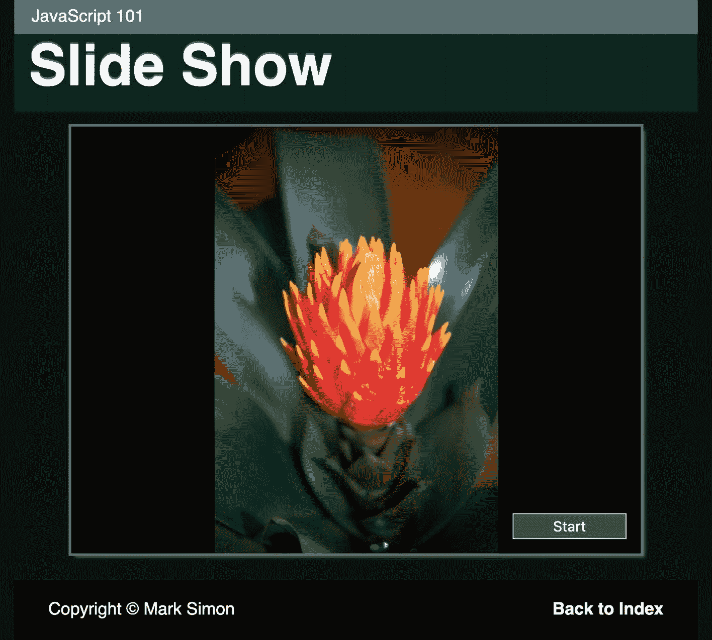

## 4. 创建幻灯片

在这个项目中，我们将构建一个简单的图像幻灯片。该幻灯片将以预定义的速率循环播放一组预定义的图像。你可以通过鼠标和键盘来启动和停止它。在`images`文件夹中有一个`slides`文件夹，`slides`文件夹中包含一组图像文件，它们都已准备好用于幻灯片展示。

幻灯片页面将类似于图 4-1。



图 4-1 图像幻灯片

幻灯片通过定期更改主图像的`src`属性来工作。

在这个项目中，我们将掌握以下技术：

*   定位元素
*   数组
*   拆分字符串以创建数组
*   预加载图像
*   取模运算
*   更改 HTML 元素的属性
*   响应用户事件
*   使用定时器函数

稍后你将看到的一件事是使用 CSS 实现某些动画效果。CSS 是定义 HTML 元素*外观*的编码语言，你可以使用 JavaScript 创建并应用额外的 CSS。如果你熟悉 CSS，那会很有帮助，但并非必需；你只需要一点信心就好。只需知道现代 CSS 可用于各种动画技巧，而这些技巧曾经依赖于额外的 JavaScript。这让你可以自由地专注于实现项目的逻辑，让 CSS 处理视觉方面。

## 幻灯片概述

HTML 的`img`元素定义了要显示的图像。通常，它采用以下形式：

```html

```

`src`属性是实际图像的 URL。

HTML 实际上并不包含图像，而是告诉浏览器从哪里获取它。通常，图像位于网站本地，但如果 URL 包含`http://`或`https://`协议，则它可以是远程图像。当浏览器遇到`img`标签时，它会发出一个请求，请求`src`属性中引用的图像。通常获取图像需要一些时间，因此浏览器会继续处理其余的 HTML。当图像从服务器到达时，浏览器会将其显示在为其保留的空间中。如果图像无法显示——例如原始图像丢失、加载时间过长，或者用户有视觉障碍并依赖文本——那么浏览器将改用`alt`文本。

还有另外三个常见属性：

`title`是当鼠标悬停在图片上时可能显示的附加文本；它也有助于搜索引擎描述图片。`width`和`height`属性有助于浏览器在等待图片加载时为其创建合适的空间。它们也可以用于调整图片大小。

我们的幻灯片将通过更改`src`属性的值来循环显示一组图片，从而使浏览器重新加载新图片。

整个幻灯片将包含在以下结构中：

```html
<div id="slideshow">
  
</div>
```

`div`元素是一个通用的块级容器。它通常用于布局。使用 CSS，使`div`看起来像一个图片容器。

## 准备 HTML

对于脚本编写，需要两个 JavaScript 链接：

```html
<script src="library.js"></script>
<script src="slideshow.js" defer></script>
```

与其他项目一样，`slideshow.js`文件将包含主要代码。然而，实际运行幻灯片的代码是你可能希望在其它项目中使用的代码；你在本书后面的幻灯片变体中也肯定会用到它。因此，这段代码将被放在`library.js`文件中以便重用。

另请注意，`library`文件不需要`defer`属性，因为它不会在页面加载时干扰或依赖于页面。

对于这个项目，你最好像引言中讨论的那样运行某种网络服务器。如果你直接在网页浏览器中加载文件，你应该移除`crossorigin="anonymous"`部分。

## JavaScript 大纲

为了方便起见，已经有一个名为`slideshow.js`的文件。它目前只包含标题块注释。

在此基础上，我们从主要的 JavaScript 大纲开始：

```javascript
/*  Slide Show

================================================

================================================ */

'use strict';

window.onerror = function(message, url, line) {

alert(`Error: ${message}\n${url}: ${line}`);

};

init();

function init() {

}
```

在`library`文件中，我们可以添加一个函数来完成所有繁重的工作。这个函数需要被赋予图片集合以及放置它们的位置：

```javascript
/*  doSlides(images, containerSelector)

================================================

Turns a container element into an slide show

with a collection of images.

================================================ */

function doSlides(images, containerSelector) {

}
```

`images`参数将是一个图片集合，而`containerSelector`参数将是图片*容器*的选择器字符串；在这种情况下，容器是`div`元素。

## 图片数组

当我们谈论集合时，通常指的是**数组**，它是一个带编号的集合。数组的一个例子是：

```javascript
var fruit = ['apple', 'banana', 'cherry', 'date'];
```

每个项目的编号被称为其**索引**。在 JavaScript 中，索引从`0`开始，因此上面显示的索引是`0`、`1`、`2`和`3`。

你需要知道的一件事是有多少项目。在 JavaScript 中，这是数组的`length`属性：

```javascript
console.log(fruit.length);
```

请注意，由于索引从`0`开始，所以长度*比*最后一个索引*大一*。

对于我们的项目，我们将使用一个图片名称的数组。我们将把它放到`slideshow.js`文件中的`init()`函数里。然后，我们将该变量发送给`doSlides()`函数。

```javascript
function init() {

let images = [

'bamboo.jpg', 'bird.jpg', 'bromeliad.jpg',

'bush-panorama.jpg', 'canal.jpg', 'church.jpg',

'cityscape.jpg', 'emu.jpg', 'gum-nuts.jpg',

'hanging-rock.jpg', 'hut.jpg', 'koala.jpg',

'kookaburra.jpg', 'lake.jpg', 'lantern.jpg',

];
```

# JavaScript 幻灯片实现指南

## 图片集合

```javascript
const imageFiles = [
  'light-house.jpg', 'lorikeet.jpg', 'mountain-panorama.jpg',
  'rocks.jpg', 'rose.jpg', 'steps.jpg',
  'sunset.jpg', 'tall-trees.jpg', 'tea-leaf.jpg',
  'train.jpg', 'waterfall.jpg'
];
```

图片很多，我们不得不将列表写成多行。在某些情况下，每行写一个项目可能更有意义。如果你不想手动输入，这个数组有一个代码片段。

当然，这并不是真正的图片集合。它是一个文件名的集合，我们需要在后面的代码中通过将`images/slides/`文件夹添加到文件名中，并将其放入`src`属性中，将其转换为实际的图片。

你可能会认为让 JavaScript 管理如此大的集合风险太大或不便。稍后，我们将学习 JavaScript 如何使用 Ajax 从外部文件读取此列表。

## 调用幻灯片函数

使用这个集合，你将在`library`中调用`doSlides()`函数，为其提供图片集合和对容器的引用：

```javascript
// slideshow.js
function init() {
  let images = [...];
  doSlides(images, 'div#slides');
}
```

`div#slides`字符串与 CSS 选择器相同，意思是“`id`为`slides`的`div`”。然后，JavaScript 将使用此字符串在`document.querySelector()`函数中定位实际的元素。

## 填充图片

目前，`img`元素是空的，因为没有有效的`src`值。我们将在代码中更改这一点。

首先，你需要实际获取容器元素以及内部的`img`元素：

```javascript
// library.js
function doSlides(images, containerSelector) {
  // Elements
  let container = document.querySelector(containerSelector);
  let img = container.querySelector('img');
}
```

`container`变量将引用包含`div`元素，这对于幻灯片更复杂的部分很重要。`img`变量将引用实际的`img`元素，我们将设置其`src`属性。

通常，你会使用`document.querySelector()`来定位元素，就像我们对`container`元素所做的那样。这会在整个文档中搜索第一个匹配项。但是，你也可以将搜索限制在特定元素内部，就像我们对`img`元素所做的那样：`container.querySelector()`将只在`container`元素内部搜索。这不仅稍微快一些，因为 JavaScript 不必在错误的位置查找，而且还会忽略我们不感兴趣的其他`img`元素。

填充图片就是设置`img`元素的`src`属性。我们可以用一个特定的图片来尝试：

```javascript
function doSlides(images, containerSelector) {
  // Elements
  let container = document.querySelector(containerSelector);
  let img = container.querySelector('img');
  img.src = 'images/slides/bamboo.jpg';
}
```

由于`images`数组只有文件名，我们添加了这些图片相对于网站根目录的路径。这使得代码更加灵活，因为我们可以轻松更改图片的位置，而无需更改集合本身。

如果你重新加载页面，你应该能看到图片。

因为我们有整个图片集合，所以应该使用数组中的其中一个：

```javascript
function doSlides(images, containerSelector) {
  // Elements
  let container = document.querySelector(containerSelector);
  let img = container.querySelector('img');
  img.src = `images/slides/${images[0]}`; // ← backticks
}
```

注意不同的引号（`` ` ... ` ``），即所谓的反引号。这种字符串类型被称为`模板字面量`。对于普通文本，其效果与单引号或双引号相同，但模板字面量允许你在`${...}`语法中嵌入值和计算。

这里，我们硬编码了路径，但插入了实际的图片文件名。

如果你重新加载页面，你应该能看到相同的图片。至少你会看到它是有效的。

当然，你会希望为每个新图片重复设置`img.src`，所以最好将其放在一个函数内。

```javascript
function doSlides(images, containerSelector) {
  // 元素
  let container = document.querySelector(containerSelector);
  let img = container.querySelector('img');
  next();

  function next() {
    // 填充图片
    img.src = `images/slides/${images[0]}`;
  }
}
```

将其放入函数后，你就可以重复调用这段代码。你还可以延迟一小段时间再调用它：

```javascript
function doSlides(images, containerSelector) {
  ...
  setTimeout(next, 3000);
  // next();
  ...
}
```

`setTimeout()`函数接收一个要调用的函数引用（`next`）和等待的毫秒数（`3000`）。你有时也可能会看到它写作`windows.setTimeout()`。这里，我们等待了三秒才调用该函数。现在，如果你重新加载页面，图片将在三秒后出现。请注意，函数的*引用*是`next`，不带括号。如果你想要函数的*结果*，则需要使用括号（`next()`）。在这里，我们不需要结果，只需要函数本身。

## 实现图片轮播

当然，`next()`函数仍然是硬编码显示第一张图片（索引`0`）。要遍历图片集合，你需要：

- 设置一个索引变量。我们将使用变量`slideNumber`，并在一个新的“变量”部分中设置它。
- 使用该变量。这将替换`images`数组中的索引`0`。
- 递增变量的值。我们可以使用递增运算符来实现：`slideNumber++`。
- 重复调用该函数。`setTimeout()`函数在延迟后*仅*调用`next`函数*一次*。这就是为什么你访问网站后一小段时间会弹出恼人对话框的原因。要重复调用该函数，你需要将其替换为`setInterval()`。

```javascript
function doSlides(images, containerSelector) {
  // 元素
  let container = document.querySelector(containerSelector);
  let img = container.querySelector('img');

  // 变量
  let slideNumber = 0;

  // setTimeout(next, 3000);
  setInterval(next, 3000);
  // next()

  function next() {
    // 填充图片
    img.src = `images/slides/${images[slideNumber]}`;
    slideNumber++;
  }
}
```

表达式`slideNumber++`比使用`slideNumber = slideNumber + 1`更方便，如果将其与前一个表达式结合使用，则*更加*方便：

```javascript
function next() {
  // 填充图片
  img.src = `images/slides/${images[slideNumber++]}`;
}
```

在这个表达式中，`slideNumber++`被称为`后递增`运算符，因为变量是在其值被使用*之后*才递增的。`前递增`运算符`++slideNumber`则会在变量值被使用之前就递增它。还有`递减`运算符（`--`）。如果你运行这个版本，它可以工作，但你最终会看到一个新问题。（如果“最终”等待时间太长，你可以将延迟缩短到，比如 1000，以便更快地看到问题。）代码会一直执行到超出数组末尾。`slideNumber`的值会不断递增，超过数组的上限，因此从那里开始你会得到`undefined`。你实际上看不到`undefined`，但你会看到图片现在缺失了。

这需要在到达末尾时重置`slideNumber`：

```javascript
```

function next() {

  //  填充图片

  img.src = `images/slides/${images[slideNumber++]}`;

  //  循环播放

  if (slideNumber >= images.length) slideNumber = 0;

}

```

请记住，数组的 `length` 比最后一个索引大1，因此当你达到该值（`slideNumber == images.length`）时，你已经越界了。作为一种策略，你应该始终检查是否已经越界得更远（`slideNumber >= images.length`），以防你之前错过了它。例如，你已经知道，重复添加 `0.1` 并不总能得到一个简单的结果。这可以实现功能，但有两个改进你可以轻松做到。首先，在第一张图片显示之前有一个延迟；其次，幻灯片之间的延迟应该更具可配置性。

## 显示第一张幻灯片

`setInterval()` 函数会等到延迟结束后才调用 `next()` 函数。你可以通过在开始时调用 `next()` 函数来立即显示第一张幻灯片：

```javascript

function doSlides(images, containerSelector) {

  ...

  setInterval(next, 3000);

  next();

  ...

}

```

现在，这将从第一张幻灯片开始，后续幻灯片循环播放。

## 更改延迟

作为一项原则，你不应该在代码中间硬编码任意值。最好尽早在一个变量中设置该值。在这种情况下，延迟的实际值对代码逻辑并不重要，因此我们将其放在一个函数参数中，让调用代码来决定它应该是什么。

在主代码中，将延迟作为附加参数包含在内：

```javascript

//  slideshow.js

function init() {

  let images = [...];

  doSlides(images, 'div#slides', 3000);

}

```

在 JavaScript 中，包含函数未期望的额外函数参数并不是错误。这与其他大多数编程语言不同。这意味着，如果你在不做任何其他更改的情况下尝试这段代码，它可以工作：`doSlides()` 函数将简单地忽略这个额外值。

当然，额外的值不是用来被忽略的，因此在库函数中，包含一个额外的参数变量：

```javascript

//  library.js

function doSlides(images, containerSelector, delay=3000) {

  ...

}

```

第三个参数包含一个默认值：如果调用函数省略了第三个参数，则使用此值。这确保了旧行为仍然不变，因为最初第三个参数不是必需的。当对函数进行改进时，你应该始终尝试保持与早期版本的行为兼容性。在这里，我们包含了默认值，这样即使没有添加额外的参数，它的工作方式仍与以前相同。显然，在这种情况下，`slideShow()` 函数仍在开发中，所以无需担心兼容性问题。不过，我们还是走了一遍这个过程以阐明这一点。

最后，在 `setInterval()` 函数中使用变量而不是硬编码的值：

```javascript

function doSlides(images, containerSelector, delay=3000) {

  ...

  setInterval(next, delay);

  next();

  ...

}

```

为了测试目的，你可以通过使用较短的延迟值来加快幻灯片播放，例如使用 `doSlides(images, 'div#slides', 1000);` 或更短。

## 停止和启动幻灯片播放

你可能已经对幻灯片播放开始感到厌烦了。如果你让用户忍受不可停止的动画，就像过去的动态 `gif` 那样，这肯定会惹恼用户。你至少可以做到的是让用户有机会暂停幻灯片播放，这比强迫用户前往其他网站要好得多。虽然你可以编写代码在鼠标悬停在图片上时暂停幻灯片播放，但这并不是最自然的方法。最好提供一个按钮来暂停。同一个按钮也将恢复幻灯片播放。一个在两种状态（运行和暂停）之间切换的按钮通常被称为`切换开关`。稍后，我们将使用 JavaScript 添加一个真正的按钮。现在，我们可以使用图片本身作为一个按钮。

要实现一个切换开关，我们将采取以下步骤：

- 创建一个变量来保存当前状态。
- 创建一个函数，根据当前状态暂停或恢复幻灯片播放。

设置函数以响应图片的点击事件。

### 状态变量

首先，我们将添加一个新变量 `running`：

```javascript

function doSlides(images, containerSelector, delay=3000) {

//  元素

...

//  变量

let slideNumber = 0;

let running;    //  未定义

...

}

```

JavaScript 中的所有变量在诞生之初都会被赋予一个特殊值 `undefined`。这个词语容易让人困惑，因为它并不意味着该变量是未定义的。`undefined` 是一个特殊值，用于表示你尚未给变量赋值。其他编程语言没有这个特殊值，如果你在变量被赋予实际值之前尝试使用它，这些语言会报错。

要设置状态变量，请将 `setInterval()` 函数的返回值赋值给它：

```javascript

function doSlides(images, containerSelector, delay=3000) {

...

running = setInterval(next, delay);

next();

...

}

```

在 JavaScript 中，所有函数都会返回一个值。如果没有特定的 `return` 语句，函数将返回 `undefined`。你可以使用这个返回值（例如将其赋值给一个变量），也可以像我们之前做的那样完全忽略返回值。`setInterval()` 原则上可用于多个函数。每次调用都会创建一个所谓的“定时器”。`setInterval()` 的返回值是 `intervalID`，即对新创建定时器的引用。这是为了让你在需要时能够清除该定时器——这正是我们暂停幻灯片播放的方式。我们之前使用的 `setTimeout()` 函数也以相同方式工作，你可以使用其返回值来取消一个延迟的函数调用。

### 切换函数

由于我们预计会多次停止和启动幻灯片播放，因此不再适合在开始时立即启动一次。相反，我们应该将这个流程封装在另一个函数中，并在需要时调用该函数。在本例中，我们将其命名为 `toggle()` 函数：

```javascript

function doSlides(images, containerSelector, delay=3000) {

...

//  setInterval 已被移动到 toggle() 内部：

next();

function toggle() {

running = setInterval(next, delay);

next();

}

function next() {

...

}

}

```

从技术上讲，并不需要在 `next()` 函数之前定义 `toggle()` 函数；JavaScript 会在实际运行代码之前处理所有函数定义。即使你决定在之后定义它，这也没有影响。但在控制台中编写代码时情况并非如此。由于控制台无法预知你接下来要输入什么，你需要先定义所有将要引用的内容。

`toggle()` 函数的作用是：如果幻灯片尚未播放则启动它，如果正在播放则停止它。这需要使用 `if ... else` 语句：

```javascript

function toggle() {

if(!running) {

running = setInterval(next, delay);

next();

}

else {

}

}

```

请记住，`if()` 不仅会测试`true`值，还会测试“有值”的情况，例如非零数字或非空字符串。特殊的 `undefined` 值绝对算作“无值”，因此 `!running` 会测试 `running` 是否为 `undefined`。

要停止幻灯片播放，你可以使用 `clearInterval()` 函数，该函数将之前保存的定时器 ID 作为参数。你还必须重置 `running` 的值以供下次使用。

```javascript

function toggle() {

if(!running) {

...

}

else {

clearInterval(running);

running = undefined;

}

}

```

事实证明，`clearInterval()` 函数会返回 `undefined`。我们可以利用这一点，将其返回值直接赋值给 `running` 变量：

```javascript

function toggle() {

if(!running) {

...

}

else {

running = clearInterval(running);

}

}

```

此时，如果你测试代码，会发现点击图片不会产生任何效果。

## 点击图片

现在，我们将让点击图片来暂停或继续幻灯片播放，实际上就是将图片变成一个大的按钮。用户的动作，例如鼠标点击或键入字符，被称为**事件**。响应事件的代码被称为**事件监听器**。事件监听器总是一个函数。在这里，我们将 `toggle` 函数作为 `img` 元素的事件监听器。

设置事件监听器通常有两种方法。经典方法是直接设置某个事件监听属性：

```javascript
function doSlides(images, containerSelector, delay=3000) {
  ...
  img.onclick = toggle;
  next();
  ...
}
```

如果你尝试这样做，幻灯片播放将不会立即开始，因为它现在正在等待你点击图片。`onclick` 事件监听器属性会在你点击该元素（或在触摸屏上触摸该元素）时触发。再次提醒，使用 `toggle` 函数时不要加括号，因为你是在引用该函数，而（尚）未调用它。请克制住将属性拼写为 `onClick` 的冲动。JavaScript 会接受这个赋值，但由于名称是区分大小写的，它不会对 `click` 事件做出反应。同样的情况也适用于 `onlick`，这是一个极其常见的拼写错误。还有许多其他可用的事件监听属性，例如 `.onmouseover` 用于检测鼠标悬停在元素上，或 `.onkeyup` 用于检测键盘活动。

以这种方式添加事件监听器很简单，但它有一些缺点：

*   这种方式只能添加一个事件监听器。
*   如果该元素位于另一个带有事件监听器的元素内部，你无法控制哪个事件先触发。
*   某些（较新的）事件类型没有像 `onclick` 这样简单的事件监听属性。

一种更新、更全面的方法是使用 `addEventListener()` 函数：

```javascript
function doSlides(images, containerSelector, delay=3000) {
  ...
  img.addEventListener('click', toggle);
  next();
  ...
}
```

在这种情况下，使用 `.onclick` 属性并没有什么特别的缺点，许多 JavaScript 开发者可能更喜欢 `.onclick` 方法。但在这里，我们将使用更新的方法，以备将来需要其灵活性。`addEventListener()` 函数还可以带有额外的选项来控制其行为。这里还有另一个关于拼写的要点。实际的事件类型叫做 `click`，这就是你在 `addEventListener()` 函数中输入的内容。而事件监听器*属性*则叫做 `.onclick`。再次强调，你不能搞错拼写。

此时，幻灯片播放会通过调用 `next()` 函数加载第一张图片。然后它将等待用户点击图片来启动播放。如果你希望它立即开始，可以将 `next()` 函数调用替换为 `toggle()`：

```javascript
function doSlides(images, containerSelector, delay=3000) {
  ...
  img.addEventListener('click', toggle);
  //  next();     //  等待用户启动
  toggle();       //  立即启动
  ...
}
```

在这里，`next()` 函数调用被注释掉了，而不是删除掉。这样，就可以很容易地在两种行为之间进行选择。

### 预加载图片

你可能正在自己的电脑上测试所有这些功能，因此不会感受到通过互联网加载时的任何延迟。在实际应用中，用户最初会因浏览器获取下一张图片而经历一次额外的暂停。不过，这种暂停在第一轮之后就消失了。

造成这种行为的原因如下：

*   首先，图片通过互联网传输需要一点时间。
*   为了消除后续等待，浏览器会将图片的副本保存在一个称为**缓存**的本地区域。*下一次*需要同一张图片时，它将从缓存中获取，因此你不会再遇到同样的暂停。

### 消除首次等待图像的技巧
如果你想消除首次加载图像时的等待时间，技巧是在需要图像之前就提前获取它，这样它就能被添加到缓存中，供后续使用。这种方法被称为**预取**（`prefetch`）。

要预取图像，我们首先创建一个图像对象。该对象不会被显示，仅存在于内存中。当我们显示一张图像时，也会用数组中的下一张图像填充这个新对象。当用户查看当前图像时，加载图像的延迟就会被吸收。

---

### 创建图像对象
为了创建一个新的图像对象，我们调用一个名为 `Image()` 的特殊函数：

```javascript
function doSlides(images, containerSelector, delay=3000) {
  //  元素
  // ...
  let prefetch = new Image();
  // ...
}
```

`Image()` 函数被称为**构造函数**，用于创建一个**对象**。对象是数据的封装包。有许多内置的构造函数，例如 `Date()` 用于创建处理日期和时间的对象。你也可以创建自己的构造函数来定义自定义对象。

构造函数通过特殊的 `new` 关键字调用。通常，圆括号内会包含额外的参数来帮助设置对象。如果没有参数需要提供，你可以省略括号直接调用构造函数：`let prefetch = new Image;`。此外，还有一些用于创建对象的函数不是构造函数，例如稍后会遇到的 `createElement()`。它们有自己的创建对象的方式。

---

### 设置 `src` 属性
与此同时，`prefetch` 对象将作为虚拟图像仅存在于内存中。我们想对它做的唯一操作就是设置它的 `src` 属性，以强制浏览器加载另一张图像。这部分操作位于 `next()` 函数内部：

```javascript
function next() {
  //  填充当前图像
  img.src = `images/slides/${images[slideNumber++]}`;
  //  循环播放
  if(slideNumber >= images.length) slideNumber = 0;
  //  预取
  prefetch.src = `images/slides/${images[slideNumber]}`;
}
```

这里，你首先递增幻灯片编号（`slideNumber++`），然后使用这个新值来填充 `prefetch`。如果你在复制粘贴代码，请记住**不要**再次递增 `slideNumber`。

---

## 向文档添加按钮
通过点击图像来暂停幻灯片播放是可行的，但你可能会觉得应该有一个真正的按钮。此时，你需要做一个设计决策。
一个好的 JavaScript 脚本应尽可能不引人注目，并尽量减少对 HTML 的依赖。HTML 已经为图像提供了一个容器，但不应要求它提供更多内容，例如额外的按钮。你甚至可以考虑让 HTML 提供更少的内容。

我们不会在 HTML 中定义按钮，而是使用 JavaScript 创建一个按钮，并将其插入到合适的位置。我们还将通过 JavaScript 来设置它的文本。

### 创建按钮元素
首先，使用 `document.createElement()` 创建一个 `button` 元素：

```javascript
function doSlides(images, containerSelector, delay=3000) {
  //  元素
  // ...
  //  添加按钮
  let button = document.createElement('button');
  //  变量
  // ...
}
```

`document.createElement()` 函数会创建一个 `button` 元素，但它目前仅存在于内存中。稍后我们会将其移动到实际的文档中。在此之前，我们需要为它提供一些基本属性：

```javascript
function doSlides(images, containerSelector, delay=3000) {
  // ...
  //  添加按钮
  let button = document.createElement('button');
  button.id = 'run-button';
  button.textContent = 'Start';
  // ...
}
```

`textContent` 属性设置了页面上显示的内容。我们会在暂停或恢复幻灯片播放时更改它。
`id` 属性并非严格必需，因为我们不需要它来使按钮工作。但是，如果你想控制它的外观，就需要在 CSS 中定位它。附带的 CSS 文件包含了针对 `button#run-button` 的样式规则；当然，你可以使用任何你喜欢的 `id`，只要相应地修改 CSS 即可。

### 绑定事件监听器
按钮的主要作用是暂停和恢复幻灯片播放，因此我们将像处理图像那样，为它绑定事件监听器：

```javascript
function doSlides(images, containerSelector, delay=3000) {
```

### 将按钮添加到文档
最后，我们需要将按钮元素添加到文档中。按钮可以放在很多位置，但将其放置在包含`img`元素的`div`元素附近是合理的。这可以通过`insertAdjacentElement()`函数轻松实现。
我们在第三章中已经了解过`insertAdjacentElement()`函数。

在我们的例子中，我们将按钮添加到容器内部的末尾：

```javascript
function doSlides(images, containerSelector, delay=3000) {
  // ...
  let button = document.createElement('button');
  button.id = 'run-button';
  button.textContent = 'Start';
  container.insertAdjacentElement('beforeend', button);
  // ...
}
```

如果你看不清新按钮，可以将鼠标移到容器右下角按钮的模糊图像上。CSS 负责将按钮定位在图像上方、使其变暗，并在鼠标悬停时高亮。相关的 CSS 部分如下所示：

```css
button#run-button {
  /* ... */
  position: absolute;
  bottom: 1em; right: 1em;
  opacity: .2;
  transition: opacity 500ms;
}
button#run-button:hover {
  opacity: 1;
}
```

此时，你可能会决定不再需要让整个图像作为按钮：

```javascript
//  img.addEventListener('click', toggle);
```

该语句被注释掉而不是删除，以防你后续还想使用它。
现在的问题是按钮的文本令人困惑。

### 更改按钮文本
按钮的初始文本显示`Start`。当幻灯片正在播放时，它应变为`Stop`；当暂停时，应变回`Start`。这个操作应在`toggle()`函数中完成：

```javascript
function toggle() {
  if(!running) {
    running = setInterval(next, delay);
    next();
    button.textContent = 'Stop';
  }
  else {
    running = clearInterval(running);
    button.textContent = 'Start';
  }
}
```

这样，按钮的显示就更有意义了。

---

## 更改外观
当幻灯片暂停或播放时，你可以使用 CSS 更改其外观。思路是使用 CSS 类。
在 CSS 中，**类**（`class`）可用于描述元素的变体。你可以让多个元素拥有相同的类，此时 CSS 会将相同的属性应用于它们。
通过 JavaScript，你可以为元素分配或取消分配一个类。CSS 随后会相应地应用或移除类的属性。在旧版本的 JavaScript 中，你需要使用`.className`属性。
然而，这已被`classList`属性所取代，后者允许分配多个类，并且更容易操作。

要为元素添加一个类，使用`.classList.add(...)`并传入类名；要移除一个类，使用`.classList.remove()`：

```javascript
function toggle() {
  if(!running) {
    running = setInterval(next, delay);
    next();
    button.textContent = 'Stop';
    container.classList.add('running');
  }
  else {
    running = clearInterval(running);
    button.textContent = 'Start';
    container.classList.remove('running');
  }
}
```

相关的 CSS 部分如下：

```css
div#slides {
  outline: medium solid #666;
}
div#slides.running {
  outline-color: black;
}
```

你将看到，当幻灯片暂停或播放时，CSS 会改变边框的颜色。

---

## 响应按键事件
我们已经添加了一个按钮来暂停和恢复幻灯片播放，但如果能通过按键来实现会更方便。这里，我们可以使用空格键。

如果你拥有表单输入或`textarea`元素，可以在该元素内设置事件监听器来响应特定的按键。在本例中，我们希望整个文档能响应空格键，因此我们将事件监听器分配给文档本身：

```javascript
document.onkeypress = /* ... */;
```

事件监听器是针对`keypress`事件的，这里我们可以使用简单的形式。如前所述，事件监听器总是一个函数，例如`toggle`函数。在这种情况下，我们需要一个不同的函数，先测试按下了哪个键，然后再调用`toggle`函数。

到目前为止，我们通过名称创建了一个函数，并将其作为事件监听器进行赋值，就像这样：

```javascript
button.onclick = toggle;
function toggle() {
}
```

如果你稍后要再次使用这个函数，以这种方式定义函数是很有用的。然而，你也可以在不单独定义函数的情况下做同样的事情：

```javascript
button.onclick = function() {
}
```

这被称为**函数表达式**。注意这个函数没有名字，这种情况下它被称为匿名函数。你也可以给它一个名字：

```javascript
button.onclick = function toggle() {
}
```

但是，这个名字只能在函数内部使用，所以你不太会经常看到这种模式。

对于`keypress`事件，我们将使用同样的思路来创建事件监听器，而不单独创建一个函数：

```javascript
function doSlides(images, containerSelector, delay=3000) {
  ...
  document.onkeypress = function(event) {
  };
  function toggle() {
    ...
  }
  ...
}
```

注意这个函数也有一个参数。所有事件监听器都会接收一个特殊的`event`对象作为参数，但在许多情况下，你不会去理会它。你可以给它起任何名字，但你通常会看到它被命名为`event`、`e`，甚至`evt`。JavaScript 允许你忽略传入的参数值，正如我们目前所做的那样。但这一次，我们将需要它。

`event`对象包含关于事件的各种信息，比如事件发生时鼠标的位置、是否同时按下了 Shift 键，以及是哪个键触发了事件。按下的键位于`.key`属性中，我们可以用一个简单的`if()`来测试它：

```javascript
document.onkeypress = function(event) {
  if(event.key == ' ') {
  }
};
```

这里，我们只对空格键感兴趣，所以我们只使用一个包含空格的字符串（`' '`）。

此时，如果测试通过，我们就可以调用 toggle 函数：

```javascript
document.onkeypress = function(event) {
  if(event.key==' ') {
    toggle();
  }
};
```

然而，浏览器通常对某些按键有自己的响应方式，这可能会干扰我们的计划。我们可以通过使用`event.preventDefault()`函数告诉浏览器不要再继续响应，从而完全接管其行为：

```javascript
document.onkeypress = function(event) {
  if(event.key==' ') {
    toggle();
    event.preventDefault();
  }
};
```

现代 JavaScript 有一种编写函数表达式的替代方法：

```javascript
document.onkeypress = event => {
  if(event.key==' ') {
    toggle();
    event.preventDefault();
  }
};
```

## 箭头函数

这被称为`箭头函数`表达式，原因显而易见。箭头函数语法简洁，这使得它们非常适合编写事件处理程序。它们也缺少传统函数的一些特性，这在更复杂的代码中反而可能是一个优势。在这种情况下，使用箭头语法并没有实际的好处，但你会逐渐发现事件监听器越来越多地以这种方式编写。

## 添加说明文字

现在我们可以为每个图像添加描述性的说明文字。这些说明文字将包含在图像名称数组中，并通过 JavaScript 创建的特殊段落元素来显示。

## JavaScript 对象

到目前为止，`images`数组只包含图像名称的条目。如果我们想要包含说明文字，每个条目都需要稍复杂一些。

`对象`是一个数据包。JavaScript 有许多预定义的对象，但你可以通过定义一组对象属性来创建自己的对象：

```javascript
var apple = {
    shape: 'round',
    colour: 'red'
};
```

这被称为`对象字面量`，因为你是在代码本身中定义属性。在 JavaScript 中，对象字面量包含在大括号（`{ ... }`）内，看起来就像代码块，但其实不是。事实上，大括号用于两种不同的事情可能会导致 JavaScript 误解某些代码。

对象的每个属性可以通过`object.property`读取：

```javascript
console.log(apple.colour);
```

你也可以更改属性的值：

```javascript
apple.colour = 'green';
```

在编写对象属性时要小心。默认情况下，JavaScript 允许你即时创建新属性，这并不总是你的本意。例如：

```javascript
apple.Colour = 'green';
```

将会创建一个名为`Colour`的新属性，因为属性名和 JavaScript 的其他部分一样，是区分大小写的。

当然，你也可以在一行内编写对象字面量：

```javascript
var banana = { shape: 'long', colour: 'yellow' };
```

如果你要创建许多具有相同属性但不同值的对象，你可以创建一个构造函数来自动完成：

```javascript
function Fruit(shape, colour) {
    this.shape = shape;
    this.colour = colour;
}
var cherry = new Fruit('small', 'black');
```

关于创建构造函数，我们在这里就不再深入讨论了。

## 重新审视图像集合

我们可以使用一个对象数组，而不是字符串数组，每个对象将包含图像的名称及其说明文字。每个对象可以采取以下形式：

```javascript
{
    src: '...',
    caption: '...'
}
```

其中`src`属性是图像的名称，`caption`属性是说明文字。我们可以将这个新数组命名为`images2`，以区别于原始集合。

通过将每个对象写在一行，图像数组现在变成：

```javascript
let images2 = [
    { src: '...', caption: '...' },
    { src: '...', caption: '...' },
    { src: '...', caption: '...' }
];
```

你现在可以在示例项目中像这样定义 `images` 数组：

```javascript
let images = [ ... ];
let images2 = [
    { src: 'bamboo.jpg', caption: '日本竹林' },
    { src: 'bird.jpg', caption: '飞翔的鸟' },
    { src: 'bromeliad.jpg', caption: '凤梨花' },
    { src: 'bush-panorama.jpg', caption: '澳大利亚灌木丛全景' },
    { src: 'canal.jpg', caption: '荷兰运河' },
    { src: 'church.jpg', caption: '布里斯班夜晚的老教堂' },
    { src: 'cityscape.jpg', caption: '日本城市' },
    { src: 'emu.jpg', caption: '澳大利亚鸸鹋' },
    { src: 'gum-nuts.jpg', caption: '一些桉树果' },
    { src: 'hanging-rock.jpg', caption: '维多利亚州的岩石露头' },
    { src: 'hut.jpg', caption: '古老的丛林小屋' },
    { src: 'koala.jpg', caption: '一只做着考拉平常事的考拉……' },
    { src: 'kookaburra.jpg', caption: '一只回头的笑翠鸟' },
    { src: 'lake.jpg', caption: '日本的一个湖泊' },
    { src: 'lantern.jpg', caption: '日本神社的灯笼' },
    { src: 'light-house.jpg', caption: '一座灯塔' },
    { src: 'lorikeet.jpg', caption: '澳大利亚吸蜜鹦鹉' },
    { src: 'mountain-panorama.jpg', caption: '日本的山脉全景' },
    { src: 'rocks.jpg', caption: '湖中的岩石露头' },
    { src: 'rose.jpg', caption: '一朵黄玫瑰' },
    { src: 'steps.jpg', caption: '花园中的石阶' },
    { src: 'sunset.jpg', caption: '云中日落' },
    { src: 'tall-trees.jpg', caption: '澳大利亚灌木丛中的树木' },
    { src: 'tea-leaf.jpg', caption: '一片茶树叶子' },
    { src: 'train.jpg', caption: '进站的火车' },
    { src: 'waterfall.jpg', caption: '林间瀑布' }
];
```

为了减少你的输入量，这里也提供了这个数组的代码片段。

在`slideshow.js`文件中，你可以修改函数调用以使用`images2`数组：

```javascript
doSlides(images2, 'div#slides', 3000);
```

当然，你现在已经破坏了代码。

## 使用对象属性

现在每个项目不再只是图片的名称，而是包含名称和标题的对象。要读取名称，你需要使用 `images[...].src`。这将位于求值表达式 `${images[...].src}` 中：

```javascript
function next() {
    //  填充图片
    //  img.src = `images/slides/${images[slideNumber++]}`;
    img.src = `images/slides/${images[slideNumber++].src}`;
    //  循环播放
    if(slideNumber>=images.length) slideNumber = 0;
    //  预加载
    //  prefetch.src = `images/slides/${images[slideNumber]}`;
    prefetch.src = `images/slides/${images[slideNumber].src}`;
}
```

至少幻灯片又可以正常工作了。

## 添加标题

下一步是创建一个段落元素来包含标题，并在适当的时候填充它。

为了创建段落元素，我们将使用与创建按钮相同的技术：

```javascript
function doSlides(images, containerSelector, delay=3000) {
    //  元素
    ...
    //  添加标题
    let caption = document.createElement('p');
    container.insertAdjacentElement('beforeend', caption);
    //  变量
    ...
}
```

在这里，段落被添加到了容器的末尾，位于之前添加的按钮之后。CSS 负责在容器中定位新的段落并定义其外观，例如文本居中并加粗。

剩下的工作就是让 `next()` 函数来填充标题：

```javascript
function next() {
    //  填充图片
    img.src = `images/slides/${images[slideNumber].src}`;
    caption.textContent = images[slideNumber++].caption;
    ...
}
```

注意，表达式 `slideNumber++` 已被移到标题语句中。这是因为你不想在旧值使用完毕之前递增 `slideNumber`。如果你愿意，下面的写法可能更清晰：

```javascript
function next() {
    //  填充图片
    img.src = `images/slides/${images[slideNumber].src}`;
    caption.textContent = images[slideNumber].caption;
    slideNumber++;
    ...
}
```

img.src = `images/slides/${images[slideNumber].src}`;

caption.textContent = images[slideNumber].caption;

slideNumber++;

...

}

```

同时，你还可以设置图片本身的 `title` 属性，以及 `alt` 属性，你可以将它们设置为相同的内容：

```

function next() {

//  填充图片

img.src = `images/slides/${images[slideNumber].src}`;

caption.textContent = images[slideNumber].caption;

img.title = images[slideNumber].caption;

img.alt = images[slideNumber].caption;

slideNumber++;

...

}

```

图片的 `title` 属性通常不会显示，但如果你将鼠标悬停在上面，它会显示为工具提示。

## 总结

在本章中，我们通过一个图片幻灯片示例，学习了操作网页内容的技术。在此过程中，我们掌握了许多技能。

### 组织代码

我们将实际的幻灯片代码放在了 `library.js` 文件中，以便可以重复使用。该函数还接受一个图片集合和幻灯片容器的 CSS 选择器，以使其尽可能灵活。

### 定位元素

我们使用 `.querySelector()` 函数来定位幻灯片容器以及其中的 `img` 元素。

### 数组

数组是一个编号的项目集合。你可以通过数组字面量创建一个数组：

```

var fruit = ['apple', 'banana', 'cherry'];

```

数组从 0 开始编号。你可以使用 `.length` 属性获取项目数量。你可以使用方括号中的索引从数组中获取单个项目：`fruit[1]`。

### 操作图片元素

在 HTML 中，图片出现在 `img` 元素中。在 JavaScript 中，我们通过更改其 `.src`、`.alt` 和 `.title` 属性来操作该元素。一旦 `.src` 属性被更改，浏览器会立即尝试重新加载图片。

### 延迟和重复函数

JavaScript 有 `setTimeout()` 函数来延迟调用函数一段时间。还有 `setInterval()` 函数用于重复调用函数。在这两种情况下，都可以从这些函数的返回值中设置一个变量，以便我们取消它们。

### 启动与停止

使用 `setTimeout()` 函数返回的变量，我们可以跟踪幻灯片是否正在运行，并用它来调整内容的外观。我们还可以使用这个变量来管理一个切换按钮。该按钮用于通过运行 `setTimeout()` 来启动幻灯片，或者如果它已经在运行则取消它。

### 事件处理程序与创建元素

通过设置事件监听器来响应点击，任何 HTML 元素都可以充当按钮。我们首先对图片元素执行了此操作。我们还可以使用 `document.createElement()` 创建额外的按钮元素。通过添加 `.id` 属性，我们可以让 CSS 对其进行样式设置。然后为该按钮分配了一个点击事件处理程序。还可以为文档本身分配一个键盘事件监听器。我们这样做了，以监听空格键来切换幻灯片。

### 预加载图片

通过网络获取图片可能需要一些时间，这可能会导致幻灯片暂停。我们创建了一个虚拟图片来包含数组中的下一张图片。这允许浏览器在访问者观看前一张图片时获取并缓存下一张图片。

### 对象

我们接着为每张图片添加了标题。这需要将数组从字符串数组修改为对象数组。对象是值的集合。用于图片的对象包含一个 `.src` 属性和一个 `.caption` 属性。然后我们重构了代码，使用每个对象的 `.src` 属性。我们还为标题创建了一个新的段落元素，并用每个对象的 `caption` 属性填充它。

### 下回预告

下一个项目将涉及与 Web 表单的交互。这将是第 6 章的内容，关于创建一个专用计算器。不过在此之前，我们将更多地了解表单的工作原理以及我们如何处理它们。
