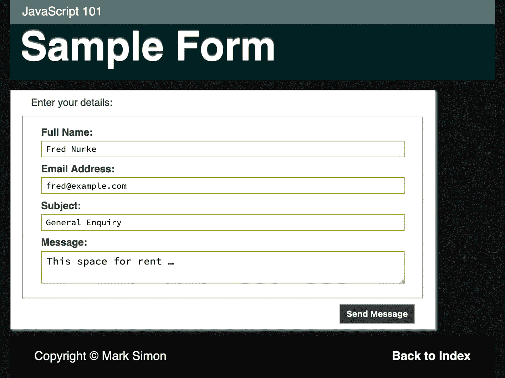
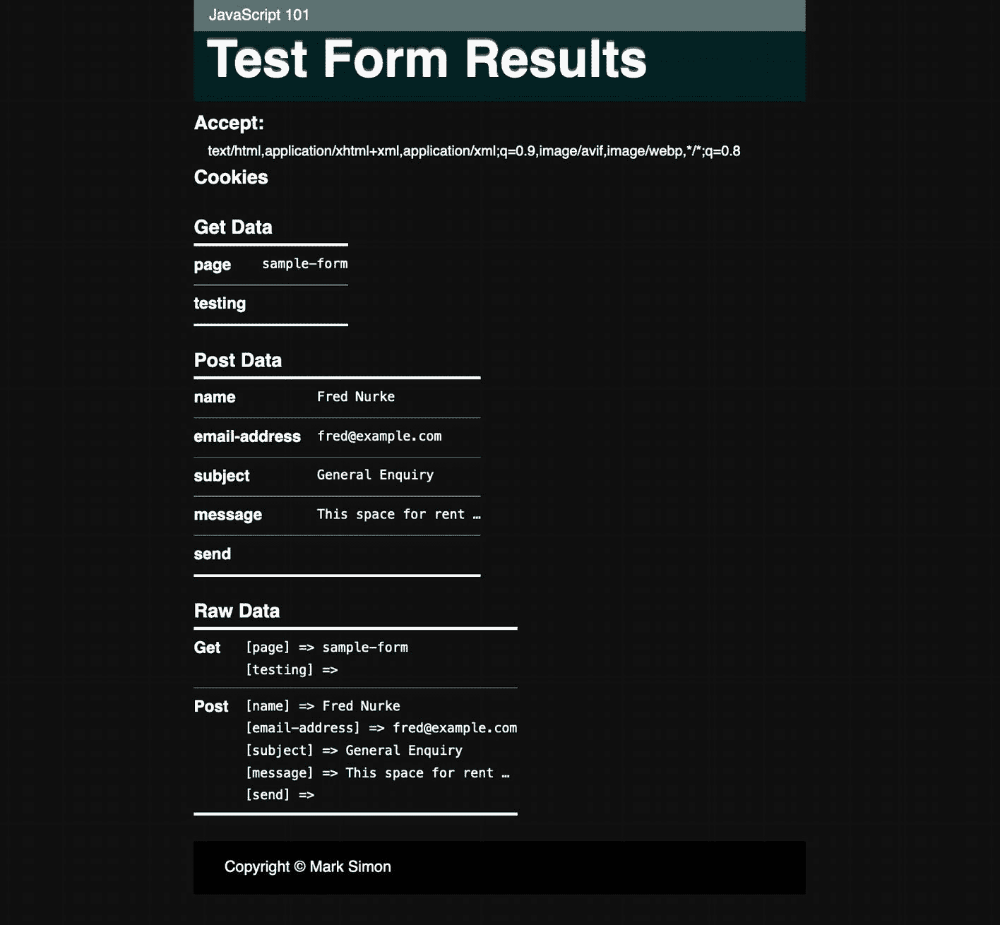

## 5. 使用表单

HTML 表单是与用户交互的重要组成部分。通常，用户将数据输入表单，然后数据被发送到 Web 服务器进行进一步处理。JavaScript 也可以在浏览器内处理表单数据。有时，这是为了在数据发送到服务器之前对其进行预处理或检查，但有时所有操作都留在浏览器内，无需发送出去。

传统上，JavaScript 用于数据`验证`：检查表单在发送前是否已正确填写。为了确保万无一失，Web 服务器应再次检查：有些情况无法在浏览器端检查，而且绕过 JavaScript 验证总是可能的。从这个意义上说，JavaScript 验证并非最终验证，而是为了方便用户，因为它可以在表单发送之前警告用户错误。

在现代 HTML 中，许多表单验证可以通过额外的 HTML 属性来处理，因此 JavaScript 验证不再那么重要。然而，JavaScript 在处理表单数据方面仍然扮演着重要角色。在下一个项目中，我们将使用表单作为专用计算器，其中 JavaScript 将用于检查输入并计算结果。现在，我们先了解一下 JavaScript 通常如何与表单协同工作。

### HTML 表单的结构

表单是一个 HTML 容器，它可以包含以下类型的元素：

- 表单字段，例如文本框、菜单和按钮。这些包含表单的实际 `数据`，它们是表单的核心。
- 组织元素，例如 `fieldset` 和 `label`。这些对数据没有影响，但在视觉上和实用性上对用户有帮助。
- 任何其他元素，例如段落和图片。同样，它们对数据没有影响，但用于增强表单的外观或使表单的某些部分更清晰。

当然，这些其他元素本身并不是表单的一部分：它们只是*位于*表单内部。它们完全也可以被放置在表单外部。

在浏览器和代码编辑器中打开 `sample-form.html` 页面。以下是显示表单结构的摘录：

```

Enter your details:

Full Name:

Email Address:

Subject:

Message:

This space ...

Send Message
```

## 在浏览器中，表单可能类似于图 5-1。



截图显示了示例表单，包含以下字段：全名、电子邮件地址、主题、消息。

**图 5-1** 示例表单

实际外观部分取决于浏览器，很大程度上取决于 CSS 样式。现代开发者在使表单美观易用方面投入了大量精力。外观对提交数据后 Web 服务器所看到的内容没有任何影响；但肯定会影响用户与表单的交互方式。

示例表单的重要部分如下：

*   表单有一个`id`属性。这对数据没有影响，但用于 CSS 设置样式，也用于 JavaScript 定位特定表单。
*   表单还有`method`和`action`属性，用于控制数据如何发送回 Web 服务器。它们对于将数据提交回服务器非常重要。
*   存在一些数据元素。在此示例中，它们是各种类型的文本框，但也可能包括复选框、单选按钮、列表和菜单。我们将在 JavaScript 中重点关注这些数据元素。
*   有一个提交按钮，它也被视为数据元素。通常，这会向服务器提交数据，但可以在 JavaScript 中被拦截。
*   表单中的其他所有内容都是组织性的，不会影响我们对数据的处理。

除了其他 HTML 属性之外，表单字段*元素*还有一些相关属性：

*   `name="..."`属性为数据附加一个标识符。如果将表单发送到服务器，`name`是识别值的*唯一*方式。在 JavaScript 中，有其他替代方法，但我们将使用`name`属性。
*   `value="..."`是一个*默认*值，但当前值可以由用户轻松更改。它通常用作对用户的便利，并且对我们测试来说也很方便。

`value`是少数具有*两种*不同含义的属性之一。作为 HTML 属性，它是*默认*值；作为 JavaScript 属性，它是*当前*值。

*   `type`属性对于表单及其元素的*行为*很重要，但对实际数据没有影响。

在这种情况下，较小的文本框具有`type="text"`或`type="email"`，这看起来像文本框，但仅限于类似电子邮件地址的文本。较大的文本框是一个`textarea`元素，它执行类似的工作，但没有`type`属性。

默认情况下，表单内的`button`元素充当`submit`按钮。通常最好使用`type="submit"`属性来指定。表单通常有一个`action="..."`属性，其中包含数据将提交到的 URL。

如果提交示例表单（使用默认值或自定义值），数据将被发送到 Web 服务器上的脚本。在这种情况下，脚本仅显示发送到服务器的数据，而不会进一步处理。你将看到类似图 5-2 的内容。



测试表单结果页面的截图。它包含以下列出的信息：Accept、Cookies、Get Data、Post Data、Raw Data。

**图 5-2** 示例表单结果

**Get** 数据是以查询字符串形式添加到 URL 的数据。**Post** 数据是来自表单本身的数据，其方法设置为`post`。如果方法设置为`get`，它将被添加到查询字符串中作为更多的**Get**数据。

## 在 JavaScript 中访问表单

出于我们的目的，我们不一定想将表单提交到服务器。我们只想用 JavaScript 访问它。

你首先需要的是对表单的引用。假设表单有一个`id`，你可以使用类似这样的代码：

```javascript
var form = document.querySelector('form#contact');
```

当然，变量名不必是`form`。如果提交表单，表单的`id`属性没有任何意义，服务器也永远不会看到`id`。但是，它在浏览器中对于 CSS 样式以及我们在此看到的 JavaScript 非常重要。还有一个`forms`集合，你可以引用`forms[0]`作为第一个（也是唯一一个）表单，但这在现代 JavaScript 中不是必需的。

## 访问表单元素

从 JavaScript 的角度来看，表单是一个对象：一个复杂的包。它有许多属性，例如`action`和`method`，它们是表单自身行为的一部分。它还有一个表单元素的集合。

访问表单的元素有两种方法。最简单的方法是使用元素的名称作为属性。例如，要访问`name`为`subject`的元素，你可以在文本框中填写内容，然后在 JavaScript 中使用`form.subject`：

```javascript
var form = document.querySelector('form#contact');
console.log(form.subject);
```

这是一种非常常见的方法，因为它很简单。但是，它将表单元素与表单的其他属性（例如其`method`或`action`）混合在一起，并且如果你需要访问其他恰好与表单元素同名的表单属性，就会成为问题。最好通过`form.elements`集合来访问元素：

```javascript
var form = document.querySelector('form#contact');
console.log(form.elements.subject);
```

另一个复杂之处是元素的`name`属性可能不是一个合适的 JavaScript 属性名。例如，如果`name`类似于`name="email-address"`，你不能引用`form.elements.email-address`，因为你不能在属性名中使用连字符。相反，你需要使用替代表示法`form.elements['email-address']`。

现在有几种方法可以引用表单元素：

```javascript
var form = document.querySelector('form#contact');
console.log(form.subject);
console.log(form.elements.subject);
console.log(form.elements['subject']);  //  首选
```

最后一种是我们更倾向于使用的方式，因为它最安全，并且适用于所有有效的名称。如果你运行前面显示的代码，你将看到元素本身，而不是元素中的文本。为此，你需要读取元素的一些属性。

## 访问表单数据

所有表单元素都可以使用`form.elements['element-name']`来访问。但是，这将给你元素本身，而不是元素内部的数据。

令人困惑的是，有两个相关属性的名称重叠：

*   你也可以通过这种方式设置`.defaultValue`属性，但它不是很有用。
*   HTML 的`value="..."`属性实际上是*默认*值；在 JavaScript 中，它被称为`.defaultValue`属性。
*   元素的*当前*值是 JavaScript 所称的`.value`属性。

例如，假设你在表单的主题中输入了`Random Question`。然后你可以如下检查它：

```javascript
var form = document.querySelector('form#contact');
console.log(form.elements['subject'].defaultValue);
// 输出: General Enquiry
console.log(form.elements['subject'].value);
// 输出: Random Question
```

对于大多数应用程序，你将需要`.value`属性。

如果你愿意，你可以设置`value`属性：

```javascript
var form = document.querySelector('form#contact');
form.elements['email-address'].value = 'someone@example.com';
```

### 关于 `.value` 属性的说明

请注意，`.value` 属性*始终*是一个字符串。如果你期望得到一个数字，你可能需要使用 `parseInt()` 或 `parseFloat()` 将其转换为数字。这与你在猜数字游戏中遇到的 `prompt` 函数的问题是相同的。

## 访问提交按钮

表单的提交按钮与其他表单元素一样，因此可以使用相同的表示法轻松访问：

-   你可以做的一件事是模拟点击提交按钮：

```javascript
var form = document.querySelector('form#contact');
form.elements['send'].click();
```

-   `click()` 函数模拟点击，可以在任何时候用于点击任何元素。

如果你确实想要提交表单，也可以使用 `submit()` 函数从表单对象执行此操作：

```javascript
var form = document.querySelector('form#contact');
form.submit();
```

-   访问提交按钮最可能的用途是附加一个事件监听函数：

```javascript
var form = document.querySelector('form#contact');
```
