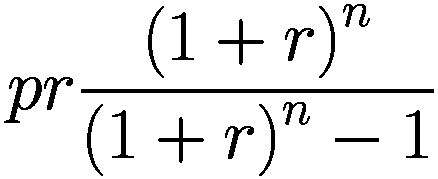
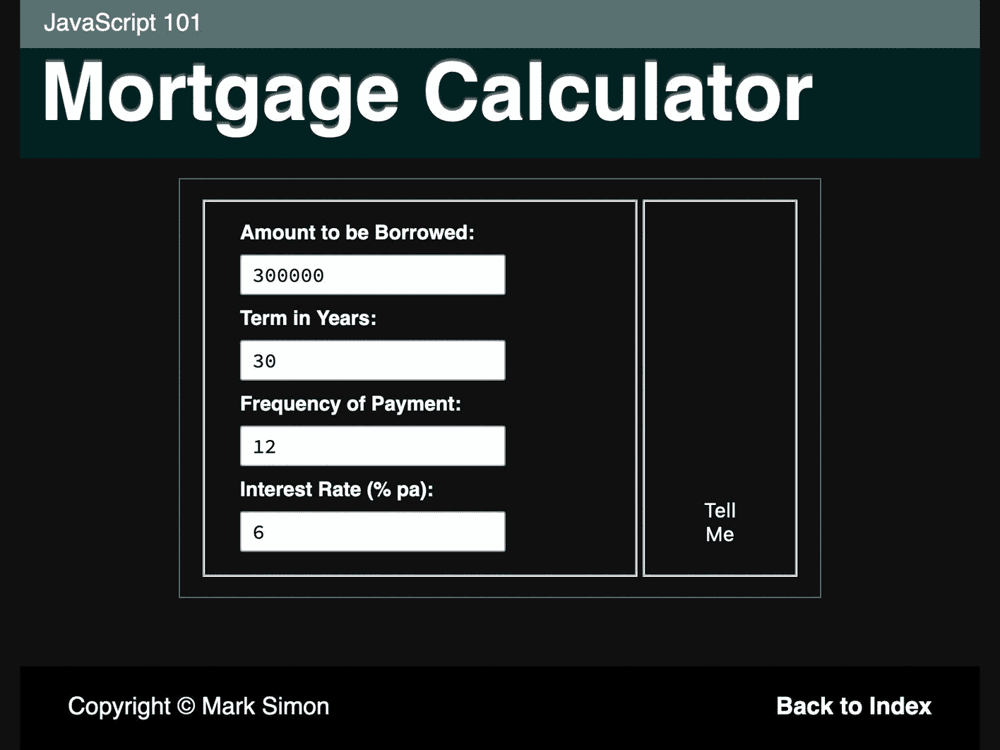
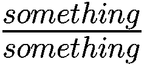
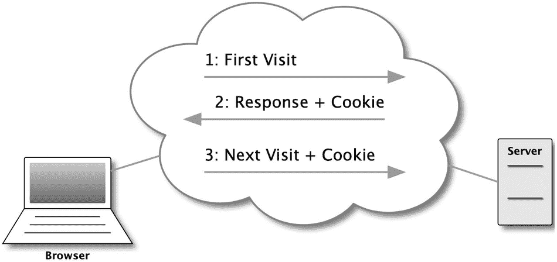

# 6. 创建自定义计算器表单

Web 表单是一种允许用户与网络服务器进行通信的标准方法。这通常用于发送消息或下订单。尽管表单可以按原样工作，但通常会用 JavaScript 来预处理数据和进行检查。在这个项目中，我们将使用 JavaScript 来处理数据，而不将其发送到服务器。在这种情况下，我们将创建一个专门的計算機。

在开发这个项目的过程中，我们将学习以下内容：

-   从 Web 表单读取数据
-   检查和验证数据
-   拦截表单
-   编写公式代码
-   在浏览器中存储数据

虽然我们不会将表单提交到服务器（除了测试表单），但如果你想要记录查询或进行一些进一步的处理，你也可以这样做。

## 创建抵押贷款还款计算器

专门计算器的一个简单例子是使用专门公式的计算器。在这里，我们将根据本金（借款金额）、利率和抵押贷款期限来计算定期还款额。你可能会或可能不会对金融计算充满热情。或者你可能对科学计算或数学公式更感兴趣。当然，我们关注的不是公式本身，而是如何将公式转化为表单，以及如何用 JavaScript 实现它。

如果你要在电子表格应用程序中执行此操作，你可能会找到一个名为 `PMT()` 的内置函数来完成相同的工作。JavaScript 没有这样的函数，所以你必须自己编写代码。如果你有时间和数学知识，你可能可以自己推导出这个公式。如果你没有时间、知识或意愿，你可以尝试在互联网上找到某个公式。

最终，你会发现还款公式为：



其中

- p = 本金
- r = 利率（每期）
- n = 还款期数

这个公式可以完成任务，但其中两个值对用户不太友好。在计算抵押贷款时，我们通常以*年*利率表示，而不是*每期*利率。而且我们通常使用*年*数，而不是还款期数。

为人类编写应用程序的最重要规则是，让人类做对他们来说自然的事情，并让代码进行必要的调整。*永远不要期望用户进行调整：(a) 他们不想这样做，(b) 他们可能会犯错误，(c) 他们真的不想这样做。*

因此，部分工作将是把对人类友好的值转换为对公式友好的值。

### 计算器表单

数据将来自以下表单：

```
借款金额：
期限（年）：
还款频率：
利率（年化%）：
计算
```

它看起来类似于图 6-1。



抵押贷款计算器表单页面的屏幕截图。以下是字段：借款金额、期限（年）、还款频率和利率。

**图 6-1** 抵押贷款计算器表单

在此表单中，两个重要的输入元素类型是 `<input type="text" name="...">` 和 `<button name="...">`，它们是文本框和操作按钮。你会看到还有一个 `output` 元素。这是一个简单的元素，你可以在 JavaScript 中向它写入任何你喜欢的内容。它将是表单的 `elements` 集合的一部分，但如果你提交表单，它将不会被包含在内。

为了实现计算器，我们将响应 `button`，读取和处理来自 `input` 元素的数据，并将结果放入 `output` 元素中。

### 表单字段

表单字段是从用户角度看待我们需要处理的值。它们是：

-   `principal`：借款金额
-   `term`：抵押贷款的年数
-   `frequency`：每年的还款次数
-   `rate`：以百分比表示的年利率

请注意，这些都是 `text` 类型的输入。HTML 确实有 `type="number"`，但它不够灵活。无论如何，数据将是一个字符串，即使我们使用 `type="number"`，所以对我们来说没有多大好处。

这四个值是人们期望填写的那种值，但公式想要的是不同的东西。为了准备好公式需要的值：

-   本金保持不变。
-   每期利率将按如下方式计算：

```
每期利率
= 年利率 / 每年还款次数 / 100
```

# 除以 100 将百分比转换为小数。

- 还款期数的计算方式如下

```
还款期数
= 贷款年限 × 每年还款次数
```

请注意，我们再次向用户做出了让步。我们习惯于将利率表示为百分比，但`JavaScript`对百分比一无所知。因此，我们将允许用户输入看起来像百分比的值，然后在代码中将其除以 100。^(³)

## 初始化 JavaScript

HTML 代码已准备就绪，并包含了指向`JavaScript`文件的链接：

```
...
...
...
```

请注意，其中包含了库脚本。如果某些新代码是可复用的，我们可能需要将其移到库中。

`calculator.js` 文件已为您创建完毕，可以直接使用：

```
/*  按揭贷款计算器
================================================ */

'use strict';

window.onerror=function(message,url,line) {
    alert(`Error: ${message}\n${url}: ${line}`);
};

doCalculator();

function doCalculator() {
}
```

我们没有费心去单独编写一个`init()`函数，因为那里已无需再做任何处理。

## 处理表单

第一步是找到表单并引用它：

```
function doCalculator() {
    let calculatorForm = document.querySelector('form#data');
}
```

找到表单后，你需要为提交按钮附加一个事件监听器：

```
function doCalculator() {
    let calculatorForm = document.querySelector('form#data');
    calculatorForm.elements['calculate'].onclick = doit;

    function doit(event) {
    }
}
```

请注意，由于我们是在控制台中实验，我们需要在引用 `doSomething()` 函数*之前*定义它。在真实的脚本中，你可以之后定义该函数，因为 JavaScript 解释器会在运行脚本之前扫描所有函数定义。

另外请注意，如果你重新定义了该函数（就像你在这里会做几次一样），你还需要重新分配 `onclick` 事件监听器。

```
form.elements['send'];
```

这个附加的函数被称为事件监听器，并且如果你需要的话，它实际上有一个参数。这个参数通常被称为 `event`，可用于取消提交：

```
»   var form = document.querySelector('form#contact');

»   function doSomething(event) {
    //  处理表单
    event.preventDefault();
}

»   form.elements['send'].onclick = doSomething;
```

由于提交按钮的默认行为是提交数据，`preventDefault()` 函数会阻止此行为。有时，这会在 `if()` 之后使用，例如在检查错误时。如果你希望完全在 JavaScript 中处理表单而不将其发送到服务器，也可以无条件地使用它。

你经常会看到 `preventDefault()` 函数被首先调用：

```
function doSomething(event) {
    event.preventDefault();
    //  处理表单
}
```

如果你不取消提交，那么表单将被提交，在这种情况下，页面将被重新加载。

## 总结

在本章中，我们快速了解了 HTML 表单。我们讨论了：

-   HTML 表单的结构
-   在 JavaScript 中访问表单
-   访问表单元素
-   访问表单数据
-   访问提交按钮并拦截提交过程

## 下一章预告

既然我们已经了解了表单和 JavaScript，我们将把表单用作一个自定义计算器。在计算器项目中，我们将学习更多关于处理表单和表单字段以及处理来自表单的数据的知识。我们还将了解更多关于数据处理和计算的技术，以及关于为将来存储数据的一些知识。

# JavaScript 表单数据处理

这里，提交按钮的名称为`calculate`。事件监听器是`doit`函数。你可能觉得`doit`不是一个描述性很强的名称，但我们能用其简洁性来辩护。

在这种情况下，`doit`函数是`嵌套`在`doCalculator()`函数内部的。因此，这个函数具有以下几个特点：

- 由于位于`doCalculator()`函数内部，`doit`函数继承了所有外部变量。在本例中，它继承了`calculatorForm`变量，该变量对于获取数据值至关重要。
- 与局部变量一样，嵌套函数只能在外部函数内部访问，外部无法访问。你可以随意命名嵌套函数，而不会影响你其余的`JavaScript`代码。
- 正是这个特性使得为`doit`函数取一个描述性较弱的名称是合理的，因为它只需在局部范围内有意义。
- 外部函数是自包含的，因为它包含了所有依赖函数，并且无需与其他任何函数通信。

`doit`函数包含了`event`参数，我们可以用它来阻止表单实际提交：

```javascript
function doit(event) {
    event.preventDefault();
}
```

如果你忘记这样做，每次点击提交按钮时页面都会重新加载，你将永远看不到计算结果。

### 获取表单数据元素

有四个数据元素需要用到。你可以直接使用它们的值，但将它们存入变量会更方便：

```javascript
function doit(event) {
    event.preventDefault();
    let principal = calculatorForm.elements['principal'].value;
    let term = calculatorForm.elements['term'].value;
    let frequency = calculatorForm.elements['frequency'].value;
    let rate = calculatorForm.elements['rate'].value;
}
```

无法阻止用户犯错，尤其是输入错误。最简单的错误是多余的空格，我们可以使用`trim()`函数轻松处理：

```javascript
function doit(event) {
    event.preventDefault();
    let principal = calculatorForm.elements['principal'].value.trim();
    let term = calculatorForm.elements['term'].value.trim();
    let frequency = calculatorForm.elements['frequency'].value.trim();
    let rate = calculatorForm.elements['rate'].value.trim();
}
```

`trim()`函数应用于字符串，在这里是`.value`属性，它会移除字符串开头和结尾的所有空格。如果字符串内部有其他空格，则不受影响。

### 检查表单值

记住，所有表单数据最初都是字符串，因此你需要确保它们被转换为数字。虽然`JavaScript`会在可能的情况下自动进行转换，但你自己手动转换更好。这样，你也可以检查转换错误。例如：

```javascript
let principal = calculatorForm.elements['principal'].value.trim();
principal = parseFloat(principal);
```

`parseFloat()`和`parseInt()`函数都会尝试从字符串开头开始，尽可能多地将字符串解析为浮点数或整数。如果遇到数字中无效的字符，它们就会停止解析，并使用该字符之前的所有内容。两者之间的区别在于，`parseFloat`还会接受小数点，这对于整数来说是无效的。

当你使用`parseInt()`或`parseFloat()`处理字符串时，字符串转换失败的可能性始终存在；也就是说，它是`无效的`。检查用户数据是否有效当然被称为`验证`。现代 HTML 为表单提供了一些内置验证，但使用`JavaScript`进行验证功能更强大。

如果字符串为空或开头就是无效字符，`parseFloat()`和`parseInt()`将返回`NaN`，这是一个特殊值，表示“Not a Number”（非数字）。你可以使用以下两种方法之一专门测试这个特殊值：

```javascript
if(isNaN(principal)) ... ;            //  isNaN() 函数
if(principal != principal) ...    ;   //  NaN 的特性
```

第一种方法使用`isNaN()`函数，你需要记住它有两个大写`N`。第二种方法利用了`NaN`的一个奇特特性：它不等于任何东西，甚至不等于它本身。你不会认真使用这个方法，但可能想展示一下。

实际上，你可以利用`NaN`被视为假值的特性，直接使用非（`!`）运算符：

```javascript
let principal = calculatorForm.elements['principal'].value.trim();
principal = parseFloat(principal);
if(!principal) principal = 0;
```

这样，如果字符串解析失败，你可以指定一个默认值。

在`JavaScript`中，你可以使用`||`（或）运算符将上一步骤中显示的最后两步合并：

```javascript
let principal = calculatorForm.elements['principal'].value.trim();
principal = parseFloat(principal) || 0;
```

在`JavaScript`中，`||`运算符是`短路`的。这意味着如果第一个测试足以得到结果，第二个将不会被执行。在这种情况下，如果第一个值为真值，则不会使用第二个值，因为`||`只需一个成功条件即可。

现在，你可以预处理以下值：

```javascript
function doit(event) {
    event.preventDefault();
    let principal = calculatorForm.elements['principal'].value.trim();
    principal = parseFloat(principal);
    if(!principal) principal = 0;
    let term = calculatorForm.elements['term'].value.trim();
    term = parseFloat(term);
    if(!term) term = 0;
    let frequency = calculatorForm.elements['frequency'].value.trim();
    frequency = parseFloat(frequency);
    if(!frequency) frequency = 1;
    let rate = calculatorForm.elements['rate'].value.trim();
    rate = parseFloat(rate);
    if(!rate) rate = 0;
}
```

或者更简洁地：

```javascript
function doit(event) {
    event.preventDefault();
    let principal = calculatorForm.elements['principal'].value.trim();
    principal = parseFloat(principal) || 0;
    let term = calculatorForm.elements['term'].value.trim();
    term = parseFloat(term) || 0;
    let frequency = calculatorForm.elements['frequency'].value.trim();
    frequency = parseFloat(frequency) || 0;
    let rate = calculatorForm.elements['rate'].value.trim();
    rate = parseFloat(rate) || 0;
}
```

除了为公式提供无害的虚拟值之外，这些默认值实际上什么也不做。你本来可以轻松地提供更有意义的值。

### 使用 HTML 默认值与修复表单值

如果你想要使用 HTML 默认值，请记住 HTML 使用`value`作为该属性的默认值。然而，JavaScript 使用`value`表示当前值，因此你需要使用另一个 JavaScript 属性`defaultValue`。例如：

```javascript
principal = parseFloat(principal) ||
    parseFloat(calculatorForm.elements['principal'].defaultValue);
```

# 修复表单值

虽然有些开发者似乎以此为乐，但通常不建议混淆用户。在本例中，你可能已经调整了某些值，并且即将使用这些调整后的值。

当你对用户数据做出任何更改后，最好将这些值写回表单，以便用户能够看到实际发生了什么。表单的`value`属性既可读也可写，因此我们可以通过这种方式写入调整后的值：

```javascript
function doit(event) {
    event.preventDefault();

    let principal =
        calculatorForm.elements['principal'].value.trim();
    principal = parseFloat(principal) || 0;
    calculatorForm.elements['principal'].value = principal;

    let term = calculatorForm.elements['term'].value.trim();
    term = parseFloat(term) || 0;
    calculatorForm.elements['term'].value = term;

    let frequency =
        calculatorForm.elements['frequency'].value.trim();
    frequency = parseFloat(frequency) || 0;
    calculatorForm.elements['frequency'].value = frequency;

    let rate = calculatorForm.elements['rate'].value.trim();
    rate = parseFloat(rate) || 0;
    calculatorForm.elements['rate'].value = rate;
}
```

虽然`.value`属性从技术上讲是字符串而非数字，但 JavaScript 知道这一点，并且会轻松地将数字转换为字符串。

你现在可以尝试使用无效值进行测试。任何默认值都会被写回表单，尽管在此阶段还不会进行任何计算。

## 转换抵押贷款计算公式

如前所述，还款公式为：


你需要做的第一件事是准备计算所需的值：

- 本金很简单，我们使用从表单获取的值`principal`。唯一需要注意的是，为了简化，我们可以将其放入一个新变量中：

```javascript
let p = principle;
```

- 值`n`是还款次数。由于我们拥有以年为单位的期限（`term`）和每年的还款次数（`frequency`），总的还款次数就是这两个值的乘积：

`let n = term * frequency;`

- 值`r`是每期的利率。由于我们拥有年利率和每年的还款次数，我们需要将两者相除。同时，由于该数字是百分比形式，我们还需要除以`100`：

`let r = rate / frequency / 100;`

我们现在可以将以下代码添加到函数中：

```javascript
function doit(event) {
    event.preventDefault();
    ...
    let p = principal;
    let n = term * frequency;
    let r = rate / frequency / 100;
}
```

下一步是将表达式转换为 JavaScript：

- 第一部分只是值的乘法，因此你可以写成：

`p * r * ...`

- 表达式`(1+r)`^(`n`)表示`(1 + r)`的`n`次方。你可以这样写：

`(1 + r)**n`

在较旧的 JavaScript 中，你需要使用内置函数`Math.pow(1+r, n)`来完成计算。

- 表达式  表示你需要进行除法运算。但是，表达式的分母部分是一个加法运算，你需要将其用括号括起来。

综合起来，公式转换为：

```javascript
p * r * (1+r)**n / ((1+r)**n - 1)
```

使用较旧的 JavaScript，你需要：

```javascript
p * r * Math.pow(1+r,n) / (Math.pow(1+r,n) - 1)
```

将代码添加到函数中：

```javascript
function doit(event) {
    ...
    let repayment = p * r * (1+r)**n / ((1+r)**n - 1);
}
```

我们将结果保存到一个新的变量`repayment`中。

### 显示结果

最后，我们需要将结果显示在页面上。还记得那个名为`result`的`output`元素吗？我们可以像写入其他表单元素一样写入它：

有一个`id`为`results`的段落，因此我们需要定位它。我们可以将变量命名为`result`。我们可以在`doit`函数中完成此操作：

```javascript
function doit(event) {
    ...
    let repayment = p * r * (1+r)**n / ((1+r)**n - 1);
    calculatorForm.elements['result'].value = repayment;
}
```

你可能已经注意到结果中存在过多的小数位。这是用复杂数字进行除法运算的结果。你可能只需要保留两位小数。

虽然 JavaScript 确实有一个四舍五入函数（`Math.round`），但它只能四舍五入到整数。无论如何，将数字显示为固定的小数位数并不是近似函数的职责。相反，你应该按照你喜欢的格式生成一个字符串。

幸运的是，JavaScript 有一个函数可以完成这项工作：`toFixed(...)`。它会将数字转换为指定小数位数的字符串。我们可以直接将其应用于`repayment`变量：

```javascript
function doit(event) {
    ...
    let repayment = p * r * (1+r)**n / ((1+r)**n - 1);
    calculatorForm.elements['result'].value = repayment.toFixed(2);
}
```

如果你现在使用默认值进行尝试，应该会得到结果`1798.65`。

## 改进

我们可以做一些事情来让这个计算器表单变得更好。这里，我们只做以下两件事：

- 以本地货币格式显示结果。
- 为下次使用本地存储这些值。

我们可能会沉迷于次要的改进，但这两个实现起来并不太难。

### 以本地货币格式显示结果

如果你不在澳大利亚阅读本文，你的本地货币可能不同，甚至十进制和长数字的表示方式也可能不同。实际上，过滤输入格式的差异非常困难，但输出格式却相对容易。

#### `Intl` 对象

JavaScript 有一个内置对象叫做`Intl`。它非常强大——事实上，它强大到需要花点功夫才能弄明白它的工作原理。

`Intl`对象能够根据不同的区域设置格式化日期、时间和数字。它甚至可以根据惯例格式化列表。在我们的例子中，我们感兴趣的是将数字格式化为货币。

要使用`Intl`格式化，你需要经过两个步骤。你可以在控制台中实验以了解其工作原理。

首先，创建一个新的`NumberFormat`对象，指定区域设置以及你希望如何处理数字：

```javascript
»   var numberFormat = Intl.NumberFormat(
        'en-AU',
        { style: 'currency', currency: 'aud' }
    );
```

此处，区域设置设置为`en-AU`，表示澳大利亚的英语。这里的关键是区域设置有助于定义小数点（`.`）和千位分隔符（`,`）。如果你在欧洲，比如可能想使用`nl-NL`，这是荷兰使用的格式：小数点与千位分隔符的用法是相反的。

第二个参数是一个选项对象。这里，我们指定希望以货币形式显示数字，使用澳元。货币和区域设置不必匹配。如果你希望以荷兰的数字格式显示澳元，这是可以的：

```javascript
»   var numberFormat = Intl.NumberFormat(
        'nl-NL',
        { style: 'currency', currency: 'aud' }
    );
```

### 格式化数字

当然，你此时还不会得到格式化后的数字。为此，你需要使用该对象的`format()`方法：

```javascript
»   numberFormat.format(123456.789);
←   "$123,456.79"
```

注意该数字已正确四舍五入至两位小数。同时请注意结果是字符串。数值仅含数值本身，不包含货币符号或千位分隔符。若需要此类修饰，则需使用字符串，这对于后续操作而言是可行的。

若打算多次使用该格式化器，可将`format()`方法纳入变量以提升便利性：

```javascript
var format = Intl.NumberFormat(
    'en-AU',
    { style: 'currency', currency: 'aud' }
).format;

format(123456.789);
// 返回 "$123,456.79"
```

请记住，在 JavaScript 中，函数也是数据对象。你可以像赋值其他对象一样赋值函数。此处，我们将新`NumberFormat`对象的`format()`方法赋值给名为`format`的变量。由于该变量包含的是函数，因此可直接将其作为函数使用。接下来我们将此功能添加到代码中。

原则上，我们可能需要多次重新计算。每次创建新的格式化对象会造成浪费，因此将其创建在`doit()`函数外部：

```javascript
function doCalculator() {
    let calculatorForm = document.querySelector('form#data');
    calculatorForm.elements['calculate'].onclick = doit;

    let format = Intl.NumberFormat(
        'en-AU',
        { style: 'currency', currency: 'aud' }
    ).format;

    function doit(event) {
        ...
    }
}
```

由于已不在控制台环境中，我们将`var`改为`let`。`doit()`函数在每次点击`calculate`按钮时执行。与`calculatorForm`变量类似，它能够访问包含函数中的`format()`函数。

我们不再需要`toFixed()`方法。该方法之前表现尚可，但格式化函数也会对结果进行四舍五入。可将其替换为以下代码：

```javascript
function doit(event) {
    ...
    let repayment = p * r * (1+r)**n / ((1+r)**n - 1);
    // calculatorForm.elements['result'].value =
    // repayment.toFixed(2);
    calculatorForm.elements['result'].value = format(repayment);
}
```

这样看起来更专业一些。`Intl`对象的功能远不止格式化数字。若想了解其更多用法，可访问[`https://developer.mozilla.org/en-US/docs/Web/JavaScript/Reference/Global_Objects/Intl`](https://developer.mozilla.org/en-US/docs/Web/JavaScript/Reference/Global_Objects/Intl)。

## 在存储中保存数值

这是一个带有默认值的简单计算器，对用户负担不大。不过，记住这些数值以供下次使用或许会带来便利。你无法将数据保存到磁盘，这是出于安全设计——网页不应能访问用户计算机。但你可以将部分数据保存到浏览器的存储区域。

过去，保存数据会使用浏览器 Cookie，这实际上是对 Cookie 的误用。以下才是 Cookie 的正确使用方式：

1.  用户访问网站，可能输入一些数据或进行搜索。
2.  服务器响应请求内容，同时通过 Cookie 发送附加数据。
3.  用户再次访问该网站时，与该网站关联的任何 Cookie 都会返回给服务器。

该过程如图 6-2 所示。


*与用户设备和服务器相连的云状结构包含以下序列：1. 首次访问；2. 响应+Cookie；3. 再次访问+Cookie。*

从一开始，JavaScript 就具备读取、修改甚至创建 Cookie 的能力。这些 Cookie 会在浏览器再次访问服务器时被发送，即便它们并非源自该服务器。

使用 Cookie 进行本地存储存在两个主要问题：

*   所有与网站相关的 Cookie 都会被发送到服务器，即便它们是在 JavaScript 中创建且并非真正源自服务器。这意味着你的数据从未真正实现隐私保护。

### 在 JavaScript 中操作 Cookie

在 JavaScript 中操作 Cookie 实际上相当棘手。

### 使用 Web 存储

幸运的是，如今 JavaScript 有了更好的机制用于在浏览器上存储本地数据。这被称为 **web 存储**，有两种形式：

-   **本地存储**会无限期地保存在浏览器中。本地存储可通过内置对象 `localStorage` 使用。
-   **会话存储**会在浏览器或标签页关闭时自动删除。会话存储可通过内置对象 `sessionStorage` 使用。

两者的工作方式相同，因此你只需决定希望数据保留多长时间。在这个例子中，我们将使用 `localStorage`。

`storage` 对象有许多用于设置和获取数据的方法。这里，我们将存储刚才用于计算结果的值：

```javascript
function doit(event) {
    ...
    //  存储值
    localStorage.setItem('data', true);
    localStorage.setItem('principal', principal);
    localStorage.setItem('term', term);
    localStorage.setItem('frequency', frequency);
    localStorage.setItem('rate', rate);
}
```

当然，这些项目的实际名称可以任意指定，但在这里我们将它们设置为与变量和原始表单数据相同的名称。我们还设置了另一个项目 `data`。这将使我们下次加载页面时，能够轻松地测试是否有任何数据被存储。

你可以在开发者工具中检查浏览器存储中的内容。对于 Firefox 和 Safari，你可以在“存储”(Storage) 部分找到它。在 Chromium 中，则位于“应用程序”(Application) 部分的“存储”(Storage) 部分。你会看到类似下面的内容：

| 键 (Key) | 值 (Value) |
| :--- | :--- |
| `data` | `true` |
| `frequency` | `12` |
| `principal` | `300000` |
| `rate` | `6` |
| `term` | `30` |

下一步是从存储中重新填充这些值。我们在页面加载时执行此操作，也就是运行 `doCalculator()` 函数时。当然，这只有在之前有保存的值时才有效。这就是 `data` 项目的用武之地：

```javascript
function doCalculator() {
    ...
    //  恢复值
    if(localStorage.getItem('data')) {
    }

    function doit(event) {
        ...
    }
}
```

`.getItem()` 方法简单地通过项目名称获取一个值。如果某个项目不存在，`.getItem()` 会返回 `null`，众所周知，这是一个假值。`if()` 语句检查它是否为真值。我们本可以测试其他任何项目来达到此目的，但如果有专门的值来检查，则更容易理解和维护。

恢复这些项目虽然繁琐但很简单。只需为每个值调用 `.getItem()` 方法，并将这些值放入相应的表单字段中：

```javascript
function doCalculator() {
    ...
    //  恢复值
    if(localStorage.getItem('data')) {
        calculatorForm.elements['principal'].value =
            localStorage.getItem('principal');
        calculatorForm.elements['term'].value =
            localStorage.getItem('term');
        calculatorForm.elements['frequency'].value =
            localStorage.getItem('frequency');
        calculatorForm.elements['rate'].value =
            localStorage.getItem('rate');
    }
    ...
}
```

# Web存储与数据处理

要尝试此功能：

-   更改部分数值并计算结果。
-   返回主页。
-   现在返回到计算器页面，检查先前的数值是否已被恢复。

Web 存储的优点在于它不仅易于使用，而且也很安全。至少它和你使用的浏览器一样安全：如果其他人能够接触到你的浏览器，他们仍然可以检查存储的内容。因此，你永远不应以这种方式存储任何真正敏感的信息。至少它不会被发送回 Web 服务器。

## 使用数组处理

恢复数值的那部分代码包含大量重复。每当出现代码重复时，就有可能进行简化。在这个例子中，重复操作涉及对四个项目做相同的事情。

我们可以通过将这些值放入一个数组 `items` 中来稍微简化：

```
['principal','term','frequency','rate']
```

要遍历数组，我们可以使用计数器循环。你可以在控制台中尝试一下。

```javascript
var items = ['principal','term','frequency','rate'];

for(var i=0; i<items; i++) {
    console.log(item);
}
```

在现代 JavaScript 中，你可以使用一个名为 `.forEach()` 的数组方法：

```javascript
var items = ['principal','term','frequency','rate'];

items.forEach(function(item) {
    console.log(item);
});
```

如你所见，`.forEach()` 方法接收一个带有一个或多个参数的函数。第一个参数（也是最常用的参数）是数组中的每一项。既然我们在使用现代 JavaScript，那么使用箭头函数表达式也很常见：

```javascript
var items = ['principal','term','frequency','rate'];

items.forEach(item => {
    console.log(item);
});
```

在箭头函数表达式中，`item =>` 替代了 `function(item)`。虽然它并没有简短多少，但对于简单的任务来说，它可以非常简洁。

如果我们要立即使用数据，则无需将数据保存在单独的变量中。你可以将 `.forEach()` 方法应用于数组字面量：

```javascript
['principal','term','frequency','rate'].forEach(item => {
    console.log(item);
});
```

我们可以用这个方法来替换代码中用于恢复值的部分：

```javascript
// 恢复值
if(localStorage.getItem('data')) {
    /*
    ...
    */
    ['principal','term','frequency','rate'].forEach(item => {
        calculatorForm.elements[item].value =
            localStorage.getItem(item);
    });
}
```

在测试新版本时，其他代码已被注释掉。一旦你确认新代码运行正常，就可以删除被注释的代码。

遗憾的是，你无法对用于存储值的代码做同样的处理。这是因为你想要存储的数据在变量中，而 JavaScript 没有简单的方法来遍历普通变量。

## 使用对象存储数据

如果你*真的*想遍历计算器中使用的变量，有一种间接方法。你已经接触过 `Math` 对象了。它本质上是一个包含数学计算所需的实用函数和数据的包。你可以轻松地创建自己的对象来完成同样的工作。

我们可以在控制台中尝试：

```javascript
var data = {};

data.principal = 300000;
data.term = 30;
data.frequency = 12;
data.rate = 6;
```

在 JavaScript 中，你可以通过赋值一个`对象字面量`来创建新对象，对象字面量是包含在花括号 (`{ ... }`) 中的一组数据。在这个例子中，新对象是一个空对象。然后，你可以像示例所示那样，为其分配新的属性和值。

在控制台中，你可以使用 `console.log()` 打印出这个对象：

```javascript
console.log(data);
```

我们还可以将其与数组遍历结合，以列出对象的全部内容：

```javascript
['principal','term','frequency','rate'].forEach(item => {
    console.log(`${item}: ${data[item]}`);
});
```

我们使用了模板字符串字面量来包含属性名和来自 `data` 对象的值。请注意，我们对对象成员使用了方括号表示法。记住，它是点表示法的一种替代方案，允许我们使用变量。

在我们的计算器代码中，我们可以用对象属性来替换四个主要变量的实例。首先，我们可以使用 `.forEach()` 循环来获取并检查数据：

```javascript
function doit(event) {
    event.preventDefault();
    let data = {};
    ['principal','term','frequency','rate'].forEach(item => {
        data[item] = calculatorForm.elements[item].value.trim();
        data[item] = parseFloat(data[item]) || 0;
        calculatorForm.elements[item].value = data[item];
    });
    ...
}
```

公式中使用的变量随后可以使用这些对象属性，而不是之前的变量：

```javascript
function doit(event) {
    event.preventDefault();
    ...
    let p = data.principal;
    let n = data.term * data.frequency;
    let r = data.rate / data.frequency / 100;
    ...
}
```

最后，你可以用同样的方式存储值：

```javascript
function doit(event) {
    event.preventDefault();
    ...
    ['principal','term','frequency','rate'].forEach(item => {
        localStorage.setItem(item, data[item]);
    });
}
```

最终的代码看起来像这样：

```javascript
function doit(event) {
    event.preventDefault();
    let data = {};
    ['principal','term','frequency','rate'].forEach(item => {
        data[item] = calculatorForm.elements[item].value.trim();
        data[item] = parseFloat(data[item]) || 0;
        calculatorForm.elements[item].value = data[item];
    });
    let p = data.principal;
    let n = data.term * data.frequency;
    let r = data.rate / data.frequency / 100;
    // 不受影响的部分：
    let repayment = p * r * (1+r)**n / ((1+r)**n - 1);
    calculatorForm.elements['result'].value =
        format(repayment);
    // 存储值
    localStorage.setItem('data', true);
    ['principal','term','frequency','rate'].forEach(item => {
        localStorage.setItem(item, data[item]);
    });
}
```

将数据保存在对象中而不是单独的变量中，不仅有助于遍历这些值，还可以简化对过多变量的管理，并便于将数据存储起来供以后使用。这也是一种在位置之间传输数据的便捷方式，例如从网络服务器获取数据。

JavaScript 最近新增了一个 `Map` 对象，它更专门地用于以这种方式存储数据。不过，它使用起来并不那么方便。

## 总结

在本章中，我们了解了如何处理表单数据并存储数据。为了实践这个思路，我们开发了一个简单的计算器来计算抵押贷款还款额。

### 获取表单数据

一个网页表单包含一个 `elements` 集合，该集合引用了所有的 `input` 和 `output` 元素。你可以使用“点”表示法或“方括号”表示法来引用单个元素，但方括号表示法更灵活、更一致。

要引用单个元素，你可以使用类似 `form.elements['...']` 的表达式。然而，这样会得到元素本身；你可能真正想要的是该元素中的值，这时需要使用像 `form.elements['...'].value` 这样的表达式。

所有表单数据都以字符串形式提供。如果你想执行数值计算，你应该对数据进行类似 `parseInt()` 或 `parseFloat()` 的处理，这会将字符串解析为数字。

来自表单的数据不一定合适，因此你需要检查每个值，并可能默认设置为合适的数值。

通常情况下，表单应该将数据提交到服务器上的外部进程。然而，我们可以使用 `event.preventDefault()` 方法来拦截这个过程，它可以阻止表单的默认行为。有时，这是有条件执行的，例如当表单数据未能通过某种验证检查时。在这种情况下，表单本就不该发送数据。

### 执行计算

专用计算器的全部意义在于能够执行那些过于复杂的计算。寻找合适的公式可能需要一些研究，并且公式并不总是对代码友好。

另一个问题是，有时公式对人类也不友好。部分任务在于获取用户期望输入的数值，并对其进行调整以满足公式要求。

最后，公式可能需要转换为 JavaScript 表达式。

### 显示结果

`output` 元素允许你设置一个值显示在表单上。然而，有时计算出的结果格式并不合适，例如小数位数过多，失去了意义。

`.toFixed()` 方法可以将数字格式化为固定的小数位数。结果实际上是一个字符串，这非常适合用于输出。

你可以使用 `Intl` 对象获得更灵活的结果，该对象可以根据特定的区域设置和其他偏好来格式化数字、日期以及其他数据。在这个例子中，我们根据区域设置将数字格式化为货币格式。结果同样是一个字符串。

### 存储数据

`JavaScript` 无法将数据存储到用户的磁盘上，但可以将数据存储在浏览器中。过去，这一功能是通过 cookie 实现的，不过 cookie 并非为此用途而设计。

如今我们可以使用 Web 存储，它既支持短期存储，也支持长期存储。这使得我们能够保存数值，以便在下次访问页面时加载。

由于 `storage` 对象使用键来存储值，我们可以使用键名数组并遍历该数组来简化重复操作。

普通变量无法以这种方式遍历，但我们可以创建一个简单对象，将值存储在对象属性中，而不是使用简单变量。在遍历键名数组时，可以引用这些对象属性。

## 后续内容

接下来的几个项目将对页面上显示的内容进行重大调整。在某些情况下，我们会创建新的 HTML 元素；在某些情况下，我们会显示和隐藏它们；而在另一些情况下，我们会持续更改这些元素的内容。

在此之前，我们需要进一步了解如何操作 CSS 样式，以及 JavaScript 如何响应用户事件。

## 脚注
