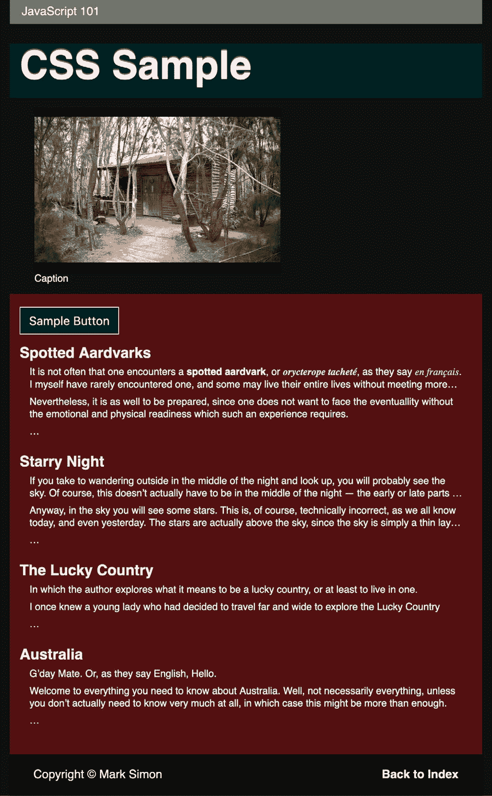
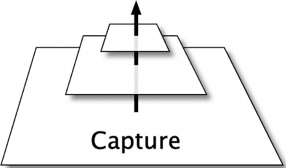
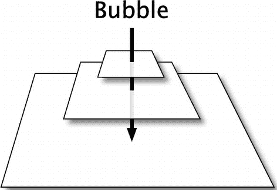

### 7. 与 CSS 和事件监听器的交互

在幻灯片项目以及后续项目中，我们都依赖 CSS 来完成大部分工作。CSS，即层叠样式表，是一种主要控制页面内容外观的语言。你无需成为 CSS 专家也能完成这些工作，但应该了解一些基本概念，以便理解其工作原理并能轻松进行调整。

在此，我们将探讨：

* CSS 的背景
* CSS 能做什么
* 使用事件监听器函数响应用户事件
* 如何使用 JavaScript 与 CSS 交互
* 使用 JavaScript 创建额外的 CSS 样式
* CSS 动画效果

你可以使用浏览器的开发者工具同时实验 CSS 和 JavaScript。有一个示例文件 `sample-css.html` 供你尝试，以及它的 CSS 文件 `sample-css.css`。

该示例文件如图 7-1 所示。



CSS 示例页面的屏幕截图。顶部是一张照片，下方是标题和示例按钮。

**图 7-1** CSS 示例文件

在我们尝试这些概念（尤其是样式和事件监听器）时，文档可能会积累一些不必要的冗余。此时，重新加载页面是你的好朋友，可以让你重新开始。

### 什么是 CSS？

最初的 HTML 并没有包含任何严格控制页面内容外观的方式。早期的尝试包括 `font` 元素；关于这一点，越少提越好。

后来 CSS 语言得以发展。CSS 控制颜色、字体样式、定位，甚至控制内容的可见性。它已经发展到包含一些视觉效果，例如阴影、圆角，以及控制物体不透明度的能力。

随着 CSS 的发展，它还增加了对这些属性变化进行动画处理的能力，无论是简单的过渡还是多步动画。

过去，其中一些功能（例如显示和隐藏元素或对它们的属性进行动画处理）是由 JavaScript 完成的。在部分项目中，你将向文档添加新的元素。如果你不断添加和移除对象，这本身就是一种显示和隐藏的形式，但代价是需要大量额外的编码，并且浏览器需要处理不断变化或缺失的元素，从而增加了额外的工作负担。

同样，我们创建了一个幻灯片，它依次显示图像。如果你切换得足够快，就可以形成动画，但这同样意味着需要大量额外的编码和浏览器工作量。

现在，CSS 为我们提供了无需编写 JavaScript 就能完成这些工作的工具。然而，CSS 无法做到的是与用户交互，或根据情况自行决定事件发生的时间和方式。这正是 JavaScript 的用武之地。

### 在 HTML 中添加 CSS

通常，CSS 会被添加到一个单独的 CSS 文档中，然后通过 HTML 的 `link` 元素进行链接。你可以在 `sample-css.html` 中看到这一点：

```html
<link rel="stylesheet" href="sample-css.css" id="sample-css">
```

这里，`href` 属性指向样式表。无论在理论上还是实践中，`href` 都可以是一个指向不同网站的完整 URL。通常不需要 `id`，但我们后续可以利用它来实现一些效果。

样式也可以包含在 HTML 的 `style` 元素中：

```html
<style>
/* 样式规则 ... */
</style>
```

这种方式比外部样式表更难以管理，因此在正常情况下应避免使用。然而，有时你可能需要在页面中使用自定义的样式块。你也可以在 JavaScript 中创建一个 `style` 元素，效果是等同的。稍后你将看到更多关于创建 `style` 元素的内容。

最后，你可以使用 `style` 属性为元素分配样式：

```html
<div style="color: red;">Hello</div>
```

这被称为内联样式，是实现方式中最繁琐的一种。由于它是在其他样式表之后应用的，因此也是最难以覆盖的。不过，在 JavaScript 中设置此属性仍然很有用。

## 禁用样式

你可以通过设置 `disabled` 属性来禁用某个样式块或链接的样式表。通常你不需要在纯 HTML 中这样做，但可以借助 JavaScript 来打开或关闭此属性。这就是之前的例子中包含 `id` 属性的原因之一——以便让 JavaScript 能够修改链接。

例如：

```javascript
var link = document.querySelector('link#sample-css');
link.disabled = true;
```

你可以通过将该属性设置为 `false` 来重新激活样式表或样式块：

```javascript
link.disabled = false;
```

像这样打开和关闭样式表，可以让你响应例如用户偏好之类的需求。你可能有一个额外字号或不同颜色的样式表。

### 事件监听器

与网页交互需要设置事件监听器。事件监听器是一个函数，它会响应用户触发的事件（例如点击某处或按下某个键）而运行。

你可以直接使用元素的事件属性来分配事件监听器。例如：

```javascript
function doit() {
    console.log(h1.textContent);
}
var h1 = document.querySelector('h1');
h1.onclick = doit;
```

这里，事件属性是 `onclick`，当用户点击该元素时会被触发。在支持触摸的设备上，它同样会响应触摸，因此不一定是仅限鼠标的事件。当你点击或触摸标题时，该函数会打印出标题的文本。正如我们在前几章所述，不要将属性写成 `onClick`、`onlick` 或其他任何变体。

如果你想要移除事件监听器，可以将 `null` 赋值给它：

```javascript
h1.onclick = null;
```

你也可以使用 `addEventListener` 来分配事件监听器：

```javascript
h1.addEventListener('click', doit);
```

# 事件监听器与事件目标

第二种方法显然更复杂，但它使得分配多个事件监听器以及改变其在嵌套元素中的响应方式成为可能。有些事件甚至没有简单的 `onsomething` 版本。由于前面展示的 `doit` 函数是专门附加到 `h1` 元素上的，在函数内部再次引用 `h1` 就显得重复了。为此，你需要多了解一些关于事件目标的知识。

如果你想要移除通过这种方式添加的事件监听器，可以使用 `removeEventListener()`：

```javascript
h1.removeEventListener('click', doit);
```

用这种方式移除事件监听器有一个陷阱，我们将在关于嵌套事件监听器的部分看到。使用 `.addEventListener()` 是添加事件监听器的首选方式。然而，在接下来的实验中，你可能需要多次添加事件监听器。这会导致单个事件上产生许多动作。对于每个新章节，请务必移除之前添加的事件监听器。或者，你也可以重新加载页面。

### 事件目标

当你触发一个事件监听器时，你需要知道是什么实际触发了它。

例如，在示例文件中，有一个包含图片和标题的 `figure` 元素：

```html
...
```

你当然可以为前面展示的任何元素分配一个事件监听器，但让我们看看如果将其分配给 `figure` 元素会发生什么：

```javascript
function doit(event) {
    console.log(this);
    console.log(event.target);
    console.log(event.currentTarget);
}

var figure = document.querySelector('figure');
figure.addEventListener('click', doit);
```

`doit()` 函数包含一个参数 `event`，它包含事件的详细信息以及控制事件的方法。在函数内部，有三个重要的值：

*   `this` 是一个魔法变量，指向持有事件监听器函数的对象；在这个例子中，它是 `figure` 元素。
*   `event.target` 是你实际点击的元素。
*   `event.currentTarget` 是持有事件监听器函数的元素；在*大多数*情况下，它与 `this` 相同，但并非总是如此。

如果你点击图片或标题，你会得到 `` 或 `<figcaption>`。

如果你点击图片周围的空间，你会得到 `<figure>`。

在所有情况下，`this` 和 `event.currentTarget` 都是容器 `figure`。`event.target` 的值取决于你实际点击的是哪个元素。虽然写 `this` 显然比 `event.currentTarget` 更方便，但它的实际值会根据函数的调用方式而变化，因此在后续代码中，我们将坚持使用 `event.currentTarget` 或 `event.target`。

上一节的例子现在可以写成：

```javascript
h1.removeEventListener('click', doit);   // 移除旧的

function doit(event) {
    console.log(event.target.textContent);
}

var h1 = document.querySelector('h1');
h1.addEventListener('click', doit);
```

通过将 `h1` 替换为 `event.target`，你使事件监听器更具可复用性。你也可以将它分配给多个元素，让代码自动判断你点击的是哪个元素。

### 嵌套事件目标

你已经看到，点击图片也会触发包含它的 `figure` 元素的点击事件。这是设计使然，但并非总是你想要的。有时，你可能希望点击图片时事件就止步于此。

在此之前，我们需要理解点击事件是如何传播的。当你点击一个嵌套在另一个元素内部的元素时，被点击的元素以及所有包含它的元素都会感知到此次点击。点击事件的传播分两个阶段进行。首先，点击事件从外向内传播，从外层元素到内层元素。这被称为**事件捕获**阶段，如图 7-2 所示。



*图 7-2 事件捕获*

然后它进入**目标**阶段，这个阶段涉及你实际点击的元素。

之后，点击事件从内向外传播，从内层元素到外层元素。这被称为**事件冒泡**，如图 7-3 所示。



*图 7-3 事件冒泡*

大多数时候，你更关注的是冒泡阶段，即从被点击的元素开始。当你直接使用 `onclick` 属性或默认的 `addEventListener()` 方法时，事件监听器只会响应冒泡阶段。

你可以使用带有可选参数的 `addEventListener()` 来让事件监听器监听捕获阶段：

```javascript
addEventListener('click', doit, true);
```

第三个参数可以包含其他选项，但使用 `true` 表示它应该监听捕获阶段；其默认值为 `false`，这也是为什么它默认监听冒泡阶段。

你可以通过在多个元素上添加相同的事件监听器来测试冒泡阶段和捕获阶段。我们将使用 `<figure>` 和嵌套的 `` 元素进行测试。在这个实验中，我们将使用 `.currentTarget` 属性，它会告诉我们正在响应的是哪个事件监听器。

在进行测试之前，你需要确保当前的事件监听器已被移除：

```javascript
figure.removeEventListener('click', doit);
```

我们还需要获取对嵌套图片的引用：

```javascript
var img = figure.querySelector('img');
```

现在，重新定义 `doit()` 函数：

```javascript
function doit(event) {
    console.log(event.currentTarget);
}
```

首先，将事件监听器添加到冒泡阶段。这是默认行为，但我们会通过将最后一个参数设置为 `false` 来明确这一点：

```javascript
figure.addEventListener('click', doit, false);
img.addEventListener('click', doit, false);
```

当你点击图片时，你会看到两个元素都调用了事件监听器，但 `img` 元素会先响应：

现在移除事件监听器。当你移除事件监听器时，它必须在事件类型（`click`）、事件监听器函数（`doit`）以及监听器类型（`false`）上与已添加的事件监听器完全匹配。如果任何一项不同，则事件监听器将无法被成功移除。由于 `false` 是默认类型，你不需要显式指定它，但我们仍会这样做：

```javascript
figure.removeEventListener('click', doit, false);
img.removeEventListener('click', doit, false);
```

现在，将第三个参数设置为 `true` 来添加它们，以在捕获阶段调用：

```javascript
figure.addEventListener('click', doit, true);
img.addEventListener('click', doit, true);
```

当你点击图片时，你现在会看到响应以相反的顺序出现：

同样，要移除事件监听器，你需要使用 `removeEventListener()`，并匹配所有三个参数：

```javascript
figure.removeEventListener('click', doit, true);
img.removeEventListener('click', doit, true);
```

在第[8]章中，我们需要注意元素的传播顺序。

### 停止传播

你可以阻止事件函数进一步处理。例如，你可以决定只处理最内层的元素，或只处理最外层的元素。

你可以使用 `stopPropagation()` 方法来阻止进一步的处理。例如，如果你只想处理图片，可以这样使用：

```javascript
function doit(event) {
    event.stopPropagation();
    console.log(event.currentTarget);
}
figure.addEventListener('click', doit, false);
img.addEventListener('click', doit, false);
```

如果你现在点击图片，输出中你将只会得到图片，即最内层的元素。你现在可以再次移除事件监听器：

```javascript
figure.removeEventListener('click', doit, false);
img.removeEventListener('click', doit, false);
```

如果你只想让`figure`元素响应，你可以通过将第三个参数设置为`true`来使用捕获阶段。

## 直接修改 CSS 样式

JavaScript 可以使用元素的`style`属性直接访问元素的 CSS 样式。例如：

```javascript
var h1 = document.querySelector('h1');
h1.style.color = 'red';
```

设置`style`属性类似于在 HTML 中使用内联样式：

```html
<h1 style="color: red;">This is a heading</h1>
```

你可以读取通过这种方式设置的属性：

```javascript
h1.style.color
// ← "red"
```

但是，只有通过直接设置方式获得的属性才能以这种方式读取。通过常规 CSS 设置的属性无法通过这种方式读取。与内联样式一样，`style`属性在所有其他样式之后应用，因此你无法通过其他 CSS 样式表覆盖它。这对于一些简单的属性来说没问题，但不够灵活，稍后你将看到如何更好地与样式表协同工作。

`style`属性是一个`对象`，它本身是一个包含自身属性的数据包。JavaScript 有两种寻址属性的方式：

```javascript
var h1 = document.querySelector('h1');
h1.style.color = 'red';         //  点号表示法
h1.style['color'] = 'green';    //  方括号表示法
```

第一种表示法，通常被称为`点号表示法`，原因显而易见，它更简单，但有一些局限性。第二种表示法，同样出于显而易见的原因被称为`方括号表示法`，它克服了这些局限性。

第一个局限性在 CSS 中最为明显，即点号表示法不允许使用在 JavaScript 中无效的属性名。例如，`background-color`属性包含一个连字符，这在 JavaScript 中是不允许的，因为它会被解释为减法运算。此时，方括号表示法就派上了用场：

```javascript
var h1 = document.querySelector('h1');
h1.style.background-color = 'yellow';       //  错误
h1.style['background-color'] = 'orange';    //  有效
h1.style.backgroundColor = 'purple';        //  camelCase 写法
```

正如你所见，带连字符的 CSS 属性可以替换为驼峰式（camelCase）写法。然而，为了与标准 CSS 保持一致，我们将优先使用方括号表示法。

点号表示法的第二个局限性是属性名是硬编码的。你不能为属性使用变量。而方括号表示法则允许你使用变量来代替字符串字面量。

你可能会想，既然颜色应该在 CSS 中设置，为什么还要用 JavaScript 来改变颜色呢？原因是 CSS 只设置一次属性，而 JavaScript 可以用于与用户交互，因此你可以轻松地将其设置为其他值。

例如，你可以通过这种方式切换标题的颜色：

```javascript
var h1 = document.querySelector('h1');
function doit(event) {
  if(event.target.style['color'] != 'yellow')
    event.target.style['color'] = 'yellow';
  else event.target.style['color'] = 'orange';
}
h1.addEventListener('click',doit);
```

这段代码中存在一些重复。我们可以对此进行改进，但这需要一点小小的迂回。

### 重置属性

如果你想移除通过这种方式设置的属性，可以将其设置为`null`或空字符串（`''`）：

```javascript
h1.style['color'] = null;               //  或 ''
h1.style['background-color'] = null;    //  或 ''
```

这将使元素回退到之前在 CSS 中设置的属性。

与此同时，我们还应该移除事件监听器：

```javascript
h1.removeEventListener('click',doit);
```

如果我们不移除事件监听器，我们所有额外的实验都会堆积更多的事件监听器，导致元素以多种方式响应。

用这种方式设置颜色可能不是一个好主意，因为你更愿意在其他地方做艺术决策。然而，这种技术可以用于显示或隐藏元素，正如你将在接下来的项目中看到的那样。如果你希望 JavaScript 更改一些更艺术性的属性，你可以使用关于类（classes）和样式表（style sheets）部分中介绍的技术。

## 存储状态

在前面的例子中，我们在决定如何处理颜色之前，测试了颜色是否已经被设置。除了繁琐之外，这种技术也硬编码了太多值。

一种更好的技术是将我们所做的存储在一个单独的变量中。我们将其称为`状态`变量。

一个简单的方法是在函数外部创建一个变量，并在函数内部测试和设置它：

```javascript
var h1 = document.querySelector('h1');
var modified = false;
function doit(event) {
  if(!modified) event.target.style['color'] = 'yellow';
  else event.target.style['color'] = null;
  modified = !modified;
}
h1.addEventListener('click',doit);
```

当你完成测试后，移除事件监听器：

```javascript
h1.removeEventListener('click',doit);
```

## 优化代码

我们可以改进之前展示的代码。如果基于测试条件来设置值，可以简化这个过程。

### 条件运算符

JavaScript 有一个`条件运算符`（也称为`三元运算符`），它将测试与值的选择结合起来。例如：

```javascript
var a = 3, b = 4;
a == b ? 'yes' : 'no';
// ← "no"
```

条件运算符包含三个部分。第一部分是测试，可以使用在`if()`或`while()`语句中使用的任何表达式。第二部分是如果测试结果为`true`或真值时的值。第三部分是测试结果为假时的值。

我们可以使用条件运算符重写之前的代码：

```javascript
var h1 = document.querySelector('h1');
var modified = false;
function doit(event) {
  event.target.style['color'] = !modified ? 'yellow' : null;
  modified = !modified;
}
h1.addEventListener('click',doit);
```

这不仅更简单，而且使意图更清晰。

测试完成后，移除事件监听器：

```javascript
h1.removeEventListener('click',doit);
```

### 静态变量

在某个时候，你可能会听说`JavaScript`不支持静态变量，从技术上讲，这是正确的。

在支持静态变量的语言中，函数变量可以在调用之间保留其值。例如，你可能会像这样编写代码：

```javascript
//  This doesn't work:
function test() {
  static var value;
  value = value ? value+1 : 1;
  console.log(value);
}
test();
test();
test();
```

从注释中可以看出，这在`JavaScript`中无法工作。这是因为`JavaScript`确实不支持静态变量。但是，如果你利用所有`JavaScript`函数在技术上都是对象这一事实，你可以*模拟*静态变量。这意味着它们具有属性，并且你可以根据需要添加更多属性。

为了使之前的示例正常工作，我们将`value`变量更改为函数的`.value`属性：

```javascript
function test() {
  test.value ??= 0;       //  undefined → 0
  test.value ++;
  console.log(test.value);
}
test();
test();
test();
```

如果尝试读取不存在的属性（例如`test.value`），第一次你会得到`undefined`，记住，除非你尝试在计算中使用它，否则这不是错误。第一次运行时，你需要检查这一点，如果它是`undefined`，则为其赋予一个实际值。

你可以使用像这样的语句：

```javascript
if(test.value === undefined) test.value = 0;
```

你需要使用恒等运算符（`===`）来避免将`undefined`与其他假值混淆。然而，当你习惯后，使用前面显示的较短表达式会更简单且更具可读性。

在`JavaScript`中，这是`空值合并运算符`，它专门测试第一个值是否为`null`或`undefined`，这避免了混淆。你可以像这样测试它：

```
undefined ?? 23
// 23
```

你可以将其与赋值运算符结合，创建`空值合并赋值运算符`（`??=`）。

我们可以使用相同的技术来省去事件监听器中的状态变量：

```javascript
var h1 = document.querySelector('h1');
//  var modified = false;   //  not needed
function doit(event) {
    doit.modified ??= false;
    event.target.style['color'] =
        !doit.modified ? 'yellow' : null;
    doit.modified = !doit.modified;
}
h1.addEventListener('click',doit);
```

这使函数更加自包含，因为它不依赖外部变量来维护状态。

测试完成后，移除事件监听器：

```javascript
h1.removeEventListener('click',doit);
```

## 动态 CSS 更改

因为现在`JavaScript`深度参与其中，你可以以更有趣的方式变化样式。例如，这将随机更改背景颜色：

```javascript
var h1 = document.querySelector('h1');
var colours
    = ['red','orange','yellow','green','blue','violet'];
function doit(event) {
    //  random index
    var i = Math.floor(Math.random() * colours.length);
    event.target.style['background-color'] = colours[i];
}
h1.addEventListener('click',doit);
```

`colours`变量只是一个颜色名称数组。变量`i`是一个随机数，将用作数组的索引。当你点击标题时，其背景颜色将设置为随机颜色。这绝对是`CSS`本身无法做到的。

测试完成后，移除事件监听器：

```javascript
h1.removeEventListener('click',doit);
```

如果你不喜欢最终得到的颜色，也可以移除它：

```javascript
h1.style['background-color'] = null;
```

## 读取其他 CSS 属性

如果你开始篡改各个`CSS`属性，将会丢失已精心添加到页面中的原始`CSS`设置。你可以读取这些属性，也许是为了恢复你的更改。例如，我们可以将标题背景颜色在新颜色和原始颜色之间切换，无论原始颜色是什么。

如果你一直在跟随操作，可能会发现自己积累了多个事件监听器。此时，如果重新加载页面，所有这些都将被清除。

要读取元素的所有可用`CSS`属性，你可以使用`window.getComputedStyle(element)`，或简写为`getComputedStyle(element)`。例如：

```javascript
var h1 = document.querySelector('h1');
var styles = getComputedStyle(h1);
console.log(styles['background-color']);
```

`getComputedStyle(element)`的结果是一个对象，包含应用于元素的所有`CSS`属性，无论它们是继承的、有意设置的，还是（更可能是）两者兼有。在这种情况下，我们想要`background-color`属性，它是在`styles.css`样式表中设置的。

我们可以将其存储在变量中，并将其用于切换：

```javascript
var h1 = document.querySelector('h1');
var styles = getComputedStyle(h1);
var originalColour = styles['background-color'];
function doit(event) {
    doit.modified ??= false;
    event.target.style['background-color'] =
        !doit.modified ? 'yellow' : originalColour;
    doit.modified = !doit.modified;
}
h1.addEventListener('click',doit);
```

通常，如果你要在`JavaScript`中更改原始`CSS`属性，记录它们始终是一个好主意。

不要忘记为将来的实验移除事件监听器和颜色。或者，你可以直接重新加载页面。

```javascript
h1.removeEventListener('click',doit);
h1.style['background-color'] = null;
```

## 使用 CSS 样式表

直接更改样式的主要问题是，决策是在`JavaScript`中做出的，并由`JavaScript`开发者实现。在许多情况下，这些是艺术决策，应该由设计师在`CSS`中做出。即使两个角色由同一个人担任，你也应该将`JavaScript`逻辑与艺术风格分离。

最简单的方法是在`CSS`样式表中设置所有样式，并使用类来区分不同的状态。然后在`JavaScript`中更改类的值。

例如，在`sample-css.css`样式表中，你会找到类似这样的内容：

```css
h1.different-color {
    color: #dac1a4;
}
h1.different-background {
    background-color: #587272;
}
```

你会注意到有两个不同的类，每个类都有自己的属性。如果你希望应用其中任何一个类，可以在`HTML`中添加以下内容：

```html
<h1 class="different-color">...</h1>
```

你甚至可以添加多个类：

```html
<h1 class="different-color different-background">...</h1>
```

但是，这仅在你想使其永久生效时才有效。如果你想动态更改类，可以在`JavaScript`中执行：

```javascript
var h1 = document.querySelector('h1');
h1.className = 'different-color';
```

如果你想应用多个类，只需列出它们即可。

```javascript
var h1 = document.querySelector('h1');
h1.className = 'different-color different-background';
```

大多数 JavaScript 中的元素属性与 HTML 中的对应属性同名，但 `class` 名称除外。这是因为 `class` 在 JavaScript 中有特殊含义，因此 JavaScript 使用 `className` 来避免冲突。

你可以通过将 `className` 设置为空字符串来移除一个类。

```javascript
h1.className = '';
```

如果在字符串中管理多个类，而你又希望单独操作它们，这可能会比较棘手。现代 JavaScript 提供了一种使用 `.classList` 操作类的替代方法：

```javascript
var h1 = document.querySelector('h1');
h1.classList.add('different-color', 'different-background');
```

你可以通过这种方式添加任意数量的类，但通常它用于单个类。

然后你可以移除该类以恢复其样式：

```javascript
var h1 = document.querySelector('h1');
h1.classList.remove('different-color');
```

`classList` 属性允许你一次操作一个类，而保持其他类不变。`classList` 属性还赋予你更多控制权，它拥有以下方法：

- `.classList.add(...)` 如果类不存在则添加它，如果已存在则忽略。
  你可以在列表中包含多个类。
- `.classList.remove(...)` 如果类存在则移除它，如果不存在则忽略。
  你可以在列表中包含多个类。
- `.classList.toggle(...)` 如果类不存在则添加它，如果已存在则移除它。
  `.classList.toggle()` 可以接受第二个参数。如果为 `true`，则添加该类；如果为 `false`，则移除它。
- `.classList.contains(...)` 告知你元素是否拥有该类。

你会发现 `.classList.toggle()` 方法特别有用。例如，你可以在 `click` 事件处理器中使用它：

```javascript
var h1 = document.querySelector('h1');

function toggle(event) {
    event.target.classList.toggle('different-color');
}

h1.addEventListener('click', toggle);
```

完成后，你可以移除事件监听器：

```javascript
h1.removeEventListener('click', toggle);
```

## 关于事件监听器函数表达式的说明
请注意，在前面的示例中，你定义了一个函数纯粹是为了将其分配为事件监听器。这可能被视为一种形式，因为事件监听器必须是一个函数，但实际上你之后不再需要引用该函数。

你可以通过直接分配事件监听器函数来简化此过程。如果你使用 `onclick` 事件属性，可以这样写：

```javascript
var h1 = document.querySelector('h1');

h1.onclick = function(event) {
    event.target.classList.toggle('different-color');
};
```

这里，我们使用了一个`函数表达式`，它本质上是一个未单独定义的函数。如果你打算立即分配它，这会特别有用。

现代 JavaScript 为`函数表达式`提供了一种替代语法：

```javascript
var h1 = document.querySelector('h1');

h1.onclick = event => {
    event.target.classList.toggle('different-color');
};
```

这被称为`箭头函数`表达式，在现代 JavaScript 中经常用于赋值的函数。然而，使用`箭头函数`时有一个陷阱。之前，你看到可以使用 `this` 关键字来引用带有事件监听器的元素。但这在`箭头函数`中行不通，因为`箭头函数`不会将 `this` 与不同的对象关联起来。这也是为什么使用 `event.target` 属性更好的原因之一。

如果你想使用 `.addEventListener` 方法，它的工作方式相同，但`函数表达式`被添加在括号内，这使得它稍微难以理解。

例如，使用传统的`函数表达式`：

```javascript
var h1 = document.querySelector('h1');

h1.addEventListener('click', function(event) {
    event.target.classList.toggle('different-color');
});
```

或者使用`箭头函数`表达式：

```javascript
var h1 = document.querySelector('h1');

h1.addEventListener('click', event => {
    event.target.classList.toggle('different-color');
});
```

这样写可读性稍差，但它能让你获得 `.addEventListener()` 方法提供的灵活性。真正的问题是事件监听器现在是匿名的，你无法轻易移除它，因为你没有直接的引用。有两种解决方法。

首先，你可以将匿名函数作为元素的一个属性来命名：

```javascript
var h1 = document.querySelector('h1');

h1.addEventListener('click', h1.fn = function(event) {
    event.target.classList.toggle('different-color');
});
```

由于`箭头函数`表达式的运算符优先级，这种方法更适用于传统（非箭头）`函数表达式`。在这里，`函数表达式`同时被赋值给了 `h1.fn`（或任何你想要赋予的属性名）。

要移除事件监听器，你可以使用 `h1.fn` 属性：

```javascript
h1.removeEventListener('click', h1.fn);
```

第二种方法则更为彻底，但它是清除累积事件监听器的一个绝佳途径：

```javascript
h1.outerHTML = h1.outerHTML;
```

`outerHTML` 属性本质上是元素本身的 HTML。你所做的实际上是重新构建该元素。这不会包含任何 JavaScript，但会包含已添加到元素上的所有类。如果你开始记不清自己添加的事件监听器，并且确实不想重新加载页面时，可以使用 `outerHTML` 方法。

## 触发 CSS 过渡
CSS `过渡`是从一种样式逐渐变化到另一种样式的过程，例如改变元素的颜色、大小或不透明度。你可以将其视为一次简单的、一次性动画。这依赖于两个部分：

- 首先，必须有一个设置来定义*哪些*属性需要进行过渡以及需要多长时间。
- 其次，一个属性必须有两个不同的值。其中一个值可以是默认值，例如文本颜色的黑色。

对于简单的 CSS `过渡`，你可以直接使用 CSS，但对于更复杂的行为，你可以使用 JavaScript。

### 一个简单的 CSS 过渡
你可以在 CSS 中实现`过渡`，但 CSS 对用户操作的响应能力不是很好。因此，你通常会在鼠标移动到元素上时看到它们，例如按钮改变颜色。

例如，当你将鼠标悬停在示例按钮上时，它的颜色会改变。
以下是导致这种情况发生的部分 CSS 代码：

```css
button#sample-button {
    ...
    background-color: rgb(0,34,34);
    color: white;
    transition: color 0.5s, background-color 0.5s
}

button#sample-button:hover {
    color: rgb(0,34,34);
    background-color: white;
}
```

`过渡`由鼠标悬停触发，因为这是在纯 CSS 中你所能做的全部。有时你也可以响应点击，但 CSS 在这方面并不灵活。你还会注意到，变化大约需要半秒钟，这很好。这是因为 `transition` 属性的作用。

### 在 JavaScript 中实现过渡
*在过去*，所有的`过渡`和动画都是在 JavaScript 中实现的。那是因为 CSS 当时不知道如何实现。整个库都围绕`过渡`和动画构建，有些至今仍在使用。但大多数情况下，我们不再需要它们了。
如果你真的想自己实现 JavaScript `过渡`，可以使用幻灯片项目中修改过的代码。`过渡`本质上是变化的快速重复。

以下是你如何使用 JavaScript 在 20 步内淡出图像元素的方法：

```javascript
var img = document.querySelector('figure>img');
var i = 0;

function fading() {
    img.style.opacity = 1 - i/20;
    i++;
    if(i>20) clearInterval(timer);
}

var timer = setInterval(fading, 100);
```

如果你想认真对待这件事，可以将其封装在一个函数中。

```javascript
function fade(element, time, steps=20) {
  var interval = time/steps;
  var i = 0;
  var timer = setInterval(fading, interval);

  function fading() {
    element.style.opacity = 1 - i/steps;
    i++;
    if(i>steps) clearInterval(timer);
  }
}

fade(document.querySelector('figure>img'), 2000, 20);
```

这里，图片现在作为参数传递，同时还传递了总时间（2000 毫秒）和步数；在函数内部，它们用于计算 `setInterval()` 函数的间隔和透明度的增量。

然而，我们真的不想这样做，尤其是在涉及其他更复杂的过渡时。幸运的是，CSS 解决了这个问题。

## 使用 JavaScript 实现 CSS 过渡

你也可以在 JavaScript 中通过设置 CSS 属性并使用事件监听器触发更改来实现过渡。

例如：

```javascript
var h1 = document.querySelector('h1');

// 初始属性
h1.style.transition = 'border-color 3s';
h1.style['border'] = 'thick solid';
h1.style['border-color'] = 'red';

function doTransition(event) {
  doTransition.modified ??= false;
  event.target.style['border-color'] =
    !doTransition.modified ? 'yellow' : 'red';
  doTransition.modified = !doTransition.modified;
}

h1.onclick = doTransition;
```

点击标题时，边框颜色最终会变为黄色，但需要三秒钟才能完成。再次点击则会变回红色。

过渡效果需要两个条件：

- 在 `border-color` 属性上设置了 `transition` 属性。
- 然后更改了 `border-color` 属性。

这比依赖 `:hover` 伪类好得多，因为更改仅在用户明确需要时才会执行。如果弹出菜单能做到这一点，而不是在用户移动鼠标时突然出现，世界会变得更好。

如果你尝试连续更改属性两次，会遇到一些问题：

```javascript
var h1 = document.querySelector('h1');
h1.style['transition'] ='border-color 3s';
h1.style['border-color'] = 'red';
h1.style['border-color'] = 'yellow';
```

问题在于，浏览器不会等待三秒完成颜色更改后再进行下一次更改。相反，它会走捷径，直接分配第二个值。如果元素一开始是另一种颜色，你只会看到过渡到第二种颜色。如果元素已经是第二种颜色，你将什么也看不到。

JavaScript 不喜欢等待，但你可以让它到时候再回来处理任务。在这种情况下，你可以分配一个函数在过渡结束时运行。这需要响应 `transitionend` 事件：

```javascript
var h1 = document.querySelector('h1');
h1.style['transition'] = 'border-color 3s';
h1.ontransitionend = event => {
  event.target.style['border-color'] = 'yellow';
};
h1.style['border-color'] = 'red';
```

这些示例都使用颜色作为明显的测试属性。你也可以将这种技术与 `opacity` 一起使用：

```javascript
h1.style.transition='opacity 4s';
h1.ontransitionend = event => {
  event.target.style['opacity'] = 1;
}
h1.style.opacity = 0;
```

... 或者与尺寸一起使用：

```javascript
h1.style['overflow']='hidden';
h1.style.transition='max-height 4s';
h1.style['max-height'] = '2em';
h1.ontransitionend = event => {
  event.target.style['max-height'] = '2em';
}
h1.offsetHeight;
h1.style['max-height'] = '0';
```

最后一个示例需要一些额外的样式修改才能使过渡更明显。`overflow` 属性控制内容超出盒子时的行为。在这种情况下，内容被隐藏而不是溢出。

它还需要一些技巧才能工作：

- 只有在属性实际发生变化时才会触发过渡。这就是为什么 `max-height` 属性最初被设置为 `2em`。
- 如果允许，JavaScript 也会不耐烦地合并两个 `max-height` 设置。在第二次设置它之前，我们包含了 `h1.offsetHeight` 来强制屏幕更新。

如你所见，在 JavaScript 中触发 CSS 过渡有点棘手，但它仍然比尝试在 JavaScript 中完成整个过渡要简单得多。在下一节中，你将看到如何将更多的艺术工作委托给 CSS 本身。

## 在 JavaScript 中创建样式表

在之前关于使用类的讨论中，你会注意到对现有 CSS 样式表的依赖。当然，页面元素外观的细节应该留给样式表及其开发者，但 JavaScript 中的某些技术如果依赖别人完成他们的工作，就会变得脆弱。

在 JavaScript 代码绝对需要某些 CSS 属性的情况下，最好让 JavaScript 设置这些属性。更好的是，JavaScript 可以以允许 CSS 开发者用首选值覆盖它们的方式设置这些属性。

### 创建样式表

如果你要在 HTML 本身中定义样式，你可以创建一个 `style` 元素：

```html
<html>
  <head>
    <style>
      ...
    </style>
    <link rel="stylesheet" type="text/css" href="standardstyles.css" />
    ...
  </head>
</html>
```

`style` 元素将包含仅限此页面的额外样式。请注意，在此示例中，它被放置在加载外部样式表的 `link` 元素之前。也可以放在后面，但放在前面允许外部样式表覆盖内部样式。

在 HTML 中以这种方式定义样式通常不是一个好主意，因为它难以维护，但我们将在 JavaScript 中使用此技术的变体。

要在 JavaScript 中创建样式表，我们使用 `document.createElement()`，它可以创建任何 HTML 元素：

```javascript
var style = document.createElement('style');
document.head.insertAdjacentElement('afterbegin', style);
```

变量 `style` 用于将元素添加到文档中，并且稍后也将用于添加 CSS 规则。

要将样式元素添加到 `head` 元素，最简单的方法是使用 `insertAdjacentElement`，它允许你在原始元素的内部或外部、开头或结尾添加新元素。

请注意，新的样式表被添加到 `head` 元素的开头，位于任何其他已添加的样式表之前。这允许链接的样式表在需要时覆盖属性。

### 添加 CSS 规则

你现在可以使用 `insertRule()` 函数添加 CSS 规则，该函数接受一个 CSS 字符串：

```javascript
style.sheet.insertRule(`h2 {
  border: medium solid white;
  border-style: none none solid none;
  padding-bottom: 0.5em;
}`);
```

CSS 可以写成一行，但通常在属性之间换行以使代码更易于管理。这就是我们使用模板字符串字面量来允许字符串中换行的原因。

在这个例子中，我们添加了一些本可以轻松包含在标准样式表中的 CSS，所以在这里有点浪费。然而，在第 9 章关于 Lightbox 的内容中，我们将使用这种技术来添加一些使效果工作所需的基本 CSS。通过将新样式表放在开头，你仍然可以选择使用常规样式表覆盖某些属性。

## 总结

在本章中，我们探讨了如何使用 CSS 样式和 JavaScript 事件监听器。

### CSS

CSS 是向网页添加样式的标准方法。它可以作为样式块添加到 HTML 中，但更常见的是作为指向单独样式表的链接添加。也可以使用 `style` 属性将 CSS 样式直接添加到单个元素。

你可以使用 JavaScript 对元素进行 CSS 样式更改，无论是直接添加样式还是更改与样式关联的元素类。

JavaScript 还可以选择性地禁用或启用单个样式表。

### 事件监听器

事件监听器是一种用于响应用户事件的函数，例如使用鼠标或键盘。你可以通过事件监听属性（如 `.onclick`）或使用 `.addEventListener()` 方法来为元素添加事件监听器。`.addEventListener()` 方法更为灵活，允许为单个元素添加多个事件监听器。事件监听器也可以被移除。

事件监听器不必是一个完整的函数。它可以是一个函数表达式，即不单独存储的函数。它也可以是一个箭头函数表达式，这是一种简化形式。然而，使用函数表达式会使移除监听器变得更为棘手。

事件监听函数可以访问一个事件对象，该对象包含刚刚发生的事件的信息。事件对象的一个重要属性是 `target`，它指向触发事件的元素。

同一个事件监听函数可以用于多个元素。如果元素是嵌套的，所有事件都会经历事件，既包括捕获阶段（从外向内），也包括冒泡阶段（从内向外）。

### 更改 CSS 属性和类

可以使用元素的 `style` 对象来更改单个 CSS 属性。CSS 属性可以像其他对象属性一样被访问，但我们使用方括号表示法，以便属性名称与 CSS 属性名称保持一致。

也可以通过更改元素的类或类列表来间接更改 CSS 样式。这样可以将 CSS 样式设置在样式表中，而让 JavaScript 来触发样式的更改。

可以使用 `.className` 属性来设置类，但使用 `.classList` 对象更加灵活。

还可以读取应用于元素的所有样式，这些样式可以是直接添加的、通过样式表添加的，或者是继承而来的。这在恢复你可能已做出的任何更改时非常有用。

### 切换属性

JavaScript 的一个常见应用是来回更改属性——即切换它们。

将当前状态存储在一个变量中可能会很有用。这可以在函数外部的变量中完成，也可以作为函数对象的属性来完成，其作用类似于静态变量。可以使用空值合并运算符来初始化变量。可以使用条件运算符在两个状态之间进行切换。

### 过渡

过渡是 CSS 样式的渐变过程。在过去，这需要通过 JavaScript 重复调用函数来实现，类似于 JavaScript 幻灯片展示代码的方式。现代 CSS 无需额外的 JavaScript 即可处理这些过渡效果。

你可以通过在 JavaScript 中设置 `transition` 属性并更改受影响的 CSS 属性来触发 CSS 过渡。或者，你也可以通过使用预定义的过渡来更改类，从而触发过渡。

### 创建样式表

通常情况下，所有 CSS 都应在附件样式表中实现。然而，有时可能会需要额外的样式。这可以通过在 JavaScript 中创建一个新的 `style` 元素并将其添加到文档中来实现。

## 后续内容

接下来的两个项目将会把这些知识付诸实践。第 8 章重点介绍 JavaScript 如何通过切换类来切换某些元素的可见性。第 9 章重点介绍创建新元素、添加 CSS 样式、劫持 HTML 锚点以及更多关于事件监听器的内容，包括处理键盘事件。
