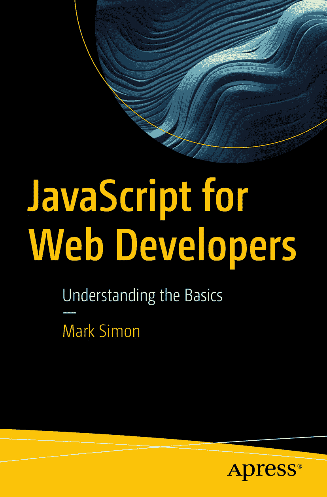

## ISBN 信息

ISBN 978-1-4842-9773-5  
电子书 ISBN 978-1-4842-9774-2  
`doi.org/10.1007/978-1-4842-9774-2`

## 版权声明

© Mark Simon 2023  

本作品受版权保护。所有权利均由出版商独家许可，无论涉及材料的全部或部分，特别是翻译、重印、重用插图、朗诵、广播、以缩微胶片或任何其他物理形式复制，以及传输或信息存储与检索、电子改编、计算机软件，或采用目前已知或未来开发的各种类似或不同方法。在本出版物中使用通用描述性名称、注册商标名称、商标、服务标志等，即使未明确声明，也不意味着这些名称不受相关保护性法律和法规的约束，因此可自由使用。出版商、作者和编辑均可假定，本书中的建议和信息在出版日期时是真实准确的。出版商、作者或编辑均不对本文所含材料或可能存在的任何错误或遗漏提供明示或暗示的担保。出版商对已出版地图中的管辖权主张和机构隶属关系保持中立。

## 出版信息

本 Apress 印记由注册公司 APress Media, LLC（施普林格自然集团的一部分）出版。  

注册公司地址为：1 New York Plaza, New York, NY 10004, U.S.A.

*献给父母。他们虽已离世多年，但每当我提问或说傻话时，他们依然如故。*