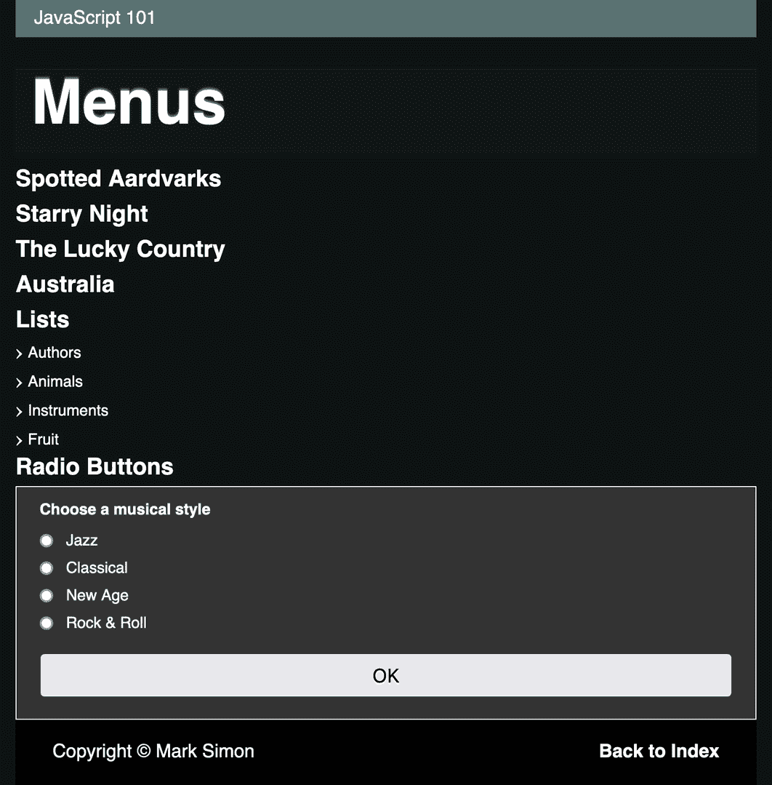

# 8. 显示和隐藏内容

你经常会在网页上看到可以打开和关闭的区域。它们可能是菜单项或内容区块。

在这个项目中，我们将切换内容和列表。技术是相似的，都是让 JavaScript 更改选定元素的状态。至于其他方面，我们将让 CSS 来完成内容的显示和隐藏，并适当地添加一些动画效果。

## 初始页面设置

我们处理的页面位于**变化的内容**链接中，文件名为 `showing-hiding.html`。初始状态下，页面如图 8-1 所示。



**图 8-1** *变化的内容*

内容各部分和列表均已折叠。其余内容虽存在，但在 CSS 中被隐藏了。我们将编写代码来改变这一情况。此外，最后还有一个部分，讨论如何根据我们在第一个关于内容标题的练习中开发的技术来改变分组框的行为。

### 初始 HTML 和 JavaScript

`showing-hiding.html` 页面已配置好内容及指向 JavaScript 文件的链接：

同样，我们引入了该库，以备编写可复用代码。而且，由于没有需要立即执行的内容，因此没有使用 `defer` 属性。

JavaScript 文件 `showing-hiding.js` 也已设置完毕：

```javascript
init();

function init() {
  doHeadings();
  doMenu();
  doForm();
}

function doHeadings() {
}

function doMenu() {
}

function doForm() {
}
```

`init()` 函数将调用*三个*函数，分别对应这个项目的不同部分。

## 显示和隐藏文本内容

本项目的这一部分将允许你通过点击标题来显示和隐藏文本块。

### 基本 HTML

内容的基本格式如下所示：

```html
<div id="headings">
  <div class="section">
    <h2>...</h2>
    <div>...</div>
  </div>
  ...
</div>
```

所有内容都包含在一个 `div` 元素内。`div` 常用于控制布局，但在这里它被用作主容器。由于 `div` 除了作为块级元素之外，没有特定的默认行为，通常会给它一个 `id` 或 `class` 来标识。在此例中，`id` 为 `headings`，容器被标识为 `div#headings`。这在 CSS 和 JavaScript 中都会用到。

还有更多的 `div` 元素，但它们很容易被识别为主容器内部的元素。`h2` 元素也是如此，它们通常定义标题，但在这里也将用于显示和隐藏内容。内部 `div` 元素的用途是容纳标题之后要显示或隐藏的内容。在 CSS 中，它们被标识为 `h2+div`，表示 `h2` *之后*的 `div`。

通过使用这一个 `id`，我们可以使用以下选择器来识别主容器及其内容：

| 元素 | 选择器 |
| --- | --- |
| 主容器 `div` | `div#headings` |
| 内部 `h2` | `div#headings>h2` |
| `h2` 之后的 `div` | `div#headings>h2+div` |

注意，我们已尽量降低对 HTML 的要求。容器必须有一个 `id`，且内容必须遵循一种模式。仅此而已。

### 准备切换代码

我们首先要做的是找到那些能切换 `div` 可见性的标题。JavaScript 有两个函数可以使用 CSS 选择器定位元素。`querySelector()` 函数查找*第一个*匹配项，在你知道该元素应该是唯一时特别有用。`querySelectorAll()` 函数返回一个带编号的匹配集合。对于本项目，我们将使用 `querySelectorAll()`。如果没有匹配 `querySelectorAll()` 的结果，你将得到一个空集合。测试空集合最简单的方法是检查其 `length` 属性。

要获取所有标题，我们可以使用：

```javascript
function doHeadings() {
  let headings = document.querySelectorAll('div#headings>h2');
  if(!headings.length) return;
}
```

该集合将存储在 `headings` 变量中。如果没有匹配项，`length` 为 `0`，这是假值，函数将立即返回，因为无事可做。

如果考虑让这段代码可复用，我们应该移除对 `div#headings` 的硬编码引用，并将其改为参数变量。我们仍然需要其中的 `h2` 部分，因此我们将它们组合成一个模板字符串字面量：

```javascript
function doHeadings(container) {
  let headings = document.querySelectorAll(`${container}>h2`);
  if(!headings.length) return;
}
```

我们需要在 `init()` 函数的调用中提供容器：

## 代码通用化与标题遍历

我们也会留意其他可以将代码通用化的机会。

### 遍历标题集合

从 `querySelectorAll()` 获取的数据称为`节点列表`。它实际上并不是数组，但它与数组类似，是一个带编号的集合。它同样类似于数组，因为你可以使用 `forEach()` 方法遍历该集合。

`forEach()` 方法接受一个函数作为参数，该函数将执行实际工作：

```
function doSomething(item, index, collection) {

}

headings.forEach(doSomething);
```

其中 `item` 是集合中的每一项，`index` 是每一项的编号，`collection` 是整个集合。大多数时候我们只关心 `item`。

如果你只在 `forEach()` 方法中使用该函数，它不必是一个永久命名的函数。函数表达式也可以：

```
headings.forEach(function(item, index, collection) {

});
```

现代 JavaScript 为函数表达式提供了一种更短的语法：

```
headings.forEach((item, index, collection) => {

});
```

在我们的案例中，我们需要引用集合中的每一项（每个标题），但不需要其余参数，因此我们可以使用更短的语法，省去括号：

```
headings.forEach(item => {

});
```

在我们的 `doHeadings()` 函数中，可以如下使用：

```
function doHeadings() {

  let headings = document.querySelectorAll('div#headings>h2');

  if(!headings.length) return;

  headings.forEach(heading => {

  });
```

下一步将是让标题执行某些操作。

### 附加切换行为

显示和隐藏内容的代码将以一个名为 `toggle()` 的函数的形式存在。我们需要做的是在点击标题时触发该函数。我们将通过为每个标题的 `onclick` 事件属性赋值一个 `toggle()` 函数来实现：

```
function doHeadings(container) {

  ...

  headings.forEach(heading => {

    heading.onclick = toggle;

  });

  function toggle() {

  }

}
```

注意，函数是在赋值*之后*定义的，这看起来有些违反直觉。当然，你也可以在之前定义函数，但这种方式可能更容易理解。JavaScript 通常不会乱序执行。然而，JavaScript 解释器分多个阶段运行，你会发现它在实际运行代码之前会处理所有 `var` 和 `function` 语句。我们说 `var` 和 `function` 语句会被`提升`（hoisted）。较新的 `let` 和 `const` 语句则*不会*被提升。

### 改变外观

此时，我们需要了解一些 CSS 如何显示和隐藏内容的知识。一个非常简单的例子如下：

```
div#headings>h2+div {

  display: none;

}

div#headings>h2.open+div {

  display: block;

}
```

选择器 `div#headings>h2+div` 表示位于 id 为 `headings` 的 `div` 内部、`h2` 元素之后的 `div`。有时，你需要反向阅读选择器才能理解其英文含义。在这里，`div` 默认是隐藏的，因为其 `display` 属性设置为 `none`。如果你为 `h2` 分配一个 `open` 类，那么选择器 `h2.open` 就会生效。在这种情况下，它会变得可见，因为其 `display` 属性被设置为 `block`。

前面的 CSS 可以实现功能，但如果你加入一些（微妙的）动画，显示和隐藏会变得更有趣。项目中的实际 CSS 是：

```
div#headings>h2+div {

  overflow: hidden;

  max-height: 0;

  opacity: 0;

  transition: max-height 250ms, opacity 1500ms;

}

div#headings>h2.open+div {

  max-height: 30em;

  opacity: 1;

}
```

与其用 `display` 属性生硬地隐藏和显示 `div`，不如先将 `div` 的 `max-height` 设为 `0`。为避免内容溢出，还需要将 `overflow` 属性设为 `hidden`。同时，我们将其 `opacity` 设为 `0` 使其不可见，这样就能在后续让它淡入。

要显示这个 `div`，我们把它的高度设为一个足够大的值，并将 `opacity` 设为 `1`。让这种变化更有趣的是 `transition` 属性，它指定了哪些属性需要过渡以及过渡时长。最难的部分是为 `max-height` 属性设置一个合理的值。如果设得太高，你会等很久才能看到内容闭合；如果设得太低，又无法容纳内容。通过这几行 CSS 代码，你会体会到其功能之强大。而 JavaScript 只需要负责切换类名。

### 切换类名

从 JavaScript 的角度来看，任务很简单。当你点击标题时，应该添加或移除 `open` 类，剩下的工作交给 CSS。

要切换所点击标题的类名，使用 `classList.toggle` 函数：

```javascript
function toggle(event) {

  event.target.classList.toggle('open');

}
```

记住，`event.target` 就是你刚刚点击的标题。`toggle` 函数会查找 `open` 类，如果找到就移除它，否则就添加它。现在测试一下，你会发现可以通过点击任意部分的标题来打开或关闭该部分，还会看到为这个类编写的 CSS 动画效果。

### 选中单个标题

按照目前的代码，你可以同时打开任意多个部分。这种行为类似于表单上的复选框，你同样可以选中多个。你可能更希望一次只打开一个部分，就像在表单上从多个单选按钮中选择一个一样。一次只选中一个部分需要更多工作，因为你还需要跟踪哪个部分已经打开，以便在打开新部分时将其关闭。

首先，我们需要另一个变量，比如 `opened`，来记住当前打开的部分：

```javascript
function doHeadings() {

  ...

  let opened = null;

  function toggle(event) {

    //  event.target.classList.toggle('open');

  }

}
```

`opened` 变量将用于跟踪当前拥有 `open` 类的 `h2` 元素。一开始没有部分被打开，所以变量 `opened` 初始化为 `null`。注意，`toggle` 函数中原来的语句已被注释掉。接下来将替换这段代码。当然，你可以删除那条语句，但这里保留它以便对比。

还要注意新变量与内部函数和外部函数的关系。`opened` 变量定义在 `doHeadings` 函数内部，因此它是 `doHeadings` 的*局部*变量。然而，它是在外部 `toggle` 函数外部定义的。虽然没有官方术语，但我们可以非正式地称其为`相对全局变量`。一个相对全局变量的最接近正确名称是`闭包变量`。`闭包`是由一个函数及其继承的环境（此处指该变量）组合而成的。你可以在 [`https://developer.mozilla.org/en-US/docs/Web/JavaScript/Closures`](https://developer.mozilla.org/en-US/docs/Web/JavaScript/Closures) 了解更多关于闭包的内容。

`toggle` 函数的第一个任务应该是隐藏前一个部分，即从当前选中的 `h2` 上移除 `open` 类：

```javascript
function toggle(event) {

  //  event.target.classList.toggle('open');

  opened.classList.remove('open');    //  还未实现

}
```

`classList.remove` 函数会在元素中查找 `open` 类，如果存在就将其移除；如果不存在则无任何效果。

如果尝试运行这段代码，一开始会遇到错误。这是因为没有部分被打开，且 `opened` 被设为 `null`；不能在 `null` 上调用方法。这意味着我们必须先进行判断：

```javascript
```

# 列表与菜单的 JavaScript 实现

这里，主列表项包含一些文本，后面跟着另一个 `ul`；文本充当嵌套列表的标题。列表常被用作菜单，从简单的导航按钮到带有下拉子菜单的菜单，这一切都通过 CSS 的魔力实现。如果列表足够大，它开始主导页面，因此找到一种打开和关闭列表部分的方法变得方便。这正是我们在项目这一部分所做的工作。

当然，列表可以用于许多事情，但一个常见用途是作为链接列表充当菜单。过去，由于使菜单（尤其是水平菜单）看起来美观的难度，其他结构（如表格）也被用于菜单。谢天谢地，那些日子已经过去了，CSS 可以让列表菜单看起来恰到好处。现在最难的部分是决定你想要用众多方式中的哪一种来设计你的列表。

## 初始 JavaScript

主列表是如下的无序列表：

CSS 对其外观做了许多更改，包括隐藏嵌套列表：

```css
ul#menu li>ul { /*  ul inside li inside ul#menu */
  display: none;
}
```

与之前展示的标题一样，我们希望代码可重用，因此我们将在 `doMenu()` 函数中包含一个参数，并在 `init()` 函数中使用它：

```javascript
function init() {
  toggleHeadingContent('div#headings');
  doMenu('menu');
}

function doMenu(menuId) {
}
```

这里，我们简单地传递一个 `id`，假设它必须是某个 `ul` 元素的 `id`。

在 `doMenu()` 函数内部，我们可以使用这个 `id` 来定位列表：

```javascript
function doMenu(menuId) {
  let ul = document.querySelector(`ul#${menuId}`);
}
```

与前述标题不同，我们不需要将事件监听器附加到列表内的单个元素上。这是因为如果你点击内部的某个元素，该点击会`传播`到其容器，因此一个事件监听器就能够处理它。

要附加事件监听器，照常分配 `onclick` 属性：

```javascript
function doMenu() {
  let ul = document.querySelector('ul#menu');
  ul.onclick = toggle;

  function toggle(event) {
  }
}
```

请记住，使用 `onclick` 事件属性添加的事件监听器默认在冒泡阶段（即从内到外）进行监听。这正是我们想要的。

`ul` 变量只被使用一次，因此我们可以通过如下语句省去它：

```javascript
//  Not this time:
document.querySelector('ul#menu').onclick = toggle;
```

记住，`if( ... )` 会判断 `true` 或 `false`，但也判断“有值”或“无值”。在此例中，`null` 被视为“无值”；如果 `opened` 有值，我们就可以移除该类。

下一步是通过向选中的 `h2` 的类列表添加 `open` 来打开选中的部分。同时，我们会将该 `h2` 赋给新的 `opened` 变量：

```javascript
function toggle(event) {
  //  event.target.classList.toggle('open');
  if(opened) opened.classList.remove('open'); //  关闭
  event.target.classList.add('open');
  opened = event.target;
}
```

现在运行代码，你会看到一次只有一个部分被打开。

### 关闭选中的部分

单选按钮的正常行为是，一旦选中一个，就始终有一个被选中。（你可以在页面底部的单选按钮部分看到这一点。）这对单选按钮来说并不总是方便，对打开部分来说也是如此。再做一些工作，我们可以让再次点击当前打开的部分时将其关闭。

在关闭当前部分后，你需要检查选中的标题是否与上一次相同。如果是，就让它保持关闭并忘记它；如果不是，则按之前的方式打开它：

```javascript
function toggle(event) {
  //  event.target.classList.toggle('open');
  if(opened) opened.classList.remove('open'); //  关闭
  if(event.target == opened) {            //  忘记
    opened = null;
  }
  else {                                  //  打开并记住
    event.target.classList.add('open');
    opened = event.target;
  }
}
```

### 将 `doHeadings` 代码移至库文件

大部分代码与应用程序无关，因此我们可以将其移至库文件以备将来使用。不过，我们可能得想一个更好的名字。`doHeadings` 有点太模糊了。如果你能想到比 `toggleHeadingContent` 更好的名字，尽管用。目前，我们假设你没想到。

首先，你可以将整个 `doHeadings()` 函数代码移至 `library.js` 文件。`showing-hiding.html` 页面中已经有对库文件的引用，因此你可以少操心一件事。别忘了重命名它。

函数前应该有一个注释块，其中还应包含一些简单的说明，如下所示：

```javascript
/*  toggleHeadingContent(container)
================================================
切换标题部分。使用以下结构：
div#containerid
  h2
  div
    content
  h2
  div
    content
  h2
  div
    content
================================================ */

function toggleHeadingContent(container) {
  ...
}
```

你可以根据需要写得尽量详细，但不要过于繁杂。

最后，当然还需要在 `init()` 函数代码中更改名称：

```javascript
function init() {
  toggleHeadingContent('div#headings');
  doMenu();
  doForm();
}
```

现在，我们可以编写用于切换嵌套列表的代码了。

### 切换列表

HTML 列表是一种包含一个或多个列表项的结构。其最简单的形式如下：

```html
<ul>
  <li>苹果</li>
  <li>香蕉</li>
  <li>樱桃</li>
</ul>
```

在浏览器中显示为：

*   苹果
*   香蕉
*   樱桃

这种列表被称为`无序列表`，标记为 `ul`；原则上，项目顺序没有特定含义。你也可以有`有序列表`，标记为 `ol`，此时项目编号会自动生成。使用 CSS，你可以对列表的外观进行多种更改，包括编号样式。

你还可以有`嵌套列表`，即列表中的列表：

```html
<ul>
  <li>水果
    <ul>
      <li>苹果</li>
      <li>香蕉</li>
      <li>樱桃</li>
    </ul>
  </li>
  <li>乐器
    <ul>
      <li>手风琴</li>
      <li>班卓琴</li>
      <li>英国管</li>
    </ul>
  </li>
</ul>
```

显示为：

*   水果
    *   苹果
    *   香蕉
    *   樱桃
*   乐器
    *   手风琴
    *   班卓琴
    *   英国管

然而，我们稍后需要 `ul` 变量来做出进一步改进，因此我们保留其原始形式。现在，列表是一个包含许多其他列表项和内部列表的大型结构。事件监听器将响应任何这些嵌套元素的点击。你需要知道的是你实际点击了哪个元素，以便我们能改变其状态。

事件监听器可以访问与事件相关的**两个**值：

-   `event.target` 变量引用的是实际被点击的元素。这里，它始终是 `ul#menu` 元素。
-   `event.currentTarget` 属性引用的是触发事件监听器的元素；也就是你实际点击的那个元素。

在我们之前的许多示例中，你点击的元素与拥有事件监听器的元素是同一个，因此 `event.currentTarget` 和 `event.target` 引用的是同一个东西。这次它们会不同，你需要区分它们。这次我们将该事件监听器称为**委托**事件监听器。

接下来我们需要担心的是是否存在要显示的嵌套列表。`event.target` 始终是一个 `li` 元素，因为这是列表在页面上可见的部分。这些条目中**有些**会有嵌套列表，有些则没有。

我们可以使用 `event.target.querySelector('ul')` 来测试是否存在嵌套列表：

```javascript
function toggle(event) {
  if(!event.target.querySelector('ul')) return;
}
```

我们将 `querySelector` 限制在这个 `li` 元素上。`event.target.querySelector('ul')` 的结果要么是某个东西（另一个列表），要么是空（`null`）。如果它不是某个东西（`if(!...)`），我们就用 `return` 语句退出函数。否则，我们继续切换该条目：

```javascript
function toggle(event) {
  if(!event.target.querySelector('ul')) return;
  event.target.classList.toggle('open');
}
```

现在你可以打开和关闭嵌套列表了。

### 高亮显示嵌套列表

当然，并非所有列表项都有嵌套列表。理想情况下，你应该高亮显示那些有嵌套列表的项。在这个例子中，它们通过 `›` 字符高亮显示，当条目打开时该字符会被旋转。

传统上，CSS 没有能够选择包含特定内容的元素的选择器，因此你必须使用 JavaScript 中的蛮力方法。

现代 CSS 确实有这样的选择器。然而，它是全新的，并且在 Firefox 中尚未得到完全支持。该选择器采用以下形式：

```css
li:has(ul) {
  ...
}
```

这表示任何包含 `ul` 的 `li`。如果你查看样式表本身，它并没有那么简单，因为它仍然需要照顾不支持该选择器的浏览器：

```css
li:is(.nested,:has(ul)) {
  ...
}
```

关于选择器还有很多内容，因为它们包含了对 `open` 类、`ul#menu` 主列表以及其他内容的引用。关键在于，不支持该选择器的浏览器需要以名为 `nested` 的类的形式获得一些帮助。

### 支持不支持该选择器的浏览器

目前，大多数（但不是全部）浏览器都支持 `:has()` 选择器，很可能你的浏览器也支持。然而，你应该始终为**较新**特性不被支持的情况做准备。你可以通过访问 [`https://caniuse.com/`](https://caniuse.com/) 来了解一个较新特性的支持情况。

为了让这个功能跨平台工作，我们需要在不支持该选择器的浏览器上，为那些具有嵌套列表的条目添加 `nested` 类。我们不想手动执行此操作，因此我们让 JavaScript 来做这项艰苦的工作。

在过去，有大量“浏览器嗅探”——检查正在使用哪个浏览器。这绝对是个坏主意，因为要跟上各种浏览器及其版本是不可能的。一个好得多的方法是测试特性本身。

只有当某个特性已经被标准化但尚未得到完全支持时，你才应该考虑这种事情。依赖非标准特性将来肯定会让你头疼。

在过去，我们在本书中使用的许多 JavaScript 特性，例如 `.forEach()`、`.querySelector()` 或 `.classList`，都需要测试。这就是为什么有这么多对“现代 JavaScript”的引用的原因。幸运的是，它们都已经支持了很多年，访问 [`https://caniuse.com/`](https://caniuse.com/) 就能确认这一点。

要测试一个新的 CSS 特性，有一个名为 `CSS.supports()` 的函数，它将测试某个特定的 CSS 特性是否可用。我们想要的大概是这样的：

```javascript
CSS.supports('selector(:has(ul))')
```

字符串中的 `selector()` 函数用于测试特定的选择器是否有效；`:has(ul)` 就是我们想要的具体伪类选择器。如果特性受支持，结果将为 `true`；否则为 `false`。

我们将使用这个来为那些需要 `nested` 类的列表项添加它，但仅在需要时添加。之前，我们找到了主列表并将其赋值给变量 `ul`。利用这个，我们可以搜索其内容：

```javascript
function doMenu() {
  let ul=document.querySelector('ul#menu');
  ul.onclick=toggle;
  if(!CSS.supports('selector(:has(ul))')) {
    ul.querySelectorAll('li').forEach(li => {
    });
  }
  ...
}
```

`ul.querySelectorAll('li')` 将生成 `ul` 列表内所有列表项的集合。正如我们之前所见，你可以使用 `.forEach()` 遍历这个集合。注意，找到的条目将是**所有**列表项，包括嵌套列表内部更深处的条目以及那些没有自己嵌套列表的条目。

在 `forEach` 内部，我们有一个箭头函数，将每个列表项赋值给变量 `li`。在这里，我们希望只选中那些自身包含列表的列表项：

```javascript
function doMenu() {
  let ul=document.querySelector('ul#menu');
  ul.onclick=toggle;
  if(!CSS.supports('selector(:has(ul))')) {
    ul.querySelectorAll('li').forEach(li => {
      if(li.querySelector('ul')) li.classList.add('nested');
    });
  }
  ...
}
```

`li.querySelector('ul')` 会在每个 `li` 内部查找 `ul` 元素。如果找到了，我们并不需要这个实际元素，而是希望给该 `li` 添加 `nested` 类。如果没找到，结果就是 `null`，其余代码将被忽略。

关于 `CSS.supports('selector(:has(ul))')` 是否能正确测试，在错误报告中存在一些讨论。根据作者的经验，它运行良好。如果你有所疑虑，可以放弃测试该特性，直接添加类：

```javascript
function doMenu() {
  let ul=document.querySelector('ul#menu');
  ul.onclick=toggle;
  //  if(!CSS.supports('selector(:has(ul))')) {
  ul.querySelectorAll('li').forEach(li => {
    if(li.querySelector('ul')) li.classList.add('nested');
  });
  //  }
  ...
}
```

同时保留两者也无妨。

### 修复 `toggle()` 函数

在 `toggle()` 函数中，我们包含了一个测试，用于判断列表项是否包含嵌套列表：

```javascript
if(!event.target.querySelector('ul')) return;
```

反复遍历 DOM 开销较大，因此我们可以利用已知的嵌套列表信息：要么 `:has(ul)` 满足条件，要么它拥有 `nested` 类（或两者兼具）。我们可以使用 `.matches()` 方法来测试其中任一条件，该方法用于检验 CSS 选择器是否匹配：

```javascript
function toggle(event) {
  if(!event.target.matches(':is(.nested,:has(ul))')) return;
  event.target.classList.toggle('open');
}
```

`.matches()` 方法用于测试一个元素是否匹配某个 CSS 选择器。例如：

```javascript
var h1 = document.querySelector('h1');
h1.matches('body *');
```

# 排版后的文档

←   true

```

这表明`h1`元素位于`body`元素内部，事实也的确如此。`.is(.nested,:has(ul))`选择器会在`.nested`选择器或`:has(ul)`选择器匹配时成功。如果不匹配，则从函数返回。测试属性比在元素内部搜索其他元素更高效。

## 将列表切换功能迁移到库中

同样，这段代码的编写方式使其不依赖于特定应用。唯一的要求是列表是嵌套的，并且我们知道其`id`。

我们可以将代码迁移到`lilbrary.js`文件中，使用`toggleNestedLists()`之类的命名，或者你喜欢的任何名字。同样，我们应该在其前面添加一个有用的注释块，如下所示：

```
/*  toggleNestedLists(menuId)

================================================

切换嵌套列表。

结构应类似于：

项目

  项目

    项目

  项目

项目

================================================ */

function toggleNestedLists(menuId) {

...

}
```

别忘了在`init()`函数中更改函数名：

```
function init() {

toggleHeadingContent('div#headings');

toggleNestedLists('menu');

}
```

现在这个功能已准备好用于其他项目。

## 增强单选按钮

之前，我们提到过单选按钮的行为。单选按钮是一种表单元素，允许用户从多个选项中选择一个。当你选中一个时，其他选项会被取消选中。这个名称源于古代汽车收音机使用按钮选择电台的时期。前面提到过，一旦你选中了一个单选按钮，就无法全部取消选中——总有一个会被选中。若要允许不选任何选项，用户友好的方式是包含一个“以上都不是”选项。或者，我们可以使用JavaScript注入与本章标题类似的行为：选中一个已经选中的选项将取消选中它。

页面底部有一个简单的表单，包含一些单选按钮、一个输出元素和一个提交按钮。

HTML代码看起来是这样的：

```
选择一种音乐风格

爵士乐

古典乐

新世纪音乐

摇滚乐

确定
```

没人觉得这是一种很有用的形式。

在HTML中，一组单选按钮具有以下两个特征：

-   它们都是`radio`类型：`<input type="radio">`。
-   它们都具有相同的`name`属性，浏览器正是通过该属性知道它们属于同一组。

提交表单时，只会提交选中的单选按钮。如果没有任何按钮被选中，那么该名称下就不会提交任何内容。

我们要做的第一件事是找到表单并禁用其提交功能：

```
function doForm() {

let form = document.querySelector('form#music');

form.elements['ok'].onclick = event => {

event.preventDefault();

};

}
```

接下来要获取单选按钮：

```
function doForm() {

let form = document.querySelector('form#music');

let buttons = form.elements['musical-style'];

...

}
```

通常，从`elements`集合中获取内容时，你会得到一个单独的表单元素。但对于单选按钮，你会得到另一个集合；更具体地说，它是一个`RadioNodeList`，但我们只关心我们可以遍历该集合这一事实。回想内容标题部分，我们只想选择一个元素。这种内置行为是单选按钮自带的。然而，我们也希望能够取消选择一个标题，这显然不是单选按钮的内置功能。我们将使用相同的技术，即使用一个跟踪变量。

我们将声明一个变量来跟踪当前选中的按钮：

```
function doForm() {

let form = document.querySelector('form#music');

let buttons = form.elements['musical-style'];

let selected = null;

...

}
```

现在，我们将为每个单选按钮附加一个事件监听器，以维护这个跟踪变量：

```
function doForm() {

let form = document.querySelector('form#music');

let buttons = form.elements['musical-style'];

let selected = null;

buttons.forEach(b => {

b.onclick = event => {

};

});

...

}
```

这里有两个箭头函数表达式：一个用于遍历`buttons`集合，另一个用于事件监听器。事件监听器将检查被点击的按钮是否与上次相同。如果是，我们将通过将其`.checked`属性设置为`false`并清除`selected`变量来取消选择该按钮。如果不同，我们只需在`selected`变量中记录即可。

当然，第一次点击时没有“上次”的概念，所以结果会是`false`。

```
buttons.forEach(b => {

b.onclick = event => {

if(event.target == selected) {

event.target.checked = false;

selected = null;

}

else selected = event.target;

};

});
```

## 复用可取消选择的单选按钮代码

一如既往，如果代码有用，我们或许可以将其封装成一个可复用的函数。

第一步是创建一个新函数。我们将其命名为`deselectableRadio()`。然后，我们可以将代码的主要部分移入其中：

```
function doForm() {

}

function deselectableRadio(buttons) {

buttons.forEach(b => {

b.onclick = event => {

if(event.target == selected) {

event.target.checked = false;

selected = null;

}

else selected = event.target;

};

});

}
```

该函数将接收`buttons`集合。

为了避免维护一个单独的变量，我们可以将其转换为函数属性：

```
function deselectableRadio(buttons) {

deselectableRadio.selected ??= null;

buttons.forEach(b => {

b.onclick = event => {

if(event.target == deselectableRadio.selected) {

event.target.checked = false;

deselectableRadio.selected = null;

}

else deselectableRadio.selected = event.target;

};

});

}
```

现在，我们应该能够测试这个函数了。为保险起见，先注释掉旧代码，然后包含对新函数的调用，并传入`buttons`集合：

```
function doForm() {

let form = document.querySelector('form#music');

let buttons = form.elements['musical-style'];

deselectableRadio(buttons);

/*

...

*/

form.elements['ok'].onclick = event => {

event.preventDefault();

};

}

function deselectableRadio(buttons) {

...

}
```

如果一切正常，你可以删除注释掉的代码，并将该函数移动到`library.js`中，就像你处理本章其他函数一样。你可以包含一个类似这样的注释块：

```
/*  deselectableRadio(buttons)

================================================

Allows a group of radio buttons to be deselected.

================================================ */
```

当然，你可能不希望你的单选按钮是可取消选择的，但有选择总归是好的。

## 总结

在本项目中，我们使用 JavaScript 通过用户交互来显示和隐藏内容。我们运用了第 7 章中开发的许多概念。

你可以在 CSS 中显示和隐藏内容。一个简单的方法是将`display`属性在`block`和`none`之间切换，这也是嵌套列表中使用的方法。一个更复杂的方法（允许过渡动画效果）是改变`max-height`和`opacity`属性。

代码的主要思路是使用`click`事件来切换元素的类。CSS 处理嵌套或与受影响元素相邻的内容。

在标题练习中，有多个元素需要绑定到事件监听器。这些元素通过`.querySelectorAll()`函数获取。然后，我们可以通过`.forEach()`方法遍历这个集合。

在嵌套列表练习中，我们将一个单一的委托事件监听器附加到主列表上，并让事件从选中的列表项冒泡。然后，我们使用`event.target`来切换特定元素。

简单的切换允许多个元素处于相同状态，就像表单上的复选框。通过使用一个单独的变量来管理选中的元素，可以一次只选中一个元素，就像表单上的单选按钮。也可以取消选中所有元素。

现代 CSS 包含一个用于包含其他元素的元素的选择器。这应该能简化处理包含嵌套列表的列表项的代码，但并非所有浏览器都完全支持此功能。不过，可以在 JavaScript 中测试此功能，搜索这些特定元素，并分配一个类来替代此功能。

最后，我们编写了一些代码来修改单选按钮的行为，以允许取消选中所有按钮。

当代码完成后，只要它不特定于当前项目，我们就可以将代码移动到库文件中。

## 展望未来

我们一直在处理的内容已经存在于页面中——它只是被隐藏了。在第 10 章中，我们将学习如何按需加载新内容。

然而，在此之前，我们将做一个灯箱项目。这是指图像按需在屏幕上弹出。为此，我们将添加 HTML 内容、添加 CSS，并通过鼠标和键盘触发活动。

在第 10 章中，我们还将使用 Ajax 从服务器加载图像内容和数据。
