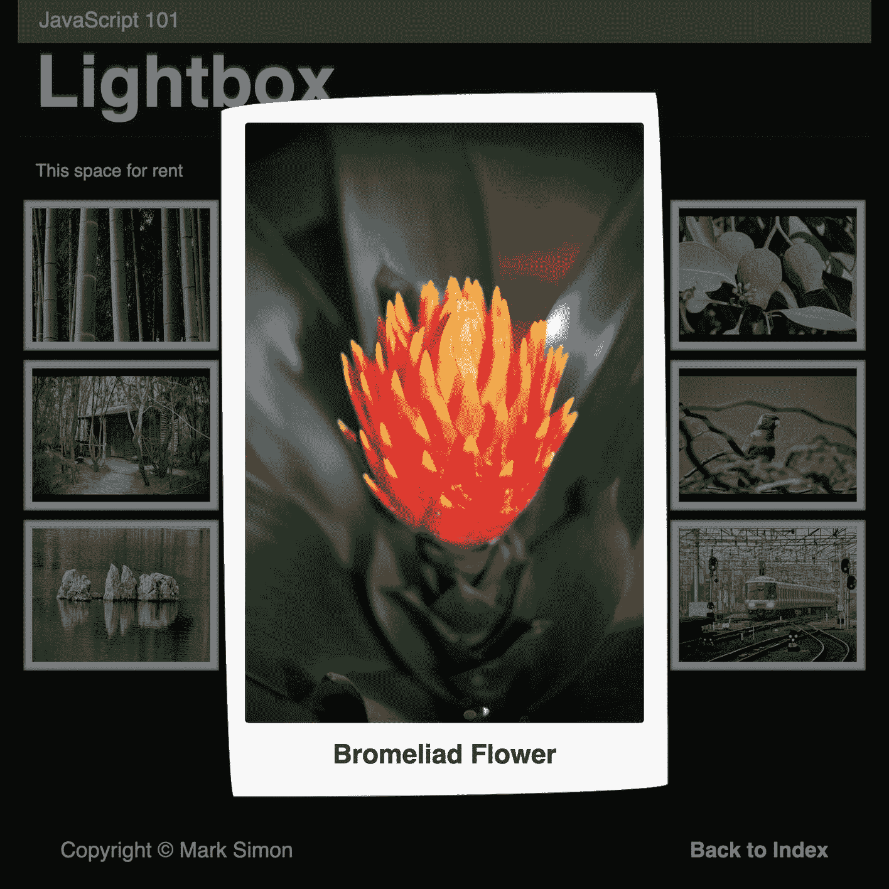
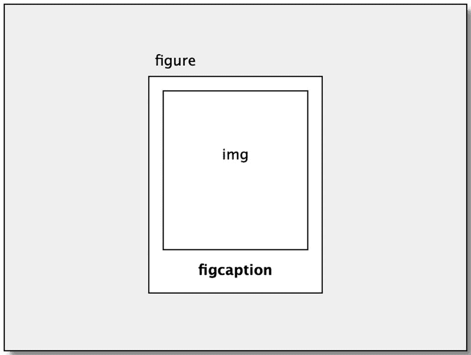
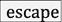
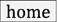
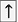
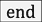
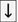
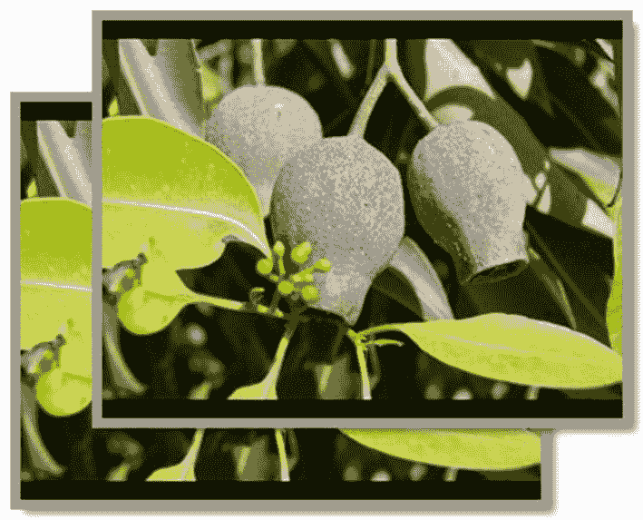
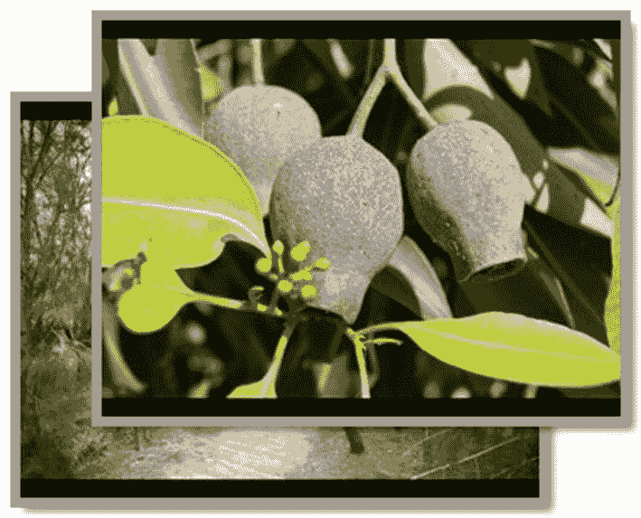
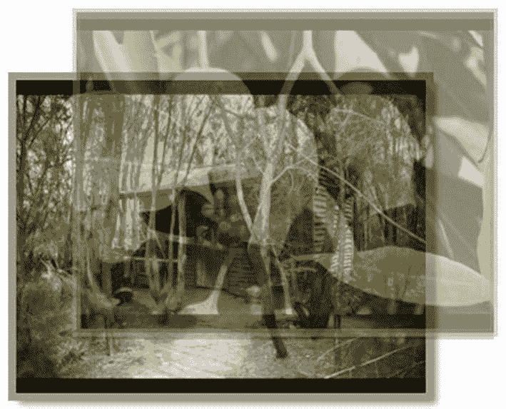

# 9. 项目：构建灯箱画廊

许多现代图像画廊页面都包含一个弹出的大图。这被称为**灯箱**，其名称源于 Lokesh Dhakar 的一个原始脚本（参见[`https://en.wikipedia.org/wiki/Lightbox_(JavaScript)`](https://en.wikipedia.org/wiki/Lightbox_%2528JavaScript%2529)）。

你会在许多网站上看到类似的效果。当你点击一个缩略图时，一个更大的图片会出现在页面其余部分的上方。一个典型的灯箱效果如图 9-1 所示。



一个 JavaScript 灯箱画廊的截图。它由一个位于中央的大型菠萝花照片组成，两侧各有三张较小的照片排成一行。

**图 9-1** 一个灯箱画廊

你可以在[`https://pure-javascript.net/lightbox.html`](https://javascript101.webcraft101.com/lightbox.html)查看一个示例灯箱画廊的实际效果。

在这个项目中，你将编写自己的 JavaScript 灯箱函数，你可以在许多其他项目中使用它。除了拥有你自己的 JavaScript 小部件之外，你还将学习到更多关于：

*   劫持 HTML 锚点
*   创建可复用和适配的 JavaScript 小部件
*   在 JavaScript 中创建 HTML 元素和 CSS 样式
*   创建弹出元素
*   使用 JavaScript 事件触发 CSS 变化
*   处理异步图像加载
*   响应键盘事件

灯箱的一个重要部分是其视觉外观，它由 CSS 控制，包括一些动画效果。你将学习如何生成足够的基础 CSS 来让小部件正常工作，同时允许设计师覆盖部分外观。

在本章结尾，我们将重新回顾第 4 章中的幻灯片。届时，我们将掌握更多处理动态 CSS 的技能，并添加一些新功能，使幻灯片看起来更有趣。

## 准备 HTML

JavaScript 代码应尽可能保持不显眼，因此你无需做太多额外准备。

在这种情况下，我们希望 HTML 尽可能自然。如果你在编辑器中打开`lightbox.html`文件并查看代码，你会看到一个主容器内有一组链接图像：

在这种情况下，容器是一个`div`元素，这是最通用的块级元素。我们可以使用`id`属性`catalogue`来标识要处理的容器。这个`id`也用于 CSS 中，以便为容器及其内容赋予你喜欢的任何特殊外观。

图像将是普通的`img`元素，在`src`属性中显示缩略图版本。我们在这里省略了其他属性，但`title`属性很有用。通常，`title`在鼠标悬停时作为工具提示文本出现，但我们将把它用作大图的说明文字。

每张图片都包裹在一个指向大图的锚点（`a`元素）中。单独使用时，锚点通常会重新加载页面以显示链接的图像，但我们将用它来在弹出窗口中显示大图。

### 初始 HTML 和 JavaScript

与上一个项目一样，我们将创建一个独立的、灵活的函数，可以轻松地将其移至库文件中。为简单起见，现在我们将其保留在主 JavaScript 文件中。

HTML 文件名为`lightbox.html`，对应的 JavaScript 文件名为`lightbox.js`。

HTML 已经包含了对 JavaScript 文件的引用：

JavaScript 以通常的方式开始，但我们已经包含了一个对新函数的调用，并带了容器的参数：

```
init();

function init() {

  doLightbox('div#catalogue');

}

function doLightbox(container) {

}
```

如果你现在加载页面并点击一张图片，你只会看到页面重新加载并显示大图。这是因为大图在周围锚点的`href`属性中被引用。

你还会看到，当鼠标不在缩略图上时，每个缩略图的颜色都是去饱和的（主要是灰度）。这些都是由 CSS 完成的。

在`doLightbox()`函数内部，我们可以使用选择器字符串配合`querySelectorAll()`来找到包含图像的锚点：

```
function doLightbox(container) {

  let anchors = document.querySelectorAll(`${container}>a`);

}
```

正如你所记得的，模板字面量`` `${container}>a` ``允许你在其中包含表达式和变量。在前面的代码中，选择器字符串转换为：

```
let anchors = document.querySelectorAll('div#catalogue>a');
```

这意味着所有`div`元素的子锚点。

一旦我们有了这些锚点，我们就可以改变它们的行为，将大图加载到弹出窗口中。

### 劫持锚点

通常，锚点用于链接到新文档或页面。但在这里，我们将用它来显示更大的图片。这意味着我们需要改变其默认行为，转而采用新的行为。这通常被称为**劫持**锚点。

为了添加我们自己的行为，我们需要为所有锚点的 `click` 事件添加一个事件监听器：

```
function doLightbox(container) {

let anchors = document.querySelectorAll(`${container}>a`);

anchors.forEach(a => {

a.onclick = show;

});

//  显示与隐藏

function show(event) {

}

}
```

`forEach()` 函数会遍历 `anchors` 集合中的每一个成员。箭头函数表达式 `a => {}` 将每个锚点临时赋值给变量 `a`，这样我们就可以将其 `onclick` 事件监听器设置为 `show` 函数。`show` 函数将使用 `event` 参数。

我们需要解决锚点的一个逻辑问题。尽管我们已经将点击事件转移到了自己的函数上，但锚点的正常行为仍然会让浏览器加载新内容，也就是 `href` 属性中的那张更大的图片；这个新内容会*替换*掉旧内容。

相反，我们将在当前页面上显示新内容，因此需要取消其正常行为。这可以通过 `preventDefault()` 函数来实现：

```
function show(event) {

event.preventDefault();

}
```

只要 HTML 元素具有动态行为，例如表单中的按钮或上述的锚点，都可以使用 `preventDefault()` 函数。你可以在 `show` 函数中的任何时候调用 `preventDefault()` 函数，但通常会在函数开头调用它。我们还需要再次使用 `event` 对象来获取图片的详细信息。

如果你重新加载页面，它不会有什么反应。事实上，它什么也不会做。点击图片不再加载更大的图片，因为我们已经拦截了该行为。我们稍后会编写显示图片的代码。首先，我们需要创建一个放置图片的地方。

## 创建弹窗元素

要将更大的图片显示为弹窗，你需要一些额外的 HTML 和 CSS。你可以在原始文档中创建这些元素，但更好的做法是由 JavaScript 为你完成。这样，文档就没有额外需求了。这是在编写此类 JavaScript 工具时的一个重要原则。实现灯箱所需的 HTML 元素和 CSS 是页面原始内容的附加部分。保持原始内容不变，让 JavaScript 来管理附加内容是合适的。

我们需要为弹窗创建四个额外的 HTML 元素：

-   需要一个背景 `div` 来覆盖整个屏幕。背景有两个作用。首先，它通过半透明的背景颜色来遮挡文档的其余部分。其次，你可以点击它来隐藏背景和弹窗。
-   需要一个容器 `figure` 来容纳更大的图片和说明文字。
-   弹窗图片本身，它将是一个 `img` 元素。
-   最后，说明文字将位于 `figcaption` 元素中。

弹窗元素看起来会像图 9-2 所示。



一张灯箱中弹窗元素的示意图。它有一个矩形框，内部包含一张图片和底部的图片说明文字。

`图 9-2`
灯箱元素

`figure` 元素以及其中的 `img` 和 `figcaption` 元素，将位于背景 `div` 的前面。

### 创建元素

要创建这些元素，我们使用 `document.createElement()`：

```javascript
function doLightbox(container) {

let anchors = document.querySelectorAll(`${conainer}>a`);

anchors.forEach(a => {

a.onclick = show;

});

//  创建元素

let background = document.createElement('div');

let figure = document.createElement('figure');

let img = document.createElement('img');

let figcaption = document.createElement('figcaption');

...

}
```

这应该足以让 JavaScript 处理了，但还需要一点 CSS。为了确保 CSS 不会混淆，我们将为 `background` 和 `figure` 元素添加 id。CSS 将知道如何处理嵌套的 `img` 和 `figcaption` 元素。

```javascript
function (container) {

...

//  创建元素

let background = document.createElement('div');

let figure = document.createElement('figure');

let img = document.createElement('img');

let figcaption = document.createElement('figcaption');

background.id = 'lightbox-background';

figure.id = 'lightbox';

...

}
```

背景 `div` 将独立存在，但图片和说明文字应包含在容器元素内部。这可以通过 `appendChild()` 来实现：

```javascript
function doLightbox(container) {

...

//  创建元素

...

background.id = 'lightbox-background';

figure.id = 'lightbox';

figure.appendChild(img);

figure.appendChild(figcaption);

...

}
```

`appendChild()` 函数将一个元素添加到其内容的末尾。这是 `insertAdjacentElement('beforeend', ...)` 的一个更简单的版本。

### 将元素添加到文档中

此时，新创建的元素仍在内存中浮动。我们将以相同的方式将它们添加到文档的 body 中：

```javascript
function (container) {

...

//  创建元素

...

figure.appendChild(img);

figure.appendChild(figcaption);

document.body.appendChild(background);

document.body.appendChild(figure);

...

}
```

我们现在有了一些空元素被添加到了文档 body 的末尾。如果你重新加载页面，你几乎看不到什么：所有新元素都在 `body` 元素的末尾，但它们都是空的，所以不占用空间。下一步将开始定义它们的外观。

## 为附加元素设置样式

你可以直接将 CSS 添加到样式表中，但和之前一样，这意味着开发者需要做额外的工作。更好的做法是通过 JavaScript 添加样式。在第 7 章关于操作 CSS 的内容中，我们在 JavaScript 中创建了一个样式块。在这里，我们将把这个想法付诸实践。

要添加 CSS 样式，首先创建一个 `style` 元素，并将其添加到文档的 `head` 中：

```javascript
function doLightbox(container) {

...

//  创建元素

...

//  样式表

let style = document.createElement('style');

document.head.insertAdjacentElement('afterbegin',style);

...

}
```

请注意，新的 style 元素被添加到 `head` 元素的*开头*。这允许之后添加额外的真实样式表，这意味着它们可以覆盖你的一些样式。

### 添加样式规则

接下来，我们需要创建一些基本的 CSS 规则来完成工作。如果你在普通样式表中实现，基本的 CSS 看起来是这样的：

```css
/*  背景 Div: */

div#lightbox-background {

position: fixed;

top: 0; left: 0; width:100%; height: 100%;

z-index: 1;

background-color: rgb(0,0,0,0.5);

}

/*  容器 Div: */

figure#lightbox {

position: fixed;

top: 50%; left: 50%; margin-right: -50%;

transform: translate(-50%, -50%);

z-index: 2;

}
```

CSS 的工作原理如下：

-   背景 `div` 需要填满整个屏幕，这是通过将其位置固定相对于屏幕（`position: fixed`）并设置其左上角坐标和尺寸来实现的。
-   为了达到遮罩屏幕其余部分的效果，背景颜色设置为黑色（`0,0,0`），但不透明度设置为 `0.5`，使其半透明（部分可见）。它还有一个非零的 `z-index`，这使其位于其他元素的前面。
-   `figure` 元素需要居中于屏幕，这也需要将其位置固定相对于屏幕（`position: fixed`），但将其起始位置偏移一半。
-   为了确保 `figure` 元素出现在背景的前面，其 `z-index` 属性的值设置得比背景高。

背景的实际颜色和不透明度是任意的，你可以轻松地在额外的真实样式表中覆盖这些值。

前面展示的 CSS 中的两个部分被称为`规则`，可以使用`insertRule()`添加：

```javascript
function doLightbox(container) {

...

//  Style Sheet

let style = document.createElement('style');

document.head.insertAdjacentElement('afterbegin',style);

//  Lightbox Element Styles

style.sheet.insertRule(`

div#lightbox-background {

position: fixed;

top: 0; left: 0; width:100%; height: 100%;

z-index: 1;

background-color: rgb(0,0,0,0.5);

}

`);
```

style.sheet.insertRule(`

figure#lightbox {

position: fixed;

top: 50%; left: 50%; margin-right: -50%;

transform: translate(-50%, -50%);

z-index: 2;

}

`);

...

}

```

我们使用了模板字面量来允许换行和缩进，以提高可读性。请记住，CSS 可以包含任意多的额外间距。如你所见，CSS 有变得冗长的趋势，因此它永远不会非常紧凑。幸运的是，这些 CSS 已经足够实现所需效果。你现在看到的是整个页面被半透明背景覆盖。`figure`元素显示为一个小框，但由于没有内容，它在其他方面是不可见的。

### 隐藏和显示元素

灯箱的整个技巧在于，背景和容器只会在你选择一张图片时出现，并在你查看完毕后消失。

#### 显示和隐藏背景

你已经开始编写`show()`函数来显示图像，现在可以添加一个`hide()`函数来隐藏它：

```
function doLightbox(container) {

...

//  Showing & Hiding

function show(event) {

event.preventDefault();

}

function hide(event) {

}

}
```

要隐藏一个元素，你可以将其`display`属性设置为`none`。要显示该元素，则将其`display`属性设置为`block`，这是我们通常希望的显示方式：

```
function doLightbox(container) {

...

//  Showing & Hiding

function show(event) {

event.preventDefault();

background.style.display

= figure.style.display

= 'block';

}

function hide(event) {

background.style.display

= figure.style.display

= 'none';

}

}
```

上述代码使用了链式赋值语句来设置多个属性。这样做的主要原因是为了明确表明你在将两个属性设置为相同的值。你不需要显示或隐藏图像或标题元素，因为它们是容器元素的一部分。

你已经将`show()`函数附加到了锚点的`click`事件上。要隐藏所有内容，你可以将`hide()`函数附加到背景的`click`事件上：

```
function doLightbox(container) {

...

//  Showing & Hiding

background.onclick = hide;

function show(event) {

...

}

...

}
```

这有效地将背景变成了一个巨大的按钮。你现在可以点击背景来隐藏它，但你也应该在脚本首次加载时调用`hide()`函数：

```
function doLightbox(container) {

...

//  Showing & Hiding

background.onclick=hide;

hide(); //  hide now

...

}
```

在此阶段，你可以通过点击图像和背景来测试显示和隐藏功能，但你只会看到背景的显示和隐藏。接下来，你需要用图像及其标题来填充容器。

### 显示图像内容

下一步是显示图像及其标题。这基本上意味着显示`figure`元素，但首先你需要填充图像和标题段落。

回想一下，图像位于一个锚点元素内：

锚点本身只是一个包装器，大部分视觉空间将被图像占据。因此，当你点击此处时，实际上是在点击图像。图像没有事件监听器，也没有默认的点击行为，所以它对点击事件不感兴趣。该点击事件会被传递到其容器，即锚点元素。正如我们在事件监听器章节中看到的，事件发生了`冒泡`。我们可以阻止冒泡发生，但在此例中，这正是我们想要的。包含图像的锚点`确实`有一个事件监听器，并且正是这个函数来执行任务。总之，你点击的是图像，但锚点会处理这个点击。

在事件监听器内部，有两个重要的对象：

*   `event.target`指向你实际点击的元素：图像。
*   另一方面，`event.currentTarget`是引用了附加了事件监听器的元素：锚点。

我们需要两者。`currentTarget`（即锚点）在其`href`属性中引用了一个更大的元素。`target`（即图像）在其`title`属性中包含了标题文本。

当我们显示更大的图像时，我们想要将锚点的`href`属性中的 URL 复制到弹出图像的`src`属性中。这意味着从`currentTarget`复制`href`：

```
function show(event) {

event.preventDefault();

//  populate image element

img.src = event.currentTarget.href;

background.style.display = figure.style.display = 'block';

}
```

至于标题，它将来自原始图像的`title`属性。这意味着将`event.target`的`title`复制到`figcaption`的`textContent`：

```
function show(event) {

event.preventDefault();

//  populate image element

img.src = event.currentTarget.href;

//  caption text

figcaption.textContent = event.target.title;

background.style.display = container.style.display = 'block';

}
```

弹出图像元素目前缺少`alt`和`title`属性。这些属性对于图像来说总是一个好习惯。我们可以同时复制它们：

```
function show(event) {

event.preventDefault();

//  populate image element

img.src = event.currentTarget.href;

//  caption text

figcaption.textContent = img.alt = img.title

= event.target.title;

background.style.display=container.style.display='block';

}
```

你不会看到图像的`alt`或`title`属性，但`alt`是必需的，以防图像无法显示，而`title`通常会在鼠标悬停在图像上时出现。如果你现在加载页面，它会工作，但显示和隐藏会非常突兀。稍后，我们会让这个过程更有趣。然而，首先我们需要解决一个关于时序的小问题。

### 时序问题

如果你在自己的机器上测试代码，可能会发现大部分功能按预期工作。但是，如果你从真实的网络服务器上运行代码，可能会因为加载图像的延迟而出现问题。

例如，如果你将第一个锚点中的`href`更改为

```
...

```

当你点击它时，会有一个短暂的延迟。然而，这个延迟会足够长，以至于图像不会在弹出窗口中显示。

这个问题本质上是一个关于 JavaScript 运行方式的问题。这里有一个简单的脚本来演示这个问题：

```
»   var image = new Image();

»   image.src =

`http://pure-javascript.net/images/random.jpg?${Math.random()}`;

»   console.log(image.width);

```

`image` 变量是一个用于测试的虚拟图片，你实际上不会看到它。在 `random.jpg` 后添加随机查询字符串可确保浏览器不会缓存该图片，因为缓存会干扰实验。

语句 `image.src = ...;` 会使浏览器向服务器请求一张图片。然而，这可能需要一些时间，而 JavaScript 不喜欢等待。因此，下一行 `console.log(...)` 会在新图片*到达之前*运行，所以 `image.width` 还未就绪。你很可能得到 `0`，或者之前的值。

我们说图片是`异步`加载的。这在之后使用 Ajax（同样涉及与 Web 服务器通信）时也会成为一个问题。

现代 JavaScript 有处理异步代码的新方法，但图片加载的延迟可以用一种更传统的方式轻松处理。图片可以有一个 `load` 事件监听器，当图片完全到达时会被触发。我们可以利用它来延迟部分代码的执行：

```
»   var image = new Image();

»   function doit(event) {

console.log(image.width);

}

»   image.onload = doit;

»   image.src =
```

`https://pure-javascript.net/images/random.jpg?${Math.random()}`;

```javascript
console.log('Meanwhile ...');
```

现在，`console.log(...);` 语句会等待图片加载完成，结果将是正确的。注意消息 `Meanwhile` 会在图片宽度*之前*打印出来，因为它是立即执行的，无需等待。

这个事件监听器很简单，不需要命名函数，因此我们可以使用函数表达式：

```javascript
image.onload = function(event) {
    console.log(image.width);
};
```

或更简洁的箭头函数表达式：

```javascript
image.onload = event => {
    console.log(image.width);
};
```

回到我们的 lightbox 项目，我们可以利用这个想法，在图片到达之前暂缓显示弹出窗口：

```javascript
function show(event) {
    event.preventDefault();
    //  填充图片元素
    img.src = event.currentTarget.href;
    //  标题文本
    figcaption.textContent = img.alt = img.title
        = event.target.title;
    //  background.style.display = figure.style.display='block';
    img.onload = event => {
        background.style.display = figure.style.display = 'block';
    };
}
```

现在我们已经准备好了要显示的内容，但只会在图片到达后才显示。你现在可以测试这个项目了。

## 添加键盘控制

到目前为止，lightbox 画廊是通过鼠标控制的，这已经够用了。你还可以为画廊添加一些键盘控制。至少，你应该能够使用 Escape 键这样的按键来取消弹出窗口，但我们还可以添加一些按键来浏览画廊。

这是我们想要实现的键盘行为：

| 按键 | 行为 |
| --- | --- |
|  一个退出图标。 | 隐藏图片 |
|  主页图标。或  向上箭头图标。 | 第一张图片 |
|  向左箭头图标。 | 上一张图片。如果在开头，则循环到最后一张图片 |
|  向右箭头图标。 | 下一张图片。如果在结尾，则循环到第一张图片 |
|  结束图标。或  向下箭头图标。 | 最后一张图片 |

与其他所有功能一样，这将通过事件监听器来实现。

### 添加键盘事件监听器

你可以将键盘事件监听器添加到单个元素上，例如表单中的 `textarea` 元素，但这里我们没有任何元素可以聚焦键盘。在这种情况下，我们将事件监听器添加到文档本身。

为了不影响页面其他部分键盘的正常使用，我们只在图片显示时分配事件监听器，并在图片隐藏时移除它。我们将这个函数命名为 `doKeys()`。

```javascript
function show(event) {
    ...
    document.addEventListener('keydown', doKeys);
}

function hide(event) {
    ...
    document.removeEventListener('keydown', doKeys);
}

function doKeys(event) {
}
```

JavaScript 有几种响应键盘事件的方式，包括 `keydown`、`keyup` 和 `keypress`，它们发生在按键的不同阶段。它们在响应非字符键（如 `shift` 键）的方式上也不同。对于我们的按键来说，`keydown` 事件似乎效果最好。

`doKeys()` 事件监听器函数的起始方式与其他任何事件监听器一样：

```javascript
function doLightbox(container) {
    //  --snip--
    function doKeys(event) {
        event.preventDefault();
    }
}
```

稍后我们将允许使用方向键浏览图片集。但是，它们通常会使页面滚动，所以我们要在显示图片时阻止这种情况。添加 `preventDefault()` 将阻止任何此类按键被进一步处理。

### 检查按下的键

我们需要检查按下了哪个键。这个信息可以在 `event.key` 属性中找到。你可能会发现一些旧代码使用了不同的属性，这在过去非常成问题，因为不同的浏览器对按键有不同的值。幸运的是，更现代的 `event.key` 属性更简单、更可靠。

最终，我们将响应多个不同的按键，因此使用 `switch` 语句来区分它们更容易。`switch` 语句就像一个专门的 `if ... else if ... else if ... else` 块。它用于将未知值与多个备选值进行匹配。

例如，我们可以获取一个用户输入的数字并按如下方式测试（如果你想测试，可以在行之间使用 shift-return）：

```javascript
var n = prompt('Choose 1 ... 4');
if(n==1) {
    console.log('one');
}
else if(n==2) {
    console.log('two');
}
else if(n==3) {
    console.log('three');
}
else if(n==4) {
    console.log('four');
}
else {
    console.log('whatever');
}
```

`switch` 语句做的*几乎*是同一件事，但又不完全相同。开始时，它看起来像这样，但还不能正常工作：

```javascript
var n = prompt('Choose 1 ... 4');
switch(n) {
    case 1:
        console.log('one');
    case 2:
        console.log('two');
    case 3:
        console.log('three');
    case 4:
        console.log('four');
    default:
        console.log('whatever');
}
```

原则上，你是在将变量 `n` 与各个值进行匹配。如果它没有任何匹配，就会落到 `default` 分支。你首先会注意到输入数字无法匹配。由于某种原因，`switch` 语句不会进行 JavaScript 的常规自动类型转换，`prompt()` 函数返回的字符串与 `case` 块中的数字不匹配。

你可以尝试自己转换值：

```javascript
var n = prompt('Choose 1 ... 4');
switch(parseInt(n)) {
    ...
}
```

现在你遇到了下一个问题。如果你输入，比如数字 `2`，你会发现你会得到从 `two` 开始的所有输出语句。一旦进入一个 `case` 块，就会继续执行后续的块，即使后面的 case 不匹配。这即使对有经验的开发者来说也令人困惑，但这是出于历史原因。我们稍后甚至会利用这一点。

同时，解决方案是处理完每个 case 后添加一个 `break` 语句：

```javascript
var n = prompt('Choose 1 ... 4');
switch(parseInt(n)) {
    case 1:
        console.log('one');
        break;
    case 2:
        console.log('two');
        break;
    case 3:
        console.log('three');
        break;
    case 4:
        console.log('four');
        break;
    default:
        console.log('whatever');
}
```

你不需要在 `default` case 之后添加 break，因为它是最后一个，没有其他地方可以去了。

回到项目，我们将添加 `switch` 块的大纲来测试各种按键：

```javascript
function doKeys(event) {
    event.preventDefault();
    switch(event.key) {
    }
}
```

每个按键都将在不同的 `case` 代码块中实现。

## 使用 Escape 键隐藏

第一个 case 将用于检测 Escape 键，并利用它隐藏弹出窗口：

```javascript
function doKeys(event) {
```

event.preventDefault();

switch(event.key) {

case 'Esc': //  旧版本

case 'Escape':

hide();

break;

}

}

```

Escape 键的正确值是 `Escape`。然而，一些较旧的浏览器会使用旧的 `Esc` 名称，因此最好同时检查两者。这可以通过包含一个空值的 `case` 并让它自然落入下一个 case 来实现。请注意，我们利用了一个事实，即代码会继续执行后续的 `case` 代码块，直到遇到 `break` 或到达末尾。这就是我们允许 `Esc` case 落入 `Escape` case 的方式。现在您可以测试页面，并验证 Escape 键是否确实隐藏了弹出图像。

## 添加导航键

我们还将使用箭头键浏览图库。然而，当前的代码只知道`当前`图像，无法显示上一张或下一张图像。为了实现导航，我们首先需要`重构`代码。

### 重构图像加载

`重构`指的是更改代码的结构而不改变其行为。这样做通常是为了提高代码的效率或可靠性，但在本例中，是为了使其更加灵活。

目前，当您点击图库链接时，会加载较大的图像，并且弹出窗口开始出现。所需的信息可以从您点击的图像中获得。

当浏览图库时，弹出窗口已经出现，您需要加载新内容。这些信息无法直接从您点击的图像中获得，因此您需要采用不同的方法：

-   当您点击图像时，弹出元素会像之前一样出现。
-   作为独立过程，弹出图像和标题将被填充。这将允许您独立于显示或隐藏弹出窗口来导航到其他图像。

还有一个与使用键盘相关的逻辑问题。当您点击图像时，事件的 `currentTarget` 和 `target` 会由鼠标的 `click` 事件设置为锚点和嵌套图像。然而，当您按下箭头键时，新事件的 `currentTarget` 和 `target` 与按键操作相关，而与任何图像无关。

首先，我们需要跟踪当前显示的图像，因为我们需要从那里开始使用箭头键进行导航。我们可以使用一个新变量来实现这一点：

```javascript

function doLightbox(container) {

let images = document.querySelectorAll(`${container}>a`);

anchors.forEach(a => {

a.onclick = show;

});

let currentAnchor;  //  当前锚点

...

}

```

`currentAnchor` 变量实际上将是对包含图像的锚点的引用。每当您点击图像时，它将被首次设置：

```javascript

function doLightbox(container) {

...

function show(event) {

event.preventDefault();

currentAnchor = event.currentTarget;

...

}

...

}

```

现在，我们将把 `event.currentTarget` 的引用改为 `currentAnchor`：

```javascript

function show(event) {

event.preventDefault();

currentAnchor = event.currentTarget;

//  填充图像元素

img.src = currentAnchor.href;

...

}

```

下一步是将代码的加载部分移到一个单独的函数中。我们将其命名为 `loadImage()`：

```javascript

function loadImage() {

//  填充图像元素

img.src = currentAnchor.href;

//  标题文本

//  figcaption.textContent = img.alt = img.title

//      = event.target.title;

img.onload = event => {

background.style.display = figure.style.display = 'block';

};

}

function show(event) {

event.preventDefault();

currentAnchor = event.currentTarget;

//  代码移至 loadImage()

document.addEventListener('keydown',doKeys);

}

```

我们也从 `show()` 函数中剪切出了代码，并暂时用注释替换了它。

请注意，`figcaption.textContent =` 代码目前也被注释掉了。这是因为事件目标存在的问题：我们不再能够直接引用嵌套的图像元素。不过，使用 `querySelector()` 可以轻松地在当前锚点内部查找该引用：

```javascript

let currentImage = currentAnchor.querySelector('img');

```

然后，我们可以使用 `currentImage` 变量来代替 `event.target` 属性：

```javascript

function loadImage() {

let currentImage = currentAnchor.querySelector('img');

//  填充图像元素

img.src = currentAnchor.href;

//  标题文本

figcaption.textContent = img.alt = img.title

= currentImage.title;

//  background.style.display = figure.style.display='block';

img.onload = event => {

background.style.display = figure.style.display = 'block';

};

}

```

通常，我们使用 `document.querySelector()`，它会在整个文档中搜索匹配项。这里，我们将搜索范围限制在当前锚点内。我们可以将其添加到 `loadImage()` 函数中，并使用 `currentImage` 来提取标题。

最后，我们不再在 `show` 函数本身中加载图像，而是调用 `loadImage()` 函数：

```javascript

function show(event) {

event.preventDefault();

currentAnchor = event.currentTarget;

loadImage();

document.addEventListener('keydown',doKeys);

}

```

此时，一切应和之前一样正常工作，但现在我们将能够从代码的其他部分重用 `loadImage()` 函数。这将是响应箭头键的操作。

## 加载相邻图像

现在我们可以添加代码来启用箭头键，以及 `Home` 和 `End` 键。

首先，我们来实现左箭头和右箭头。我们可以在 `switch` 中开始添加这些：

```javascript

switch(event.key) {

case 'Esc': //  旧版本

case 'Escape':

hide();

break;

case 'Left':    //  旧版本

case 'ArrowLeft':

//  上一张图像

break;

case 'Right':   //  旧版本

case 'ArrowRight':

//  下一张图像

break;

}

```

在较旧的浏览器中，这些键被称为 `Left` 和 `Right`，但现在前面加上了单词 `Arrow`。我们再次使用空的 `case` 代码块来实现这一点。

要获取上一个或下一个锚点，您需要：

-   **上一个锚点**：`currentAnchor.previousElementSibling`
-   **下一个锚点**：`currentAnchor.nextElementSibling`

`previousElementSibling` 和 `nextElementSibling` 属性分别指当前元素之前或之后的元素，会跳过任何空白或注释。

之后，您可以调用 `loadImage()` 函数，让它完成其余工作：

```javascript

switch(event.key) {

case 'Esc': //  旧版本

case 'Escape':

hide();

break;

case 'Left':    //  旧版本

case 'ArrowLeft':

currentAnchor = currentAnchor.previousElementSibling;

loadImage();

break;

case 'Right':   //  旧版本

case 'ArrowRight':

currentAnchor = currentAnchor.nextElementSibling;

loadImage();

break;

}

```

loadImage();

break;

}

```

如果您进行测试，当尝试移动过远时，会发现一个错误。在第一张图像之前和最后一张图像之后都没有图像。我们需要考虑到这一点，但首先我们将处理选择第一张和最后一张图像。

## 加载第一张和最后一张图像

我们可以为第一张和最后一张图像再添加两个 `switch` 代码块：

```javascript
switch(event.key) {

...

case 'Home':

case 'Up':      //  旧版本

case 'ArrowUp':

//  第一张图像

break;

case 'End':

case 'Down':    //  旧版本

case 'ArrowDown':

//  最后一张图像

break;

}
```

这里同样有新旧版本的箭头键名称；我们还有 `Home` 和 `End` 键分别作为上箭头键和下箭头键的同义词。与相邻兄弟元素不同，JavaScript 没有“第一个”或“最后一个”兄弟元素属性，因此我们需要采用不同的方法。

虽然无法获取第一个或最后一个同级元素，但可以获取元素的第一个或最后一个子元素。诀窍是找到当前锚点的父元素，然后获取该父元素的第一个或最后一个子元素。你可以使用如下代码：

*   第一个锚点：`currentAnchor.parentNode.firstElementChild`
*   最后一个锚点：`currentAnchor.parentNode.lastElementChild`

`parentNode` 是包含当前锚点的元素：即容器 `div`。从那里，你可以选择第一个或最后一个元素，同样会跳过空白和注释。

现在，我们可以添加如下代码：

```
switch(event.key) {

...

case 'Home':

case 'Up':      //  旧版本

case 'ArrowUp':

currentAnchor = currentAnchor.parentNode.firstElementChild;

loadImage();

break;

case 'End':

case 'Down':    //  旧版本

case 'ArrowDown':

currentAnchor = currentAnchor.parentNode.lastElementChild;

loadImage();

break;

}
```

现在，回到左右箭头键的问题。合理的期望是集合能够循环；也就是说，第一张图片之前的应该是集合中的最后一张，最后一张图片之后的应该是集合中的第一张。

## 环绕末端

如果尝试选择第一张图片之前或最后一张图片之后的元素，你会得到一个错误，提示 `currentAnchor` 变量是 `null`。在 JavaScript 中，你可以使用**或**运算符 (`||`) 来添加一个备选方案。例如：

```
var a = null;
console.log(a || 'Banana');
"Banana"
```

在上述代码中，如果变量 `a` 有实际值，则使用该值。这里，它是 `null`，接近于“无”，所以使用下一个值 `Banana`。我们说 `||` 表达式是**短路**的。

根据这个信息，如果下一张图片为 `null`，我们可以使用第一张图片；同样地，如果上一张图片为 `null`，我们可以使用最后一张图片：

```
//  上一张图片
currentAnchor = currentAnchor.previousElementSibling ||
currentAnchor.parentNode.lastElementChild;

//  下一张图片
currentAnchor = currentAnchor.nextElementSibling ||
currentAnchor.parentNode.firstElementChild;
```

现在，你可以完成 `switch` 代码块：

```
switch(event.key) {

...

case 'Left':    //  旧版本

case 'ArrowLeft':

currentAnchor = currentAnchor.previousElementSibling ||
currentAnchor.parentNode.lastElementChild;

loadImage();

break;

case 'Right':   //  旧版本

case 'ArrowRight':

currentAnchor = currentAnchor.nextElementSibling ||
currentAnchor.parentNode.firstElementChild;

loadImage();

break;

...

}
```

现在，你可以测试包含键盘导航功能的灯箱画廊了。

## 添加 CSS 特效

如果你测试在线版本，会注意到图片显示时带有动画效果（这可能符合也可能不符合你的喜好）。这个效果纯粹由 CSS 实现，JavaScript 仅负责触发它。

你不需要了解全部细节，但关键部分在于以下的 CSS 代码：

```
figure#lightbox {
  transform-origin: 0 0;
  transition:
    transform 1s cubic-bezier(0.175, 0.885, 0.32, 1.275),
    opacity 2s;
}
figure#lightbox.closed {
  opacity: 0;
  transform: scale(0) translate(-50%, -50%);
}
figure#lightbox.open {
  opacity: 1;
  transform: scale(1) translate(-50%, -50%);
}
```

当 `figure` 关闭时，其 `opacity` 设为 `0`。`figure` 也被缩小到无。结果是你看不到任何东西。如果 `figure` 打开，`opacity` 和 `scale` 将变为正常的可见度和正常大小。然而，特效在于 `transition` 属性。在 CSS 中，`transition` 基本上意味着缓慢变化。在这种情况下，透明度在一秒钟内变化，产生淡入效果。缩放比例在两秒内增加，但由于 `cubic-bezier` 的值，变化并不均匀。

为了让 CSS 发挥作用，我们将做两处修改。首先，我们只更改背景的 `display` 属性，而不更改 `figure` 的：

```
function loadImage() {

...

img.onload = event => {

//  background.style.display = figure.style.display = 'block';

background.style.display = 'block';

...

};

}

function show(event) {

...

}

function hide(event) {

//  background.style.display = figure.style.display = 'none';

background.style.display = 'none';

...

}
```

第二处是将 `closed` 或 `open` 类应用于 `figure`：

```
function loadImage() {

...

img.onload = event => {

//  background.style.display = figure.style.display = 'block';

background.style.display = 'block';

figure.classList.add('open');

figure.classList.remove('closed');

};

}

function show(event) {

...

}

function hide(event) {

//  background.style.display = figure.style.display = 'none';

background.style.display = 'none';

figure.classList.remove('open');

figure.classList.add('closed');

...

}
```

通常，你只需要一个类来在两个状态之间切换，就像我们在其他项目中所做的那样。但是，在这种情况下，这样做会将 `figure` 的透明度设置为 `0`，这会干扰代码的早期版本。

## 将代码移至库中

现在一切正常，你可以将代码移至库文件。由于所有代码都在一个函数中，只需将其剪切并粘贴到 `library.js` 文件中即可。HTML 文件中已经有了一个指向该文件的链接。

你可以添加以下块注释：

/* `doLightbox(container)`

用于实现图片库灯箱功能的函数。

使用以下结构：

锚点包含对大图的引用。

图片包含缩略图。

## 重新审视幻灯片

在第 4 章中，我们开发了一个简单的幻灯片。它能完成任务，但缺少我们在本章中为灯箱画廊添加的一些亮点。在本节中，我们将为幻灯片添加一些淡入淡出效果。首先，我们需要重新打开 `slideshow.html`、`slideshow.js` 和 `library.js` 文件。

### 使用 CSS 淡入图片

为了让每张图片淡入，我们将过渡元素的 `opacity`，即元素的透明度。`opacity` 为 `0` 表示完全透明，因此不可见；`opacity` 为 `1` 表示实心。将透明度值从 0 过渡到 1 将使元素淡入。

首先，我们将添加一个样式表和几条规则，就像我们对灯箱画廊所做的那样：

```javascript
function doSlides(images, containerSelector, delay=3000) {

...

//  淡入效果

let style = document.createElement('style');

document.head.insertAdjacentElement('afterbegin',style);

style.sheet.insertRule(`

div#slides>img {

opacity: 0;

}

`);

style.sheet.insertRule(`

div#slides>img.showing {

transition: opacity 1s;

opacity: 1;

}

`);

function toggle() {

...

}

...

}
```

图片的初始透明度将为 `0`，这意味着它是透明的。我们将其过渡到 `1`，这将是不透明的。过渡将耗时一秒。CSS 过渡只会在你更改元素状态时运行。在这种情况下，我们将更改类，即改为 `showing`。

### 触发过渡

我们将在 `next()` 函数中更改状态：

```javascript
function next() {

//  填充图片

img.src = `images/slides/${images[slideNumber].src}`;

img.classList.add('showing');

caption.textContent = images[slideNumber]. caption;

img.title = images[slideNumber].caption;

img.alt = images[slideNumber].caption;

slideNumber++;

...

}
```

但是，如果该类已被添加，再次添加将不起作用，因此过渡不会被触发。你必须先将其移除：

```javascript
function next() {

//  填充图片

img.src = `images/slides/${images[slideNumber].src}`;

img.classList.remove('showing');

img.classList.add('showing');

...

}
```

这样做仍然不行，因为浏览器会采取捷径来避免不必要的额外工作。如果你打算移除一个类再重新添加它，浏览器会决定什么都不做，因此过渡*仍然*不会被触发。然而，如果我们能在两个语句*之间*欺骗浏览器更新文档，它就会按要求移除并添加这个类，过渡也就会被触发。

强制更新的一种方法是读取某个元素的尺寸。由于尺寸*可能*会受到 CSS 影响，浏览器必须在测量元素大小之前应用类中的改动。然后，类中的下一次改动也将被应用：

```javascript
function next() {

//  载入图片

img.src = `images/slides/${images[slideNumber].src}`;

img.classList.remove('showing');

img.offsetHeight;

img.classList.add('showing');

...

}
```

`.offsetHeight`属性是许多能给出元素当前尺寸的属性之一。由于`offsetHeight`可能受到 CSS 影响，浏览器需要在读取它之前按照指示进行任何调整。

JavaScript 会愉快地允许你使用任何表达式作为语句，例如`1+2;`，并且我们在开头的`use strict`语句中已经见过这种情况。大多数情况下，这个值会被忽略，因为你实际上并没有用它做任何事情。有时，你会看到它和`void`运算符一起使用：

```javascript
img.classList.remove('showing');

void img.offsetHeight;

img.classList.add('showing');
```

`void`运算符的结果总是`undefined`，如果你不希望代码中存在任何零散的值，这会很有用。在类更改之间读取属性以强制浏览器执行操作，这个技巧是让 CSS 过渡在 JavaScript 中工作的关键。

### 交叉淡入淡出

之前淡入效果的唯一问题是每张新图片都是从空白开始的：这就是图片切换时你所看到的闪烁。如果你希望从一张图片淡出到下一张，这被称为`交叉淡入淡出`。

要实现交叉淡入淡出，你需要一个额外的`img`元素，放在原始图片上方，这样你就能从一张淡出到另一张。你将在图 9-3 到图 9-5 中看到这个过程。使用额外的图片：



*   将其`opacity`设置为`1`，使其不透明。然后，将旧图片复制到前面的额外图片中。
*   用新图片填充原始的`img`元素。你暂时还看不到它，因为它位于另一张图片后面。



**图 9-4** 新图片已更换

*   触发一个 CSS 过渡，将前方图片的`opacity`设置为`0`，使其不可见。



**图 9-5** 前景图片淡出

过程就是这样。我们现在就来创建额外的图片。

### 创建额外图片

我们将通过复制原始的`img`元素来创建额外图片。这被称为`克隆`元素。这样，我们可以确保新图片与原始图片具有相同的尺寸。

要克隆一个元素，使用`cloneNode()`。从技术上讲，文档中的所有元素都被称为`节点`，以反映它们在文档对象模型中的位置。我们还会给它一个`id`，以便稍后使用：

```javascript
function doSlides(images, containerSelector, delay=3000) {

//  元素

let container = document.querySelector(containerSelector);

let img = container.querySelector('img');

let prefetch = new Image();

//  交叉淡入淡出

let crossFade = img.cloneNode();

crossFade.id = 'crossfade';

img.insertAdjacentElement('afterend', crossFade);

...

}
```

新的`img`元素被立即插入到原始元素之后，这样它就会在之后显示出来。

### 为新图片设置样式

如果你查看你的文档，你会看到原始图片下方出现了一大块空白。CSS 样式表确实包含将新图片定位到另一张图片上方所需的样式。我们将像实现淡入效果时那样，把这些样式添加到代码中。

同时，我们可以移除旧的 CSS 规则，以免它们干扰这个版本。

```javascript
style.sheet.insertRule(`

div#slidese {

position: relative;

}

`);

style.sheet.insertRule(`

div#slides>img#crossfade {

display: block;

position: absolute;

top: 0; left: 0;

opacity: 1;

}

`);

style.sheet.insertRule(`

div#slides>img#crossfade.fading {

transition: opacity 2500ms;

opacity: 0;

}

`);
```

这里，我们将保持原始图片不动，让新的`crossFade`图片来完成所有繁重的工作。除了`opacity`和`transition`属性之外：

*   默认情况下，图片像文本一样以内联方式显示。我们需要将其改为`block`，以便更好地控制其大小和位置。
*   `position: absolute;`意味着我们可以将其定位在相对于其容器（即父级`div`）的任何位置。我们希望将其定位在`top: 0; left: 0;`，即左上角。
*   如果你在想，什么元素的左上角？`div`的`position: relative;`属性回答了这个问题：它将位于其容器的角落。

### 触发交叉淡入淡出

要真正实现交叉淡入淡出，首先要做的是将旧图片复制到交叉淡入淡出图片中：

```javascript
function next() {
  //  复制到交叉淡入淡出
  crossFade.src = img.src;
  crossFade.alt = img.alt;
  ...
}
```

从技术上讲，每个图片都应该包含一个`alt`属性，所以我们直接从原始图片中复制过来。

下一张图片将像以前一样分配，但现在我们更改的是交叉淡入淡出图片的类，而不是原始图片：

```javascript
function next() {
  crossFade.src = img.src;
  img.src = `images/slides/${images[slideNumber].src}`;
  // img.classList.remove('showing');
  // img.offsetHeight;
  // img.classList.add('showing');
  crossFade.classList.remove('fading');
  crossFade.offsetHeight;
  crossFade.classList.add('fading');
  ...
}
```

同样，之前的代码已被注释掉，因为你不再需要它了。通常，你会期望删除不需要的代码，但我们以注释形式将其保留在这里，以便你可以比较这两种技术。你甚至可能决定更喜欢旧的实现方式。

## 总结

在这个项目中，我们开发了一个灯箱工具，用于从较小的缩略图弹出较大的图片。我们还应用这些技术增强了第 4 章的幻灯片展示。

### 劫持链接

幻灯片展示的缩略图包含在 HTML 锚点中，这些锚点引用了较大版本的图片。我们可以通过为锚点添加一个`click`事件监听器并阻止其默认行为来拦截这些锚点。锚点和嵌套的图片除了图片本身之外，还包含有用的数据：锚点包含对较大图片的引用，而图片有一个`title`属性，我们可以将其用作标题。当你点击锚点中的图片时，图片和锚点都会触发`click`事件。为了从正确的元素中提取正确的数据，我们区分了`target`（指向被点击的图片）和`currentTarget`（指向包含图片的锚点）。

### 添加元素与样式

为了管理灯箱效果，最好先创建辅助元素，这样原始 HTML 就不需要过多调整。为这些新元素添加额外样式也是同理。可以创建一个样式块并将其添加到网页的`head`部分。最好将其添加到开头，这样外部样式表之后仍能被应用。这个新样式块只需包含足以实现效果的 CSS 代码，包括将背景设置为半透明覆盖整个屏幕，以及让弹出窗口显示在屏幕中央的 CSS。另外还可以准备一个样式表来负责美化外观。

### 显示与隐藏内容

内容的可见性可以通过修改元素的`display`属性来控制。为了增强效果，还可以操作元素的 class 属性，让 CSS 样式来处理隐藏与显示。如果我们希望显示和隐藏的效果更生动——比如在灯箱画廊中放大图像、在幻灯片中淡入淡出——那么修改 class 属性就特别有用。通过先改变一个元素的 class，然后再改回来，可以触发过渡效果。但是，由于 JavaScript 倾向于合并更改，必须通过读取一个受影响的属性（例如`.offsetHeight`属性）来强制浏览器更新屏幕。

### 时间控制

由于图像是作为独立资源加载的，它们始终是异步加载的。当依赖尚未加载完成的图像时，就会产生问题。可以使用`onload`事件来触发等待，直到图像加载完毕后再尝试使用它。

### 使用键盘

可以使用键盘来控制图库。通过添加键盘事件监听器，我们可以响应特定按键来在图库中移动浏览。

### 重构

重构是指修改代码，使其行为保持不变但更具适应性。当尝试重用那些在开发阶段应用范围有限的代码时，这一点尤为重要。

### 父元素、子元素与兄弟元素

当在一组元素中导航时，我们需要了解引用相邻元素的方法。相邻元素可以被引用为前一个或后一个兄弟元素。集合中的第一个和最后一个元素必须被引用为其父元素的第一个和最后一个子元素。

### 交叉淡入淡出

虽然通过改变 class 来触发过渡效果实现淡入淡出很简单，但创建交叉淡入淡出效果则需要额外的工作。要创建交叉淡入淡出效果，我们可以克隆现有图像，并使用 CSS 将其定位在原始图像之上。然后将原始图像的副本放入交叉淡入淡出的图像中，并替换原始图像。通过淡出交叉淡入淡出的图像，让新图像逐渐显现，从而实现了交叉淡入淡出的效果。

### 下章预告

我们这里开发的灯箱工具可以用于任何画廊项目。但是，它确实需要您准备好一个包含锚点集合和图片集合的`div`容器，因此它可能不像想象中那么方便或灵活。为了更简单地使用灯箱，我们可以改用包含图片文件名和标题的 CSV 文件。然后，JavaScript 可以读取该文件，并为我们生成锚点和图片。这样，进行更改也会更容易，无需麻烦地修改 HTML。幻灯片同理，我们可以获取图片列表，并用它来填充幻灯片。如果要从网络服务器获取更多数据，则需要一种称为 Ajax 的技术。Ajax 允许 JavaScript 请求和接收额外的数据。这些数据可以是简单的文本，也可以更复杂。然后，我们可以利用这些数据对当前页面进行更改。在下一章中，我们将介绍 Ajax 的基础知识，以及如何使用它从网络服务器加载更多内容。
