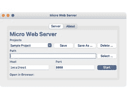
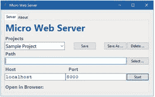
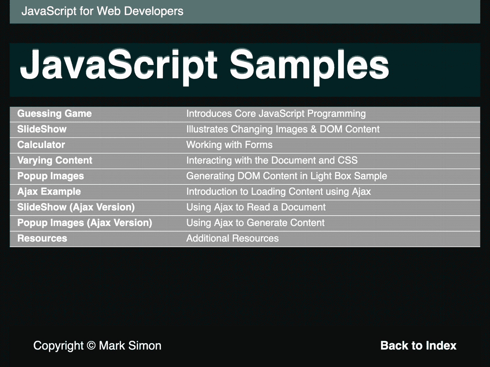

# 环境搭建

如果你计划去海边某个地方度假，可能会带上这本书作为轻松的读物。希望它不会太难读。

然而，如果你能跟着书中的示例一起操作，那么你将从中收获更多。为了充分利用本书，你需要准备：

*   一份可供练习的示例网站副本
*   一个像样的代码编辑器
*   如果可能，一个某种类型的 Web 服务器

以下是详细信息。

## 示例网站

在本书中，我们将使用一个示例网站进行练习。这个网站没什么花哨之处——它只是 JavaScript 示例和项目的集合。

你可以访问 `https://pure-javascript.net` 查看该网站的在线版本。

你应该从以下地址下载示例网站的本地副本：

`https://github.com/Apress/JavaScript-for-Web-Developers`

这基本上与在线示例相同，唯一的区别是实际的 JavaScript 代码是空的。填充这些 JavaScript 代码正是本书的核心内容。

解压文件并将示例文件夹放置在一个方便的位置。

## 代码编辑器

除了图片，网站的大部分文件（尤其是这里的示例网站）都是文本文件。这意味着你可以使用任何旧版文本编辑器来编辑这些文件，甚至 Windows 记事本也可以——如果你觉得这样很有趣的话。

更实际的做法是，你会希望使用一款专为编写代码而设计的文本编辑器。以下是你会需要的功能：

*   能够显示项目文件夹视图，方便在文件之间切换。
*   代码编辑器支持**语法高亮**，它能够识别你正在编辑的文档类型（`HTML`、`CSS`、JavaScript 等），并高亮显示语言中的各个部分。

你可能已经有自己偏好的代码编辑器。如果没有，可以尝试以下之一：

*   Pulsar：`https://pulsar-edit.dev/`
    这是 Atom 文本编辑器的后继版本。
*   VSCodium：`https://vscodium.com/`
    这是微软 Visual Studio Code（`https://code.visualstudio.com/`）的开源版本，去除了微软特定的遥测和专有功能。

两者都是免费、跨平台且开源的。它们还提供额外的扩展包，用于自定义编辑器。

### 运行 Web 服务器

原则上，你可以在浏览器中直接打开一个包含 JavaScript 的文件，它甚至可能正常运行。然而，现代浏览器对运行本地 JavaScript 脚本越来越谨慎。

如果你能通过 Web 服务器运行代码，将会从本书中获得最大收益，而且搭建一个 Web 服务器其实出奇地简单。

如果你经常进行 Web 开发，你的开发机器上可能已经安装了 Web 服务器，例如 XAMPP 或 MAMP。它们功能相当齐全，包含了数据库软件和 PHP 服务器端脚本。但如果只是开发 HTML、CSS 或 JavaScript，你并不需要这么复杂的功能。

有很多方法可以运行一个更轻量级的 Web 服务器。Pulsar 和 VSCodium 都提供了相应的插件包，让你可以直接在代码编辑器中运行一个简单的 Web 服务器。

然而，最简单的解决方案是下载一个。你可以从以下链接获取一个名为 Micro Web Server 的服务器：

[`https://github.com/manngo/micro-web-server`](https://github.com/manngo/micro-web-server)

它看起来像这样：

```
| Macintosh | Windows |
| --- | --- |
|  Macintosh 系统上 Micro Web Server 的截图。项目列表下选中了示例项目。路径选项卡被选中。主机和端口数据显示在下面的文本框中。 |  Windows 系统上 Micro Web Server 的截图。项目列表下选中了示例项目。路径选项卡被选中。主机和端口数据显示在下面的文本框中。 |
```

设置步骤如下：

1.  选择你的示例文件夹的位置。
2.  保存项目。你可以使用 **另存为…** 为你的项目起一个新名称。
3.  检查端口号。`8000` 通常没问题，但 `8080` 也是一个常见的替代选项。
4.  启动。

服务器启动后，你会看到一个指向该站点的链接，类似于：

`http://localhost:8000`

你可以点击该链接，在浏览器中加载页面。



一张为 Web 开发人员准备的 JavaScript 截图。它显示了 9 个 JavaScript 示例的列表。分别是猜数字游戏、幻灯片、计算器、动态内容、弹出图像、Ajax 示例、幻灯片、Ajax 版本的弹出图像以及资源。

附录 A 提供了一些关于使用其他 Web 服务器的信息。

关于作者 关于技术审校者 脚注 1