# 排版后的文档

本练习的目的*不是*游戏，而是让我们在实际操作中观察一些重要的 JavaScript 原理和结构。

接下来的一些代码示例建议在控制台中尝试。如果是这样，它们会以控制台提示符 `»` 作为前缀。

## 预备代码

每个网页都从 HTML 开始。反过来，HTML 会加载 JavaScript，并且在大多数情况下，包含各种将与 JavaScript 交互的 HTML 元素。

在本例中，与 JavaScript 交互的主要元素是一个用于启动游戏的简单按钮：

```html
<button id="startgame">Start Game</button>
```

原则上，页面上可能有多个按钮，因此识别出这个特定的按钮非常重要。这可以通过 `id` 属性（一个唯一标识符）来实现。实际值可以是任何我们喜欢的内容，只要它是唯一的。在第 1 章中，我们开发了一些将 JavaScript 添加到网页的模板。我们将在此处使用它们。

JavaScript 代码本身可以放入 `scripts` 文件夹内的 `game.js` 文件中，这样我们就可以在此处链接它：

```html
<script src="scripts/game.js" crossorigin="anonymous"></script>
```

对于这个项目，最好运行某种 Web 服务器，如引言中所述。如果你直接在 Web 浏览器中加载文件，则应移除 `crossorigin="anonymous"` 部分。

对于 JavaScript 文件，我们可以从标准模板开始：

```javascript
/*  game.js
================================================
Guessing Game
================================================ */
'use strict';
window.onerror=function(message,url,line) {
alert(`Error: ${message}\n${url}: ${line}`);
};
init();
function init() {
}
```

在本章后面，我们会将一些代码移到另一个文件中。到那时，我们将编写一个生成随机数的函数，这种函数可能你会在其他项目中使用。在 `scripts` 文件夹中会有一个名为 `library.js` 的空文件。我们现在还用不到它，但先打开它也无妨。

## 开始游戏

游戏本身很简单：

-   游戏会从 1 到 100 中随机选择一个数字。
-   人类（你）将尝试猜出这个数字。
-   游戏报告猜测是太高、太低，还是正确。
-   如果猜测不正确，人类会再次尝试，直到猜对或人类感到厌倦并退出游戏。

交互将通过 JavaScript 弹窗的形式进行，特别是使用 `prompt` 函数，该函数会显示一条简单的消息并等待用户输入。

你将会看到游戏的效果，如图 2-1 所示。

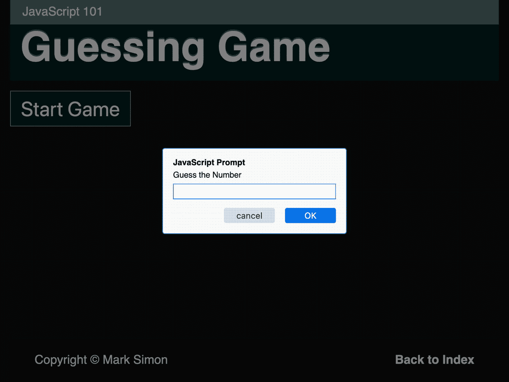

*图 2-1 猜数字游戏*

对于游戏，我们将创建另一个名为 `playGame()` 的函数。思路是通过点击按钮来触发此函数。

第一步是识别按钮并将其链接到该函数：

```javascript
...
init();
function init() {
let button = document.querySelector('button#startgame');
button.onclick=playGame;
}
function playGame() {
}
```

JavaScript 有很多方法来定位 HTML 元素，但如今最有用的是 `document.querySelector()` 函数。此函数接受一个字符串，该字符串与 CSS 用来标识元素的字符串相同。在本例中，我们请求的是 `id` 为 `startgame` 的 `button`。在 CSS 中，`#` 字符指的是 `id` 属性。这就是为什么在 HTML 中正确标记按钮如此重要。

如前所述，游戏代码将放入 `playGame` 函数中。这里，我们有一个所谓的 **存根**，一个满足 JavaScript 语法但尚未执行任何操作的空函数块。

我们希望点击按钮时运行游戏。为此，我们需要一个 **事件监听器**，它会在事件发生时调用一个函数。在本例中，事件是 `click` 事件，分配事件监听器的最简单方法是使用 `onclick` 属性。处理该事件的函数当然是 `playGame` 函数，因此将其赋值给 `onclick` 属性。

此时，许多初学者会对括号的使用感到困惑。对于函数，函数名有 *三种* 用途：

-   当你 **定义** 一个函数时，它总是带有括号。有时，这些括号包含要在函数中使用的附加变量，但有时它们是空的。
-   当你 **调用** 一个函数时，你是在运行函数内部的代码。同样，你总是使用括号，可能还包含你想传递给定义中那些变量的值。有些函数会计算结果，因此函数的值就是结果的值。
-   当你 **引用** 一个函数时，你会 *省略* 括号。这意味着你计划稍后调用该函数，但不是现在。

对于 `onclick` 事件处理程序，你需要使用括号定义函数。然后，你分配一个对该函数的引用，以便稍后调用；也就是说，你赋值 `playGame` 时 *不带* 括号。该函数将在稍后响应 `click` 事件时被调用。

## 勾勒脚本大纲

游戏本身将在 `playGame()` 函数内进行。回顾本章开头的游戏描述，我们将游戏规划为以下步骤：

-   设置游戏数据。
-   重复：
    -   用户猜测数字。
    -   检查数字并告知用户。
-   ……直到猜对为止。

我们会在过程中思考更多的细节，但这是一个好的开始。我们可以用注释的形式来勾勒：

```javascript
function playGame() {
//  Set up the data
//  Initialise
//  Repeat
//  User guesses
//  Check and report
//  ... until correct
}
```

使用注释是勾勒计划的好方法。当你编写代码时，它们也可以作为标题。当你实际编写代码时，可能会发现计划需要调整，一些注释会改变或消失。这是开发过程的一部分。

## 初始化数据

现在来填充实际代码。首先，JavaScript 中的所有数据都在变量中，我们需要两个变量：一个用于正确答案，我们称之为 `answer`；另一个用于用户的猜测，我们称之为 `guess`：

```javascript
function playGame() {
//  Set up the data
let answer, guess;
...
}
```

我们将使用较新的 `let` 语句，而不是更传统的 `var` 语句。在这个阶段，这不会有什么区别，但这是一个好习惯，因为 `let` 更可预测。不过，在控制台中进行的任何操作仍会使用 `var` 语句，以便保持灵活性。

变量名可能听起来不太有创意，但很难误解它们的含义：

-   `answer` 将是用户必须猜出的数字。
-   `guess` 将是用户的猜测。

作为一个 *独立* 的步骤，我们将初始化 `guess` 为一个随机数：

```javascript
function playGame() {
//  Set up the data
let answer, guess;
//  Initialise
answer = 57;
}
```

```


## 随机数与游戏逻辑

`57`可能不够随机，但在现阶段，我们需要使用已知的数值；当然，你可以使用任何想要的数字。在开发过程中，应当使用可预测的数据，以便验证其余代码是否正常运行。一旦确认代码工作正常，就可以改用未知值。后续我们会引入更随机的数字。

## 重复代码

接下来要处理的内容，至少在 JavaScript 中会显得重复。我们需要重复询问用户输入猜测结果，并报告猜测是否正确，直到猜中数字为止。

JavaScript 有多种用于重复代码的语句，其中最通用的是`do ... while`语句：

```
do {
} while( ... );
```

有时你会看到重复语句被称为循环。更好的理解方式是把它看作重复操作，或者后续会提到的迭代。这里的语句块会在括号内的条件为`true`时重复执行。

在游戏中，我们希望重复代码*直到*猜对为止。有些语言确实提供了`until`条件语句，但 JavaScript 没有。我们需要将其转换为否定形式：在猜测*不正确*时重复执行：

```
function playGame() {
...
do {
} while(guess != answer);
}
```

运算符`!=`表示“不等于”，JavaScript 使用感叹号（`!`）来表示“非”的逻辑。这个符号的灵感来自数学中的≠符号，不过你可能需要发挥一点想象力来理解。这种将条件判断放在代码块末尾的重复结构称为**后置测试**，意味着代码至少会执行一次，然后才决定是否继续重复。

## 主要游戏逻辑

在重复结构内部，我们将获取用户猜测、与正确答案比较，并报告结果。

### 获取用户输入

要获取用户输入，我们使用`prompt`函数：

```
do {
guess = prompt('Guess the number:');
} while(guess != answer);
```

`prompt`函数接收一条显示给用户的消息，并等待用户响应。它的实际外观因浏览器和操作系统而异，但大致如图 2-2 所示。

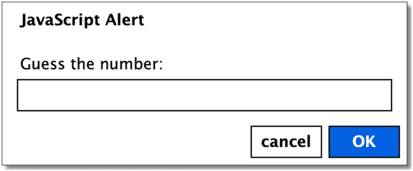

JavaScript 警告对话框的截图，包含以下字段：Guess the number。

**图 2-2** 猜数字游戏的输入提示

这里的消息略显突兀，但你可以自定义任何消息。请注意，你无法控制`prompt`的外观以及按钮的内容，这是为了防止网站伪造系统消息而采取的安全措施。这也意味着你需要设计消息措辞，让“确定”和“取消”按钮的含义清晰易懂。

`prompt`的响应有三种可能：

*   **用户输入的字符串**：当用户点击**确定**按钮时返回。
*   **空字符串**：用户点击**确定**按钮但未输入任何内容时返回。
*   **`null`**：表示用户点击了**取消**按钮，此时用户输入将被忽略。

该响应存储在变量`guess`中。

### 测试响应

假设我们已经在`prompt`中输入了有意义的内容，接下来需要将其与正确答案进行比较。可以使用`if`语句实现：

```
do {
guess = prompt('Guess the number:');
if(guess < answer) {        //  太小
//  方案 A
}
} while(guess != answer);
```

`if`语句检查括号内的条件。通常条件结果为`true`或`false`，但后续你会发现 JavaScript 对条件判断的处理更灵活。如果条件满足，则执行花括号（`{ ... }`）内的代码；否则不执行。

如果条件代码只有一行，可以省略花括号。例如：


```javascript
var a = 4, b = 3;
if(a > b) {
    alert('更大');
}
if(a > b) alert('更大');  // 效果相同
```

事实上，如果不使用不必要的结构来堆砌代码，代码会更易于理解和维护。此处的 `if` 子句使用了花括号，是因为稍后会有更多代码。

当然，条件判断的取值情况可能不止一种，因此你可以在 `if` 后面跟一个 `else if` 子句：

```javascript
do {
    guess = prompt('猜数字：');
    if(guess > answer) {   // 太大
        // B 计划
    }
} while(guess != answer);
```

只有当最初的 `if` 条件不成立时，才会评估 `else if` 子句；否则，其代码将被忽略。你可以根据需要添加任意多个 `else if` 语句，但务必牢记：

*   它们不能与其他语句交叉。
*   它们会按顺序依次判断。

本例中，只有另一种取值情况，因此我们可以使用 `else` 子句来捕获剩余的情况：

```javascript
do {
    guess = prompt('猜数字：');
    if(guess > answer) {   // 太大
        // B 计划
    }
    else {                      // 正确
        // Z 计划
    }
} while(guess != answer);
```

这是一个相当完整的 `if` 语句示例。实际上，并非所有 `if` 语句都会有 `else if` 子句，也并非都会有 `else` 子句。但如果确实存在，则必须按照正确的顺序排列。

## 报告结果

目前，我们可以简单地使用 `alert` 函数弹出一条消息，让用户知道测试结果：

```javascript
do {
    guess = prompt('猜数字：');
    if(guess > answer) {   // 太大
        alert('太高了');
    }
    else {                      // 正确
        alert('正确');
    }
} while(guess != answer);
```

`alert` 函数与 `prompt` 类似，它会弹出一条消息并等待用户响应。在这种情况下，只有一个选项，如图 2-3 所示。

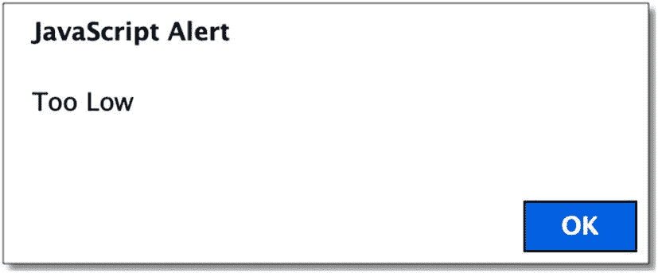

**图 2-3** 猜数字游戏的提示框

目前，每个条件块只有一个语句（`alert()` 函数），我们通常会去掉花括号。不过，为了将来的改进，我们暂时保留它们。

## 测试你的代码

现在可以测试你的代码了。不过，因为答案最初是硬编码的，所以看到正确答案时不必惊讶。为了正确测试，你应该尝试以下值：

*   输入一个太小的数字。
*   输入一个太大的数字。
*   取消 `prompt` 对话框。
*   输入 0。
*   输入一个负数。
*   输入一个非数字的字符串。
*   最后，输入正确的答案（57）。

你会注意到一些情况，其中部分情况会开始变得令人困扰：

*   取消操作不会停止游戏，而是被当作另一个数字处理。
*   输入字符串会被当作数字处理。
*   你需要点击很多次“确定”：一次用于输入猜测，另一次用于关闭消息对话框。

当我们开始随机生成数字时，你还会看到其他一些问题。

## 整合消息

目前，每次猜测都会出现两个对话框：一个用于 `prompt`，另一个用于显示结果的 `alert`。将结果与下一次猜测的 `prompt` 结合起来会方便得多。为此，我们需要另一个变量 `message`。这是因为提示消息会随着每次猜测而改变。

首先，添加新变量并初始化：

```javascript
function playGame() {
    // 设置数据
    let answer, guess;
    let message;
    // 初始化
    answer = 57;
    message = '猜数字';
    ...
}
```

现在，你可以在 `prompt` 函数中使用 message 变量：

```javascript
guess = prompt(message);
```

这样应该能得到完全相同的行为，所以你可能会想我们何必多此一举。即使没有其他改动，将消息文本移到初始化部分，我们已经提高了代码的可维护性。这样一来，所有任意设定的、灵活的值都集中在了一处，而不是散布在代码中。

但真正的好处在于，我们将根据猜测结果来更新消息：

```javascript
do {
    guess = prompt(message);
    if(guess > answer) {   // 太大
        message = '太高了';
    }
    else {                      // 正确
        alert('正确');
    }
} while(guess != answer);
```

在这里，我们将消息替换为“太小了”或“太高了”。它不会立即显示，但 `while` 语句会继续循环，因此新的消息会在下一轮显示在 `prompt` 中。另一方面，如果猜测正确，就不会有下一轮了，所以“正确”消息会像之前一样立即通过 `alert()` 函数显示。现在测试代码时，就不会那么繁琐了。

## 随机化数字

现在你可以来真的了。为此，你需要将硬编码的数字替换为随机数。JavaScript 有一个生成随机数的函数，它是 `Math` 包的一部分。要使用这个函数，你需要调用 `Math.random()`。`Math` 包实际上是一个内置的 JavaScript 对象。其目的是为数学处理提供一系列有用的函数和值。与所有对象一样，你使用所谓的点号表示法来引用其中的一项。在这里，`Math.random()` 就是指 `Math` 对象中的 `random()` 函数。出于技术原因，任何作为对象一部分的函数都被称为**方法**。这其实是一回事。`Math` 对象中其他一些有用的方法包括 `Math.sqrt()` 和 `Math.log10()`。一些有用的值包括 `Math.PI` 和 `Math.E`，它们是数学中重要的常数。

从技术上讲，`Math.random()` 函数生成的是一个**伪随机**数，因为它并非真正随机——这个数字是通过一个极其复杂的过程生成的，以至于我们无法猜测结果。不幸的是，`Math.random()` 的结果并不是整数；它是一个 `0–0.999...` 范围内的小数。也就是说，最小值可能是 `0`，而最大值则*小于* `1`。数学上，我们会写作 `0 ≤ r < 1`。

我们需要做的是将这个数字缩放为 1 到 100 之间的值。这需要以下步骤：

| 步骤 | 操作 | 最小值 | 最大值 |
| --- | --- | --- | --- |
| 获取随机数 | `Math.random()` | 0 | 0.999… |
| 乘以 100 | `Math.random()*100` | 0 | 99.99… |
| 截断结果 | `Math.floor(Math.random()*100)` | 0 | 99 |
| 加 1 | `Math.floor(Math.random()*100)+1` | 1 | 100 |

`Math.floor()` 函数会截断小数部分，这种操作也称为截尾；无论小数部分距离下一个整数有多近，都会被截断。

如果你觉得这个过程有些繁琐，你可以将其封装到一个便捷函数中：

```javascript
/*  game.js
================================================
猜数字游戏
================================================ */
'use strict';
function random(max) {
    //  返回一个 1 到 max 之间的随机数
    return Math.floor(Math.random()*max)+1;
}
...
```

你会注意到，我们给函数起的名字*几乎*和原始函数一样。不同之处在于，原始函数是 `Math` 对象的一部分，而我们的函数不是。只要它们在不同的上下文（作用域）中，且哲学上执行相同类型的操作，这样命名函数是没问题的。JavaScript 允许你创建一个与另一个函数完全同名的函数，在这种情况下，新函数会替换旧函数。这并不总是一个好主意，但有时会意外发生。

函数是构建代码的重要组成部分。我们已经将游戏代码包装在 `playGame()` 函数中，现在又添加了另一个函数来支持它。创建函数有很多理由，其中包括：

*   代码可以被重复使用。这里，`random()` 函数虽小，却是一段可以重复使用的有用代码。


一旦编写了函数代码，程序的其余部分就可以直接使用它，而无需关心函数内部的实现细节。这让你能够一次专注于一个任务。

- 函数帮助你通过更小的步骤来开发更大的程序。实际上，函数成为了构建模块。

对于这个`random()`函数，我们没有硬编码最大值`100`，而是使用了一个参数变量`max`，使函数更具通用性。
你会注意到，我们将这个新函数放在了最开头（当然，是在`'use strict';`语句之后）。这样做是为了提醒我们，这是一个支持性函数，可能是一个库的一部分。以后，我们甚至可以将此函数移动到一个公共库脚本中，以便在其他项目中使用。

现在，我们可以在游戏中使用这个随机数：

```javascript
function playGame() {
    //  Setup the data
    let answer, guess;
    let message;
    //  Initialise
    //  answer = 57;
    answer = random(100);
    message = 'Guess the Number'
    // ...
}
```

如果你想现在测试这个游戏，你必须进行有策略地猜测；否则，你可能要猜很久。最简单的方法是二分法猜测：从`50`开始，然后根据结果向上或向下减半。这被称为**二分查找**，因为你将可能性一分为二。
从技术上讲，这个数字并不是真正的随机数，但就我们的目的而言，它是不可预测的，这就足够了。
随机数（或接近随机的数）的一个特点是它们可能是任何值。如果这个数字恰好是`1`或`100`，嗯，那是可能发生的，但这（还）不是怀疑某些功能不正常的理由。在你开始惊慌之前，多试几次。

### 取消游戏
为了实现接下来的改进，你将不得不进行大量的猜测，只是为了看看你的下一个功能是否正常工作。一旦你确定下一个功能正常工作后，你应该能够取消游戏。

请记住，如果你点击**取消**，`prompt`函数会返回`null`。这会取消提示框，但 JavaScript 目前还不知道你同时也想取消游戏。
你必须告诉它：

```javascript
do {
    guess = prompt(message);
    if(guess === null) return;
    // ...
} while(guess != answer);
```

是的，这是三个`=`字符。你将在下一节中理解原因。

请记住，整个游戏是在一个函数内部进行的。`return`语句完成两项工作：

- 退出函数。
- 设置一个特定的值作为函数的返回结果。

要设置一个返回值，你可以使用类似`return 'goodbye';`这样的语句。在这个案例中，我们没有设置任何特定的值，但 JavaScript 仍然会设置一个值；默认的返回值是`undefined`。
对于这个游戏，我们实际上并不关心返回值。我们只关心函数被退出这一事实。
请注意`if`条件：`if(guess === null) ...`。这是一个例子，说明简单的单行`if`语句比使用语句块更具表达力。

### 比较相等的值
这是给新手的一个陷阱。部分困惑来自于我们对“等于”这个词的随意使用。

JavaScript 有**三个**使用`=`字符的运算符。第一个是赋值运算符：

```javascript
var a, b;
a = 3; b = 4;                   //  assignment
```

下一个运算符是**等值**运算符，用于比较两个值：

```javascript
if(a == b) console.log('yes');  //  comparison
else console.log('no');
//  ← no
```

比较运算符使用两个`=`字符：`==`。这里，我们会得到`no`，因为这两个值不相同。

现在，这是陷阱 1。如果你错误地使用了赋值运算符而不是比较运算符，它确实会做一些事情，但你不是在比较值。相反，你是在重新赋值给一个变量：

```javascript
if(a = b) console.log('yes');   //  assign b to a
else console.log('no');
//  ← yes
```

在这个例子中，`a`变成了 4，你会得到`yes`。但这并不是你可能以为的原因。让我们用不同的值再试一次：

```javascript
var a, b;
a = 3; b = 0;
if(a = b) console.log('yes');
else console.log('no');
//  ← no
```

这次，你会得到一个`no`。正如你所见，唯一不同的是`b`现在是`0`。
在控制台中实验时，你会注意到，像`a = 3`这样的语句会有一个结果，这个结果就是你刚刚赋的值。
在表达式`if(a = b) ...`中，发生了**两**件事。首先，变量`a`获得了一个新值。其次，这个新值在`if()`中被测试：如果这个值是 truthy（例如非零数字），测试通过；如果这个值是 falsy（例如零），测试失败。
有很多开发者会提供各种避免这个陷阱的建议，但这些都是糟糕的建议。习惯它就好。你*会*犯这个错误，并且你最终会变得更擅长识别它。

至于陷阱 2，它没那么严重，但仍然可能让你犯错。让我们将其中一个值改为字符串，并进行一次正确的比较：

```javascript
var a, b;
a = 3; b = '3';
if(a == b) console.log('yes');
else console.log('no');
//  ← yes
```

数字`3`和字符串`'3'`是相同的值吗？答案取决于你对等值的宽松程度。在 JavaScript 中，其中一个可以轻易地被解释为另一个，所以这已经足够接近了。

如果这还不够好，你可以严格一点：

```javascript
if(a === b) console.log('yes');
else console.log('no');
//  ← no
```

第三个运算符是**恒等**运算符，使用**三个**字符：`===`。基本上，它测试值是否相同，而不进行重新解释。
你不会经常看到恒等运算符，但在比较 falsy 值时，它可能特别重要。有很多值会被解释为`false`，偶尔你可能需要区分它们。这就是恒等运算符的用武之地。

### 更有意义的返回值
如前所述，我们并不真正关心函数的返回值，因为它只是为了取消游戏。在更宏大的方案中，你实际上可能会用到这个返回值。以下是它的用法：

首先，将返回值设置为有意义的内容：

```javascript
guess = prompt(message);
if(guess === null) return 'game cancelled';
```

其次，为函数设置一个备选返回值：

```javascript
function playGame() {
    // ...
    return 'game over';
}
```

我们设置`startgame`按钮的方式使得利用返回值有些困难，但至少我们生成了一些指示游戏结束原因的标志。

### 显示猜测范围
如果你已经测试了这个游戏几次，你可能会发现自己记不清已经猜过哪些数字。我们现在可以做的是，以猜测范围的形式添加一些反馈。
一开始，数字在 1 到 100 之间。如果第一次猜的数字太高，那么正确数字将在 1 到你猜测的数字减 1 之间；如果第一次猜的数字太低，那么正确数字将在你猜测的数字加 1 到 100 之间。
你可以通过调整猜测范围的最小值和最大值来继续这个过程，直到你锁定正确的值。无论如何你都应该这样做，但现在我们将让 JavaScript 帮助我们进行追踪。

首先，我们需要两个新的变量：

```javascript
function playGame() {
    //  Setup the data
    let min, max;
    let answer, guess;
    let message;
    //  Initialise
    [min, max] = [1, 100];  //  or: min=1; max=100;
    answer = random(max);
    message = 'Guess the Number';
    // ...
}
```

这两个新变量`min`和`max`，首先像通常一样声明，然后分别初始化为`1`和`100`。
这种写法有几个值得注意的特点：


- 我们有三条`let`语句用于五个变量。你可以根据需要设置任意多条`let`语句。这里将它们用于在单个语句中对逻辑相关的变量进行分组。

- 新变量`min`和`max`在其他变量之前声明，更重要的是，它们在其他变量之前初始化。这是因为我们将在下一条语句中使用`max`的初始值。

- 我们不再生成最大值为`100`的随机值，而是使用`max`。这样得到的数值相同，并且通过使用已初始化的变量来强调这一点。如果我们决定改用最大值为`1000`，只需要设置一次，这样更安全。

- 我们在单条语句中同时初始化了`min`和`max`变量。

表达式`[min,max] = [1,100]`被称为**解构**赋值，它允许你一次性赋值多个值。方括号`[ ... ]`定义了一个称为**数组**的集合，我们将在后面详细讨论。其思想是，左侧的每个变量都获取右侧对应的值。解构赋值并非 JavaScript 的原生特性，因此你需要像相关注释中所示那样，在两个单独的语句中完成赋值。将两条语句放在同一行并用分号分隔，这是一种合理的方式。这也是强化“你在赋值两个相关值”这一概念的一种方法。

接下来是在提示信息中使用这些新变量：

```
do {
  guess = prompt(`${message}\n 从${min}到${max}`);
  if(guess === null) return '游戏已取消';
  ...
} while(guess != answer);
```

该消息已嵌入到较新类型的字符串字面量——**模板字面量**中。其最直接的特征是使用反引号（`` `...` ``）而不是通常的单引号或双引号。这告诉 JavaScript 它可以查找内部的表达式。字符串内部是表达式和普通文本的混合。表达式被包裹在特殊的代码`${ ... }`中。在这个例子中，表达式只是变量。这是将字符串与值混合的最简单方式。你还会看到字符串中的`\n`。这在普通字符串中也能工作，它是一个表示换行的代码。

刚开始时，你会看到类似图 2-4 的内容。

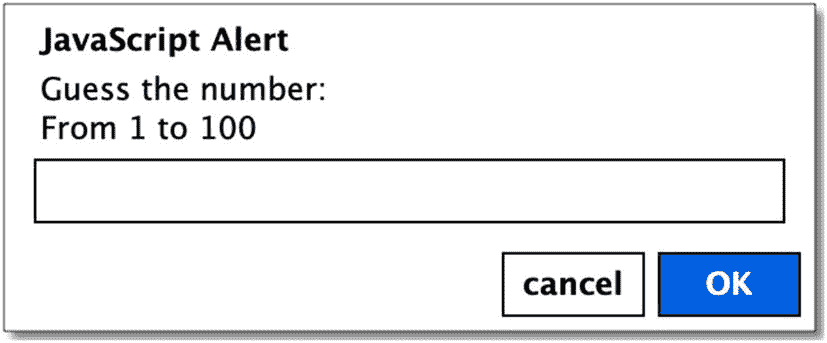

JavaScript 提示对话框的截图。其中包含以下文本字段：“从 1 到 100 猜数字”。

图 2-4 带有最小值和最大值的提示框

随着游戏进行，范围会改变。这可以在测试猜测时实现：

```
if(guess < answer) {
  message = '太小了';
  min = guess + 1;
}
else if(guess > answer) {
  message = '太大了';
  max = guess - 1;
}
else {
  alert('正确');
}
```

这就是为什么我们在`if`语句的每个部分都使用花括号：以便我们可以包含额外的语句。如果猜测太小，你需要下一次猜得更大；新的最小值应该比上一次的猜测大 1。如果猜测太大，你下一次应该猜得更小，新的最大值应该比上一次的猜测小 1。

现在测试时，它会工作一会儿，但你会看到另一个问题。你可能会收到类似“从 501 到 100”的消息。这里，我们遇到了 JavaScript 的另一个问题。回想一下，JavaScript 使用`+`运算符进行字符串拼接和数字加法，并且优先进行拼接。事实证明，`prompt`的所有输入都是字符串。到目前为止这还没问题，因为像我们使用`<`和`>`比较数字和字符串时，会导致`guess`临时转换为数字以供比较。对于表达式`guess - 1`也没问题；你不能对字符串进行减法运算，所以 JavaScript 再次临时将`guess`转换了。

然而，对于`guess + 1`操作，JavaScript 会将它们都视为字符串并进行拼接；这就是像`501`这样的结果出现的原因。解决方案是强制将`guess`值转换为数字。最简单的方法是使用`parseInt()`函数，它会将`guess`变量转换为整数：

```
do {
  guess = prompt(`${message}\n 从${min}到${max}`);
  if(guess === null) return '游戏已取消';
  guess = parseInt(guess);    // 转换为数字
  ...
} while(guess != answer);
```

只要字符串以数字开头，例如`23`、`23.5`或`23etc`，`parseInt()`函数通常就能从字符串中生成一个整数。但是，如果字符串不是以数字开头，例如`hello`，它就会失败；在这种情况下，你会得到`NaN`，即“非数字”。

与其传播这样的错误，我们可以为无效数字替换为`0`：

```
do {
  guess = prompt(`${message}\n 从${min}到${max}`);
  if(guess === null) return '游戏已取消';
  guess = parseInt(guess) || 0;    // 转换为数字
  ...
} while(guess != answer);
```

`||`运算符在 JavaScript 中表示**或者**。它通常用于组合多个条件，但在这里用作备选：如果第一个值没有意义，就使用下一个值。出于这个目的，`NaN`以及`undefined`和`null`都没有意义。

## 函数库

在开发代码时，我们添加了一个`random()`函数，作为 JavaScript 内置`Math.random()`函数的便捷封装。它没有与当前项目特别相关的内容，所以我们把它放在开头，以提醒我们可以在任何地方使用它。现在一切正常，我们可以将函数移动到单独的库文件中，从而完成代码的组织。

在`scripts`文件夹中，有一个名为`library.js`的文件。名称本身无关紧要——只要你能记住你叫它什么，可以用任何名称。我们将把`random()`函数移动到该文件中。

1.  打开`scripts/library.js`文件。
2.  从`game.js`文件中剪切`random()`函数，并粘贴到`library.js`中。
3.  在`random()`函数上方添加另一个注释块来描述该函数。类似下面这样即可：

```
    /*  random(max)
    ================================================
    返回一个介于 1 和 max 之间的随机整数
    ================================================ */
```

4.  在你的`game.html`文件中添加一个脚本链接：

注意，这里不需要包含`defer`属性，因为加载该文件不会干扰页面其余部分的加载。我们可以在未来的项目中使用`library.js`文件。

## 最终代码

以下是`playGame`函数的完整实现：

```
function playGame() {
  //  设置数据
  let min, max;
  let answer, guess;
  let message;
  //  初始化
  [min,max] = [1,100];
  answer = random(100);
  message = '猜数字';
  do {
    guess = prompt(`${message}\n 从${min}到${max}`);
    if(guess === null) return '游戏已取消';
    guess = parseInt(guess) || 0;
    if(guess < answer) {          //  太小
      message = '太小了';
      min = guess + 1;
    }
    else if(guess > answer) {     //  太大
      message = '太大了';
      max = guess - 1;
    }
    else {                        //  正确
      alert('正确');
    }
  } while(guess != answer);
  return '游戏结束';
}
```

## 总结

在本章中，我们通过一个简单的猜数字游戏项目，探索了一些重要的编程概念。

### 注释

注释可用于解释代码的各个部分，以及勾勒代码的章节。它们还可以用于禁用部分代码以进行测试。

### 组织

当然，最好能够预先规划好所有代码。然而，在构建项目时，我们遵循了一些组织原则：

-   **尽早声明变量。**

    我们使用了多条`let`语句并带有多个变量，以体现变量的分组感。

-   **接下来初始化数据。**

    有时，你可以一步完成变量的声明和初始化。


# 排版后的文档

## 编写可重用代码

* 寻找编写可重用代码的机会。如果可能，将该代码放入一个库中。

我们使用`random()`函数做到了这一点。

## 重复

`while`语句用于在条件为真时重复执行一个代码块。

## 条件块

`if`语句用于条件性地运行代码——当条件测试为`true`时。
`if`后面可以跟一个或多个`else if`块，并且可以跟一个`else`块。
多行代码块用花括号括起来。对于单条语句，花括号不是必需的，但如果认为这样可读性更好，或者认为以后可能需要添加更多语句，也可以使用花括号。
在测试相等性时，需要使用相等运算符（`a == b`）。一个常见的错误是使用赋值运算符（`a = b`），这不会测试相等性，而是改变第一个变量的值。

## 对话框

`prompt()`函数可用于获取用户输入，而`alert()`函数可用于发送消息。
取消`prompt()`对话框并不会取消所有操作。如果你希望它执行更多操作，例如退出游戏，则必须编写相应的代码。
从`prompt()`返回的值是字符串，并且永远不会是数字。虽然 JavaScript 通常会在需要时将字符串重新解释为数字，但如果使用加法运算符（`+`），则不会重新解释；相反，它会进行字符串拼接。有时，你需要使用类似`parseInt()`的方法自行转换字符串。

## 后续内容

这个游戏作为一个 Web 项目来说相当枯燥。网页的唯一参与是通过页面上的一个按钮来启动游戏。
在下一章中，我们将仔细研究如何与网页进行交互。我们将学习如何定位页面上的元素，以及如何更改它们的内容或其他属性。我们甚至将创建一些元素来添加到页面中。
在第 4 章中，我们将把所有这些付诸实践。

---

# 第 3 章 操作 HTML 元素

所有网页最初都是用 HTML 编写的，但这些代码最初只是文本。浏览器获取这些 HTML 代码以及任何关联的 CSS，并使用它们生成页面的可见内容。
当浏览器加载并实现 HTML 时，它还会为 JavaScript 创建一个文档的内部表示。这被称为**文档对象模型**，简称**DOM**。我们可以使用 DOM 在 JavaScript 中操作网页的各个部分。

在本章中，我们将探讨：

* 选择页面上的单个和多个元素
* 访问和添加内容到 HTML 元素
* 创建额外的元素
* 操作元素属性
* 操作 HTML 元素的 CSS 样式

要真正掌握这些内容，这里有一个供您实验的示例页面：

* 在浏览器中加载页面`sample-dom.html`。
* 打开开发者工具控制台。
* 同时在代码编辑器中加载该页面，以便查看底层的 HTML。

首先，页面看起来类似于图 3-1。

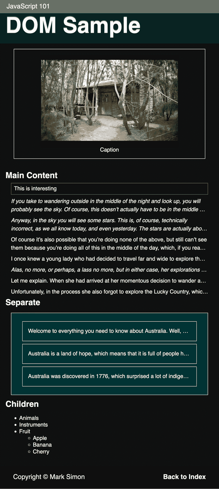

图 3-1 示例 DOM 页面

随着本章的深入，您将对页面的内容和外观进行各种更改。
为了提醒我们是在控制台中进行实验，代码示例将以控制台提示符（`»`）开头。

## DOM 树

HTML 文档本质上是层次化的：元素位于其他元素内部。如果您查看示例页面的 HTML，将会看到类似这样的结构：

实际上，还有更多内容。

当页面加载时，DOM 是根据 HTML 创建的。这被表示为一个**树状结构**，其中元素分支到它们内部嵌套的元素，如图 3-2 所示。

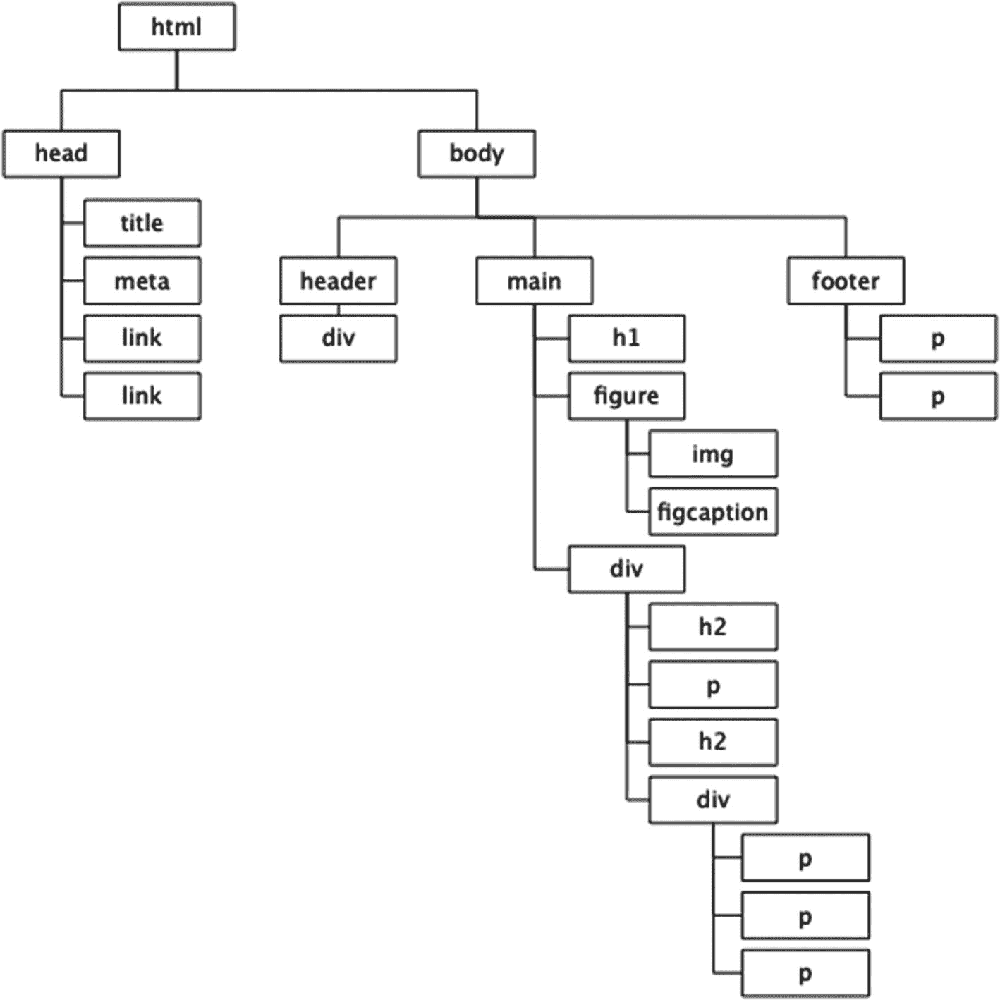


## DOM 树结构

一个 DOM 树结构从`html`开始，后面跟着`head`和`body`。`head`包含`title`、`meta`和两个`link`。`body`由`header`、`main body`和`footer`组成。

**图 3-2**  
**DOM 树**

用于描述树结构元素的术语往往混合了多种隐喻：

- 在树结构中，元素被称为**节点（node）**，它们是分支上的连接点。
- 一个分支到其他元素的元素称为**父（parent）**节点。
- 父节点分支出的元素称为**子（child）**节点。
- 具有相同父节点的节点称为**兄弟（sibling）**节点。
- 树结构的起点称为**根（root）**节点。你会注意到，整个树结构通常被绘制成倒置的，根节点在顶部。

有些术语来自树的隐喻，而另一些则来自家族的隐喻。有时你需要处理特定的节点，而有时你会处理与特定节点相关的节点。

### 查找元素

在 JavaScript 中，你肯定需要做的一件事就是找到你想要处理的元素。过去，你可能会使用以下任意函数：

- `document.getElementsByTagName()`：返回使用特定标签（如`h1`或`li`）的元素集合。
- `document.getElementsByName()`：返回具有特定`name="..."`属性的元素集合。如今，`name`属性仅限于表单元素。
- `document.getElementById()`：返回与`id="..."`属性匹配的单个元素。如果有多个匹配项（不应该出现），则只返回第一个匹配项。
- `document.getElementsByClassName()`：返回具有特定`class`属性的元素集合。

这些函数大致按历史顺序排列。实际上，最后一个函数`document.getElementsByClassName()`并没有得到太多青睐，因为它较晚才出现在当时占主导地位的 Internet Explorer 中，而那时更好的方法已经出现了。请注意，上述函数中除了一个之外，其名称中都有复数形式的`Elements`，以反映它们返回一个集合的事实。只有`document.getElementById()`在其名称中有单数形式的`Element`，以反映应该只有一个匹配项的事实。

你不再需要这些函数中的任何一个，但你仍然会在旧代码或由年长开发者编写的代码中看到它们。对于`document.getElementById()`来说尤其如此。然而，从现在开始，我们将不再使用它们。

现在有两个函数可以满足你的所有需求：

- `document.querySelector()`：匹配选择器的*第一个*元素。如果没有匹配项，你将得到`null`。
- `document.querySelectorAll()`：返回匹配选择器的元素*集合*。即使只有一个匹配项，它仍会在集合中返回。如果没有匹配项，你将得到一个空集合。

你将通过下表了解它们的使用方法：

| 方法 | 含义 |
| :--- | :--- |
| `document.getElementsByTagName('p')` `document.querySelectorAll('p')` | 所有段落 |
| `document.getElementsByName('amount')` `document.querySelectorAll('[name="amount"]')` | 所有具有`name`属性的元素 |
| `document.getElementsByClassName('special')` `document.querySelectorAll('.special')` | 类中的所有元素 |
| `document.getElementById('separate')` `document.querySelector('#separate')` | 通过`id`获取单个元素 |

注意，上述所有示例都以`document.`开头，这意味着我们在整个文档中搜索。但是，你可以从先前定位到的元素开始搜索。

例如：

```
//  在文档中查找第一个 div
    var div = document.querySelector('div');
//  在上述 div 中查找所有段落
    var p = div.querySelectorAll('p');
```

这里，在整个文档中搜索第一个匹配`div`的元素。然后在得到的`div`元素中进一步搜索所有`p`（段落）元素。在下一节中，你将看到更多关于使用标签名和其他选择器的内容。

## CSS 选择器

JavaScript 不是 CSS，但它在其`.querySelector()`和`.querySelectorAll()`方法中使用了 CSS 选择器。CSS 选择器是 CSS 用来标识哪些元素受 CSS 规则影响的表达式。

多年来，CSS 已经变得非常复杂，并且有许多微妙的方式来定位元素。对我们来说，我们主要关心以下几点：

- **标签（tag）** 选择器：引用一个或多个基本元素，如`h1`或`p`。
- **id** 选择器：引用具有`id="..."`属性的单个元素。
- **类（class）** 选择器：引用具有`class="..."`属性的任意数量的元素。
- **属性（attribute）** 选择器：引用各种元素的其他属性，例如`name=""`。
- 也可以引用作为元素**后代（descendant）**或**子元素（child）**的元素，例如特定列表中的项目或`div`内的段落。

### 标签选择器

最基本的选择器是**标签**选择器。这是一个简单的 HTML 标签，指的是所有具有该标签的元素。例如：

```
document.querySelectorAll('p');   //  所有段落 ()
document.querySelector('div');    //  第一个 div
document.querySelector('h1');     //  第一个（并且大概是唯一的）主标题 h1
document.querySelectorAll('h1');  //  一个可能只有一个 h1 的集合
```

原则上，你应该使用`querySelectorAll()`通过标签选择器获取任何元素。然而，在某些情况下，例如`h1`，该元素被认为是唯一的，因此`querySelector()`可能更合适。通过标签名获取元素的旧方法是`document.getElementsByTagName(...)`，但使用`document.querySelectorAll(...)`更加灵活。除了那些应该是唯一的元素之外，你可能还需要通过使用**id**来进一步限制结果。

### id 选择器

在 HTML 中，通常有一个`id`附加到要定位的元素上。例如，页面上的一个段落具有以下 HTML：

```
<p id="something" class="special">This is interesting</p>
```

在 CSS 中，id 用井号（`#`）标识：

```css
p#something {
  border: thin solid #666;
  padding: 0.25em 0.5em;
}
```

在 JavaScript 中，你可以使用 CSS 选择器引用该元素：

```
var p = document.querySelector('p#something');
var p = document.querySelector('#something');   //  相同
var p = document.getElementById('something');   //  旧方法
```

由于`id`应该是唯一的，你可以像第二个例子那样单独使用`id`。然而，包含标签会使意图更清晰，所以我们采用这种方式。你会发现许多开发者仍然使用`document.getElementById()`，如最后一个例子所示，但这其实没有必要。较新的`document.querySelector()`做得同样好，而且更加灵活。

### 类选择器

如果你想要匹配多个元素，那么`id`就不适用了。相反，你会看到`class`属性，它描述了一组多个元素。例如，在示例文档中，有几个段落，其中一些具有`class`属性：

```html
<p>...</p>
<p class="special">...</p>
<p>...</p>
<p>...</p>
<p class="special">...</p>
<p class="special">...</p>
<p>...</p>
```

当然，类组可以小到一个，甚至为零。你通常认为组包含多个项目，但只有一个项目的组也可能有意义。例如，你可能想要描述**状态**的变化，比如当你点击某个东西时。

为了匹配特定的类，CSS 使用点号（`.`）：

```css
p.special {
  font-style: italic;
}
```

与`id`一样，你可以使用`querySelector()`来选择第一个匹配项，但与`id`不同，使用`querySelectorAll()`选择多个匹配项也是合理的。


```javascript
//  第一个匹配
var p = document.querySelector('p.special');
//  所有匹配
var pp = document.querySelectorAll('p.special');
//  不那么具体
var special = document.querySelectorAll('.special');
//  较旧的方法
var special = document.getElementsByClassName('special');
```

`p.special`和`.special`之间有一个微妙的区别。许多元素可以拥有相同的类，但它们可能并不都具有相同的标签。第二种形式也会匹配具有相同类的其他元素。

## 子代与后代选择器

有时，您希望定位特定元素*内部*的所有元素。例如：

```html
<div>
  <p> ... </p>
  <p> ... </p>
  <p> ... </p>
</div>
```

要定位`div`内部的段落，您需要结合使用选择器，一个用于容器，一个用于内容。CSS 有两种定位元素内容的方法：

```css
div#separate>p {
  border: thin solid white;
}
div#separate p {
  padding: 1em;
}
```

大于号（`>`）选择器是一个**子代选择器**：它选择作为`div#separate`*子元素*的段落。空格选择器（它看起来根本不像选择器）是一个**后代选择器**：它选择作为`div#separate`*后代*的段落。

在 JavaScript 中，您可以选择子代或后代段落，如下所示：

```javascript
var pp = document.querySelectorAll('div#separate>p');
console.log(pp);            //  子元素
var pp = document.querySelectorAll('div#separate p');
console.log(pp);            //  后代元素
```

在此例中，它们是相同的，因为示例中没有其他容器。但是，如果从`div#content`开始，您会看到一个区别：

```javascript
var pp = document.querySelectorAll('div#content>p');
console.log(pp);            //  子元素
var pp = document.querySelectorAll('div#content p');
console.log(pp);            //  后代元素
```

这是因为`div#separate`位于`div#content`内部。`div#separate`中的段落是`div#content`的后代，但不是其子元素。

当您有一个嵌套列表时，这一点也很明显：

```html
<ul id="children">
  <li>Animals</li>
  <li>Instruments</li>
  <li>Fruit</li>
  <li>
    <ul>
      <li>Apple</li>
      <li>Banana</li>
      <li>Cherry</li>
    </ul>
  </li>
</ul>
```

它看起来像这样：

-   Animals
-   Instruments
-   Fruit
-   Apple
-   Banana
-   Cherry

您可以使用以下方法选择列表的不同部分：

```javascript
var children = document.querySelectorAll('ul#children>li');
console.log(children);
var grandchildren = document.querySelectorAll('ul#children>li>ul>li');
console.log(grandchildren);
var descendants = document.querySelectorAll('ul#children li');
console.log(descendants);
```

在所有这些示例中，选择器的第一部分是`ul#main`，它选择主列表。从那里，我们选择列表的各种子元素和后代元素。在第一个示例中，子代选择器（`>`）只会选择直接子元素，即第一级的元素。第三个带有后代选择器（空格）的示例会选择*所有*列表项，包括子元素和孙元素。如果您想专门选择*仅*孙元素，则需要像第二个示例那样使用多个子代选择器。这些是我们将使用的主要选择器，尽管当我们开始在第 5 章和第 6 章中处理表单时，我们会看到一些属性选择器的示例。

## 处理多个元素

使用`querySelectorAll()`的结果是一个元素集合，技术上称为**节点列表**。节点列表类似于数组，因为它是一个编号的集合，您可以对其进行迭代。

例如，您可以像之前一样获取该集合：

```javascript
var children = document.querySelectorAll('ul#children>li');
```

这将集合获取到`children`变量中，与之前一样。有两种主要方法可以遍历编号集合。首先，您可以使用`for()`循环来计数遍历集合。

`for()`循环将使用一个变量来计数集合中的成员，并对每个成员执行操作：

```javascript
var children = document.querySelectorAll('ul#children>li');
for(let i=0; i<children.length; i++) {
  children[i].textContent = children[i].textContent.toUpperCase();
  //  其他处理
}
```

`textContent`属性顾名思义，它是元素作为文本的内容。稍后您会看到更多关于`textContent`的内容。`for`结构设置一个计数器（`let i=0`），并通过索引`i`引用每个成员来遍历`children`集合。`.toUpperCase()`方法返回原始文本的大写版本。请注意，替换`textContent`会产生一个副作用：将嵌套列表替换为纯文本，不再是一个列表。

第二种方法是较新的方法，使用`.forEach()`方法。要尝试此示例，您可能需要重新加载页面。

```javascript
var children = document.querySelectorAll('ul#children>li');
children.forEach(child => {
  child.textContent = child.textContent.toLowerCase();
  //  其他处理
});
```

使用`.forEach()`，您不需要使用计数器变量。相反，`child`变量直接从集合的每个成员中赋值。这是我们稍后将使用的技术。`.forEach()`方法包含一个函数。该示例使用了所谓的**箭头函数表达式**，这是一种紧凑的形式，适用于定义一次性函数。

## 相关元素

处理 DOM 时，您有时会对附近的元素感兴趣。您之前看到了不同节点之间的关系。以下是您可以访问它们的一些方法列表：

| 节点(s) | 任何内容 | 仅元素 |
| --- | --- | --- |
| 子节点 | `childNodes` | `children` |
| 第一个子节点 | `firstChild` | `firstElementChild` |
| 最后一个子节点 | `lastChild` | `lastElementChild` |
| 相邻节点 | `nextSibling` `previousSibling` | `nextElementSibling` `previousElementSibling` |
| 父节点 | `parentNode` | `parentElement` |

例如（您可能希望先重新加载页面）：

```javascript
var list = document.querySelector('ul#children');
var item = list.firstElementChild;  //  获取第一个子元素
console.log(item.textContent);
item = item.nextElementSibling;     //  下一个子元素
console.log(item.textContent);
```

这些名称清楚地说明了这些方法的作用。前两个方法（`childNodes`和`children`）返回一个集合，而其他方法返回单个结果。上表中前三个方法从父节点开始操作。在这种情况下，它是`ul`无序列表，您将引用其中的`li`项。最后两个方法从子节点开始操作。在这种情况下，它们是`li`列表项，您将引用相邻的同级列表项或父级`ul`列表。

您会注意到有两个版本，这是由于 HTML 工作方式的一个特性所致。从技术上讲，HTML 中元素之间的所有空白，甚至注释，都是 DOM 的一部分。例如，假设您有一个列表和项目：

```html
<ul>
  <li>Child</li>
  <li>Child</li>
</ul>
```

缩进、换行和注释都被视为 DOM 节点。大多数时候，您并不关心这些，只对列表和项目感兴趣，而不必处理额外的空格或注释。额外的空格和注释当然不会出现在渲染的页面中，因此只有查看源代码时才能看到。或者，如果您使用 JavaScript，也可能看到。在是否应该使用前面第一列属性来包含这些内容方面，浏览器之间存在差异，这在过去造成了麻烦。第二列属性只处理真正的元素，从而解决了这个问题。

例如：

```javascript
var ul = document.querySelector('ul#children');
console.log(ul.children);   //  仅列表项
console.log(ul.childNodes); //  可能包含其他代码
```


## 创建和操作元素

有时，你需要通过操作 DOM 本身的内容来对文档进行更改。例如，你可能要做的第一件事就是创建一个元素：

```
var p = document.createElement('p');
```

参数是一个字符串，它就是一个简单的 HTML 标签，不带尖括号。你甚至可以自己编造一个：

```
var p = document.createElement('thing');
```

但不要指望浏览器会知道如何正确显示它。默认情况下，一个编造出来的元素会被显示为内联元素，除非你通过 CSS 更改它。这种技巧曾在尝试让**旧版浏览器**接受更新的 HTML5 元素时使用过。

此时，新创建的元素没有内容，也没有属性，甚至尚未存在于文档中：它只是漂浮在内存中。稍后，你将看到如何将新元素添加到实际文档中。

### 向元素添加内容

你可以使用多种方法向元素添加内容，无论这个元素是你找到的，还是刚刚创建的。

添加内容最简单的方法是设置其 `textContent` 属性：

```
var p = document.createElement('p');
p.textContent = '此位招租……';
```

还有一个可供选择的属性叫 `innerHTML`，在这种情况下，它会给你相同的结果。然而，区别在于 `innerHTML` 会将内容解释为 HTML。

例如，你可以像下面这样更改主标题的内容：

```
var h1 = document.querySelector('h1');
h1.textContent = 'Hello<br/>Goodbye';
```

在前面的示例中，该标题现在会显示 `Hello<br/>Goodbye`。但是，如果你使用 `innerHTML`：

```
var h1 = document.querySelector('h1');
h1.innerHTML = 'Hello<br/>Goodbye';
```

字符串中的 `<br/>` 会被解释为 HTML 换行符，你将看到两行文本。

通常，除非你真的需要额外的 HTML，否则使用 `textContent` 更安全。

还有一个名为 `innerText` 的属性，它有一段复杂的演变史。最初，它是一个只有 Internet Explorer 支持的非官方属性，而其他浏览器只支持官方的 `textContent` 属性。如今，所有现代浏览器都支持这两个属性。但是，两者之间有一个细微的差别，这使得 `textContent` 是更受青睐的属性。

### 添加其他属性

你还可以将属性作为 JavaScript 属性来添加。例如，你可以像下面这样创建一个图像元素：

```
var img = document.createElement('img');    //  创建图像
img.src = 'https://pure-javascript.net/random.jpg'; //  src="..."
img.alt = '随机图像';                   //  alt="..."
```

记住，你还不能真正看到这个图像。它稍后需要被添加到文档中。

有两个你可能特意添加的属性，特别是为了 CSS 的便利：

```
img.id = 'something';           //  id="..."
img.classList.add('whatever');  //  class="..."
img.className = 'whatever';     //  较旧的替代方法
```

请注意，在大多数情况下，JavaScript 的属性名称与 HTML 属性相同，但 `class` 属性并不完全匹配，因为 `class` 这个词是 JavaScript 中的保留字。

有两种方法可以向元素添加类：

* 较旧的 `className` 属性会用单个类替换任何现有的类，因此它仅适用于非常简单的情况。
* 较新的 `classList` 方法操作的是一个类集合，你可以对其添加、移除，甚至切换（根据类是否已存在来决定添加或移除）。

所有上述内容也适用于你通过 `querySelector()` 或 `querySelectorAll()` 找到的现有元素。

### 将元素放入文档

如果你不把图像放到文档的某个位置，那么之前所做的一切都是徒劳。传统方法涉及 JavaScript 节点函数，例如 `insertBefore()` 和 `appendChild()`。现在有一些函数可以简化和统一这个过程。

首先，你需要找到一个现有的元素，新元素将放置在它附近。然后，相对于该现有元素，你有四个位置可选：

* `existingElement.before(newElement)`：外部，在现有元素之前
* `existingElement.prepend(newElement)`：内部，在现有元素的开头
* `existingElement.append(newElement)`：内部，在现有元素的末尾
* `existingElement.after(newElement)`：外部，在现有元素之后

图 3-3 展示了这些函数的具体含义。

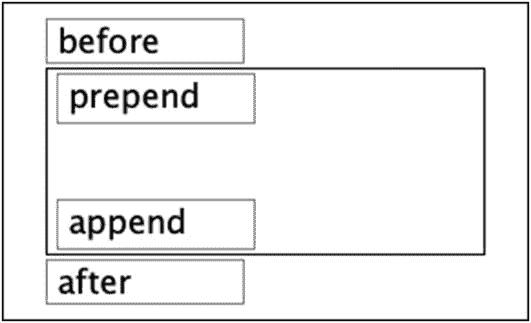

一个矩形说明了元素的放置方式。外部矩形分别在顶部和底部包括了“之前”和“之后”。内部矩形在顶部和底部则分别有“开头插入”和“末尾追加”。

**图 3-3** 放置元素

函数 `before()` 和 `after()` 的语法在英语中听起来有些别扭。表达式 `apple.before(banana)` 被解读为“对于 `apple`，将 `banana` 放在它之前”，这与初看时的理解可能正好相反。所有这四个提到的函数都以现有元素开头。

如果你查看现有代码，可能会经常看到 `appendChild()` 函数。它几乎与较新的 `append()` 函数相同。两者有一些区别，但大多数情况下，你可以任选其一使用。

例如，要在现有标题之后添加一个新图像，你可以这样写：

```
var h1 = document.querySelector('h1');
var img = document.createElement('img');
img.src = 'https://pure-javascript.net/random.jpg';
img.alt = '随机图像';
h1.after(img);
```

还有一个可选的单一函数，它可以通过一个包含位置的额外参数来实现上述所有四个函数的功能：`existingElement.insertAdjacentElement(position, newElement)`。位置是以下值之一：

* `'beforebegin'`：外部，在容器之前
* `'afterbegin'`：内部，在容器的开头
* `'beforeend'`：内部，在容器的末尾
* `'afterend'`：外部，在容器之后

图 3-4 展示了这些位置。

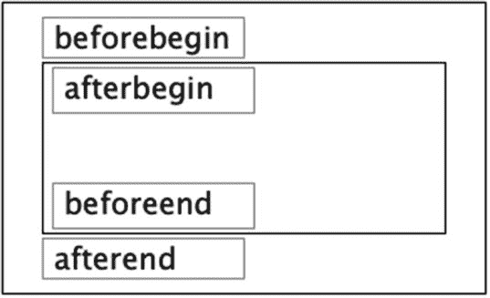

一个矩形代表了元素的相邻位置。外部矩形分别在顶部和底部包括了“开始之前”和“结束之后”。内部矩形的顶部和底部则分别是“开始之后”和“结束之前”。

**图 3-4** 插入相邻元素

使用这个函数，你可以这样写：

```
var h1 = document.querySelector('h1');
var img = document.createElement('img');
img.src = 'https://pure-javascript.net/random.jpg';
img.alt = '随机图像';
h1.insertAdjacentElement('afterend', img);
```

这当然不算更方便，但它可能符合你对模式感的追求。

### 直接添加 HTML

如果你创建一个元素只是为了直接将其添加到 DOM 中，你可以使用 `insertAdjacentHTML(position, html)` 这个快捷方式。该函数接受与 `insertAdjacentElement` 相同的位置值，但允许你使用 HTML 字符串来创建元素。对于以下示例，你可以使用相同的 `src` 和 `alt` 值：

```
var h1 = document.querySelector('h1');
var html = '';
h1.insertAdjacentHTML('afterend', html);
```

当然，你不需要 `html` 这个变量：

```
var h1 = document.querySelector('h1');
h1.insertAdjacentHTML('afterend', '');
```

……甚至在这种情况下，连 `h1` 变量也不需要：

```
document.querySelector('h1')
.insertAdjacentHTML('afterend', '');
```


### 但这开始变得难以管理了。

请注意，只有在后续的 JavaScript 代码中无需引用新元素时，使用`insertAdjacentHTML()`才有用，因为你没有获得新元素的引用。

### 添加更复杂的内容

到目前为止，我们一直在讨论创建一两个元素。使用`innerHTML`或`insertAdjacentHTML()`，你可以同样轻松地插入多个元素，例如这个包含多个条目的列表：

```
var h1 = document.querySelector('h1');
var ul = 'onezweitrois';
h1.insertAdjacentHTML('afterend', ul);
```

如你所知，JavaScript 有一种新的字符串字面量类型，即**模板字面量**。我们主要用它通过`${...}`符号来插值。然而，它的另一个特性是这种字符串字面量可以跨越多行编写：

```
var h1 = document.querySelector('h1');
var ul =
`
one
zwei
trois
`;
h1.insertAdjacentHTML('afterend', ul);
```

由于该字符串被视作 HTML，额外的间距和换行符在 HTML 中会被忽略，因此这些间距不会对结果产生任何影响。不过，它可能会让代码更易于阅读，而在其他情况下，间距和换行符则意义重大。

和之前一样，如果你只想添加元素，HTML 字符串就足够了，但你无法获得对它们的引用。另一方面，如果你需要在后续的 JavaScript 中引用它们，就必须逐个创建元素：

```
var h1 = document.querySelector('h1');
var heading = document.createElement('h2');
var message = document.createElement('p');
h1.insertAdjacentElement('afterend', message);
h1.insertAdjacentElement('afterend', heading);
heading.textContent = 'Message';
message.textContent = `The Time is ${new Date()}`;
```

在示例代码中，给标题和段落赋予更有意义的名称是合理的，因为代码稍后会在脚本中为它们分配内容。请注意，元素是按相反顺序添加的，因为它们是在`h1`元素之后立即插入的。在下一章 4 的幻灯片项目中，我们就会做这类事情。

## 总结

在本章中，我们研究了操作网页的一些技术。

### 文档对象模型

浏览器获取页面的 HTML 并将其渲染成文档。同时，它会生成一个名为文档对象模型的内部模型。DOM 以树状结构表示，以反映 HTML 的层级性质。JavaScript 包含许多用于导航和操作 DOM 的函数。可以通过添加或移除元素，以及更改单个元素来修改 DOM。

### 查找元素

有许多函数可用于在 DOM 中查找现有元素。其中一些函数已经存在了一段时间。现代浏览器都支持较新的函数`querySelector()`和`querySelectorAll()`，这极大地简化了定位元素的过程。这些函数使用 CSS 选择器来描述你要查找的元素。一旦定位到元素，就有函数用于引用 DOM 树中其他附近的元素：父元素、兄弟元素和子元素。

### 多个元素

有些函数，特别是`querySelectorAll()`，会返回一个元素集合，即使该集合为空或只有一个成员。要处理一个集合，你可以使用经典的`for( ... ; ... ; ... )`循环，或者使用更现代的`forEach()`函数来遍历这些元素。

### 创建元素

JavaScript 也可以创建新元素。你甚至可以创建在 HTML 中没有意义的元素，只要你不期望浏览器知道下一步该做什么。对于新创建的元素，你可以添加内容和属性，这些属性与 HTML 属性相匹配。使用相同的方法，你也可以对之前找到的现有元素执行此操作。新元素需要使用众多函数之一添加到 DOM 中。这些函数会将一个元素放置在另一个现有元素附近。你也可以直接添加 HTML，要么使用`innerHTML`添加到现有元素，要么使用`insertAdjacentHTML()`在创建新元素时添加。

### 接下来

我们已经了解了如何使用 JavaScript 来更改网页。在下一章中，我们将应用这些知识来创建图像幻灯片。在下一个项目中，我们将研究如何向页面添加额外的元素、更改现有元素的行为以及与 CSS 样式交互。我们还将学习如何处理 JavaScript 数组和对象。最后，我们将学习 JavaScript 如何响应键盘和鼠标事件。

## 4. 创建幻灯片

在这个项目中，我们将构建一个简单的图像幻灯片。该幻灯片将以预定义的速率循环播放一组预定义的图像。你可以通过鼠标和键盘来启动和停止它。在 `images` 文件夹中有一个 `slides` 文件夹，`slides` 文件夹中包含一组图像文件，它们都已准备好用于幻灯片展示。

幻灯片页面将类似于图 4-1。


幻灯片页面的屏幕截图。

图 4-1 图像幻灯片

幻灯片通过定期更改主图像的 `src` 属性来工作。

在这个项目中，我们将掌握以下技术：

*   定位元素
*   数组
*   拆分字符串以创建数组
*   预加载图像
*   取模运算
*   更改 HTML 元素的属性
*   响应用户事件
*   使用定时器函数

稍后你将看到的一件事是使用 CSS 实现某些动画效果。CSS 是定义 HTML 元素*外观*的编码语言，你可以使用 JavaScript 创建并应用额外的 CSS。如果你熟悉 CSS，那会很有帮助，但并非必需；你只需要一点信心就好。只需知道现代 CSS 可用于各种动画技巧，而这些技巧曾经依赖于额外的 JavaScript。这让你可以自由地专注于实现项目的逻辑，让 CSS 处理视觉方面。

## 幻灯片概述

HTML 的 `img` 元素定义了要显示的图像。通常，它采用以下形式：

```
`src` 属性是实际图像的 URL。
```

HTML 实际上并不包含图像，而是告诉浏览器从哪里获取它。通常，图像位于网站本地，但如果 URL 包含 `http://` 或 `https://` 协议，则它可以是远程图像。当浏览器遇到 `img` 标签时，它会发出一个请求，请求 `src` 属性中引用的图像。通常获取图像需要一些时间，因此浏览器会继续处理其余的 HTML。当图像从服务器到达时，浏览器会将其显示在为其保留的空间中。如果图像无法显示——例如原始图像丢失、加载时间过长，或者用户有视觉障碍并依赖文本——那么浏览器将改用 `alt` 文本。

还有另外三个常见属性：


# Markdown 排版后的内容

`title`是当鼠标悬停在图片上时可能显示的附加文本；它也有助于搜索引擎描述图片。`width`和`height`属性有助于浏览器在等待图片加载时为其创建合适的空间。它们也可以用于调整图片大小。

我们的幻灯片将通过更改`src`属性的值来循环显示一组图片，从而使浏览器重新加载新图片。

整个幻灯片将包含在以下结构中：

`div`元素是一个通用的块级容器。它通常用于布局。使用 CSS，使`div`看起来像一个图片容器。

## 准备 HTML

对于脚本编写，需要两个 JavaScript 链接：

```
Slide Show
...
```

与其他项目一样，`slideshow.js`文件将包含主要代码。然而，实际运行幻灯片的代码是你可能希望在其它项目中使用的代码；你在本书后面的幻灯片变体中也肯定会用到它。因此，这段代码将被放在`library.js`文件中以便重用。

另请注意，`library`文件不需要`defer`属性，因为它不会在页面加载时干扰或依赖于页面。

对于这个项目，你最好像引言中讨论的那样运行某种网络服务器。如果你直接在网页浏览器中加载文件，你应该移除`crossorigin="anonymous"`部分。

## JavaScript 大纲

为了方便起见，已经有一个名为`slideshow.js`的文件。它目前只包含标题块注释。

在此基础上，我们从主要的 JavaScript 大纲开始：

```
/*  Slide Show
================================================
================================================ */
'use strict';
window.onerror = function(message, url, line) {
alert(`Error: ${message}\n${url}: ${line}`);
};
init();
function init() {
}
```

在`library`文件中，我们可以添加一个函数来完成所有繁重的工作。这个函数需要被赋予图片集合以及放置它们的位置：

```
/*  doSlides(images, containerSelector)
================================================
Turns a container element into an slide show
with a collection of images.
================================================ */
function doSlides(images, containerSelector) {
}
```

`images`参数将是一个图片集合，而`containerSelector`参数将是图片*容器*的选择器字符串；在这种情况下，容器是`div`元素。

## 图片数组

当我们谈论集合时，通常指的是**数组**，它是一个带编号的集合。数组的一个例子是：

```
»   var fruit = ['apple', 'banana', 'cherry', 'date'];
```

每个项目的编号被称为其**索引**。在 JavaScript 中，索引从`0`开始，因此上面显示的索引是`0`、`1`、`2`和`3`。

你需要知道的一件事是有多少项目。在 JavaScript 中，这是数组的`length`属性：

```
»   console.log(fruit.length);
```

请注意，由于索引从`0`开始，所以长度*比*最后一个索引*大一*。

对于我们的项目，我们将使用一个图片名称的数组。我们将把它放到`slideshow.js`文件中的`init()`函数里。然后，我们将该变量发送给`doSlides()`函数。

```
function init() {
let images = [
'bamboo.jpg', 'bird.jpg', 'bromeliad.jpg',
'bush-panorama.jpg', 'canal.jpg', 'church.jpg',
'cityscape.jpg', 'emu.jpg', 'gum-nuts.jpg',
'hanging-rock.jpg', 'hut.jpg', 'koala.jpg',
'kookaburra.jpg', 'lake.jpg', 'lantern.jpg',
'light-house.jpg', 'lorikeet.jpg', 'mountain-panorama.jpg',
'rocks.jpg', 'rose.jpg', 'steps.jpg',
'sunset.jpg', 'tall-trees.jpg', 'tea-leaf.jpg',
'train.jpg','waterfall.jpg'
];
}
```

图片很多，我们不得不将列表写成多行。在某些情况下，每行写一个项目可能更有意义。如果你不想手动输入，这个数组有一个代码片段。

当然，这并不是真正的图片集合。它是一个文件名的集合，我们需要在后面的代码中通过将`images/slides/`文件夹添加到文件名中，并将其放入`src`属性中，将其转换为实际的图片。

你可能会认为让 JavaScript 管理如此大的集合风险太大或不便。稍后，我们将学习 JavaScript 如何使用 Ajax 从外部文件读取此列表。

使用这个集合，你将在`library`中调用`doSlides()`函数，为其提供图片集合和对容器的引用：

```
//  slideshow.js
function init() {
let images = [...];
doSlides(images, 'div#slides');
}
```

`div#slides`字符串与 CSS 选择器相同，意思是“`id`为`slides`的`div`”。然后，JavaScript 将使用此字符串在`document.querySelector()`函数中定位实际的元素。

## 填充图片

目前，`img`元素是空的，因为没有有效的`src`值。我们将在代码中更改这一点。

首先，你需要实际获取容器元素以及内部的`img`元素：

```
//  library.js
function doSlides(images, containerSelector) {
//  Elements
let container = document.querySelector(containerSelector);
let img = container.querySelector('img');
}
```

`container`变量将引用包含`div`元素，这对于幻灯片更复杂的部分很重要。`img`变量将引用实际的`img`元素，我们将设置其`src`属性。

通常，你会使用`document.querySelector()`来定位元素，就像我们对`container`元素所做的那样。这会在整个文档中搜索第一个匹配项。但是，你也可以将搜索限制在特定元素内部，就像我们对`img`元素所做的那样：`container.querySelector()`将只在`container`元素内部搜索。这不仅稍微快一些，因为 JavaScript 不必在错误的位置查找，而且还会忽略我们不感兴趣的其他`img`元素。

填充图片就是设置`img`元素的`src`属性。我们可以用一个特定的图片来尝试：

```
function doSlides(images, containerSelector) {
//  Elements
let container = document.querySelector(containerSelector);
let img = container.querySelector('img');
img.src = 'images/slides/bamboo.jpg';
}
```

由于`images`数组只有文件名，我们添加了这些图片相对于网站根目录的路径。这使得代码更加灵活，因为我们可以轻松更改图片的位置，而无需更改集合本身。

如果你重新加载页面，你应该能看到图片。

因为我们有整个图片集合，所以应该使用数组中的其中一个：

```
function doSlides(images, containerSelector) {
//  Elements
let container = document.querySelector(containerSelector);
let img = container.querySelector('img');
img.src = `images/slides/${images[0]}`; //  ← backticks
}
```

注意不同的引号（`` ` ... ` ``），即所谓的反引号。这种字符串类型被称为**模板字面量**。对于普通文本，其效果与单引号或双引号相同，但模板字面量允许你在`${...}`语法中嵌入值和计算。

这里，我们硬编码了路径，但插入了实际的图片文件名。

如果你重新加载页面，你应该能看到相同的图片。至少你会看到它是有效的。

当然，你会希望为每个新图片重复设置`img.src`，所以最好将其放在一个函数内。


```javascript
function doSlides(images, containerSelector) {
  //  元素
  let container = document.querySelector(containerSelector);
  let img = container.querySelector('img');
  next();
  function next() {
    //  填充图片
    img.src = `images/slides/${images[0]}`;
  }
}
```

将其放入函数后，你就可以重复调用这段代码。你还可以延迟一小段时间再调用它：

```javascript
function doSlides(images, containerSelector) {
  ...
  setTimeout(next, 3000);
  //  next();
  ...
}
```

`setTimeout()` 函数接收一个要调用的函数引用（`next`）和等待的毫秒数（`3000`）。你有时也可能会看到它写作 `windows.setTimeout()`。这里，我们等待了三秒才调用该函数。现在，如果你重新加载页面，图片将在三秒后出现。请注意，函数的*引用*是 `next`，不带括号。如果你想要函数的*结果*，则需要使用括号（`next()`）。在这里，我们不需要结果，只需要函数本身。

当然，`next()` 函数仍然是硬编码显示第一张图片（索引 `0`）。要遍历图片集合，你需要：

- 设置一个索引变量。我们将使用变量 `slideNumber`，并在一个新的“变量”部分中设置它。
- 使用该变量。这将替换 `images` 数组中的索引 `0`。
- 递增变量的值。我们可以使用递增运算符来实现：`slideNumber++`。
- 重复调用该函数。`setTimeout()` 函数在延迟后*仅*调用 `next` 函数*一次*。这就是为什么你访问网站后一小段时间会弹出恼人对话框的原因。要重复调用该函数，你需要将其替换为 `setInterval()`。

```javascript
function doSlides(images, containerSelector) {
  //  元素
  let container = document.querySelector(containerSelector);
  let img = container.querySelector('img');
  //  变量
  let slideNumber = 0;
  //  setTimeout(next, 3000);
  setInterval(next, 3000);
  //  next()
  function next() {
    //  填充图片
    img.src = `images/slides/${images[slideNumber]}`;
    slideNumber++;
  }
}
```

表达式 `slideNumber++` 比使用 `slideNumber = slideNumber + 1` 更方便，如果将其与前一个表达式结合使用，则*更加*方便：

```javascript
function next() {
  //  填充图片
  img.src = `images/slides/${images[slideNumber++]}`;
}
```

在这个表达式中，`slideNumber++` 被称为**后递增**运算符，因为变量是在其值被使用*之后*才递增的。**前递增**运算符 `++slideNumber` 则会在变量值被使用之前就递增它。还有**递减**运算符（`--`）。如果你运行这个版本，它可以工作，但你最终会看到一个新问题。（如果“最终”等待时间太长，你可以将延迟缩短到，比如 1000，以便更快地看到问题。）代码会一直执行到超出数组末尾。`slideNumber` 的值会不断递增，超过数组的上限，因此从那里开始你会得到 `undefined`。你实际上看不到 `undefined`，但你会看到图片现在缺失了。

这需要在到达末尾时重置 `slideNumber`：

```javascript
function next() {
  //  填充图片
  img.src = `images/slides/${images[slideNumber++]}`;
  //  循环播放
  if (slideNumber >= images.length) slideNumber = 0;
}
```

请记住，数组的 `length` 比最后一个索引*大*1，因此当你达到该值（`slideNumber == images.length`）时，你已经越界了。作为一种策略，你应该始终检查是否已经越界得更远（`slideNumber >= images.length`），以防你之前错过了它。例如，你已经知道，重复添加 `0.1` 并不总能得到一个简单的结果。这可以实现功能，但有两个改进你可以轻松做到。首先，在第一张图片显示之前有一个延迟；其次，幻灯片之间的延迟应该更具可配置性。

## 显示第一张幻灯片

`setInterval()` 函数会等到延迟结束后才调用 `next()` 函数。你可以通过在开始时调用 `next()` 函数来立即显示第一张幻灯片：

```javascript
function doSlides(images, containerSelector) {
  ...
  setInterval(next, 3000);
  next();
  ...
}
```

现在，这将从第一张幻灯片开始，后续幻灯片循环播放。

## 更改延迟

作为一项原则，你不应该在代码中间硬编码任意值。最好尽早在一个变量中设置该值。在这种情况下，延迟的实际值对代码逻辑并不重要，因此我们将其放在一个函数参数中，让调用代码来决定它应该是什么。

在主代码中，将延迟作为附加参数包含在内：

```javascript
//  slideshow.js
function init() {
  let images = [...];
  doSlides(images, 'div#slides', 3000);
}
```

在 JavaScript 中，包含函数未期望的额外函数参数并不是错误。这与其他大多数编程语言不同。这意味着，如果你在不做任何其他更改的情况下尝试这段代码，它可以工作：`doSlides()` 函数将简单地忽略这个额外值。

当然，额外的值不是用来被忽略的，因此在库函数中，包含一个额外的参数变量：

```javascript
//  library.js
function doSlides(images, containerSelector, delay=3000) {
  ...
}
```

第三个参数包含一个默认值：如果调用函数省略了第三个参数，则使用此值。这确保了旧行为仍然不变，因为最初第三个参数不是必需的。当对函数进行改进时，你应该始终尝试保持与早期版本的行为兼容性。在这里，我们包含了默认值，这样即使没有添加额外的参数，它的工作方式仍与以前相同。显然，在这种情况下，`slideShow()` 函数仍在开发中，所以无需担心兼容性问题。不过，我们还是走了一遍这个过程以阐明这一点。

最后，在 `setInterval()` 函数中使用变量而不是硬编码的值：

```javascript
function doSlides(images, containerSelector, delay=3000) {
  ...
  setInterval(next, delay);
  next();
  ...
}
```

为了测试目的，你可以通过使用较短的延迟值来加快幻灯片播放，例如使用 `doSlides(images, 'div#slides', 1000);` 或更短。

## 停止和启动幻灯片播放

你可能已经对幻灯片播放开始感到厌烦了。如果你让用户忍受不可停止的动画，就像过去的动态 `gif` 那样，这肯定会惹恼用户。你至少可以做到的是让用户有机会暂停幻灯片播放，这比强迫用户前往其他网站要好得多。虽然你可以编写代码在鼠标悬停在图片上时暂停幻灯片播放，但这并不是最自然的方法。最好提供一个按钮来暂停。同一个按钮也将恢复幻灯片播放。一个在两种状态（运行和暂停）之间切换的按钮通常被称为**切换开关**。稍后，我们将使用 JavaScript 添加一个真正的按钮。现在，我们可以使用图片本身作为一个按钮。

要实现一个切换开关，我们将采取以下步骤：

- 创建一个变量来保存当前状态。
- 创建一个函数，根据当前状态暂停或恢复幻灯片播放。


# 排版后的文本

设置函数以响应图片的点击事件。

## 状态变量

首先，我们将添加一个新变量 `running`：

```
function doSlides(images, containerSelector, delay=3000) {
//  元素
...
//  变量
let slideNumber = 0;
let running;    //  未定义
...
}
```

JavaScript 中的所有变量在诞生之初都会被赋予一个特殊值 `undefined`。这个词语容易让人困惑，因为它并不意味着该变量是*未定义的*。`undefined` 是一个特殊值，用于表示你尚未给变量赋值。其他编程语言没有这个特殊值，如果你在变量被赋予实际值之前尝试使用它，这些语言会报错。

要设置状态变量，请将 `setInterval()` 函数的返回值赋值给它：

```
function doSlides(images, containerSelector, delay=3000) {
...
running = setInterval(next, delay);
next();
...
}
```

在 JavaScript 中，所有函数都会返回一个值。如果没有特定的 `return` 语句，函数将返回 `undefined`。你可以使用这个返回值（例如将其赋值给一个变量），也可以像我们之前做的那样完全忽略返回值。`setInterval()` 原则上可用于多个函数。每次调用都会创建一个所谓的“定时器”。`setInterval()` 的返回值是 `intervalID`，即对新创建定时器的引用。这是为了让你在需要时能够清除该定时器——这正是我们暂停幻灯片播放的方式。我们之前使用的 `setTimeout()` 函数也以相同方式工作，你可以使用其返回值来取消一个延迟的函数调用。

## 切换函数

由于我们预计会多次停止和启动幻灯片播放，因此不再适合在开始时立即启动一次。相反，我们应该将这个流程封装在另一个函数中，并在需要时调用该函数。在本例中，我们将其命名为 `toggle()` 函数：

```
function doSlides(images, containerSelector, delay=3000) {
...
//  setInterval 已被移动到 toggle() 内部：
next();
function toggle() {
running = setInterval(next, delay);
next();
}
function next() {
...
}
}
```

从技术上讲，并不需要在 `next()` 函数*之前*定义 `toggle()` 函数；JavaScript 会在实际运行代码之前处理所有函数定义。即使你决定*在之后*定义它，这也没有影响。但在控制台中编写代码时情况并非如此。由于控制台无法预知你接下来要输入什么，你需要先定义所有将要引用的内容。

`toggle()` 函数的作用是：如果幻灯片尚未播放则启动它，如果正在播放则停止它。这需要使用 `if ... else` 语句：

```
function toggle() {
if(!running) {
running = setInterval(next, delay);
next();
}
else {
}
}
```

请记住，`if()` 不仅会测试`true`值，还会测试“有值”的情况，例如非零数字或非空字符串。特殊的 `undefined` 值绝对算作“无值”，因此 `!running` 会测试 `running` 是否为 `undefined`。

要停止幻灯片播放，你可以使用 `clearInterval()` 函数，该函数将之前保存的定时器 ID 作为参数。你还必须重置 `running` 的值以供下次使用。

```
function toggle() {
if(!running) {
...
}
else {
clearInterval(running);
running = undefined;
}
}
```

事实证明，`clearInterval()` 函数会返回 `undefined`。我们可以利用这一点，将其返回值直接赋值给 `running` 变量：

```
function toggle() {
if(!running) {
...
}
else {
running = clearInterval(running);
}
}
```

此时，如果你测试代码，会发现点击图片不会产生任何效果。

## 点击图片

现在，我们将让点击图片来暂停或继续幻灯片播放，实际上就是将图片变成一个大的按钮。用户的动作，例如鼠标点击或键入字符，被称为**事件**。响应事件的代码被称为**事件监听器**。事件监听器总是一个函数。在这里，我们将 `toggle` 函数作为 `img` 元素的事件监听器。

设置事件监听器通常有两种方法。经典方法是直接设置某个事件监听属性：

```
function doSlides(images, containerSelector, delay=3000) {
...
img.onclick = toggle;
next();
...
}
```

如果你尝试这样做，幻灯片播放将不会立即开始，因为它现在正在等待你点击图片。`onclick` 事件监听器属性会在你点击该元素（或在触摸屏上触摸该元素）时触发。再次提醒，使用 `toggle` 函数时不要加括号，因为你是在引用该函数，而（尚）未调用它。请克制住将属性拼写为 `onClick` 的冲动。JavaScript 会接受这个赋值，但由于名称是区分大小写的，它不会对 `click` 事件做出反应。同样的情况也适用于 `onlick`，这是一个极其常见的拼写错误。还有许多其他可用的事件监听属性，例如 `.onmouseover` 用于检测鼠标悬停在元素上，或 `.onkeyup` 用于检测键盘活动。

以这种方式添加事件监听器很简单，但它有一些缺点：

*   这种方式只能添加一个事件监听器。
*   如果该元素位于另一个带有事件监听器的元素内部，你无法控制哪个事件先触发。
*   某些（较新的）事件类型没有像 `onclick` 这样简单的事件监听属性。

一种更新、更全面的方法是使用 `addEventListener()` 函数：

```
function doSlides(images, containerSelector, delay=3000) {
...
img.addEventListener('click', toggle);
next();
...
}
```

在这种情况下，使用 `.onclick` 属性并没有什么特别的缺点，许多 JavaScript 开发者可能更喜欢 `.onclick` 方法。但在这里，我们将使用更新的方法，以备将来需要其灵活性。`addEventListener()` 函数还可以带有额外的选项来控制其行为。这里还有另一个关于拼写的要点。实际的事件类型叫做 `click`，这就是你在 `addEventListener()` 函数中输入的内容。而事件监听器*属性*则叫做 `.onclick`。再次强调，你不能搞错拼写。

此时，幻灯片播放会通过调用 `next()` 函数加载第一张图片。然后它将等待用户点击图片来启动播放。如果你希望它立即开始，可以将 `next()` 函数调用替换为 `toggle()`：

```
function doSlides(images, containerSelector, delay=3000) {
...
img.addEventListener('click', toggle);
//  next();     //  等待用户启动
toggle();       //  立即启动
...
}
```

在这里，`next()` 函数调用被注释掉了，而不是删除掉。这样，就可以很容易地在两种行为之间进行选择。

### 预加载图片

你可能正在自己的电脑上测试所有这些功能，因此不会感受到通过互联网加载时的任何延迟。在实际应用中，用户最初会因浏览器获取下一张图片而经历一次额外的暂停。不过，这种暂停在第一轮之后就消失了。

造成这种行为的原因如下：

*   首先，图片通过互联网传输需要一点时间。
*   为了消除后续等待，浏览器会将图片的副本保存在一个称为**缓存**的本地区域。*下一次*需要同一张图片时，它将从缓存中获取，因此你不会再遇到同样的暂停。


### 消除首次等待图像的技巧  
如果你想消除首次加载图像时的等待时间，技巧是在需要图像之前就提前获取它，这样它就能被添加到缓存中，供后续使用。这种方法被称为**预取**（`prefetch`）。

要预取图像，我们首先创建一个图像对象。该对象不会被显示，仅存在于内存中。当我们显示一张图像时，也会用数组中的下一张图像填充这个新对象。当用户查看当前图像时，加载图像的延迟就会被吸收。

---

### 创建图像对象  
为了创建一个新的图像对象，我们调用一个名为`Image()`的特殊函数：

```javascript
function doSlides(images, containerSelector, delay=3000) {
  //  元素
  // ...
  let prefetch = new Image();
  // ...
}
```

`Image()`函数被称为**构造函数**，用于创建一个**对象**。对象是数据的封装包。有许多内置的构造函数，例如`Date()`用于创建处理日期和时间的对象。你也可以创建自己的构造函数来定义自定义对象。

构造函数通过特殊的`new`关键字调用。通常，圆括号内会包含额外的参数来帮助设置对象。如果没有参数需要提供，你可以省略括号直接调用构造函数：`let prefetch = new Image;`。此外，还有一些用于创建对象的函数不是构造函数，例如稍后会遇到的`createElement()`。它们有自己的创建对象的方式。

---

### 设置`src`属性  
与此同时，`prefetch`对象将作为虚拟图像仅存在于内存中。我们想对它做的唯一操作就是设置它的`src`属性，以强制浏览器加载另一张图像。这部分操作位于`next()`函数内部：

```javascript
function next() {
  //  填充当前图像
  img.src = `images/slides/${images[slideNumber++]}`;
  //  循环播放
  if(slideNumber >= images.length) slideNumber = 0;
  //  预取
  prefetch.src = `images/slides/${images[slideNumber]}`;
}
```

这里，你首先递增幻灯片编号（`slideNumber++`），然后使用这个新值来填充`prefetch`。如果你在复制粘贴代码，请记住**不要**再次递增`slideNumber`。

---

## 向文档添加按钮  
通过点击图像来暂停幻灯片播放是可行的，但你可能会觉得应该有一个真正的按钮。此时，你需要做一个设计决策。  
一个好的 JavaScript 脚本应尽可能不引人注目，并尽量减少对 HTML 的依赖。HTML 已经为图像提供了一个容器，但不应要求它提供更多内容，例如额外的按钮。你甚至可以考虑让 HTML 提供更少的内容。

我们不会在 HTML 中定义按钮，而是使用 JavaScript 创建一个按钮，并将其插入到合适的位置。我们还将通过 JavaScript 来设置它的文本。

### 创建按钮元素  
首先，使用`document.createElement()`创建一个`button`元素：

```javascript
function doSlides(images, containerSelector, delay=3000) {
  //  元素
  // ...
  //  添加按钮
  let button = document.createElement('button');
  //  变量
  // ...
}
```

`document.createElement()`函数会创建一个`button`元素，但它目前仅存在于内存中。稍后我们会将其移动到实际的文档中。在此之前，我们需要为它提供一些基本属性：

```javascript
function doSlides(images, containerSelector, delay=3000) {
  // ...
  //  添加按钮
  let button = document.createElement('button');
  button.id = 'run-button';
  button.textContent = 'Start';
  // ...
}
```

`textContent`属性设置了页面上显示的内容。我们会在暂停或恢复幻灯片播放时更改它。  
`id`属性并非严格必需，因为我们不需要它来使按钮工作。但是，如果你想控制它的外观，就需要在 CSS 中定位它。附带的 CSS 文件包含了针对`button#run-button`的样式规则；当然，你可以使用任何你喜欢的`id`，只要相应地修改 CSS 即可。

### 绑定事件监听器  
按钮的主要作用是暂停和恢复幻灯片播放，因此我们将像处理图像那样，为它绑定事件监听器：

```javascript
function doSlides(images, containerSelector, delay=3000) {
  // ...
  img.addEventListener('click', toggle);
  button.addEventListener('click', toggle);
  // ...
}
```

### 将按钮添加到文档  
最后，我们需要将按钮元素添加到文档中。按钮可以放在很多位置，但将其放置在包含`img`元素的`div`元素附近是合理的。这可以通过`insertAdjacentElement()`函数轻松实现。  
我们在第三章中已经了解过`insertAdjacentElement()`函数。

在我们的例子中，我们将按钮添加到容器内部的末尾：

```javascript
function doSlides(images, containerSelector, delay=3000) {
  // ...
  let button = document.createElement('button');
  button.id = 'run-button';
  button.textContent = 'Start';
  container.insertAdjacentElement('beforeend', button);
  // ...
}
```

如果你看不清新按钮，可以将鼠标移到容器右下角按钮的模糊图像上。CSS 负责将按钮定位在图像上方、使其变暗，并在鼠标悬停时高亮。相关的 CSS 部分如下所示：

```css
button#run-button {
  /* ... */
  position: absolute;
  bottom: 1em; right: 1em;
  opacity: .2;
  transition: opacity 500ms;
}
button#run-button:hover {
  opacity: 1;
}
```

此时，你可能会决定不再需要让整个图像作为按钮：

```javascript
//  img.addEventListener('click', toggle);
```

该语句被注释掉而不是删除，以防你后续还想使用它。  
现在的问题是按钮的文本令人困惑。

### 更改按钮文本  
按钮的初始文本显示`Start`。当幻灯片正在播放时，它应变为`Stop`；当暂停时，应变回`Start`。这个操作应在`toggle()`函数中完成：

```javascript
function toggle() {
  if(!running) {
    running = setInterval(next, delay);
    next();
    button.textContent = 'Stop';
  }
  else {
    running = clearInterval(running);
    button.textContent = 'Start';
  }
}
```

这样，按钮的显示就更有意义了。

---

## 更改外观  
当幻灯片暂停或播放时，你可以使用 CSS 更改其外观。思路是使用 CSS 类。  
在 CSS 中，**类**（`class`）可用于描述元素的变体。你可以让多个元素拥有相同的类，此时 CSS 会将相同的属性应用于它们。  
通过 JavaScript，你可以为元素分配或取消分配一个类。CSS 随后会相应地应用或移除类的属性。在旧版本的 JavaScript 中，你需要使用`.className`属性。  
然而，这已被`classList`属性所取代，后者允许分配多个类，并且更容易操作。

要为元素添加一个类，使用`.classList.add(...)`并传入类名；要移除一个类，使用`.classList.remove()`：

```javascript
function toggle() {
  if(!running) {
    running = setInterval(next, delay);
    next();
    button.textContent = 'Stop';
    container.classList.add('running');
  }
  else {
    running = clearInterval(running);
    button.textContent = 'Start';
    container.classList.remove('running');
  }
}
```

相关的 CSS 部分如下：

```css
div#slides {
  outline: medium solid #666;
}
div#slides.running {
  outline-color: black;
}
```

你将看到，当幻灯片暂停或播放时，CSS 会改变边框的颜色。

---

## 响应按键事件  
我们已经添加了一个按钮来暂停和恢复幻灯片播放，但如果能通过按键来实现会更方便。这里，我们可以使用空格键。

如果你拥有表单输入或`textarea`元素，可以在该元素内设置事件监听器来响应特定的按键。在本例中，我们希望整个文档能响应空格键，因此我们将事件监听器分配给文档本身：

```javascript
document.onkeypress = /* ... */;
```


事件监听器是针对`keypress`事件的，这里我们可以使用简单的形式。如前所述，事件监听器总是一个函数，例如`toggle`函数。在这种情况下，我们需要一个不同的函数，先测试按下了哪个键，然后再调用`toggle`函数。

到目前为止，我们通过名称创建了一个函数，并将其作为事件监听器进行赋值，就像这样：

```
button.onclick = toggle;
function toggle() {
}
```

如果你稍后要再次使用这个函数，以这种方式定义函数是很有用的。然而，你也可以在不单独定义函数的情况下做同样的事情：

```
button.onclick = function() {
}
```

这被称为**函数表达式**。注意这个函数没有名字，这种情况下它被称为匿名函数。你也可以给它一个名字：

```
button.onclick = function toggle() {
}
```

但是，这个名字只能在函数内部使用，所以你不太会经常看到这种模式。

对于`keypress`事件，我们将使用同样的思路来创建事件监听器，而不单独创建一个函数：

```
function doSlides(images, containerSelector, delay=3000) {
...
document.onkeypress = function(event) {
};
function toggle() {
...
}
...
}
```

注意这个函数也有一个参数。所有事件监听器都会接收一个特殊的`event`对象作为参数，但在许多情况下，你不会去理会它。你可以给它起任何名字，但你通常会看到它被命名为`event`、`e`，甚至`evt`。JavaScript 允许你忽略传入的参数值，正如我们目前所做的那样。但这一次，我们将需要它。

`event`对象包含关于事件的各种信息，比如事件发生时鼠标的位置、是否同时按下了 Shift 键，以及是哪个键触发了事件。按下的键位于`.key`属性中，我们可以用一个简单的`if()`来测试它：

```
document.onkeypress = function(event) {
if(event.key == ' ') {
}
};
```

这里，我们只对空格键感兴趣，所以我们只使用一个包含空格的字符串（`' '`）。

此时，如果测试通过，我们就可以调用 toggle 函数：

```
document.onkeypress = function(event) {
if(event.key==' ') {
toggle();
}
};
```

然而，浏览器通常对某些按键有自己的响应方式，这可能会干扰我们的计划。我们可以通过使用`event.preventDefault()`函数告诉浏览器不要再继续响应，从而完全接管其行为：

```
document.onkeypress = function(event) {
if(event.key==' ') {
toggle();
event.preventDefault();
}
};
```

现代 JavaScript 有一种编写函数表达式的替代方法：

```
document.onkeypress = event => {
if(event.key==' ') {
toggle();
event.preventDefault();
}
};
```

这被称为**箭头函数**表达式，原因显而易见。箭头函数语法简洁，这使得它们非常适合编写事件处理程序。它们也缺少传统函数的一些特性，这在更复杂的代码中反而可能是一个优势。在这种情况下，使用箭头语法并没有实际的好处，但你会逐渐发现事件监听器越来越多地以这种方式编写。

## 添加说明文字

现在我们可以为每个图像添加描述性的说明文字。这些说明文字将包含在图像名称数组中，并通过 JavaScript 创建的特殊段落元素来显示。

## JavaScript 对象

到目前为止，`images`数组只包含图像名称的条目。如果我们想要包含说明文字，每个条目都需要稍复杂一些。

**对象**是一个数据包。JavaScript 有许多预定义的对象，但你可以通过定义一组对象属性来创建自己的对象：

```
»   var apple = {
shape: 'round',
colour: 'red'
};
```

这被称为**对象字面量**，因为你是在代码本身中定义属性。在 JavaScript 中，对象字面量包含在大括号（`{ ... }`）内，看起来就像代码块，但其实不是。事实上，大括号用于两种不同的事情可能会导致 JavaScript 误解某些代码。

对象的每个属性可以通过`object.property`读取：

```
»   console.log(apple.colour);
```

你也可以更改属性的值：

```
»   apple.colour = 'green';
```

在编写对象属性时要小心。默认情况下，JavaScript 允许你即时创建新属性，这并不总是你的本意。例如：

```
apple.Colour = 'green';
```

将会创建一个名为`Colour`的新属性，因为属性名和 JavaScript 的其他部分一样，是区分大小写的。

当然，你也可以在一行内编写对象字面量：

```
»   var banana = { shape: 'long', colour: 'yellow' };
```

如果你要创建许多具有相同属性但不同值的对象，你可以创建一个构造函数来自动完成：

```
»   function Fruit(shape, colour) {
this.shape = shape;
this.colour = colour;
}
»   var cherry = new Fruit('small', 'black');
```

关于创建构造函数，我们在这里就不再深入讨论了。

## 重新审视图像集合

我们可以使用一个对象数组，而不是字符串数组，每个对象将包含图像的名称及其说明文字。每个对象可以采取以下形式：

```
{
src: '...',
caption: '...'
}
```

其中`src`属性是图像的名称，`caption`属性是说明文字。我们可以将这个新数组命名为`images2`，以区别于原始集合。

通过将每个对象写在一行，图像数组现在变成：

```
let images2 = [
{ src: '...', caption: '...' },
{ src: '...', caption: '...' },
{ src: '...', caption: '...' }
];
```

你现在可以在示例项目中像这样定义 images 数组：

```
let images = [ ... ];
let images2 = [
{ src: 'bamboo.jpg',
caption: '日本竹林' },
{ src: 'bird.jpg', caption: '飞翔的鸟' },
{ src: 'bromeliad.jpg', caption: '凤梨花' },
{ src: 'bush-panorama.jpg',
caption: '澳大利亚灌木丛全景' },
{ src: 'canal.jpg', caption: '荷兰运河' },
{ src: 'church.jpg',
caption: '布里斯班夜晚的老教堂' },
{ src: 'cityscape.jpg', caption: '日本城市' },
{ src: 'emu.jpg', caption: '澳大利亚鸸鹋' },
{ src: 'gum-nuts.jpg', caption: '一些桉树果' },
{ src: 'hanging-rock.jpg',
caption: '维多利亚州的岩石露头' },
{ src: 'hut.jpg', caption: '古老的丛林小屋' },
{ src: 'koala.jpg',
caption: '一只做着考拉平常事的考拉……' },
{ src: 'kookaburra.jpg',
caption: '一只回头的笑翠鸟' },
{ src: 'lake.jpg', caption: '日本的一个湖泊' },
{ src: 'lantern.jpg',
caption: '日本神社的灯笼' },
{ src: 'light-house.jpg', caption: '一座灯塔' },
{ src: 'lorikeet.jpg',
caption: '澳大利亚吸蜜鹦鹉' },
{ src: 'mountain-panorama.jpg',
caption: '日本的山脉全景' },
{ src: 'rocks.jpg', caption: '湖中的岩石露头' },
{ src: 'rose.jpg', caption: '一朵黄玫瑰' },
{ src: 'steps.jpg',
caption: '花园中的石阶' },
{ src: 'sunset.jpg', caption: '云中日落' },
{ src: 'tall-trees.jpg',
caption: '澳大利亚灌木丛中的树木' },
{ src: 'tea-leaf.jpg',
caption: '一片茶树叶子' },
{ src: 'train.jpg',
caption: '进站的火车' },
{ src: 'waterfall.jpg',
caption: '林间瀑布' }
];
```

为了减少你的输入量，这里也提供了这个数组的代码片段。

在`slideshow.js`文件中，你可以修改函数调用以使用`images2`数组：

```
doSlides(images2, 'div#slides', 3000);
```

当然，你现在已经破坏了代码。

## 使用对象属性


现在每个项目不再只是图片的名称，而是包含名称和标题的对象。要读取名称，你需要使用 `images[...].src`。这将位于求值表达式 `${images[...].src}` 中：

```
function next() {
//  填充图片
//  img.src = `images/slides/${images[slideNumber++]}`;
img.src = `images/slides/${images[slideNumber++].src}`;
//  循环播放
if(slideNumber>=images.length) slideNumber = 0;
//  预加载
//  prefetch.src = `images/slides/${images[slideNumber]}`;
prefetch.src = `images/slides/${images[slideNumber].src}`;
}
```

至少幻灯片又可以正常工作了。

## 添加标题

下一步是创建一个段落元素来包含标题，并在适当的时候填充它。

为了创建段落元素，我们将使用与创建按钮相同的技术：

```
function doSlides(images, containerSelector, delay=3000) {
//  元素
...
//  添加标题
let caption = document.createElement('p');
container.insertAdjacentElement('beforeend', caption);
//  变量
...
}
```

在这里，段落被添加到了容器的末尾，位于之前添加的按钮之后。CSS 负责在容器中定位新的段落并定义其外观，例如文本居中并加粗。

剩下的工作就是让 `next()` 函数来填充标题：

```
function next() {
//  填充图片
img.src = `images/slides/${images[slideNumber].src}`;
caption.textContent = images[slideNumber++].caption;
...
}
```

注意，表达式 `slideNumber++` 已被移到标题语句中。这是因为你不想在旧值使用完毕之前递增 `slideNumber`。如果你愿意，下面的写法可能更清晰：

```
function next() {
//  填充图片
img.src = `images/slides/${images[slideNumber].src}`;
caption.textContent = images[slideNumber].caption;
slideNumber++;
...
}
```

同时，你还可以设置图片本身的 `title` 属性，以及 `alt` 属性，你可以将它们设置为相同的内容：

```
function next() {
//  填充图片
img.src = `images/slides/${images[slideNumber].src}`;
caption.textContent = images[slideNumber].caption;
img.title = images[slideNumber].caption;
img.alt = images[slideNumber].caption;
slideNumber++;
...
}
```

图片的 `title` 属性通常不会显示，但如果你将鼠标悬停在上面，它会显示为工具提示。

## 总结

在本章中，我们通过一个图片幻灯片示例，学习了操作网页内容的技术。在此过程中，我们掌握了许多技能。

### 组织代码

我们将实际的幻灯片代码放在了 `library.js` 文件中，以便可以重复使用。该函数还接受一个图片集合和幻灯片容器的 CSS 选择器，以使其尽可能灵活。

### 定位元素

我们使用 `.querySelector()` 函数来定位幻灯片容器以及其中的 `img` 元素。

### 数组

数组是一个编号的项目集合。你可以通过数组字面量创建一个数组：

```
var fruit = ['apple', 'banana', 'cherry'];
```

数组从 0 开始编号。你可以使用 `.length` 属性获取项目数量。你可以使用方括号中的索引从数组中获取单个项目：`fruit[1]`。

### 操作图片元素

在 HTML 中，图片出现在 `img` 元素中。在 JavaScript 中，我们通过更改其 `.src`、`.alt` 和 `.title` 属性来操作该元素。一旦 `.src` 属性被更改，浏览器会立即尝试重新加载图片。

### 延迟和重复函数

JavaScript 有 `setTimeout()` 函数来延迟调用函数一段时间。还有 `setInterval()` 函数用于重复调用函数。在这两种情况下，都可以从这些函数的返回值中设置一个变量，以便我们取消它们。

### 启动与停止

使用 `setTimeout()` 函数返回的变量，我们可以跟踪幻灯片是否正在运行，并用它来调整内容的外观。我们还可以使用这个变量来管理一个切换按钮。该按钮用于通过运行 `setTimeout()` 来启动幻灯片，或者如果它已经在运行则取消它。

### 事件处理程序与创建元素

通过设置事件监听器来响应点击，任何 HTML 元素都可以充当按钮。我们首先对图片元素执行了此操作。我们还可以使用 `document.createElement()` 创建额外的按钮元素。通过添加 `.id` 属性，我们可以让 CSS 对其进行样式设置。然后为该按钮分配了一个点击事件处理程序。还可以为文档本身分配一个键盘事件监听器。我们这样做了，以监听空格键来切换幻灯片。

### 预加载图片

通过网络获取图片可能需要一些时间，这可能会导致幻灯片暂停。我们创建了一个虚拟图片来包含数组中的下一张图片。这允许浏览器在访问者观看前一张图片时获取并缓存下一张图片。

### 对象

我们接着为每张图片添加了标题。这需要将数组从字符串数组修改为对象数组。对象是值的集合。用于图片的对象包含一个 `.src` 属性和一个 `.caption` 属性。然后我们重构了代码，使用每个对象的 `.src` 属性。我们还为标题创建了一个新的段落元素，并用每个对象的 `caption` 属性填充它。

### 下回预告

下一个项目将涉及与 Web 表单的交互。这将是第 6 章的内容，关于创建一个专用计算器。不过在此之前，我们将更多地了解表单的工作原理以及我们如何处理它们。

## 5. 使用表单

HTML 表单是与用户交互的重要组成部分。通常，用户将数据输入表单，然后数据被发送到 Web 服务器进行进一步处理。JavaScript 也可以在浏览器内处理表单数据。有时，这是为了在数据发送到服务器之前对其进行预处理或检查，但有时所有操作都留在浏览器内，无需发送出去。

传统上，JavaScript 用于数据**验证**：检查表单在发送前是否已正确填写。为了确保万无一失，Web 服务器应再次检查：有些情况无法在浏览器端检查，而且绕过 JavaScript 验证总是可能的。从这个意义上说，JavaScript 验证并非最终验证，而是为了方便用户，因为它可以在表单发送之前警告用户错误。

在现代 HTML 中，许多表单验证可以通过额外的 HTML 属性来处理，因此 JavaScript 验证不再那么重要。然而，JavaScript 在处理表单数据方面仍然扮演着重要角色。在下一个项目中，我们将使用表单作为专用计算器，其中 JavaScript 将用于检查输入并计算结果。现在，我们先了解一下 JavaScript 通常如何与表单协同工作。

### HTML 表单的结构

表单是一个 HTML 容器，它可以包含以下类型的元素：

- 表单字段，例如文本框、菜单和按钮。这些包含表单的实际 *数据*，它们是表单的核心。
- 组织元素，例如 `fieldset` 和 `label`。这些对数据没有影响，但在视觉上和实用性上对用户有帮助。
- 任何其他元素，例如段落和图片。同样，它们对数据没有影响，但用于增强表单的外观或使表单的某些部分更清晰。

当然，这些其他元素本身并不是表单的一部分：它们只是*位于*表单内部。它们完全也可以被放置在表单外部。


好的，作为高级文档工程师和翻译员，我将严格遵守您提供的注意事项，将给定的英文文本翻译成中文。


在浏览器和代码编辑器中打开`sample-form.html`页面。以下是显示表单结构的摘录：

```
Enter your details:

Full Name:

Email Address:

Subject:

Message:
This space ...

Send Message
```

在浏览器中，表单可能类似于图 5-1。

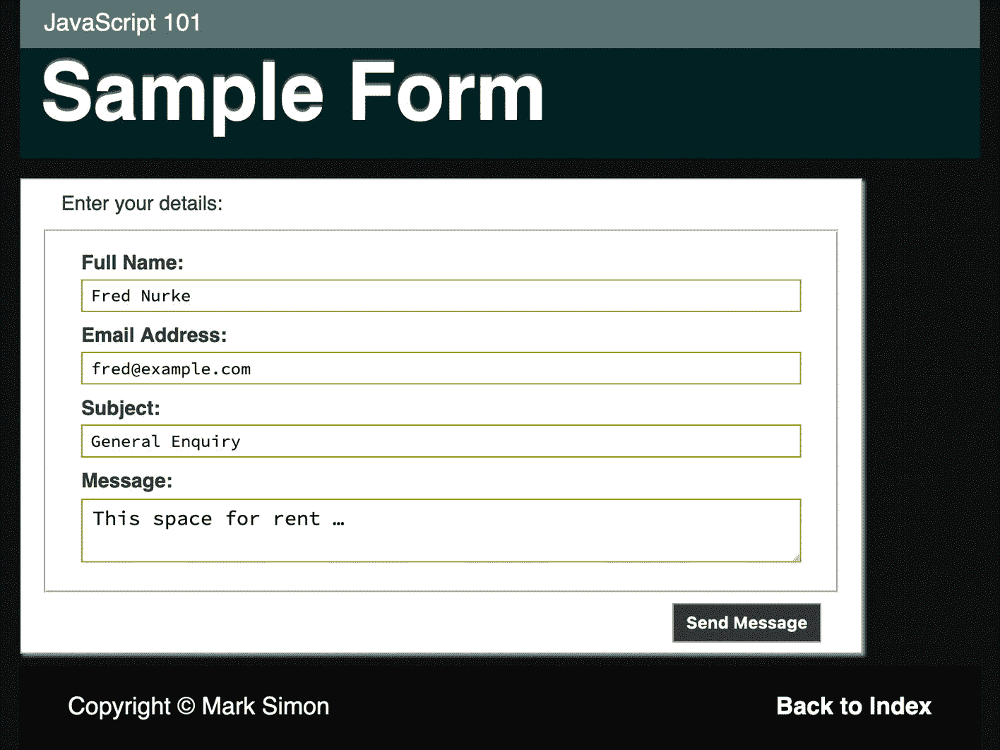

截图显示了示例表单，包含以下字段：全名、电子邮件地址、主题、消息。

**图 5-1** 示例表单

实际外观部分取决于浏览器，很大程度上取决于 CSS 样式。现代开发者在使表单美观易用方面投入了大量精力。外观对提交数据后 Web 服务器所看到的内容没有任何影响；但肯定会影响用户与表单的交互方式。

示例表单的重要部分如下：

*   表单有一个`id`属性。这对数据没有影响，但用于 CSS 设置样式，也用于 JavaScript 定位特定表单。
*   表单还有`method`和`action`属性，用于控制数据如何发送回 Web 服务器。它们对于将数据提交回服务器非常重要。
*   存在一些数据元素。在此示例中，它们是各种类型的文本框，但也可能包括复选框、单选按钮、列表和菜单。我们将在 JavaScript 中重点关注这些数据元素。
*   有一个提交按钮，它也被视为数据元素。通常，这会向服务器提交数据，但可以在 JavaScript 中被拦截。
*   表单中的其他所有内容都是组织性的，不会影响我们对数据的处理。

除了其他 HTML 属性之外，表单字段*元素*还有一些相关属性：

*   `name="..."`属性为数据附加一个标识符。如果将表单发送到服务器，`name`是识别值的*唯一*方式。在 JavaScript 中，有其他替代方法，但我们将使用`name`属性。
*   `value="..."`是一个*默认*值，但当前值可以由用户轻松更改。它通常用作对用户的便利，并且对我们测试来说也很方便。

`value`是少数具有*两种*不同含义的属性之一。作为 HTML 属性，它是*默认*值；作为 JavaScript 属性，它是*当前*值。

*   `type`属性对于表单及其元素的*行为*很重要，但对实际数据没有影响。

在这种情况下，较小的文本框具有`type="text"`或`type="email"`，这看起来像文本框，但仅限于类似电子邮件地址的文本。较大的文本框是一个`textarea`元素，它执行类似的工作，但没有`type`属性。

默认情况下，表单内的`button`元素充当`submit`按钮。通常最好使用`type="submit"`属性来指定。表单通常有一个`action="..."`属性，其中包含数据将提交到的 URL。

如果提交示例表单（使用默认值或自定义值），数据将被发送到 Web 服务器上的脚本。在这种情况下，脚本仅显示发送到服务器的数据，而不会进一步处理。你将看到类似图 5-2 的内容。

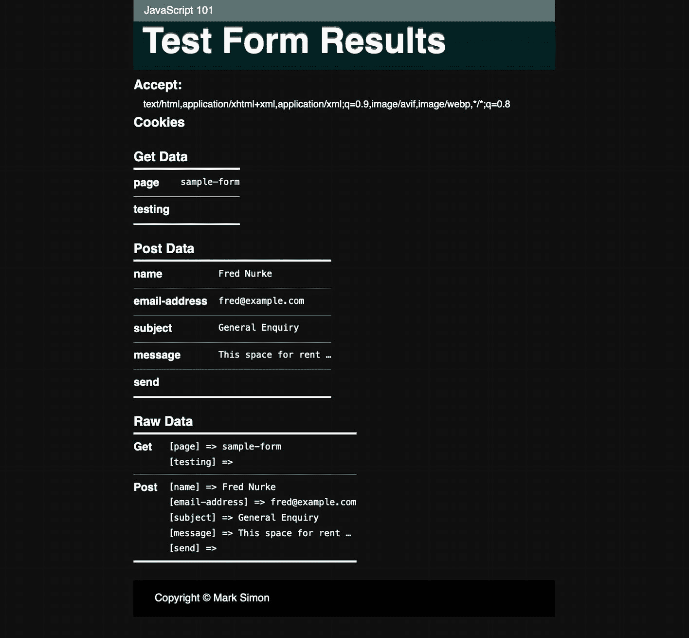

测试表单结果页面的截图。它包含以下列出的信息：Accept、Cookies、Get Data、Post Data、Raw Data。

**图 5-2** 示例表单结果

**Get** 数据是以查询字符串形式添加到 URL 的数据。**Post** 数据是来自表单本身的数据，其方法设置为`post`。如果方法设置为`get`，它将被添加到查询字符串中作为更多的**Get**数据。

## 在 JavaScript 中访问表单

出于我们的目的，我们不一定想将表单提交到服务器。我们只想用 JavaScript 访问它。

你首先需要的是对表单的引用。假设表单有一个`id`，你可以使用类似这样的代码：

```
var form = document.querySelector('form#contact');
```

当然，变量名不必是`form`。如果提交表单，表单的`id`属性没有任何意义，服务器也永远不会看到`id`。但是，它在浏览器中对于 CSS 样式以及我们在此看到的 JavaScript 非常重要。还有一个`forms`集合，你可以引用`forms[0]`作为第一个（也是唯一一个）表单，但这在现代 JavaScript 中不是必需的。

## 访问表单元素

从 JavaScript 的角度来看，表单是一个**对象**：一个复杂的包。它有许多属性，例如`action`和`method`，它们是表单自身行为的一部分。它还有一个表单元素的集合。

访问表单的元素有两种方法。最简单的方法是使用元素的名称作为属性。例如，要访问`name`为`subject`的元素，你可以在文本框中填写内容，然后在 JavaScript 中使用`form.subject`：

```
var form = document.querySelector('form#contact');
console.log(form.subject);
```

这是一种非常常见的方法，因为它很简单。但是，它将表单元素与表单的其他属性（例如其`method`或`action`）混合在一起，并且如果你需要访问其他恰好与表单元素同名的表单属性，就会成为问题。最好通过`form.elements`集合来访问元素：

```
var form = document.querySelector('form#contact');
console.log(form.elements.subject);
```

另一个复杂之处是元素的`name`属性可能不是一个合适的 JavaScript 属性名。例如，如果`name`类似于`name="email-address"`，你不能引用`form.elements.email-address`，因为你不能在属性名中使用连字符。相反，你需要使用替代表示法`form.elements['email-address']`。

现在有几种方法可以引用表单元素：

```
var form = document.querySelector('form#contact');
console.log(form.subject);
console.log(form.elements.subject);
console.log(form.elements['subject']);  //  首选
```

最后一种是我们更倾向于使用的方式，因为它最安全，并且适用于所有有效的名称。
如果你运行前面显示的代码，你将看到元素本身，而不是元素中的文本。为此，你需要读取元素的一些属性。

## 访问表单数据

所有表单元素都可以使用`form.elements['element-name']`来访问。但是，这将给你元素本身，而不是元素内部的数据。

令人困惑的是，有两个相关属性的名称重叠：

*   你也可以通过这种方式设置`.defaultValue`属性，但它不是很有用。
*   HTML 的`value="..."`属性实际上是*默认*值；在 JavaScript 中，它被称为`.defaultValue`属性。
*   元素的*当前*值是 JavaScript 所称的`.value`属性。

例如，假设你在表单的主题中输入了`Random Question`。然后你可以如下检查它：

```
var form = document.querySelector('form#contact');
console.log(form.elements['subject'].defaultValue);
General Enquiry
console.log(form.elements['subject'].value);
Random Question
```

对于大多数应用程序，你将需要`.value`属性。

如果你愿意，你可以设置`value`属性：

```
var form = document.querySelector('form#contact');
form.elements['email-address'].value = 'someone@example.com';
```


### 关于 `.value` 属性的说明

请注意，`.value` 属性*始终*是一个字符串。如果你期望得到一个数字，你可能需要使用 `parseInt()` 或 `parseFloat()` 将其转换为数字。这与你在猜数字游戏中遇到的 `prompt` 函数的问题是相同的。

## 访问提交按钮

表单的提交按钮与其他表单元素一样，因此可以使用相同的表示法轻松访问：

-   你可以做的一件事是模拟点击提交按钮：

```
    »   var form = document.querySelector('form#contact');
    »   form.elements['send'].click();
    ```

-   `click()` 函数模拟点击，可以在任何时候用于点击任何元素。

如果你确实想要提交表单，也可以使用 `submit()` 函数从表单对象执行此操作：

```
    »   var form = document.querySelector('form#contact');
    »   form.submit();
    ```

-   访问提交按钮最可能的用途是附加一个事件监听函数：

```
    »   var form = document.querySelector('form#contact');
    »   function doSomething(event) {
    }
    »   form.elements['send'].onclick = doSomething;
    ```

请注意，由于我们是在控制台中实验，我们需要在引用 `doSomething()` 函数*之前*定义它。在真实的脚本中，你可以之后定义该函数，因为 JavaScript 解释器会在运行脚本之前扫描所有函数定义。

另外请注意，如果你重新定义了该函数（就像你在这里会做几次一样），你还需要重新分配 `onclick` 事件监听器。

```
form.elements['send'];
```

这个附加的函数被称为事件监听器，并且如果你需要的话，它实际上有一个参数。这个参数通常被称为 `event`，可用于取消提交：

```
»   var form = document.querySelector('form#contact');
»   function doSomething(event) {
//  处理表单
event.preventDefault();
}
»   form.elements['send'].onclick = doSomething;
```

由于提交按钮的默认行为是提交数据，`preventDefault()` 函数会阻止此行为。有时，这会在 `if()` 之后使用，例如在检查错误时。如果你希望完全在 JavaScript 中处理表单而不将其发送到服务器，也可以无条件地使用它。

你经常会看到 `preventDefault()` 函数被首先调用：

```
function doSomething(event) {
event.preventDefault();
//  处理表单
}
```

如果你不取消提交，那么表单将被提交，在这种情况下，页面将被重新加载。

## 总结

在本章中，我们快速了解了 HTML 表单。我们讨论了：

-   HTML 表单的结构
-   在 JavaScript 中访问表单
-   访问表单元素
-   访问表单数据
-   访问提交按钮并拦截提交过程

## 下一章预告

既然我们已经了解了表单和 JavaScript，我们将把表单用作一个自定义计算器。在计算器项目中，我们将学习更多关于处理表单和表单字段以及处理来自表单的数据的知识。我们还将了解更多关于数据处理和计算的技术，以及关于为将来存储数据的一些知识。

# 6. 创建自定义计算器表单

Web 表单是一种允许用户与网络服务器进行通信的标准方法。这通常用于发送消息或下订单。尽管表单可以按原样工作，但通常会用 JavaScript 来预处理数据和进行检查。在这个项目中，我们将使用 JavaScript 来处理数据，而不将其发送到服务器。在这种情况下，我们将创建一个专门的計算機。

在开发这个项目的过程中，我们将学习以下内容：

-   从 Web 表单读取数据
-   检查和验证数据
-   拦截表单
-   编写公式代码
-   在浏览器中存储数据

虽然我们不会将表单提交到服务器（除了测试表单），但如果你想要记录查询或进行一些进一步的处理，你也可以这样做。

## 创建抵押贷款还款计算器

专门计算器的一个简单例子是使用专门公式的计算器。在这里，我们将根据本金（借款金额）、利率和抵押贷款期限来计算定期还款额。你可能会或可能不会对金融计算充满热情。或者你可能对科学计算或数学公式更感兴趣。当然，我们关注的不是公式本身，而是如何将公式转化为表单，以及如何用 JavaScript 实现它。

如果你要在电子表格应用程序中执行此操作，你可能会找到一个名为 `PMT()` 的内置函数来完成相同的工作。JavaScript 没有这样的函数，所以你必须自己编写代码。如果你有时间和数学知识，你可能可以自己推导出这个公式。如果你没有时间、知识或意愿，你可以尝试在互联网上找到某个公式。

最终，你会发现还款公式为：

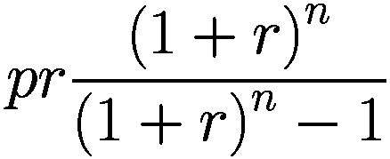

其中

- p = 本金
- r = 利率（每期）
- n = 还款期数

这个公式可以完成任务，但其中两个值对用户不太友好。在计算抵押贷款时，我们通常以*年*利率表示，而不是*每期*利率。而且我们通常使用*年*数，而不是还款期数。

为人类编写应用程序的最重要规则是，让人类做对他们来说自然的事情，并让代码进行必要的调整。*永远不要期望用户进行调整：(a) 他们不想这样做，(b) 他们可能会犯错误，(c) 他们真的不想这样做。*

因此，部分工作将是把对人类友好的值转换为对公式友好的值。

### 计算器表单

数据将来自以下表单：

```

借款金额：

期限（年）：

还款频率：

利率（年化%）：

计算

```

它看起来类似于图 6-1。

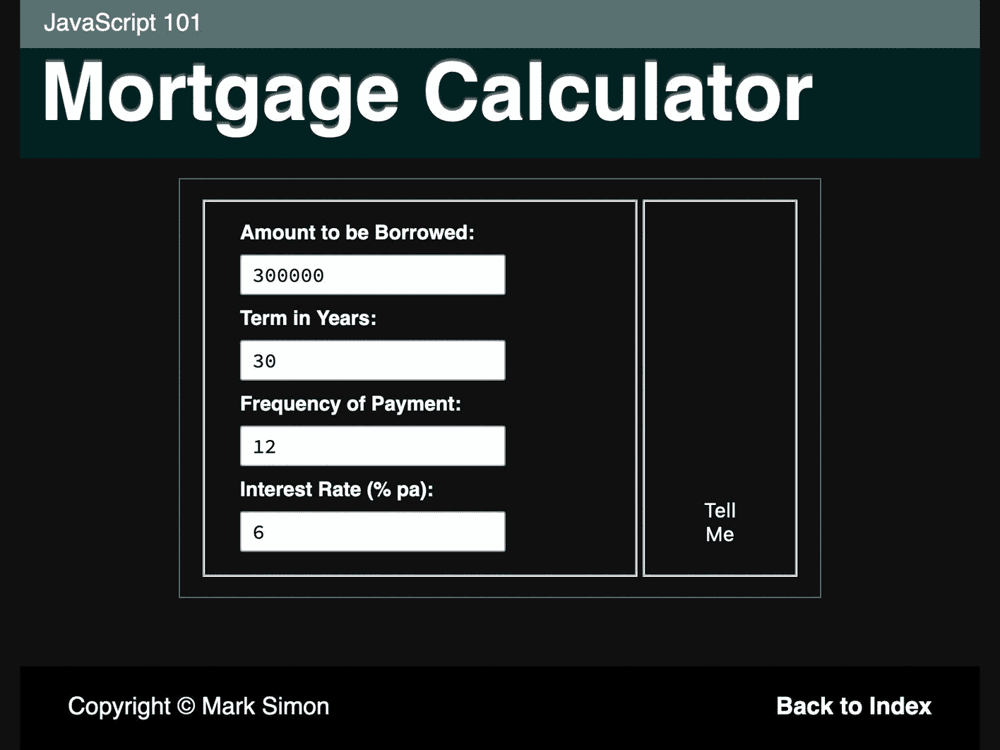

抵押贷款计算器表单页面的屏幕截图。以下是字段：借款金额、期限（年）、还款频率和利率。

**图 6-1** 抵押贷款计算器表单

在此表单中，两个重要的输入元素类型是 `<input type="text" name="...">` 和 `<button name="...">`，它们是文本框和操作按钮。你会看到还有一个 `output` 元素。这是一个简单的元素，你可以在 JavaScript 中向它写入任何你喜欢的内容。它将是表单的 `elements` 集合的一部分，但如果你提交表单，它将不会被包含在内。

为了实现计算器，我们将响应 `button`，读取和处理来自 `input` 元素的数据，并将结果放入 `output` 元素中。

### 表单字段

表单字段是从用户角度看待我们需要处理的值。它们是：

-   `principal`：借款金额
-   `term`：抵押贷款的年数
-   `frequency`：每年的还款次数
-   `rate`：以百分比表示的年利率

请注意，这些都是 `text` 类型的输入。HTML 确实有 `type="number"`，但它不够灵活。无论如何，数据将是一个字符串，即使我们使用 `type="number"`，所以对我们来说没有多大好处。

这四个值是人们期望填写的那种值，但公式想要的是不同的东西。为了准备好公式需要的值：

-   本金保持不变。
-   每期利率将按如下方式计算：

```
    每期利率
    = 年利率 / 每年还款次数 / 100
```


# 除以 100 将百分比转换为小数。

- 还款期数的计算方式如下

```
    还款期数
    = 贷款年限 × 每年还款次数
    ```

请注意，我们再次向用户做出了让步。我们习惯于将利率表示为百分比，但`JavaScript`对百分比一无所知。因此，我们将允许用户输入看起来像百分比的值，然后在代码中将其除以 100。^(³)

## 初始化 JavaScript

HTML 代码已准备就绪，并包含了指向`JavaScript`文件的链接：

```
...
...
...
```

请注意，其中包含了库脚本。如果某些新代码是可复用的，我们可能需要将其移到库中。

`calculator.js` 文件已为您创建完毕，可以直接使用：

```
/*  按揭贷款计算器
================================================ */
'use strict';
window.onerror=function(message,url,line) {
alert(`Error: ${message}\n${url}: ${line}`);
};
doCalculator();
function doCalculator() {
}
```

我们没有费心去单独编写一个`init()`函数，因为那里已无需再做任何处理。

## 处理表单

第一步是找到表单并引用它：

```
function doCalculator() {
let calculatorForm = document.querySelector('form#data');
}
```

找到表单后，你需要为提交按钮附加一个事件监听器：

```
function doCalculator() {
let calculatorForm = document.querySelector('form#data');
calculatorForm.elements['calculate'].onclick = doit;
function doit(event) {
}
}
```

这里，提交按钮的名称为`calculate`。事件监听器是`doit`函数。你可能觉得`doit`不是一个描述性很强的名称，但我们能用其简洁性来辩护。

在这种情况下，`doit`函数是**嵌套**在`doCalculator()`函数内部的。因此，这个函数具有以下几个特点：

- 由于位于`doCalculator()`函数内部，`doit`函数继承了所有外部变量。在本例中，它继承了`calculatorForm`变量，该变量对于获取数据值至关重要。

- 与局部变量一样，嵌套函数只能在外部函数内部访问，外部无法访问。你可以随意命名嵌套函数，而不会影响你其余的`JavaScript`代码。

- 正是这个特性使得为`doit`函数取一个描述性较弱的名称是合理的，因为它只需在局部范围内有意义。

- 外部函数是自包含的，因为它包含了所有依赖函数，并且无需与其他任何函数通信。

`doit`函数包含了`event`参数，我们可以用它来阻止表单实际提交：

```
function doit(event) {
event.preventDefault();
}
```

如果你忘记这样做，每次点击提交按钮时页面都会重新加载，你将永远看不到计算结果。

### 获取表单数据元素

有四个数据元素需要用到。你可以直接使用它们的值，但将它们存入变量会更方便：

```
function doit(event) {
event.preventDefault();
let principal = calculatorForm.elements['principal'].value;
let term = calculatorForm.elements['term'].value;
let frequency = calculatorForm.elements['frequency'].value;
let rate = calculatorForm.elements['rate'].value;
}
```

无法阻止用户犯错，尤其是输入错误。最简单的错误是多余的空格，我们可以使用`trim()`函数轻松处理：

```
function doit(event) {
event.preventDefault();
let principal =
calculatorForm.elements['principal'].value.trim();
let term = calculatorForm.elements['term'].value.trim();
let frequency =
calculatorForm.elements['frequency'].value.trim();
let rate = calculatorForm.elements['rate'].value.trim();
}
```

`trim()`函数应用于字符串，在这里是`.value`属性，它会移除字符串开头和结尾的所有空格。如果字符串内部有其他空格，则不受影响。

### 检查表单值

记住，所有表单数据最初都是字符串，因此你需要确保它们被转换为数字。虽然`JavaScript`会在可能的情况下自动进行转换，但你自己手动转换更好。这样，你也可以检查转换错误。例如：

```
let principal = calculatorForm.elements['principal'].value.trim();
principal = parseFloat(principal);
```

`parseFloat()`和`parseInt()`函数都会尝试从字符串开头开始，尽可能多地将字符串解析为浮点数或整数。如果遇到数字中无效的字符，它们就会停止解析，并使用该字符之前的所有内容。两者之间的区别在于，`parseFloat`还会接受小数点，这对于整数来说是无效的。

当你使用`parseInt()`或`parseFloat()`处理字符串时，字符串转换失败的可能性始终存在；也就是说，它是**无效的**。检查用户数据是否有效当然被称为**验证**。现代 HTML 为表单提供了一些内置验证，但使用`JavaScript`进行验证功能更强大。

如果字符串为空或开头就是无效字符，`parseFloat()`和`parseInt()`将返回`NaN`，这是一个特殊值，表示“Not a Number”（非数字）。你可以使用以下两种方法之一专门测试这个特殊值：

```
if(isNaN(principal)) ... ;            //  isNaN() 函数
if(principal != principal) ...    ;   //  NaN 的特性
```

第一种方法使用`isNaN()`函数，你需要记住它有两个大写`N`。第二种方法利用了`NaN`的一个奇特特性：它不等于任何东西，甚至不等于它本身。你不会认真使用这个方法，但可能想展示一下。

实际上，你可以利用`NaN`被视为假值的特性，直接使用非（`!`）运算符：

```
let principal = calculatorForm.elements['principal'].value.trim();
principal = parseFloat(principal);
if(!principal) principal = 0;
```

这样，如果字符串解析失败，你可以指定一个默认值。

在`JavaScript`中，你可以使用`||`（或）运算符将上一步骤中显示的最后两步合并：

```
let principal = calculatorForm.elements['principal'].value.trim();
principal = parseFloat(principal) || 0;
```

在`JavaScript`中，`||`运算符是**短路**的。这意味着如果第一个测试足以得到结果，第二个将不会被执行。在这种情况下，如果第一个值为真值，则不会使用第二个值，因为`||`只需一个成功条件即可。

现在，你可以预处理以下值：

```
function doit(event) {
event.preventDefault();
let principal =
calculatorForm.elements['principal'].value.trim();
principal = parseFloat(principal);
if(!principal) principal = 0;
let term = calculatorForm.elements['term'].value.trim();
term = parseFloat(term);
if(!term) term = 0;
let frequency =
calculatorForm.elements['frequency'].value.trim();
frequency = parseFloat(frequency);
if(!frequency) frequency = 1;
let rate = calculatorForm.elements['rate'].value.trim();
rate = parseFloat(rate);
if(!rate) rate = 0;
}
```

或者更简洁地：

```
function doit(event) {
event.preventDefault();
let principal =
calculatorForm.elements['principal'].value.trim();
principal = parseFloat(principal) || 0;
let term = calculatorForm.elements['term'].value.trim();
term = parseFloat(term) || 0;
let frequency =
calculatorForm.elements['frequency'].value.trim();
frequency = parseFloat(frequency) || 0;
let rate = calculatorForm.elements['rate'].value.trim();
rate = parseFloat(rate) || 0;
}
```

除了为公式提供无害的虚拟值之外，这些默认值实际上什么也不做。你本来可以轻松地提供更有意义的值。


### 使用 HTML 默认值与修复表单值

如果你想要使用 HTML 默认值，请记住 HTML 使用`value`作为该属性的默认值。然而，JavaScript 使用`value`表示当前值，因此你需要使用另一个 JavaScript 属性`defaultValue`。例如：

```
principal = parseFloat(principal) ||
parseFloat(calculatorForm.elements['principal'].defaultValue);
```

上述语句的续行通过缩进使其更易阅读。

### 修复表单值

虽然有些开发者似乎以此为乐，但通常不建议混淆用户。在本例中，你可能已经调整了某些值，并且即将使用这些调整后的值。

当你对用户数据做出任何更改后，最好将这些值写回表单，以便用户能够看到实际发生了什么。表单的`value`属性既可读也可写，因此我们可以通过这种方式写入调整后的值：

```
function doit(event) {
event.preventDefault();
let principal =
calculatorForm.elements['principal'].value.trim();
principal = parseFloat(principal) || 0;
calculatorForm.elements['principal'].value = principal;
let term = calculatorForm.elements['term'].value.trim();
term = parseFloat(term) || 0;
calculatorForm.elements['term'].value = term;
let frequency =
calculatorForm.elements['frequency'].value.trim();
frequency = parseFloat(frequency) || 0;
calculatorForm.elements['frequency'].value = frequency;
let rate = calculatorForm.elements['rate'].value.trim();
rate = parseFloat(rate) || 0;
calculatorForm.elements['rate'].value = rate;
}
```

虽然`.value`属性从技术上讲是字符串而非数字，但 JavaScript 知道这一点，并且会轻松地将数字转换为字符串。

你现在可以尝试使用无效值进行测试。任何默认值都会被写回表单，尽管在此阶段还不会进行任何计算。

## 转换抵押贷款计算公式

如前所述，还款公式为：


你需要做的第一件事是准备计算所需的值：

- 本金很简单，我们使用从表单获取的值`principal`。唯一需要注意的是，为了简化，我们可以将其放入一个新变量中：

```
    let p = principle;
    ```

- 值`n`是还款次数。由于我们拥有以年为单位的期限（`term`）和每年的还款次数（`frequency`），总的还款次数就是这两个值的乘积：

`let n = term * frequency;`

- 值`r`是*每期*的利率。由于我们拥有年利率和每年的还款次数，我们需要将两者相除。同时，由于该数字是百分比形式，我们还需要除以`100`：

`let r = rate / frequency / 100;`

我们现在可以将以下代码添加到函数中：

```
function doit(event) {
event.preventDefault();
...
let p = principal;
let n = term * frequency;
let r = rate / frequency / 100;
}
```

下一步是将表达式转换为 JavaScript：

- 第一部分只是值的乘法，因此你可以写成：

`p * r * ...`

- 表达式`(1+r)`^(`n`)表示`(1 + r)`的`n`次方。你可以这样写：

`(1 + r)**n`

在较旧的 JavaScript 中，你需要使用内置函数`Math.pow(1+r, n)`来完成计算。

- 表达式 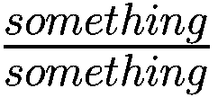 表示你需要进行除法运算。但是，表达式的分母部分是一个加法运算，你需要将其用括号括起来。

综合起来，公式转换为：

```
p * r * (1+r)**n / ((1+r)**n - 1)
```

使用较旧的 JavaScript，你需要：

```
p * r * Math.pow(1+r,n) / (Math.pow(1+r,n) - 1)
```

将代码添加到函数中：

```
function doit(event) {
...
let repayment = p * r * (1+r)**n / ((1+r)**n - 1);
}
```

我们将结果保存到一个新的变量`repayment`中。

### 显示结果

最后，我们需要将结果显示在页面上。还记得那个名为`result`的`output`元素吗？我们可以像写入其他表单元素一样写入它：

有一个`id`为`results`的段落，因此我们需要定位它。我们可以将变量命名为`result`。我们可以在`doit`函数中完成此操作：

```
function doit(event) {
...
let repayment = p * r * (1+r)**n / ((1+r)**n - 1);
calculatorForm.elements['result'].value = repayment;
}
```

你可能已经注意到结果中存在过多的小数位。这是用复杂数字进行除法运算的结果。你可能只需要保留两位小数。

虽然 JavaScript 确实有一个四舍五入函数（`Math.round`），但它只能四舍五入到整数。无论如何，将数字*显示*为固定的小数位数并不是近似函数的职责。相反，你应该按照你喜欢的格式生成一个*字符串*。

幸运的是，JavaScript 有一个函数可以完成这项工作：`toFixed(...)`。它会将数字转换为指定小数位数的字符串。我们可以直接将其应用于`repayment`变量：

```
function doit(event) {
...
let repayment = p * r * (1+r)**n / ((1+r)**n - 1);
calculatorForm.elements['result'].value = repayment.toFixed(2);
}
```

如果你现在使用默认值进行尝试，应该会得到结果`1798.65`。

## 改进

我们可以做一些事情来让这个计算器表单变得更好。这里，我们只做以下两件事：

- 以本地货币格式显示结果。
- 为下次使用本地存储这些值。

我们可能会沉迷于次要的改进，但这两个实现起来并不太难。

### 以本地货币格式显示结果

如果你不在澳大利亚阅读本文，你的本地货币可能不同，甚至十进制和长数字的表示方式也可能不同。实际上，过滤输入格式的差异非常困难，但输出格式却相对容易。

#### `Intl` 对象

JavaScript 有一个内置对象叫做`Intl`。它非常强大——事实上，它强大到需要花点功夫才能弄明白它的工作原理。

`Intl`对象能够根据不同的区域设置格式化日期、时间和数字。它甚至可以根据惯例格式化列表。在我们的例子中，我们感兴趣的是将数字格式化为货币。

要使用`Intl`格式化，你需要经过两个步骤。你可以在控制台中实验以了解其工作原理。

首先，创建一个新的`NumberFormat`对象，指定区域设置以及你希望如何处理数字：

```
»   var numberFormat = Intl.NumberFormat(
'en-AU',
{ style: 'currency', currency: 'aud' }
);
```

此处，区域设置设置为`en-AU`，表示澳大利亚的英语。这里的关键是区域设置有助于定义小数点（`.`）和千位分隔符（`,`）。如果你在欧洲，比如可能想使用`nl-NL`，这是荷兰使用的格式：小数点与千位分隔符的用法是相反的。

第二个参数是一个选项对象。这里，我们指定希望以货币形式显示数字，使用澳元。货币和区域设置不必匹配。如果你希望以荷兰的数字格式显示澳元，这是可以的：

```
»   var numberFormat = Intl.NumberFormat(
'nl-NL',
{ style: 'currency', currency: 'aud' }
);
```

### 格式化数字

当然，你此时还不会得到格式化后的数字。为此，你需要使用该对象的`format()`方法：

```
»   numberFormat.format(123456.789);
←   "$123,456.79"
```


注意该数字已正确四舍五入至两位小数。同时请注意结果是字符串。数值仅含数值本身，不包含货币符号或千位分隔符。若需要此类修饰，则需使用字符串，这对于后续操作而言是可行的。

若打算多次使用该格式化器，可将`format()`方法纳入变量以提升便利性：

```
var format = Intl.NumberFormat(
'en-AU',
{ style: 'currency', currency: 'aud' }
).format;
format(123456.789);
// 返回 "$123,456.79"
```

请记住，在 JavaScript 中，函数也是数据对象。你可以像赋值其他对象一样赋值函数。此处，我们将新`NumberFormat`对象的`format()`方法赋值给名为`format`的变量。由于该变量包含的是函数，因此可直接将其作为函数使用。接下来我们将此功能添加到代码中。

原则上，我们可能需要多次重新计算。每次创建新的格式化对象会造成浪费，因此将其创建在`doit()`函数外部：

```
function doCalculator() {
let calculatorForm = document.querySelector('form#data');
calculatorForm.elements['calculate'].onclick = doit;
let format = Intl.NumberFormat(
'en-AU',
{ style: 'currency', currency: 'aud' }
).format;
function doit(event) {
...
}
}
```

由于已不在控制台环境中，我们将`var`改为`let`。`doit()`函数在每次点击`calculate`按钮时执行。与`calculatorForm`变量类似，它能够访问包含函数中的`format()`函数。

我们不再需要`toFixed()`方法。该方法之前表现尚可，但格式化函数也会对结果进行四舍五入。可将其替换为以下代码：

```
function doit(event) {
...
let repayment = p * r * (1+r)**n / ((1+r)**n - 1);
// calculatorForm.elements['result'].value =
// repayment.toFixed(2);
calculatorForm.elements['result'].value = format(repayment);
}
```

这样看起来更专业一些。`Intl`对象的功能远不止格式化数字。若想了解其更多用法，可访问[`https://developer.mozilla.org/en-US/docs/Web/JavaScript/Reference/Global_Objects/Intl`](https://developer.mozilla.org/en-US/docs/Web/JavaScript/Reference/Global_Objects/Intl)。

**在存储中保存数值**  
这是一个带有默认值的简单计算器，对用户负担不大。不过，记住这些数值以供下次使用或许会带来便利。你无法将数据保存到磁盘，这是出于安全设计——网页不应能访问用户计算机。但你可以将部分数据保存到浏览器的存储区域。

过去，保存数据会使用浏览器 Cookie，这实际上是对 Cookie 的误用。以下才是 Cookie 的正确使用方式：

1.  用户访问网站，可能输入一些数据或进行搜索。
2.  服务器响应请求内容，同时通过 Cookie 发送附加数据。
3.  用户再次访问该网站时，与该网站关联的任何 Cookie 都会返回给服务器。

该过程如图 6-2 所示。

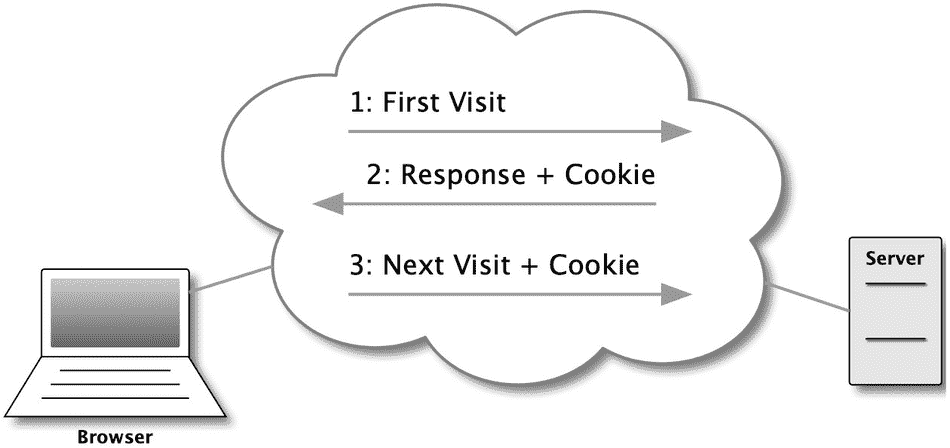  
*与用户设备和服务器相连的云状结构包含以下序列：1. 首次访问；2. 响应+Cookie；3. 再次访问+Cookie。*

从一开始，JavaScript 就具备读取、修改甚至创建 Cookie 的能力。这些 Cookie 会在浏览器再次访问服务器时被发送，即便它们并非源自该服务器。

使用 Cookie 进行本地存储存在两个主要问题：

*   所有与网站相关的 Cookie 都会被发送到服务器，即便它们是在 JavaScript 中创建且并非真正源自服务器。这意味着你的数据从未真正实现隐私保护。


## 在 JavaScript 中操作 Cookie

在 JavaScript 中操作 Cookie 实际上相当棘手。

## 使用 Web 存储

幸运的是，如今 JavaScript 有了更好的机制用于在浏览器上存储本地数据。这被称为 **web 存储**，有两种形式：

-   **本地存储**会无限期地保存在浏览器中。

本地存储可通过内置对象 `localStorage` 使用。

-   **会话存储**会在浏览器或标签页关闭时自动删除。

会话存储可通过内置对象 `sessionStorage` 使用。

两者的工作方式相同，因此你只需决定希望数据保留多长时间。在这个例子中，我们将使用 `localStorage`。

`storage` 对象有许多用于设置和获取数据的方法。这里，我们将存储刚才用于计算结果的值：

```
function doit(event) {
...
//  存储值
localStorage.setItem('data', true);
localStorage.setItem('principal', principal);
localStorage.setItem('term', term);
localStorage.setItem('frequency', frequency);
localStorage.setItem('rate', rate);
}
```

当然，这些项目的实际名称可以任意指定，但在这里我们将它们设置为与变量和原始表单数据相同的名称。我们还设置了另一个项目 `data`。这将使我们下次加载页面时，能够轻松地测试是否有任何数据被存储。

你可以在开发者工具中检查浏览器存储中的内容。对于 Firefox 和 Safari，你可以在“存储”(Storage) 部分找到它。在 Chromium 中，则位于“应用程序”(Application) 部分的“存储”(Storage) 部分。你会看到类似下面的内容：

| 键 (Key) | 值 (Value) |
| :--- | :--- |
| `data` | `true` |
| `frequency` | `12` |
| `principal` | `300000` |
| `rate` | `6` |
| `term` | `30` |

下一步是从存储中重新填充这些值。我们在页面加载时执行此操作，也就是运行 `doCalculator()` 函数时。当然，这只有在之前有保存的值时才有效。这就是 `data` 项目的用武之地：

```
function doCalculator() {
...
//  恢复值
if(localStorage.getItem('data')) {
}
function doit(event) {
...
}
}
```

`.getItem()` 方法简单地通过项目名称获取一个值。如果某个项目不存在，`.getItem()` 会返回 `null`，众所周知，这是一个假值。`if()` 语句检查它是否为真值。我们本可以测试其他任何项目来达到此目的，但如果有专门的值来检查，则更容易理解和维护。

恢复这些项目虽然繁琐但很简单。只需为每个值调用 `.getItem()` 方法，并将这些值放入相应的表单字段中：

```
function doCalculator() {
...
//  恢复值
if(localStorage.getItem('data')) {
calculatorForm.elements['principal'].value =
localStorage.getItem('principal');
calculatorForm.elements['term'].value =
localStorage.getItem('term');
calculatorForm.elements['frequency'].value =
localStorage.getItem('frequency');
calculatorForm.elements['rate'].value =
localStorage.getItem('rate');
}
...
}
```

要尝试此功能：

-   更改部分数值并计算结果。
-   返回主页。
-   现在返回到计算器页面，检查先前的数值是否已被恢复。

Web 存储的优点在于它不仅易于使用，而且也很安全。至少它和你使用的浏览器一样安全：如果其他人能够接触到你的浏览器，他们仍然可以检查存储的内容。因此，你永远不应以这种方式存储任何真正敏感的信息。至少它不会被发送回 Web 服务器。

## 使用数组处理

恢复数值的那部分代码包含大量重复。每当出现代码重复时，就有可能进行简化。在这个例子中，重复操作涉及对四个项目做相同的事情。

我们可以通过将这些值放入一个数组 `items` 中来稍微简化：

```
['principal','term','frequency','rate']
```

要遍历数组，我们可以使用计数器循环。你可以在控制台中尝试一下。


```javascript
var items = ['principal','term','frequency','rate'];
for(var i=0; i<items; i++) {
console.log(item);
}
```

在现代 JavaScript 中，你可以使用一个名为 `.forEach()` 的数组方法：

```javascript
var items = ['principal','term','frequency','rate'];
items.forEach(function(item) {
console.log(item);
});
```

如你所见，`.forEach()` 方法接收一个带有一个或多个参数的函数。第一个参数（也是最常用的参数）是数组中的每一项。既然我们在使用现代 JavaScript，那么使用箭头函数表达式也很常见：

```javascript
var items = ['principal','term','frequency','rate'];
items.forEach(item => {
console.log(item);
});
```

在箭头函数表达式中，`item =>` 替代了 `function(item)`。虽然它并没有简短多少，但对于简单的任务来说，它可以非常简洁。

如果我们要立即使用数据，则无需将数据保存在单独的变量中。你可以将 `.forEach()` 方法应用于数组字面量：

```javascript
['principal','term','frequency','rate'].forEach(item => {
console.log(item);
});
```

我们可以用这个方法来替换代码中用于恢复值的部分：

```javascript
// 恢复值
if(localStorage.getItem('data')) {
/*
...
*/
['principal','term','frequency','rate'].forEach(item => {
calculatorForm.elements[item].value =
localStorage.getItem(item);
});
}
```

在测试新版本时，其他代码已被注释掉。一旦你确认新代码运行正常，就可以删除被注释的代码。

遗憾的是，你无法对用于存储值的代码做同样的处理。这是因为你想要存储的数据在变量中，而 JavaScript 没有简单的方法来遍历普通变量。

## 使用对象存储数据

如果你*真的*想遍历计算器中使用的变量，有一种间接方法。你已经接触过 `Math` 对象了。它本质上是一个包含数学计算所需的实用函数和数据的包。你可以轻松地创建自己的对象来完成同样的工作。

我们可以在控制台中尝试：

```javascript
var data = {};
data.principal = 300000;
data.term = 30;
data.frequency = 12;
data.rate = 6;
```

在 JavaScript 中，你可以通过赋值一个**对象字面量**来创建新对象，对象字面量是包含在花括号 (`{ ... }`) 中的一组数据。在这个例子中，新对象是一个空对象。然后，你可以像示例所示那样，为其分配新的属性和值。

在控制台中，你可以使用 `console.log()` 打印出这个对象：

```javascript
console.log(data);
```

我们还可以将其与数组遍历结合，以列出对象的全部内容：

```javascript
['principal','term','frequency','rate'].forEach(item => {
console.log(`${item}: ${data[item]}`);
});
```

我们使用了模板字符串字面量来包含属性名和来自 `data` 对象的值。请注意，我们对对象成员使用了方括号表示法。记住，它是点表示法的一种替代方案，允许我们使用变量。

在我们的计算器代码中，我们可以用对象属性来替换四个主要变量的实例。首先，我们可以使用 `.forEach()` 循环来获取并检查数据：

```javascript
function doit(event) {
event.preventDefault();
let data = {};
['principal','term','frequency','rate'].forEach(item => {
data[item] = calculatorForm.elements[item].value.trim();
data[item] = parseFloat(data[item]) || 0;
calculatorForm.elements[item].value = data[item];
});
...
}
```

公式中使用的变量随后可以使用这些对象属性，而不是之前的变量：

```javascript
function doit(event) {
event.preventDefault();
...
let p = data.principal;
let n = data.term * data.frequency;
let r = data.rate / data.frequency / 100;
...
}
```

最后，你可以用同样的方式存储值：

```javascript
function doit(event) {
event.preventDefault();
...
['principal','term','frequency','rate'].forEach(item => {
localStorage.setItem(item, data[item]);
});
}
```

最终的代码看起来像这样：

```javascript
function doit(event) {
event.preventDefault();
let data = {};
['principal','term','frequency','rate'].forEach(item => {
data[item] = calculatorForm.elements[item].value.trim();
data[item] = parseFloat(data[item]) || 0;
calculatorForm.elements[item].value = data[item];
});
let p = data.principal;
let n = data.term * data.frequency;
let r = data.rate / data.frequency / 100;
// 不受影响的部分：
let repayment = p * r * (1+r)**n / ((1+r)**n - 1);
calculatorForm.elements['result'].value =
format(repayment);
// 存储值
localStorage.setItem('data', true);
['principal','term','frequency','rate'].forEach(item => {
localStorage.setItem(item, data[item]);
});
}
```

将数据保存在对象中而不是单独的变量中，不仅有助于遍历这些值，还可以简化对过多变量的管理，并便于将数据存储起来供以后使用。这也是一种在位置之间传输数据的便捷方式，例如从网络服务器获取数据。

JavaScript 最近新增了一个 **Map** 对象，它更专门地用于以这种方式存储数据。不过，它使用起来并不那么方便。

## 总结

在本章中，我们了解了如何处理表单数据并存储数据。为了实践这个思路，我们开发了一个简单的计算器来计算抵押贷款还款额。

### 获取表单数据

一个网页表单包含一个 `elements` 集合，该集合引用了所有的 `input` 和 `output` 元素。你可以使用“点”表示法或“方括号”表示法来引用单个元素，但方括号表示法更灵活、更一致。

要引用单个元素，你可以使用类似 `form.elements['...']` 的表达式。然而，这样会得到元素本身；你可能真正想要的是该元素中的值，这时需要使用像 `form.elements['...'].value` 这样的表达式。

所有表单数据都以字符串形式提供。如果你想执行数值计算，你应该对数据进行类似 `parseInt()` 或 `parseFloat()` 的处理，这会将字符串解析为数字。

来自表单的数据不一定合适，因此你需要检查每个值，并可能默认设置为合适的数值。

通常情况下，表单应该将数据提交到服务器上的外部进程。然而，我们可以使用 `event.preventDefault()` 方法来拦截这个过程，它可以阻止表单的默认行为。有时，这是有条件执行的，例如当表单数据未能通过某种验证检查时。在这种情况下，表单本就不该发送数据。

### 执行计算

专用计算器的全部意义在于能够执行那些过于复杂的计算。寻找合适的公式可能需要一些研究，并且公式并不总是对代码友好。

另一个问题是，有时公式对人类也不友好。部分任务在于获取用户期望输入的数值，并对其进行调整以满足公式要求。

最后，公式可能需要转换为 JavaScript 表达式。

### 显示结果

`output` 元素允许你设置一个值显示在表单上。然而，有时计算出的结果格式并不合适，例如小数位数过多，失去了意义。

`.toFixed()` 方法可以将数字格式化为固定的小数位数。结果实际上是一个字符串，这非常适合用于输出。

你可以使用 `Intl` 对象获得更灵活的结果，该对象可以根据特定的区域设置和其他偏好来格式化数字、日期以及其他数据。在这个例子中，我们根据区域设置将数字格式化为货币格式。结果同样是一个字符串。


### 存储数据

`JavaScript` 无法将数据存储到用户的磁盘上，但可以将数据存储在浏览器中。过去，这一功能是通过 cookie 实现的，不过 cookie 并非为此用途而设计。

如今我们可以使用 Web 存储，它既支持短期存储，也支持长期存储。这使得我们能够保存数值，以便在下次访问页面时加载。

由于 `storage` 对象使用键来存储值，我们可以使用键名数组并遍历该数组来简化重复操作。

普通变量无法以这种方式遍历，但我们可以创建一个简单对象，将值存储在对象属性中，而不是使用简单变量。在遍历键名数组时，可以引用这些对象属性。

## 后续内容

接下来的几个项目将对页面上显示的内容进行重大调整。在某些情况下，我们会创建新的 HTML 元素；在某些情况下，我们会显示和隐藏它们；而在另一些情况下，我们会持续更改这些元素的内容。

在此之前，我们需要进一步了解如何操作 CSS 样式，以及 JavaScript 如何响应用户事件。

## 脚注

### 7. 与 CSS 和事件监听器的交互

在幻灯片项目以及后续项目中，我们都依赖 CSS 来完成大部分工作。CSS，即**层叠样式表**，是一种主要控制页面内容外观的语言。你无需成为 CSS 专家也能完成这些工作，但应该了解一些基本概念，以便理解其工作原理并能轻松进行调整。

在此，我们将探讨：

* CSS 的背景
* CSS 能做什么
* 使用事件监听器函数响应用户事件
* 如何使用 JavaScript 与 CSS 交互
* 使用 JavaScript 创建额外的 CSS 样式
* CSS 动画效果

你可以使用浏览器的开发者工具同时实验 CSS 和 JavaScript。有一个示例文件 `sample-css.html` 供你尝试，以及它的 CSS 文件 `sample-css.css`。

该示例文件如图 7-1 所示。

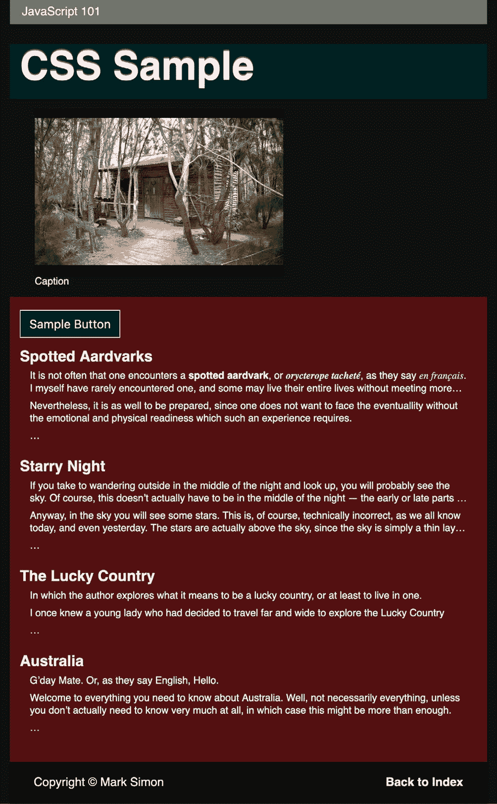

CSS 示例页面的屏幕截图。顶部是一张照片，下方是标题和示例按钮。

**图 7-1** CSS 示例文件

在我们尝试这些概念（尤其是样式和事件监听器）时，文档可能会积累一些不必要的冗余。此时，重新加载页面是你的好朋友，可以让你重新开始。

### 什么是 CSS？

最初的 HTML 并没有包含任何严格控制页面内容外观的方式。早期的尝试包括 `font` 元素；关于这一点，越少提越好。

后来 CSS 语言得以发展。CSS 控制颜色、字体样式、定位，甚至控制内容的可见性。它已经发展到包含一些视觉效果，例如阴影、圆角，以及控制物体不透明度的能力。

随着 CSS 的发展，它还增加了对这些属性变化进行动画处理的能力，无论是简单的过渡还是多步动画。

过去，其中一些功能（例如显示和隐藏元素或对它们的属性进行动画处理）是由 JavaScript 完成的。在部分项目中，你将向文档添加新的元素。如果你不断添加和移除对象，这本身就是一种显示和隐藏的形式，但代价是需要大量额外的编码，并且浏览器需要处理不断变化或缺失的元素，从而增加了额外的工作负担。

同样，我们创建了一个幻灯片，它依次显示图像。如果你切换得足够快，就可以形成动画，但这同样意味着需要大量额外的编码和浏览器工作量。

现在，CSS 为我们提供了无需编写 JavaScript 就能完成这些工作的工具。然而，CSS 无法做到的是与用户交互，或根据情况自行决定事件发生的时间和方式。这正是 JavaScript 的用武之地。

### 在 HTML 中添加 CSS


通常，CSS 会被添加到一个单独的 CSS 文档中，然后通过 HTML 的 `link` 元素进行链接。你可以在 `sample-css.html` 中看到这一点：

```
这里，`href` 属性指向样式表。无论在理论上还是实践中，`href` 都可以是一个指向不同网站的完整 URL。通常不需要 `id`，但我们后续可以利用它来实现一些效果。
```

样式也可以包含在 HTML 的 `style` 元素中：

```
/* 样式规则 ... */
```

这种方式比外部样式表更难以管理，因此在正常情况下应避免使用。然而，有时你可能需要在页面中使用自定义的样式块。你也可以在 JavaScript 中创建一个 `style` 元素，效果是等同的。稍后你将看到更多关于创建 `style` 元素的内容。

最后，你可以使用 `style` 属性为元素分配样式：

```
Hello
```

这被称为内联样式，是实现方式中最繁琐的一种。由于它是在其他样式表之后应用的，因此也是最难以覆盖的。不过，在 JavaScript 中设置此属性仍然很有用。

## 禁用样式

你可以通过设置 `disabled` 属性来禁用某个样式块或链接的样式表。通常你不需要在纯 HTML 中这样做，但可以借助 JavaScript 来打开或关闭此属性。这就是之前的例子中包含 `id` 属性的原因之一——以便让 JavaScript 能够修改链接。

例如：

```
»   var link = document.querySelector('link#sample-css');
»   link.disabled = true;
```

你可以通过将该属性设置为 `false` 来重新激活样式表或样式块：

```
»   link.disabled = false;
```

像这样打开和关闭样式表，可以让你响应例如用户偏好之类的需求。你可能有一个额外字号或不同颜色的样式表。

### 事件监听器

与网页交互需要设置事件监听器。事件监听器是一个函数，它会响应用户触发的事件（例如点击某处或按下某个键）而运行。

你可以直接使用元素的事件属性来分配事件监听器。例如：

```
»   function doit() {
console.log(h1.textContent);
}
»   var h1 = document.querySelector('h1');
»   h1.onclick = doit;
```

这里，事件属性是 `onclick`，当用户点击该元素时会被触发。在支持触摸的设备上，它同样会响应触摸，因此不一定是仅限鼠标的事件。当你点击或触摸标题时，该函数会打印出标题的文本。正如我们在前几章所述，不要将属性写成 `onClick`、`onlick` 或其他任何变体。

如果你想要移除事件监听器，可以将 `null` 赋值给它：

```
»   h1.onclick = null;
```

你也可以使用 `addEventListener` 来分配事件监听器：

```
»   h1.addEventListener('click',doit);
```

第二种方法显然更复杂，但它使得分配多个事件监听器以及改变其在嵌套元素中的响应方式成为可能。有些事件甚至没有简单的 `onsomething` 版本。由于前面展示的 `doit` 函数是专门附加到 `h1` 元素上的，在函数内部再次引用 `h1` 就显得重复了。为此，你需要多了解一些关于事件目标的知识。

如果你想要移除通过这种方式添加的事件监听器，可以使用 `removeEventListener()`：

```
»   h1.removeEventListener('click',doit);
```

用这种方式移除事件监听器有一个陷阱，我们将在关于嵌套事件监听器的部分看到。使用 `.addEventListener()` 是添加事件监听器的首选方式。然而，在接下来的实验中，你可能需要多次添加事件监听器。这会导致单个事件上产生许多动作。对于每个新章节，请务必移除之前添加的事件监听器。或者，你也可以重新加载页面。

### 事件目标

当你触发一个事件监听器时，你需要知道是什么实际触发了它。

例如，在示例文件中，有一个包含图片和标题的 `figure` 元素：

```
...
```

你当然可以为前面展示的任何元素分配一个事件监听器，但让我们看看如果将其分配给 `figure` 元素会发生什么：

```
»   function doit(event) {
console.log(this);
console.log(event.target);
console.log(event.currentTarget);
}
»   var figure = document.querySelector('figure');
»   figure.addEventListener('click',doit);
```

`doit()` 函数包含一个参数 `event`，它包含事件的详细信息以及控制事件的方法。在函数内部，有三个重要的值：

*   `this` 是一个魔法变量，指向持有事件监听器函数的对象；在这个例子中，它是 `figure` 元素。
*   `event.target` 是你实际点击的元素。
*   `event.currentTarget` 是持有事件监听器函数的元素；在*大多数*情况下，它与 `this` 相同，但并非总是如此。

如果你点击图片或标题，你会得到 `` 或 `<figcaption>`。

如果你点击图片周围的空间，你会得到 `<figure>`。

在所有情况下，`this` 和 `event.currentTarget` 都是容器 `figure`。`event.target` 的值取决于你实际点击的是哪个元素。虽然写 `this` 显然比 `event.currentTarget` 更方便，但它的实际值会根据函数的调用方式而变化，因此在后续代码中，我们将坚持使用 `event.currentTarget` 或 `event.target`。

上一节的例子现在可以写成：

```
»   h1.removeEventListener('click', doit);   // 移除旧的
»   function doit(event) {
console.log(event.target.textContent);
}
»   var h1 = document.querySelector('h1');
»   h1.addEventListener('click', doit);
```

通过将 `h1` 替换为 `event.target`，你使事件监听器更具可复用性。你也可以将它分配给多个元素，让代码自动判断你点击的是哪个元素。

### 嵌套事件目标

你已经看到，点击图片也会触发包含它的 `figure` 元素的点击事件。这是设计使然，但并非总是你想要的。有时，你可能希望点击图片时事件就止步于此。

在此之前，我们需要理解点击事件是如何传播的。当你点击一个嵌套在另一个元素内部的元素时，被点击的元素以及所有包含它的元素都会感知到此次点击。点击事件的传播分两个阶段进行。首先，点击事件从外向内传播，从外层元素到内层元素。这被称为**事件捕获**阶段，如图 7-2 所示。

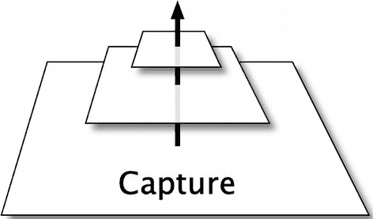

*图 7-2 事件捕获*

然后它进入**目标**阶段，这个阶段涉及你实际点击的元素。

之后，点击事件从内向外传播，从内层元素到外层元素。这被称为**事件冒泡**，如图 7-3 所示。

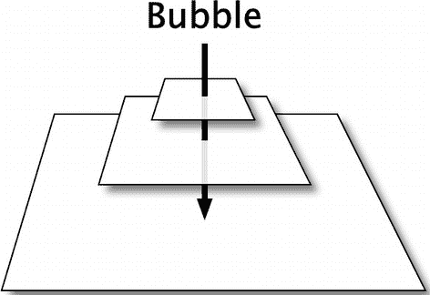

*图 7-3 事件冒泡*

大多数时候，你更关注的是冒泡阶段，即从被点击的元素开始。当你直接使用 `onclick` 属性或默认的 `addEventListener()` 方法时，事件监听器只会响应冒泡阶段。

你可以使用带有可选参数的 `addEventListener()` 来让事件监听器监听捕获阶段：

```
addEventListener('click', doit, true);
```


```markdown
第三个参数可以包含其他选项，但使用`true`表示它应该监听捕获阶段；其默认值为`false`，这也是为什么它默认监听冒泡阶段。

你可以通过在多个元素上添加相同的事件监听器来测试冒泡阶段和捕获阶段。我们将使用`<figure>`和嵌套的``元素进行测试。在这个实验中，我们将使用`.currentTarget`属性，它会告诉我们正在响应的是哪个事件监听器。

在进行测试之前，你需要确保当前的事件监听器已被移除：

```
figure.removeEventListener('click',doit);
```

我们还需要获取对嵌套图片的引用：

```
var img = figure.querySelector('img');
```

现在，重新定义`doit()`函数：

```
function doit(event) {
console.log(event.currentTarget);
}
```

首先，将事件监听器添加到冒泡阶段。这是默认行为，但我们会通过将最后一个参数设置为`false`来明确这一点：

```
figure.addEventListener('click', doit, false);
img.addEventListener('click', doit, false);
```

当你点击图片时，你会看到两个元素都调用了事件监听器，但`img`元素会先响应：

现在移除事件监听器。当你移除事件监听器时，它必须在事件类型（`click`）、事件监听器函数（`doit`）以及监听器类型（`false`）上与已添加的事件监听器完全匹配。如果任何一项不同，则事件监听器将无法被成功移除。由于`false`是默认类型，你不需要显式指定它，但我们仍会这样做：

```
figure.removeEventListener('click', doit, false);
img.removeEventListener('click', doit, false);
```

现在，将第三个参数设置为`true`来添加它们，以在捕获阶段调用：

```
figure.addEventListener('click', doit, true);
img.addEventListener('click', doit, true);
```

当你点击图片时，你现在会看到响应以相反的顺序出现：

同样，要移除事件监听器，你需要使用`removeEventListener()`，并匹配所有三个参数：

```
figure.removeEventListener('click', doit, true);
img.removeEventListener('click', doit, true);
```

在第[8]章中，我们需要注意元素的传播顺序。

### 停止传播

你可以阻止事件函数进一步处理。例如，你可以决定只处理最内层的元素，或只处理最外层的元素。

你可以使用`stopPropagation()`方法来阻止进一步的处理。例如，如果你只想处理图片，可以这样使用：

```
function doit(event) {
event.stopPropagation();
console.log(event.currentTarget);
}
figure.addEventListener('click', doit, false);
img.addEventListener('click', doit, false);
```

如果你现在点击图片，输出中你将只会得到图片，即最内层的元素。你现在可以再次移除事件监听器：

```
figure.removeEventListener('click', doit, false);
img.removeEventListener('click', doit, false);
```

如果你只想让`figure`元素响应，你可以通过将第三个参数设置为`true`来使用捕获阶段。

## 直接修改 CSS 样式

JavaScript 可以使用元素的`style`属性直接访问元素的 CSS 样式。例如：

```
var h1 = document.querySelector('h1');
h1.style.color = 'red';
```

设置`style`属性类似于在 HTML 中使用内联样式：

```
This is a heading
```

你可以读取通过这种方式设置的属性：

```
h1.style.color
←   red
```

但是，只有通过直接设置方式获得的属性才能以这种方式读取。通过常规 CSS 设置的属性无法通过这种方式读取。与内联样式一样，`style`属性在所有其他样式之后应用，因此你无法通过其他 CSS 样式表覆盖它。这对于一些简单的属性来说没问题，但不够灵活，稍后你将看到如何更好地与样式表协同工作。

`style`属性是一个**对象**，它本身是一个包含自身属性的数据包。JavaScript 有两种寻址属性的方式：

```
var h1 = document.querySelector('h1');
h1.style.color = 'red';         //  点号表示法
h1.style['color'] = 'green';    //  方括号表示法
```

第一种表示法，通常被称为**点号表示法**，原因显而易见，它更简单，但有一些局限性。第二种表示法，同样出于显而易见的原因被称为**方括号表示法**，它克服了这些局限性。

第一个局限性在 CSS 中最为明显，即点号表示法不允许使用在 JavaScript 中无效的属性名。例如，`background-color`属性包含一个连字符，这在 JavaScript 中是不允许的，因为它会被解释为减法运算。此时，方括号表示法就派上了用场：

```
var h1 = document.querySelector('h1');
h1.style.background-color = 'yellow';       //  错误
h1.style['background-color'] = 'orange';    //  有效
h1.style.backgroundColor = 'purple';        //  camelCase 写法
```

正如你所见，带连字符的 CSS 属性可以替换为驼峰式（camelCase）写法。然而，为了与标准 CSS 保持一致，我们将优先使用方括号表示法。

点号表示法的第二个局限性是属性名是硬编码的。你不能为属性使用变量。而方括号表示法则允许你使用变量来代替字符串字面量。

你可能会想，既然颜色应该在 CSS 中设置，为什么还要用 JavaScript 来改变颜色呢？原因是 CSS 只设置一次属性，而 JavaScript 可以用于与用户交互，因此你可以轻松地将其设置为其他值。

例如，你可以通过这种方式切换标题的颜色：

```
var h1 = document.querySelector('h1');
function doit(event) {
if(event.target.style['color'] != 'yellow')
event.target.style['color'] = 'yellow';
else event.target.style['color'] = 'orange';
}
h1.addEventListener('click',doit);
```

这段代码中存在一些重复。我们可以对此进行改进，但这需要一点小小的迂回。

### 重置属性

如果你想移除通过这种方式设置的属性，可以将其设置为`null`或空字符串（`''`）：

```
h1.style['color'] = null;               //  或 ''
h1.style['background-color'] = null;    //  或 ''
```

这将使元素回退到之前在 CSS 中设置的属性。

与此同时，我们还应该移除事件监听器：

```
h1.removeEventListener('click',doit);
```

如果我们不移除事件监听器，我们所有额外的实验都会堆积更多的事件监听器，导致元素以多种方式响应。

用这种方式设置颜色可能不是一个好主意，因为你更愿意在其他地方做艺术决策。然而，这种技术可以用于显示或隐藏元素，正如你将在接下来的项目中看到的那样。如果你希望 JavaScript 更改一些更艺术性的属性，你可以使用关于类（classes）和样式表（style sheets）部分中介绍的技术。

## 存储状态

在前面的例子中，我们在决定如何处理颜色之前，测试了颜色是否已经被设置。除了繁琐之外，这种技术也硬编码了太多值。

一种更好的技术是将我们所做的存储在一个单独的变量中。我们将其称为**状态**变量。

一个简单的方法是在函数外部创建一个变量，并在函数内部测试和设置它：

```
var h1 = document.querySelector('h1');
var modified = false;
function doit(event) {
if(!modified) event.target.style['color']
= 'yellow';
else event.target.style['color'] = null;
modified = !modified;
}
h1.addEventListener('click',doit);
```

当你完成测试后，移除事件监听器：

```
h1.removeEventListener('click',doit);
```
```

好的，作为高级文档工程师和翻译员，我将严格遵循您的注意事项和示例格式，将给定的英文文本翻译成中文。


## 优化代码

我们可以改进之前展示的代码。如果基于测试条件来设置值，可以简化这个过程。

### 条件运算符

JavaScript 有一个**条件运算符**（也称为**三元运算符**），它将测试与值的选择结合起来。例如：

```
»   var a = 3, b = 4;
»   a == b ? 'yes' : 'no';
←   "no"
```

条件运算符包含三个部分。第一部分是测试，可以使用在`if()`或`while()`语句中使用的任何表达式。第二部分是如果测试结果为`true`或真值时的值。第三部分是测试结果为假时的值。

我们可以使用条件运算符重写之前的代码：

```
»   var h1 = document.querySelector('h1');
»   var modified = false;
»   function doit(event) {
event.target.style['color'] =
!modified ? 'yellow' : null;
modified = !modified;
}
»   h1.addEventListener('click',doit);
```

这不仅更简单，而且使意图更清晰。

测试完成后，移除事件监听器：

```
»   h1.removeEventListener('click',doit);
```

### 静态变量

在某个时候，你可能会听说`JavaScript`不支持静态变量，从技术上讲，这是正确的。

在支持静态变量的语言中，函数变量可以在调用之间保留其值。例如，你可能会像这样编写代码：

```
»   //  This doesn't work:
»   function test() {
static var value;
value = value ? value+1 : 1;
console.log(value);
}
»   test();
»   test();
»   test();
```

从注释中可以看出，这在`JavaScript`中无法工作。这是因为`JavaScript`确实不支持静态变量。但是，如果你利用所有`JavaScript`函数在技术上都是对象这一事实，你可以*模拟*静态变量。这意味着它们具有属性，并且你可以根据需要添加更多属性。

为了使之前的示例正常工作，我们将`value`变量更改为函数的`.value`属性：

```
»   function test() {
test.value ??= 0;       //  undefined → 0
test.value ++;
console.log(test.value);
}
»   test();
»   test();
»   test();
```

如果尝试读取不存在的属性（例如`test.value`），第一次你会得到`undefined`，记住，除非你尝试在计算中使用它，否则这不是错误。第一次运行时，你需要检查这一点，如果它是`undefined`，则为其赋予一个实际值。

你可以使用像这样的语句：

```
»   if(test.value === undefined) test.value = 0;
```

你需要使用恒等运算符（`===`）来避免将`undefined`与其他假值混淆。然而，当你习惯后，使用前面显示的较短表达式会更简单且更具可读性。

在`JavaScript`中，这是**空值合并运算符**，它专门测试第一个值是否为`null`或`undefined`，这避免了混淆。你可以像这样测试它：

```
»   undefined ?? 23
←   23
```

你可以将其与赋值运算符结合，创建**空值合并赋值运算符**（`??=`）。

我们可以使用相同的技术来省去事件监听器中的状态变量：

```
»   var h1 = document.querySelector('h1');
»   //  var modified = false;   //  not needed
»   function doit(event) {
doit.modified ??= false;
event.target.style['color'] =
!doit.modified ? 'yellow' : null;
doit.modified = !doit.modified;
}
»   h1.addEventListener('click',doit);
```

这使函数更加自包含，因为它不依赖外部变量来维护状态。

测试完成后，移除事件监听器：

```
»   h1.removeEventListener('click',doit);
```

## 动态 CSS 更改

因为现在`JavaScript`深度参与其中，你可以以更有趣的方式变化样式。例如，这将随机更改背景颜色：

```
»   var h1 = document.querySelector('h1');
»   var colours
= ['red','orange','yellow','green','blue','violet'];
»   function doit(event) {
//  random index
var i = Math.floor(Math.random() * colours.length);
event.target.style['background-color'] = colours[i];
}
»   h1.addEventListener('click',doit);
```

`colours`变量只是一个颜色名称数组。变量`i`是一个随机数，将用作数组的索引。当你点击标题时，其背景颜色将设置为随机颜色。这绝对是`CSS`本身无法做到的。

测试完成后，移除事件监听器：

```
»   h1.removeEventListener('click',doit);
```

如果你不喜欢最终得到的颜色，也可以移除它：

```
»   h1.style['background-color'] = null;
```

## 读取其他 CSS 属性

如果你开始篡改各个`CSS`属性，将会丢失已精心添加到页面中的原始`CSS`设置。你可以读取这些属性，也许是为了恢复你的更改。例如，我们可以将标题背景颜色在新颜色和原始颜色之间切换，无论原始颜色是什么。

如果你一直在跟随操作，可能会发现自己积累了多个事件监听器。此时，如果重新加载页面，所有这些都将被清除。

要读取元素的所有可用`CSS`属性，你可以使用`window.getComputedStyle(element)`，或简写为`getComputedStyle(element)`。例如：

```
»   var h1 = document.querySelector('h1');
»   var styles = getComputedStyle(h1);
»   console.log(styles['background-color']);
```

`getComputedStyle(element)`的结果是一个对象，包含应用于元素的所有`CSS`属性，无论它们是继承的、有意设置的，还是（更可能是）两者兼有。在这种情况下，我们想要`background-color`属性，它是在`styles.css`样式表中设置的。

我们可以将其存储在变量中，并将其用于切换：

```
»   var h1 = document.querySelector('h1');
»   var styles = getComputedStyle(h1);
»   var originalColour = styles['background-color'];
»   function doit(event) {
doit.modified ??= false;
event.target.style['background-color'] =
!doit.modified ? 'yellow' : originalColour;
doit.modified = !doit.modified;
}
»   h1.addEventListener('click',doit);
```

通常，如果你要在`JavaScript`中更改原始`CSS`属性，记录它们始终是一个好主意。

不要忘记为将来的实验移除事件监听器和颜色。或者，你可以直接重新加载页面。

```
»   h1.removeEventListener('click',doit);
»   h1.style['background-color'] = null;
```

## 使用 CSS 样式表

直接更改样式的主要问题是，决策是在`JavaScript`中做出的，并由`JavaScript`开发者实现。在许多情况下，这些是艺术决策，应该由设计师在`CSS`中做出。即使两个角色由同一个人担任，你也应该将`JavaScript`逻辑与艺术风格分离。

最简单的方法是在`CSS`样式表中设置所有样式，并使用类来区分不同的状态。然后在`JavaScript`中更改类的值。

例如，在`sample-css.css`样式表中，你会找到类似这样的内容：

```
h1.different-color {
color: #dac1a4;
}
h1.different-background {
background-color: #587272;
}
```

你会注意到有两个不同的类，每个类都有自己的属性。如果你希望应用其中任何一个类，可以在`HTML`中添加以下内容：

```
 ... 
```

你甚至可以添加多个类：

```
 ... 
```

但是，这仅在你想使其永久生效时才有效。如果你想动态更改类，可以在`JavaScript`中执行：

```
»   var h1 = document.querySelector('h1');
»   h1.className = 'different-color';
```

如果你想应用多个类，只需列出它们即可。


```javascript
var h1 = document.querySelector('h1');
h1.className = 'different-color different-background';
```

大多数 JavaScript 中的元素属性与 HTML 中的对应属性同名，但 `class` 名称除外。这是因为 `class` 在 JavaScript 中有特殊含义，因此 JavaScript 使用 `className` 来避免冲突。

你可以通过将 `className` 设置为空字符串来移除一个类。

```javascript
h1.className = '';
```

如果在字符串中管理多个类，而你又希望单独操作它们，这可能会比较棘手。现代 JavaScript 提供了一种使用 `.classList` 操作类的替代方法：

```javascript
var h1 = document.querySelector('h1');
h1.classList.add('different-color', 'different-background');
```

你可以通过这种方式添加任意数量的类，但通常它用于单个类。

然后你可以移除该类以恢复其样式：

```javascript
var h1 = document.querySelector('h1');
h1.classList.remove('different-color');
```

`classList` 属性允许你一次操作一个类，而保持其他类不变。`classList` 属性还赋予你更多控制权，它拥有以下方法：

- `.classList.add(...)` 如果类不存在则添加它，如果已存在则忽略。
  你可以在列表中包含多个类。
- `.classList.remove(...)` 如果类存在则移除它，如果不存在则忽略。
  你可以在列表中包含多个类。
- `.classList.toggle(...)` 如果类不存在则添加它，如果已存在则移除它。
  `.classList.toggle()` 可以接受第二个参数。如果为 `true`，则添加该类；如果为 `false`，则移除它。
- `.classList.contains(...)` 告知你元素是否拥有该类。

你会发现 `.classList.toggle()` 方法特别有用。例如，你可以在 `click` 事件处理器中使用它：

```javascript
var h1 = document.querySelector('h1');
function toggle(event) {
    event.target.classList.toggle('different-color');
}
h1.addEventListener('click', toggle);
```

完成后，你可以移除事件监听器：

```javascript
h1.removeEventListener('click', toggle);
```

**关于事件监听器函数表达式的说明**
请注意，在前面的示例中，你定义了一个函数纯粹是为了将其分配为事件监听器。这可能被视为一种形式，因为事件监听器必须是一个函数，但实际上你之后不再需要引用该函数。

你可以通过直接分配事件监听器函数来简化此过程。如果你使用 `onclick` 事件属性，可以这样写：

```javascript
var h1 = document.querySelector('h1');
h1.onclick = function(event) {
    event.target.classList.toggle('different-color');
};
```

这里，我们使用了一个**函数表达式**，它本质上是一个未单独定义的函数。如果你打算立即分配它，这会特别有用。

现代 JavaScript 为函数表达式提供了一种替代语法：

```javascript
var h1 = document.querySelector('h1');
h1.onclick = event => {
    event.target.classList.toggle('different-color');
};
```

这被称为**箭头函数**表达式，在现代 JavaScript 中经常用于赋值的函数。然而，使用箭头函数时有一个陷阱。之前，你看到可以使用 `this` 关键字来引用带有事件监听器的元素。但这在箭头函数中行不通，因为箭头函数不会将 `this` 与不同的对象关联起来。这也是为什么使用 `event.target` 属性更好的原因之一。

如果你想使用 `.addEventListener` 方法，它的工作方式相同，但函数表达式被添加在括号内，这使得它稍微难以理解。

例如，使用传统的函数表达式：

```javascript
var h1 = document.querySelector('h1');
h1.addEventListener('click', function(event) {
    event.target.classList.toggle('different-color');
});
```

或者使用箭头函数表达式：

```javascript
var h1 = document.querySelector('h1');
h1.addEventListener('click', event => {
    event.target.classList.toggle('different-color');
});
```

这样写可读性稍差，但它能让你获得 `.addEventListener()` 方法提供的灵活性。真正的问题是事件监听器现在是匿名的，你无法轻易移除它，因为你没有直接的引用。有两种解决方法。

首先，你可以将匿名函数作为元素的一个属性来命名：

```javascript
var h1 = document.querySelector('h1');
h1.addEventListener('click', h1.fn = function(event) {
    event.target.classList.toggle('different-color');
});
```

由于箭头函数表达式的运算符优先级，这种方法更适用于传统（非箭头）函数表达式。在这里，函数表达式同时被赋值给了 `h1.fn`（或任何你想要赋予的属性名）。

要移除事件监听器，你可以使用 `h1.fn` 属性：

```javascript
h1.removeEventListener('click', h1.fn);
```

第二种方法则更为彻底，但它是清除累积事件监听器的一个绝佳途径：

```javascript
h1.outerHTML = h1.outerHTML;
```

`outerHTML` 属性本质上是元素本身的 HTML。你所做的实际上是重新构建该元素。这不会包含任何 JavaScript，但会包含已添加到元素上的所有类。如果你开始记不清自己添加的事件监听器，并且确实不想重新加载页面时，可以使用 `outerHTML` 方法。

**触发 CSS 过渡**

CSS **过渡**是从一种样式逐渐变化到另一种样式的过程，例如改变元素的颜色、大小或不透明度。你可以将其视为一次简单的、一次性动画。这依赖于两个部分：

- 首先，必须有一个设置来定义*哪些*属性需要进行过渡以及需要多长时间。
- 其次，一个属性必须有两个不同的值。其中一个值可以是默认值，例如文本颜色的黑色。

对于简单的 CSS 过渡，你可以直接使用 CSS，但对于更复杂的行为，你可以使用 JavaScript。

**一个简单的 CSS 过渡**
你可以在 CSS 中实现过渡，但 CSS 对用户操作的响应能力不是很好。因此，你通常会在鼠标移动到元素上时看到它们，例如按钮改变颜色。

例如，当你将鼠标悬停在示例按钮上时，它的颜色会改变。
以下是导致这种情况发生的部分 CSS 代码：

```css
button#sample-button {
    ...
    background-color: rgb(0,34,34);
    color: white;
    transition: color 0.5s, background-color 0.5s
}
button#sample-button:hover {
    color: rgb(0,34,34);
    background-color: white;
}
```

过渡由鼠标悬停触发，因为这是在纯 CSS 中你所能做的全部。有时你也可以响应点击，但 CSS 在这方面并不灵活。你还会注意到，变化大约需要半秒钟，这很好。这是因为 `transition` 属性的作用。

**在 JavaScript 中实现过渡**
*在过去*，所有的过渡和动画都是在 JavaScript 中实现的。那是因为 CSS 当时不知道如何实现。整个库都围绕过渡和动画构建，有些至今仍在使用。但大多数情况下，我们不再需要它们了。
如果你真的想自己实现 JavaScript 过渡，可以使用幻灯片项目中修改过的代码。过渡本质上是变化的快速重复。

以下是你如何使用 JavaScript 在 20 步内淡出图像元素的方法：

```javascript
var img = document.querySelector('figure>img');
var i = 0;
function fading() {
    img.style.opacity = 1 - i/20;
    i++;
    if(i>20) clearInterval(timer);
}
var timer = setInterval(fading, 100);
```

如果你想认真对待这件事，可以将其封装在一个函数中。

```javascript
function fade(element, time, steps=20) {
  var interval = time/steps;
  var i = 0;
  var timer = setInterval(fading, interval);
  function fading() {
    element.style.opacity = 1 - i/steps;
    i++;
    if(i>steps) clearInterval(timer);
  }
}
fade(document.querySelector('figure>img'), 2000, 20);
```

这里，图片现在作为参数传递，同时还传递了总时间（2000 毫秒）和步数；在函数内部，它们用于计算 `setInterval()` 函数的间隔和透明度的增量。

然而，**我们真的不想这样做**，尤其是在涉及其他更复杂的过渡时。幸运的是，CSS 解决了这个问题。

## 使用 JavaScript 实现 CSS 过渡

你也可以在 JavaScript 中通过设置 CSS 属性并使用事件监听器触发更改来实现过渡。

例如：

```javascript
var h1 = document.querySelector('h1');
// 初始属性
h1.style.transition = 'border-color 3s';
h1.style['border'] = 'thick solid';
h1.style['border-color'] = 'red';
function doTransition(event) {
  doTransition.modified ??= false;
  event.target.style['border-color'] =
    !doTransition.modified ? 'yellow' : 'red';
  doTransition.modified = !doTransition.modified;
}
h1.onclick = doTransition;
```

点击标题时，边框颜色最终会变为黄色，但需要三秒钟才能完成。再次点击则会变回红色。

过渡效果需要两个条件：

- 在 `border-color` 属性上设置了 `transition` 属性。
- 然后更改了 `border-color` 属性。

这比依赖 `:hover` 伪类**好得多**，因为更改仅在用户明确需要时才会执行。如果弹出菜单能做到这一点，而不是在用户移动鼠标时突然出现，世界会变得更好。

如果你尝试连续更改属性两次，会遇到一些问题：

```javascript
var h1 = document.querySelector('h1');
h1.style['transition'] ='border-color 3s';
h1.style['border-color'] = 'red';
h1.style['border-color'] = 'yellow';
```

问题在于，浏览器不会等待三秒完成颜色更改后再进行下一次更改。相反，它会走捷径，直接分配第二个值。如果元素一开始是另一种颜色，你只会看到过渡到第二种颜色。如果元素已经是第二种颜色，你将什么也看不到。

JavaScript 不喜欢等待，但你可以让它到时候再回来处理任务。在这种情况下，你可以分配一个函数在过渡结束时运行。这需要响应 `transitionend` 事件：

```javascript
var h1 = document.querySelector('h1');
h1.style['transition'] = 'border-color 3s';
h1.ontransitionend = event => {
  event.target.style['border-color'] = 'yellow';
};
h1.style['border-color'] = 'red';
```

这些示例都使用颜色作为明显的测试属性。你也可以将这种技术与 `opacity` 一起使用：

```javascript
h1.style.transition='opacity 4s';
h1.ontransitionend = event => {
  event.target.style['opacity'] = 1;
}
h1.style.opacity = 0;
```

... 或者与尺寸一起使用：

```javascript
h1.style['overflow']='hidden';
h1.style.transition='max-height 4s';
h1.style['max-height'] = '2em';
h1.ontransitionend = event => {
  event.target.style['max-height'] = '2em';
}
h1.offsetHeight;
h1.style['max-height'] = '0';
```

最后一个示例需要一些额外的样式修改才能使过渡更明显。`overflow` 属性控制内容超出盒子时的行为。在这种情况下，内容被隐藏而不是溢出。

它还需要一些技巧才能工作：

- 只有在属性实际发生变化时才会触发过渡。这就是为什么 `max-height` 属性最初被设置为 `2em`。
- 如果允许，JavaScript 也会不耐烦地合并两个 `max-height` 设置。在第二次设置它之前，我们包含了 `h1.offsetHeight` 来强制屏幕更新。

如你所见，在 JavaScript 中触发 CSS 过渡有点棘手，但它仍然比尝试在 JavaScript 中完成整个过渡要简单得多。在下一节中，你将看到如何将更多的艺术工作委托给 CSS 本身。

## 在 JavaScript 中创建样式表

在之前关于使用类的讨论中，你会注意到对现有 CSS 样式表的依赖。当然，页面元素外观的细节应该留给样式表及其开发者，但 JavaScript 中的某些技术如果依赖别人完成他们的工作，就会变得脆弱。

在 JavaScript 代码**绝对需要**某些 CSS 属性的情况下，最好让 JavaScript 设置这些属性。更好的是，JavaScript 可以以允许 CSS 开发者用首选值覆盖它们的方式设置这些属性。

### 创建样式表

如果你要在 HTML 本身中定义样式，你可以创建一个 `style` 元素：

```html
<html>
  <head>
    <style>
      ...
    </style>
    <link rel="stylesheet" type="text/css" href="standardstyles.css" />
    ...
  </head>
</html>
```

`style` 元素将包含仅限此页面的额外样式。请注意，在此示例中，它被放置在加载外部样式表的 `link` 元素**之前**。也可以放在后面，但放在前面允许外部样式表覆盖内部样式。

在 HTML 中以这种方式定义样式通常不是一个好主意，因为它难以维护，但我们将在 JavaScript 中使用此技术的变体。

要在 JavaScript 中创建样式表，我们使用 `document.createElement()`，它可以创建任何 HTML 元素：

```javascript
var style = document.createElement('style');
document.head.insertAdjacentElement('afterbegin', style);
```

变量 `style` 用于将元素添加到文档中，并且稍后也将用于添加 CSS 规则。

要将样式元素添加到 `head` 元素，最简单的方法是使用 `insertAdjacentElement`，它允许你在原始元素的内部或外部、开头或结尾添加新元素。

请注意，新的样式表被添加到 `head` 元素的开头，位于任何其他已添加的样式表之前。这允许链接的样式表在需要时覆盖属性。

### 添加 CSS 规则

你现在可以使用 `insertRule()` 函数添加 CSS 规则，该函数接受一个 CSS 字符串：

```javascript
style.sheet.insertRule(`h2 {
  border: medium solid white;
  border-style: none none solid none;
  padding-bottom: 0.5em;
}`);
```

CSS 可以写成一行，但通常在属性之间换行以使代码更易于管理。这就是我们使用模板字符串字面量来允许字符串中换行的原因。

在这个例子中，我们添加了一些本可以轻松包含在标准样式表中的 CSS，所以在这里有点浪费。然而，在第 9 章关于 Lightbox 的内容中，我们将使用这种技术来添加一些使效果工作所需的基本 CSS。通过将新样式表放在开头，你仍然可以选择使用常规样式表覆盖某些属性。

## 总结

在本章中，我们探讨了如何使用 CSS 样式和 JavaScript 事件监听器。

### CSS

CSS 是向网页添加样式的标准方法。它可以作为样式块添加到 HTML 中，但更常见的是作为指向单独样式表的链接添加。也可以使用 `style` 属性将 CSS 样式直接添加到单个元素。

你可以使用 JavaScript 对元素进行 CSS 样式更改，无论是直接添加样式还是更改与样式关联的元素类。

JavaScript 还可以选择性地禁用或启用单个样式表。


### 事件监听器

事件监听器是一种用于响应用户事件的函数，例如使用鼠标或键盘。你可以通过事件监听属性（如 `.onclick`）或使用 `.addEventListener()` 方法来为元素添加事件监听器。`addEventListener()` 方法更为灵活，允许为单个元素添加多个事件监听器。事件监听器也可以被移除。

事件监听器不必是一个完整的函数。它可以是一个函数表达式，即不单独存储的函数。它也可以是一个箭头函数表达式，这是一种简化形式。然而，使用函数表达式会使移除监听器变得更为棘手。

事件监听函数可以访问一个事件对象，该对象包含刚刚发生的事件的信息。事件对象的一个重要属性是 `target`，它指向触发事件的元素。

同一个事件监听函数可以用于多个元素。如果元素是嵌套的，所有事件都会经历事件，既包括捕获阶段（从外向内），也包括冒泡阶段（从内向外）。

### 更改 CSS 属性和类

可以使用元素的 `style` 对象来更改单个 CSS 属性。CSS 属性可以像其他对象属性一样被访问，但我们使用方括号表示法，以便属性名称与 CSS 属性名称保持一致。

也可以通过更改元素的类或类列表来间接更改 CSS 样式。这样可以将 CSS 样式设置在样式表中，而让 JavaScript 来触发样式的更改。

可以使用 `.className` 属性来设置类，但使用 `.classList` 对象更加灵活。

还可以读取应用于元素的所有样式，这些样式可以是直接添加的、通过样式表添加的，或者是继承而来的。这在恢复你可能已做出的任何更改时非常有用。

### 切换属性

JavaScript 的一个常见应用是来回更改属性——即切换它们。

将当前状态存储在一个变量中可能会很有用。这可以在函数外部的变量中完成，也可以作为函数对象的属性来完成，其作用类似于静态变量。可以使用空值合并运算符来初始化变量。可以使用条件运算符在两个状态之间进行切换。

### 过渡

过渡是 CSS 样式的渐变过程。在过去，这需要通过 JavaScript 重复调用函数来实现，类似于 JavaScript 幻灯片展示代码的方式。现代 CSS 无需额外的 JavaScript 即可处理这些过渡效果。

你可以通过在 JavaScript 中设置 `transition` 属性并更改受影响的 CSS 属性来触发 CSS 过渡。或者，你也可以通过使用预定义的过渡来更改类，从而触发过渡。

### 创建样式表

通常情况下，所有 CSS 都应在附件样式表中实现。然而，有时可能会需要额外的样式。这可以通过在 JavaScript 中创建一个新的 style 元素并将其添加到文档中来实现。

## 后续内容

接下来的两个项目将会把这些知识付诸实践。第 8 章重点介绍 JavaScript 如何通过切换类来切换某些元素的可见性。第 9 章重点介绍创建新元素、添加 CSS 样式、劫持 HTML 锚点以及更多关于事件监听器的内容，包括处理键盘事件。

# 8. 显示和隐藏内容

你经常会在网页上看到可以打开和关闭的区域。它们可能是菜单项或内容区块。

在这个项目中，我们将切换内容和列表。技术是相似的，都是让 JavaScript 更改选定元素的状态。至于其他方面，我们将让 CSS 来完成内容的显示和隐藏，并适当地添加一些动画效果。


## 初始页面设置

我们处理的页面位于**变化的内容**链接中，文件名为 `showing-hiding.html`。初始状态下，页面如图 8-1 所示。

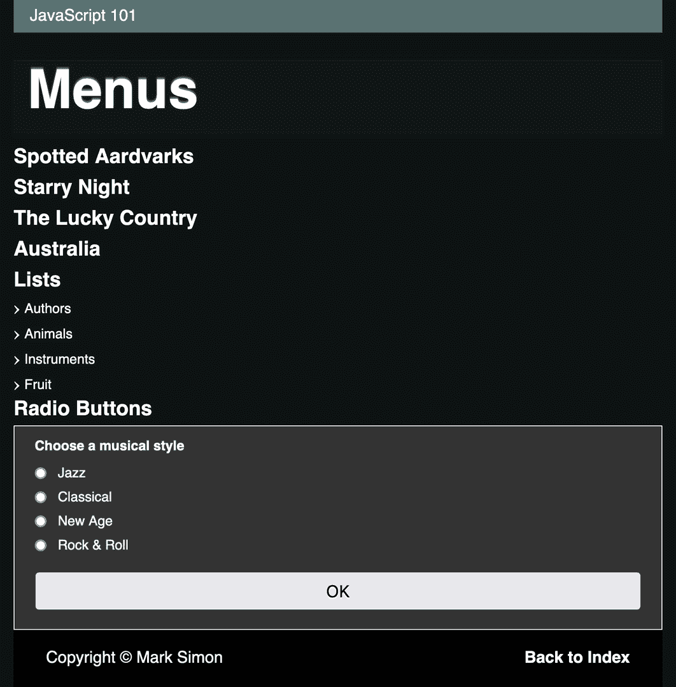

**图 8-1** *变化的内容*

内容各部分和列表均已折叠。其余内容虽存在，但在 CSS 中被隐藏了。我们将编写代码来改变这一情况。此外，最后还有一个部分，讨论如何根据我们在第一个关于内容标题的练习中开发的技术来改变分组框的行为。

### 初始 HTML 和 JavaScript

`showing-hiding.html` 页面已配置好内容及指向 JavaScript 文件的链接：

同样，我们引入了该库，以备编写可复用代码。而且，由于没有需要立即执行的内容，因此没有使用 `defer` 属性。

JavaScript 文件 `showing-hiding.js` 也已设置完毕：

```
init();
function init() {
  doHeadings();
  doMenu();
  doForm();
}
function doHeadings() {
}
function doMenu() {
}
function doForm() {
}
```

`init()` 函数将调用*三个*函数，分别对应这个项目的不同部分。

## 显示和隐藏文本内容

本项目的这一部分将允许你通过点击标题来显示和隐藏文本块。

### 基本 HTML

内容的基本格式如下所示：

```
<div id="headings">
  <div class="section">
    <h2>...</h2>
    <div>...</div>
  </div>
  ...
</div>
```

所有内容都包含在一个 `div` 元素内。`div` 常用于控制布局，但在这里它被用作主容器。由于 `div` 除了作为块级元素之外，没有特定的默认行为，通常会给它一个 `id` 或 `class` 来标识。在此例中，`id` 为 `headings`，容器被标识为 `div#headings`。这在 CSS 和 JavaScript 中都会用到。

还有更多的 `div` 元素，但它们很容易被识别为主容器内部的元素。`h2` 元素也是如此，它们通常定义标题，但在这里也将用于显示和隐藏内容。内部 `div` 元素的用途是容纳标题之后要显示或隐藏的内容。在 CSS 中，它们被标识为 `h2+div`，表示 `h2` *之后*的 `div`。

通过使用这一个 `id`，我们可以使用以下选择器来识别主容器及其内容：

| 元素 | 选择器 |
| --- | --- |
| 主容器 `div` | `div#headings` |
| 内部 `h2` | `div#headings>h2` |
| `h2` 之后的 `div` | `div#headings>h2+div` |

注意，我们已尽量降低对 HTML 的要求。容器必须有一个 id，且内容必须遵循一种模式。仅此而已。

### 准备切换代码

我们首先要做的是找到那些能切换 `div` 可见性的标题。JavaScript 有两个函数可以使用 CSS 选择器定位元素。`querySelector()` 函数查找*第一个*匹配项，在你知道该元素应该是唯一时特别有用。`querySelectorAll()` 函数返回一个带编号的匹配集合。对于本项目，我们将使用 `querySelectorAll()`。如果没有匹配 `querySelectorAll()` 的结果，你将得到一个空集合。测试空集合最简单的方法是检查其 `length` 属性。

要获取所有标题，我们可以使用：

```
function doHeadings() {
  let headings = document.querySelectorAll('div#headings>h2');
  if(!headings.length) return;
}
```

该集合将存储在 `headings` 变量中。如果没有匹配项，`length` 为 `0`，这是假值，函数将立即返回，因为无事可做。

如果考虑让这段代码可复用，我们应该移除对 `div#headings` 的硬编码引用，并将其改为参数变量。我们仍然需要其中的 `h2` 部分，因此我们将它们组合成一个模板字符串字面量：

```
function doHeadings(container) {
  let headings = document.querySelectorAll(`${container}>h2`);
  if(!headings.length) return;
}
```

我们需要在 `init()` 函数的调用中提供容器：

```
function init() {
  doHeadings('div#headings');
  doMenu();
  doForm();
}
```

我们也会留意其他可以将代码通用化的机会。

### 遍历标题集合

从 `querySelectorAll()` 获取的数据称为**节点列表**。它实际上并不是数组，但它与数组类似，是一个带编号的集合。它同样类似于数组，因为你可以使用 `forEach()` 方法遍历该集合。

`forEach()` 方法接受一个函数作为参数，该函数将执行实际工作：

```
function doSomething(item, index, collection) {
}
headings.forEach(doSomething);
```

其中 `item` 是集合中的每一项，`index` 是每一项的编号，`collection` 是整个集合。大多数时候我们只关心 `item`。

如果你只在 `forEach()` 方法中使用该函数，它不必是一个永久命名的函数。函数表达式也可以：

```
headings.forEach(function(item, index, collection) {
});
```

现代 JavaScript 为函数表达式提供了一种更短的语法：

```
headings.forEach((item, index, collection) => {
});
```

在我们的案例中，我们需要引用集合中的每一项（每个标题），但不需要其余参数，因此我们可以使用更*短*的语法，省去括号：

```
headings.forEach(item => {
});
```

在我们的 `doHeadings()` 函数中，可以如下使用：

```
function doHeadings() {
  let headings = document.querySelectorAll('div#headings>h2');
  if(!headings.length) return;
  headings.forEach(heading => {
  });
```

下一步将是让标题执行某些操作。

### 附加切换行为

显示和隐藏内容的代码将以一个名为 `toggle()` 的函数的形式存在。我们需要做的是在点击标题时触发该函数。我们将通过为每个标题的 `onclick` 事件属性赋值一个 `toggle()` 函数来实现：

```
function doHeadings(container) {
  ...
  headings.forEach(heading => {
    heading.onclick = toggle;
  });
  function toggle() {
  }
}
```

注意，函数是在赋值*之后*定义的，这看起来有些违反直觉。当然，你也可以在之前定义函数，但这种方式可能更容易理解。JavaScript 通常不会乱序执行。然而，JavaScript 解释器分多个阶段运行，你会发现它在实际运行代码之前会处理所有 `var` 和 `function` 语句。我们说 `var` 和 `function` 语句会被**提升**（hoisted）。较新的 `let` 和 `const` 语句则*不会*被提升。

### 改变外观

此时，我们需要了解一些 CSS 如何显示和隐藏内容的知识。一个非常简单的例子如下：

```
div#headings>h2+div {
  display: none;
}
div#headings>h2.open+div {
  display: block;
}
```

选择器 `div#headings>h2+div` 表示位于 id 为 `headings` 的 `div` 内部、`h2` 元素之后的 `div`。有时，你需要反向阅读选择器才能理解其英文含义。在这里，`div` 默认是隐藏的，因为其 `display` 属性设置为 `none`。如果你为 `h2` 分配一个 `open` 类，那么选择器 `h2.open` 就会生效。在这种情况下，它会变得可见，因为其 `display` 属性被设置为 `block`。

前面的 CSS 可以实现功能，但如果你加入一些（微妙的）动画，显示和隐藏会变得更有趣。项目中的实际 CSS 是：

```
div#headings>h2+div {
  overflow: hidden;
  max-height: 0;
  opacity: 0;
  transition: max-height 250ms, opacity 1500ms;
}
div#headings>h2.open+div {
  max-height: 30em;
  opacity: 1;
}
```


与其用 `display` 属性生硬地隐藏和显示 `div`，不如先将 `div` 的 `max-height` 设为 `0`。为避免内容溢出，还需要将 `overflow` 属性设为 `hidden`。同时，我们将其 `opacity` 设为 `0` 使其不可见，这样就能在后续让它淡入。

要显示这个 `div`，我们把它的高度设为一个足够大的值，并将 `opacity` 设为 `1`。让这种变化更有趣的是 `transition` 属性，它指定了哪些属性需要过渡以及过渡时长。最难的部分是为 `max-height` 属性设置一个合理的值。如果设得太高，你会等很久才能看到内容闭合；如果设得太低，又无法容纳内容。通过这几行 CSS 代码，你会体会到其功能之强大。而 JavaScript 只需要负责切换类名。

### 切换类名

从 JavaScript 的角度来看，任务很简单。当你点击标题时，应该添加或移除 `open` 类，剩下的工作交给 CSS。

要切换所点击标题的类名，使用 `classList.toggle` 函数：

```javascript
function toggle(event) {
  event.target.classList.toggle('open');
}
```

记住，`event.target` 就是你刚刚点击的标题。`toggle` 函数会查找 `open` 类，如果找到就移除它，否则就添加它。现在测试一下，你会发现可以通过点击任意部分的标题来打开或关闭该部分，还会看到为这个类编写的 CSS 动画效果。

### 选中单个标题

按照目前的代码，你可以同时打开任意多个部分。这种行为类似于表单上的复选框，你同样可以选中多个。你可能更希望一次只打开一个部分，就像在表单上从多个单选按钮中选择一个一样。一次只选中一个部分需要更多工作，因为你还需要跟踪哪个部分已经打开，以便在打开新部分时将其关闭。

首先，我们需要另一个变量，比如 `opened`，来记住当前打开的部分：

```javascript
function doHeadings() {
  ...
  let opened = null;
  function toggle(event) {
    //  event.target.classList.toggle('open');
  }
}
```

`opened` 变量将用于跟踪当前拥有 `open` 类的 `h2` 元素。一开始没有部分被打开，所以变量 `opened` 初始化为 `null`。注意，`toggle` 函数中原来的语句已被注释掉。接下来将替换这段代码。当然，你可以删除那条语句，但这里保留它以便对比。

还要注意新变量与内部函数和外部函数的关系。`opened` 变量定义在 `doHeadings` 函数内部，因此它是 `doHeadings` 的*局部*变量。然而，它是在外部 `toggle` 函数外部定义的。虽然没有官方术语，但我们可以非正式地称其为**相对全局变量**。一个相对全局变量的最接近正确名称是**闭包变量**。**闭包**是由一个函数及其继承的环境（此处指该变量）组合而成的。你可以在 [`https://developer.mozilla.org/en-US/docs/Web/JavaScript/Closures`](https://developer.mozilla.org/en-US/docs/Web/JavaScript/Closures) 了解更多关于闭包的内容。

`toggle` 函数的第一个任务应该是隐藏前一个部分，即从当前选中的 `h2` 上移除 `open` 类：

```javascript
function toggle(event) {
  //  event.target.classList.toggle('open');
  opened.classList.remove('open');    //  还未实现
}
```

`classList.remove` 函数会在元素中查找 `open` 类，如果存在就将其移除；如果不存在则无任何效果。

如果尝试运行这段代码，一开始会遇到错误。这是因为没有部分被打开，且 `opened` 被设为 `null`；不能在 `null` 上调用方法。这意味着我们必须先进行判断：

```javascript
function toggle(event) {
  //  event.target.classList.toggle('open');
  if(opened) opened.classList.remove('open');
}
```

记住，`if( ... )` 会判断 `true` 或 `false`，但也判断“有值”或“无值”。在此例中，`null` 被视为“无值”；如果 `opened` 有值，我们就可以移除该类。

下一步是通过向选中的 `h2` 的类列表添加 `open` 来打开选中的部分。同时，我们会将该 `h2` 赋给新的 `opened` 变量：

```javascript
function toggle(event) {
  //  event.target.classList.toggle('open');
  if(opened) opened.classList.remove('open'); //  关闭
  event.target.classList.add('open');
  opened = event.target;
}
```

现在运行代码，你会看到一次只有一个部分被打开。

### 关闭选中的部分

单选按钮的正常行为是，一旦选中一个，就始终有一个被选中。（你可以在页面底部的单选按钮部分看到这一点。）这对单选按钮来说并不总是方便，对打开部分来说也是如此。再做一些工作，我们可以让再次点击当前打开的部分时将其关闭。

在关闭当前部分后，你需要检查选中的标题是否与上一次相同。如果是，就让它保持关闭并忘记它；如果不是，则按之前的方式打开它：

```javascript
function toggle(event) {
  //  event.target.classList.toggle('open');
  if(opened) opened.classList.remove('open'); //  关闭
  if(event.target == opened) {            //  忘记
    opened = null;
  }
  else {                                  //  打开并记住
    event.target.classList.add('open');
    opened = event.target;
  }
}
```

### 将 `doHeadings` 代码移至库文件

大部分代码与应用程序无关，因此我们可以将其移至库文件以备将来使用。不过，我们可能得想一个更好的名字。`doHeadings` 有点太模糊了。如果你能想到比 `toggleHeadingContent` 更好的名字，尽管用。目前，我们假设你没想到。

首先，你可以将整个 `doHeadings()` 函数代码移至 `library.js` 文件。`showing-hiding.html` 页面中已经有对库文件的引用，因此你可以少操心一件事。别忘了重命名它。

函数前应该有一个注释块，其中还应包含一些简单的说明，如下所示：

```javascript
/*  toggleHeadingContent(container)
================================================
切换标题部分。使用以下结构：
div#containerid
  h2
  div
    content
  h2
  div
    content
  h2
  div
    content
================================================ */
function toggleHeadingContent(container) {
  ...
}
```

你可以根据需要写得尽量详细，但不要过于繁杂。

最后，当然还需要在 `init()` 函数代码中更改名称：

```javascript
function init() {
  toggleHeadingContent('div#headings');
  doMenu();
  doForm();
}
```

现在，我们可以编写用于切换嵌套列表的代码了。

### 切换列表

HTML 列表是一种包含一个或多个列表项的结构。其最简单的形式如下：

```html
<ul>
  <li>苹果</li>
  <li>香蕉</li>
  <li>樱桃</li>
</ul>
```

在浏览器中显示为：

*   苹果
*   香蕉
*   樱桃

这种列表被称为**无序列表**，标记为 `ul`；原则上，项目顺序没有特定含义。你也可以有**有序列表**，标记为 `ol`，此时项目编号会自动生成。使用 CSS，你可以对列表的外观进行多种更改，包括编号样式。

你还可以有**嵌套列表**，即列表中的列表：

```html
<ul>
  <li>水果
    <ul>
      <li>苹果</li>
      <li>香蕉</li>
      <li>樱桃</li>
    </ul>
  </li>
  <li>乐器
    <ul>
      <li>手风琴</li>
      <li>班卓琴</li>
      <li>英国管</li>
    </ul>
  </li>
</ul>
```

显示为：

*   水果
    *   苹果
    *   香蕉
    *   樱桃
*   乐器
    *   手风琴
    *   班卓琴
    *   英国管


好的，作为一名高级文档工程师兼翻译员，我将严格遵循您提供的格式和注意事项，将给定的英文文本翻译成符合要求的中文。


# 列表与菜单的 JavaScript 实现

这里，主列表项包含一些文本，后面跟着另一个 `ul`；文本充当嵌套列表的标题。列表常被用作菜单，从简单的导航按钮到带有下拉子菜单的菜单，这一切都通过 CSS 的魔力实现。如果列表足够大，它开始主导页面，因此找到一种打开和关闭列表部分的方法变得方便。这正是我们在项目这一部分所做的工作。

当然，列表可以用于许多事情，但一个常见用途是作为链接列表充当菜单。过去，由于使菜单（尤其是水平菜单）看起来美观的难度，其他结构（如表格）也被用于菜单。谢天谢地，那些日子已经过去了，CSS 可以让列表菜单看起来恰到好处。现在最难的部分是决定你想要用众多方式中的哪一种来设计你的列表。

### 初始 JavaScript

主列表是如下的无序列表：

CSS 对其外观做了许多更改，包括隐藏嵌套列表：

```css
ul#menu li>ul { /*  ul inside li inside ul#menu */
  display: none;
}
```

与之前展示的标题一样，我们希望代码可重用，因此我们将在 `doMenu()` 函数中包含一个参数，并在 `init()` 函数中使用它：

```javascript
function init() {
  toggleHeadingContent('div#headings');
  doMenu('menu');
}
function doMenu(menuId) {
}
```

这里，我们简单地传递一个 `id`，假设它必须是某个 `ul` 元素的 `id`。

在 `doMenu()` 函数内部，我们可以使用这个 `id` 来定位列表：

```javascript
function doMenu(menuId) {
  let ul = document.querySelector(`ul#${menuId}`);
}
```

与前述标题不同，我们不需要将事件监听器附加到列表内的单个元素上。这是因为如果你点击内部的某个元素，该点击会**传播**到其容器，因此一个事件监听器就能够处理它。

要附加事件监听器，照常分配 `onclick` 属性：

```javascript
function doMenu() {
  let ul = document.querySelector('ul#menu');
  ul.onclick = toggle;
  function toggle(event) {
  }
}
```

请记住，使用 `onclick` 事件属性添加的事件监听器默认在冒泡阶段（即从内到外）进行监听。这正是我们想要的。

`ul` 变量只被使用一次，因此我们可以通过如下语句省去它：

```javascript
//  Not this time:
document.querySelector('ul#menu').onclick = toggle;
```

然而，我们稍后需要 `ul` 变量来做出进一步改进，因此我们保留其原始形式。
现在，列表是一个包含许多其他列表项和内部列表的大型结构。事件监听器将响应任何这些嵌套元素的点击。你需要知道的是你实际点击了哪个元素，以便我们能改变其状态。

事件监听器可以访问与事件相关的**两个**值：

-   `event.target` 变量引用的是实际被点击的元素。这里，它始终是 `ul#menu` 元素。
-   `event.currentTarget` 属性引用的是触发事件监听器的元素；也就是你实际点击的那个元素。

在我们之前的许多示例中，你点击的元素与拥有事件监听器的元素是同一个，因此 `event.currentTarget` 和 `event.target` 引用的是同一个东西。这次它们会不同，你需要区分它们。这次我们将该事件监听器称为**委托**事件监听器。
接下来我们需要担心的是是否存在要显示的嵌套列表。`event.target` 始终是一个 `li` 元素，因为这是列表在页面上可见的部分。这些条目中**有些**会有嵌套列表，有些则没有。

我们可以使用 `event.target.querySelector('ul')` 来测试是否存在嵌套列表：

```javascript
function toggle(event) {
  if(!event.target.querySelector('ul')) return;
}
```

我们将 `querySelector` 限制在这个 `li` 元素上。`event.target.querySelector('ul')` 的结果要么是某个东西（另一个列表），要么是空（`null`）。如果它不是某个东西（`if(!...)`），我们就用 `return` 语句退出函数。否则，我们继续切换该条目：

```javascript
function toggle(event) {
  if(!event.target.querySelector('ul')) return;
  event.target.classList.toggle('open');
}
```

现在你可以打开和关闭嵌套列表了。

### 高亮显示嵌套列表

当然，并非所有列表项都有嵌套列表。理想情况下，你应该高亮显示那些有嵌套列表的项。在这个例子中，它们通过 `›` 字符高亮显示，当条目打开时该字符会被旋转。
传统上，CSS 没有能够选择包含特定内容的元素的选择器，因此你必须使用 JavaScript 中的蛮力方法。

现代 CSS 确实有这样的选择器。然而，它是全新的，并且在 Firefox 中尚未得到完全支持。该选择器采用以下形式：

```css
li:has(ul) {
  ...
}
```

这表示任何包含 `ul` 的 `li`。如果你查看样式表本身，它并没有那么简单，因为它仍然需要照顾不支持该选择器的浏览器：

```css
li:is(.nested,:has(ul)) {
  ...
}
```

关于选择器还有很多内容，因为它们包含了对 `open` 类、`ul#menu` 主列表以及其他内容的引用。关键在于，不支持该选择器的浏览器需要以名为 `nested` 的类的形式获得一些帮助。

### 支持不支持该选择器的浏览器

目前，大多数（但不是全部）浏览器都支持 `:has()` 选择器，很可能你的浏览器也支持。然而，你应该始终为**较新**特性不被支持的情况做准备。你可以通过访问 [`https://caniuse.com/`](https://caniuse.com/) 来了解一个较新特性的支持情况。
为了让这个功能跨平台工作，我们需要在不支持该选择器的浏览器上，为那些具有嵌套列表的条目添加 `nested` 类。我们不想手动执行此操作，因此我们让 JavaScript 来做这项艰苦的工作。
在过去，有大量“浏览器嗅探”——检查正在使用哪个浏览器。这绝对是个坏主意，因为要跟上各种浏览器及其版本是不可能的。一个好得多的方法是测试特性本身。
只有当某个特性已经被标准化但尚未得到完全支持时，你才应该考虑这种事情。依赖非标准特性将来肯定会让你头疼。
在过去，我们在本书中使用的许多 JavaScript 特性，例如 `.forEach()`、`.querySelector()` 或 `.classList`，都需要测试。这就是为什么有这么多对“现代 JavaScript”的引用的原因。幸运的是，它们都已经支持了很多年，访问 [`https://caniuse.com/`](https://caniuse.com/) 就能确认这一点。

要测试一个新的 CSS 特性，有一个名为 `CSS.supports()` 的函数，它将测试某个特定的 CSS 特性是否可用。我们想要的大概是这样的：

```javascript
CSS.supports('selector(:has(ul))')
```

字符串中的 `selector()` 函数用于测试特定的选择器是否有效；`:has(ul)` 就是我们想要的具体伪类选择器。如果特性受支持，结果将为 `true`；否则为 `false`。

我们将使用这个来为那些需要 `nested` 类的列表项添加它，但仅在需要时添加。之前，我们找到了主列表并将其赋值给变量 `ul`。利用这个，我们可以搜索其内容：

```javascript
function doMenu() {
  let ul=document.querySelector('ul#menu');
  ul.onclick=toggle;
  if(!CSS.supports('selector(:has(ul))')) {
    ul.querySelectorAll('li').forEach(li => {
    });
  }
  ...
}
```

`ul.querySelectorAll('li')` 将生成 `ul` 列表内所有列表项的集合。正如我们之前所见，你可以使用 `.forEach()` 遍历这个集合。注意，找到的条目将是**所有**列表项，包括嵌套列表内部更深处的条目以及那些没有自己嵌套列表的条目。


在 `forEach` 内部，我们有一个箭头函数，将每个列表项赋值给变量 `li`。在这里，我们希望只选中那些自身包含列表的列表项：

```
function doMenu() {
let ul=document.querySelector('ul#menu');
ul.onclick=toggle;
if(!CSS.supports('selector(:has(ul))')) {
ul.querySelectorAll('li').forEach(li => {
if(li.querySelector('ul')) li.classList.add('nested');
});
}
...
}
```

`li.querySelector('ul')` 会在每个 `li` 内部查找 `ul` 元素。如果找到了，我们并不需要这个实际元素，而是希望给该 `li` 添加 `nested` 类。如果没找到，结果就是 `null`，其余代码将被忽略。

关于 `CSS.supports('selector(:has(ul))')` 是否能正确测试，在错误报告中存在一些讨论。根据作者的经验，它运行良好。如果你有所疑虑，可以放弃测试该特性，直接添加类：

```
function doMenu() {
let ul=document.querySelector('ul#menu');
ul.onclick=toggle;
//  if(!CSS.supports('selector(:has(ul))')) {
ul.querySelectorAll('li').forEach(li => {
if(li.querySelector('ul')) li.classList.add('nested');
});
//  }
...
}
```

同时保留两者也无妨。

### 修复 `toggle()` 函数

在 `toggle()` 函数中，我们包含了一个测试，用于判断列表项是否包含嵌套列表：

```
if(!event.target.querySelector('ul')) return;
```

反复遍历 DOM 开销较大，因此我们可以利用已知的嵌套列表信息：要么 `:has(ul)` 满足条件，要么它拥有 `nested` 类（或两者兼具）。我们可以使用 `.matches()` 方法来测试其中任一条件，该方法用于检验 CSS 选择器是否匹配：

```
function toggle(event) {
if(!event.target.matches(':is(.nested,:has(ul))')) return;
event.target.classList.toggle('open');
}
```

`.matches()` 方法用于测试一个元素是否匹配某个 CSS 选择器。例如：

```
»   var h1 = document.querySelector('h1');
»   h1.matches('body *');
←   true
```

这表明 `h1` 元素位于 `body` 元素内部，事实也的确如此。`:.is(.nested,:has(ul))` 选择器会在 `.nested` 选择器或 `:has(ul)` 选择器匹配时成功。如果不匹配，则从函数返回。测试属性比在元素内部搜索其他元素更高效。

### 将列表切换功能迁移到库中

同样，这段代码的编写方式使其不依赖于特定应用。唯一的要求是列表是嵌套的，并且我们知道其 id。

我们可以将代码迁移到 `lilbrary.js` 文件中，使用 `toggleNestedLists()` 之类的命名，或者你喜欢的任何名字。同样，我们应该在其前面添加一个有用的注释块，如下所示：

```
/*  toggleNestedLists(menuId)
================================================
切换嵌套列表。
结构应类似于：

项目
  项目
    项目
  项目
项目

================================================ */
function toggleNestedLists(menuId) {
...
}
```

别忘了在 `init()` 函数中更改函数名：

```
function init() {
toggleHeadingContent('div#headings');
toggleNestedLists('menu');
}
```

现在这个功能已准备好用于其他项目。

### 增强单选按钮

之前，我们提到过单选按钮的行为。单选按钮是一种表单元素，允许用户从多个选项中选择一个。当你选中一个时，其他选项会被取消选中。这个名称源于古代汽车收音机使用按钮选择电台的时期。前面提到过，一旦你选中了一个单选按钮，就无法全部取消选中——总有一个会被选中。若要允许不选任何选项，用户友好的方式是包含一个“以上都不是”选项。或者，我们可以使用 JavaScript 注入与本章标题类似的行为：选中一个已经选中的选项将取消选中它。

页面底部有一个简单的表单，包含一些单选按钮、一个输出元素和一个提交按钮。


HTML 代码看起来是这样的：

```
选择一种音乐风格
爵士乐
古典乐
新世纪音乐
摇滚乐

确定

```

没人觉得这是一种很有用的形式。

在 HTML 中，一组单选按钮具有以下两个特征：

-   它们都是 `radio` 类型：`<input type="radio">`。
-   它们都具有相同的 `name` 属性，浏览器正是通过该属性知道它们属于同一组。

提交表单时，只会提交选中的单选按钮。如果没有任何按钮被选中，那么该名称下就不会提交任何内容。

我们要做的第一件事是找到表单并禁用其提交功能：

```
function doForm() {
let form = document.querySelector('form#music');
form.elements['ok'].onclick = event => {
event.preventDefault();
};
}
```

接下来要获取单选按钮：

```
function doForm() {
let form = document.querySelector('form#music');
let buttons = form.elements['musical-style'];
...
}
```

通常，从 `elements` 集合中获取内容时，你会得到一个单独的表单元素。但对于单选按钮，你会得到另一个集合；更具体地说，它是一个 `RadioNodeList`，但我们只关心我们可以遍历该集合这一事实。回想内容标题部分，我们只想选择一个元素。这种内置行为是单选按钮自带的。然而，我们也希望能够取消选择一个标题，这显然不是单选按钮的内置功能。我们将使用相同的技术，即使用一个跟踪变量。

我们将声明一个变量来跟踪当前选中的按钮：

```
function doForm() {
let form = document.querySelector('form#music');
let buttons = form.elements['musical-style'];
let selected = null;
...
}
```

现在，我们将为每个单选按钮附加一个事件监听器，以维护这个跟踪变量：

```
function doForm() {
let form = document.querySelector('form#music');
let buttons = form.elements['musical-style'];
let selected = null;
buttons.forEach(b => {
b.onclick = event => {
};
});
...
}
```

这里有两个箭头函数表达式：一个用于遍历 `buttons` 集合，另一个用于事件监听器。事件监听器将检查被点击的按钮是否与上次相同。如果是，我们将通过将其 `.checked` 属性设置为 `false` 并清除 `selected` 变量来取消选择该按钮。如果不同，我们只需在 `selected` 变量中记录即可。

当然，第一次点击时没有“上次”的概念，所以结果会是 `false`。

```
buttons.forEach(b => {
b.onclick = event => {
if(event.target == selected) {
event.target.checked = false;
selected = null;
}
else selected = event.target;
};
});
```

### 复用可取消选择的单选按钮代码

一如既往，如果代码有用，我们或许可以将其封装成一个可复用的函数。

第一步是创建一个新函数。我们将其命名为 `deselectableRadio()`。然后，我们可以将代码的主要部分移入其中：

```
function doForm() {
}
function deselectableRadio(buttons) {
buttons.forEach(b => {
b.onclick = event => {
if(event.target == selected) {
event.target.checked = false;
selected = null;
}
else selected = event.target;
};
});
}
```

该函数将接收 `buttons` 集合。

为了避免维护一个单独的变量，我们可以将其转换为函数属性：

```
function deselectableRadio(buttons) {
deselectableRadio.selected ??= null;
buttons.forEach(b => {
b.onclick = event => {
if(event.target == deselectableRadio.selected) {
event.target.checked = false;
deselectableRadio.selected = null;
}
else deselectableRadio.selected = event.target;
};
});
}
```

现在，我们应该能够测试这个函数了。为保险起见，先注释掉旧代码，然后包含对新函数的调用，并传入 `buttons` 集合：

```
function doForm() {
let form = document.querySelector('form#music');
let buttons = form.elements['musical-style'];
deselectableRadio(buttons);
/*
...
*/
form.elements['ok'].onclick = event => {
event.preventDefault();
};
}
function deselectableRadio(buttons) {
...
}
```


# 排版后的文档

如果一切正常，你可以删除注释掉的代码，并将该函数移动到`library.js`中，就像你处理本章其他函数一样。你可以包含一个类似这样的注释块：

```
/*  deselectableRadio(buttons)
================================================
Allows a group of radio buttons to be deselected.
================================================ */
```

当然，你可能不希望你的单选按钮是可取消选择的，但有选择总归是好的。

## 总结

在本项目中，我们使用 JavaScript 通过用户交互来显示和隐藏内容。我们运用了第 7 章中开发的许多概念。

你可以在 CSS 中显示和隐藏内容。一个简单的方法是将`display`属性在`block`和`none`之间切换，这也是嵌套列表中使用的方法。一个更复杂的方法（允许过渡动画效果）是改变`max-height`和`opacity`属性。

代码的主要思路是使用`click`事件来切换元素的类。CSS 处理嵌套或与受影响元素相邻的内容。

在标题练习中，有多个元素需要绑定到事件监听器。这些元素通过`.querySelectorAll()`函数获取。然后，我们可以通过`.forEach()`方法遍历这个集合。

在嵌套列表练习中，我们将一个单一的委托事件监听器附加到主列表上，并让事件从选中的列表项冒泡。然后，我们使用`event.target`来切换特定元素。

简单的切换允许多个元素处于相同状态，就像表单上的复选框。通过使用一个单独的变量来管理选中的元素，可以一次只选中一个元素，就像表单上的单选按钮。也可以取消选中所有元素。

现代 CSS 包含一个用于包含其他元素的元素的选择器。这应该能简化处理包含嵌套列表的列表项的代码，但并非所有浏览器都完全支持此功能。不过，可以在 JavaScript 中测试此功能，搜索这些特定元素，并分配一个类来替代此功能。

最后，我们编写了一些代码来修改单选按钮的行为，以允许取消选中所有按钮。

当代码完成后，只要它不特定于当前项目，我们就可以将代码移动到库文件中。

## 展望未来

我们一直在处理的内容已经存在于页面中——它只是被隐藏了。在第 10 章中，我们将学习如何按需加载新内容。

然而，在此之前，我们将做一个灯箱项目。这是指图像按需在屏幕上弹出。为此，我们将添加 HTML 内容、添加 CSS，并通过鼠标和键盘触发活动。

在第 10 章中，我们还将使用 Ajax 从服务器加载图像内容和数据。

# 9. 项目：构建灯箱画廊

许多现代图像画廊页面都包含一个弹出的大图。这被称为**灯箱**，其名称源于 Lokesh Dhakar 的一个原始脚本（参见[`https://en.wikipedia.org/wiki/Lightbox_(JavaScript)`](https://en.wikipedia.org/wiki/Lightbox_%2528JavaScript%2529)）。

你会在许多网站上看到类似的效果。当你点击一个缩略图时，一个更大的图片会出现在页面其余部分的上方。一个典型的灯箱效果如图 9-1 所示。

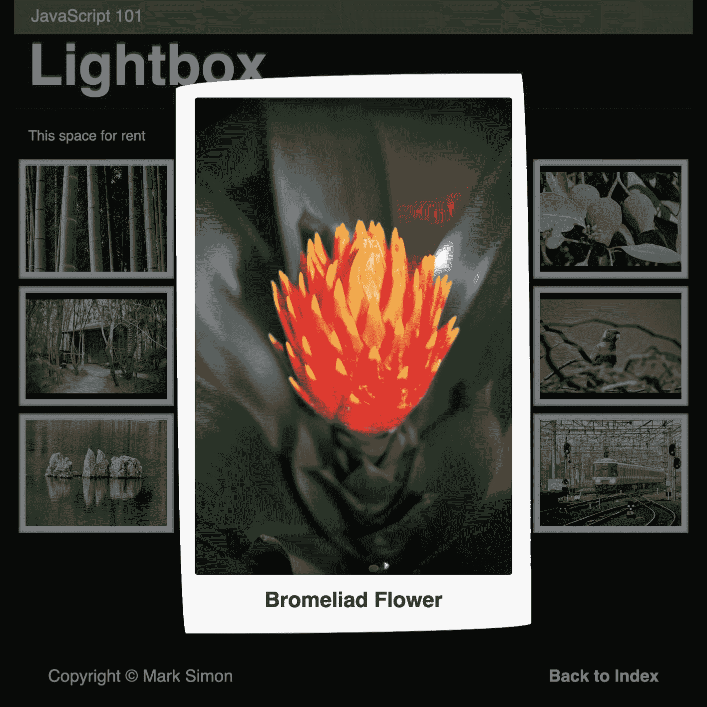

一个 JavaScript 灯箱画廊的截图。它由一个位于中央的大型菠萝花照片组成，两侧各有三张较小的照片排成一行。

**图 9-1** 一个灯箱画廊

你可以在[`https://pure-javascript.net/lightbox.html`](https://javascript101.webcraft101.com/lightbox.html)查看一个示例灯箱画廊的实际效果。

在这个项目中，你将编写自己的 JavaScript 灯箱函数，你可以在许多其他项目中使用它。除了拥有你自己的 JavaScript 小部件之外，你还将学习到更多关于：

*   劫持 HTML 锚点
*   创建可复用和适配的 JavaScript 小部件
*   在 JavaScript 中创建 HTML 元素和 CSS 样式
*   创建弹出元素
*   使用 JavaScript 事件触发 CSS 变化
*   处理异步图像加载
*   响应键盘事件

灯箱的一个重要部分是其视觉外观，它由 CSS 控制，包括一些动画效果。你将学习如何生成足够的基础 CSS 来让小部件正常工作，同时允许设计师覆盖部分外观。

在本章结尾，我们将重新回顾第 4 章中的幻灯片。届时，我们将掌握更多处理动态 CSS 的技能，并添加一些新功能，使幻灯片看起来更有趣。

## 准备 HTML

JavaScript 代码应尽可能保持不显眼，因此你无需做太多额外准备。

在这种情况下，我们希望 HTML 尽可能自然。如果你在编辑器中打开`lightbox.html`文件并查看代码，你会看到一个主容器内有一组链接图像：

在这种情况下，容器是一个`div`元素，这是最通用的块级元素。我们可以使用`id`属性`catalogue`来标识要处理的容器。这个`id`也用于 CSS 中，以便为容器及其内容赋予你喜欢的任何特殊外观。

图像将是普通的`img`元素，在`src`属性中显示缩略图版本。我们在这里省略了其他属性，但`title`属性很有用。通常，`title`在鼠标悬停时作为工具提示文本出现，但我们将把它用作大图的说明文字。

每张图片都包裹在一个指向大图的锚点（`a`元素）中。单独使用时，锚点通常会重新加载页面以显示链接的图像，但我们将用它来在弹出窗口中显示大图。

### 初始 HTML 和 JavaScript

与上一个项目一样，我们将创建一个独立的、灵活的函数，可以轻松地将其移至库文件中。为简单起见，现在我们将其保留在主 JavaScript 文件中。

HTML 文件名为`lightbox.html`，对应的 JavaScript 文件名为`lightbox.js`。

HTML 已经包含了对 JavaScript 文件的引用：

JavaScript 以通常的方式开始，但我们已经包含了一个对新函数的调用，并带了容器的参数：

```
init();
function init() {
  doLightbox('div#catalogue');
}
function doLightbox(container) {
}
```

如果你现在加载页面并点击一张图片，你只会看到页面重新加载并显示大图。这是因为大图在周围锚点的`href`属性中被引用。

你还会看到，当鼠标不在缩略图上时，每个缩略图的颜色都是去饱和的（主要是灰度）。这些都是由 CSS 完成的。

在`doLightbox()`函数内部，我们可以使用选择器字符串配合`querySelectorAll()`来找到包含图像的锚点：

```
function doLightbox(container) {
  let anchors = document.querySelectorAll(`${container}>a`);
}
```

正如你所记得的，模板字面量`` `${container}>a` ``允许你在其中包含表达式和变量。在前面的代码中，选择器字符串转换为：

```
let anchors = document.querySelectorAll('div#catalogue>a');
```

这意味着所有`div`元素的子锚点。

一旦我们有了这些锚点，我们就可以改变它们的行为，将大图加载到弹出窗口中。


### 劫持锚点

通常，锚点用于链接到新文档或页面。但在这里，我们将用它来显示更大的图片。这意味着我们需要改变其默认行为，转而采用新的行为。这通常被称为**劫持**锚点。

为了添加我们自己的行为，我们需要为所有锚点的 `click` 事件添加一个事件监听器：

```
function doLightbox(container) {
let anchors = document.querySelectorAll(`${container}>a`);
anchors.forEach(a => {
a.onclick = show;
});
//  显示与隐藏
function show(event) {
}
}
```

`forEach()` 函数会遍历 `anchors` 集合中的每一个成员。箭头函数表达式 `a => {}` 将每个锚点临时赋值给变量 `a`，这样我们就可以将其 `onclick` 事件监听器设置为 `show` 函数。`show` 函数将使用 `event` 参数。

我们需要解决锚点的一个逻辑问题。尽管我们已经将点击事件转移到了自己的函数上，但锚点的正常行为仍然会让浏览器加载新内容，也就是 `href` 属性中的那张更大的图片；这个新内容会*替换*掉旧内容。

相反，我们将在当前页面上显示新内容，因此需要取消其正常行为。这可以通过 `preventDefault()` 函数来实现：

```
function show(event) {
event.preventDefault();
}
```

只要 HTML 元素具有动态行为，例如表单中的按钮或上述的锚点，都可以使用 `preventDefault()` 函数。你可以在 `show` 函数中的任何时候调用 `preventDefault()` 函数，但通常会在函数开头调用它。我们还需要再次使用 `event` 对象来获取图片的详细信息。

如果你重新加载页面，它不会有什么反应。事实上，它什么也不会做。点击图片不再加载更大的图片，因为我们已经拦截了该行为。我们稍后会编写显示图片的代码。首先，我们需要创建一个放置图片的地方。

## 创建弹窗元素

要将更大的图片显示为弹窗，你需要一些额外的 HTML 和 CSS。你可以在原始文档中创建这些元素，但更好的做法是由 JavaScript 为你完成。这样，文档就没有额外需求了。这是在编写此类 JavaScript 工具时的一个重要原则。实现灯箱所需的 HTML 元素和 CSS 是页面原始内容的附加部分。保持原始内容不变，让 JavaScript 来管理附加内容是合适的。

我们需要为弹窗创建四个额外的 HTML 元素：

-   需要一个背景 `div` 来覆盖整个屏幕。背景有两个作用。首先，它通过半透明的背景颜色来遮挡文档的其余部分。其次，你可以点击它来隐藏背景和弹窗。
-   需要一个容器 `figure` 来容纳更大的图片和说明文字。
-   弹窗图片本身，它将是一个 `img` 元素。
-   最后，说明文字将位于 `figcaption` 元素中。

弹窗元素看起来会像图 9-2 所示。

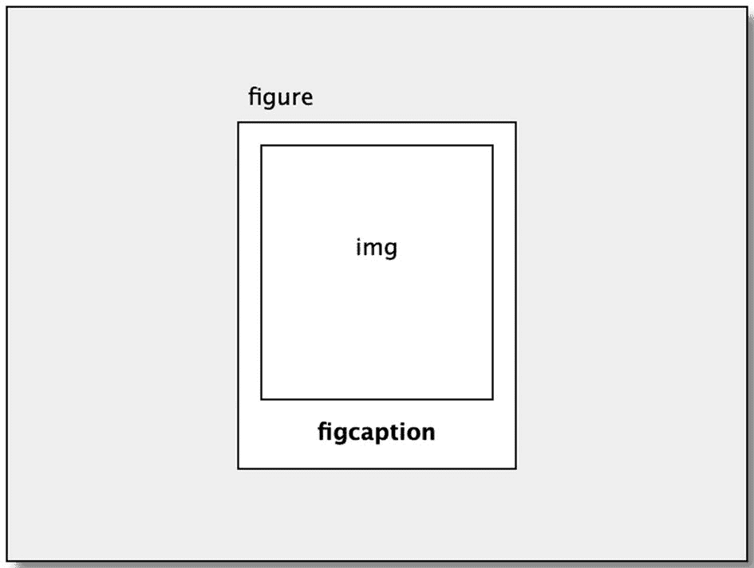

一张灯箱中弹窗元素的示意图。它有一个矩形框，内部包含一张图片和底部的图片说明文字。

**图 9-2**
灯箱元素

`figure` 元素以及其中的 `img` 和 `figcaption` 元素，将位于背景 `div` 的前面。

### 创建元素

要创建这些元素，我们使用 `document.createElement()`：

```
function doLightbox(container) {
let anchors = document.querySelectorAll(`${conainer}>a`);
anchors.forEach(a => {
a.onclick = show;
});
//  创建元素
let background = document.createElement('div');
let figure = document.createElement('figure');
let img = document.createElement('img');
let figcaption = document.createElement('figcaption');
...
}
```

这应该足以让 JavaScript 处理了，但还需要一点 CSS。为了确保 CSS 不会混淆，我们将为 `background` 和 `figure` 元素添加 id。CSS 将知道如何处理嵌套的 `img` 和 `figcaption` 元素。

```
function (container) {
...
//  创建元素
let background = document.createElement('div');
let figure = document.createElement('figure');
let img = document.createElement('img');
let figcaption = document.createElement('figcaption');
background.id = 'lightbox-background';
figure.id = 'lightbox';
...
}
```

背景 `div` 将独立存在，但图片和说明文字应包含在容器元素内部。这可以通过 `appendChild()` 来实现：

```
function doLightbox(container) {
...
//  创建元素
...
background.id = 'lightbox-background';
figure.id = 'lightbox';
figure.appendChild(img);
figure.appendChild(figcaption);
...
}
```

`appendChild()` 函数将一个元素添加到其内容的末尾。这是 `insertAdjacentElement('beforeend', ...)` 的一个更简单的版本。

### 将元素添加到文档中

此时，新创建的元素仍在内存中浮动。我们将以相同的方式将它们添加到文档的 body 中：

```
function (container) {
...
//  创建元素
...
figure.appendChild(img);
figure.appendChild(figcaption);
document.body.appendChild(background);
document.body.appendChild(figure);
...
}
```

我们现在有了一些空元素被添加到了文档 body 的末尾。如果你重新加载页面，你几乎看不到什么：所有新元素都在 `body` 元素的末尾，但它们都是空的，所以不占用空间。下一步将开始定义它们的外观。

## 为附加元素设置样式

你可以直接将 CSS 添加到样式表中，但和之前一样，这意味着开发者需要做额外的工作。更好的做法是通过 JavaScript 添加样式。在第 7 章关于操作 CSS 的内容中，我们在 JavaScript 中创建了一个样式块。在这里，我们将把这个想法付诸实践。

要添加 CSS 样式，首先创建一个 `style` 元素，并将其添加到文档的 `head` 中：

```
function doLightbox(container) {
...
//  创建元素
...
//  样式表
let style = document.createElement('style');
document.head.insertAdjacentElement('afterbegin',style);
...
}
```

请注意，新的 style 元素被添加到 `head` 元素的*开头*。这允许之后添加额外的真实样式表，这意味着它们可以覆盖你的一些样式。

### 添加样式规则

接下来，我们需要创建一些基本的 CSS 规则来完成工作。如果你在普通样式表中实现，基本的 CSS 看起来是这样的：

```
/*  背景 Div: */
div#lightbox-background {
position: fixed;
top: 0; left: 0; width:100%; height: 100%;
z-index: 1;
background-color: rgb(0,0,0,0.5);
}
/*  容器 Div: */
figure#lightbox {
position: fixed;
top: 50%; left: 50%; margin-right: -50%;
transform: translate(-50%, -50%);
z-index: 2;
}
```

CSS 的工作原理如下：

-   背景 `div` 需要填满整个屏幕，这是通过将其位置固定相对于屏幕（`position: fixed`）并设置其左上角坐标和尺寸来实现的。
-   为了达到遮罩屏幕其余部分的效果，背景颜色设置为黑色（`0,0,0`），但不透明度设置为 `0.5`，使其半透明（部分可见）。它还有一个非零的 `z-index`，这使其位于其他元素的前面。
-   `figure` 元素需要居中于屏幕，这也需要将其位置固定相对于屏幕（`position: fixed`），但将其起始位置偏移一半。
-   为了确保 `figure` 元素出现在背景的前面，其 `z-index` 属性的值设置得比背景高。


背景的实际颜色和不透明度是任意的，你可以轻松地在额外的真实样式表中覆盖这些值。

前面展示的 CSS 中的两个部分被称为**规则**，可以使用`insertRule()`添加：

```
function doLightbox(container) {
...
//  Style Sheet
let style = document.createElement('style');
document.head.insertAdjacentElement('afterbegin',style);
//  Lightbox Element Styles
style.sheet.insertRule(`
div#lightbox-background {
position: fixed;
top: 0; left: 0; width:100%; height: 100%;
z-index: 1;
background-color: rgb(0,0,0,0.5);
}
`);
style.sheet.insertRule(`
figure#lightbox {
position: fixed;
top: 50%; left: 50%; margin-right: -50%;
transform: translate(-50%, -50%);
z-index: 2;
}
`);
...
}
```

我们使用了模板字面量来允许换行和缩进，以提高可读性。请记住，CSS 可以包含任意多的额外间距。如你所见，CSS 有变得冗长的趋势，因此它永远不会非常紧凑。幸运的是，这些 CSS 已经足够实现所需效果。你现在看到的是整个页面被半透明背景覆盖。`figure`元素显示为一个小框，但由于没有内容，它在其他方面是不可见的。

### 隐藏和显示元素

灯箱的整个技巧在于，背景和容器只会在你选择一张图片时出现，并在你查看完毕后消失。

#### 显示和隐藏背景

你已经开始编写`show()`函数来显示图像，现在可以添加一个`hide()`函数来隐藏它：

```
function doLightbox(container) {
...
//  Showing & Hiding
function show(event) {
event.preventDefault();
}
function hide(event) {
}
}
```

要隐藏一个元素，你可以将其`display`属性设置为`none`。要显示该元素，则将其`display`属性设置为`block`，这是我们通常希望的显示方式：

```
function doLightbox(container) {
...
//  Showing & Hiding
function show(event) {
event.preventDefault();
background.style.display
= figure.style.display
= 'block';
}
function hide(event) {
background.style.display
= figure.style.display
= 'none';
}
}
```

上述代码使用了链式赋值语句来设置多个属性。这样做的主要原因是为了明确表明你在将两个属性设置为相同的值。你不需要显示或隐藏图像或标题元素，因为它们是容器元素的一部分。

你已经将`show()`函数附加到了锚点的`click`事件上。要隐藏所有内容，你可以将`hide()`函数附加到背景的`click`事件上：

```
function doLightbox(container) {
...
//  Showing & Hiding
background.onclick = hide;
function show(event) {
...
}
...
}
```

这有效地将背景变成了一个巨大的按钮。你现在可以点击背景来隐藏它，但你也应该在脚本首次加载时调用`hide()`函数：

```
function doLightbox(container) {
...
//  Showing & Hiding
background.onclick=hide;
hide(); //  hide now
...
}
```

在此阶段，你可以通过点击图像和背景来测试显示和隐藏功能，但你只会看到背景的显示和隐藏。接下来，你需要用图像及其标题来填充容器。

## 显示图像内容

下一步是显示图像及其标题。这基本上意味着显示`figure`元素，但首先你需要填充图像和标题段落。

回想一下，图像位于一个锚点元素内：

锚点本身只是一个包装器，大部分视觉空间将被图像占据。因此，当你点击此处时，实际上是在点击图像。图像没有事件监听器，也没有默认的点击行为，所以它对点击事件不感兴趣。该点击事件会被传递到其容器，即锚点元素。正如我们在事件监听器章节中看到的，事件发生了**冒泡**。我们可以阻止冒泡发生，但在此例中，这正是我们想要的。包含图像的锚点*确实*有一个事件监听器，并且正是这个函数来执行任务。总之，你点击的是图像，但锚点会处理这个点击。

在事件监听器内部，有两个重要的对象：

*   `event.target`指向你实际点击的元素：图像。
*   另一方面，`event.currentTarget`是引用了附加了事件监听器的元素：锚点。

我们需要两者。`currentTarget`（即锚点）在其`href`属性中引用了一个更大的元素。`target`（即图像）在其`title`属性中包含了标题文本。

当我们显示更大的图像时，我们想要将锚点的`href`属性中的 URL 复制到弹出图像的`src`属性中。这意味着从`currentTarget`复制`href`：

```
function show(event) {
event.preventDefault();
//  populate image element
img.src = event.currentTarget.href;
background.style.display = figure.style.display = 'block';
}
```

至于标题，它将来自原始图像的`title`属性。这意味着将`event.target`的`title`复制到`figcaption`的`textContent`：

```
function show(event) {
event.preventDefault();
//  populate image element
img.src = event.currentTarget.href;
//  caption text
figcaption.textContent = event.target.title;
background.style.display = container.style.display = 'block';
}
```

弹出图像元素目前缺少`alt`和`title`属性。这些属性对于图像来说总是一个好习惯。我们可以同时复制它们：

```
function show(event) {
event.preventDefault();
//  populate image element
img.src = event.currentTarget.href;
//  caption text
figcaption.textContent = img.alt = img.title
= event.target.title;
background.style.display=container.style.display='block';
}
```

你不会看到图像的`alt`或`title`属性，但`alt`是必需的，以防图像无法显示，而`title`通常会在鼠标悬停在图像上时出现。如果你现在加载页面，它会工作，但显示和隐藏会非常突兀。稍后，我们会让这个过程更有趣。然而，首先我们需要解决一个关于时序的小问题。

## 时序问题

如果你在自己的机器上测试代码，可能会发现大部分功能按预期工作。但是，如果你从真实的网络服务器上运行代码，可能会因为加载图像的延迟而出现问题。

例如，如果你将第一个锚点中的`href`更改为

```
...
```

当你点击它时，会有一个短暂的延迟。然而，这个延迟会足够长，以至于图像不会在弹出窗口中显示。

这个问题本质上是一个关于 JavaScript 运行方式的问题。这里有一个简单的脚本来演示这个问题：

```
»   var image = new Image();
»   image.src =
`http://pure-javascript.net/images/random.jpg?${Math.random()}`;
»   console.log(image.width);
```


`image` 变量是一个用于测试的虚拟图片，你实际上不会看到它。在 `random.jpg` 后添加随机查询字符串可确保浏览器不会缓存该图片，因为缓存会干扰实验。

语句 `image.src = ...;` 会使浏览器向服务器请求一张图片。然而，这可能需要一些时间，而 JavaScript 不喜欢等待。因此，下一行 `console.log(...)` 会在新图片*到达之前*运行，所以 `image.width` 还未就绪。你很可能得到 `0`，或者之前的值。

我们说图片是**异步**加载的。这在之后使用 Ajax（同样涉及与 Web 服务器通信）时也会成为一个问题。

现代 JavaScript 有处理异步代码的新方法，但图片加载的延迟可以用一种更传统的方式轻松处理。图片可以有一个 `load` 事件监听器，当图片完全到达时会被触发。我们可以利用它来延迟部分代码的执行：

```
»   var image = new Image();
»   function doit(event) {
console.log(image.width);
}
»   image.onload = doit;
»   image.src =
`https://pure-javascript.net/images/random.jpg?${Math.random()}`;
»   console.log('Meanwhile ...');
```

现在，`console.log(...);` 语句会等待图片加载完成，结果将是正确的。注意消息 `Meanwhile` 会在图片宽度*之前*打印出来，因为它是立即执行的，无需等待。

这个事件监听器很简单，不需要命名函数，因此我们可以使用函数表达式：

```
»   image.onload = function(event) {
console.log(image.width);
}
```

或更简洁的箭头函数表达式：

```
»   image.onload = event => {
console.log(image.width);
}
```

回到我们的 lightbox 项目，我们可以利用这个想法，在图片到达之前暂缓显示弹出窗口：

```
function show(event) {
event.preventDefault();
//  填充图片元素
img.src = event.currentTarget.href;
//  标题文本
figcaption.textContent = img.alt = img.title
= event.target.title;
//  background.style.display = figure.style.display='block';
img.onload = event => {
background.style.display = figure.style.display = 'block';
};
}
```

现在我们已经准备好了要显示的内容，但只会在图片到达后才显示。你现在可以测试这个项目了。

## 添加键盘控制

到目前为止，lightbox 画廊是通过鼠标控制的，这已经够用了。你还可以为画廊添加一些键盘控制。至少，你应该能够使用 Escape 键这样的按键来取消弹出窗口，但我们还可以添加一些按键来浏览画廊。

这是我们想要实现的键盘行为：

| 按键 | 行为 |
| --- | --- |
|  一个退出图标。 | 隐藏图片 |
| 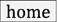 主页图标。或  向上箭头图标。 | 第一张图片 |
|  向左箭头图标。 | 上一张图片。如果在开头，则循环到最后一张图片 |
|  向右箭头图标。 | 下一张图片。如果在结尾，则循环到第一张图片 |
| 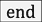 结束图标。或  向下箭头图标。 | 最后一张图片 |

与其他所有功能一样，这将通过事件监听器来实现。

### 添加键盘事件监听器

你可以将键盘事件监听器添加到单个元素上，例如表单中的 `textarea` 元素，但这里我们没有任何元素可以聚焦键盘。在这种情况下，我们将事件监听器添加到文档本身。

为了不影响页面其他部分键盘的正常使用，我们只在图片显示时分配事件监听器，并在图片隐藏时移除它。我们将这个函数命名为 `doKeys()`。

```
function show(event) {
...
document.addEventListener('keydown',doKeys);
}
function hide(event) {
...
document.removeEventListener('keydown',doKeys);
}
function doKeys(event) {
}
```

JavaScript 有几种响应键盘事件的方式，包括 `keydown`、`keyup` 和 `keypress`，它们发生在按键的不同阶段。它们在响应非字符键（如 `shift` 键）的方式上也不同。对于我们的按键来说，`keydown` 事件似乎效果最好。

`doKeys()` 事件监听器函数的起始方式与其他任何事件监听器一样：

```
function doLightbox(container) {
//  --snip--
function doKeys(event) {
event.preventDefault();
}
}
```

稍后我们将允许使用方向键浏览图片集。但是，它们通常会使页面滚动，所以我们要在显示图片时阻止这种情况。添加 `preventDefault()` 将阻止任何此类按键被进一步处理。

### 检查按下的键

我们需要检查按下了哪个键。这个信息可以在 `event.key` 属性中找到。你可能会发现一些旧代码使用了不同的属性，这在过去非常成问题，因为不同的浏览器对按键有不同的值。幸运的是，更现代的 `event.key` 属性更简单、更可靠。

最终，我们将响应多个不同的按键，因此使用 `switch` 语句来区分它们更容易。`switch` 语句就像一个专门的 `if ... else if ... else if ... else` 块。它用于将未知值与多个备选值进行匹配。

例如，我们可以获取一个用户输入的数字并按如下方式测试（如果你想测试，可以在行之间使用 shift-return）：

```
»   var n = prompt('Choose 1 ... 4');
if(n==1) {
console.log('one');
}
else if(n==2) {
console.log('two');
}
else if(n==3) {
console.log('three');
}
else if(n==4) {
console.log('four');
}
else {
console.log('whatever');
}
```

`switch` 语句做的*几乎*是同一件事，但又不完全相同。开始时，它看起来像这样，但还不能正常工作：

```
»   var n = prompt('Choose 1 ... 4');
switch(n) {
case 1:
console.log('one');
case 2:
console.log('two');
case 3:
console.log('three');
case 4:
console.log('four');
default:
console.log('whatever');
}
```

原则上，你是在将变量 `n` 与各个值进行匹配。如果它没有任何匹配，就会落到 `default` 分支。你首先会注意到输入数字无法匹配。由于某种原因，`switch` 语句不会进行 JavaScript 的常规自动类型转换，`prompt()` 函数返回的字符串与 `case` 块中的数字不匹配。

你可以尝试自己转换值：

```
»   var n = prompt('Choose 1 ... 4');
switch(parseInt(n)) {
...
}
```

现在你遇到了下一个问题。如果你输入，比如数字 `2`，你会发现你会得到从 `two` 开始的所有输出语句。一旦进入一个 `case` 块，就会继续执行后续的块，即使后面的 case 不匹配。这即使对有经验的开发者来说也令人困惑，但这是出于历史原因。我们稍后甚至会利用这一点。

同时，解决方案是处理完每个 case 后添加一个 `break` 语句：

```
»   var n = prompt('Choose 1 ... 4');
switch(parseInt(n)) {
case 1:
console.log('one');
break;
case 2:
console.log('two');
break;
case 3:
console.log('three');
break;
case 4:
console.log('four');
break;
default:
console.log('whatever');
}
```

你不需要在 `default` case 之后添加 break，因为它是最后一个，没有其他地方可以去了。

回到项目，我们将添加 `switch` 块的大纲来测试各种按键：


```javascript
function doKeys(event) {
event.preventDefault();
switch(event.key) {
}
}
```

每个按键都将在不同的 `case` 代码块中实现。

## 使用 Escape 键隐藏

第一个 case 将用于检测 Escape 键，并利用它隐藏弹出窗口：

```javascript
function doKeys(event) {
event.preventDefault();
switch(event.key) {
case 'Esc': //  旧版本
case 'Escape':
hide();
break;
}
}
```

Escape 键的正确值是 `Escape`。然而，一些较旧的浏览器会使用旧的 `Esc` 名称，因此最好同时检查两者。这可以通过包含一个空值的 `case` 并让它自然落入下一个 case 来实现。请注意，我们利用了一个事实，即代码会继续执行后续的 `case` 代码块，直到遇到 `break` 或到达末尾。这就是我们允许 `Esc` case 落入 `Escape` case 的方式。现在您可以测试页面，并验证 Escape 键是否确实隐藏了弹出图像。

## 添加导航键

我们还将使用箭头键浏览图库。然而，当前的代码只知道*当前*图像，无法显示上一张或下一张图像。为了实现导航，我们首先需要**重构**代码。

### 重构图像加载

**重构**指的是更改代码的结构而不改变其行为。这样做通常是为了提高代码的效率或可靠性，但在本例中，是为了使其更加灵活。

目前，当您点击图库链接时，会加载较大的图像，并且弹出窗口开始出现。所需的信息可以从您点击的图像中获得。

当浏览图库时，弹出窗口已经出现，您需要加载新内容。这些信息无法直接从您点击的图像中获得，因此您需要采用不同的方法：

-   当您点击图像时，弹出元素会像之前一样出现。
-   作为独立过程，弹出图像和标题将被填充。这将允许您独立于显示或隐藏弹出窗口来导航到其他图像。

还有一个与使用键盘相关的逻辑问题。当您点击图像时，事件的 `currentTarget` 和 `target` 会由鼠标的 `click` 事件设置为锚点和嵌套图像。然而，当您按下箭头键时，新事件的 `currentTarget` 和 `target` 与按键操作相关，而与任何图像无关。

首先，我们需要跟踪当前显示的图像，因为我们需要从那里开始使用箭头键进行导航。我们可以使用一个新变量来实现这一点：

```javascript
function doLightbox(container) {
let images = document.querySelectorAll(`${container}>a`);
anchors.forEach(a => {
a.onclick = show;
});
let currentAnchor;  //  当前锚点
...
}
```

`currentAnchor` 变量实际上将是对包含图像的锚点的引用。每当您点击图像时，它将被首次设置：

```javascript
function doLightbox(container) {
...
function show(event) {
event.preventDefault();
currentAnchor = event.currentTarget;
...
}
...
}
```

现在，我们将把 `event.currentTarget` 的引用改为 `currentAnchor`：

```javascript
function show(event) {
event.preventDefault();
currentAnchor = event.currentTarget;
//  填充图像元素
img.src = currentAnchor.href;
...
}
```

下一步是将代码的加载部分移到一个单独的函数中。我们将其命名为 `loadImage()`：

```javascript
function loadImage() {
//  填充图像元素
img.src = currentAnchor.href;
//  标题文本
//  figcaption.textContent = img.alt = img.title
//      = event.target.title;
img.onload = event => {
background.style.display = figure.style.display = 'block';
};
}
function show(event) {
event.preventDefault();
currentAnchor = event.currentTarget;
//  代码移至 loadImage()
document.addEventListener('keydown',doKeys);
}
```

我们也从 `show()` 函数中剪切出了代码，并暂时用注释替换了它。

请注意，`figcaption.textContent =` 代码目前也被注释掉了。这是因为事件目标存在的问题：我们不再能够直接引用嵌套的图像元素。不过，使用 `querySelector()` 可以轻松地在当前锚点内部查找该引用：

```javascript
let currentImage = currentAnchor.querySelector('img');
```

然后，我们可以使用 `currentImage` 变量来代替 `event.target` 属性：

```javascript
function loadImage() {
let currentImage = currentAnchor.querySelector('img');
//  填充图像元素
img.src = currentAnchor.href;
//  标题文本
figcaption.textContent = img.alt = img.title
= currentImage.title;
//  background.style.display = figure.style.display='block';
img.onload = event => {
background.style.display = figure.style.display = 'block';
};
}
```

通常，我们使用 `document.querySelector()`，它会在整个文档中搜索匹配项。这里，我们将搜索范围限制在当前锚点内。我们可以将其添加到 `loadImage()` 函数中，并使用 `currentImage` 来提取标题。

最后，我们不再在 `show` 函数本身中加载图像，而是调用 `loadImage()` 函数：

```javascript
function show(event) {
event.preventDefault();
currentAnchor = event.currentTarget;
loadImage();
document.addEventListener('keydown',doKeys);
}
```

此时，一切应和之前一样正常工作，但现在我们将能够从代码的其他部分重用 `loadImage()` 函数。这将是响应箭头键的操作。

## 加载相邻图像

现在我们可以添加代码来启用箭头键，以及 `Home` 和 `End` 键。

首先，我们来实现左箭头和右箭头。我们可以在 `switch` 中开始添加这些：

```javascript
switch(event.key) {
case 'Esc': //  旧版本
case 'Escape':
hide();
break;
case 'Left':    //  旧版本
case 'ArrowLeft':
//  上一张图像
break;
case 'Right':   //  旧版本
case 'ArrowRight':
//  下一张图像
break;
}
```

在较旧的浏览器中，这些键被称为 `Left` 和 `Right`，但现在前面加上了单词 `Arrow`。我们再次使用空的 `case` 代码块来实现这一点。

要获取上一个或下一个锚点，您需要：

-   **上一个锚点**：`currentAnchor.previousElementSibling`
-   **下一个锚点**：`currentAnchor.nextElementSibling`

`previousElementSibling` 和 `nextElementSibling` 属性分别指当前元素之前或之后的元素，会跳过任何空白或注释。

之后，您可以调用 `loadImage()` 函数，让它完成其余工作：

```javascript
switch(event.key) {
case 'Esc': //  旧版本
case 'Escape':
hide();
break;
case 'Left':    //  旧版本
case 'ArrowLeft':
currentAnchor = currentAnchor.previousElementSibling;
loadImage();
break;
case 'Right':   //  旧版本
case 'ArrowRight':
currentAnchor = currentAnchor.nextElementSibling;
loadImage();
break;
}
```

如果您进行测试，当尝试移动过远时，会发现一个错误。在第一张图像之前和最后一张图像之后都没有图像。我们需要考虑到这一点，但首先我们将处理选择第一张和最后一张图像。

## 加载第一张和最后一张图像

我们可以为第一张和最后一张图像再添加两个 switch 代码块：

```javascript
switch(event.key) {
...
case 'Home':
case 'Up':      //  旧版本
case 'ArrowUp':
//  第一张图像
break;
case 'End':
case 'Down':    //  旧版本
case 'ArrowDown':
//  最后一张图像
break;
}
```

这里同样有新旧版本的箭头键名称；我们还有 `Home` 和 `End` 键分别作为上箭头键和下箭头键的同义词。与相邻兄弟元素不同，JavaScript 没有“第一个”或“最后一个”兄弟元素属性，因此我们需要采用不同的方法。

好的，作为高级文档工程师和翻译员，我将严格遵循您提供的注意事项和示例格式，将该英文文档翻译成中文。


# 文档格式化

虽然无法获取第一个或最后一个同级元素，但可以获取元素的第一个或最后一个子元素。诀窍是找到当前锚点的父元素，然后获取该父元素的第一个或最后一个子元素。你可以使用如下代码：

*   第一个锚点：`currentAnchor.parentNode.firstElementChild`
*   最后一个锚点：`currentAnchor.parentNode.lastElementChild`

`parentNode` 是包含当前锚点的元素：即容器 `div`。从那里，你可以选择第一个或最后一个元素，同样会跳过空白和注释。

现在，我们可以添加如下代码：

```
switch(event.key) {
...
case 'Home':
case 'Up':      //  旧版本
case 'ArrowUp':
currentAnchor = currentAnchor.parentNode.firstElementChild;
loadImage();
break;
case 'End':
case 'Down':    //  旧版本
case 'ArrowDown':
currentAnchor = currentAnchor.parentNode.lastElementChild;
loadImage();
break;
}
```

现在，回到左右箭头键的问题。合理的期望是集合能够循环；也就是说，第一张图片之前的应该是集合中的最后一张，最后一张图片之后的应该是集合中的第一张。

## 环绕末端

如果尝试选择第一张图片之前或最后一张图片之后的元素，你会得到一个错误，提示 `currentAnchor` 变量是 `null`。在 JavaScript 中，你可以使用**或**运算符 (`||`) 来添加一个备选方案。例如：

```
»   var a = null;
»   console.log(a || 'Banana');
"Banana"
```

在上述代码中，如果变量 `a` 有实际值，则使用该值。这里，它是 `null`，接近于“无”，所以使用下一个值 `Banana`。我们说 `||` 表达式是**短路**的。

根据这个信息，如果下一张图片为 `null`，我们可以使用第一张图片；同样地，如果上一张图片为 `null`，我们可以使用最后一张图片：

```
//  上一张图片
currentAnchor = currentAnchor.previousElementSibling ||
currentAnchor.parentNode.lastElementChild;
//  下一张图片
currentAnchor = currentAnchor.nextElementSibling ||
currentAnchor.parentNode.firstElementChild;
```

现在，你可以完成 `switch` 代码块：

```
switch(event.key) {
...
case 'Left':    //  旧版本
case 'ArrowLeft':
currentAnchor = currentAnchor.previousElementSibling ||
currentAnchor.parentNode.lastElementChild;
loadImage();
break;
case 'Right':   //  旧版本
case 'ArrowRight':
currentAnchor = currentAnchor.nextElementSibling ||
currentAnchor.parentNode.firstElementChild;
loadImage();
break;
...
}
```

现在，你可以测试包含键盘导航功能的灯箱画廊了。

## 添加 CSS 特效

如果你测试在线版本，会注意到图片显示时带有动画效果（这可能符合也可能不符合你的喜好）。这个效果纯粹由 CSS 实现，JavaScript 仅负责触发它。

你不需要了解全部细节，但关键部分在于以下的 CSS 代码：

```
figure#lightbox {
transform-origin: 0 0;
transition:
transform 1s cubic-bezier(0.175, 0.885, 0.32, 1.275),
opacity 2s;
}
figure#lightbox.closed {
opacity: 0;
transform: scale(0) translate(-50%, -50%);
}
figure#lightbox.open {
opacity: 1;
transform: scale(1) translate(-50%, -50%);
}
```

当 figure 关闭时，其 `opacity` 设为 `0`。figure 也被缩小到无。结果是你看不到任何东西。如果 figure 打开，`opacity` 和 `scale` 将变为正常的可见度和正常大小。然而，特效在于 `transition` 属性。在 CSS 中，`transition` 基本上意味着缓慢变化。在这种情况下，透明度在一秒钟内变化，产生淡入效果。缩放比例在两秒内增加，但由于 `cubic-bezier` 的值，变化并不均匀。

为了让 CSS 发挥作用，我们将做两处修改。首先，我们只更改背景的 `display` 属性，而不更改 figure 的：

```
function loadImage() {
...
img.onload = event => {
//  background.style.display = figure.style.display = 'block';
background.style.display = 'block';
...
};
}
function show(event) {
...
}
function hide(event) {
//  background.style.display = figure.style.display = 'none';
background.style.display = 'none';
...
}
```

第二处是将 `closed` 或 `open` 类应用于 figure：

```
function loadImage() {
...
img.onload = event => {
//  background.style.display = figure.style.display = 'block';
background.style.display = 'block';
figure.classList.add('open');
figure.classList.remove('closed');
};
}
function show(event) {
...
}
function hide(event) {
//  background.style.display = figure.style.display = 'none';
background.style.display = 'none';
figure.classList.remove('open');
figure.classList.add('closed');
...
}
```

通常，你只需要一个类来在两个状态之间切换，就像我们在其他项目中所做的那样。但是，在这种情况下，这样做会将 figure 的透明度设置为 `0`，这会干扰代码的早期版本。

## 将代码移至库中

现在一切正常，你可以将代码移至库文件。由于所有代码都在一个函数中，只需将其剪切并粘贴到 `library.js` 文件中即可。HTML 文件中已经有了一个指向该文件的链接。

你可以添加以下块注释：

```
/*  function doLightbox(container)
================================================
用于实现图片库灯箱功能的函数。
使用以下结构：

锚点包含对大图的引用。
图片包含缩略图。
================================================ */
```

## 重新审视幻灯片

在第 4 章中，我们开发了一个简单的幻灯片。它能完成任务，但缺少我们在本章中为灯箱画廊添加的一些亮点。在本节中，我们将为幻灯片添加一些淡入淡出效果。首先，我们需要重新打开 `slideshow.html`、`slideshow.js` 和 `library.js` 文件。

### 使用 CSS 淡入图片

为了让每张图片淡入，我们将过渡元素的 `opacity`，即元素的透明度。`opacity` 为 `0` 表示完全透明，因此不可见；`opacity` 为 `1` 表示实心。将透明度值从 0 过渡到 1 将使元素淡入。

首先，我们将添加一个样式表和几条规则，就像我们对灯箱画廊所做的那样：

```
function doSlides(images, containerSelector, delay=3000) {
...
//  淡入效果
let style = document.createElement('style');
document.head.insertAdjacentElement('afterbegin',style);
style.sheet.insertRule(`
div#slides>img {
opacity: 0;
}
`);
style.sheet.insertRule(`
div#slides>img.showing {
transition: opacity 1s;
opacity: 1;
}
`);
function toggle() {
...
}
...
}
```

图片的初始透明度将为 `0`，这意味着它是透明的。我们将其过渡到 `1`，这将是不透明的。过渡将耗时一秒。CSS 过渡只会在你更改元素状态时运行。在这种情况下，我们将更改类，即改为 `showing`。

### 触发过渡

我们将在 `next()` 函数中更改状态：

```
function next() {
//  填充图片
img.src = `images/slides/${images[slideNumber].src}`;
img.classList.add('showing');
caption.textContent = images[slideNumber]. caption;
img.title = images[slideNumber].caption;
img.alt = images[slideNumber].caption;
slideNumber++;
...
}
```

但是，如果该类已被添加，再次添加将不起作用，因此过渡不会被触发。你必须先将其移除：

```
function next() {
//  填充图片
img.src = `images/slides/${images[slideNumber].src}`;
img.classList.remove('showing');
img.classList.add('showing');
...
}
```


这样做仍然不行，因为浏览器会采取捷径来避免不必要的额外工作。如果你打算移除一个类再重新添加它，浏览器会决定什么都不做，因此过渡*仍然*不会被触发。然而，如果我们能在两个语句*之间*欺骗浏览器更新文档，它就会按要求移除并添加这个类，过渡也就会被触发。

强制更新的一种方法是读取某个元素的尺寸。由于尺寸*可能*会受到 CSS 影响，浏览器必须在测量元素大小之前应用类中的改动。然后，类中的下一次改动也将被应用：

```
function next() {
//  载入图片
img.src = `images/slides/${images[slideNumber].src}`;
img.classList.remove('showing');
img.offsetHeight;
img.classList.add('showing');
...
}
```

`.offsetHeight`属性是许多能给出元素当前尺寸的属性之一。由于`offsetHeight`可能受到 CSS 影响，浏览器需要在读取它之前按照指示进行任何调整。

JavaScript 会愉快地允许你使用任何表达式作为语句，例如`1+2;`，并且我们在开头的`use strict`语句中已经见过这种情况。大多数情况下，这个值会被忽略，因为你实际上并没有用它做任何事情。有时，你会看到它和`void`运算符一起使用：

```
img.classList.remove('showing');
void img.offsetHeight;
img.classList.add('showing');
```

`void`运算符的结果总是`undefined`，如果你不希望代码中存在任何零散的值，这会很有用。在类更改之间读取属性以强制浏览器执行操作，这个技巧是让 CSS 过渡在 JavaScript 中工作的关键。

### 交叉淡入淡出

之前淡入效果的唯一问题是每张新图片都是从空白开始的：这就是图片切换时你所看到的闪烁。如果你希望从一张图片淡出到下一张，这被称为**交叉淡入淡出**。

要实现交叉淡入淡出，你需要一个额外的`img`元素，放在原始图片上方，这样你就能从一张淡出到另一张。你将在图 9-3 到图 9-5 中看到这个过程。使用额外的图片：

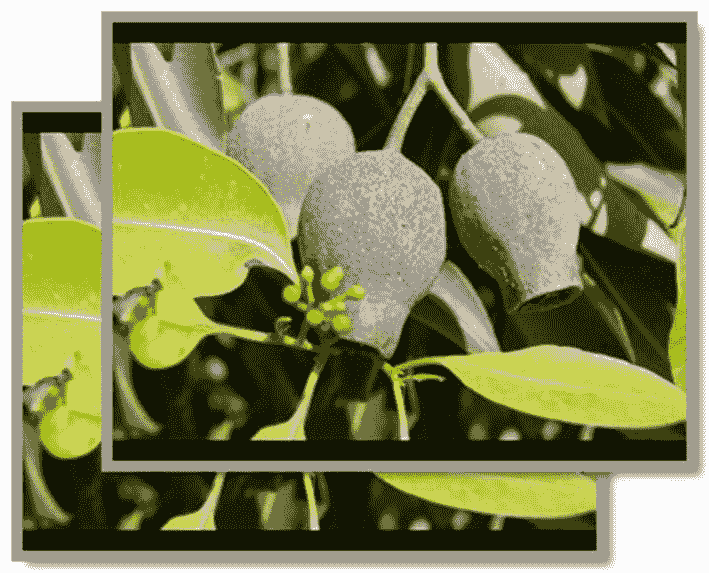

*   将其`opacity`设置为`1`，使其不透明。然后，将旧图片复制到前面的额外图片中。
*   用新图片填充原始的`img`元素。你暂时还看不到它，因为它位于另一张图片后面。


**图 9-4** 新图片已更换

*   触发一个 CSS 过渡，将前方图片的`opacity`设置为`0`，使其不可见。

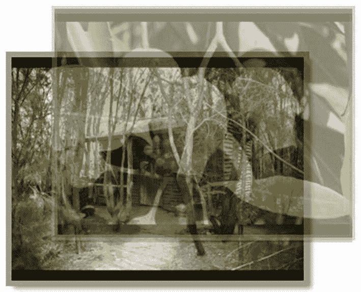

**图 9-5** 前景图片淡出

过程就是这样。我们现在就来创建额外的图片。

### 创建额外图片

我们将通过复制原始的`img`元素来创建额外图片。这被称为`克隆`元素。这样，我们可以确保新图片与原始图片具有相同的尺寸。

要克隆一个元素，使用`cloneNode()`。从技术上讲，文档中的所有元素都被称为**节点**，以反映它们在文档对象模型中的位置。我们还会给它一个`id`，以便稍后使用：

```
function doSlides(images, containerSelector, delay=3000) {
//  元素
let container = document.querySelector(containerSelector);
let img = container.querySelector('img');
let prefetch = new Image();
//  交叉淡入淡出
let crossFade = img.cloneNode();
crossFade.id = 'crossfade';
img.insertAdjacentElement('afterend', crossFade);
...
}
```

新的`img`元素被立即插入到原始元素之后，这样它就会在之后显示出来。

### 为新图片设置样式

如果你查看你的文档，你会看到原始图片下方出现了一大块空白。CSS 样式表确实包含将新图片定位到另一张图片上方所需的样式。我们将像实现淡入效果时那样，把这些样式添加到代码中。

同时，我们可以移除旧的 CSS 规则，以免它们干扰这个版本。

```
style.sheet.insertRule(`
div#slidese {
position: relative;
}
`);
style.sheet.insertRule(`
div#slides>img#crossfade {
display: block;
position: absolute;
top: 0; left: 0;
opacity: 1;
}
`);
style.sheet.insertRule(`
div#slides>img#crossfade.fading {
transition: opacity 2500ms;
opacity: 0;
}
`);
```

这里，我们将保持原始图片不动，让新的`crossFade`图片来完成所有繁重的工作。除了`opacity`和`transition`属性之外：

*   默认情况下，图片像文本一样以内联方式显示。我们需要将其改为`block`，以便更好地控制其大小和位置。
*   `position: absolute;`意味着我们可以将其定位在相对于其容器（即父级`div`）的任何位置。我们希望将其定位在`top: 0; left: 0;`，即左上角。
*   如果你在想，什么元素的左上角？`div`的`position: relative;`属性回答了这个问题：它将位于其容器的角落。

### 触发交叉淡入淡出

要真正实现交叉淡入淡出，首先要做的是将旧图片复制到交叉淡入淡出图片中：

```
function next() {
//  复制到交叉淡入淡出
crossFade.src = img.src;
crossFade.alt = img.alt;
...
}
```

从技术上讲，每个图片都应该包含一个`alt`属性，所以我们直接从原始图片中复制过来。

下一张图片将像以前一样分配，但现在我们更改的是交叉淡入淡出图片的类，而不是原始图片：

```
function next() {
crossFade.src = img.src;
img.src = `images/slides/${images[slideNumber].src}`;
// img.classList.remove('showing');
// img.offsetHeight;
// img.classList.add('showing');
crossFade.classList.remove('fading');
crossFade.offsetHeight;
crossFade.classList.add('fading');
...
}
```

同样，之前的代码已被注释掉，因为你不再需要它了。通常，你会期望删除不需要的代码，但我们以注释形式将其保留在这里，以便你可以比较这两种技术。你甚至可能决定更喜欢旧的实现方式。

## 总结

在这个项目中，我们开发了一个灯箱工具，用于从较小的缩略图弹出较大的图片。我们还应用这些技术增强了第 4 章的幻灯片展示。

### 劫持链接

幻灯片展示的缩略图包含在 HTML 锚点中，这些锚点引用了较大版本的图片。我们可以通过为锚点添加一个`click`事件监听器并阻止其默认行为来拦截这些锚点。锚点和嵌套的图片除了图片本身之外，还包含有用的数据：锚点包含对较大图片的引用，而图片有一个`title`属性，我们可以将其用作标题。当你点击锚点中的图片时，图片和锚点都会触发`click`事件。为了从正确的元素中提取正确的数据，我们区分了`target`（指向被点击的图片）和`currentTarget`（指向包含图片的锚点）。


### 添加元素与样式

为了管理灯箱效果，最好先创建辅助元素，这样原始 HTML 就不需要过多调整。为这些新元素添加额外样式也是同理。可以创建一个样式块并将其添加到网页的 `head` 部分。最好将其添加到开头，这样外部样式表之后仍能被应用。这个新样式块只需包含足以实现效果的 CSS 代码，包括将背景设置为半透明覆盖整个屏幕，以及让弹出窗口显示在屏幕中央的 CSS。另外还可以准备一个样式表来负责美化外观。

### 显示与隐藏内容

内容的可见性可以通过修改元素的 `display` 属性来控制。为了增强效果，还可以操作元素的 class 属性，让 CSS 样式来处理隐藏与显示。如果我们希望显示和隐藏的效果更生动——比如在灯箱画廊中放大图像、在幻灯片中淡入淡出——那么修改 class 属性就特别有用。通过先改变一个元素的 class，然后再改回来，可以触发过渡效果。但是，由于 JavaScript 倾向于合并更改，必须通过读取一个受影响的属性（例如 `.offsetHeight` 属性）来强制浏览器更新屏幕。

### 时间控制

由于图像是作为独立资源加载的，它们始终是异步加载的。当依赖尚未加载完成的图像时，就会产生问题。可以使用 `onload` 事件来触发等待，直到图像加载完毕后再尝试使用它。

### 使用键盘

可以使用键盘来控制图库。通过添加键盘事件监听器，我们可以响应特定按键来在图库中移动浏览。

### 重构

重构是指修改代码，使其行为保持不变但更具适应性。当尝试重用那些在开发阶段应用范围有限的代码时，这一点尤为重要。

### 父元素、子元素与兄弟元素

当在一组元素中导航时，我们需要了解引用相邻元素的方法。相邻元素可以被引用为前一个或后一个兄弟元素。集合中的第一个和最后一个元素必须被引用为其父元素的第一个和最后一个子元素。

### 交叉淡入淡出

虽然通过改变 class 来触发过渡效果实现淡入淡出很简单，但创建交叉淡入淡出效果则需要额外的工作。要创建交叉淡入淡出效果，我们可以克隆现有图像，并使用 CSS 将其定位在原始图像之上。然后将原始图像的副本放入交叉淡入淡出的图像中，并替换原始图像。通过淡出交叉淡入淡出的图像，让新图像逐渐显现，从而实现了交叉淡入淡出的效果。

### 下章预告

我们这里开发的灯箱工具可以用于任何画廊项目。但是，它确实需要您准备好一个包含锚点集合和图片集合的 `div` 容器，因此它可能不像想象中那么方便或灵活。为了更简单地使用灯箱，我们可以改用包含图片文件名和标题的 CSV 文件。然后，JavaScript 可以读取该文件，并为我们生成锚点和图片。这样，进行更改也会更容易，无需麻烦地修改 HTML。幻灯片同理，我们可以获取图片列表，并用它来填充幻灯片。如果要从网络服务器获取更多数据，则需要一种称为 Ajax 的技术。Ajax 允许 JavaScript 请求和接收额外的数据。这些数据可以是简单的文本，也可以更复杂。然后，我们可以利用这些数据对当前页面进行更改。在下一章中，我们将介绍 Ajax 的基础知识，以及如何使用它从网络服务器加载更多内容。

# 10. 项目：Ajax 入门

如果您尝试在没有网络服务器的情况下运行此项目，那可能不太走运。除非其他域名明确允许，否则 JavaScript 无法向不同域名发出 Ajax 请求。这被称为**同源策略**。现代浏览器倾向于将本地打开的（通过“文件：打开...”）不同文档视为来自不同域，*即使它们位于同一个文件夹中*。因此，Ajax 请求将被拒绝。使用 `http://` 协议从同一位置获取的文件被视为来自同一源，这就是为什么本章节需要一个网络服务器。此项目中唯一能正常工作的部分是最后一节，因为它专门访问了不同的网络服务器。运行此项目不需要功能强大的网络服务器。您可以从 [`https://github.com/manngo/micro-web-server/releases/latest`](https://github.com/manngo/micro-web-server/releases/latest) 使用一个轻量级的服务器。

在迄今为止的一些项目中，包含了大量静态内容。幻灯片使用了硬编码的图片列表。关于显示和隐藏内容的项目操作了页面上已有的内容。而灯箱项目则需要一个缩略图图片和链接的集合。

传统上，当你从网络服务器加载一个包含图片、CSS 文件和其他相关资源的页面时，连接会关闭，浏览器自行处理已获取的内容。但是，借助 JavaScript，你可以通过一种称为 **Ajax** 的过程来获取额外的资源。Ajax 这个词据说是由 James Garrett 创造的，用来描述一系列允许浏览器无需从头重新加载所有内容即可与服务器交互的技术。在我们的例子中，我们将使用 JavaScript 与相同或不同的网络服务器建立另一个连接，允许它请求额外的资源或将信息发送回服务器。

在幻灯片项目中，你已经看到了这个想法的一个简单形式。每次更改图片的 `.src` 属性时，你都会与服务器建立一个新的连接以获取另一张图片。以原始的方式，你也在与服务器通信，因为每个图片的请求都可以被处理，并可能被记录。

现代 JavaScript 现在能够以更复杂的方式做到这一点，同时在服务器端和浏览器端进行实时更新。现代 Ajax 最初是使用一个特殊的 `XMLHTTPRequest` 对象实现的，后来经过改进增加了更多功能。该对象仍然可用，但实现起来可能有些棘手。如今，所有现代浏览器都实现了 Fetch API，它允许你使用 `fetch` 函数来完成大部分繁重的工作。它比旧的 `XMLHTTPRequest` 对象简单得多。

在本章中，我们将通过几个小项目来探索 Ajax。每个项目都将使用 Ajax 从服务器获取额外数据。

-   第一部分使用被劫持的链接来获取额外的 HTML 内容。
-   第二部分通过从服务器获取图片列表，并利用你已经编写的代码来运行幻灯片，实现了一个幻灯片功能。
-   第三部分对灯箱画廊进行了类似的操作。此外，我们将创建包含缩略图的元素。
-   第四部分从服务器获取国家列表以生成一个菜单。然后，我们使用该菜单刷新一个表单，表单中的数据是从服务器获取的更多数据。

通过完成这些，我们将培养以下技能：

-   理解异步处理
-   使用 `fetch()` 函数从服务器获取数据
-   处理 JSON 字符串数据格式以传输复杂数据
-   在网页上创建元素
-   使用 Ajax API 访问数据服务

我们需要打开 `ajax.html` 来查看发生了什么，并打开 `ajax.js` 来编写代码。我们还将使用 `library.js` 文件中的现有代码。


## 时序问题

在接下来的讨论中，请确保你已打开了一个页面，例如 `ajax.html`。如果没有打开页面，你很可能会遇到内容安全策略报错。

Ajax 编程中最棘手的问题始终在于时序。与网络服务器的所有通信都需要时间，而 JavaScript 又不喜欢等待。

以下面这段代码为例：

```
var image = new Image;
image.src = 'https://pure-javascript.net/random.jpg';
console.log(image.width);
```

`Image` 对象是一个虚拟图像，它具备图像的属性，但不会实际显示出来。如果你执行一次，很可能会得到结果 `0`。再执行一次，有可能得到更有意义的值，但也未必。

问题在于请求新图像需要一点时间。JavaScript 不想干等着，就会跳到下一行，试图在图像可用之前读取其宽度，从而得到结果 `0`。我们称图像是**异步**加载的，也就是说，加载发生在后台。为了让你免于继续等待，图像可能会被存储在浏览器缓存中，这样下次加载就会更快——快得足以让 JavaScript 能够读取它的宽度，这就是为什么你再次尝试时可能会得到一个非零的结果。

让 JavaScript 等待图像的一种方法是使用**回调**函数：

```
var image = new Image;
image.onload = function(event) {
    console.log(image.width);
};
image.src = 'https://pure-javascript.net/random.jpg';
```

图像的 `onload` 属性被赋予一个函数，该函数将在图像加载完成后运行。通过推迟对图像的操作，现在代码就能按预期工作了。

使用 Ajax 时，你会不断遇到类似的时序问题：你试图获取一个资源（如文本），但 JavaScript 急于继续执行，因此数据总是到达得太晚。处理异步 Ajax 调用的经典方法是同样使用一个 `onload` 事件监听器，将后续处理推迟到回调函数中。然而，对于 Ajax，回调函数要复杂得多，尤其是当你需要在此之后再发起另一个 Ajax 调用时。

现代 JavaScript 通过**Promise（期约）**解决了这个问题。Promise 允许你包含一段在条件就绪时运行的代码，而无需费力处理回调函数。

## 使用 Fetch

`fetch()` 函数向服务器请求一些数据，并返回一个**Promise**。Promise 是一种特殊对象，允许你添加接下来要执行的操作，类似于添加一系列回调函数。

典型的模式是：

```
//  假设示例
fetch(url)                  //  第 1 步：请求某些内容
.then(processResponse)      //  第 2 步
.then(processData);         //  第 3 步
```

`url` 是你期望找到数据的位置。每个后续步骤都是一个传递给 `.next()` 方法的函数。该函数的数据取决于前一步骤中发生的情况。这里我们使用了名称 `processResponse` 和 `processData`，不过你通常会更常使用函数表达式。

对于 `fetch()` 函数，下一步骤将得到一个**响应（response）**对象作为其参数，通常（尽管不必然）被称为 `response`。响应对象包含从服务器返回的各种详细信息，但我们通常只对提取数据感兴趣。

你可以像这样定义 `processResponse()` 函数：

```
function processResponse(response) {
    return response.text();
}
```

`.text()` 方法从响应中提取文本。结果实际上不仅仅是文本：它是另一个包含文本的 Promise 对象。在后续章节中，一旦我们弄清楚了 `json()` 方法的含义，我们也会用到它。

当然，我们也可以使用箭头函数表达式：

```
response => {
    return response.text();
}
```

如果你只是要返回一个值，箭头函数表达式还有一种更简短的形式：

```
response => response.text();
```

现在 `fetch()` 函数可以是这样的：

```
//  仍然是一个假设示例
fetch(url)
.then(response => response.text())
.then(processData);
```

下一步骤将涉及实际数据。`processData` 函数将接收一个参数，其中包含来自前一步骤的文本。同样，如果处理逻辑足够简单，我们可以使用箭头函数表达式：

```
//  仍然仍然是一个假设示例
fetch(url)
.then(response => response.text())
.then(text => {
    console.log(text);
});
```

这个箭头函数所做的不仅仅是返回一个值，这就是代码放在花括号内的原因。

我们可以在控制台中尝试一下：

```
fetch('https://pure-javascript.net/quote.txt')
.then(response => response.text())
.then(text => {
    console.log(text);
});
```

短暂停顿后，你会看到一句来自格劳乔·马克斯的随机名言，例如：

*我一直在寻找一个像你这样的女孩——不是你，而是像你这样的女孩。*

这就是基本原理。现在我们将把它付诸实践。对于本项目，我们需要处理 `ajax.html` 和 `ajax.js` 这两个文件。

HTML 文件包含四个区域，我们将用它们来使用 Ajax。`ajax.js` 文件包含以下代码：

```
init();
function init() {
    ajaxContent();
    ajaxSlideshow();
    ajaxLightbox();
    ajaxCountries();
}
function ajaxContent() {
}
function ajaxSlideshow() {
}
function ajaxLightbox() {
}
function ajaxCountries() {
}
```

每个函数分别处理 HTML 中的一个区域。

## 获取所选内容

在本项目的第一部分，我们将使用 Ajax 来获取点击链接时所需的文本内容。如果你打开 `ajax.html` 文件，会看到一个列表内的链接集合：

```
斑点土豚
星夜
幸运之国
澳大利亚
```

如果你点击其中一个链接，浏览器会加载新文本，但我们希望劫持该链接，让浏览器将内容加载到一个容器 `div` 中：

> 点击链接应使用新内容填充 `div`。内容本身是一个文本文件，但实际上包含 HTML 代码。

我们在 `ajaxContent()` 函数中设置初步的 JavaScript 代码：

```
function ajaxContent() {
    let links = document.querySelector('ul#links');
    let content = document.querySelector('div#content');
}
```

`links` 变量引用链接列表，`content` 变量引用将被填充内容的 `div`。

### 劫持链接

我们之前在灯箱项目中已经经历过劫持链接的过程。在这里，我们将采用不同的方法，使用委托事件监听器——也就是说，我们将事件监听器放在容器上。

我们首先将事件监听器挂载到 `links` 容器的 `onclick` 属性上：

```
function ajaxContent() {
    let links = document.querySelector('ul#links');
    let content = document.querySelector('div#content');
    links.onclick = event => {
        event.preventDefault();
    }
}
```

我们还添加了 `event.preventDefault()` 来阻止链接加载新页面。

### 获取内容

接下来，我们可以直接使用 `fetch()` 函数加载内容，方式与之前的 `fetch` 练习类似。由于锚点已经包含了内容的引用，我们可以在 URL 参数中使用它：

```
function ajaxContent() {
    let links = document.querySelector('ul#links');
    let content = document.querySelector('div#content');
    links.onclick = event => {
        event.preventDefault();
        fetch(event.target.href)
        .then(response => response.text())
        .then(text => {
            content.innerHTML = text;
        });
    }
}
```


这里务必记住使用 `event.target`。尽管事件监听器位于包含元素的列表上，但 `event.target` 引用的却是你实际点击的元素：即锚点（anchor）。通过锚点，我们可以利用 `.href` 属性获取内容的 URL。

与前一个练习相同，我们首先从响应中获取文本，并在下一步对其进行处理。在这个案例中，只需使用 `innerHTML` 填充 `content` 这个 `div` 即可。

现在，我们可以通过刷新页面并点击四个链接来测试此功能。这种技术的好处之一在于，你可以修改待加载的内容，而无需改动 HTML 文件本身。

## Ajax 幻灯片

项目的下一部分将重新探讨幻灯片。在幻灯片项目中，待加载的图片是硬编码的：首先是一个图片文件名数组，然后是一个包含图片文件名和标题的对象数组。我们现在要做的是，使用 Ajax 从外部源加载这个集合。

在 `ajax.html` 文件中，幻灯片部分的代码只有寥寥几行：

`slideshow.html` 文件中的内容确实也就这么多。大部分繁重的工作都在库文件中的 `doSlides()` 函数里完成。我们在这里要做的，是使用 Ajax 获取幻灯片对象的数组。但首先，我们需要了解一种名为 JSON 的数据格式。

### JSON 简介

传统上，简单的数据可以以文本文件的形式存储和传输。但对于更复杂的数据结构，这种方式就行不通了。一种替代方案是使用 XML 来结构化文本文件，XML 是一种类似于 HTML 的标记语言。这就是 Ajax 中 **X** 的由来：异步 JavaScript 和 XML（Asynchronous JavaScript and XML）。XML 非常流行，但在 JavaScript 应用中已显得过于繁琐。因此，一种更简单、更直接的文件格式应运而生。

你已经见过使用如下 JavaScript 代码创建对象的方式：

```
var apple = {
name: 'Granny Smith',
shape: 'Round',
colour: 'Green'
};
```

你也可以使用如下方式创建对象数组：

```
var apples = [
{ name: 'Granny Smith', shape: 'Round', colour: 'Green' },
{ name: 'Fuji', shape: 'Round', colour: 'Red' },
];
```

当然，空格和缩进是可选的，它们的存在仅仅是为了便于人类阅读。注意最后一项后面的逗号。这可能略显粗心，但 JavaScript 会宽容地忽略它。

上述代码是纯粹的 JavaScript。JSON 则将这种表示法扩展到了字符串。JSON 这个词读作“j-son”，意为 **JavaScript 对象表示法**。字符串形式与对象字面量非常相似，但它有一些非常严格的要求。第二个例子的 JSON 版本如下：

```
var apples = `[
{"name":"Granny Smith", "shape":"Round", "colour":"Green"},
{"name":"Fuji", "shape":"Round", "colour":"Red"}
]`;
```

注意，字符串被包裹在反引号中。当然，这在 JSON 中并非必需，但它允许我们将字符串写成多行。

这个字符串与之前的对象数组非常相似，但请注意以下标注差异：

-   每个属性名都用双引号括起来。
-   所有字符串都用双引号括起来，而不是单引号。
-   最后一项之后不能有尾随逗号。

这对于普通的 JavaScript 对象字面量来说也是有效的，但却是 JSON 的绝对要求。

一旦你有了 JSON 文本，通常可以使用 `JSON.parse(...)` 将其转换为合法的 JavaScript 对象：

```
var apples = `[
{"name":"Granny Smith", "shape":"Round", "colour":"Green"},
{"name":"Fuji", "shape":"Round", "colour":"Red"}
]`;
apples = JSON.parse(apples);
```

`JSON` 这个内置对象只有两个方法：`JSON.parse()` 将字符串转换为对象，`JSON.stringify()` 则执行相反的操作。如果你想知道为什么要费心在字符串和对象数据之间进行转换，那是因为字符串是一种简单、安全的数据形式——它们易于通过互联网连接传输，也易于保存在文本文件中。通过设计一种将对象编码为字符串的方法，你可以存储或传输更复杂的数据。JSON 已变得非常流行，以至于在那些甚至没有 JavaScript 的其他各种平台上都得到了广泛支持。例如，PHP、Python 以及一些数据库也支持 JSON 格式。

### 加载幻灯片文件

在 `images/slides/` 目录下有一个名为 `slides.json` 的文件。我们将采用与上一节获取文本内容相同的方式来获取这个文件。以下代码最终会被添加到 `ajaxSlides()` 函数中，但我们会先在控制台中试验一下。

我们可以获取数据并使用 `JSON.parse()` 函数来解析它。请记住，在尝试此操作时，确保 `ajax.html` 页面是打开的，以避免跨域错误：

```
fetch('images/slides/slides.json')
.then(response => response.text())
.then(text => {
let data = JSON.parse(text);
console.log(data);
});
```

这样能行，但响应对象还有一个名为 `.json()` 的便捷快捷方法，可以为我们完成这项工作：

```
fetch('images/slides/slides.json')
.then(response => response.json())
.then(data => {
console.log(data);
});
```

现在，我们可以将其构建到我们的代码中。

用于管理幻灯片的函数叫做 `ajaxSlides()`：

```
function ajaxSlideshow() {
}
```

在函数中，我们可以获取 JSON 文件并处理它：

```
function ajaxSlideshow() {
fetch('images/slides/slides.json')
.then(response => response.json())
.then(data => {
});
}
```

只剩最后一步了。

### 运行幻灯片

实际上，所有繁重的工作都已经完成了。回想一下，我们在库文件中保存了一个名为 `doSlides()` 的函数：

```
doSlides(images, containerSelector, delay)
```

在这种情况下，`images` 对象将来自 `fetch()` 函数，而 `containerSelector` 只是对 HTML 中 `div` 的引用：

```
function ajaxSlideshow() {
fetch('images/slides/slides.json')
.then(response => response.json())
.then(data => {
doSlides(data, 'div#slides', 3000);
});
}
```

延迟设置为默认值 `3000`，但你可以根据自己的喜好更改它，特别是在测试时。

### Ajax 灯箱画廊

对于 Ajax 幻灯片来说，唯一显著不同的是图片集合的来源。以前，集合是在 JavaScript 代码中硬编码的。使用 Ajax，你可以从加载的文件中获取集合。

然而，对于灯箱画廊来说，情况要稍微复杂一些。画廊最初使用的是 HTML 链接中的图片集合，然后我们劫持这些链接以用于灯箱。在当前的文档中，你只会找到以下内容：

```
你肯定会同意，这并不多。我们将结合使用 Ajax 和少量 DOM 操作来填充目录，然后让我们的库函数 `doLightbox()` 完成其余工作。
```

JavaScript 代码将位于 `ajaxLightbox()` 函数中。

#### 获取画廊数据

灯箱画廊中的图片与幻灯片中的图片相同。这意味着我们可以采用与幻灯片相同的方式来开始：

```
function ajaxLightbox() {
fetch('images/slides/slides.json')
.then(response => response.json())
.then(data => {
});
}
```

从这里开始，任务就是使用这些数据来生成画廊。

#### 创建画廊元素

计划是将画廊元素添加到容器中。首先，我们将设置一个变量来引用容器：

```
function ajaxLightbox() {
let catalogue = document.querySelector('div#catalogue');
...
}
```

请记住，`fetch()` 函数返回的数据将是一个对象数组。我们可以遍历这个数组：


```javascript
function ajaxLightbox() {
let catalogue = document.querySelector('div#catalogue');
fetch('images/slides/slides.json')
.then(response => response.json())
.then(data => {
data.forEach(item => {
//  create gallery element
});
});
}
```

每个画廊元素都是一个包含在锚点中的图像：

我们将创建这些元素并将它们添加到画廊中。

在前面的代码中，我们大多使用 `document.createElement()` 来创建元素并添加到容器中。不过，也可以使用 HTML 代码创建元素，并通过 `.insertAdjacentHTML()` 添加：

```javascript
//  Not Yet
data.forEach(item => {
catalogue.insertAdjacentHTML(
'beforeend',
``
);
});
```

新元素被添加在 `beforeend` 位置，这表示它被添加到容器的末尾。我们将 HTML 字符串放在反引号中，因为稍后需要用到模板字面量。

对于实际的元素，有很多值需要替换。不过，我们可以将 HTML 字符串拆分成几行：

```javascript
data.forEach(item => {
catalogue.insertAdjacentHTML(
'beforeend',
`

`
);
});
```

当然，你也可以把它写在一行里，但在这个书中显然空间不够。

一旦画廊填充完成，你就可以将其传递给 `doLightbox()` 函数：

```javascript
function ajaxLightbox() {
let catalogue = document.querySelector('div#catalogue');
//  fetch ...
doLightbox('div#catalogue');
}
```

完成后的函数应该如下所示：

```javascript
function ajaxLightbox() {
let catalogue = document.querySelector('div#catalogue');
fetch('images/slides/slides.json')
.then(response => response.json())
.then(data => {
data.forEach(item => {
catalogue.insertAdjacentHTML(
'beforeend',
`

`
);
});
doLightbox('div#catalogue');
});
}
```

你可能会注意到，画廊中的图片比原始版本更多。这正是此技术的一个优势：画廊变得更加灵活。

## 访问数据库

Ajax 最强大的应用之一在于数据源是动态的情况。这类数据通常来自服务器端的数据库。

你不能直接使用 JavaScript 访问数据库。你可以做的是通过 Web 服务器向数据库服务器发起请求。其思路是，Web 服务器应当运行着某个监听此类请求的应用程序。

如果你在轻量级 Web 服务器（例如 Micro Web Server）上运行示例网站，则无法尝试此操作。如果你碰巧通过更强大的工具（例如 XAMPP）甚至完整的 Web 服务器来运行它，那么有一个 PHP 脚本可以完成这项工作。

在本节中，我们假设你并未运行此类 Web 服务器。相反，我们将依赖在线网站上的一个应用程序。

用于支持 Ajax 访问的服务通常被称为 API，这是一个非常古老的术语。它的意思是应用程序编程接口。实际上，它仅意味着该服务会接收格式正确的请求，并返回某种结果。

在本示例中，我们将使用一个提供世界各国信息的 API。

我们使用的服务将返回 JSON 格式的数据。但并非总是如此。另一种常见的格式是 XML，JavaScript 处理 XML 需要额外做很多工作。

并非所有 API 都可以免费使用。有些需要注册，有些则需要付费。

无论如何，访问其他服务器上的数据并不总是被允许的。服务器需要设置为允许来自其他来源的请求。那些提供 API 的服务器自然已经完成了这样的设置。

## 使用 API

API 通常以带有查询字符串的 URL 形式存在。查询字符串是问号后面的部分，用于提供额外信息。

当 API 开放使用时，你通常会看到相关使用说明。在本例中：

* 单独的 URL 会返回国家列表。
* 查询字符串 `id=...` 会返回特定国家的详细信息。

在许多情况下，你还需要提供某种密钥来验证用户身份。


在实时示例中，URL 是

```
https://pure-javascript.net/resources/countries.php
```

你可以在浏览器中尝试这个链接。

你会发现该 URL 直接返回一个 JSON 字符串，其中包含国家 ID 和名称的列表。

```
[
{ "id": "af", "name": "Afghanistan" },
{ "id": "al", "name": "Albania" },
{ "id": "dz", "name": "Algeria" },
...
{ "id": "zm", "name": "Zambia" },
{ "id": "zw", "name": "Zimbabwe" }
]
```

你的浏览器可能会解析 JSON，并以更偏向数据视图的方式呈现。你可能需要查看原始数据才能看到实际的 JSON 字符串。

你可以通过在 URL 后添加查询字符串来进行测试：

```
https://pure-javascript.net/resources/countries.php?id=au
```

现在你将得到一个国家的详细信息：

```
{
"id":"au",
"name":"Australia",
"local_name":"Australia",
"capital":"Canberra",
"alpha3":"AUS",
"tld":"au",
"numeric":"036",
"phone":"61",
"continent":"Australia",
"population":"22751014",
"area":"7741220",
"coastline":"25760",
"currency":"AUD"
}
```

我们不会使用所有这些详细信息。

## 使用 Ajax 调用 API

在示例页面底部附近有一个表单，用于显示某些国家详细信息。以下是该表单的简化版本：

```

选择国家

本地名称

顶级域名

大洲

货币

```

表单元素大部分是用于接收数据的输出元素。然而，表单中包含一个`select`元素，它将显示为下拉菜单。目前`select`元素是空的：我们需要用 JavaScript 来填充它。

对于普通的`select`元素，其选项应为`option`元素：

```
Apple
Banana
Cherry

```

如果提交表单，`select`项的值将是所选选项的 value。

## 准备 `select` 元素

我们将把所有代码放在`ajaxCountries()`函数中。

首先，我们可以找到这个表单：

```
function ajaxCountries() {
let countriesForm
= document.querySelector('form#country-details');
}
```

下拉菜单的问题在于总会有一个选项被选中。通常，比较好的做法是先提供一个实际上不选任何内容的选项，类似这样：

```
选择一个国家 ...
```

你可以使用`document.createElement()`来创建`option`元素，但有一个专门的函数可以简化这个过程：

```
new Option(text, value)
```

严格来说，`Option()`被称为构造函数，用于生成对象；构造函数通常与`new`关键字一起使用。在这种情况下，生成的对象将是一个`option`元素，这正是我们所需要的。

我们可以直接将新的`option`元素追加到`select`元素中：

```
function ajaxCountries() {
let countriesForm
= document.querySelector('form#country-details');
countriesForm.elements['id'].append(
new Option('选择一个国家 ...', '')
);
}
```

记住，`select`元素是表单的一部分，因此我们可以通过`countriesForm.elements`来引用它。这里，文本是`选择...`，值将是一个空字符串。下一步是从 API 中获取国家列表，并用其填充`select`元素的其余部分。

首先，我们定义获取数据的 URL：

```
function ajaxCountries() {
let url = 'https://pure-javascript.net/resources/countries.php';
...
}
```

这样，在后续使用时会简化代码。

接下来，我们可以从该 URL 获取国家列表：

```
function ajaxCountries() {
let url = 'https://pure-javascript.net/resources/countries.php';
let countriesForm
= document.querySelector('form#country-details');
countriesForm.elements['id'].append(
new Option('选择一个国家 ...', '')
);
fetch(url)
.then(response => response.json())
.then(data => {
//  添加选项
});
}
```

`fetch()`函数将获取一个包含国家 ID 和名称列表的 JSON 对象，我们将把它转换成`option`元素。

我们可以遍历数据数组，并使用`new Option()`来添加`option`元素。文本将是每个项的`name`属性，而值将是`id`属性：

```
function ajaxCountries() {
...
fetch(url)
.then(response => response.json())
.then(data => {
data.forEach(item=> {
countriesForm.elements['id'].append(
new Option(item.name, item.id));
});
});
}
```

如果你现在尝试，会看到下拉菜单中填充了国家列表。下一步，当从菜单中选择一个国家时，将填充表单的其余部分。

## 响应选择操作

表单元素的值可能会发生变化，当发生这种变化时，会触发一个`change`事件。这也是为什么菜单应该从空值开始的原因：这样可以确保即使选择了第一个真实值，也总会触发 change 事件。

你可以通过简单地赋值`.onchange`事件属性来添加事件监听器：

```
function ajaxCountries() {
...
countriesForm.onchange = event => {
};
}
```

当选项发生变化时，将使用下拉菜单的当前值再次发起 fetch 请求：

```
function ajaxCountries() {
...
countriesForm.onchange = event => {
fetch(`${url}?id=${event.target.value}`)
.then(response => response.json())
.then(data => {
//  处理结果
});
};
}
```

请注意，我们使用了模板字面量来拼接字符串，以便同时使用`url`变量和`event.target.value`。查询字符串由字符串`?id=`和所选国家项的当前值组成。

当我们从`fetch()`函数获得结果后，可以填充表单的其余部分：

```
function ajaxCountries() {
...
countriesForm.onchange = event => {
fetch(`${url}?id=${event.target.value}`)
.then(response => response.json())
.then(data => {
countriesForm.elements['local-name'].value
= data['local_name'];
countriesForm.elements['tld'].value = data['tld'];
countriesForm.elements['continent'].value
= data['continent'];
countriesForm.elements['currency'].value
= data['currency'];
});
}
}
```

我们再次使用`response.json()`将接收到的 JSON 字符串转换为对象。转换后，我们填充四个输出元素的值。要完成这项工作，还有一项任务。在某些时候，用户可能会选择第一个选项`选择...`。作为开发者，你需要意识到潜在的错误，并尽量赶在用户之前进行处理。

请记住，第一个选项的值是一个空字符串。当我们从服务器返回结果时，不会有任何数据。我们可以使用空值合并运算符（`??`）来检测这种情况：

```
function ajaxCountries() {
...
countriesForm.onchange = event => {
...
.then(data => {
countriesForm.elements['local-name'].value
= data['local_name'] ?? '';
countriesForm.elements['tld'].value
= data['tld'] ?? '';
countriesForm.elements['continent'].value
= data['continent'] ?? '';
countriesForm.elements['currency'].value
= data['currency'] ?? '';
});
}
}
```

缺失的`data`值会是`undefined`。使用空值合并运算符，我们可以将其替换为空字符串`''`。

完成后的代码如下所示：

```
function ajaxCountries() {
let url = 'https://pure-javascript.net/resources/countries.php';
let countriesForm
= document.querySelector('form#country-details');
countriesForm.elements['id'].append(new Option('选择...',''));
fetch(url)
.then(response => response.json())
.then(data => {
data.forEach(item=> {
countriesForm.elements['id'].append(
new Option(item.name,item.id));
});
});
countriesForm.onchange = event => {
fetch(`${url}?id=${event.target.value}`)
.then(response => response.json())
.then(data => {
countriesForm.elements['local-name'].value
= data['local_name'] ?? '';
countriesForm.elements['tld'].value
= data['tld'] ?? '';
countriesForm.elements['continent'].value
= data['continent'] ?? '';
countriesForm.elements['currency'].value
= data['currency'] ?? '';
});
}
}
```

在 Ajax 及其相关函数成为 JavaScript 标准组成部分之前，从服务器获取新数据需要重新加载整个页面，这会给用户带来糟糕的体验。


## 总结
本章我们学习了如何使用 Ajax 从 web 服务器获取额外数据。在幻灯片和灯箱图库中，我们之前已经以图像形式获取过额外数据。而本章，我们着重探讨了如何获取文本以及更复杂的数据。

### 使用 `fetch()` 函数
需要克服的主要问题是**时机**。由于 web 请求（包括 Ajax 请求）需要一定的时间，代码的编写必须确保对数据的处理推迟到数据到达之后。`fetch()` 函数允许你向服务器发送 Ajax 请求，并返回一个 `Promise` 对象。该 `Promise` 对象可以附加代码，以便在数据到达后对其进行处理。一个简单的 `fetch()` 应用在请求数据后可以分两步操作：第一步是从响应中提取数据，第二步是处理提取到的数据。如果数据是简单的文本，则可以立即使用，例如用于填充其他元素的内容。

### 使用 JSON
JavaScript 支持一种对象字面量格式，允许直接在代码中定义一个对象或一个对象数组。JSON 字符串格式是一种类似于对象字面量的字符串，可以使用内置的 JavaScript 函数将其转换为真实的对象或对象数组。JSON 的真正优势在于能够将复杂数据表示为单个字符串。字符串可以轻松地保存在文本文件中或通过互联网传输，而复杂数据则不那么容易管理。JSON 数据可以来自服务器上保存的文件，也可以像 PHP 和数据库那样，通过服务器端的某些处理动态生成。JavaScript 有一个内置函数 `JSON.parse()`，用于转换 JSON 字符串。但 `fetch()` 的响应对象本身有一个 `.json()` 方法，它可以对接收到的 JSON 字符串执行相同的转换。

### 与 DOM 交互
之前的项目通过更改或添加元素来与 DOM 交互。在这个项目中，我们对此进行了扩展：使用 `.innerHTML` 填充元素，使用 `.insertAdjacentHTML()` 为灯箱图库创建锚点和图像，以及使用 `new Option()` 填充 `select` 元素。我们还学习了如何使用 `change` 事件响应表单，以触发另一个 `fetch()` 并填充表单的其余部分。

### Ajax API
有许多第三方以 Ajax API 的形式提供数据服务。这些服务通常返回 JSON 字符串，尽管有些使用其他形式的数据，例如 XML。访问第三方 API 需要对方的服务器接受连接。有些服务会限制只有注册用户（可能还需要付费）才能访问。

# 索引

## A, B
- 后置递增 (`a++`) 运算符
- `addEventListener()` 函数
- `.addEventListener()` 方法
- `addEventListener()` 方法
- Ajax
  - 访问数据库
  - API
  - Web 服务器
  - CSS 文件
  - `fetch`
  - JSON
  - 灯箱图库
  - 选中计数
  - 幻灯片
  - 时机问题
  - `XMLHTTPRequest` 对象
- `alert()` 函数
- `appendChild()` 函数
- 参数
- 算术运算/运算符
- 数组
- 箭头函数
- 箭头函数表达式
- 赋值语句

## C
- 回调函数
- `caption` 属性
- 层叠样式表 (CSS)
  - 添加 HTML
  - 定义
  - 禁用样式
  - 动态更改
  - 示例
  - JavaScript
  - 属性/类
  - 重置属性
  - 示例文件
  - 存储状态
  - `styles` 属性
  - 过渡
  - 工作原理
- 子节点
- 子选择器
- `clearInterval()` 函数
- 注释代码
- 注释
  - JavaScript 解释器
  - 嵌套
  - 类型
  - 用途
- 条件运算符
- `confirm()` 函数
- `console.log()` 命令
- `console.log()` 函数
- 构造函数
- 交叉淡入淡出
- 自定义计算器表单
  - 数据元素
    - 检查表单值
    - 修正表单值
    - 变量
  - 显示结果
  - 改进
  - 本地货币
  - 保存值，存储
  - 初始化 JavaScript
  - 抵押计算，翻译
  - 抵押还款计算器
  - 处理表单
  - 保存值，存储
  - 存储对象

## D
- 数据来源
- 数据类型
  - 布尔值
  - 更改数据类型
  - 数字
  - 原始类型
  - 编程语言
  - 字符串
  - 变量
- `defer` 关键字
- 后代选择器
- 开发者工具
  - 注释
  - 控制台
  - CSS 和 HTML
  - 页面
- `doCalculator()` 函数
- `document.createElement()` 函数


### 文档对象模型 (DOM)

`document.querySelector()` 函数

`doHeadings()` 函数

`doit()` 函数

`doLightbox()` 函数

`doSlides()` 函数

#### 点表示法

## E

### 相等运算符

### 转义字符

### Escape 键

### 事件冒泡

### 事件监听器

-   定义
-   事件目标
-   示例

### 函数表达式

### JavaScript

-   添加规则
-   代码
-   创建样式表

### JavaScript 过渡

-   嵌套事件目标
-   属性
-   移除
-   阻止传播
-   过渡

## F

`fetch()` 函数

`forEach()` 函数

`.forEach()` 方法

`forEach()` 方法

`format()` 函数

`format()` 方法

### 表单

-   数据验证
-   HTML 属性
-   Javascript，访问表单
-   CSS
-   数据
-   元素
-   提交按钮
-   元素类型

### 函数

-   对话框
-   表达式
-   参数
-   编程语言
-   空值

## G

`.getItem()` 方法

### 猜数字游戏

-   取消游戏
-   比较相等值
-   提示框
-   返回值
-   整合消息
-   显示范围
-   函数库
-   初始化数据
-   主游戏逻辑
-   报告结果
-   测试代码
-   测试响应
-   用户输入
-   组织原则
-   脚本大纲
-   `playGame` 函数
-   初步代码
-   随机数
-   重复代码
-   开始游戏

## H

`hide()` 函数

### 劫持锚点

### HTML 元素

-   创建/操作元素
    -   添加内容
    -   添加 HTML
    -   复杂内容
    -   CSS
    -   放置元素
    -   属性
-   CSS 选择器
    -   子代/后代
    -   类
    -   ID 选择器
    -   定位元素
-   DOM 树
-   查找
-   函数
-   多个元素
-   相关元素

## I

### 全等运算符

`Image()` 函数

`init()` 函数

### 内联脚本

`innerHTML`

`insertAdjacentElement()` 函数

`Intl` 对象

`isNaN()` 函数

## J

### JavaScript

-   字符
-   开发者工具
-   表达式
-   原则
-   运行代码
-   分号
-   间距
-   语句块
-   语句
-   结构
-   未定义/未声明

### 即时编译 (JIT)

## K

### 键盘控制

-   Escape 键
-   事件监听器
-   导航键
    -   相邻图片
    -   `currentAnchor` 变量
    -   首/末张图片
    -   重构
-   被按下的键

## L

### Lightbox 画廊

-   额外样式
-   将代码加入库
-   CSS
-   CSS 特效
-   隐藏/显示元素
-   劫持锚点
-   HTML/Javascript
-   图片库页面
-   JavaScript 组件
-   键盘
-   弹出元素
-   显示/隐藏内容

### 幻灯片

-   交叉淡入淡出
-   CSS 图片过渡
-   样式规则
-   附加元素样式
-   计时

`loadImage()` 函数

## M

`.matches()` 方法

`Math.floor()` 函数

`Math.random()` 函数

### 微型 Web 服务器

### 多行块

## N

### 嵌套列表

`next()` 函数

### Node.js

### 节点列表

### 节点

### 空值合并运算符

### 数字

-   算术
-   结合性
-   优先级
-   取余
-   类型
-   书写

## O

### 对象字面量

### 对象

### `onclick` 事件监听器属性

`.onclick` 属性

### 有序列表

## P

### 参数

### 父节点

`parseFloat()` 函数

`parseInt()` 函数

`parseInt(string)` 函数

`playGame()` 函数

`PMT()`

### 后置递增运算符

### 后置测试

### 前置递增运算符

`preventDefault()` 函数

`processData` 函数

`prompt()` 对话框

`prompt()` 函数

### Pulsar 和 VSCodium

### Python

## Q

`.querySelectorAll()` 函数

`querySelector()` 函数

## R

### 单选按钮

`random()` 函数

### 根节点

## S

### 脚本

-   添加属性
-   错误处理
-   HTML
-   主要方法
-   模板
    -   HTML
    -   JavaScript 文件

`setInterval()` 函数

`setTimeout()` 函数

`show()` 函数

### 显示/隐藏内容

-   改变外观
-   关闭已选部分
-   `doHeadings` 代码
-   标题集合
-   HTML/Javascript
-   单选按钮
-   单个标题
-   切换行为
-   切换代码
-   切换类
-   变化的内容

### 兄弟节点

### 幻灯片

-   额外按钮
-   创建按钮元素
-   改变外观
-   更改按钮文本
-   HTML
-   按键
-   数组
-   添加标题文本
    -   添加标题
    -   图片集合
    -   Javascript 对象
    -   对象属性
-   点击图片
    -   事件处理程序/创建元素
    -   图片文件夹
    -   HTML `img` 元素
    -   Javascript 大纲
    -   组织代码
    -   填充图片
-   延迟
-   第一张幻灯片
-   `img` 元素
-   `img` 的 `src` 属性
    -   表达式 `slideNumber++`
    -   预加载图片
    -   准备 HTML
    -   状态变量
    -   技术
-   切换

### 方括号表示法

### `src` 属性

`stopPropagation()` 方法

### 字符串

### 桩代码

## T

### 标签选择器

### 模板字面量

`.text()` 方法

`.toFixed()` 方法

`toggle()` 函数

### 切换列表

-   修复函数
-   高亮嵌套列表
-   HTML
-   初始 Javascript
-   移动列表切换

`.toUpperCase()` 方法

`trim()` 函数

`typeof()` 函数

## U

### 无序列表

## V

### 变量/赋值语句

-   算术运算符
-   大小写敏感
-   链式赋值
-   控制台
-   声明类型
-   声明变量
-   等号
-   递增/递减
-   命名引用
-   命名变量
-   严格模式

## W, X, Y, Z

### Web 表单

### Web 服务器

-   HTML 文件
-   PHP
-   设置
-   XAMPP/MAMP

### Web 存储
