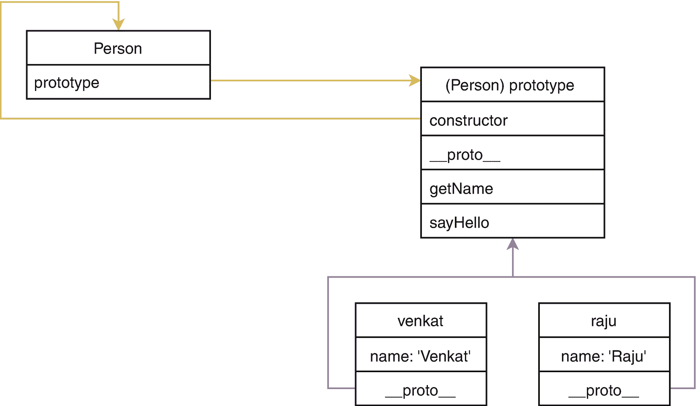
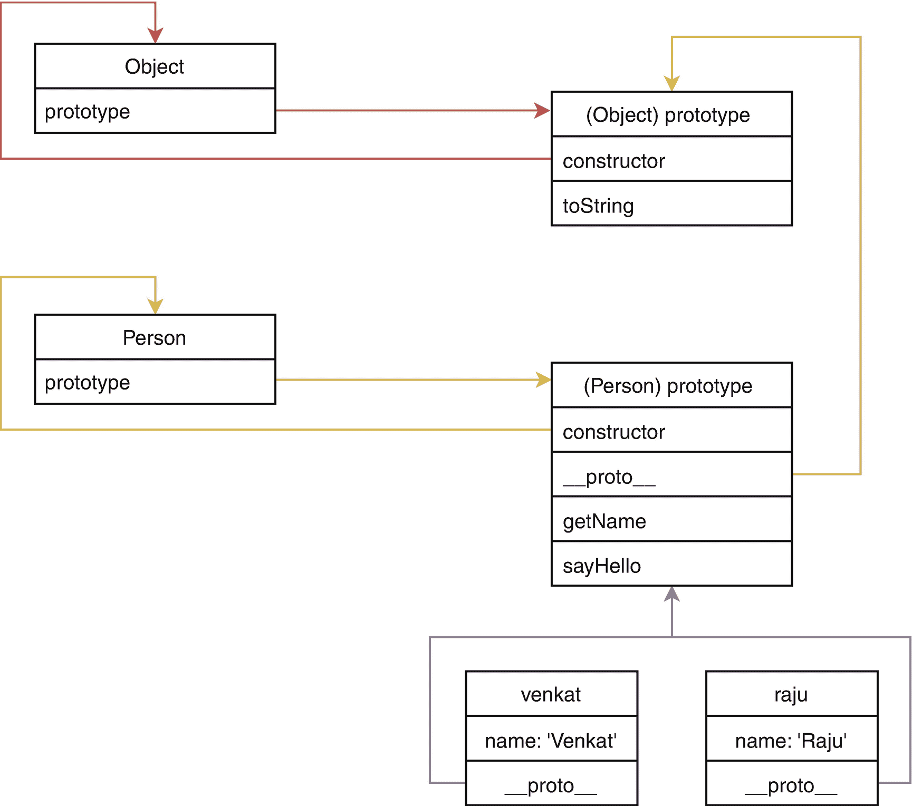
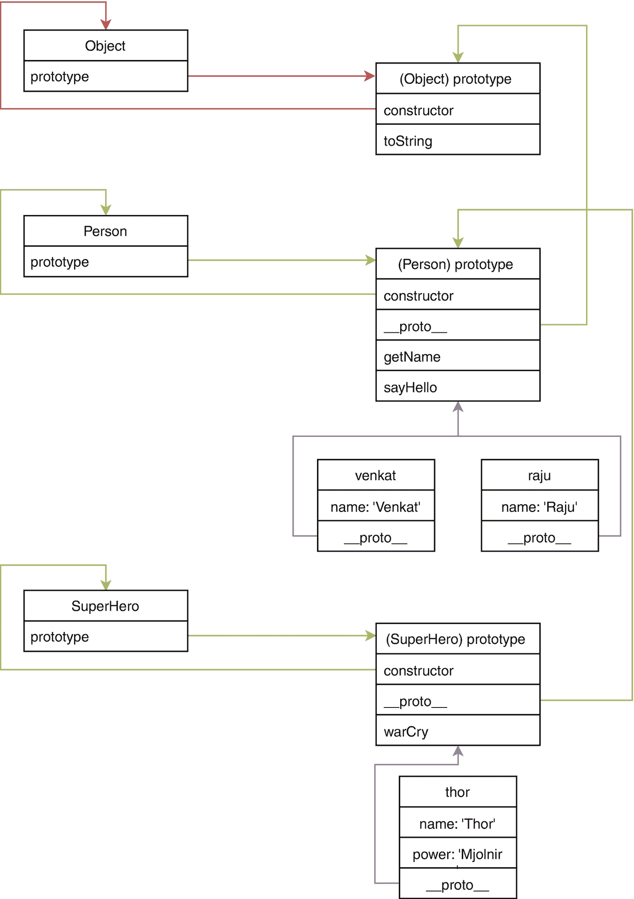

# 11. 使用类实现多重同类对象

在 JavaScript 中通过类构建对象，并将它们组织成层级结构是困难的。函数、构造函数、`prototype`属性——用秘密配方组合所有这些，撒上魔法粉尘，瞧，我们就实现了继承，*前提是*我们正确绑定了所有连接。如果对 JavaScript 原型继承的工作原理没有深入理解，这感觉就像黑魔法。

在本章中，我们将看到如何利用 ES6 引入的几个新关键字（如`class`、`extends`和`super`）轻松创建类并构建继承树，从而像在其他面向对象语言中一样表达我们的意图。完成本章后，我们将能够自信地建模问题空间并使其易于理解。我们还将获得细致入微的视角，明确在代码库中何时应当使用这一新特性，以及何时不使用它可能更合适。

## 在 JavaScript 中构建类与继承的难点

JavaScript 是面向对象的，对象可以充当数据的"袋子"以及方法（即能对包含的数据进行操作的函数）。JavaScript 体现了原型继承，即对象从其他对象扩展而来，加上其动态类型特性，这可以说比 Java 或 C#等语言中的经典继承强大得多。诚然，JavaScript 似乎并不天然具备其他语言中显而易见的抽象、多态、继承和封装等原则——然而，通过一点技巧，其中许多*是*可以实现的。

问题就在这里——虽然上述许多面向对象特性在 JavaScript 中*是*可行的，但如果不深入了解使魔法发生的所有环节，就极难正确实现。你需要理解函数如何充当构造函数，`new`如何创建对象，以及构造函数调用如何连接生成对象的原型。还需要掌握`constructor`和`prototype`属性如何在实例内工作以实现继承等功能。请看以下代码片段：

- ① 一个构造函数
- ② 在函数的原型上添加一个实例方法
- ③ 添加另一个实例方法

```javascript
function Person(name) { ①
this.name = name;
}
Person.prototype.getName = function () { ②
return this.name;
};
Person.prototype.sayHello = function (to) { ③
return `Hello ${to.getName()}. My name is ${this.name}.`;
};
const raju = new Person('Raju');
const venkat = new Person('Venkat');
// 输出 'Hello Venkat. My name is Raju'
console.log(raju.sayHello(venkat));
```

让我们逐部分分解。开始之前，请记住 JavaScript 中的函数*是*对象，和对象一样可以拥有属性。其中一个属性恰好是`prototype`属性。

在我们的示例中，我们利用了函数在 JavaScript 中扮演双重角色的事实。也就是说，它们既可以充当普通函数，也可以充当构造函数，很像我们在 Java 或 C#等语言中熟悉的构造函数。普通函数调用与构造函数调用之间的唯一区别是后者使用了`new`关键字。

当使用`new`关键字调用函数时，会创建一个新对象，该对象有一个指向创建它的函数原型的隐藏指针，并且在构造函数体内`this`被绑定到这个新对象上。换句话说，任何时候我们在（构造）函数体内使用`this`，我们指的都是这个新对象，它正是该函数创建的"实例"。

因此，每当我们添加一个像`this.name`这样的属性时，我们只是在*新创建的实例*上添加它。然而，如果我们希望为函数创建的所有实例提供"实例"方法，那么我们可以利用新创建的对象有一个指向函数`prototype`的指针这一事实，通过`Person.prototype`我们实际上就是在修改新对象的原型！

最后，由于该函数的所有实例共享相同的方法（因为它们属于共享的原型对象），我们可以从一个实例方法调用另一个实例方法，例如，我们可以在`sayHello()`中使用`getName()`。



图 11-1 原型继承

这幅图描述了原型继承的工作原理，其中新创建的实例引用了创建它的函数的原型。^(⁶⁶) 如果我们要查找实例本身不存在的属性（或调用方法），那么对象会*委托*给它的原型，从而"攀爬"继承树。当然，如果到达原型链末端仍未找到该属性，我们将得到`undefined`。

### 关于原型对象的理解

关于原型对象，需要牢记的一点是：它**仅仅**是一个 `POJO`——一个普通的旧式 JavaScript 对象！它与我们使用对象字面量（`{}`）创建的对象没有任何区别。这正是它被称为“原型式”继承的原因——一个对象作为另一个对象的原型——对象从其他对象继承。

同样，默认情况下，所有对象都固有地继承自 `Object.prototype`。^((67)) 这条规则适用于我们使用 `{}` 创建的任何对象，也适用于 JavaScript 附加到函数对象上的原型对象。

为了完整地理解这一点，`Object.prototype` 上附加了一些方法，比如 `toString`。牢记所有这些，我们的全图解表示将变成图 11-2 所示的样子。



图 11-2 从 `Object` 继承

延续我们之前的讨论，如果我们在 `Person` 的实例上调用 `toString`，JavaScript 会从该实例开始，发现它没有该方法，然后沿着原型链向上追溯到它的原型，并继续直到到达 `Object.prototype`，最后调用该方法。

我们已经看到了原型继承在 JavaScript 中是如何运作的雏形。但我们如何像其他语言那样创建继承层次结构呢？让我们看看如何从我们之前实现的 `Person` “扩展”来创建 `SuperHero`：

- ① 一个“子类”构造函数
- ② 我们首先调用“父类”构造函数
- ③ 创建子类原型
- ④ 向 `SuperHero.prototype` 添加一个方法
- ⑤ 将原型的 `constructor` 属性指向构造函数

哇！这么多活动部件。然而，其中大部分只是重现我们已经了解的 JavaScript 原型继承知识。

```javascript
function SuperHero(name, superpower) { // ①
  // 父类调用 - 可以传递参数
  Person.call(this, name); // ②
  this.superpower = superpower;
}

SuperHero.prototype = Object.create(Person.prototype); // ③

SuperHero.prototype.warCry = function () { // ④
  return `My name is ${this.name}!!!`;
};

SuperHero.prototype.constructor = SuperHero; // ⑤

const thor = new SuperHero('Thor', 'Mjolnir');
// 输出 'My name is Thor!!!'
console.log(thor.warCry());
// 输出 'Hello Venkat. My name is Thor'
console.log(thor.sayHello(venkat));
```

我们从实现 `Person` 构造函数开始，并向 `Person.prototype` 添加一些实例方法。然后我们定义一个 `SuperHero` 构造函数，它**应该**扩展 `Person`。继承要求当我们调用子类构造函数时，首先完成父类的构造（在传统面向对象语言中这会是 `super` 调用），然后才继续构造子类实例。我们如何在 JavaScript 中模拟这一点？

回想一下，当我们像构造函数一样调用函数时（即使用 `new` 关键字调用），构造函数定义内部的 `this` **就是**新创建的实例。在我们的实现中，我们通过函数上可用的 `call` 方法将 `this` 提供给 `Person`。函数对象上的 `call` 方法强制被调用函数（在我们的例子中是 `Person`）内部的 `this` 成为传递给 `call` 的第一个参数（在我们的例子中是新创建的 `SuperHero` 实例）。^((68)) `call` 的第二个参数是函数期望的任何参数——在我们的例子中就是 `name`。因此，新创建的实例会获得 `Person` 构造函数附加给它的任何属性，这正是我们想要的。

所以，我们可以模拟 `super` 调用。下一个要处理的是——正确对齐原型。如果我们回顾原型继承的实现方式，实例指向创建它们的函数的原型。为了整个继承树正确工作，`SuperHero.prototype` 必须是一个指向 `Person.prototype` 的对象。只有这样，`SuperHero` 的实例才会指向 `SuperHero.prototype`，而 `SuperHero.prototype` 又指向 `Person.prototype`，默认情况下 `Person.prototype` 指向 `Object.prototype`。

事实证明，`Object.create` 可以接受一个对象，并返回一个使用该对象作为原型的新对象。太棒了！我们用新创建的对象替换 `SuperHero.prototype`，然后在其上添加一个实例方法（仅适用于超级英雄）。

最后一个细节——由于我们替换了 JavaScript 为 `SuperHero` 函数创建的原型对象，我们需要连接它，使其知道拥有它的函数，因此我们将 `SuperHero.prototype` 上的 `constructor` 属性指回 `SuperHero` 函数。^((69))

哇。让继承工作起来需要这么多步骤，更不用说这些连接是多么复杂，因此也很容易遗漏某个步骤。然而，在完成所有这些之后，我们的图解表示就变成了图 11-3 所示的样子。



**图 11-3** 更深层次的继承

我们必须认识到，与基于类的继承不同，JavaScript 中的继承是通过原型实现的。函数只是简单的辅助工具，允许我们创建原型设置正确的对象，从而实现属性和方法的查找。

既然如此，如何实现“静态”属性呢？即与“类型”关联而非与实例关联的属性。只需在对象类型上添加一个属性即可，在 JavaScript 中，对象类型就是创建该对象的函数。因此，如果我们添加一个属性 `SuperHero.count`，或许可以跟踪应用程序中构造了多少个超级英雄。

正如我们可能得出的结论，虽然以上所有内容都相当优雅，但继承的意图**可能**会在这些复杂的机制中迷失。此外，类型的定义是分离的。诚然，通过足够巧妙的代码，可以尝试将所有内容抽象到一个位置，但这并不能缓解当前的担忧，即代码量已经很大了！有没有更好的方法来实现所有这些？ES6 引入了 `class` 关键字以及其他几个特性，使这一切变得更加容易。让我们来看看。

## 使用类进行建模

ES6 为我们引入了 `class` 关键字，让我们能够以一种与其他语言对等的方式来表达类型。我们先从简单定义 `Person` 类开始，然后看看继承是如何工作的：

* ① 使用新激活的 `class` 关键字

* ② 为我们的类型定义一个构造函数

* ③ 定义一个实例方法

* ④ 然后再定义另一个

```
class Person { ①
constructor(name) { ②
this.name = name;
}
getName() { ③
return this.name;
}
sayHello(to) { ④
return `Hello ${to.getName()}. My name is ${this.name}.`;
}
}
const raju = new Person('Raju');
const venkat = new Person('Venkat');
// 输出 'Hello Venkat. My name is Raju'
console.log(raju.sayHello(venkat));
```

瞬间让人松了一口气！^(⁷⁰)

我们引入了一个“类” `Person`，它拥有一个带单个参数的构造函数。JavaScript 要求，如果*需要*构造函数，那么它必须命名为 `constructor`，并且每个类只允许有一个构造函数。然而，如果我们的类在构造时不需要做任何工作，那么就不必编写构造函数，在这种情况下，JavaScript 会为我们提供一个默认的无参构造函数。

我们还可以像添加常规方法一样，将函数附加到类上。JavaScript 类**不能**拥有成员变量——如果我们希望在实例上添加属性，必须在构造函数或任何实例方法内部使用 `this`。

另外，类中的所有方法（包括 `constructor`）都能受益于我们之前探讨过的许多特性——默认参数、解构和展开参数都是可以使用的。组合使用这些特性中的一个或多个，我们就能为实例实现方法重载的效果。

正如我们演示的那样，其行为与我们在使用函数时完全一致。接下来谈谈继承！

正如我们之前尝试的那样，我们希望 `SuperHero` 继承自 `Person`。让我们看看如何使用新语法来实现这一点：

* ① 使用 `extends` 关键字

* ② 定义构造函数

* ③ 确保调用了 `super`

* ④ 定义一个 `SuperHero` 实例方法

```
class SuperHero extends Person { ①
constructor(name, superpower) { ②
super(name); ③
this.superpower = superpower;
}
warCry() { ④
return `My name is ${this.name}!!!`;
}
}
const thor = new SuperHero('Thor', 'Mjolnir');
// 输出 'My name is Thor!!!'
console.log(thor.warCry());
// 输出 'Hello Venkat. My name is Thor'
console.log(thor.sayHello(venkat));
```

为了扩展另一个类，我们只需使用 `extends` 关键字，在其中指明我们希望扩展的类型。在子类型中，我们**必须**做的**第一件事**就是用父类需要的所有参数来调用 `super`。其余部分应该不会让人感到意外。我们再次看到，其行为与我们基于函数的实现没有区别。

类可以拥有像我们看到的实例方法。它们也可以拥有实例级和类级（`static`）属性，以及 `static` 方法。然而，属性不能在类主体内部引入，这包括 `static` 属性。如果希望这样做，我们就必须在类主体*外部*定义它们。

另一方面，静态方法的定义方式与实例方法类似，只是前面要加上 `static` 关键字。这类方法只能通过 `Classname.staticMethod()` 在类型上访问。让我们看一个示例，其中我们将跟踪并报告已经构建了多少个超级英雄：

* ① 每次调用构造函数时，将静态计数器加 1

* ② 定义一个返回超级英雄数量的静态方法

* ③ 定义一个用于计数的属性

* ④ 调用静态方法

```
class SuperHero extends Person {
constructor(name, superpower) {
super(name);
this.superpower = superpower;
SuperHero.internalCount += 1; ①
}
static count() { ②
return SuperHero.internalCount;
}
}
SuperHero.internalCount = 0; ③
const thor = new SuperHero('Thor', 'Mjolnir');
const blackWidow = new SuperHero('Black Widow', 'weapons specialist');
// 输出 'We have 2 superheroes!'
console.log(`We have ${SuperHero.count()} superheroes!`); ④
```

我们可以通过使用类名来引用任何静态属性或方法。然而，我们必须在类定义之外声明（并在此示例中初始化）静态属性。这一限制同样适用于非静态的或实例级的属性。

最后，JavaScript **不**支持访问修饰符，比如 `private` 或 `public`。在类上定义的所有属性和方法都是公有的。这再次与 Java 或 C# 等传统语言有所不同。

尽管存在这些限制，我相信我们可以开始体会到这种语法如何大幅减少了我们必须手动编写的胶水代码，从而降低了在构建自己的继承体系时可能引入的微妙错误。不可否认，它给人一种声明式的感觉，而非我们使用函数时采用的那种命令式操作方式。

此外，对于来自其他（基于类的）语言的开发者来说，这种语法非常熟悉，因此让人感觉非常强大。这种语法已经被 Angular 等框架和 React 等库所采用，它让设计者能够更轻松地提供机制，允许客户端代码接入框架相应的生命周期。

## 注意事项

如果衡量标准是用函数在 JavaScript 中解释原型继承所需的时间和精力，那么新语法无疑胜出。与使用旧语法那种极其复杂和微妙的接线方式相比，讨论新语法几乎显得自然而然，尽管它们实现的是完全相同的事情。

话虽如此，我们还没有脱离困境。JavaScript 过去和将来都会继续使用原型继承。ES6 提供的新语法只是旧语法之上的语法糖！因此，稍微有点负面的消息是——作为 JavaScript 开发者，我们**必须**意识到这一点，并且要主动真正理解原型继承在底层是如何工作的。这是**无法回避的**，并且，作为 JavaScript 开发者，我们理应了解这门语言实际的工作原理。