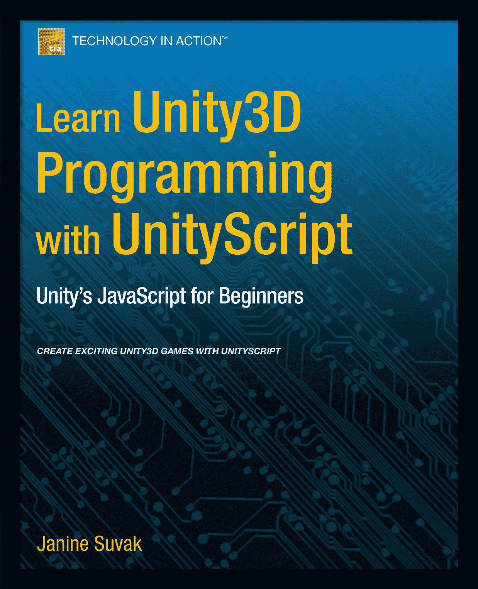

Janine Suvak 《使用 UnityScript 学习 Unity 3D 编程：面向初学者的 Unity JavaScript》

ISBN 978-1-4302-6586-3
电子书 ISBN 978-1-4302-6587-0
DOI 10.1007/978-1-4302-6587-0

© Apress 2014

《使用 UnityScript 学习 Unity 3D 编程：面向初学者的 Unity JavaScript》

出版商：Heinz Weinheimer
首席编辑：Louise Corrigan
技术审校：Graham McAllister
编辑委员会：Steve Anglin, Mark Beckner, Ewan Buckingham, Gary Cornell, Louise Corrigan, Jim DeWolf, Jonathan Gennick, Jonathan Hassell, Robert Hutchinson, Michelle Lowman, James Markham, Matthew Moodie, Jeff Olson, Jeffrey Pepper, Douglas Pundick, Ben Renow-Clarke, Dominic Shakeshaft, Gwenan Spearing, Matt Wade, Steve Weiss
协调编辑：Christine Ricketts
文字编辑：James Fraleigh
排版：SPi Global
索引编制：SPi Global
插图制作：SPi Global
封面设计：Anna Ishchenko

本书由 Springer Science+Business Media New York 向全球图书贸易发行，地址：233 Spring Street, 6th Floor, New York, NY 10013。电话：1-800-SPRINGER，传真：(201) 348-4505，电子邮件：`orders-ny@springer-sbm.com`，或访问 [www.springeronline.com](http://www.springeronline.com/)。Apress Media, LLC 是一家加利福尼亚有限责任公司，其唯一成员（所有者）是 Springer Science + Business Media Finance Inc (SSBM Finance Inc)。SSBM Finance Inc 是一家特拉华州公司。

如需了解翻译相关信息，请发送电子邮件至 `rights@apress.com`，或访问 [www.apress.com](http://www.apress.com/)。

Apress 和 friends of ED 的书籍可批量购买，用于学术、企业或促销用途。大多数图书也提供电子版和许可证。更多信息，请参考我们的特别批量销售–电子书许可网页：[www.apress.com/bulk-sales](http://www.apress.com/bulk-sales)。

作者在本文中引用的任何源代码或其他补充材料，读者可在 [www.apress.com](http://www.apress.com/) 获取。有关如何查找本书源代码的详细信息，请访问 [www.apress.com/source-code/](http://www.apress.com/source-code/)。

本作品受版权保护。出版商保留所有权利，无论涉及全部还是部分材料，特别是翻译、重印、重用插图、朗诵、广播、以缩微胶卷或任何其他物理方式复制，以及以电子方式改编、计算机软件或现有或未来开发的任何类似或不同方法进行传输或信息存储与检索的权利。

与评论或学术分析相关的简短摘录，或专门提供用于在计算机系统上输入和执行并由购买者专有的材料，不受此法律限制。本出版物或其部分的复制仅允许在出版商所在地现行版权法的规定下进行，且使用许可必须始终从 Springer 获取。使用许可可通过 Copyright Clearance Center 的 RightsLink 获取。违规行为将根据相应版权法受到起诉。

本书中可能出现商标名称、徽标和图像。我们不会在每个商标名称、徽标或图像出现时都使用商标符号，而仅以编辑方式使用这些名称、徽标和图像，以维护商标所有者的利益，无意侵犯商标权。

本出版物中使用的商品名称、商标、服务标记及类似术语，即使未被如此标识，也不应被视为对其是否受专有权利保护的看法。

尽管本书中的建议和信息在出版时被认为是真实准确的，但作者、编辑和出版商均不对可能出现的任何错误或遗漏承担法律责任。出版商不对本文所包含的内容作任何明示或暗示的保证。

献给 Rob, Paige, Justin 和 Taylor：感谢你们丰富了我的生活，让每一天都变得有意义。

关于作者

好的，作为高级文档工程师和翻译员，我将严格遵循您提供的注意事项和示例，将给定的英文文本翻译成中文。

