# 游戏编程入门

现在你已经熟悉了 Unity 编辑器，是时候来了解一下脚本编辑器 MonoDevelop 了。这两者是你进行游戏开发的两个主要工具。Unity 编辑器是你可视化构建游戏的地方，通过放置游戏对象来组装场景布局。MonoDevelop 则是你编写代码的脚本编辑器。代码告诉游戏对象如何行动，例如响应玩家输入或与其他对象交互。当你将代码脚本附加到游戏对象上时，它就会被整合到你的游戏中。在本章中，你将学习如何创建脚本、编写一些简单的代码，然后将脚本附加到游戏对象上。

你在第 1 章中随 Unity 一起安装了 MonoDevelop。你可能已经在“应用程序 ➤ Unity”文件夹中看到过它（图 2-1），但你也可以直接从 Unity 编辑器中打开 MonoDevelop。在 Unity 偏好设置 ➤ 外部工具中，它是“外部脚本编辑器”下的默认选择（图 2-2）。

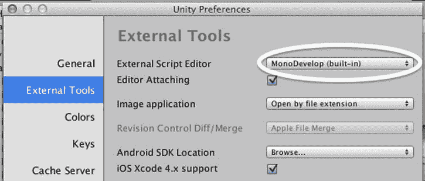

图 2-2. Unity 偏好设置菜单

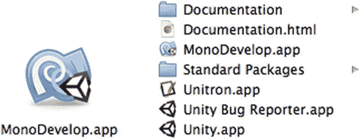

图 2-1. `MonoDevelop.app` 图标及已下载 Unity 包中的访达菜单

保持 AngryBots 项目打开，在你的项目面板中，打开 `Assets` ➤ `Scripts` ➤ `Animation` 文件夹，然后点击 `PlayerAnimation` 图标（图 2-3）。

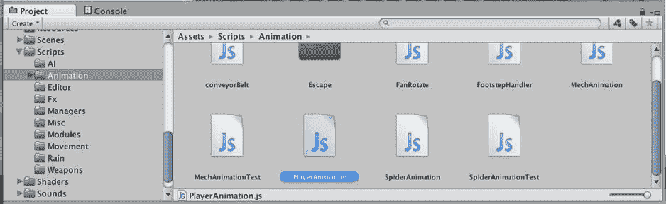

图 2-3. 项目面板中的 `PlayerAnimation` 脚本图标

在检视面板中，你将看到关于 `PlayerAnimation` 脚本内容的更多信息（图 2-4）。你可以通过双击此脚本，或选择“打开…”按钮（图 2-5）在 MonoDevelop 中将其打开。

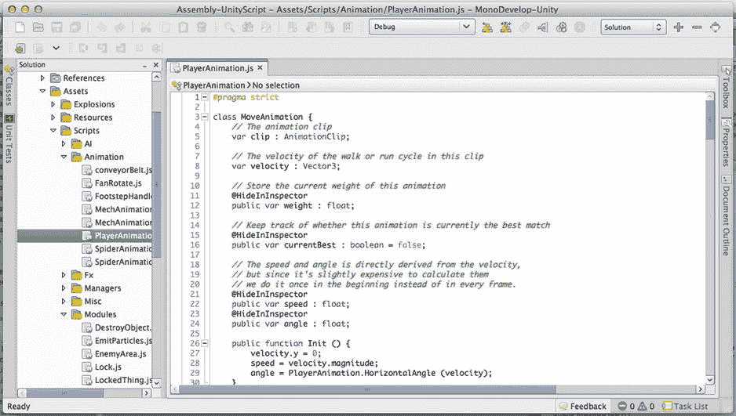

图 2-5. 准备在 MonoDevelop 中进行编辑的 `PlayerAnimation` 脚本

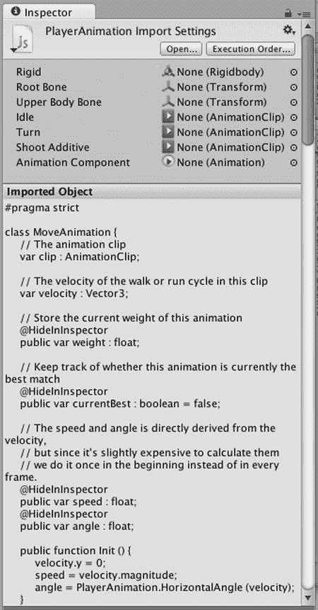

图 2-4. 检视面板中的 `PlayerAnimation` 脚本图标

AngryBots 玩起来很有趣，并且作为 Unity 和 MonoDevelop 的入门教程也很有用，但现在是时候开始学习如何开发你自己的游戏了。

你将从头开始，所以直接关闭 MonoDevelop。如果系统提示，不要保存任何更改。从 Unity 编辑器顶部菜单选择 文件 ➤ 新建项目 来打开项目向导（图 2-6）。

如果系统提示，不要保存对 AngryBots 的任何更改。给你的新项目起一个名字，然后点击“创建项目”。Unity 会提供一个默认的位置和项目名称。如果你觉得更方便，可以使用“设置…”按钮打开一个“创建新项目”窗口，作为命名和重新定位新项目的替代方法。如果你愿意，可以给你的项目起一个描述性的名称；之后你可以重命名它。你会看到在随 Unity 一起下载的标准包文件夹中找到的各个资源包，但这次不要选择任何包。确保选中了“创建新项目”选项卡，保持设置默认为 3D，然后创建你的新项目。

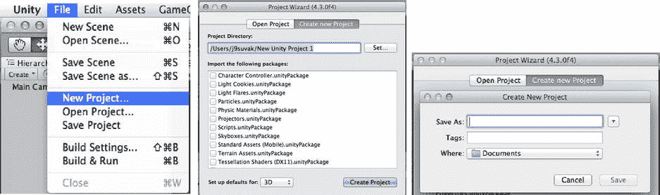

图 2-6. Unity ➤ 文件 ➤ 新建项目 菜单和项目向导

新项目的外观如图 2-7 所示。

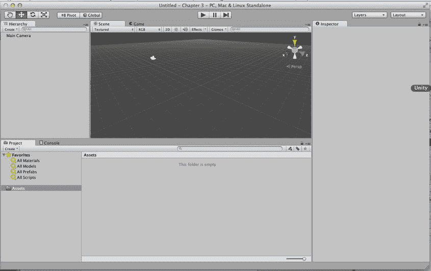

图 2-7. Unity 编辑器界面中新项目的外观

本章提供了编程的入门介绍。即使你有一些编程经验，也不要跳过这一章——示例中包含了一些常见的 Unity 特定变量和函数，你将在接下来的章节中使用它们。

## MonoDevelop

当 Unity 创建一个新项目时，它会为你提供一个游戏的骨架。这个骨架拥有任何游戏的基本要素，所以当你点击“播放”按钮时，即使是空游戏也知道如何启动，然后在取消选择“播放”时知道如何停止。游戏开发就是为这个骨架填充数字内容，并实现与游戏对象、环境和脚本的交互。

在顶部菜单中，选择 游戏对象 ➤ 创建空对象（图 2-8）。

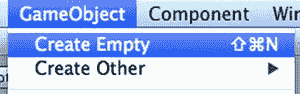

图 2-8. Unity 顶部菜单 游戏对象 ➤ 创建空对象

你将在层次结构视图中看到新的游戏对象，在场景视图中看到它的变换辅助线，并在检视面板中看到更多详细信息（图 2-9）。

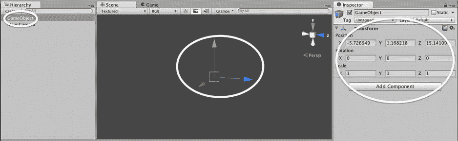

图 2-9. Unity 编辑器中的新游戏对象

在检视面板中，点击“添加组件”按钮，然后从出现的菜单中选择“新建脚本”。将你的脚本命名为 `HelloWorld`，确保语言是 JavaScript，然后点击“创建并添加”将此脚本附加到空游戏对象上（图 2-10）。按照惯例，名称应具有描述性，并且应该大写，不包含特殊字符或空格，但允许使用下划线。

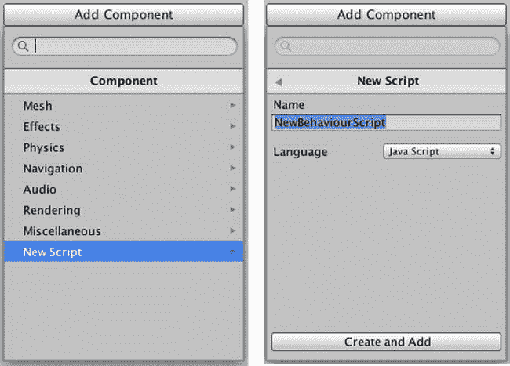

图 2-10. 用于添加新脚本的“添加组件”弹出窗口

该脚本现在在检视面板中作为游戏对象的一个组件列出，并且你将看到该脚本的图标出现在“资源”文件夹中（图 2-11）。

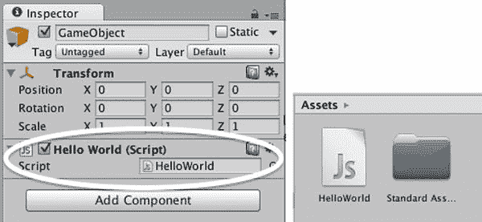

图 2-11. 检视面板中作为组件的新脚本以及项目面板资源中作为图标的新脚本

单击此图标一次以选中它，并在检视面板中查看脚本的内容（图 2-12）。

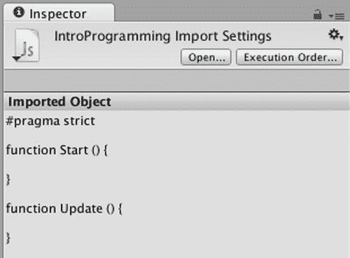

图 2-12. 在检视面板中看到的新脚本内容

你可以通过在检视面板中选择“打开”，或双击资源文件夹中的图标（图 2-13）来在 MonoDevelop 中打开该脚本。

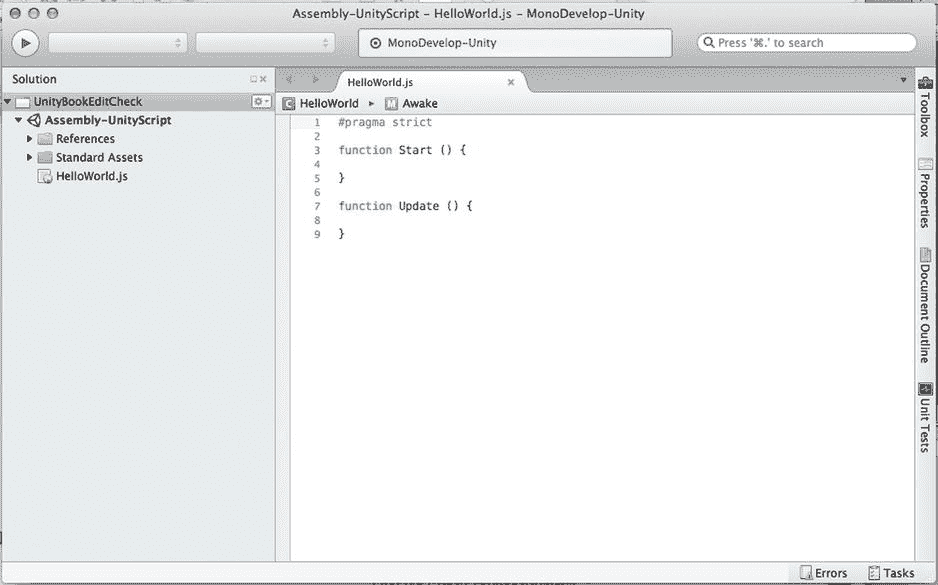

图 2-13. 准备在 MonoDevelop 中编辑的 `HelloWorld` 脚本

与 Unity 一样，MonoDevelop 也有一些键盘快捷键，你可以在 MonoDevelop ➤ Unity 偏好设置 ➤ 按键绑定（图 2-13）中找到它们。

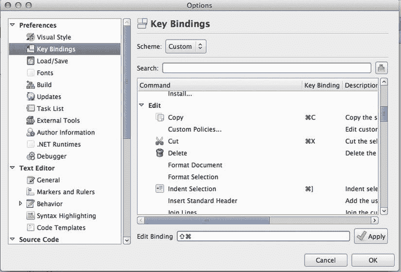

图 2-14. MonoDevelop ➤ Unity 偏好设置 ➤ 键盘快捷键的按键绑定菜单

当你创建新脚本时，Unity 会自动包含几个项目。`#pragma strict` 将出现在你所有脚本的开头。它告诉编译器变量必须具有类型声明，你将在本章稍后部分了解更多相关信息。它还会创建空的 `Start()` 和 `Update()` 函数。现在，继续删除 `Update()` 函数，包括左右大括号：

```
function Update () {

}
```

由于这个新脚本已附加到游戏对象上，因此当游戏对象进入场景时，`Start()` 函数将被调用一次。在此示例项目中，游戏对象已经存在于场景中，因此一旦游戏开始，它的 `Start()` 函数就会立即被调用。在 `Start()` 函数的大括号之间输入你的第一行代码，来看看实际效果。

```
function Start () {
  print("Hello World!");
}
```


按 `Ctrl+S` 保存，然后返回 Unity 编辑器。在 Project 面板中，选择 Console 选项卡。这就是你刚刚编写的代码的输出结果将会出现的地方。在 Game 视图中，确保取消选中 Maximize on Play，以免它遮挡 Console。现在点击 Play。在 Console 视图中，你将看到“Hello World！”出现——耶！（见图 2-15。）

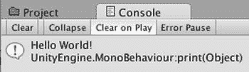

图 2-15. Console 面板中“Hello World！”的打印输出

另一种向 Console 打印消息的方法是使用 `Debug.Log`。“调试”是查找和纠正代码中错误（称为“bug”）的过程。你将在第 10 章中了解更多关于如何使用 `Debug` 类及其函数的信息。将你的代码行修改如下：

```
function Start () {

Debug.Log("Hello World!");

}
```

保存，在 Unity 编辑器中点击 Play 运行，查看 Console，你会发现得到相同的“Hello World！”，但后面跟的注释略有不同（图 2-16）。

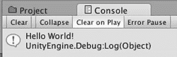

图 2-16. Console 面板中 Hello World! Debug.Log 的输出

游戏开发是一个持续学习的过程。Unity 团队不断添加新的功能和新平台，你可以将游戏移植到这些平台上。即使是最有经验的开发者也必须跟上最新的变化和新增内容，最常见的方式是参考提供的文档。每个新的游戏项目可能都有你不熟悉的地方，或者你可能想要再次确认某些变更。就像你将通过在 Unity 和 MonoDevelop 中亲手创建本书的示例来最好地学习 UnityScript 一样，通过实际使用，你也能最快地学会查阅文档。

停止游戏，回到 MonoDevelop 中的脚本。（在两个窗口之间工作时，`Alt+Tab` 是一个不错的快捷键。）在 `Debug` 单词的任意位置点击，然后按 `Ctrl+‘` 在你的网页浏览器中打开 `Debug.Log` 脚本参考文档（图 2-17）。

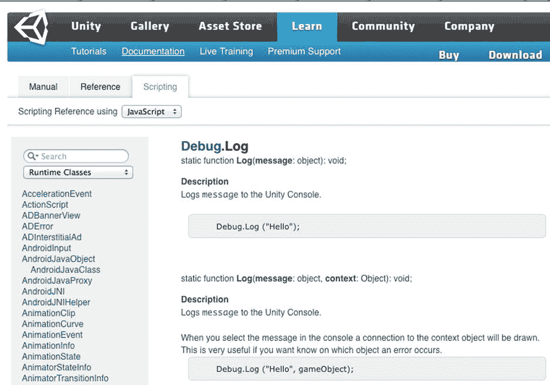

图 2-17. Unity 脚本参考文档中 `Debug.Log` 的描述

你会在描述中看到，`Debug.Log` 将一条消息记录到 Unity Console 中，随后是一个与你相似的代码示例。

还有第二个带有示例代码的描述，用于在出现错误时为你提供更多信息。通过添加 `gameObject` 引用来修改你的代码行：`Debug.Log("HelloWorld!", gameObject)`；按 `Ctrl+S` 保存，然后在 Unity 编辑器中点击 Play。现在，“Hello World！”消息会出现，同时 `Debug.Log` 函数还会提供一些额外信息（图 2-18）。

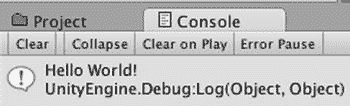

图 2-18. 带有对象上下文的 Console 中 `Debug.Log` 的输出

你将在这本书的后面部分学习更多关于调试以及如何使用这些信息的知识。目前，你已经成功试验了文档中的示例代码，这已经足够了。

游戏开发是一个互动的过程，包括经典的试错法。文档中充满了示例代码。有时书面解释可能不会马上让你明白，但亲眼看到示例代码的运行将有助于理解。不要害怕尝试！

实验时的一个实用技巧：在 Preferences ➤ Key Bindings 中，你会看到 MonoDevelop 使用与你 Unity 热键速查表中 Edit 下相同的键盘快捷键：`Ctrl+Z` 用于撤销，`Shift+Ctrl+Z` 用于重做。

在你输入代码时，你可能已经注意到 MonoDevelop 试图通过自动补全来帮助你。做出选择后，按 Tab 键，MonoDevelop 将补全剩余部分（图 2-19）。这对于提高速度和准确性非常有用，因为它减少了烦人的、会导致错误的小拼写错误的机会。

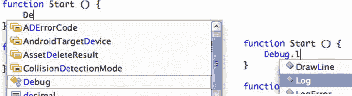

图 2-19. MonoDevelop 自动补全弹出建议

MonoDevelop 还试图帮助你识别错误。通过省略行尾的分号来引入一个错误并保存。在 Unity 编辑器中，你会在 Console 中看到一个警告，并附有 Unity 修复错误的实用建议（图 2-20）。

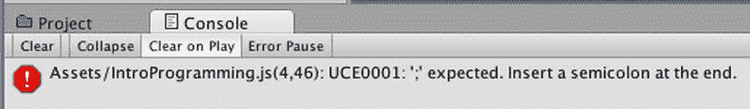

图 2-20. Console 面板中的错误警告

如果你无论如何都点击 Play，Unity 会坚持让你修复错误（图 2-21）。

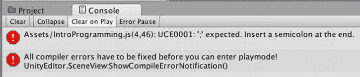

图 2-21. 尝试 Play 后 Console 面板中出现的额外错误警告

大红的警告很碍眼，所以去修复代码吧，然后保存。


