# 1. Unity 入门指南

现在是学习游戏开发的最佳时机。Unity 已成为游戏开发者最青睐的游戏引擎之一，而 Unity Technologies 公司也在持续进行重大革新，让独立开发者更容易上手。如今 Unity 游戏可以移植到的平台越来越多（这意味着它能在众多设备上运行），资源商店（Asset Store）为集中管理游戏资源提供了便利，此外 Unity 还提供了出色的支持服务，甚至拓展到为你的游戏提供专业评估和反馈。在撰写本文时，甚至有一个全新部门专门与开发者合作并发行游戏。制作游戏本身就是一种奇妙的体验，比获得高分或近乎不可能的爆头击杀更能让你引以为豪。欢迎加入这场乐趣之旅！

Unity 团队所说的"游戏"也涵盖了不断发展的"严肃游戏"领域——即使用 Unity3D 为日益增长的行业和应用场景开发的模拟及其他沉浸式交互体验。从 NASA 的火星探索、CliniSpace 的虚拟医疗培训环境，到 CrossPlatform DeSign 的动画犯罪现场重建和虚拟工业培训师，严肃游戏正以前所未有的速度出现在各个新领域。如果你有志于严肃游戏开发，我相信 Unity 是最佳工具，而本书则是理想的起点。

本书假设你拥有一台电脑，并且能够熟练使用网络浏览器下载文件——仅此而已。如果你对游戏开发感兴趣，但之前没有接触过 Unity、编程或数字艺术/内容创作，那么这本书正适合你。如果你在这方面已有一定基础，你会发现本书能帮助你了解 Unity、编程或 Unity 脚本编写。

你可能有一个游戏创意，或者想帮助他人将创意变为现实。最优秀的游戏往往能提供最佳用户体验。用户体验源于游戏的视觉与感觉，也就是图形和代码两个方面。图形或美术设计的重要性显而易见：这是用户直接看到的内容，它能够营造氛围并吸引用户。而代码则是隐藏在表象之下的核心，同样至关重要。世界上最精美的图形也无法弥补游戏运行缓慢、反应异常、流程不连贯或直接崩溃的缺陷。Unity 之所以成为游戏开发者强大且受欢迎的工具，正是因为它能让你掌控这两个重要方面，并将它们无缝融合，创造令人愉悦的体验。

初学者书籍常用的方法是引导读者创建一个简单游戏，在此过程中逐步介绍和解释其特定功能，然后让读者去查阅"官方文档"。然而这些文档往往如同古埃及象形文字般晦涩难懂，实用性大打折扣。作为初学者，我常常因此感到困惑，不知道在示例游戏之外该如何继续前进。

本书旨在将你领入游戏开发的世界。我希望你在学习使用 Unity 的同时，能够打下坚实的脚本编写基础，特别是熟悉编程模式。我将教你如何阅读文档，以及它如何融入这种编程模式，这样你就能自信地利用文档持续提升技能、拓展知识，在完成本书后制作出更宏大、更优质的游戏。

本书的配套网站是 [`www.learn-unityscript.com`](http://www.learn-unityscript.com/)，你可以在那里提问并分享你的游戏——一定要让我知道！你也可以通过 `janine@learn-unityscript.com` 联系我。本书的源代码可在 [`www.apress.com`](http://www.apress.com/) 页面的"源代码/下载"标签下找到。

## 什么是 UnityScript？

UnityScript 是基于 .NET 的 JavaScript 方言，因此其语法与流行的网页 JavaScript 方言相似。在 Unity 网站和编辑器中，它被称为"UnityScript"、"JavaScript"、"Java Script"和"Javascript"，但它与网页 JavaScript 并不相同。实际应用中有两点需要注意：(1) 从互联网上搜索到的 JavaScript 代码片段，如果不是专门为 Unity 编写的，可能无法正常工作；(2) Unity 支持的 C#、UnityScript 和 Boo 这三种语言在速度和性能上没有差异。

## 预备知识

无需编程、游戏开发或图形艺术方面的经验。投身游戏开发并非易事，但绝对充满乐趣且能带来个人成就感。你必须热爱学习——这是一个快速发展的领域，总有新东西需要学习，但这也意味着它会随着时间的推移变得越来越好，为你的游戏带来更多炫酷功能，并为你提供更强大的工具来构建它们。我认为开发游戏和玩游戏一样有趣，所以这个过程更像是"升级"我的技能。

当然，你还需要一台电脑和网络连接。在撰写本文时，Unity 的当前版本是 4.3，电脑的系统要求如图 1-1 所示。

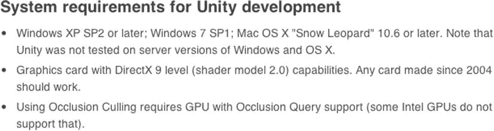

图 1-1. Unity 系统要求

## 认识 Unity

首先：Unity 的官方网站是 [`http://unity3D.com`](http://unity3d.com/)（见图 1-2）。

你可能会花上几天时间浏览这个网站；其中的游戏演示和预览画廊尤其有趣。不过，先别沉迷其中——你还有自己的游戏要制作呢！

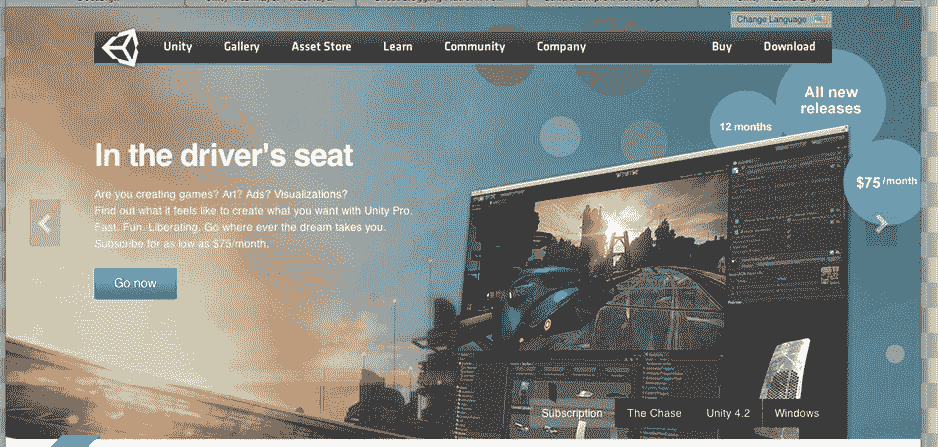

图 1-2. Unity 官方网站首页

在 Unity 首页的顶部导航栏中，你会看到“资源商店”（Asset Store）。资源商店正是一个充满各种资源的商店，提供你游戏可能需要的所有东西，包括动画、音频和脚本，此外还有我最喜欢的功能之一：促销和每日折扣！它还有许多免费资源，其中一些你将在本书后续内容中使用，届时你将更深入地了解 Unity 编辑器和资源商店是如何设计为相互协作，从而提升你的工作流程的。你对 Unity 越熟悉，就越能体会到 Unity 是如何专注于帮助你快速构建出色的游戏。

在同一导航栏中，你还会看到“社区”（Community）。Unity 社区由数十万像你一样热爱游戏并想要制作游戏的人组成。这是一个结识志同道合者并获得帮助的好地方，而且很快你就会开始帮助他人。点击这个区域，你会看到论坛、问答和反馈板块等等（见图 1-3）。

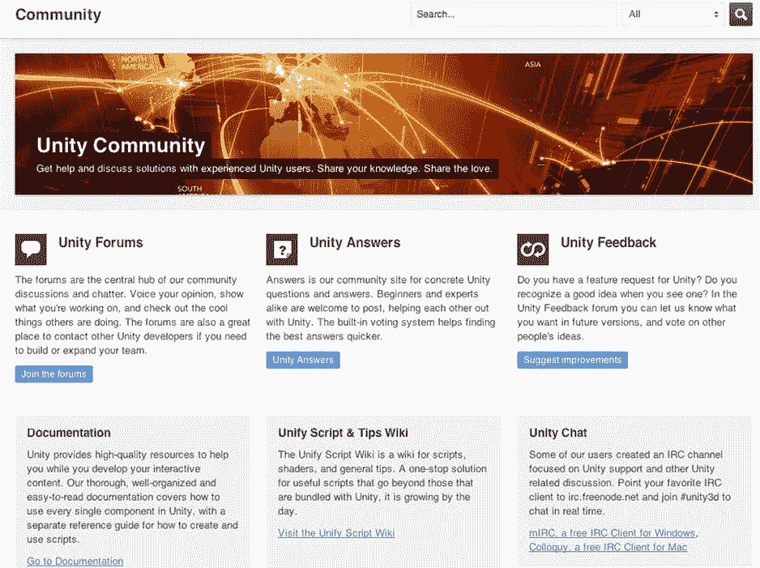

图 1-3. Unity 社区

除了视频教程之外，“学习”（Learn）板块也是你找到文档的地方：这里包含 Unity 用户手册、组件参考和脚本参考（见图 1-4）。

图 1-4. Unity 的其他学习资源

要记住像 Unity 这样强大开发工具的全部功能是不可能的，而且 Unity 团队还在不断改进并添加新特性和功能。当你跟随本书中的示例学习时，你将逐渐熟悉这些资源，并在整个游戏开发过程中习惯查阅它们。

继续操作，在“学习”选项卡的顶部蓝色子菜单中，选择“文档”（`Documentation`）（见图 1-5）。

图 1-5. 访问 Unity 网站的“学习”板块

现在，点击已加载页面上的“查看用户手册”按钮（图 1-6）。

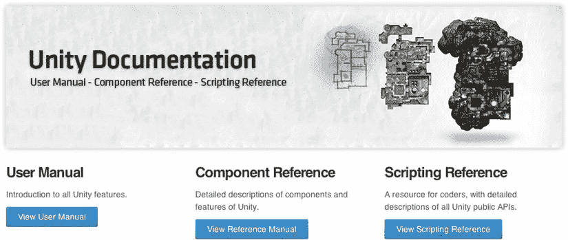

图 1-6. Unity 文档资源

在欢迎信息下方，向下滚动到“用户指南 ➤ Unity 基础知识”，然后点击“Unity 快捷键”（`Unity Hotkeys`）（见图 1-7）。

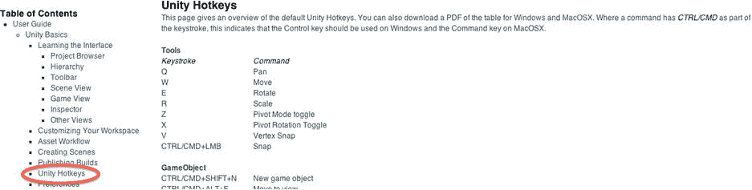

图 1-7. 用户手册中的“Unity 快捷键”主题

在这里，你可以下载适用于 PC 或 Mac 的 Unity 常用键盘快捷键 PDF。当你熟悉 Unity 编辑器时，你会发现这份参考非常有用。其内容如图 1-8 所示。

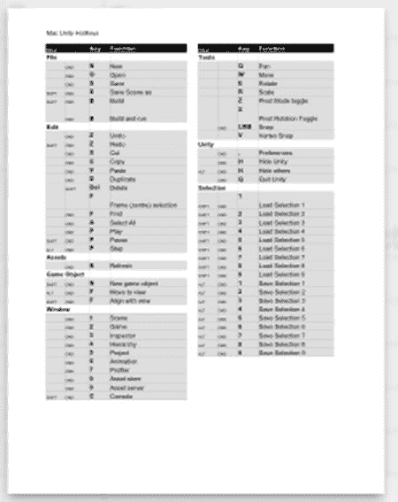

图 1-8. Unity 快捷键可打印快速参考

提示：在使用本书中提到的快捷键时，`+` 符号表示先按住第一个键，再按下第二个键。对于 Mac，`⌘+X` 表示按住 `⌘` 键，然后按下 `X` 键。对于 PC，`Ctrl+X` 表示按住 `Control` 键，然后按下 `X` 键。

## 设置开发环境

现在是时候设置你的开发环境，准备制作游戏了。返回 Unity 主页面，在顶部菜单栏的右侧选择“下载”（`Download`）（见图 1-9）。

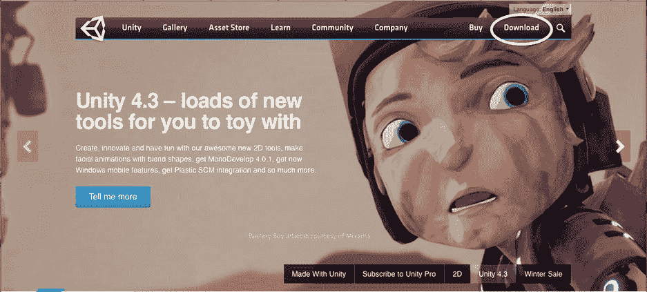

图 1-9. Unity 网站首页上的“下载”选项卡

点击写着“下载 Unity 4.3”的大蓝色按钮（图 1-10）。下载需要几分钟时间。

注意：如果你在 Unity 软件更新后购买本书，网站上显示的 Unity 版本可能更高。如果有任何疑问，请访问本书的配套网站 [`www.learn-unityscript.com`](http://www.learn-unityscript.com/)。

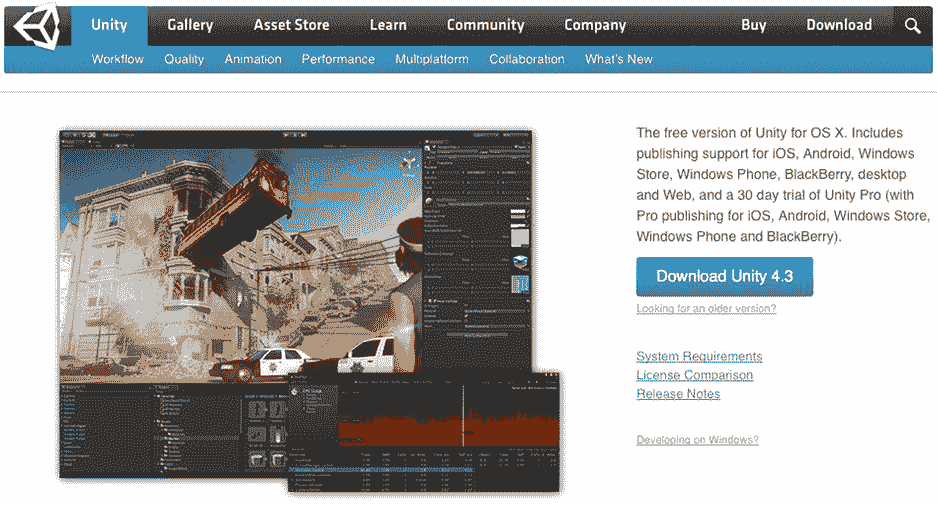
图 1-10. 下载最新版本的 Unity

在操作系统的“下载”文件夹（或你选择的保存位置）中，双击 `unity-4.3` 将其打开。然后，在打开的 Unity 安装程序窗口中，双击 `Unity` 图标（图 1-11）。

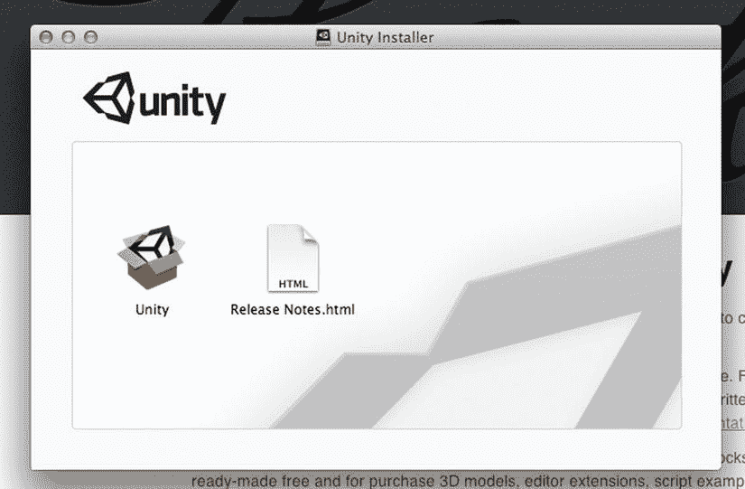
图 1-11. Unity 安装程序窗口中的 `Unity` 图标

在弹出的“安装 Unity”窗口中点击“继续”（`Continue`），并在欢迎界面后再次选择“继续”以进入 Unity 许可条款。在弹出的菜单中（当然，是在仔细阅读所有条款和条件后）选择“同意”（`Agree`）。

除非你有其他强烈偏好，否则让 Unity 使用默认安装位置。点击“安装”（`Install`）；现在让向导执行标准安装，无需自定义或更改安装位置。根据你计算机的安全设置，你可能需要输入密码以允许安装。然后点击“安装软件”（`Install Software`）。实际安装需要几分钟时间。

你将在“安装 Unity”窗口中看到一条消息，确认安装成功。点击“关闭”（`Close`）按钮可以关闭此窗口。现在你也可以关闭 Unity 安装程序窗口。

此时，会打开一个访达（Finder）窗口，在“应用程序”（`Applications`）文件夹中显示 Unity。你可以将 `Unity` 和 `MonoDevelop` 图标都拖到程序坞（Dock）中便于访问（图 1-12）。

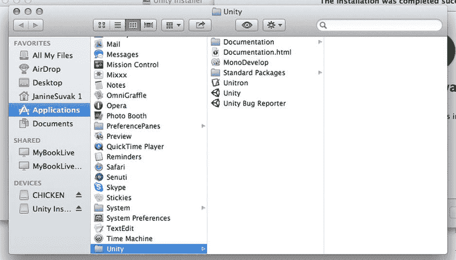
图 1-12. Unity 软件包

双击 `Unity` 图标；将出现一个用于激活 Unity 许可证的弹出窗口。选中标记为“激活 Unity 免费版本”的复选框，然后点击“确定”（`OK`）按钮（图 1-13）。

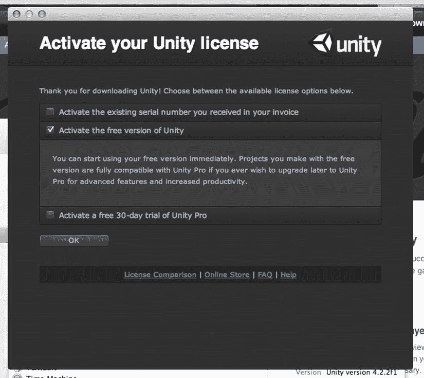
图 1-13. Unity 许可证激活

下一步是创建你的 Unity 账户（图 1-14）。这个账户也将用于 Unity 资源商店和社区论坛。我建议订阅月度通讯，以便随时了解 Unity 的最新动态。

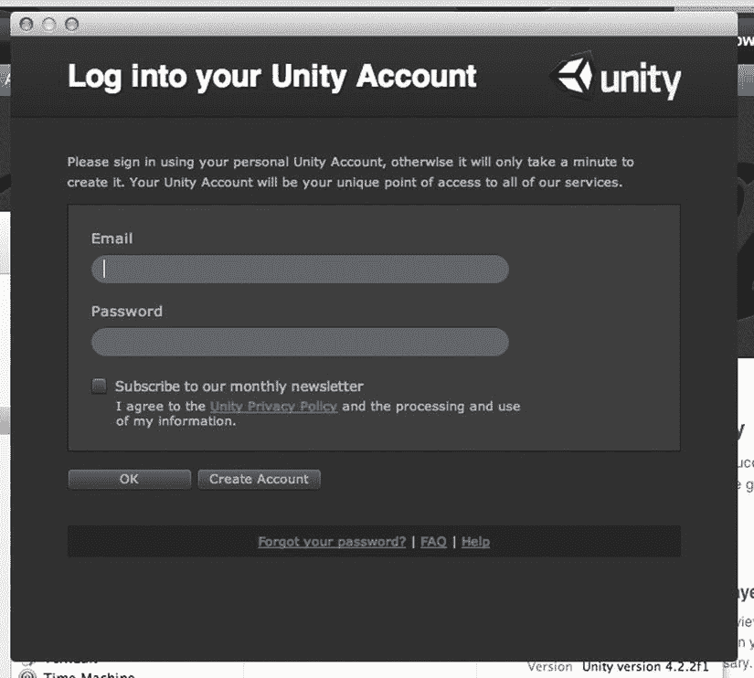
图 1-14. 创建 Unity 账户

创建账户后，会出现一个友好的感谢页面。点击大大的蓝色“开始使用 Unity”按钮（图 1-15）。

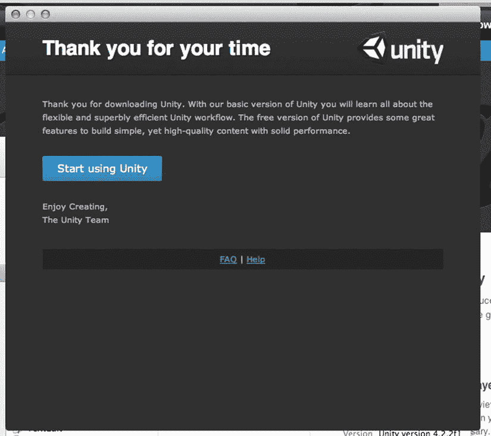
图 1-15. Unity 软件包下载和账户创建完成

“欢迎使用 Unity”屏幕将出现在 Unity 编辑器界面的上方（图 1-16）。欢迎屏幕包含指向你刚才浏览过的 Unity3D 网站上各个主题的链接。除非你取消勾选右下角的“启动时显示”（`Show at Startup`）复选框，否则每次启动编辑器时都会显示此窗口。

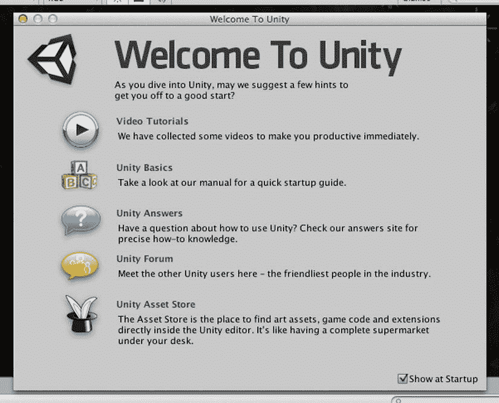
图 1-16. Unity 欢迎窗口

你也可以通过 `Help` 菜单轻松访问欢迎屏幕和这些链接，因此你可以取消勾选 `Show at Startup`（启动时显示）以跳过该窗口（图 1-17），然后关闭它即可看到 Unity 编辑器（图 1-18）。

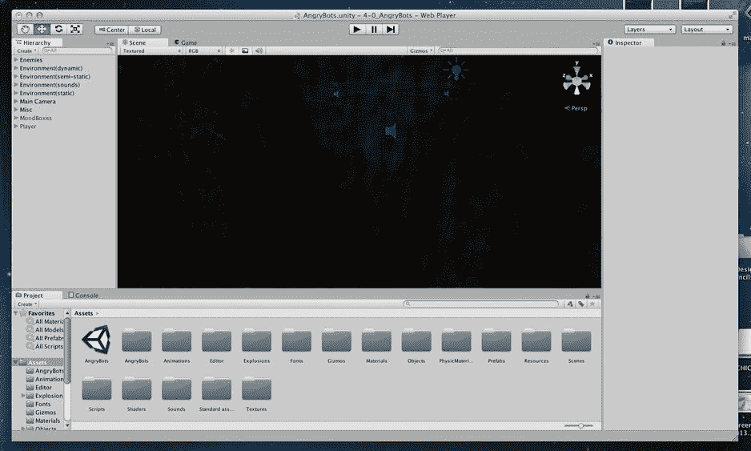
图 1-18. Unity 编辑器界面

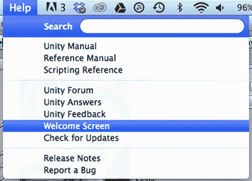
图 1-17. 可通过 Unity 编辑器 `Help` 菜单访问的 Unity 欢迎窗口

## 开始使用 AngryBots

如果你不喜欢游戏，你可能不会对游戏开发感兴趣，因此你能猜到最棒的部分——玩游戏！认识一下 AngryBots，这是 Unity 自带的演示项目。在 Unity 编辑器的顶部中央，你会看到播放按钮（图 1-19）。

图 1-19. Unity 编辑器播放模式控件

点击播放按钮启动 AngryBots 游戏。使用方向键或 `ASDW` 键移动，用鼠标左键射击，并用鼠标环顾四周。尽管去享受一下乐趣，然后再次点击播放按钮退出游戏。暂停按钮在播放按钮的右侧，其右侧的按钮用于测试时逐步推进游戏。

AngryBots 也很适合用来演示组成 Unity 编辑器界面的各个视图。界面是你与 Unity 编辑器交互的窗口。它由多个视图组成，这些视图可以通过工具栏右上角的 `Layout`（布局）下拉菜单进行配置。你还可以通过拖动标签来调整各个视图的大小并重新排列它们以自定义布局，或者将某个视图拖出编辑器窗口区域，使其成为独立窗口。你可以随时通过选择 `Layout` 下拉菜单中的 `Revert Factory Settings`（恢复出厂设置）来恢复基本布局。当你的游戏变得复杂时，`Layers`（图层）下拉菜单对于隐藏和显示不同内容非常有用（图 1-20）。

图 1-20. 图层和布局下拉菜单控件

在左上角，你会看到四个工具的按钮：平移、移动、旋转和缩放（图 1-21）。这些工具也可以通过 Unity 热键速查表的工具表格中列出的 `Q`、`W`、`E` 和 `R` 键来选择。

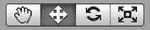
图 1-21. 平移、移动、旋转和缩放工具选择器

紧邻这些工具右侧的是几个切换开关，它们也有对应的热键，你可以在之前下载的热键列表中找到：`Z` 用于切换轴心模式（在局部空间和世界空间之间切换），`X` 用于切换轴心旋转（在中心旋转或轴心点旋转之间切换）（图 1-22）。稍后你会了解更多关于这些技术细节的内容；这里只是对你所见的编辑器界面的一个介绍。

图 1-22. 轴心模式和轴心旋转切换开关

你还可以使用窗口表格中的热键，将焦点切换到我将要介绍的各个视图。

### 游戏视图 (+2)

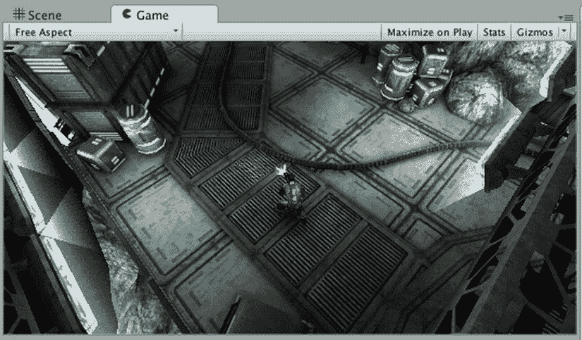
图 1-23. 在游戏视图中看到的 AngryBots

你已经使用游戏视图玩过 AngryBots（图 1-23）。你会经常使用游戏视图，因为游戏开发是一个迭代过程。这意味着你会不断重复以下步骤：逐块构建你的游戏，通过在游戏视图中播放来测试该模块，进行调整，然后再次测试，直到满意地认为它按预期运行，然后再添加下一个模块。你可以在播放时修改设置以微调游戏体验，但请注意，在游戏播放模式下对游戏对象所做的任何更改都不会被保存。为了避免因丢失本想保留的更改而感到沮丧，请按 `⌘+.`（逗号键）打开 Unity 偏好设置菜单（图 1-24）。

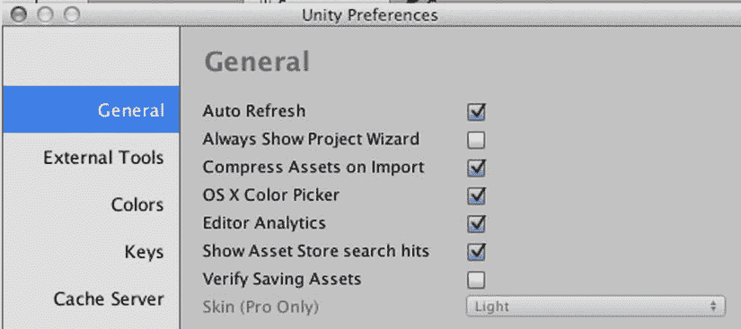
图 1-24. Unity 偏好设置菜单

# 勾选 `OS X Color Picker`，然后选择左侧的 `Colors`（颜色）。在 `Playmode tint`（播放模式色调）显示区域双击打开颜色选择器，选择一种颜色，然后关闭颜色选择器窗口和 Unity 偏好设置窗口（图 1-25）。

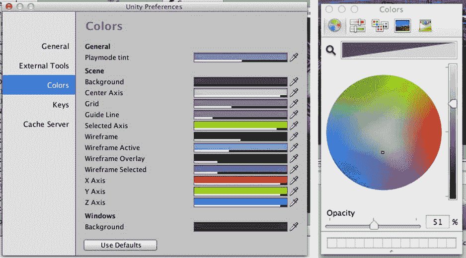

图 1-25. Unity 偏好设置：颜色菜单和颜色选择器

关闭颜色和 Unity 偏好设置窗口，点击播放按钮，你会看到编辑器颜色发生变化，提醒你正处于活动播放模式。在游戏视图的顶部，你会找到控制栏（图 1-26）。如果你希望在播放时 AngryBots 填满窗口，可以在点击播放按钮之前，从游戏视图顶部选择 `Maximize on Play`（播放时最大化）（`Shift + 空格键`）。

图 1-26. 游戏视图控制栏

左侧的 `Aspect`（宽高比）下拉菜单允许你使用目标设备或平台的屏幕比例来测试游戏玩法（图 1-27）。

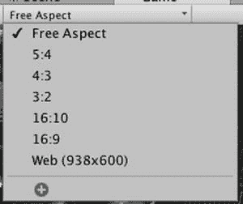

图 1-27. 游戏视图宽高比下拉菜单

选择 `Stats`（统计数据）会激活性能统计数据的显示（图 1-28）。

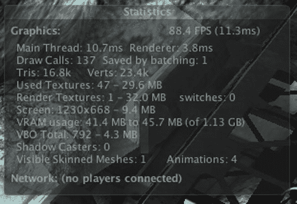

图 1-28. 游戏视图中的游戏统计数据展示

最后，`Gizmos`（辅助图标）按钮允许你直观地识别辅助图标，这将在涵盖场景视图的部分进行讨论。

## 层级视图 (+4)

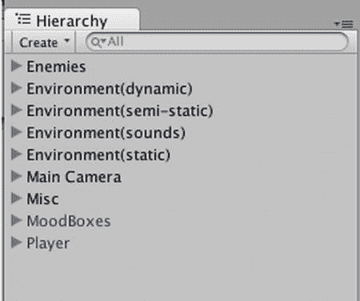

图 1-29. 层级视图

层级视图包含当前显示场景中所有对象的列表，并按字母顺序排列。对象可以分组为“父”对象，并可能拥有相应的“子”对象。在探索编辑器界面时，如果你展开图 1-29 中的任意项，会发现父对象下嵌套着一个缩进的、按字母顺序排列的子对象列表。你将在后续章节中全面了解游戏对象的父子关系。

在 Unity 编辑器中，执行任何特定操作通常都有不止一种方法。层级视图中的 `Create` 按钮与顶部菜单的 `GameObject ➤ Create (Empty or Other)` 选项功能相同，用于为你的游戏生成各种元素（图 1-30）。

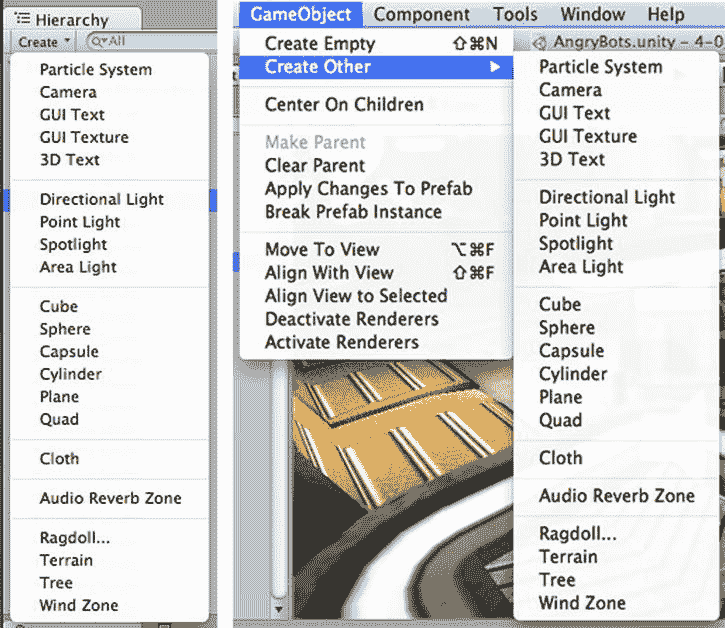

图 1-30. 创建新游戏对象的多种方法

在层级视图的搜索字段中输入 `EnemySpider`。正如你所料，视图中会显示一个 `EnemySpider` 游戏对象的列表。点击列表中任意一个 `EnemySpider` 对象，然后将鼠标光标移至场景视图，按下 `F` 键。`F` 键会将场景视图的焦点移动到你在层级视图中选中的对象上。请注意，场景视图中除层级视图搜索结果中的对象外，其他所有内容都变灰了（图 1-31）。

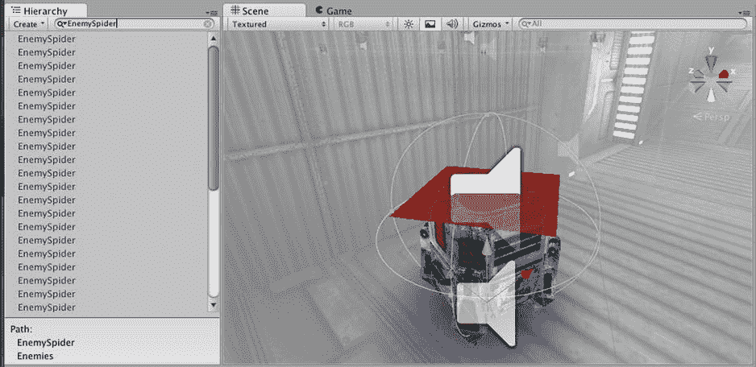

图 1-31. 聚焦于 EnemySpider 的场景视图

现在尝试将焦点切换到 `Player`。提示：在层级视图的搜索栏中输入 `Player`，选中 `Player`，将鼠标光标移到场景视图，然后按下 `F` 键。

最后，点击搜索栏中的 `x` 以返回标准场景视图。

## 场景视图 (+1)

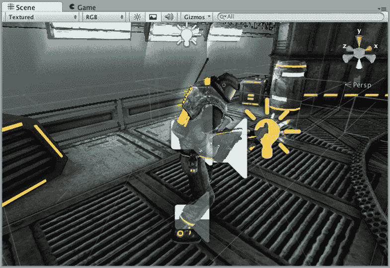

图 1-32. 场景视图

在早期，游戏完全由代码创建。Unity 之所以能够更快地创建出精美的游戏，很大程度上在于其使用了诸如场景视图之类的直观工具，你可以在其中从环境搭建到游戏对象定位，可视化地构建游戏（图 1-32）。

你可以通过多种方式浏览场景视图。选择手形工具（`Q`）并用鼠标点击并拖动。按住 `Alt` 键并点击拖动鼠标，可以围绕兴趣点旋转视图；按住 `Ctrl` 键并点击拖动鼠标，则可以缩放视图。在“第一人称飞行”模式下，按住鼠标右键并使用 `A`、`S`、`D`、`W`、`Q` 和 `E` 键进行导航，可以体验到一些乐趣。

通过点击选中 AngryBots 中的 `Player` 游戏对象。使用手形工具右侧的相应按钮，可以显示“平移”（`W`）、“缩放”（`E`）和“旋转”（`R`）辅助工具。请注意，每个工具中的 `x`、`y`、`z` 轴分别用红色、绿色和蓝色进行颜色编码。你可以通过点击拖动辅助工具来用鼠标操纵游戏对象的位置，或者在检视面板中输入精确数值来调整。场景相机的视角也可以通过场景辅助工具以相同方式进行调整（图 1-33）。

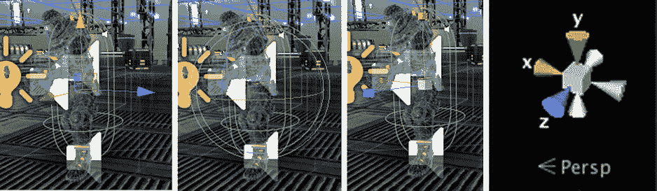

图 1-33. 场景视图的平移、旋转、缩放和相机辅助工具

你可以使用场景视图控制栏（图 1-34）以多种模式查看场景，并预览音频。

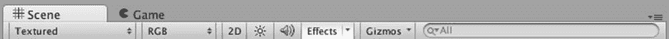

图 1-34. 场景视图控制栏

## 检视面板 (+3)

检视面板包含每个游戏对象、资源和编辑器首选项的设置。它是对上下文敏感的，这意味着它会根据你在 Unity 编辑器中所选内容的变化而变化。你可能已经注意到了检视面板的内容在不同选择之间发生了变化。请注意 `EnemySpider` 与 `Player` 的设置差异（图 1-35）。

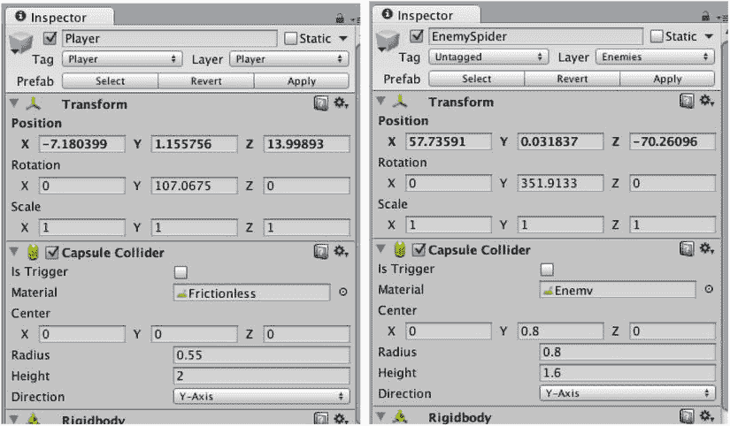

图 1-35. 检视面板内容随所选游戏对象变化而改变

## 项目面板 (+5)

构成你游戏的所有资源都存储在项目面板中（图 1-36）。你可以创建新资源，或从资源商店等其他来源导入资源。请勿使用操作系统在 Unity 项目中移动文件。Unity 会在其内部项目文件库中跟踪这些文件的存储位置，以及你通过项目面板移动或编辑它们的方式。

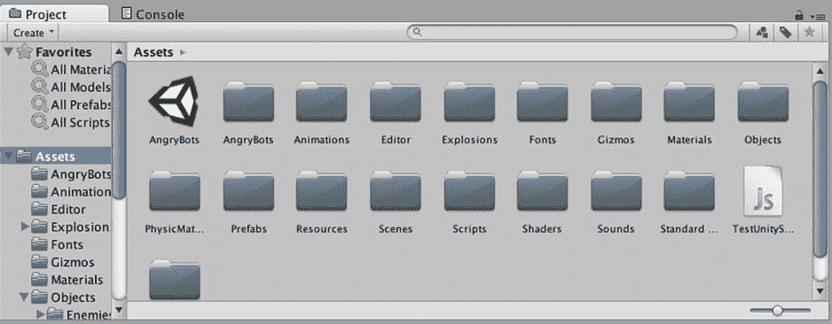

图 1-36. 显示 AngryBots 资源的项目面板

## 控制台 (SHIFT++C)

控制台（图 1-37）在开发过程中显示游戏的输出，例如消息、警告和错误。

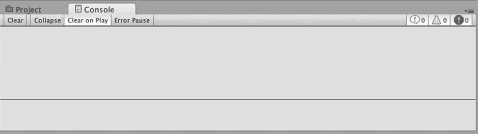

图 1-37. 控制台

## 总结

在本章中，你对 Unity 网站上可用的资源有了大致了解，并且在后续项目中使用它们时会更加熟悉。你下载了 Unity 编辑器，体验了消灭愤怒机器人的乐趣，并浏览了构成 Unity 编辑器本身的各个视图。至此，你已经准备就绪，可以开始行动了！
