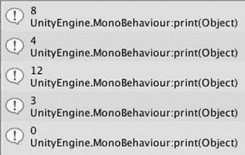
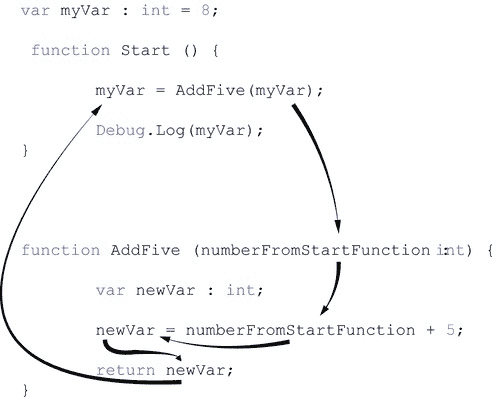
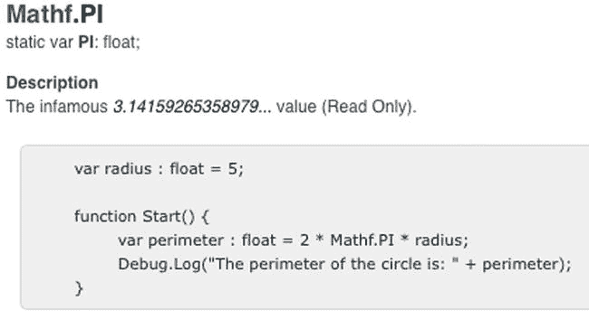
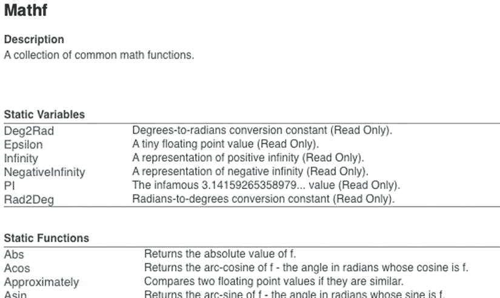
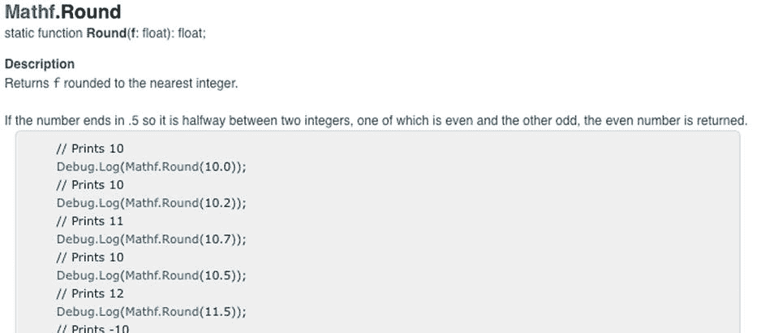

# 变量与函数

计算机只会执行你告诉它的指令。它使用变量来存储数据，并按照你以函数形式提供的指令来处理或操作这些数据。

将你的代码修改为如下所示：

```
#pragma strict

// 声明一个整数类型的变量 myVar 并赋值为 8。

var myVar : int = 8;

function Start () {

Debug.Log(myVar);

}
```

首先，仔细看一下第二行。在行首添加双斜杠 `//` 会使其成为一条注释，在 MonoDevelop 中会以灰色字体显示。注释用于为自己或其他开发者添加备注，例如描述后续代码块的作用。那些在编写时看似一目了然的代码，对他人来说可能并不清晰，或者当你在几天、几周甚至更久之后重新审视时，也会变得模糊难懂。养成在编写代码时添加注释的好习惯，对你自己和团队成员都有好处。

注意：在调试过程中，注释掉代码非常有用。你可以通过注释而非删除来禁用代码，然后在需要时轻松地重新启用它。

对于多行注释，请在注释或代码的开头添加 `/*` ，在结尾添加 `*/`。尝试将 `Start()` 函数注释掉。

```
#pragma strict

// 声明一个整数类型的变量 myVar 并赋值为 8。

var myVar : int = 8;

/* function Start () {

Debug.Log(myVar);

}  */
```

注意代码变成了相同的灰色，表明这个函数现在已被禁用。保存并在 Unity 中运行，正如你所料，控制台保持空白。取消注释 `Start()` 函数以启用它并保存。

变量用于存储和检索数据。你的游戏程序正是通过这种方式来记住管理游戏玩法所需的内容。

看一下这行代码：

```
var myVar : int = 8;
```

将其分解为几个部分：

```
(1)      (2)  (3)     (4)      (5)    (6)   (7)

var  myVar :   int    =    8   ;
```

1. 使用 `var` 语句声明一个变量。

2. 变量名称。变量名应该具有描述性，这有助于提高代码的可读性。你可以使用任何字母数字字符和下划线，但不能使用其他标点符号或特殊字符。另一个提高代码可读性的好做法是遵循标准的编程约定。变量命名的标准约定是：如果变量名的第一个字符是字母，则不大写。

3. 冒号，用于分隔变量名和数据类型。

4. 变量的数据类型，此处 `int` 表示整数。

5. 赋值运算符，用于为你刚刚声明并命名的变量赋值。你在声明整数时不必为其赋值。

6. 赋给变量的值，此处是一个整数。整数是整数，包括负数（前面用减号表示）。不能包含逗号和空格——虽然 24、0 和 –3 是有效的整数，但 2,500 不是，而 2500 是。

7. 分号，表示语句的结束。所有语句必须以分号结尾。

在 `Start()` 函数中，打印到控制台的 `Debug.Log` 消息是 `myVar` 的值。保存并播放以确认。

变量用于存储数据，而函数则执行操作。函数所执行的任何过程的指令都包含在花括号内。看一下 `Start()` 函数的组成部分：

```
(1)          (2)   (3)  (4)

function Start ()  {

(5)

Debug.Log(myVar);

(6)

}
```

1. 使用保留字 `function` 声明函数。

2. 命名函数。函数名以大写字母开头。

3. 用于处理传递给函数的信息的参数。圆括号是必需的，因此如果不需要参数，则保留为空。

4. 左花括号，表示函数内容的开始。

5. 函数要以语句形式遵循的指令——在此示例中，为 `Debug.Log` 语句。

6. 右花括号，表示函数的结束。由于它是函数的结束而非语句的结束，因此不使用分号。

注意 MonoDevelop 已经缩进了 `Debug` 语句。缩进用于提高代码的可读性。这样，你可以轻松识别不同的代码块。MonoDevelop 会自动为你执行此操作，但有时你会发现需要重新组织代码以提高可读性。在 MonoDevelop 的 偏好设置 ➤ 键绑定 ➤ 编辑 中，你可以找到键盘快捷键 `Ctrl+]` 用于缩进，或 `Ctrl+[` 用于取消缩进，这将移动你高亮选中的任意大小的代码块。用你的 `Debug` 语句试试看，然后再用整个 `Start` 函数试试。很简单，对吧？

**表 2-1.** 算术运算符的定义

| 算术运算符 | 含义 |
|------------|------|
| `+`        | 加法 |
| `-`        | 减法 |
| `*`        | 乘法 |
| `/`        | 除法 |
| `%`        | 取模 |

为了快速回顾一下算术运算符（表 2-1），将 `Start` 函数中的 `Debug` 代码行替换为以下几行：

```
print(6+2);

print(6-2);

print(6*2);

print(6/2);

print(6%2);
```

保存并播放。控制台中的输出将如图 2-22 所示：



**图 2-22.** 算术运算符的输出结果

你大概认识前四个运算符。取模运算符是另一个很方便的运算符，它给出余数，在此例中为 6 除以 2 的余数。尝试将 6 改为 5，保存并播放。这次最后一行输出是 1，即 5 除以 2 的余数。

与大多数编程语言一样，UnityScript 遵循标准的运算顺序，即乘法和除法的优先级高于加法和减法。

将你的 `Start` 函数修改如下：

```
print(6+2*4);
```

从左到右读，6 加 2 等于 8，再乘以 4 等于 32。保存并播放，你会看到 Unity 先计算 2 乘以 4 得到 8，然后加上 6，最终输出为 14。

你可以通过使用括号来改变求值顺序。括号内的运算具有更高的优先级。将同一行代码修改如下：

```
print((6+2)*4);
```

现在当你保存并播放时，输出是 32，因为 Unity 先执行了括号内的加法运算。

这些相同的算术运算符也可用于变量所保存的数值。用以下语句替换同一行代码：

```
print(myVar + myVar);
```

由于之前为 `myVar` 赋的值为 8，现在你将得到 16 作为结果。

到目前为止，你一直在使用整数，但你也可以将变量声明为浮点数据类型来处理小数。变量可以包含各种数据类型，包括字符串、布尔值以及更复杂的数据类型。实际上，你在第一行代码中就使用了一个字符串：

```
print("Hello World!");
```

字符串就是双引号内的字符。拼接是指将单独的字符串组合成一个字符串的术语。虽然我本可以说你可以“相加”字符串，但学习引入的术语对你来说很重要。当你在 Unity Answers 上搜索论坛寻求帮助时，或者为了在鸡尾酒会上显得很博学时，这会派上用场。将你的代码编辑如下：

```
#pragma strict
```

```csharp
// 声明整型变量 myVar 并赋值为 8。
var myVar : int = 8;
var myString1 : String = "Hello ";
var myString2 : String = "World!";
var myNewString: String;

function Start () {
    myNewString = String.Concat(myString1, myString2);
    Debug.Log(myNewString);
}
```

保存并运行，输出应为“Hello World!”。这里最常见的错误是忘记在需要空格的地方加入空格。

`String.Concat` 与 `Debug.Log` 相似，两者都包含一个点运算符。点运算符是一种代码语法形式，点用于分隔代码中的单词。`Concat` 是 `String` 的一个元素，就像 `Log` 是 `Debug` 的一个元素一样。你可以在 `String` 和 `Debug` 上使用熟悉的 ``+‘ 组合键，在 Unity 脚本参考中查看更多元素。

`Start` 函数在演示这些基本概念方面效果不错，但现在你可以编写自己的函数了。函数接收信息（称为参数），对这些信息执行某种操作，然后可选择返回一个结果。

删除字符串变量声明，并按如下方式编辑 `Start` 函数：

```csharp
var myVar : int = 8;

function Start () {
    myVar = AddFive(myVar);
    Debug.Log(myVar);
}
```

语句 `myVar = AddFive(myVar);` 调用了你接下来要创建的名称为 `AddFive()` 的函数，并将存储在 `myVar` 中的整数发送给它。

在 `Start()` 函数的右花括号之后，编写在 `Start` 中被调用的新函数，名称为 `AddFive`：

```csharp
function AddFive (numberFromStartFunction : int) {
    var newVar : int;
    newVar = numberFromStartFunction + 5;
    return newVar;
}
```

与 `Start()` 函数不同，`AddFive()` 需要接收信息才能通过加五来处理信息。括号内的参数 `numberFromStartFunction` 被声明为整数数据类型。这意味着当调用此函数时，必须向其发送一个整数。你已经将 `myVar` 声明为整数，因此在 `AddFive(myVar)` 函数调用中，你正确地向 `AddFive()` 函数发送了整数数据类型。`numberFromStartFunction` 在 `AddFive()` 函数中像变量一样工作，用于保存从调用者处接收到的整数。

`AddFive()` 函数的第一条语句如下：

```csharp
var newVar : int;
```

这里你声明了一个名为 `newVar` 的新变量，类型为整数。你可能还记得之前对函数的分解说明，声明变量时不必为其赋值。

`newVar` 是在 `AddFive()` 函数内部声明的，因此只能在此函数内部使用。这是一个局部变量的示例，因为其作用域仅限于声明它的函数。`myVar` 是一个全局变量的示例；其作用域更广，可以被此脚本中的任何函数使用。

此函数中的第二条语句 `newVar = numberFromStartFunction + 5;` 是对指令的实际处理，即向参数 `numberFromStartFunction` 中接收到的整数加 5。此计算结果随后存储在局部变量 `newVar` 中。

最后，`return newVar;` 将赋值给 `newVar` 的值返回，并赋值给 `myVar`。



**图 2-23.** 两个函数之间的数据流

此过程如图 2-23 所示。运行（保存并播放）脚本，果然，Unity 会给出结果 13。太棒了！

数学对于游戏开发来说是必要的，但对于那些无法从解决数学问题中获得特殊乐趣的人来说，我有个好消息：Unity 为你提供了大量内置数学函数。毕竟，超快速地进行常规计算是计算机最擅长的事情，而这里的目的是帮助你进行整体游戏开发。

`Mathf` 是 Unity 提供的便捷数学变量和函数的集合之一。在 MonoDevelop 中，将代码更新为如下所示：

```csharp
#pragma strict

function Start () {
    Debug.Log(Mathf.PI);
}
```

点击 `Mathf.PI`，然后按 +‘ 打开其 Unity 脚本参考（图 2-24）：



**图 2-24.** Unity 脚本参考中的 `Mathf.PI` 描述

在这里你会发现 `Mathf.PI` 是一个 float 数据类型的静态变量。圆周率的值是恒定的，而变量是静态的意味着它不会让你的代码更改 `Mathf.PI` 持有的值。请记住，当你创建函数时，参数类型必须与其接受的数据类型匹配。参考文档贴心地告诉你它是 float 数据类型，并提供了简短示例代码来说明如何使用它。

运行你的脚本，你会发现控制台中显示的小数位数远没有参考文档中显示的那么多。没关系——在常见的游戏使用场景中，你不太可能需要比这更高的精度。

点击脚本参考标题中的蓝色“Mathf”，以获取 `Mathf` 变量和函数的完整列表（图 2-25）。



**图 2-25.** Unity 脚本参考中的 `Mathf` 描述

取整是你在游戏开发中肯定会用到的函数。继续向下滚动到 `Round` 函数并选择它（图 2-26）。



**图 2-26.** Unity 脚本参考中的 `Mathf.Round` 描述

在这里你会发现 `Mathf.Round` 是一个静态函数，接受 float 数据类型作为参数，后面跟了一些示例。继续，复制粘贴其中一些示例到 MonoDevelop 中并尝试一下。

注意描述中的最后一条注释告诉你，`Mathf.Round` 函数并非将所有以 .5 结尾的数字都向上取整，而是向上或向下取整，以得到偶数为准。在给出的第四个示例中，你会看到 10.5 被向下取整为 10，而不是像你预期的那样向上取整为 11。当你在脚本参考中查找任何内容时，请花时间阅读整个描述——这可能会让你少一些日后因 Unity 试图告知你的行为而产生的烦恼。

干得漂亮！你已经掌握了变量和函数的基础知识。你现在越来越熟悉如何查阅 Unity 脚本参考，并使用 Unity 提供的内置函数。如果概念看起来有点模糊，不用担心；从现在开始你将进行大量练习。继续动手操作示例，通过练习你很快就能掌握要领。

## 条件语句

除了数学计算之外，你的脚本还会使用逻辑函数来定义游戏规则，例如敌人被摧毁前需要承受多少次攻击、角色基于积累的能量和能力的行为，当然还有达成大胜所需满足的条件。