# 游戏编程入门

现在你已经熟悉了 Unity 编辑器，是时候来了解一下脚本编辑器 MonoDevelop 了。这两者是你进行游戏开发的两个主要工具。Unity 编辑器是你可视化构建游戏的地方，通过放置游戏对象来组装场景布局。MonoDevelop 则是你编写代码的脚本编辑器。代码告诉游戏对象如何行动，例如响应玩家输入或与其他对象交互。当你将代码脚本附加到游戏对象上时，它就会被整合到你的游戏中。在本章中，你将学习如何创建脚本、编写一些简单的代码，然后将脚本附加到游戏对象上。

你在第 1 章中随 Unity 一起安装了 MonoDevelop。你可能已经在“应用程序 ➤ Unity”文件夹中看到过它（图 2-1），但你也可以直接从 Unity 编辑器中打开 MonoDevelop。在 Unity 偏好设置 ➤ 外部工具中，它是“外部脚本编辑器”下的默认选择（图 2-2）。

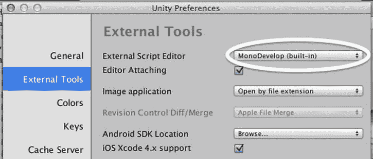

图 2-2. Unity 偏好设置菜单

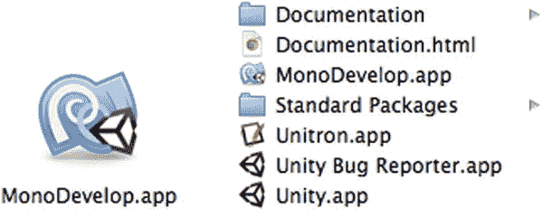

图 2-1. `MonoDevelop.app` 图标及已下载 Unity 包中的访达菜单

保持 AngryBots 项目打开，在你的项目面板中，打开 `Assets` ➤ `Scripts` ➤ `Animation` 文件夹，然后点击 `PlayerAnimation` 图标（图 2-3）。

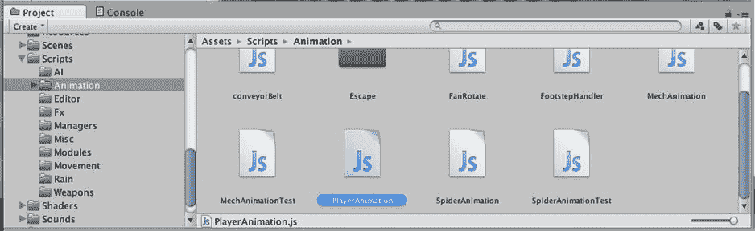

图 2-3. 项目面板中的 `PlayerAnimation` 脚本图标

在检视面板中，你将看到关于 `PlayerAnimation` 脚本内容的更多信息（图 2-4）。你可以通过双击此脚本，或选择“打开…”按钮（图 2-5）在 MonoDevelop 中将其打开。

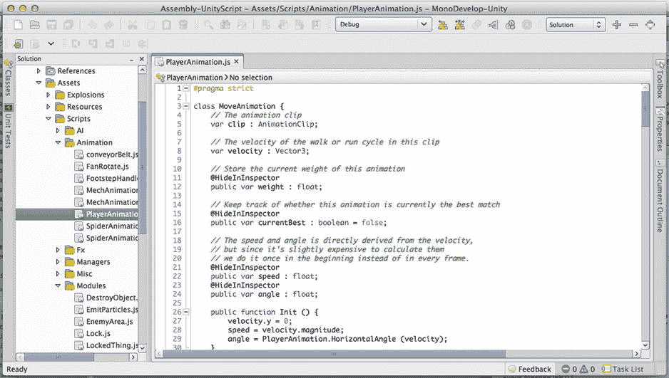

图 2-5. 准备在 MonoDevelop 中进行编辑的 `PlayerAnimation` 脚本

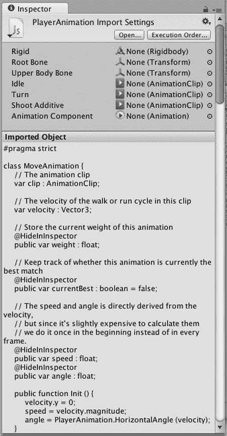

图 2-4. 检视面板中的 `PlayerAnimation` 脚本图标

AngryBots 玩起来很有趣，并且作为 Unity 和 MonoDevelop 的入门教程也很有用，但现在是时候开始学习如何开发你自己的游戏了。

你将从头开始，所以直接关闭 MonoDevelop。如果系统提示，不要保存任何更改。从 Unity 编辑器顶部菜单选择 文件 ➤ 新建项目 来打开项目向导（图 2-6）。

如果系统提示，不要保存对 AngryBots 的任何更改。给你的新项目起一个名字，然后点击“创建项目”。Unity 会提供一个默认的位置和项目名称。如果你觉得更方便，可以使用“设置…”按钮打开一个“创建新项目”窗口，作为命名和重新定位新项目的替代方法。如果你愿意，可以给你的项目起一个描述性的名称；之后你可以重命名它。你会看到在随 Unity 一起下载的标准包文件夹中找到的各个资源包，但这次不要选择任何包。确保选中了“创建新项目”选项卡，保持设置默认为 3D，然后创建你的新项目。

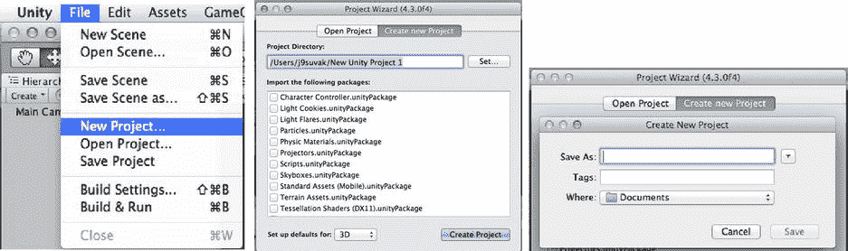

图 2-6. Unity ➤ 文件 ➤ 新建项目 菜单和项目向导

新项目的外观如图 2-7 所示。

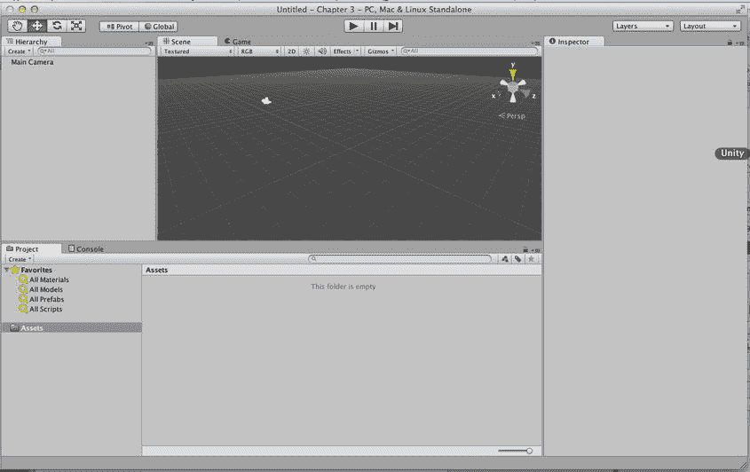

图 2-7. Unity 编辑器界面中新项目的外观

本章提供了编程的入门介绍。即使你有一些编程经验，也不要跳过这一章——示例中包含了一些常见的 Unity 特定变量和函数，你将在接下来的章节中使用它们。

## MonoDevelop

当 Unity 创建一个新项目时，它会为你提供一个游戏的骨架。这个骨架拥有任何游戏的基本要素，所以当你点击“播放”按钮时，即使是空游戏也知道如何启动，然后在取消选择“播放”时知道如何停止。游戏开发就是为这个骨架填充数字内容，并实现与游戏对象、环境和脚本的交互。

在顶部菜单中，选择 游戏对象 ➤ 创建空对象（图 2-8）。

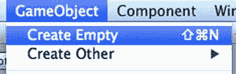

图 2-8. Unity 顶部菜单 游戏对象 ➤ 创建空对象

你将在层次结构视图中看到新的游戏对象，在场景视图中看到它的变换辅助线，并在检视面板中看到更多详细信息（图 2-9）。

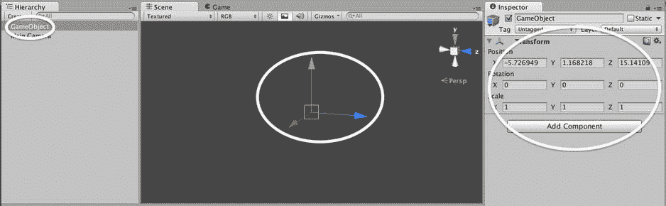

图 2-9. Unity 编辑器中的新游戏对象

在检视面板中，点击“添加组件”按钮，然后从出现的菜单中选择“新建脚本”。将你的脚本命名为 `HelloWorld`，确保语言是 JavaScript，然后点击“创建并添加”将此脚本附加到空游戏对象上（图 2-10）。按照惯例，名称应具有描述性，并且应该大写，不包含特殊字符或空格，但允许使用下划线。

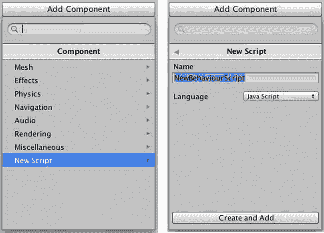

图 2-10. 用于添加新脚本的“添加组件”弹出窗口

该脚本现在在检视面板中作为游戏对象的一个组件列出，并且你将看到该脚本的图标出现在“资源”文件夹中（图 2-11）。

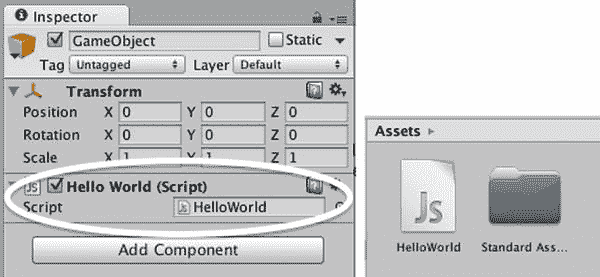

图 2-11. 检视面板中作为组件的新脚本以及项目面板资源中作为图标的新脚本

单击此图标一次以选中它，并在检视面板中查看脚本的内容（图 2-12）。

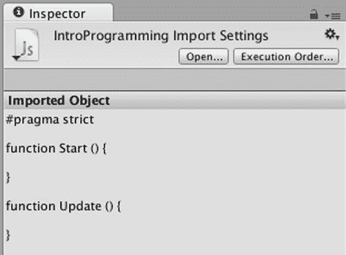

图 2-12. 在检视面板中看到的新脚本内容

你可以通过在检视面板中选择“打开”，或双击资源文件夹中的图标（图 2-13）来在 MonoDevelop 中打开该脚本。

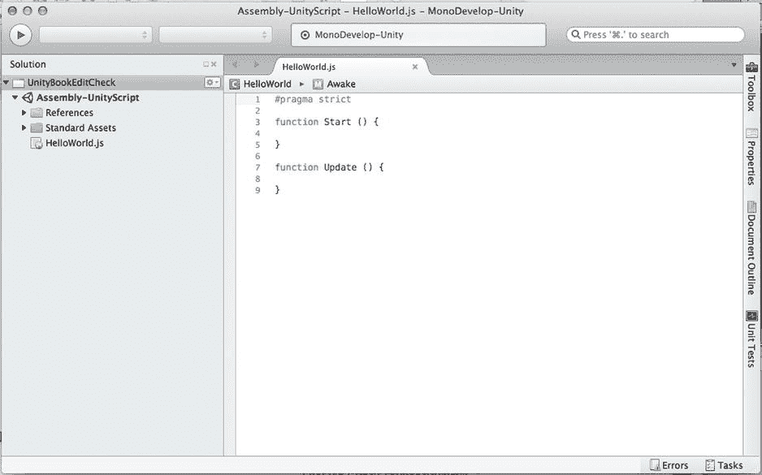

图 2-13. 准备在 MonoDevelop 中编辑的 `HelloWorld` 脚本

与 Unity 一样，MonoDevelop 也有一些键盘快捷键，你可以在 MonoDevelop ➤ Unity 偏好设置 ➤ 按键绑定（图 2-13）中找到它们。

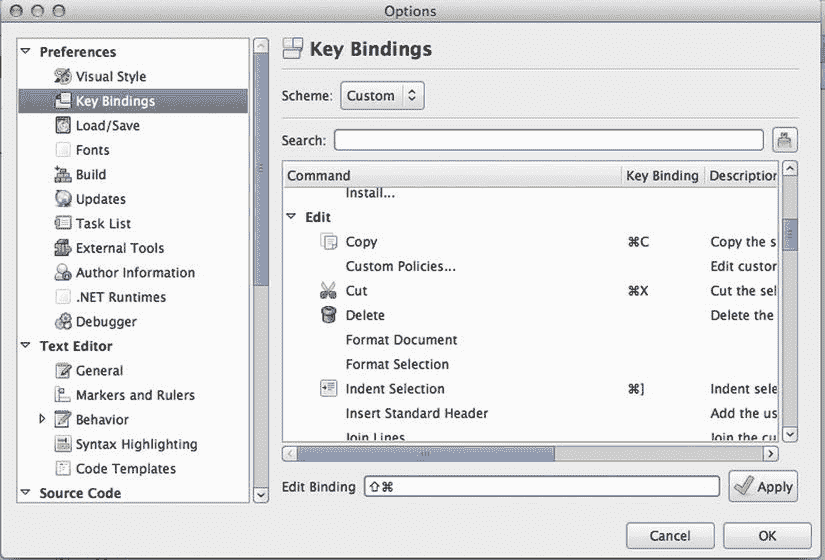

图 2-14. MonoDevelop ➤ Unity 偏好设置 ➤ 键盘快捷键的按键绑定菜单

当你创建新脚本时，Unity 会自动包含几个项目。`#pragma strict` 将出现在你所有脚本的开头。它告诉编译器变量必须具有类型声明，你将在本章稍后部分了解更多相关信息。它还会创建空的 `Start()` 和 `Update()` 函数。现在，继续删除 `Update()` 函数，包括左右大括号：

```
function Update () {

}
```

由于这个新脚本已附加到游戏对象上，因此当游戏对象进入场景时，`Start()` 函数将被调用一次。在此示例项目中，游戏对象已经存在于场景中，因此一旦游戏开始，它的 `Start()` 函数就会立即被调用。在 `Start()` 函数的大括号之间输入你的第一行代码，来看看实际效果。

```
function Start () {
  print("Hello World!");
}
```

按 `Ctrl+S` 保存，然后返回 Unity 编辑器。在 Project 面板中，选择 Console 选项卡。这就是你刚刚编写的代码的输出结果将会出现的地方。在 Game 视图中，确保取消选中 Maximize on Play，以免它遮挡 Console。现在点击 Play。在 Console 视图中，你将看到“Hello World！”出现——耶！（见图 2-15。）

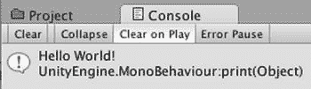

图 2-15. Console 面板中“Hello World！”的打印输出

另一种向 Console 打印消息的方法是使用 `Debug.Log`。“调试”是查找和纠正代码中错误（称为“bug”）的过程。你将在第 10 章中了解更多关于如何使用 `Debug` 类及其函数的信息。将你的代码行修改如下：

```
function Start () {

Debug.Log("Hello World!");

}
```

保存，在 Unity 编辑器中点击 Play 运行，查看 Console，你会发现得到相同的“Hello World！”，但后面跟的注释略有不同（图 2-16）。

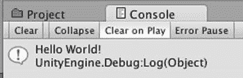

图 2-16. Console 面板中 Hello World! Debug.Log 的输出

游戏开发是一个持续学习的过程。Unity 团队不断添加新的功能和新平台，你可以将游戏移植到这些平台上。即使是最有经验的开发者也必须跟上最新的变化和新增内容，最常见的方式是参考提供的文档。每个新的游戏项目可能都有你不熟悉的地方，或者你可能想要再次确认某些变更。就像你将通过在 Unity 和 MonoDevelop 中亲手创建本书的示例来最好地学习 UnityScript 一样，通过实际使用，你也能最快地学会查阅文档。

停止游戏，回到 MonoDevelop 中的脚本。（在两个窗口之间工作时，`Alt+Tab` 是一个不错的快捷键。）在 `Debug` 单词的任意位置点击，然后按 `Ctrl+‘` 在你的网页浏览器中打开 `Debug.Log` 脚本参考文档（图 2-17）。

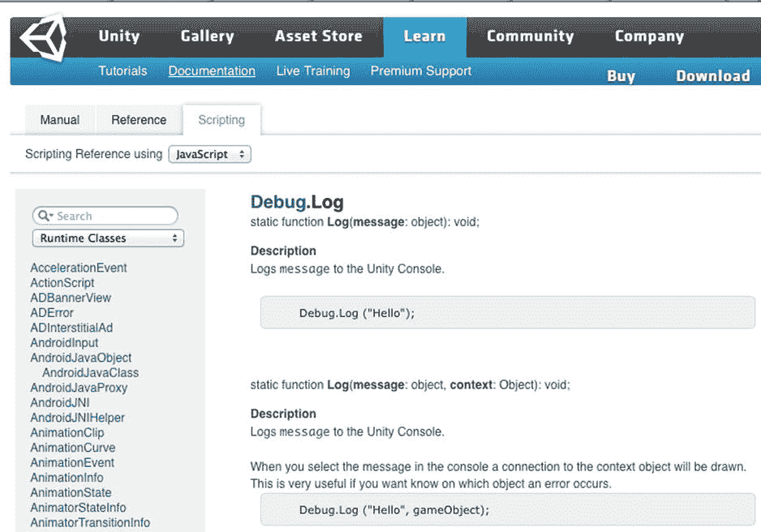

图 2-17. Unity 脚本参考文档中 `Debug.Log` 的描述

你会在描述中看到，`Debug.Log` 将一条消息记录到 Unity Console 中，随后是一个与你相似的代码示例。

还有第二个带有示例代码的描述，用于在出现错误时为你提供更多信息。通过添加 `gameObject` 引用来修改你的代码行：`Debug.Log("HelloWorld!", gameObject)`；按 `Ctrl+S` 保存，然后在 Unity 编辑器中点击 Play。现在，“Hello World！”消息会出现，同时 `Debug.Log` 函数还会提供一些额外信息（图 2-18）。

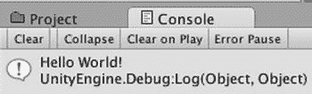

图 2-18. 带有对象上下文的 Console 中 `Debug.Log` 的输出

你将在这本书的后面部分学习更多关于调试以及如何使用这些信息的知识。目前，你已经成功试验了文档中的示例代码，这已经足够了。

游戏开发是一个互动的过程，包括经典的试错法。文档中充满了示例代码。有时书面解释可能不会马上让你明白，但亲眼看到示例代码的运行将有助于理解。不要害怕尝试！

实验时的一个实用技巧：在 Preferences ➤ Key Bindings 中，你会看到 MonoDevelop 使用与你 Unity 热键速查表中 Edit 下相同的键盘快捷键：`Ctrl+Z` 用于撤销，`Shift+Ctrl+Z` 用于重做。

在你输入代码时，你可能已经注意到 MonoDevelop 试图通过自动补全来帮助你。做出选择后，按 Tab 键，MonoDevelop 将补全剩余部分（图 2-19）。这对于提高速度和准确性非常有用，因为它减少了烦人的、会导致错误的小拼写错误的机会。

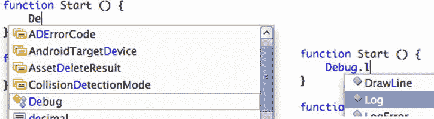

图 2-19. MonoDevelop 自动补全弹出建议

MonoDevelop 还试图帮助你识别错误。通过省略行尾的分号来引入一个错误并保存。在 Unity 编辑器中，你会在 Console 中看到一个警告，并附有 Unity 修复错误的实用建议（图 2-20）。

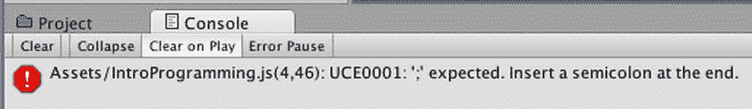

图 2-20. Console 面板中的错误警告

如果你无论如何都点击 Play，Unity 会坚持让你修复错误（图 2-21）。

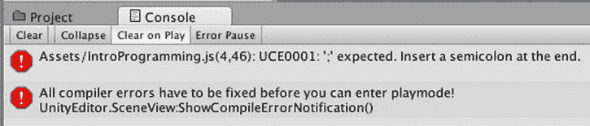

图 2-21. 尝试 Play 后 Console 面板中出现的额外错误警告

大红的警告很碍眼，所以去修复代码吧，然后保存。

# 变量与函数

计算机只会执行你告诉它的指令。它使用变量来存储数据，并按照你以函数形式提供的指令来处理或操作这些数据。

将你的代码修改为如下所示：

```
#pragma strict

// 声明一个整数类型的变量 myVar 并赋值为 8。

var myVar : int = 8;

function Start () {

Debug.Log(myVar);

}
```

首先，仔细看一下第二行。在行首添加双斜杠 `//` 会使其成为一条注释，在 MonoDevelop 中会以灰色字体显示。注释用于为自己或其他开发者添加备注，例如描述后续代码块的作用。那些在编写时看似一目了然的代码，对他人来说可能并不清晰，或者当你在几天、几周甚至更久之后重新审视时，也会变得模糊难懂。养成在编写代码时添加注释的好习惯，对你自己和团队成员都有好处。

注意：在调试过程中，注释掉代码非常有用。你可以通过注释而非删除来禁用代码，然后在需要时轻松地重新启用它。

对于多行注释，请在注释或代码的开头添加 `/*` ，在结尾添加 `*/`。尝试将 `Start()` 函数注释掉。

```
#pragma strict

// 声明一个整数类型的变量 myVar 并赋值为 8。

var myVar : int = 8;

/* function Start () {

Debug.Log(myVar);

}  */
```

注意代码变成了相同的灰色，表明这个函数现在已被禁用。保存并在 Unity 中运行，正如你所料，控制台保持空白。取消注释 `Start()` 函数以启用它并保存。

变量用于存储和检索数据。你的游戏程序正是通过这种方式来记住管理游戏玩法所需的内容。

看一下这行代码：

```
var myVar : int = 8;
```

将其分解为几个部分：

```
(1)      (2)  (3)     (4)      (5)    (6)   (7)

var  myVar :   int    =    8   ;
```

1. 使用 `var` 语句声明一个变量。

2. 变量名称。变量名应该具有描述性，这有助于提高代码的可读性。你可以使用任何字母数字字符和下划线，但不能使用其他标点符号或特殊字符。另一个提高代码可读性的好做法是遵循标准的编程约定。变量命名的标准约定是：如果变量名的第一个字符是字母，则不大写。

3. 冒号，用于分隔变量名和数据类型。

4. 变量的数据类型，此处 `int` 表示整数。

5. 赋值运算符，用于为你刚刚声明并命名的变量赋值。你在声明整数时不必为其赋值。

6. 赋给变量的值，此处是一个整数。整数是整数，包括负数（前面用减号表示）。不能包含逗号和空格——虽然 24、0 和 –3 是有效的整数，但 2,500 不是，而 2500 是。

7. 分号，表示语句的结束。所有语句必须以分号结尾。

在 `Start()` 函数中，打印到控制台的 `Debug.Log` 消息是 `myVar` 的值。保存并播放以确认。

变量用于存储数据，而函数则执行操作。函数所执行的任何过程的指令都包含在花括号内。看一下 `Start()` 函数的组成部分：

```
(1)          (2)   (3)  (4)

function Start ()  {

(5)

Debug.Log(myVar);

(6)

}
```

1. 使用保留字 `function` 声明函数。

2. 命名函数。函数名以大写字母开头。

3. 用于处理传递给函数的信息的参数。圆括号是必需的，因此如果不需要参数，则保留为空。

4. 左花括号，表示函数内容的开始。

5. 函数要以语句形式遵循的指令——在此示例中，为 `Debug.Log` 语句。

6. 右花括号，表示函数的结束。由于它是函数的结束而非语句的结束，因此不使用分号。

注意 MonoDevelop 已经缩进了 `Debug` 语句。缩进用于提高代码的可读性。这样，你可以轻松识别不同的代码块。MonoDevelop 会自动为你执行此操作，但有时你会发现需要重新组织代码以提高可读性。在 MonoDevelop 的 偏好设置 ➤ 键绑定 ➤ 编辑 中，你可以找到键盘快捷键 `Ctrl+]` 用于缩进，或 `Ctrl+[` 用于取消缩进，这将移动你高亮选中的任意大小的代码块。用你的 `Debug` 语句试试看，然后再用整个 `Start` 函数试试。很简单，对吧？

**表 2-1.** 算术运算符的定义

| 算术运算符 | 含义 |
|------------|------|
| `+`        | 加法 |
| `-`        | 减法 |
| `*`        | 乘法 |
| `/`        | 除法 |
| `%`        | 取模 |

为了快速回顾一下算术运算符（表 2-1），将 `Start` 函数中的 `Debug` 代码行替换为以下几行：

```
print(6+2);

print(6-2);

print(6*2);

print(6/2);

print(6%2);
```

保存并播放。控制台中的输出将如图 2-22 所示：

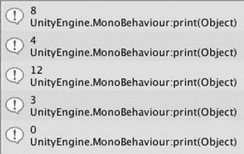

**图 2-22.** 算术运算符的输出结果

你大概认识前四个运算符。取模运算符是另一个很方便的运算符，它给出余数，在此例中为 6 除以 2 的余数。尝试将 6 改为 5，保存并播放。这次最后一行输出是 1，即 5 除以 2 的余数。

与大多数编程语言一样，UnityScript 遵循标准的运算顺序，即乘法和除法的优先级高于加法和减法。

将你的 `Start` 函数修改如下：

```
print(6+2*4);
```

从左到右读，6 加 2 等于 8，再乘以 4 等于 32。保存并播放，你会看到 Unity 先计算 2 乘以 4 得到 8，然后加上 6，最终输出为 14。

你可以通过使用括号来改变求值顺序。括号内的运算具有更高的优先级。将同一行代码修改如下：

```
print((6+2)*4);
```

现在当你保存并播放时，输出是 32，因为 Unity 先执行了括号内的加法运算。

这些相同的算术运算符也可用于变量所保存的数值。用以下语句替换同一行代码：

```
print(myVar + myVar);
```

由于之前为 `myVar` 赋的值为 8，现在你将得到 16 作为结果。

到目前为止，你一直在使用整数，但你也可以将变量声明为浮点数据类型来处理小数。变量可以包含各种数据类型，包括字符串、布尔值以及更复杂的数据类型。实际上，你在第一行代码中就使用了一个字符串：

```
print("Hello World!");
```

字符串就是双引号内的字符。拼接是指将单独的字符串组合成一个字符串的术语。虽然我本可以说你可以“相加”字符串，但学习引入的术语对你来说很重要。当你在 Unity Answers 上搜索论坛寻求帮助时，或者为了在鸡尾酒会上显得很博学时，这会派上用场。将你的代码编辑如下：

```
#pragma strict
```

```csharp
// 声明整型变量 myVar 并赋值为 8。
var myVar : int = 8;
var myString1 : String = "Hello ";
var myString2 : String = "World!";
var myNewString: String;

function Start () {
    myNewString = String.Concat(myString1, myString2);
    Debug.Log(myNewString);
}
```

保存并运行，输出应为“Hello World!”。这里最常见的错误是忘记在需要空格的地方加入空格。

`String.Concat` 与 `Debug.Log` 相似，两者都包含一个点运算符。点运算符是一种代码语法形式，点用于分隔代码中的单词。`Concat` 是 `String` 的一个元素，就像 `Log` 是 `Debug` 的一个元素一样。你可以在 `String` 和 `Debug` 上使用熟悉的 ``+‘ 组合键，在 Unity 脚本参考中查看更多元素。

`Start` 函数在演示这些基本概念方面效果不错，但现在你可以编写自己的函数了。函数接收信息（称为参数），对这些信息执行某种操作，然后可选择返回一个结果。

删除字符串变量声明，并按如下方式编辑 `Start` 函数：

```csharp
var myVar : int = 8;

function Start () {
    myVar = AddFive(myVar);
    Debug.Log(myVar);
}
```

语句 `myVar = AddFive(myVar);` 调用了你接下来要创建的名称为 `AddFive()` 的函数，并将存储在 `myVar` 中的整数发送给它。

在 `Start()` 函数的右花括号之后，编写在 `Start` 中被调用的新函数，名称为 `AddFive`：

```csharp
function AddFive (numberFromStartFunction : int) {
    var newVar : int;
    newVar = numberFromStartFunction + 5;
    return newVar;
}
```

与 `Start()` 函数不同，`AddFive()` 需要接收信息才能通过加五来处理信息。括号内的参数 `numberFromStartFunction` 被声明为整数数据类型。这意味着当调用此函数时，必须向其发送一个整数。你已经将 `myVar` 声明为整数，因此在 `AddFive(myVar)` 函数调用中，你正确地向 `AddFive()` 函数发送了整数数据类型。`numberFromStartFunction` 在 `AddFive()` 函数中像变量一样工作，用于保存从调用者处接收到的整数。

`AddFive()` 函数的第一条语句如下：

```csharp
var newVar : int;
```

这里你声明了一个名为 `newVar` 的新变量，类型为整数。你可能还记得之前对函数的分解说明，声明变量时不必为其赋值。

`newVar` 是在 `AddFive()` 函数内部声明的，因此只能在此函数内部使用。这是一个局部变量的示例，因为其作用域仅限于声明它的函数。`myVar` 是一个全局变量的示例；其作用域更广，可以被此脚本中的任何函数使用。

此函数中的第二条语句 `newVar = numberFromStartFunction + 5;` 是对指令的实际处理，即向参数 `numberFromStartFunction` 中接收到的整数加 5。此计算结果随后存储在局部变量 `newVar` 中。

最后，`return newVar;` 将赋值给 `newVar` 的值返回，并赋值给 `myVar`。

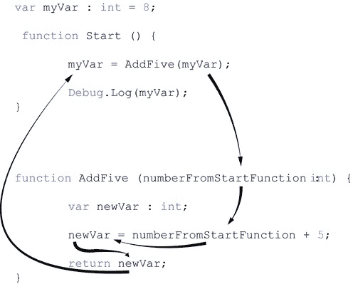

**图 2-23.** 两个函数之间的数据流

此过程如图 2-23 所示。运行（保存并播放）脚本，果然，Unity 会给出结果 13。太棒了！

数学对于游戏开发来说是必要的，但对于那些无法从解决数学问题中获得特殊乐趣的人来说，我有个好消息：Unity 为你提供了大量内置数学函数。毕竟，超快速地进行常规计算是计算机最擅长的事情，而这里的目的是帮助你进行整体游戏开发。

`Mathf` 是 Unity 提供的便捷数学变量和函数的集合之一。在 MonoDevelop 中，将代码更新为如下所示：

```csharp
#pragma strict

function Start () {
    Debug.Log(Mathf.PI);
}
```

点击 `Mathf.PI`，然后按 +‘ 打开其 Unity 脚本参考（图 2-24）：

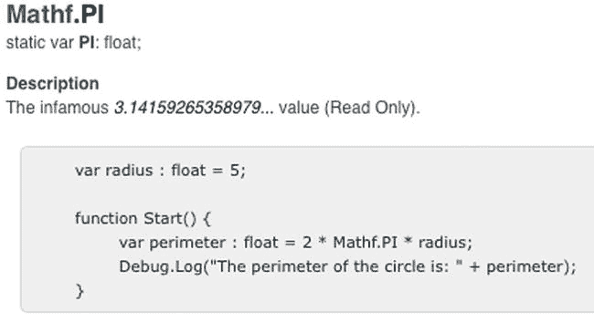

**图 2-24.** Unity 脚本参考中的 `Mathf.PI` 描述

在这里你会发现 `Mathf.PI` 是一个 float 数据类型的静态变量。圆周率的值是恒定的，而变量是静态的意味着它不会让你的代码更改 `Mathf.PI` 持有的值。请记住，当你创建函数时，参数类型必须与其接受的数据类型匹配。参考文档贴心地告诉你它是 float 数据类型，并提供了简短示例代码来说明如何使用它。

运行你的脚本，你会发现控制台中显示的小数位数远没有参考文档中显示的那么多。没关系——在常见的游戏使用场景中，你不太可能需要比这更高的精度。

点击脚本参考标题中的蓝色“Mathf”，以获取 `Mathf` 变量和函数的完整列表（图 2-25）。

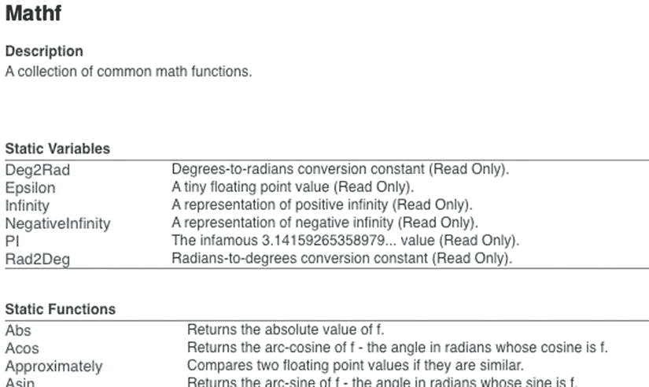

**图 2-25.** Unity 脚本参考中的 `Mathf` 描述

取整是你在游戏开发中肯定会用到的函数。继续向下滚动到 `Round` 函数并选择它（图 2-26）。

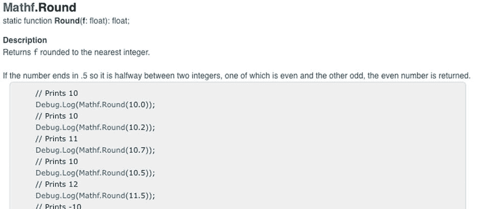

**图 2-26.** Unity 脚本参考中的 `Mathf.Round` 描述

在这里你会发现 `Mathf.Round` 是一个静态函数，接受 float 数据类型作为参数，后面跟了一些示例。继续，复制粘贴其中一些示例到 MonoDevelop 中并尝试一下。

注意描述中的最后一条注释告诉你，`Mathf.Round` 函数并非将所有以 .5 结尾的数字都向上取整，而是向上或向下取整，以得到偶数为准。在给出的第四个示例中，你会看到 10.5 被向下取整为 10，而不是像你预期的那样向上取整为 11。当你在脚本参考中查找任何内容时，请花时间阅读整个描述——这可能会让你少一些日后因 Unity 试图告知你的行为而产生的烦恼。

干得漂亮！你已经掌握了变量和函数的基础知识。你现在越来越熟悉如何查阅 Unity 脚本参考，并使用 Unity 提供的内置函数。如果概念看起来有点模糊，不用担心；从现在开始你将进行大量练习。继续动手操作示例，通过练习你很快就能掌握要领。

## 条件语句

除了数学计算之外，你的脚本还会使用逻辑函数来定义游戏规则，例如敌人被摧毁前需要承受多少次攻击、角色基于积累的能量和能力的行为，当然还有达成大胜所需满足的条件。

# 布尔逻辑与条件语句

布尔类型变量只有两个可能值：`true` 和 `false`。

在 MonoDevelop 中，将脚本编辑为以下内容：

```csharp
var skyIsClear : boolean = true;

function Start () {
    Debug.Log(skyIsClear);
}
```

运行脚本，控制台将显示 `true`。布尔变量常用于监控或“标记”某个状态或条件。例如，我可以说：“如果天空晴朗，我就出去玩。”我需要检测太阳是否升起，然后根据这个条件做出决定。

将 `Start()` 函数中的代码更新为：

```csharp
if (skyIsClear == true) {
    Debug.Log("I will go out and play");
}
```

这段代码的可读性相当高。你希望测试的条件放在关键字 `if` 后的括号中。如果条件满足，则执行花括号内的语句块。注意，“等于”的比较运算符是 `==`，与用于设置变量值的赋值运算符 `=` 不同。继续运行脚本。耶——我能够出去玩了！

**注意**：初学者程序员最常见的错误之一就是在条件语句中使用 `=` 代替 `==`。

等等——如果天空晴朗但现在是夜晚呢？我不应该在黑暗中出去玩耍。在你的第一个变量声明下方，添加第二个变量：

```csharp
var sunIsUp: boolean = true;
```

现在我想说：“如果天空晴朗且太阳升起，我就出去玩。”将你的条件 `if` 语句编辑为：

```csharp
if (skyIsClear == true && sunIsUp == true) {
```

`&&` 是逻辑运算符 AND。现在必须两个条件都满足，语句块内的代码才会执行。

逻辑运算符 OR 表示为 `||`，在 Mac 上通过按 Shift+\ 两次输入。OR 的含义正如其名：如果满足其中一个条件（或两个条件都满足），则执行语句块。

如果你希望在某些条件下执行不同的代码块，可以使用多个 `if` 语句：

```csharp
function Start () {
    if (sunIsUp) {
        Debug.Log("I will get out of bed");
    }
    if (skyIsClear) {
        Debug.Log("I do not need an umbrella");
    }
}
```

由于两个变量都设置为 `true`，运行脚本时你会看到两条语句都出现在控制台中。

在这个例子中，如果太阳没有升起且天空也不晴朗，则什么也不会发生。当你希望在前面的条件都不满足时执行另一段代码，可以使用 `else`：

```csharp
function Start () {
    if (sunIsUp) {
        Debug.Log("I will get out of bed");
    }
    if (skyIsClear) {
        Debug.Log("I do not need an umbrella");
    }
    else {
        Debug.Log("I am staying in bed");
    }
}
```

你的变量仍然设置为 `true`，因此运行脚本不会有任何不同，但你可以看到有多种方法可以测试各种条件来控制游戏进程。

`if` 语句也可以比较数值。你可以使用的其他比较运算符（表 2-2）包括 `<`、`>`、`<=`、`>=` 和 `!=`。`!` 表示“非”，因此 `!=` 是比较运算符“不等于”。

**表 2-2. 比较运算符定义**

| 比较运算符 | 含义 |
| --- | --- |
| `==` | 等于 |
| `!=` | 不等于 |
| `<` | 小于 |
| `>` | 大于 |
| `<=` | 小于等于 |
| `>=` | 大于等于 |

当你需要将变量与不同值进行比较时，`switch-case` 条件语句可以替代一系列 `if-else` 语句。

将脚本编辑为以下内容：

```csharp
#pragma strict

var diceRoll : float;

function Start () {
    diceRoll = Random.Range(1, 6);
    switch (diceRoll) {
        case 1:
            print ("You rolled a 1!");
            break;
        case 2:
            print ("You rolled a 2!");
            break;
        case 3:
            print ("You rolled a 3!");
            break;
        case 4:
            print ("You rolled a 4!");
            break;
        case 5:
            print ("You rolled a 5!");
            break;
        case 6:
            print ("You rolled a 6!");
            break;
        default:
            print ("It's your turn - roll!");
            break;
    }
}
```

这里的情况是，你声明了一个变量但没有立即赋值。相反，当调用 `Start()` 函数时，`diceRoll` 变量会被赋一个介于 1 到 6 之间的随机生成数。

随机数生成是游戏中的另一个常见功能，用于确定诸如下一个攻击波次中新游戏对象出现的位置或敌人数量等事项。从 `diceRoll = Random.Range(1, 6);` 这行代码中你大概可以猜到发生了什么，但继续点击 `Random.Range` 查看脚本参考（图 2-27）：

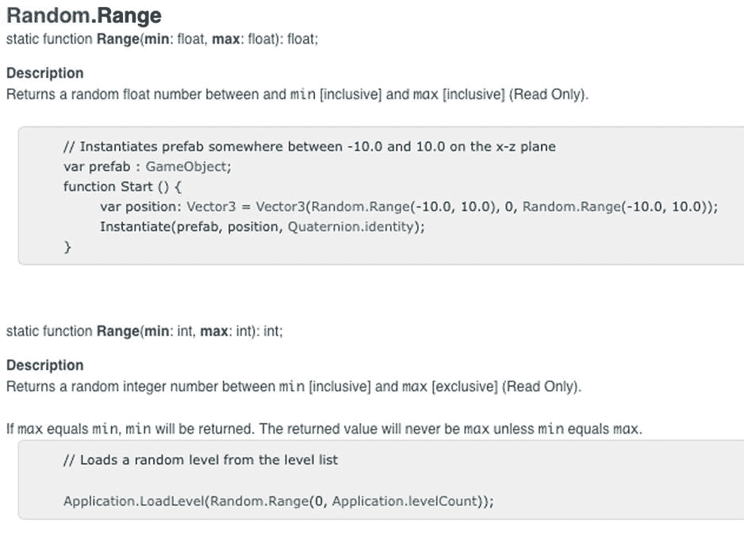

**图 2-27.** Unity 脚本参考中的 `Random.Range` 说明

正如你所料，当调用 `Start()` 函数时，`diceRoll` 会根据括号内的两个参数（`min` 和 `max`）被赋一个随机生成的数值。注意这些参数是“包含边界”的，否则你需要使用不同的参数来生成 1 到 6 的数字。

接下来，`switch` 语句获取赋给 `diceRoll` 的值，并将其与每个 `case` 的常量值进行比较，在此示例中为 1 到 6。当找到匹配的 `case` 值时，执行其后的语句块。

`break` 语句结束 `switch` 语句的执行。在最后一个 `case` 之后，你会看到一个 `default` 语句，它的作用类似于 `else` 语句——如果没有任何 `case` 值与最初传递给 `switch` 语句的参数匹配，则执行该语句。

## 循环

循环对于重复执行代码行非常有用。你可能正在检查一组游戏对象的状态，或者创建新的游戏对象，此时需要对组中的每个项目使用相同的代码行。

### `for` 循环

为了演示 `for` 循环，在 MonoDevelop 中将你的代码修改如下：

```csharp
#pragma strict
var targets : int = 4;
function Start () {
    for(var i: int = 0; i < targets; i++)
    {
        Debug.Log("This is target #" + i);
    }
}
```

将 `for` 循环分解为各个部分：

```
   (1)             (2)         (3)         (4)       (5)  (6)
for(var i: int = 0; i < targets; i++)
   (7)
   {
                    (8)
    Debug.Log(" This is target #" + i);
(9)
}
```

- 关键字 `for`。

- 将索引变量声明为整数，并赋予初始值 0。计算机从 0 而不是 1 开始计数，这需要一点时间来适应，并且经常因忘记而导致错误。

- 分号，用于分隔 `for` 语句的第一部分和第二部分。

- 条件语句。只要条件满足，循环语句块就会执行。如果条件不满足，循环终止，程序执行跳转到循环后的语句，在此例中即为 `Start()` 函数的右大括号。

- 分号，用于分隔 `for` 语句的第二部分和第三部分。

- 循环的增量。这可以写作 `i = i + 1`，甚至 `i += 1`，但增量运算符 `++` 表示加 1，是一种便捷的简写形式。这里在 `for` 循环的下一次迭代中被条件语句评估之前，索引变量加 1。类似地，索引变量也可以使用递减运算符 `--`（或 `-=`）进行递减。

- 左大括号，表示 `for` 循环体的开始。

- 语句块，包含每次迭代 `for` 循环时要执行的代码。

- 右大括号，表示 `for` 循环体的结束。与函数类似，`for` 循环以右大括号结束，而不是分号。

运行你的脚本，你会看到四条目标语句，反映了从零计数的结果（图 2-28）。

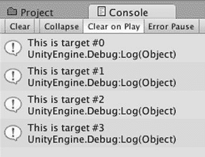

图 2-28. `for` 循环在控制台面板的输出

## `while` 循环

`while` 循环提供了更大的灵活性，因为只要条件结果为 `true`，它就会无限次地循环。

将你的代码修改如下：

```
#pragma strict
var numberOfTires : int = 0;
function Start () {
    while(numberOfTires < 4)
    {
        Debug.Log("I replaced an old tire on my car!");
        numberOfTires++;
    }
}
```

将其分解，展示如下部分：

```
      (1)                (2)
while(numberOfTires < 4)
              (3)
        {
                                          (4)
                Debug.Log("I replaced an old tire on my car!");
                numberOfTires++;
              (5)
        }
```

- 关键字 `while`。
- 条件语句。
- 左大括号，表示 `while` 循环体的开始。
- 语句块，包含每次迭代 `while` 循环时要执行的代码。
- 右大括号，表示 `while` 循环体的结束。与 `for` 循环一样，`while` 循环以右大括号结束，而不是分号。

这里最大的区别之一，也是常见问题的根源在于：如果你的条件表达式永远不会计算出 `false`，那么 `while` 循环就会持续运行。这被称为无限循环——你可不希望你的游戏陷入其中！

运行脚本，你会看到你的车换了四个新轮胎。你可以互换使用 `for` 循环或 `while` 循环来重写这些简单示例。当你在实际游戏开发场景中继续应用它们时，你会在选择使用哪一种时体会到它们之间的微妙差异。

一般来说，`for` 循环更常用于条件更加精确的情况下，例如当要执行的循环次数是预先确定的，或者当初始值、条件语句和增量都使用同一个变量时。

## `do-while` 循环

与 `for` 循环一样，如果 `while` 循环的条件从未计算为 `true`，那么语句块永远不会被执行。有时你可能希望在测试条件之前至少执行一次语句块。`do-while` 循环扩展了 `while` 循环，为你提供了这种能力。

按如下方式编辑你的代码：

```
#pragma strict
function Start () {
    var someCondition : boolean = false;
    do
    {
        Debug.Log("Print something anyway");
    }
    while(someCondition == true);
}
```

这里，你首先将变量 `someCondition` 设置为 `false`。在关键字 `do` 之后，`do` 语句的主体先执行一次，然后才执行 `while` 语句，在那里它最终有一个条件需要测试。根据你的变量声明，条件将计算出 `false`，程序退出循环。运行你的脚本，“Print something anyway” 这行文字会如你所期望的那样在控制台中显示一次。

`for` 循环和 `while` 循环之间的差异可能并不明显，但你在接下来的演示中会练习使用它们。在游戏开发的上下文中，你会对循环以及何时使用各种类型有更深刻的理解。

# 坐标几何与向量

好了，我们先稍微停一下。这本书是为初学者编写的。不是那些碰巧拥有数学高等学位的初学者，而是那些对游戏开发感兴趣的普通人……当然，我认为这让你比普通人酷多了。如果你碰巧拥有数学学位，那么你会欣赏到，为了让 Unity 这样复杂且易用的开发工具变得如此用户友好，背后所蕴含的优雅才智。

你不需要了解内燃机理论就能开车，不需要懂固态电路设计就能用电脑，也不需要知道任何关于电动机的知识就能使用电钻。最重要的是，你不需要成为数学天才才能学习游戏开发。在实际操作中，你肯定会学到比你想象中多得多的知识，而且这过程一点都不痛苦。我保证。

Unity 的创造者们希望它直观易用，他们取得了巨大的成功。“直观”也意味着对事物如何运作有一种感觉或直觉，你很快就能通过实践学会它。通过实验观察游戏中会发生什么，这就是你培养这种直觉的方式。即使在我不是故意胡乱尝试的时候，我也数不清有多少次，我以为告诉 Unity 要做什么，和它实际如何解释我的脚本之间存在的差异，导致了出乎意料的结果。但我的电脑从未冒火花或死机，而且那些搞砸的结果往往像电影花絮一样有趣。学习游戏开发确实很有趣——享受其中的乐趣吧！

大多数游戏，尤其是 3D 游戏，都围绕着移动展开。`Vectors`（向量）和`Transforms`（变换）分别是你将使用的一些最常用的结构体（见下文）和类。它们描述了游戏对象的位置以及它们的移动方式。本节是对坐标几何和向量数学基础知识的简要回顾，同时会介绍相关的 Unity 变量和函数，你可以在需要时随时查阅。在阅读本节时，不要纠结于数学计算。虽然我怀念在加州理工学院手动计算向量的时光，但你不需要那样做——Unity 会替你处理这些。目前，你的重点应该是学习词汇，并在三维空间中形象化地理解向量及其函数，而不是数学本身。

## 笛卡尔坐标系

Unity 使用笛卡尔坐标系，通过相互垂直的 x 轴和 y 轴（图 2-29）来描述空间中的点。原点就是这两条轴的交点，定义为 x 和 y 值均为零的点，即`(0, 0)`。二维空间中的每个独特点都可以用其 x 和 y 值，通过语法`(x, y)`来描述。

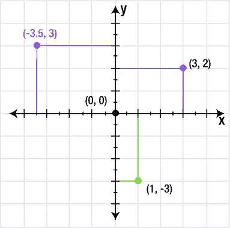

图 2-29. 笛卡尔坐标系

## 值类型与结构体

到目前为止你使用过的变量——`int`、`float`、`boolean`和`string`——被归类为值类型，因为它们包含一个特定的值，例如`8`、`hello`或`false`。一种更复杂的值类型变量被称为结构体（struct）。结构体是一个包含多个聚合值的变量。

## Vector2 结构体

`Vector2`是一个结构体，它包含了用于描述二维空间中位置和向量的 x 和 y 值。`(x, y)` 给出了一个点在二维空间中的位置。要描述一条直线或向量，你通常需要知道直线两端点的坐标，但在 Unity 中，向量被表示为相对于原点`(0, 0)`的线段，因此`(x, y)`就足以描述该向量（图 2-30）。

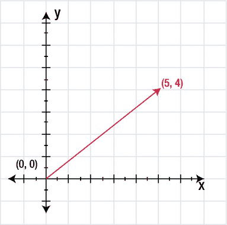

图 2-30. 笛卡尔坐标系

在 Unity 脚本参考中搜索 `Vector2`（图 2-31）。

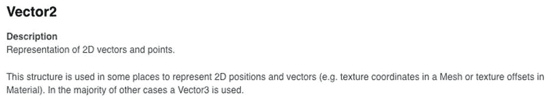

图 2-31. Unity 脚本参考中描述的 `Vector2`

在 MonoDevelop 中，将你的代码更新为如下所示：

```
#pragma strict

var myVector : Vector2 = Vector2(2, 3);

function Start () {

Debug.Log(myVector);

}
```

点击 Play 进行测试，你会在控制台面板中看到你分配给`myVector`的`(2, 3)`坐标值（图 2-32）。

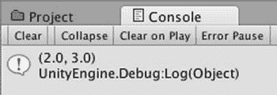

图 2-32. `Vector2` 坐标 (x, y) 值显示在控制台面板中

## 静态变量

Unity 在脚本参考中提供了一些常用的静态变量（图 2-33）。

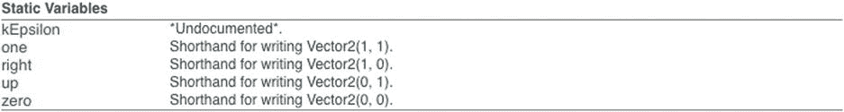

图 2-33. Unity 脚本参考中描述的 `Vector2` 静态变量

在 `Debug.Log` 语句中将 `myVector` 替换为 `Vector2.up`，以确认在控制台中得到的输出是`(0, 1)`。如果你想知道为什么没有 `.down` 或 `.left`，你可以用 `-.up` 和 `-.right` 来表示它们相反的方向。

## 向量的模

向量的长度称为其模（magnitude）。你可能还记得，也可能不记得在几何课上使用勾股定理来求两点之间的距离，但在 Unity 中，当你需要确定游戏对象之间的距离时，它会用 `Vector2.magnitude` 为你代劳。点击“magnitude”快速查看 `Vector2.magnitude` 的描述（图 2-34）。

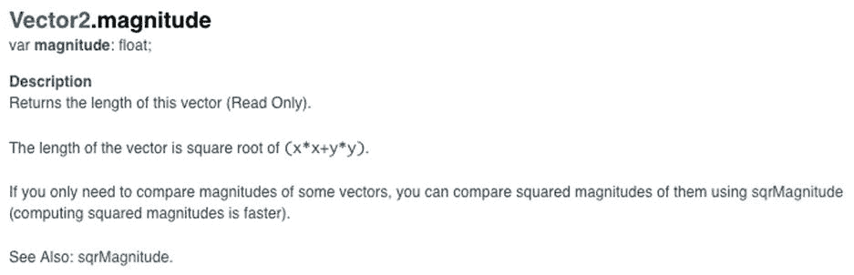

图 2-34. 来自 Unity 脚本参考的 `Vector2.magnitude` 描述

Unity 是根据向量的 x 和 y 坐标进行计算，但你可以看到它遵循的正是几何课上关于 a、b 和 c 的相同公式（图 2-35）：

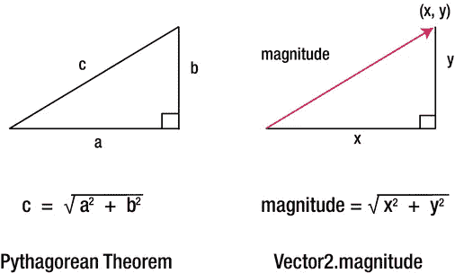

图 2-35. 使用勾股定理推导出的 `Vector2` 模

例如，当 a=3 且 b=4 时，求 c。首先，a²=9，b²=16。将它们相加得到 25，然后取 25 的平方根得到长度 c=5。现在让 Unity 为 `Vector2 (3, 4)` 做同样的计算。将你的脚本编辑如下：

```
#pragma strict

function Start () {

var myVector : Vector2 = Vector2(3, 4);

Debug.Log(myVector.magnitude);

}
```

点击 Play 进行测试，控制台会显示模为 5。

再次查看 `Vector2.magnitude` 的描述。Unity 给了你一个提示：当你想要比较两个向量的模时，也可以使用 `sqrMagnitude`。无论哪种方式，你都可以判断一个向量的模是否大于或小于另一个，但使用 `sqrMagnitude` 速度会更快。无论是在脚本参考还是 Unity 论坛中，你经常会看到关于速度的评论。游戏需要大量的计算能力，因此任何单个计算完成得越快或越高效，你的游戏运行得就越流畅。

## 运算符

在 `Vector2` 脚本参考的底部，你还会发现一些你可以使用的方便的数学和比较运算符（图 2-36）。

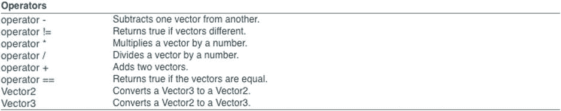

图 2-36. Unity 脚本参考中描述的 `Vector2` 运算符

# 三维空间处理

三维空间的处理方式与二维空间基本相同，只是增加了表示第三维度的值。`z`轴垂直于`x`轴和`y`轴。在 Unity 中，它们的朝向是这样的：`x`在计算机显示器上水平左右分布，`y`在显示器上垂直上下分布，而`z`代表深度，即“进入”和“离开”显示器的方向。换句话说，`xz`平面是“地面”，而`y`是高度。原点是`(0, 0, 0)`，表示`x`、`y`和`z`的值。在 Unity 中，这也被称为世界零点——即你的游戏世界的中心。正如你在二维空间中看到的，三维空间中的向量也是相对于原点表示的（图[2-37]）：

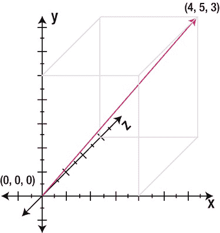

图 2-37. 三维空间中的向量

`Vector3`是一个结构体，它保存`x`、`y`和`z`的值。查阅 Unity 脚本参考中的`Vector3`，你会发现它与`Vector2`非常相似，拥有方便且常用的静态变量、`x`、`y`和`z`分量及向量模长值，以及许多相同的函数和运算符。

为了进行比较，可以查看 Unity 脚本参考中的`Vector3.magnitude`（图[2-38]）：

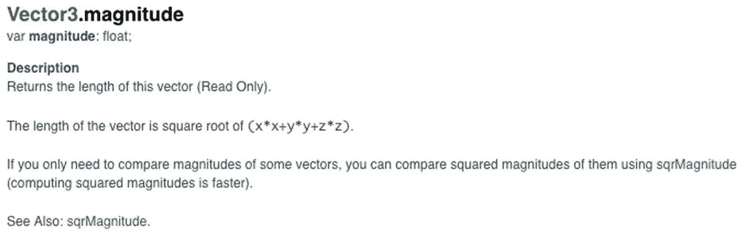

图 2-38. Unity 脚本参考中关于`Vector3.magnitude`的描述

现在，计算将`z`分量值也考虑在内。更新你的代码以计算三维向量的模长，如下所示：

```
#pragma strict

function Start () {
    var myVector : Vector3 = Vector3(3, 4, 12);
    Debug.Log(myVector.magnitude);
}
```

运行测试，控制台应该会显示模长为 13。

**注意**

“播放（Play）”、“运行（Run）”、“测试（Test）”、“进入播放模式（Enter play mode）”、“播放以测试（Play to test）”和“运行测试（Playtest）”都是指在 Unity 编辑器游戏视图中播放场景的等效术语。

无论你使用二维还是三维向量，这些变量、函数和运算符构成了处理游戏玩法判断的基本工具的一部分，这些判断基于你各种游戏对象的位置和方向。现在，你知道了如何声明变量（包括`Vector2`和`Vector3`这样的结构体），如何调用函数来处理变量中的数据，以及在哪里找到 Unity 内置的函数。

## 总结

现在，你知道了如何使用 Unity 脚本编辑器 `MonoDevelop`，并且已经了解了基本的编程术语和概念——干得好！本章既是入门指南也是参考资料，为你奠定了必要的基础。从现在开始，你将看到脚本对 Unity 编辑器中游戏对象产生的影响。而我说“影响”，是指你即将接触到更多的动作、爆炸和音效——哇哦！
