# 3. 制作一个简单场景

到目前为止，你已经设置好了游戏开发环境，并且对编程基础、脚本工具 MonoDevelop 以及 Unity 脚本参考有了初步了解。本章的重点是你的主要游戏开发工具——Unity，以及如何创建和管理构成基础游戏场景的基本部分。

一个游戏由多个场景组成，一个场景由多个游戏对象组成，一个游戏对象由多个组件组成，而组件具有由其内部函数控制的属性，如图[3-1]所示。在本章中，你将通过 Unity 编辑器界面动手实践如何将这些元素组合成一个场景，同时还会介绍 Unity 为你提供的便利的`Standard Assets`资源包。

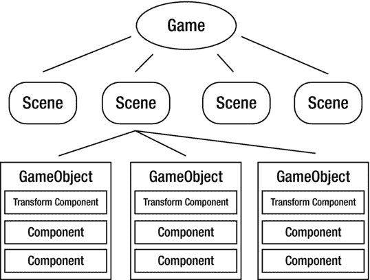

**图 3-1.** Unity 中游戏的组成元素

## 新建项目，新建场景

是时候动手了。和[第 2 章]一样，使用 Unity 编辑器顶部菜单选择`File ➤ New Project`来创建一个新项目。此时将打开`Project Wizard`窗口。命名你的项目，确保选中`Create new Project`选项卡，保持默认设置（3D），然后创建你的新项目。和之前一样，你的新项目及其空场景将会出现在 Unity 编辑器中。通过这个快速而简单的过程，Unity 为你搭建了一个可立即运行的骨架游戏。

如果你好奇，可以在 Finder 或资源管理器中查看游戏所需基本文件的内容（图[3-2]）。资源是你创建或导入到项目中的项目，例如模型、动画、脚本和音频片段；这些资源会被自动放入`Assets`文件夹。Unity 接受多种文件类型，然后在内部将其转换为兼容版本。同时，Unity 会生成称为元数据的额外数据，放在`Library`文件夹中，这些数据除其他功能外，还有助于 Unity 在你在游戏中使用这些资源时知道在哪里找到它们以及它们之间的关联方式。Unity 以特定方式自动组织这些文件夹和文件，因此如果你移动这些文件夹或文件，Unity 编辑器将无法找到它们。

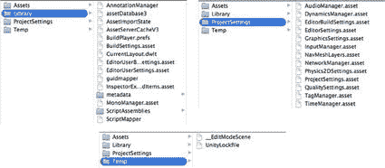

**图 3-2.** Unity 自动创建的新项目文件

**注意**

始终使用`Project`视图来组织`Assets`文件夹中的资源。

回到 Unity 编辑器，你要做的第一件事是命名并保存你的场景。Unity 处理保存的方式与文字处理器等其他程序略有不同。当你在处理游戏场景时，使用`Save Scene`来保存对其所做的更改。尽管根据名称你可能认为`Save Project`会保存项目中的所有内容，包括你正在处理的场景，但实际上它保存的是项目中除当前场景之外的所有内容，例如资源或整体项目设置。与任何计算机操作一样，养成经常保存工作的好习惯是明智的。

从视觉上看，场景是 Unity 编辑器`Scene`视图中显示的二维或三维空间，它以游戏对象的形式包含游戏内容。虽然一个场景可以构成整个游戏，但通常游戏的不同关卡和菜单会使用各自独立的场景。

场景的维度空间使用笛卡尔坐标系定义。要查看这一点，在 Unity 编辑器顶部菜单中选择`GameObject ➤ Create Other ➤ Cube`（图[3-3]）。

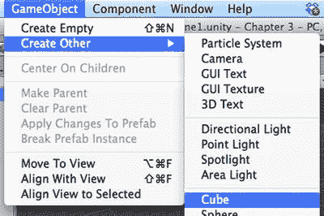

**图 3-3.** Unity 顶部菜单 `GameObject ➤ Create Other ➤ Cube`

新的游戏对象会作为`Cube`出现在`Hierarchy`视图中，其线框（gizmo）会出现在`Scene`视图中，而其组件则出现在`Inspector`视图中。在`Inspector`视图中，你会在`Transform`组件中看到游戏对象的位置用其坐标`(x, y, z)`来描述。默认情况下，Unity 将新游戏对象放置在原点`(0, 0, 0)`，即世界零点（图[3-4]）。

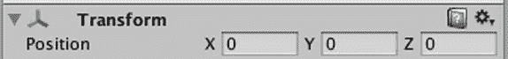

**图 3-4.** 在`Inspector`面板中显示的 Cube 游戏对象位置

# 游戏对象

虽然游戏对象最适合被视为组件的容器，但为了方便，Unity 提供了像立方体这样的基本游戏对象形状，它们预先配备了一些基础组件，你可以在检视面板中看到它们（图 3-5）。

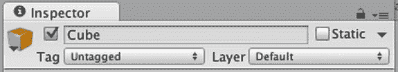

图 3-5. 检视面板中显示的立方体游戏对象头部

从检视面板的头部开始，如图 3-5 所示，第一个复选框表示该游戏对象在场景中处于激活状态。如果你取消选中它，你会注意到立方体从场景视图中消失，但不会从层级视图中消失。它并未从你的项目中删除；取消选中它允许你在处理其他内容时将其移出视野。请保持此复选框为选中状态。

接下来，游戏对象的默认名称是 `Cube`。如果你在检视面板中更改名称，你会看到层级视图中的名称也随之改变，反之亦然。

标签用于标识游戏对象组，例如`玩家`或`敌人`。这使你能够编写脚本，轻松地找到并仅影响你感兴趣的游戏对象组。

`Layers`（图层）是另一种为其他目的对对象进行分组的方式，例如仅针对场景中特定对象组的光线投射、光照和渲染。

对于场景中不会移动的环境对象，应勾选 `Static`（静态）复选框。使用 `Layers` 和 `Static` 复选框有助于 Unity 减少渲染游戏时所需的总体计算量，从而使你的游戏运行更加流畅。

检视面板中的其余内容，是组成立方体游戏对象的组件列表。

## 组件

Unity 游戏引擎的真正强大之处在于其组件。组件控制着游戏对象的外观、行为和交互。Unity 为你提供了大量现成的组件，用于构建你的游戏对象。请查看“组件”顶级菜单及其下拉菜单中的内容（图 3-6）。

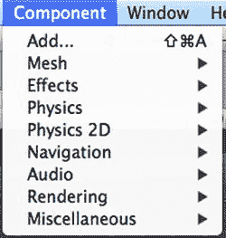

图 3-6. Unity 组件顶级菜单

你可以通过此菜单向游戏对象添加组件，或者像在第 2 章中添加脚本那样，使用检视面板中的 `Add Component`（添加组件）按钮。

最重要的是 `Transform`（变换）组件，这是每个游戏对象都必须拥有的一个组件。`Transform` 的位置、旋转和缩放属性定义了游戏对象在场景中的位置、相对于场景的方向和大小。即使是空游戏对象也必须拥有一个 `Transform` 组件。

检视面板不仅仅显示附加到游戏对象上的组件列表；它也是配置组件属性的界面。你可以输入新值来更改 `Transform` 三个属性的任何默认设置。或者，你可以在场景视图中通过单击并拖动游戏对象控件的操作手柄来直观地操作游戏对象，并在检视面板中看到这些变化。尽管试试看。记住，你可以使用 `W`、`E` 和 `R` 键快速在 `Transform` 的属性之间切换。

在右上角，带问号的小蓝书是 Unity 组件参考文档的链接。齿轮图标为你提供了一种快速将组件重置为默认值的方法，以及其他编辑功能（图 3-7）。当你测试完立方体的变换控件后，请重置 `Transform` 属性。

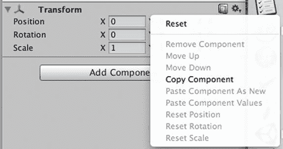

图 3-7. 组件齿轮图标下拉菜单

Unity 通过提供游戏开发者最常用的现成组件，加速了游戏开发过程。脚本也是组件——它们同样影响游戏对象的外观、行为或交互。脚本本质上是你为游戏的独特需求创建的自定义组件。

## 主摄像机

新场景并非完全为空创建；它预先填充了一个游戏对象，即主摄像机游戏对象。与任何游戏对象一样，你可以移动它，对其应用脚本，并执行通常适用于游戏对象的任何其他操作。主摄像机是玩家观察场景的视口。如果看不到游戏，那还算不上游戏，因此新场景中始终包含它是合理的。在场景视图或层级视图中选择主摄像机，即可在检视面板中显示其内容（图 3-8）。

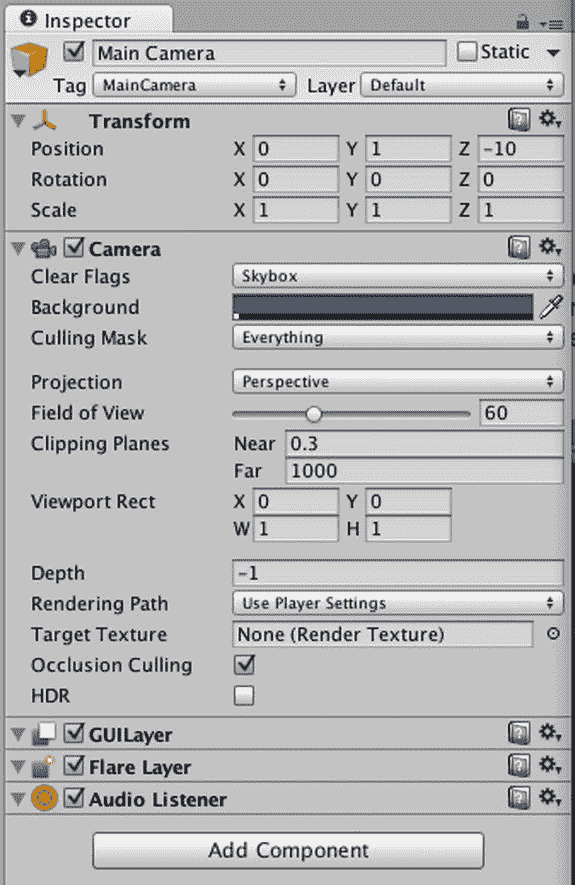

图 3-8. 检视面板中的主摄像机组件

### Transform（变换）

和往常一样，强制性的 `Transform` 组件排在首位。

> **提示：** 养成一个良好的习惯，即以一致的顺序列出组件，使其更容易找到。

虽然你创建的任何新游戏对象都会自动放置在原点位置，但主摄像机的 `Transform` 放置位置使得这些新对象能够出现在其视野中，这在场景视图右下角的摄像机预览中会友好地显示出来（图 3-9）。进入“播放”模式，你会发现游戏视图被准确呈现，然后退出“播放”模式。

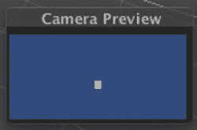

图 3-9. 显示立方体游戏对象的摄像机预览

### Camera（摄像机）

主摄像机是一个包含摄像机组件的游戏对象。为简单起见，通常直接称之为“摄像机”。实际的摄像机组件有许多属性，下面简要介绍一下。

#### 清除标志

`清除标志`用于设置背景。背景是指绘制完所有游戏元素后剩余的部分。默认值为`天空盒`，但该项目中尚未设置天空盒资源。现在我们来处理这个问题。

在 Unity 顶部菜单中选择`资源` → `导入包` → `天空盒`。导入窗口将选中标准资源中的所有天空盒选项。保留选中状态，点击`导入`，你会看到它们出现在项目视图中。你可能只会看到一个`标准资源`文件夹。展开`标准资源/天空盒/纹理`文件夹，直到看到天空盒纹理列表（图 3-10）。花点时间浏览它们，并决定要将哪个应用于场景。

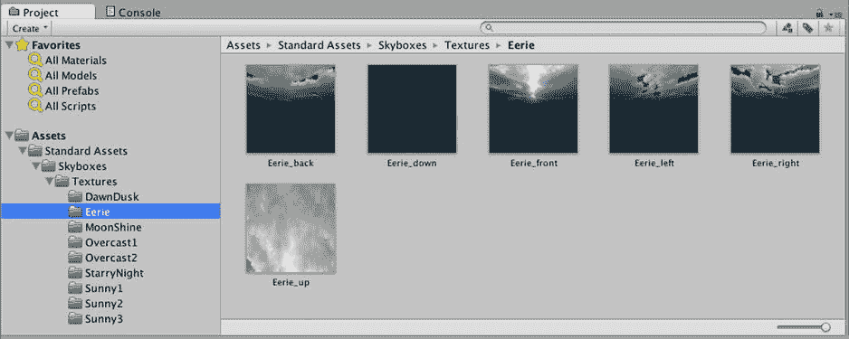

*图 3-10. 项目视图中显示的天空盒*

再次在 Unity 顶部菜单中选择`编辑` → `渲染设置`。检查器现在显示应用于该场景的渲染属性。每个场景的渲染属性设置都是该场景独有的。你可以通过单击检查器中`天空盒材质`属性右侧的小目标图标，在弹出的天空盒材质窗口中选择设置你选定的天空盒材质，或者从属性视图的天空盒文件夹中拖动材质，直接将其放入检查器的`天空盒材质`属性中（图 3-11）。当材质拖动到正确位置时，属性字段会变为蓝色。

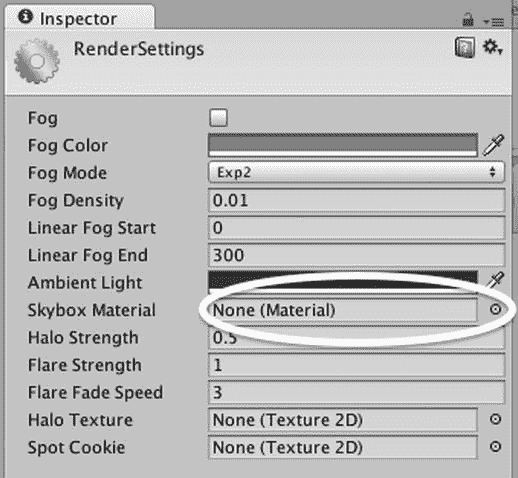

*图 3-11. 检查器中显示的渲染设置*

在场景视图中旋转查看新的天空盒背景，注意它也会出现在摄像机预览中。屏幕中未被游戏元素占据的部分现在将由天空盒填充。

你可以在一个场景中拥有多个摄像机。在检查器面板中，`清除标志`的`仅深度`下拉设置用于这种情况，不同的摄像机可用于平视显示器（HUD）或小地图。每个不同摄像机的视图按玩家所见的方式层层叠放。附加摄像机的`清除标志`设置为`仅深度`，而主摄像机的`清除标志`设置通常保持为`天空盒`，并且具有最低深度设置，使其成为场景的最终背景。

`不清除`下拉设置意味着在绘制下一帧之前不清除上一帧，从而产生涂抹效果。这种情况不常用。

#### 背景

当选择`纯色`作为`清除标志`属性时，你可以使用`背景`属性来选择一种颜色，用于指示绘制游戏元素后剩余的屏幕区域。

#### 剔除遮罩

`剔除遮罩`指定场景中的哪些图层将由摄像机渲染。图层用于对对象进行分组。你可能只希望一个摄像机渲染某个特定图层的对象，而其他图层由另一个摄像机渲染。例如，Unity 建议将用户界面（UI）放在单独的图层中作为良好实践（图 3-12）。

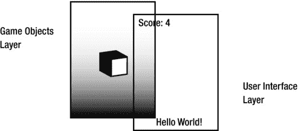

*图 3-12. 将游戏对象图层和用户界面图层分开*

#### 投影

`投影`属性在摄像机的`透视`和`正交`视图之间切换。摄像机将渲染一个称为视锥体的特殊形状内的所有内容（见图 3-13）。

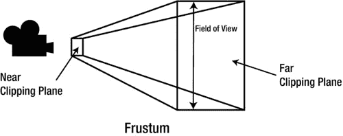

*图 3-13. 显示近裁剪面和远裁剪面的视锥体*

在`透视`模式下，当近裁剪面小于远裁剪面时，渲染的场景会给人一种透视缩小或前景缩短的效果，即物体甚至物体的部分距离越远显得越小。这是 3D 游戏中更常用的投影方式。在`正交`模式下，近裁剪面和远裁剪面大小相同，导致摄像机以平行方式观察物体。这种模式更常用于 2D 游戏或游戏的 2D 图层（如 UI）。在 Unity 编辑器中，当选中主摄像机时，你可以在场景视图中看到视锥体的轮廓。

#### 视野

摄像机的垂直视角，以本地 y 轴为基准，以度为单位测量。

#### 裁剪面

`裁剪面`垂直于摄像机，界定了金字塔状视锥体的顶部和底部。只有位于裁剪面之间且处于视锥体体积内的对象才会被渲染。

#### 视口矩形

最终，摄像机观察到的游戏视图被渲染到二维屏幕上。`视口矩形`是一个归一化的坐标尺度，将屏幕左下角定义为`(0, 0)`，右上角定义为`(1, 1)`。归一化意味着无论实际屏幕尺寸如何（例如在显示器或手持设备上），`(0, 0)`始终是屏幕左下角，`(1, 1)`是右上角。它用于指定摄像机视图在屏幕上要绘制的相对位置。

#### 深度
如之前在`清除标志`中讨论的那样，当使用多个摄像机时，`深度`用于指定每个摄像机的图层级别，数值最低的位于底层，因此其视图先被渲染。

### 组件参考
其余摄像机组件属性的使用远超本书范围。若需这些属性的详细描述，请点击蓝色书籍/问号图标，在网页浏览器中打开摄像机的组件参考。

#### 提示
你应该始终查阅文档以熟悉新组件。

说真的，花点时间查阅文档。你会发现，与脚本参考中有用的示例代码片段类似，Unity 提供了超级便捷的使用组件实用提示（图 3-14）。

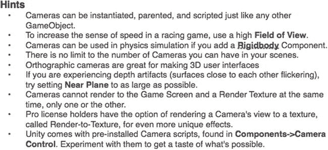

*图 3-14. Unity 组件参考中提供的摄像机提示*

### GUI 图层
附加到主摄像机的`GUI 图层`允许渲染`GUIText`和`GUITextures`，这些是常作为 UI 部分的 2D 对象。复选框用于启用或禁用`GUI 图层`。

### 光晕图层
镜头光晕是真实摄像机中玻璃透镜产生的光学效果。此效果通过`光晕图层`组件模拟，将在本章后面演示。

## 音频监听器
声音对用户体验也很重要。Unity 提供了 2D 和 3D 声音之间的选择。音频源是包含你分配的声音片段并充当其扬声器的游戏对象。你可以在场景中放置任意数量的音频源。2D 声音在整个游戏中以恒定音量播放，更适合环境背景音效或音乐。3D 声音在场景中依赖于位置；靠近时声音变大，远离时声音变弱。这种用于产生 3D 效果的音量变化由 Unity 自动处理，因此音频监听器中没有需要调整的属性。

音频监听器收集来自各个音频源的声音，通过玩家设备的扬声器传递给玩家。每个场景只需要一个音频监听器。Unity 将其附加到主摄像机，这样任何新场景都将具备音频功能，但你可以根据游戏需求将其移动到另一个游戏对象（通常是玩家角色）。

# 光照

目前，你的新场景包含了天空盒背景和一个`Cube`游戏对象。若进入 Play 模式，立方体仍会保持黑暗。无论天空盒纹理中包含多少光线，它本质上只是一张天空的纹理或图像，并不会向场景中的游戏对象投射光线。要解决这个问题，你需要一个`Light`游戏对象。例如：

- `方向光（Directional light）`：类似于太阳光，可照亮场景中的每一个游戏对象，但它并非来自单个点光源。
- `聚光灯（Spot light）`：从单个点发出的锥形光区域，类似于聚光灯或手电筒。
- `点光源（Point light）`：类似于灯泡，从中心点向所有方向发光。
- `区域光（Area light）`：用于烘焙光照贴图，不在本书讨论范围内。

使用层级视图中的`Create`按钮或顶部菜单中的`Game Object ➤ Create Other`，向场景中添加一个方向光。如果选择`Main Camera`，你会在`Camera Preview`中看到立方体明显变亮。重新选择`Directional light`，并在 Inspector 中查看其属性。

第一个属性是`Type`。尽管你创建的是方向光，但可以通过此下拉菜单将其更改为其他类型的光。请注意，Inspector 会保持上下文相关，并会根据所选类型改变属性，但层级视图中的名称“Directional light”并不会反映此处所做的任何更改。

## 通用光照属性

我想再次强调亲手操作 Unity 进行实验的重要性。以下对光照属性的描述并非枯燥乏味的说教——这些属性更适合观察和实践，而非被动阅读。虽然我不会为每个属性提供逐步指导，但我强烈建议你在 Unity 中测试每一个属性，以便在 Scene 视图和 Play 模式下观察其效果。记住，你始终可以使用`Light`组件的齿轮图标来重置属性。

### `Color`（颜色）

点击颜色框会弹出一个颜色选择器，用于选择任意颜色的光。如果点击吸管图标，颜色框中的颜色会随鼠标悬停位置的颜色而变化——例如，使用鼠标从电脑屏幕其他窗口显示的图像中抓取一个颜色样本。

### `Intensity`（强度）

这是光的亮度，其中 8 为最亮，0 则为完全无光。虽然更改光的`Type`不会改变其值，但当你创建新光时，方向光（`Directional`）的默认值为`0.5`，而点光源（`Point`）和聚光灯（`Spot`）的默认值为`1`。

### `Cookie`（遮罩）

`Cookie`起到光前掩模或屏幕的作用，为光赋予阴影图案。在 Unity 编辑器中，使用`Transform`组件的齿轮图标选择`Reset`。然后将光的`Transform`位置设置为`(0, 0, –2)`，`Type`设置为`Spot`。从顶部菜单中选择`Assets ➤ Import Package ➤ Light Cookies`。此时会打开`Import Packages`窗口，其中列出了 Unity 标准资源（Standard Assets）中可用的 Cookie。点击`Import`，然后检查`Project`面板中的`Assets`文件夹，会发现`Light Cookies`文件夹已加入`Standard Assets`文件夹中的`Skyboxes`文件夹内（图 3-15）。

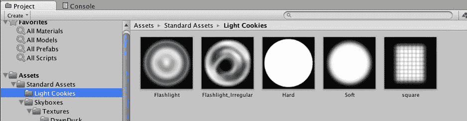

图 3-15. Unity 标准资源中`Light Cookies`包的内容

将其中任意一个拖动到 Inspector 面板的`Cookie`属性中，观察光图案如何显示在`Cube`游戏对象上。

要清除`Cookie`属性，请点击属性字段右侧的目标图标，打开`Select Texture`弹出窗口（图 3-16）。这里会显示你已导入的所有包中的纹理。在列表顶部选择`None`，即可看到`Cookie`属性随之变化，然后关闭弹出窗口。

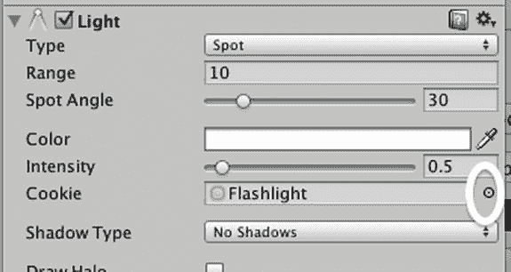

图 3-16. 用于打开`Select Texture`弹出窗口的目标图标

如果你恰好会使用 Photoshop，可以在 Unity 手册中的`Frequently Asked Questions ➤ Graphics Questions ➤ How do I make a Spot Light Cookie?`部分找到制作自定义 Cookie 的说明。

### `Shadow Type`（阴影类型）（仅限 Pro 版本）

当你准备好提升游戏品质时，务必查看 Unity Pro 中提供的众多额外效果。除了新功能、改进的开发工具和更多目标平台外，Unity 还最近调整了其定价结构，使 Pro 版本对独立开发者更加友好。你可以在 Unity 网站上通过选择顶部菜单中的`Buy`来获取更多信息。

### `Draw Halo`（绘制光晕）

当勾选`Draw Halo`属性时，其“光晕”会在光源周围的空气中产生粒子效果。

### `Flare`（光晕）

将光的`Transform`位置设置为`(0, 2, 3)`，`Type`设置为`Point`。从顶部菜单中选择`Assets ➤ Import Package ➤ Light Flares`。此时会打开`Import Packages`窗口，其中列出了 Unity 标准资源（Standard Assets）中可用的光晕（Light Flares）。点击`Import`，然后检查`Project`面板中的`Assets`文件夹，会发现`Light Flares`文件夹已加入`Standard Assets`文件夹中的`Light Cookies`和`Skyboxes`文件夹内。将`Sun`资源拖动到`Flare`属性窗口中，并在 Scene 视图或 Game 视图中观察其效果（图 3-17）。

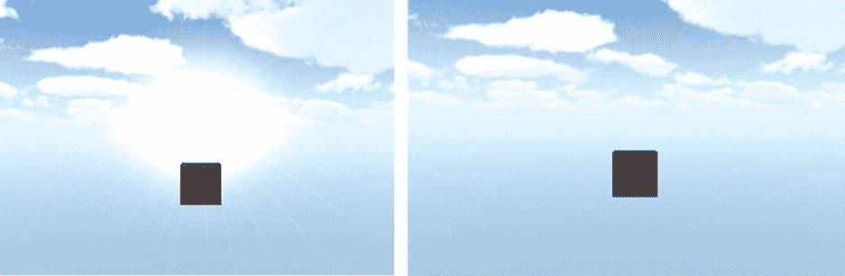

图 3-17. 分别显示有和没有太阳光晕效果的 Game 视图

### `Render Mode`（渲染模式）

该属性指定了光源的重要性。在运行时，计算光照和阴影会消耗大量计算能力。当这些消耗大量计算能力的元素影响游戏质量和性能时，它们被称为“昂贵（expensive）”。评估光源的相对重要性有助于 Unity 优化游戏性能，这是本书后续会讨论的一个主题。

### `Culling Mask`（剔除遮罩）

其工作方式与`Camera`组件中的`Culling Mask`属性相同，你可以在此指定哪些层会受到该光源的影响。

### `Lightmapping`（光照映射）

`Realtime Only`表示该光源用于在运行时动态照亮场景。`Baked Only`指的是光照贴图（lightmapping），这超出了本书的讨论范围。`Auto`则允许两者兼用。

## 其他属性

还有一些属性特定于你选择的光源类型。这些属性会根据你的选择出现在上下文相关的 Inspector 中。

### `Range`（范围）

对于`Point`（点光源）和`Spot`（聚光灯），`Range`指的是从光源发出的有效照射距离。超出该范围的游戏对象将不会被照亮。当选中光源时，其范围会在 Scene 视图中以黄色球体形式直观显示。

### `Spot Angle`（聚光角度）

仅适用于`Spot`（聚光灯）。`Spot Angle`以度为单位，决定了从`Spot`（聚光灯）发出的锥形光束的宽度。

# 立方体

现在，让我们仔细看看`Cube`游戏对象。选中它以在 Inspector 中显示其组件（图 3-18）。

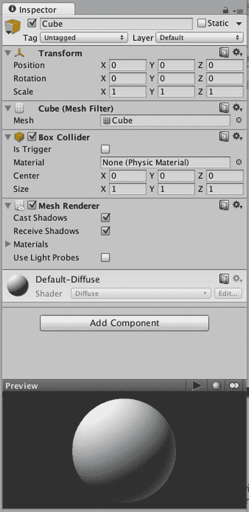

图 3-18. Inspector 中的`Cube`游戏对象组件

## Transform

到现在为止，你应该已经熟悉了`Transform`组件及其`Position`、`Rotation`和`Scale`属性，以及它们各自的热键和操作手柄。你可能已经注意到，Unity 对这些操作手柄进行了颜色编码以便于记忆：`(x, y, z)` 对应 `(r, g, b)`，即红、绿、蓝。

关于缩放游戏对象的一点说明：出于性能考虑，最好在将模型导入 Unity 之前，就根据你的游戏需求将其缩放至合适的尺寸。

### 网格过滤器

在讨论网格过滤器属性之前，先简单聊聊什么是网格。所有 3D 游戏对象的形状本质上都是由相互连接的三角形（称为多边形）构成的。每个多边形由三条边（或边缘）定义，而这些边相交的点称为顶点。网格就是构成游戏对象 3D 几何形状的多边形集合。要查看组成立方体游戏对象的多边形，可以在场景视图控制栏中选择`线框`（如图 3-19 所示）。

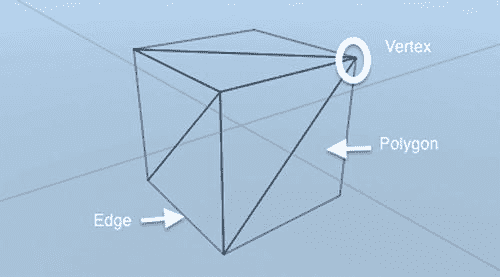

图 3-19. 立方体游戏对象的场景视图线框

`网格过滤器`的`网格`属性中命名的网格资源，存储着顶点坐标和其他以数学方式描述模型几何的数据。多边形越多，计算机需要处理的数据就越多。这意味着多边形数量会对游戏性能产生影响。`网格过滤器`将这些网格数据传递给`网格渲染器`，以便模型被渲染，使其显示为浅灰色对象，就像你现在看到的立方体一样。

### 盒碰撞器

`盒碰撞器`使用类似的立方体网格数据，其目的并非在屏幕上渲染模型。虽然`网格过滤器`和`网格渲染器`使游戏对象可见，但碰撞器是一个不可见的组件，用于检测与其它带有碰撞器或`刚体`组件的游戏对象的接触。当这两个游戏对象碰撞时，碰撞器组件会将有关游戏对象的信息传递给游戏引擎。

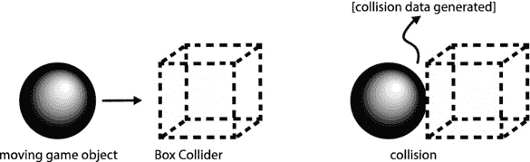

碰撞器利用游戏对象模型的体积来检测是否与另一个游戏对象发生了碰撞。至少其中一个涉及的游戏对象必须附加有`刚体`组件，它们才能在游戏世界空间中产生物理反应。

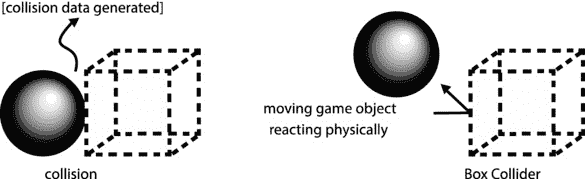

触发器用于脚本中检测碰撞，以便触发除通过代码管理的物理交互之外的游戏事件。当两个游戏对象接触时，会生成关于这些对象的数据，这些数据可以用于多种方式影响游戏玩法，但游戏对象看起来不会发生物理交互。

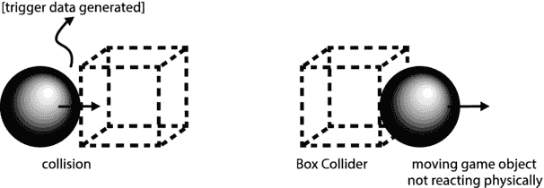

当在至少一个游戏对象也附加有`刚体`组件的物理交互中用作碰撞器时，附加到`材质`属性上的`物理材质`会影响物理引擎确定碰撞行为的方式。例如，`物理材质`可能会让游戏对象具有更多或更少的“弹性”。

碰撞器的形状不必与它所附加的游戏对象的形状完全匹配。简单的碰撞器形状也可以组合在一起，用于更复杂的 3D 模型。`中心`和`大小`属性用于相对于游戏对象模型定位和缩放此碰撞器。你将在第 6 章了解更多关于碰撞器、触发器、`物理材质`和物理引擎的内容。

### 网格渲染器

`网格渲染器`将从`网格过滤器`传递过来的、决定了模型形状的几何数据组装起来，并将其与材质、纹理、光照和阴影结合，以将模型渲染到屏幕上。这些属性面向 Unity Pro 用户，超出了本书的讨论范围。

### 材质

材质通过结合着色器脚本和纹理图像来设置模型的外观，例如哑光或闪亮反射质感之间的差异。图 3-20 展示了 Unity 提供的数十种着色器中的一些示例。

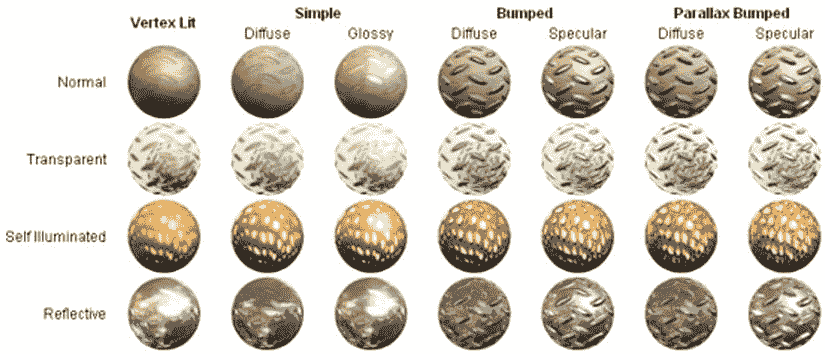

图 3-20. Unity 用户手册中显示的部分可用着色器示例

是时候让立方体变得更有趣一点了。在 Unity 编辑器顶部菜单中，选择`资源` ➤ `导入新资源`……以打开一个弹出窗口。浏览你的文件，选择一张你喜欢的图片，或者使用本书可下载资源中包含的粉红玫瑰图片（你可以在 [`http://www.apress.com/9781430265863`](http://www.apress.com/9781430265863) 找到这些资源）。点击`导入`，图片文件将出现在项目面板中。将图片拖拽到场景视图中的立方体上，就会发生几件事情。一个包含新纹理图像的材质被创建出来，并出现在项目视图的“材质”文件夹中，同时这个新材质被应用到立方体的各个面上，正如你在场景视图中看到的那样。最初导入到`资源`文件夹中的图片文件仍然以原始形式保留在那里。

# 预制件

Unity 的核心是高效的游戏开发。既然你已经配置好了一个炫酷的立方体，就可以将其存储为预制件，以便在游戏中快速创建更多炫酷的立方体。组织有序是高效的关键，因此首先创建一个 `Prefabs` 文件夹来存放这个预制件以及你为此场景创建的未来所有预制件。

在项目面板中，选择 `创建 ➤ 文件夹`，并将其命名为 `Prefabs`。在层级视图中，首先通过慢速双击将 `Cube` 重命名为 `Pink Rose Cube`。重命名后，将其从层级视图拖拽到 `Prefabs` 文件夹中。这样便为这个游戏对象创建了一个模板，使其与原始立方体区分开来（图 3-21）。在层级视图中，选中该游戏对象，然后按 `⌘+Backspace` 键将其删除。

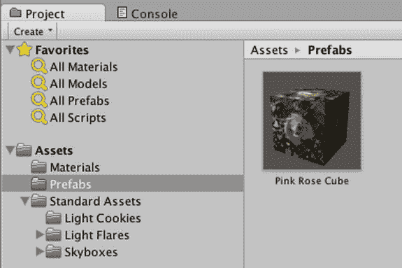

图 3-21. 项目面板 `Prefabs` 文件夹中的预制件游戏对象

在场景中填充预制件立方体克隆体之前，这里有一个巧妙的组织技巧：为了保持层级视图井井有条，空游戏对象可以像文件夹一样使用。使用 `Shift+⌘+N` 快捷键，或者在 Unity 编辑器顶部菜单中，选择 `游戏对象 ➤ 创建空对象`。将其重命名为 `Snazzy Cubes`。

从项目面板的 `Prefabs` 文件夹中，将一个 `Pink Rose Cube` 拖拽到层级视图中的 `Snazzy Cubes` 上。新的预制件游戏对象会出现在场景视图的原点位置。选中这个新游戏对象，按 `⌘+D`（D 代表复制），或者从顶部菜单中选择 `编辑 ➤ 复制`，以创建该游戏对象的新实例。层级视图中会出现第二个 `Pink Rose Cube` 游戏对象，并缩进显示在 `Snazzy Cubes` 下方，表明它是 `Snazzy Cubes` 父对象的子对象（图 3-22）。

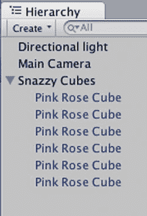

图 3-22. 层级视图中显示的父子关系

场景视图看起来是一样的，因为第二个游戏对象也像第一个一样被放置在了原点。使用变换工具重新定位这些对象。重复此操作，直到在场景中分散放置了大约六个游戏对象，并使它们彼此靠近，以便能同时看到它们（图 3-23）。

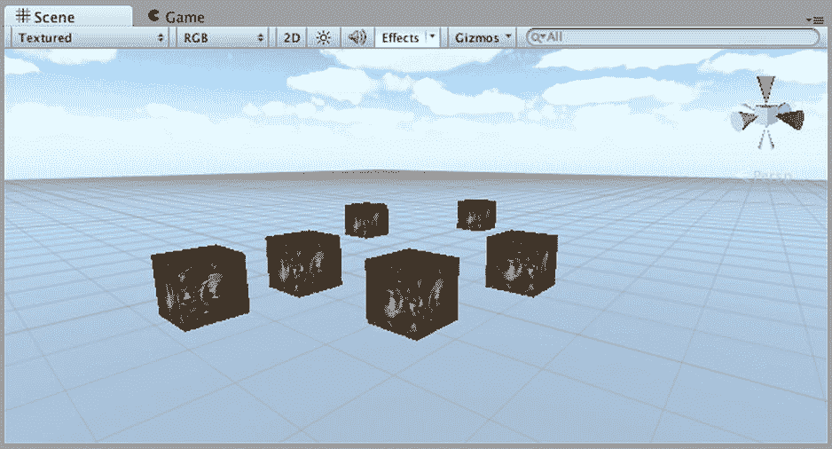

图 3-23. 预制件填充场景

当游戏对象与父对象存在子级关系时，其 `Transform` 位置将变为相对父对象，而非世界原点。如果移动父对象，子对象将保持相对位置。在层级视图中选中 `Snazzy Cubes` 空游戏对象。使用场景视图中出现的变换工具，抓住一个手柄并移动它。正如你所见，所有立方体都随之移动（图 3-24）。

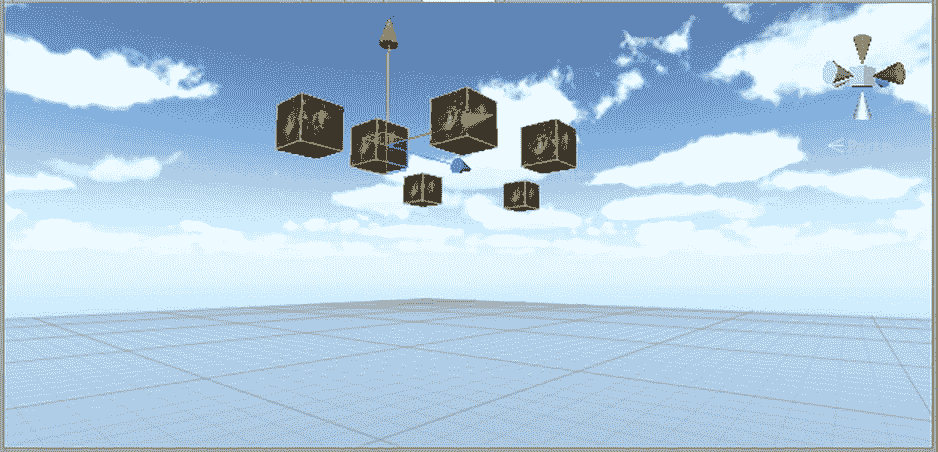

图 3-24. 子对象随父对象移动

选中一个预制件，然后在检查器中将其 `Transform` 的 `Scale` 参数的 `z` 值改为 `2`。现在你有了一个矩形块，而不是立方体（图 3-25）。尽管这个游戏对象是由预配置的预制件创建的，你仍然可以单独编辑它。将 `z` 的缩放值改回 `1`。

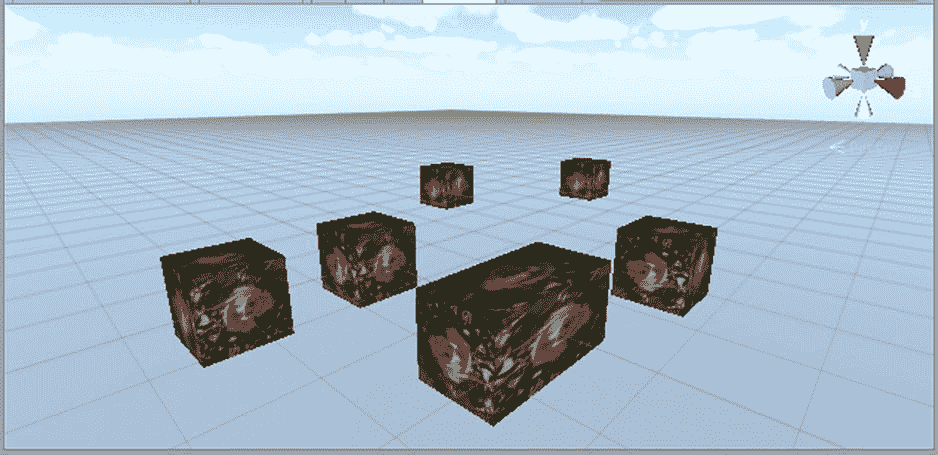

图 3-25. 单独编辑的预制件游戏对象

现在，在 `Prefabs` 文件夹中选中 `Pink Rose Cube` 预制件游戏对象。在检查器中，将其 `Transform` 的 `Scale` 参数的 `y` 值改为 `2`。这一次，场景视图中所有预制件都变成了高大的矩形块（图 3-26）。如果你修改了预制件模板的属性，这些更改将反映在该预制件的所有实例中。

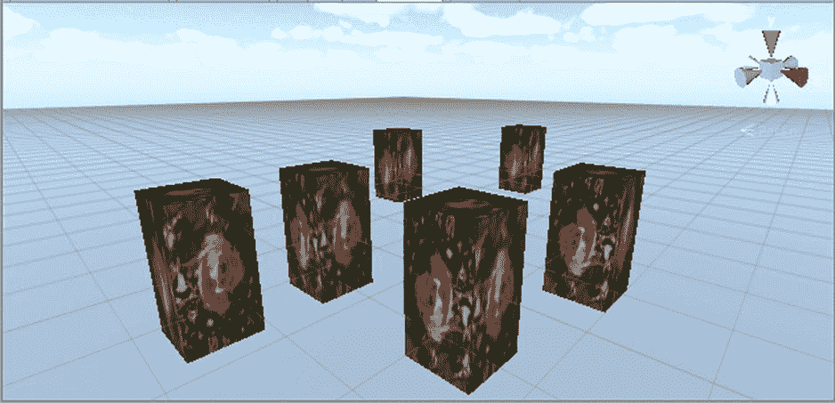

图 3-26. 编辑预制件模板影响所有预制件

## 总结

你在本章取得了长足的进步。你理解了构成场景的结构，以及必不可少的游戏对象——主摄像机。你了解了游戏对象是组件的容器，以及如何在 Unity 的组件参考文档中快速找到组件。你熟悉了 Unity 基本形状的游戏对象、摄像机和光源的默认组件。你学会了如何导入资源，并通过天空盒为场景添加色彩，使用材质为游戏对象添加颜色。你甚至尝试了使用遮罩与光晕的一些特殊效果。你正在培养保持项目组织有序的良好习惯。通过创建预制件，你变得更高效，并且知道如何单独或成组地编辑预制件。太棒了！

不过，有趣的是，对于一本关于脚本编写的书来说，本章竟然一个脚本都没有。这是有意为之。首先，我希望你有机会熟悉 Unity 编辑器的操作。其次，尽管你可以做很多有趣的事情来设置场景，但我想让你注意到，你能做的也仅限于此。如果没有脚本，当你尝试运行它时，它几乎什么都不做。

别担心——如果你想体验充满动作感的内容，你将在第 4 章中将脚本引入游戏场景时初尝滋味。脚本驱动着游戏对象之间的动作，更不用说玩家与游戏间的交互了。你将循序渐进，开始构建实用的 Unity 开发和脚本编写技能基础。从这里开始，随着你添加动画、真实的物理行为、粒子效果等等，一切会变得越来越好。
