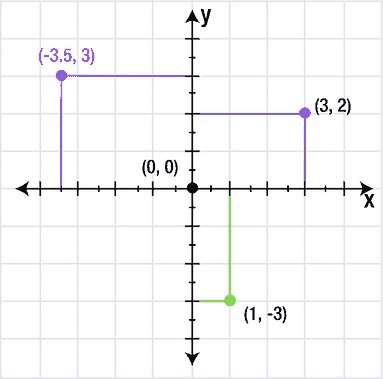
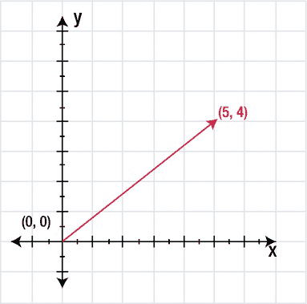
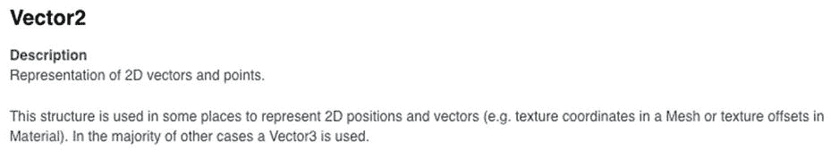
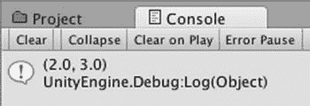
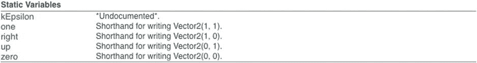
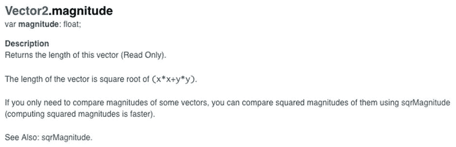
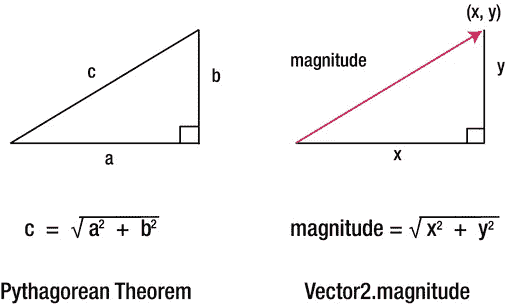
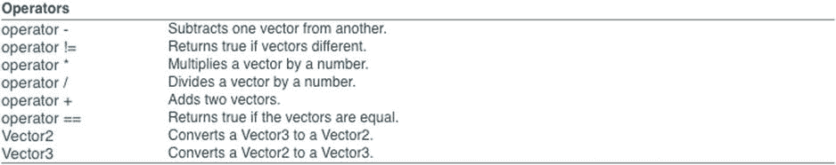

# 坐标几何与向量

好了，我们先稍微停一下。这本书是为初学者编写的。不是那些碰巧拥有数学高等学位的初学者，而是那些对游戏开发感兴趣的普通人……当然，我认为这让你比普通人酷多了。如果你碰巧拥有数学学位，那么你会欣赏到，为了让 Unity 这样复杂且易用的开发工具变得如此用户友好，背后所蕴含的优雅才智。

你不需要了解内燃机理论就能开车，不需要懂固态电路设计就能用电脑，也不需要知道任何关于电动机的知识就能使用电钻。最重要的是，你不需要成为数学天才才能学习游戏开发。在实际操作中，你肯定会学到比你想象中多得多的知识，而且这过程一点都不痛苦。我保证。

Unity 的创造者们希望它直观易用，他们取得了巨大的成功。“直观”也意味着对事物如何运作有一种感觉或直觉，你很快就能通过实践学会它。通过实验观察游戏中会发生什么，这就是你培养这种直觉的方式。即使在我不是故意胡乱尝试的时候，我也数不清有多少次，我以为告诉 Unity 要做什么，和它实际如何解释我的脚本之间存在的差异，导致了出乎意料的结果。但我的电脑从未冒火花或死机，而且那些搞砸的结果往往像电影花絮一样有趣。学习游戏开发确实很有趣——享受其中的乐趣吧！

大多数游戏，尤其是 3D 游戏，都围绕着移动展开。`Vectors`（向量）和`Transforms`（变换）分别是你将使用的一些最常用的结构体（见下文）和类。它们描述了游戏对象的位置以及它们的移动方式。本节是对坐标几何和向量数学基础知识的简要回顾，同时会介绍相关的 Unity 变量和函数，你可以在需要时随时查阅。在阅读本节时，不要纠结于数学计算。虽然我怀念在加州理工学院手动计算向量的时光，但你不需要那样做——Unity 会替你处理这些。目前，你的重点应该是学习词汇，并在三维空间中形象化地理解向量及其函数，而不是数学本身。

## 笛卡尔坐标系

Unity 使用笛卡尔坐标系，通过相互垂直的 x 轴和 y 轴（图 2-29）来描述空间中的点。原点就是这两条轴的交点，定义为 x 和 y 值均为零的点，即`(0, 0)`。二维空间中的每个独特点都可以用其 x 和 y 值，通过语法`(x, y)`来描述。



图 2-29. 笛卡尔坐标系

## 值类型与结构体

到目前为止你使用过的变量——`int`、`float`、`boolean`和`string`——被归类为值类型，因为它们包含一个特定的值，例如`8`、`hello`或`false`。一种更复杂的值类型变量被称为结构体（struct）。结构体是一个包含多个聚合值的变量。

## Vector2 结构体

`Vector2`是一个结构体，它包含了用于描述二维空间中位置和向量的 x 和 y 值。`(x, y)` 给出了一个点在二维空间中的位置。要描述一条直线或向量，你通常需要知道直线两端点的坐标，但在 Unity 中，向量被表示为相对于原点`(0, 0)`的线段，因此`(x, y)`就足以描述该向量（图 2-30）。



图 2-30. 笛卡尔坐标系

在 Unity 脚本参考中搜索 `Vector2`（图 2-31）。



图 2-31. Unity 脚本参考中描述的 `Vector2`

在 MonoDevelop 中，将你的代码更新为如下所示：

```
#pragma strict

var myVector : Vector2 = Vector2(2, 3);

function Start () {

Debug.Log(myVector);

}
```

点击 Play 进行测试，你会在控制台面板中看到你分配给`myVector`的`(2, 3)`坐标值（图 2-32）。



图 2-32. `Vector2` 坐标 (x, y) 值显示在控制台面板中

## 静态变量

Unity 在脚本参考中提供了一些常用的静态变量（图 2-33）。



图 2-33. Unity 脚本参考中描述的 `Vector2` 静态变量

在 `Debug.Log` 语句中将 `myVector` 替换为 `Vector2.up`，以确认在控制台中得到的输出是`(0, 1)`。如果你想知道为什么没有 `.down` 或 `.left`，你可以用 `-.up` 和 `-.right` 来表示它们相反的方向。

## 向量的模

向量的长度称为其模（magnitude）。你可能还记得，也可能不记得在几何课上使用勾股定理来求两点之间的距离，但在 Unity 中，当你需要确定游戏对象之间的距离时，它会用 `Vector2.magnitude` 为你代劳。点击“magnitude”快速查看 `Vector2.magnitude` 的描述（图 2-34）。



图 2-34. 来自 Unity 脚本参考的 `Vector2.magnitude` 描述

Unity 是根据向量的 x 和 y 坐标进行计算，但你可以看到它遵循的正是几何课上关于 a、b 和 c 的相同公式（图 2-35）：



图 2-35. 使用勾股定理推导出的 `Vector2` 模

例如，当 a=3 且 b=4 时，求 c。首先，a²=9，b²=16。将它们相加得到 25，然后取 25 的平方根得到长度 c=5。现在让 Unity 为 `Vector2 (3, 4)` 做同样的计算。将你的脚本编辑如下：

```
#pragma strict

function Start () {

var myVector : Vector2 = Vector2(3, 4);

Debug.Log(myVector.magnitude);

}
```

点击 Play 进行测试，控制台会显示模为 5。

再次查看 `Vector2.magnitude` 的描述。Unity 给了你一个提示：当你想要比较两个向量的模时，也可以使用 `sqrMagnitude`。无论哪种方式，你都可以判断一个向量的模是否大于或小于另一个，但使用 `sqrMagnitude` 速度会更快。无论是在脚本参考还是 Unity 论坛中，你经常会看到关于速度的评论。游戏需要大量的计算能力，因此任何单个计算完成得越快或越高效，你的游戏运行得就越流畅。

## 运算符

在 `Vector2` 脚本参考的底部，你还会发现一些你可以使用的方便的数学和比较运算符（图 2-36）。



图 2-36. Unity 脚本参考中描述的 `Vector2` 运算符