# 4. 使用脚本与游戏对象

既然你已经掌握了编程基础知识，并对 Unity 编辑器及其配套的开发者工具有了很好的理解，那么是时候将脚本引入游戏场景了。

脚本与 Unity 游戏引擎协同工作。你的脚本使用 Unity API 中的类、函数和变量来定制游戏对象的行为。你已经看到，当你创建新项目时，Unity 会创建一个非常基本、可运行的游戏，它由一个空场景组成。类似地，当你创建一个新脚本时，Unity 会用空的 `Start()` 和 `Update()` 函数填充它。

Unity 游戏引擎在后台做了大量工作。无论你是否附加了脚本，它都会在每个游戏对象上运行 `Start()` 和 `Update()` 函数。当你像在第 2 章中所做的那样，在 `Start()` 或 `Update()` 函数的花括号内添加代码时，你就是在重写该函数。

Unity 游戏引擎仍然会在游戏初始化和运行期间的适当时机运行 `Start()` 和 `Update()` 函数。但是，最初它们是空的且不执行任何操作，而添加你的代码则重新定义了每次调用这些函数时游戏内部会发生什么。

理解一点这些幕后操作至关重要。你需要了解游戏引擎何时调用各个函数，以便决定哪个函数是重写的正确选择，从而使游戏对象按照你想要的方式运行。

你将开始使用第 2 章中介绍的一些编程命令，来直接或通过玩家交互影响游戏对象的行为。你还将开始使用 Unity API 中几乎适用于所有游戏类型的通用类和函数。

我强烈建议你花时间亲自在脚本中键入示例代码，而不是复制粘贴。虽然这会多花一点时间，但意义正在于此。亲自打字迫使你放慢速度，专注于代码的每一部分，这反过来有助于你记住并回忆起这里学到的概念。

### 脚本作为行为组件

延续之前的项目，在编辑器顶部菜单中选择 `Assets` ➤ `Import Package` ➤ `Scripts`（如图 4-1 所示）。

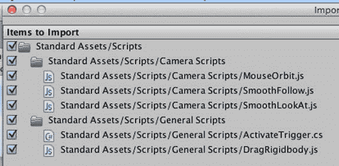

图 4-1.

全部导入后，在你的 `Project` 面板中会看到 `Standard Assets` 文件夹下出现了一个新的 `Scripts` 文件夹。双击 `Scripts` 文件夹将其打开，然后选择 `Camera Scripts` 文件夹查看其内容。在这里你将找到三个脚本：`MouseOrbit`、`SmoothFollow` 和 `SmoothLookAt`，如图 4-2 所示。

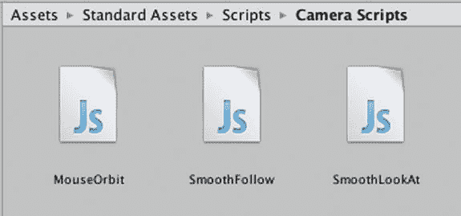

图 4-2.

`MouseOrbit` 脚本将作为 `Main Camera` 的一个行为组件。摄像机的视点将聚焦于一个游戏对象，并且你可以通过鼠标控制其围绕该游戏对象的运动。

你可以通过多种方式将 `MouseOrbit` 脚本添加到 `Main Camera`。你可以从 `Project` 面板中将其拖拽到 `Hierarchy` 视图中的 `Main Camera` 上，或者直接将其拖拽到 `Scene` 视图中的 `Main Camera` 游戏对象上。尝试第二种方式时，当将其拖拽到足够靠近 `Main Camera` 游戏对象时，你会看到一个带有白色加号的绿色圆圈。

第三种方式是在 `Hierarchy` 视图中选中 `Main Camera`，然后使用 `Inspector` 中出现的 `Add Component` 按钮。你会看到一个 `Component` 弹出窗口，该窗口已按行为组织好了组件，在本例中，那些涉及摄像机行为的脚本被组织到了 `Camera-Control` 菜单选项中。点击它查看脚本图标，然后从列表中选择 `Mouse Orbit`（图 4-3）。

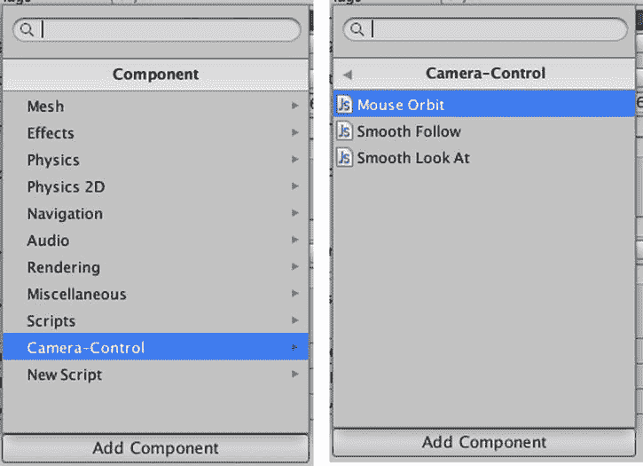

图 4-3.

如果你正在尝试每种方法，请记住你可以通过之前用于重置组件属性值的同一个齿轮图标来移除该组件（图 4-4）。

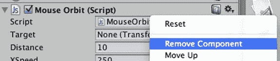

图 4-4.

在第 2 章中，你学到了如果将变量声明为 `public`，它就会作为可编辑属性出现在 `Inspector` 视图中。在图 4-5 中，你可以在 `MouseOrbit` 组件中看到的属性与 `MouseOrbit` 脚本中声明的 `public` 变量的对比。你可以通过在 `Project` 面板中选择 `MouseOrbit` 脚本图标来自行比较；该脚本将出现在 `Inspector` 中。

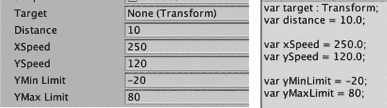

图 4-5.

`MouseOrbit` 脚本需要知道要围绕哪个游戏对象进行摄像机轨道运动。其默认值为“None”，所以即使这个脚本已挂载到摄像机，你现在播放的话也不会有什么不同。你可以看到 `target` 属性，如图 4-6 所示。

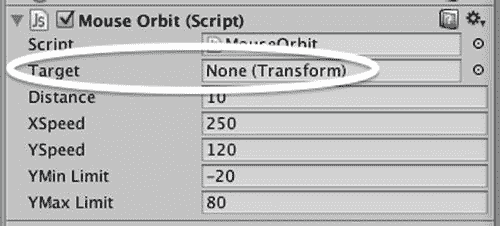

图 4-6.

在 `Hierarchy` 视图中列出的立方体预制体中选择一个，并将其拖拽到 `Inspector` 中的 `MouseOrbit Target` 属性上。立方体的名称应替换掉 `None` 这个词。

播放（`` + `P`），观察摄像机如何在你选中的立方体上保持聚焦的同时，随着鼠标移动而运动。环顾四周，查看你灯光上的辉光效果——随着移动，效果甚至更为显著。

在 `Hierarchy` 中仍然选中 `Main Camera` 的情况下，现在尝试在 `Inspector` 中调整一些 `MouseOrbit` 脚本属性，看看它们如何影响鼠标移动。如果你在 `Play` 模式下执行此操作，你的更改将会丢失。或者，如果你不喜欢在非 `Play` 模式下所做的更改，可以使用齿轮图标将这些属性重置为其默认值。

调整这些属性不仅仅是出于本练习目的的随意娱乐；这是在培养你对游戏玩法的直觉“感觉”。你知道你喜欢什么样的游戏，你知道它们的手感如何，并且你能判断它们是否不对劲。`Play` 模式就是你测试用户体验的方式。如果你觉得它的表现不佳或很奇怪，可以打赌你的用户也会这么认为。好吧，调整属性可能有点随意，但这正是重点所在。这是一款游戏——它本应有趣！

在 `Property` 面板的 `Assets` 文件夹中选择 `MouseOrbit` 图标，以在 `Inspector` 中显示该脚本（图 4-7）。

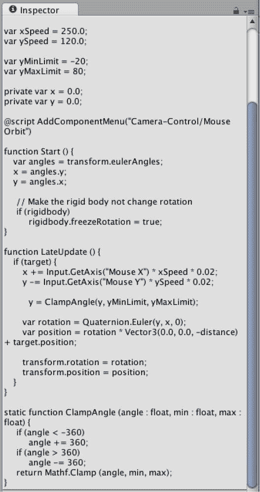

图 4-7.

你将看到变量声明，随后是一些函数，包括熟悉的 `Start()` 函数。在这些函数内部，有一些不太熟悉的条目，比如 `eulerAngles` 和 `Quaternions`。这些超出了初学者级别的主题，但不知道它们是什么并不妨碍你使用该脚本或根据自己的喜好自定义其属性。我确实建议你通读一遍脚本参考文档，并且每次遇到新的或不熟悉的话题时都重新阅读该参考文档。你会发现，随着你继续构建整体知识体系，这些概念会逐渐变得清晰。

太棒了——你已经在游戏场景中添加了一个脚本，该脚本接受用户交互并允许用户控制 `Main Camera` 游戏对象的运动。

让我们更仔细地看看脚本是如何影响游戏对象行为的。

一个类非常简单，就是一组变量和函数的集合。在 UnityScript 中，每个脚本都是一个类，并且脚本名称就是类名。函数在脚本中的顺序并不重要，但 Unity 如何知道要运行哪些函数呢？

注意

为了条理清晰，如果你在脚本中对常用的函数使用一致的顺序，那么后续再回顾时会更容易处理。

这是游戏引擎底层功能的一部分。当你进入 `Play` 模式时，会发生一个由 Unity 引擎驱动的事件特定序列。为了在游戏中获得你想要的行为，理解你的代码相对于这些事件的位置与知道要编写什么代码同样重要。

## 启动游戏

当你启动游戏时，通常首先看到的是加载画面。根据游戏的不同，它可能出现在标题画面之前或之后。无论哪种情况，在加载画面和状态栏背后，游戏引擎正在繁忙地准备游戏以供游玩。当游戏对象及其脚本被实例化时，会进行一个特定顺序的函数调用，你可以在脚本中利用这些调用来控制游戏对象的行为。

### Awake

当游戏启动时，首先游戏对象被实例化或创建。在一个游戏对象被实例化后，脚本实例会被加载。`Awake()` 函数在脚本的生命周期内仅被调用一次，即在脚本实例被加载时，以便为游戏玩法设置好各项内容，例如初始化脚本的变量。

## Awake 与 Start

游戏对象调用 `Awake()` 函数的顺序是随机的，因此你不应使用 `Awake()` 函数在对象之间传递信息，因为目标对象可能还没有准备好。

### Start

`Start()` 也仅被调用一次，即在脚本启用时。这发生在场景中每个对象的 `Awake()` 都被调用之后。

### Update

一旦脚本被启用并且 `Start()` 函数被调用后，在游戏渲染的每一帧，`Update()` 函数都会被调用。这是实现游戏行为的主要函数。但这具体意味着什么呢？

简而言之，游戏就是交互式的动画。动画，即游戏中的运动，其原理与视频类似：观众看到的是一系列静态图像。每张图像中，主体的位置都有微小的变化，当这些帧快速连续播放时，就会产生运动的错觉（见图 4-8）。

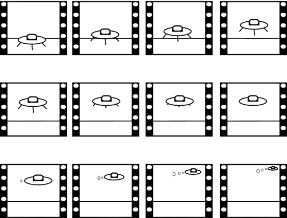

图 4-8. UFO 发射的逐帧序列

渲染游戏，是指以足够快的速度逐帧将画面绘制到屏幕上，从而在游戏中提供同样的运动错觉。Unity 游戏引擎会计算所有内容：每个游戏对象的位置或自上一帧以来的移动、基于位置和光照的每个游戏对象，然后在场景中所有变化生效后，计算出从主摄像机视角看到的场景外观，最后将这一新帧渲染到屏幕上。

与视频不同，游戏多了一个互动元素。在渲染每一帧之前，Unity 引擎必须根据每个游戏对象的组件（包括任何脚本）所决定的行为，计算自上一帧以来的变化。如你在图 4-9 中所见，编写在 `Update()` 函数中的代码驱动着游戏持续进行的动作。

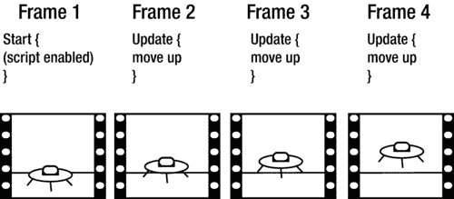

图 4-9. 已渲染帧序列及其对应的脚本函数调用

### 在 Start 中编写脚本

在 Unity 编辑器中，在层级视图中选择“Snazzy Cubes”对象。在顶部菜单中，选择**编辑** ➤ **删除**。由于 `Snazzy Cubes` 是一个父对象，当它被删除时，其所有子对象也会被删除。在这种情况下，所有立方体都会从场景中消失。

使用层级视图，选择**创建** ➤ **球体**来创建一个新的游戏对象。如预期，一个球体出现在原点 `(0, 0, 0)` 处。选中主摄像机，然后将球体从层级视图拖拽到 `MouseOrbit` 脚本组件的“目标”属性中。

在层级菜单中选中光源。将变换位置属性设置为 `(0, 5, 0)`，旋转属性设置为 `(0, 30, 0)`，并确保其类型为“方向光”。

在项目面板中，选择“Assets”文件夹。在项目面板的控制栏中，选择**创建** ➤ **文件夹**，然后将其命名为“Scripts”。养成保持游戏资源井然有序的习惯非常重要。你会看到新的“Scripts”文件夹出现在“Assets”文件夹中（图 4-10）。

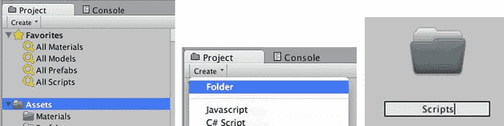

图 4-10. 在项目面板中创建 Scripts 文件夹

选中新的“Scripts”文件夹，选择**创建** ➤ **JavaScript**，并将新脚本命名为“SphereColor”（图 4-11）。

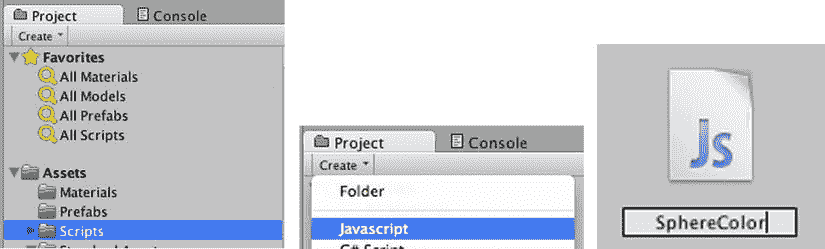

图 4-11. 创建 SphereColor 脚本

使用检视面板中的“打开”按钮在 MonoDevelop 中打开脚本，你会发现其中已经有了空的 `Start()` 和 `Update()` 函数。在 `Start()` 函数中添加如下一行代码：

```
gameObject.renderer.material.color = Color.red;
```

保存脚本。在编辑器中，将脚本从项目面板拖拽并放到层级视图或场景视图中的球体上，将其附加到球体游戏对象上。播放以查看红色球体。`Start()` 函数被调用一次，球体的材质被设置为红色。退出播放模式。

分解这行代码，结果如下：

```
(1)       (2)      (3)    (4)     (5)  (6)
gameObject.renderer.material.color = Color.red;
```

- `gameObject` 指向球体，因为这是脚本所挂载的游戏对象。

- 使用点语法，你逐级向下访问到网格渲染器组件、附加的默认材质以及该材质的颜色属性。

- 然后，你使用 `Color` 类为该颜色属性赋值，该类包含一些快捷方式，例如 `red`。

### 颜色

你可以按住 `Ctrl`+`'` 并点击 `Color`，在脚本参考中查看有关该类的更多信息，包括其他可用的快捷颜色。颜色由四个属性组成：红色、绿色、蓝色和透明度（Alpha）。这三个颜色属性各自是一个介于 0 和 1 之间的浮点数值，其中 0 表示无色，1 表示全色。颜色是叠加的，因此 r、g、b 值为 0、0、0 时产生黑色，而 1、1、1 时产生白色。第四个值，透明度属性，是透明程度，其中 0 表示完全透明，1 表示完全不透明。图 4-12 中列出的颜色快捷方式包括了 r、g、b、a 的值，因此你可以看到是哪种组合构成了最终的快捷颜色。

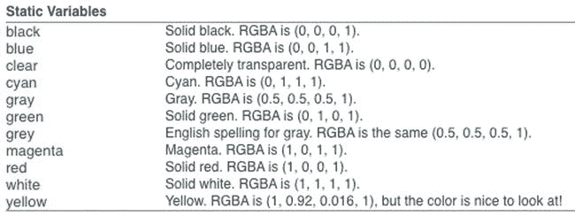

图 4-12. `Color` 类中提供的快捷颜色

对于除快捷颜色之外的任何颜色，你必须直接设置 r、g、b、a 值。将脚本编辑为以下内容：

```
#pragma strict

// 声明包含颜色值的变量。
private var red : float;
private var green : float;
private var blue : float;
private var alpha : float;

function Start()
{
    // 在 Start 时，通过调用随机数生成函数来设置颜色属性值。
    red = RandomColorValue();
    green = RandomColorValue();
    blue = RandomColorValue();
    alpha = RandomColorValue();
    gameObject.renderer.material.color = Color(red, green, blue, alpha);
    // 将随机颜色值打印到控制台。
    print(gameObject.renderer.material.color);
}

// 生成一个介于 0.000 和 1.000 之间的随机值。
function RandomColorValue() {
    var randomValue : float;
    randomValue = Random.Range(0.000, 1.000);
    return randomValue;
}
```

保存脚本，回到编辑器中进入播放模式，你会看到游戏开始时球体显示为随机颜色。注意 r、g、b、a 颜色值也会打印到控制台。退出播放模式。

你在第 2 章中使用过 `Random.Range`，当时你了解到它接受的两个参数是你希望从中选取随机数的最小值和最大值。如果必要，按住 `Ctrl`+`'` 并点击 `Random.Range` 以打开脚本参考并刷新记忆。

### 帧率

现在你已经有了在 `Start()` 中设置球体材质颜色的代码。`Start()` 只被调用一次，因此任何对颜色的进一步更改都需要放在 `Update()` 中。`Update()` 每帧都被调用，游戏引擎渲染帧的速率称为帧每秒或 FPS。帧率过低会失去运动的错觉，而更高的帧率意味着更流畅、响应更快的游戏体验。

游戏运行时的帧率是不断变化的，因为它取决于每帧所需的计算量。单个帧可能需要数千次计算，但这里为了便于说明，我们将数字保持简单。你的代码越笨重（优化越差），每帧的处理时间就越长（图 4-13）。

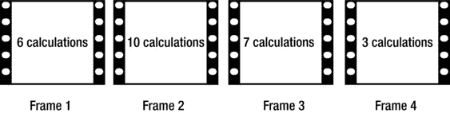

图 4-13. 每帧的计算量可能不同

除了代码要求之外，主处理器和图形芯片的硬件计算能力也限制了帧率。当你比较购买电脑时，看到“2.9 GHz Intel Core i7”这样的规格，其中的 2.9 GHz（吉赫兹）指的是英特尔芯片内部“时钟”的处理速度。

在这个简化示例中，假设处理器每个时钟周期或“滴答”可以完成一次计算。处理器 A 的芯片速度比处理器 B 慢。在相同的游戏条件下，处理器 A 的帧率将低于处理器 B（如图 4-14 所示）。

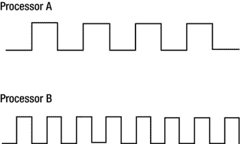

图 4-14. 两个不同处理器内部时钟速度的对比说明

## 优化

随着新游戏主机和设备制造出更快的处理器，旧设备的时钟速度将相对较慢。在某个时间点，旧芯片将无法跟上新游戏和游戏引擎的复杂性。你的代码效率越高，旧芯片就越容易处理你的游戏，从而让你的游戏能够覆盖更广阔的市场。

使用最高效的函数和代码结构来减少计算需求以提高帧率，这被称为优化。虽然第 12 章专注于游戏优化，但你将在本书和 Unity 文档中看到旨在实现更好优化的游戏开发良好实践的提示。

### `Time.deltaTime`

从视频和电影中你知道，你可以基于稳定的帧率看到流畅的角色运动。如果游戏的帧率每帧都不同，你得到的将是断断续续、不平稳的运动。你刚刚了解到硬件处理速度和脚本计算都会影响帧率。该怎么办呢？

`Time.deltaTime`来救场了。“Delta”指的是希腊字母 delta（Δ），这是数学中用来表示值变化的符号。在这种情况下，它特指渲染前一帧所花费的以秒为单位的时间变化。

例如，速度或运动，是距离/时间的度量，比如英里每小时。由于帧率每帧都在变化，为了让游戏对象显示稳定的速度，游戏引擎需要计算每秒的位置变化，而不是每帧的变化。`Time.deltaTime`是用于使这类计算与帧率无关（即基于真实时间）的转换因子。

### 在`Update`中编写脚本

将以下变量声明添加到脚本中的其他声明旁：

`public var waitTime : float = 5f;`

`waitTime` 是一个公开变量，保存一个表示球体颜色变化前需要等待的秒数的值。由于它是一个公开变量，你可以在 Inspector 中直接调整它以覆盖脚本中赋值 5 的变量声明，从而改变从游戏开始到球体变成随机颜色的时间。

现在添加`Update()`函数代码：

```
function Update()
{
        waitTime -= Time.deltaTime;
        if (waitTime < 0.0f) {
        gameObject.renderer.material.color = Color.blue;
        }
}
```

这段新代码分解如下：

`(1)     waitTime -= Time.deltaTime;`

每次调用`Update()`函数时，自上一帧渲染以来的时间会从`waitTime`中减去。

`(2)     if (waitTime < 0.0f) {`

检查`waitTime`是否已倒计时到零。

`(3)     gameObject.renderer.material.color = Color.blue;`

如果`waitTime`已耗尽，则将球体材质颜色改为蓝色。如果`waitTime`尚未耗尽，则花括号内的代码不会执行，当前材质颜色在本帧保持不变。

保存并播放。等待一下，然后…… 是的！五秒后，球体从随机颜色变为蓝色。由于你将`waitTime`声明为公开变量，你可以在 Inspector 中作为脚本组件的一部分找到它。在此处 Inspector 中进行的任何更改都将覆盖初始脚本化的`waitTime`值 5。

### 用户输入

这有点意思了，但进入和退出播放模式变得乏味。添加一些玩家交互，这样当按下 N 键（代表新颜色）时，就会为球体的材质生成一个随机颜色。你不知道玩家何时会按下 N 键，所以使用`Update()`函数在每一帧检查这个按键。编辑`Update()`函数，在末尾添加以下代码行：

```
function Update()
{
        waitTime -= Time.deltaTime;
        if (waitTime < 0.0f) {
                gameObject.renderer.material.color = Color.blue;
        }
        if(Input.GetKey(KeyCode.N)) {
                red = RandomColorValue();
                green = RandomColorValue();
                blue = RandomColorValue();
                alpha = RandomColorValue();
                gameObject.renderer.material.color = Color(red, green, blue, alpha);
                waitTime = 5;
        }
}
```

分解这段新代码：

`(1)     if(Input.GetKey(KeyCode.N)) {`

检查键盘上的 N 键是否被按下。 + ‘在脚本参考文档中查找`Input.GetKey`（图 4-15）。在这里你了解到`GetKey`是一个布尔值，如果指定的键（本例中为 N）被按下，则返回`true`。该参考文档还为你提供了一个方便的链接，指向键标识符，包括修饰键、功能键和其他特殊键。

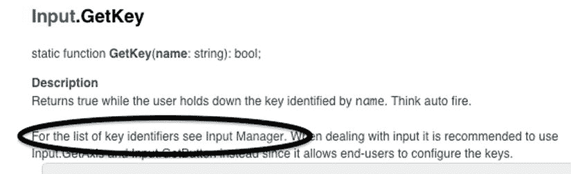

图 4-15. Unity 脚本参考文档中的`Input.GetKey`和键标识符链接

`(2)             red = RandomColorValue();`

`(3)             green = RandomColorValue();`

`(4)             blue = RandomColorValue();`

`(5)             alpha = RandomColorValue();`

`(6)             gameObject.renderer.material.color = Color(red, green, blue, alpha);`

与`Start()`函数中用于生成新的随机材质颜色的代码行完全相同。

`(7)             waitTime = 5;`

将`waitTime`重置为 5。在新颜色变化发生五秒后，球体仍将自动变为蓝色。

保存并播放。现在你可以使用鼠标控制摄像机，并使用键盘更改游戏对象的颜色——太好了！

### 清理代码

再看一下第 2 到第 6 行的描述。它们与 `Start()` 函数中的代码行完全相同。包含大量重复代码行的脚本是“笨重”的，意味着效率较低。当你发现自己使用相同的代码行时，这表明是时候通过创建一个包含重复代码块的函数来简化代码，然后用一个简单的函数调用代替这些代码块。

在 `Update()` 函数下方，添加 `NewColor()` 函数：

```
function NewColor() {
    red = RandomColorValue();
    green = RandomColorValue();
    blue = RandomColorValue();
    alpha = RandomColorValue();
    gameObject.renderer.material.color = Color(red, green, blue, alpha);
    waitTime = 5;
}
```

现在，无需两次使用这段代码块，你可以在 `Start()` 和 `Update()` 函数中用对 `NewColor()` 的调用来替换它：

```
function Start()
{
// 开始时，为球体材质设置随机颜色。
    NewColor();
// 将随机颜色值打印到控制台。
    print(gameObject.renderer.material.color);
}

function Update()
{
    waitTime -= Time.deltaTime;
    if (waitTime < 0.0f) {
        gameObject.renderer.material.color = Color.blue;
    }
    if(Input.GetKey(KeyCode.N)) {
        NewColor();
    }
}
```

你的 `Start()` 函数变得更简洁、更易读，`Update()` 函数也是如此。如果你发现未来添加的其他过程中想要改变球体颜色，只需一行代码 `NewColor();` 即可完成。

通过重写部分代码来清理代码被称为重构。在项目推进过程中，为了保持脚本的简洁，养成重构的习惯是个好方法，这最终会让你的工作更轻松。

假设你还希望用户能够通过点击鼠标来改变球体颜色。在你的脚本中 `NewColor()` 下方添加以下函数：

```
function OnMouseDown() {
    NewColor();
}
```

这比再次复制六行代码要好得多，不是吗？保存并运行。

如果你没有事先阅读 `OnMouseDown()` 脚本参考，你可能会惊讶地发现，在游戏视图中任意位置点击鼠标并不会导致颜色变化——你必须直接点击球体。


查阅 `OnMouseDown()`，你会在脚本参考描述中发现：只有当鼠标光标悬停在游戏对象的碰撞体上时点击鼠标按钮，该函数才会被调用。

在层级视图或场景视图中选择球体，你会在检查器中看到，就像使用 Unity 的立方体基本游戏对象时一样，Unity 为球体基本游戏对象创建了必要的碰撞体组件，使其能够按预期与 `OnMouseDown()` 函数配合使用。

## 启用和禁用组件

除了操作组件的属性来实现所需行为外，你还可以启用或禁用整个组件。`OnMouseDown()` 需要与碰撞体组件交互。你已经证明了它能在碰撞体组件存在时正常工作，现在测试如果禁用碰撞体组件，它是否就会失效。

一个简单的验证方法是：在检查器面板中取消选中球体的“球体碰撞体”复选框以禁用它。这个复选框代表一个布尔标志：勾选时启用标志设为 `true`，未勾选时启用标志设为 `false`。

继续取消选中该复选框，然后进入播放模式进行测试。不出所料，当碰撞体组件被禁用时，尝试用鼠标点击球体不会有任何反应。退出播放模式并重新勾选复选框以启用碰撞体组件。虽然这是测试概念的简便方法，但在游戏过程中启用或禁用组件需要在脚本中完成。

在 `#pragma strict` 之后的变量列表中添加一个新的变量声明：

```
private var sphereCollider : Collider;
```

这个变量声明与之前声明的变量略有不同，它的类型是 `Collider`。`sphereCollider` 变量对于在脚本中访问碰撞体组件的启用属性是必需的。与持有特定数值的 `float` 或 `int` 变量不同，`sphereCollider` 是一个引用变量。它持有的是定义碰撞体数据所在内存地址的引用，而非数据本身。

在 `Start()` 函数的末尾添加以下代码行：

```
sphereCollider = GetComponent(Collider);
```

`GetComponent(Collider)` 获取球体碰撞体组件的引用，并将其赋值给 `sphereCollider` 变量。在后续章节中，你将使用 `GetComponent()` 来访问其他游戏对象的组件（包括脚本）。


查阅 `GetComponent()`，你会看到一个简短的选项列表（图 4-16）。选择第一个选项：`Component.GetComponent`。在该参考文档的末尾，你会找到 Unity 关于优化性能的建议。在本例中，Unity 建议尽可能使用 `GetComponent` 并指定类型，而非字符串。在我们的示例中，我们使用了类型：类型为 `Collider` 的 `sphereCollider` 变量，而不是包含游戏对象或组件名称或标签的字符串变量。

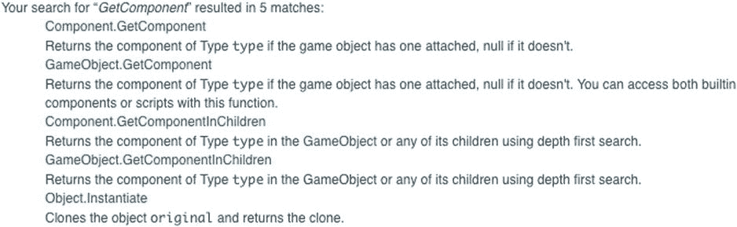

**图 4-16.** 脚本参考

在脚本参考中查阅 `GetComponent`。

现在在 `Update()` 函数的末尾添加这个条件语句：

```
if(Input.GetKey(KeyCode.C)) {
    sphereCollider.enabled = !sphereCollider.enabled;
}
```

这个条件判断玩家是否按下了 C 键。如果是，则碰撞体启用标志（一个布尔值）会被切换为相反值。请仔细看看这行代码：

```
(1)                      (2)
sphereCollider.enabled = !sphereCollider.enabled;
```

在第 2 章中，你了解到 “`!`” 代表逻辑运算符“非”。

`sphereCollider.enabled` 的布尔值要么是 `true`，要么是 `false`。无论当前值是什么，其“非”值（即相反值）都会被重新赋值给 `sphereCollider.enabled` 标志。

使用 `!` 运算符来翻转布尔值通常被称为**切换**，因为它就像是一个物理开关，只能朝两个方向翻转，类似于电灯在“开”和“关”之间切换。在这个示例中，玩家按下 C 键的效果，与你在检视面板中勾选或取消勾选复选框来启用或禁用组件是完全一样的。实际上，在游戏运行期间，请留意检视面板中的复选框，你会看到该复选框会随着你按下 C 键而自动勾选或取消勾选。

到目前为止，脚本的完整列表如下：

```
#pragma strict

// 声明用于存储颜色值的变量。

private var red : float;

private var green : float;

private var blue : float;

private var alpha : float;

public var waitTime : float = 5f;

private var sphereCollider : Collider;

function Start()

{

// 在 Start 中，为球体材质设置随机颜色。

NewColor();

// 将随机颜色值打印到控制台。

print(gameObject.renderer.material.color);

// 将球体的碰撞器组件赋值给 sphereCollider 变量。

sphereCollider = GetComponent(Collider);

}

// 生成一个介于 0.000 到 1.000 之间的随机值。

function RandomColorValue() {

var randomValue : float;

randomValue = Random.Range(0.000, 1.000);

return randomValue;

}

function Update()

{

waitTime -= Time.deltaTime;

if (waitTime < 0.0f) {

gameObject.renderer.material.color = Color.blue;

}

if(Input.GetKey(KeyCode.N)) {

NewColor();

}

if(Input.GetKey(KeyCode.C)) {

sphereCollider.enabled = !sphereCollider.enabled;

}

}

function NewColor() {

red = RandomColorValue();

green = RandomColorValue();

blue = RandomColorValue();

alpha = RandomColorValue();

gameObject.renderer.material.color = Color(red, green, blue, alpha);

waitTime = 5;

}

function OnMouseDown() {

NewColor();

}
```

保存脚本并尝试运行。

## 销毁游戏对象

比起启用/禁用，一种更持久的方法是使用 `Destroy()` 函数来移除组件或整个游戏对象。这可以通过多种不同的方式来实现。

其中一种方法是使用一个类似于我们倒计时让球体变蓝的计时器。使用双斜杠，注释掉 `Update()` 函数中将球体颜色改为蓝色的那行代码，以停用它。

```
//gameObject.renderer.material.color = Color.blue;
```

在它的正下方，并且仍然在条件语句的大括号内，添加：

```
Destroy(gameObject);
```

保存并运行。五秒后，球体不再变蓝，而是消失了。

回到脚本中，注释掉对 `Destroy()` 的调用。当两行代码都被注释掉后，五秒标记点将不会有任何变化。使用双斜杠来注释代码是一种很好的快捷方式，可以启用和禁用短代码块以进行测试或调试，而无需重新输入或剪切粘贴多行代码。

你可以让玩家通过向 `Update()` 函数添加另一个 `GetKey()` 条件来销毁球体，如下所示：

```
if(Input.GetKey(KeyCode.D)) {

        Destroy(gameObject);

}
```

保存脚本并运行。当你按下 D 键时，球体会立即被销毁。但是等等，你说，我漏掉了一些东西。你巧妙地使用了  + ‘ 浏览了 `Destroy()` 函数的脚本参考，并发觉它可以接受一个可选的第二个浮点参数，该参数表示内置的时间延迟。

将 `Destroy(gameObject);` 这一行改为 `Destroy(gameObject, 2);`。保存并运行，以演示现在按下 D 键后，球体在销毁前会有两秒的延迟。使用此参数代替我们之前的代码来创建时间延迟，可以减少实现相同目标所需的代码总行数。

实现相同结果的方法通常不止一种。请保持警惕，当你发现更有效的解决方案时，不要犹豫，立即重构你的代码。

### 实例化

到目前为止，你已经经历了游戏对象从游戏开始到确定其在游戏过程中的行为的完整生命周期，这是通过编写代码来修改、启用和禁用游戏对象组件来实现的。

你学习了在运行时销毁游戏对象，但还没有学会如何创建它。在这些示例中，你使用了在运行时之前已创建并放置在场景中的球体游戏对象。

`Instantiate()` 对于创建游戏对象的副本特别有用。什么是游戏对象的副本？预制件！你知道预制件是游戏对象的蓝图。实例化就是根据这个蓝图创建游戏对象副本的过程，这个副本被称为实例。

从层级视图中，将球体拖入项目面板的预制件文件夹中。你会看到一个新的球体预制件出现在粉红玫瑰立方体预制件旁边。通过场景视图或层级视图选中球体，然后从编辑器顶部的菜单中选择“编辑 ➤ 删除”，以此将球体从场景视图中删除。再次使用编辑器顶部的菜单，选择“游戏对象 ➤ 创建空对象”。空游戏对象的变换工具会在场景视图中出现。

在项目面板中，选择脚本文件夹，然后在控制栏中选择“创建 ➤ JavaScript”，并将新脚本命名为 `CreateSpheres`。将脚本图标拖到层级视图中的空游戏对象上，以将其附加上去。`CreateSpheres` 脚本应该作为空游戏对象的一个新组件出现在检视面板中（图 4-17）。

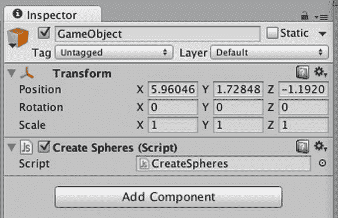

图 4-17. 在检视面板中，`CreateSpheres` 脚本作为空游戏对象的一个组件显示

在 MonoDevelop 中打开 `CreateSpheres` 脚本。在 `#pragma strict` 下方，为球体预制件的新实例声明一个新变量。

```
public var newSphere : GameObject;
```

在 `Update()` 函数中，添加以下代码行：

```
if(Input.GetKey(KeyCode.Space)) {

        var instance : GameObject = Instantiate(newSphere);

}
```

保存脚本并返回编辑器。现在你可以看到 Unity 美化后显示为“球体”的 `newSphere` 变量。在项目面板中选择预制件文件夹。将球体预制件从项目面板拖到检视面板中游戏对象的新球体属性上，并将其放到“无”之上，以便它显示在新球体区域中（参见图 4-18）。

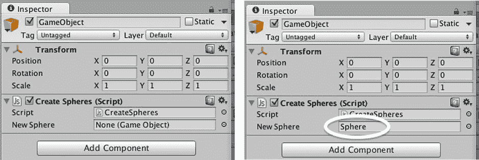

图 4-18. 分配球体预制件前后，检视面板中的新球体变量

通过选择顶部菜单中的“文件 ➤ 保存场景”来保存场景。运行，当你按下空格键时，一个新的球体预制件会出现。

如果你不停地按空格键，你正在实例化更多的球体预制件，但它们都出现在原点，相互重叠。为了防止预制件堆积，可以使用 `Destroy()` 函数在两秒后移除新实例化的球体。

在项目面板中，选择脚本文件夹。然后选择“创建 ➤ JavaScript”。将新脚本命名为 `DestroySphere`。在 MonoDevelop 中打开 `DestroySphere`，并在 `Start()` 函数中添加 `Destroy(gameObject, 2f);`。保存脚本。

返回编辑器，在项目面板中选择预制件文件夹。选择球体，然后在检视面板中选择“添加组件 ➤ 脚本”，并从脚本列表中选择“Destroy Sphere”（图 4-19）。

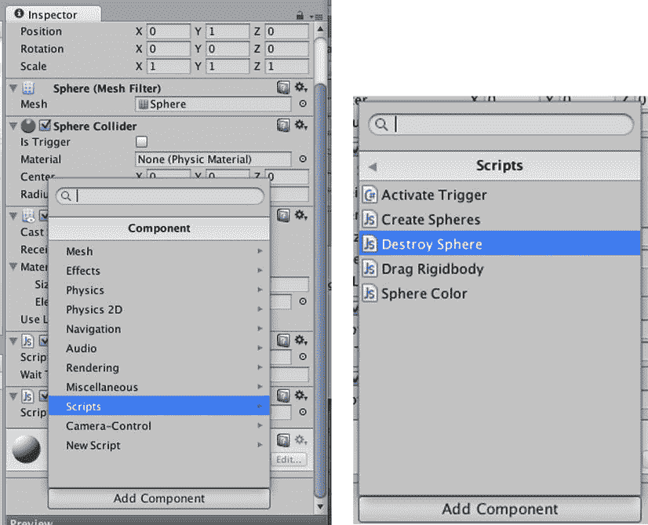

图 4-19. 在检视面板中，将新的 `Destroy Sphere` 脚本添加到球体预制件上

在顶部菜单中选择“文件 ➤ 保存场景”。进入播放模式。当你按下空格键时，一个带有随机生成材质颜色的球体预制件会出现，然后，经过两秒延迟后，消失。完美！

### 章节小结

在这一章中，你已经取得了不小的进步。Unity 在标准资源包中为你提供了一些常用脚本作为起点。你理解了游戏玩法的结构以及游戏对象从 `Awake()` 到 `Destroy()` 的生命周期，并且对优化和代码重构有了初步的了解。游戏玩家已经出现并与你的游戏进行交互。你可以创建脚本并将其附加到游戏对象上，还掌握了一些可供游戏对象使用的 Unity 类和函数。简而言之——你已经开始编写脚本了！

下一章将着重为游戏增添动作元素，从简单的游戏对象移动开始，继而介绍 Unity 的 Mecanim 动画系统。这正是为“紧张刺激的动作场面”注入“动作”的关键所在！
