# 5. 移动游戏对象

你已经构建了一个基本场景，并用游戏对象充实了它。你添加了脚本，允许用户交互来添加和销毁游戏对象，以及改变它们的外观。现在，是时候加入移动功能了。

首先，你将学习如何使用游戏对象的变换组件通过脚本来移动游戏对象。然后，你将初步了解如何使用 Unity 的 Mecanim 系统来处理资源商店中更复杂的游戏对象角色。这些角色带有内置动画，你将学习如何通过脚本操控它们。

Unity 游戏引擎还提供了游戏对象在响应重力或与其他游戏对象碰撞等作用力时的移动和交互。这些由 Unity 游戏引擎的物理系统控制，将在第 6 章和第 7 章中介绍。

## 旋转

由于球体从任何角度看起来都一样，因此它并不是演示旋转运动的最佳形状。与其删除它，不如先禁用它。在项目面板的资源文件夹中找到的预制件子文件夹中，选择球体预制件。在检查器顶部附近，取消选中预制件名称“Sphere”左侧的复选框以禁用它（图 5-1）。

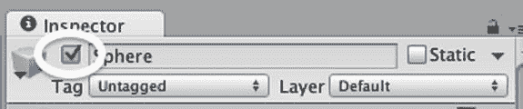

图 5-1. 在检查器中禁用球体预制件

在层级视图中，选择“创建 ➤ 立方体”。Unity 的原始对象立方体将出现在场景视图的 (0, 0, 0) 位置。

在检查器视图中，选择“添加组件 ➤ 新建脚本”，将其命名为 `MoveCube`，并确保语言属性为 JavaScript。点击“创建并添加”按钮，它将作为组件出现在检查器中。在项目面板中，该脚本出现在资源根文件夹中。为了保持项目整洁，将其移动到脚本文件夹。

现在在 MonoDevelop 中打开 `MoveCube`。为了获得移动的错觉，你希望 Unity 在每一帧中将立方体渲染到略微不同的位置，这意味着你需要使用 `Update()` 函数。在 `Update()` 函数的花括号之间，添加以下代码行：`transform.Rotate(Vector3.up);`。保存脚本，点击播放进行测试，你的立方体正在旋转——好极了！

让我们分解这行代码，以理解究竟发生了什么：

`(1)      (2)    (3)   (4)`

`transform.Rotate(Vector3.up);`

`Transform` 是每个游戏对象必备的组件；它包含位置、旋转和缩放信息。在这行代码中，你可以使用小写的 `transform`，编译器知道这指的是附加此脚本的游戏对象的变换组件。从一个附加到第二个游戏对象的脚本中影响第一个游戏对象的 `Transform` 组件会稍微复杂一些，将从第 6 章“访问其他游戏对象”开始介绍。

`Rotate()` 是 `Transform` 类的一个函数。你可以使用 `#` 阅读脚本参考。它围绕其 `Vector3` 参数的轴应用旋转，单位是欧拉角。欧拉角是一个高级数学术语，指的是围绕游戏对象轴线的旋转度数。

`Vector3` 参数定义了旋转将要围绕的轴。`.up` 是向量 (0, 1, 0) 的 `Vector3` 静态变量快捷方式。

仔细观察立方体的平移操纵杆，记住在 Unity 的世界空间中，y 轴是“向上”的。再次播放，从视觉上确认立方体的旋转是围绕 y 轴发生的。查看检查器，你可以看到 `Transform` 组件的旋转属性的 y 值正在根据立方体的旋转变化而变化（图 5-2）。

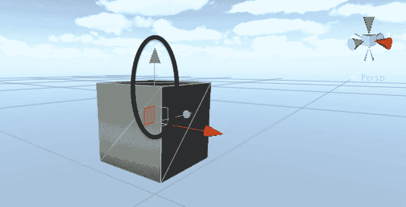

图 5-2. `Vector3.up` 平行于正 y 轴

向量确实有方向，因此虽然 `Vector3.up` 和 `Vector3.down` 都平行于 y 轴，但它们指向相反的方向。将 `Vector3.up` 替换为 `Vector3.down`。保存、播放，注意现在立方体似乎正在向相反方向旋转。这是因为旋转现在是围绕向下指向的向量 (0, -1, 0) 计算的。

你不仅限于使用 `Vector3` 快捷方式，实际上你可以传入任何值的 `Vector3` 变量。将 (`Vector3.down`) 替换为 (x, y, z) 值 (2, -5, 4)，保存并播放。现在你会看到立方体以一个角度翻转，因为旋转是围绕这个随机向量计算的。由于应用于所有三个轴的旋转计算累加在一起，立方体看起来也翻转得更快了。

### 在游戏测试中编辑属性

既然你可以让游戏对象围绕任何你喜欢的轴旋转，那么如果也能控制速度就好了。更好的是能够直接在 Unity 编辑器中测试和调整速度，而不是在脚本和编辑器之间来回切换。

回到 MonoDevelop，在 `#pragma strict` 下，声明公共浮点变量 `rotationSpeed` 并赋予其初始值 5：

`public var rotationSpeed:float = 5;`

将 `Update()` 函数编辑为：

`transform.Rotate(Vector3.up * rotationSpeed);`

你将默认的旋转计算乘以一个你控制的因子：变量 `rotationSpeed`。保存并返回 Unity 编辑器。在层级视图中选中立方体游戏对象，现在你会看到 `rotationSpeed` 作为 `MoveCube` 脚本组件的一个属性出现，初始值为 5（图 5-3）。

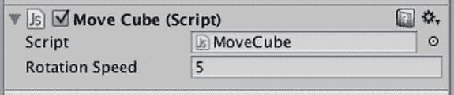

图 5-3. `rotationSpeed` 公共变量作为“旋转速度”属性显示在检查器中

你将 `Vector3` 参数改回 `Vector3.up`，只是为了让你在游戏测试时更容易直观地看到你对 `rotationSpeed` 属性所做的更改并进行调整。

播放，看到立方体再次围绕 y 轴旋转。在保持播放模式的同时，更改 `rotationSpeed` 的值（注意必须选中立方体）。尝试更快的值、更慢的值、零值，甚至负值。这是 Unity 的一个强大功能，你可以在微调游戏体验时立即看到更改的效果。退出播放模式，注意 `rotationSpeed` 值恢复为 5。请记住，在播放模式下所做的更改不会被保存。

在第 4 章中，你学习了帧率和 `Time.deltaTime`。当你调整游戏对象移动时，请记住，基于不同的帧率，游戏对象在不同计算机上的移动方式会有所不同。解决方案是乘以 `Time.deltaTime` 来使运动与帧率无关。将 `Update()` 函数编辑如下：

```javascript
function Update () {
    transform.Rotate(Vector3.up * rotationSpeed * Time.deltaTime);
}
```

### 添加用户交互

保存并运行。立方体的速度因这个新增因素而改变，但你可以重新调整 `rotationSpeed` 属性，恢复到你喜欢的速度。现在不同之处在于，任何在不同机器上玩你游戏的人，都将获得与你在自己机器上创建的游戏相同的体验。

像你在第 4 章中做的那样，通过键盘添加一些用户交互，这次用于控制立方体的旋转。编辑 `Update()` 函数，添加一个条件判断来检查用户是否按下了左箭头键。

```javascript
function Update () {
        if(Input.GetKey(KeyCode.LeftArrow)) {
                transform.Rotate(Vector3.up * rotationSpeed * Time.deltaTime);
        }
}
```

保存并运行。现在立方体仅在按下左箭头键时才旋转。类似地，你可以通过使用 `-rotationSpeed`，让用户用右箭头键使立方体向相反方向旋转。

```javascript
function Update () {
        if(Input.GetKey(KeyCode.LeftArrow)) {
                transform.Rotate(Vector3.up * rotationSpeed * Time.deltaTime);
        }
        if(Input.GetKey(KeyCode.RightArrow)) {
                transform.Rotate(Vector3.up * -rotationSpeed * Time.deltaTime);
        }
}
```

保存并运行。

## 移动（Translate）

`Translate()` 是 `Transform` 的另一个函数，用于移动 `GameObject`。和 `Rotate()` 一样，它也接受一个 `Vector3` 参数，但在这个情况下，`Vector3` 描述了 `GameObject` 将要移动的方向和距离。添加一个公共变量，用作乘法因子，以便在编辑器中调整立方体的速度。在 `rotationSpeed` 变量声明下方，添加一个 `travelSpeed` 变量。

```javascript
public var travelSpeed:float = 5;
```

通过向 `Update()` 函数添加以下代码行，让玩家使用上箭头和下箭头键上下移动立方体。

```csharp
if(Input.GetKey(KeyCode.UpArrow)) {
    transform.Translate(Vector3.up * Time.deltaTime * travelSpeed);
}
if(Input.GetKey(KeyCode.DownArrow)) {
    transform.Translate(Vector3.down * Time.deltaTime * travelSpeed);
}
```

保存并运行。这次，对于向下方向，你使用了 `Vector3.down` 而不是 `-travelSpeed`。两种方法都可行，就像 `-Vector3.up` 也等同于 `Vector3.down` 一样。获得相同结果的方法往往不止一种；这很大程度上取决于个人偏好。如果有选择，请选择最高效的代码，如果其他条件相同，则可读性越强越好。

### `Transform.position`

`Translate()` 是一个移动变换（`Transform`）的函数，而 `position` 则是一个保存变换位置（x, y, z）值的变量。你也可以通过直接分配一个新位置来将 `GameObject` 移动到特定位置。在这个例子中，我们将使用 `O` 键将 `GameObject` 送回原点（0, 0, 0）。

首先，在公共变量声明下方添加一个新的私有变量声明。

```csharp
private var originPosition : Vector3 = new Vector3(0, 0, 0);
```

在 `Update()` 函数中，添加以下代码：

```csharp
if(Input.GetKey(KeyCode.O)) {
    transform.position = originPosition;
}
```

保存并运行。使用箭头键移动立方体，然后按下 `O` 键将其返回到游戏视图中心。注意，这会重置立方体的位置，但对其旋转没有影响。

虽然这种移动是瞬间完成的，但显得相当突兀。如果你希望立方体更缓慢、更平滑地返回原点，Unity 正好有一个专为此目的而设计的出色函数，称为 `Lerp()`。

## 使用 Lerp 实现平滑移动

Unity 的 `Lerp()` 函数可以平滑立方体返回原点的过渡。Lerp 代表线性插值（Linear Interpolation），这是一种在两个值之间逼近平滑线或曲线的数学方法。在这种情况下，我们使用 `Lerp()` 来平滑地将立方体从玩家移动到的位置移回原点。如果你花点时间在脚本参考中搜索“Lerp”，你会发现 `Lerp()` 可用于在两个表示几乎任何内容的值之间进行过渡，包括颜色、材质和四元数（图 5-4）。

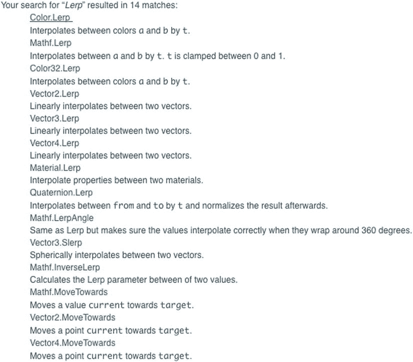

图 5-4. Unity 中使用 `Lerp()` 的静态函数

具体来说，你将使用 `Vector3.Lerp`。在脚本参考中选择它，快速阅读一下。

`Vector3.Lerp` 有三个参数：起始 `Vector3`、目标 `Vector3`，以及一个用于实际线性插值计算的浮点值。

首先，在其他变量声明之后声明一个公共浮点变量 `smoothing`，用于从检视面板调整立方体的移动速度：

```csharp
public var smoothing : float;
```

将 `Update()` 函数中用于将立方体返回原点的代码修改如下：

```csharp
//将立方体移回原点
if(Input.GetKey(KeyCode.O)) {
    transform.position = Vector3.Lerp(transform.position, originPosition, smoothing * Time.deltaTime);
}
```

分解关键代码行，我们可以看到以下内容：

`(1) (2) (3) (4) (5)`

`transform.position = Vector3.Lerp(transform.position, originPosition, smoothing *`

`(6)`

`Time.deltaTime);`

设置游戏对象的变换位置，通过 `Vector3.Lerp()` 函数进行平滑处理，从游戏对象的当前位置移动到原点，并使用一个可用于定制的平滑乘数，该乘数基于实时时间而非变化的帧率。

保存并返回 Unity 编辑器。在层级面板中选中立方体游戏对象，在检视面板中将平滑属性（`Smoothing`）更改为 3。进入播放模式。现在，当你按住 `O` 键时，立方体会平滑移动，并且越接近原点，其移动速度会逐渐变慢，最终滑行停止。

现在，你已经通过多种不同的方式为你的原始游戏对象实现了各种移动动画。你玩过一些游戏，它们有效地利用像这样的简单运动来创造有趣、互动的体验，但这只是 Unity 能力的冰山一角。本章的其余部分将向你介绍 Mecanim（Unity 的动画系统），以及可以在资源商店中找到的精彩多样的角色和动画包。

# Mecanim 动画系统

`Mecanim` 是 Unity 的动画系统。该系统已集成到 Unity 编辑器中，旨在为游戏开发者提供可视化、直观的工具。虽然角色及其基础动画片段是在导入 Unity 之前创建的，但 `Mecanim` 系统用于管理和混合这些动画，从而带来更流畅、更出色的游戏体验。

最棒的是，通过使用虚拟角色（`Avatar`），`Mecanim` 允许您将一个角色模型的动画重定向到另一个角色上，而无需为第二个角色创建全新的动画序列。这听起来很简单，但这恰恰是 Unity 团队将复杂功能变得易于使用的又一例证，同时还能为您节省大量的工作时间。

毕竟，这是一本关于学习 Unity 并专注于脚本编程的书，而脚本编程最终是将动画角色与游戏代码整合以实现游戏运行的必要环节。不过，您需要高效地投入精力——请记住，这里的目标是完成一款出色的游戏并发布它。

开发工具不断升级，变得更加直观、可视化，更重要的是，通过省去为常用和重复功能编写原始代码的负担，变得更加高效。`Mecanim` 提供了一个可视化编程工具，您可以在编写游戏脚本代码之前，用它来处理复杂的动画交互。

3D 角色模型的创建和动画制作是在将其集成到 Unity 游戏项目之前完成的。虽然角色创建远远超出了本书的范围，但您将学习如何将一个现成的角色与现成的动画片段结合，为在游戏中使用它做好准备的基础知识。

本节将向您介绍如何使用 `Mecanim` 设置角色及其动画，并配合脚本编程来处理用户输入，从而控制角色。为了真正理解 `Mecanim` 的精妙之处，您将选择一个角色，配置其虚拟角色和动画，然后利用 `Asset Store` 中的免费资源，快速将该动画应用到第二个角色上。这种角色与动画的混搭能力，为您在控制学习成本的同时，为游戏原型提供了庞大的选项库。

## 我是医生，不是……！

在深入之前，我想就游戏开发行业的工作提出几点总体观察。艺术家与开发者之间常有一种友好的竞争关系，通常被定义为创意型与逻辑型之争。我想鼓励您——一位初出茅庐的游戏开发者——不要将自己局限在任何一个类别中。

虽然艺术家确实富有创造力，但真正技艺精湛的艺术家必须对其选择的媒介有深入的理解，这本质上是技术性的，就像学习和使用任何工具或运动技能来操作艺术媒介，将创意概念从想法变为现实一样。

开发者使用各种基于纯数学函数和逻辑的编程语言。没有比这更具技术性的了。另一方面，在计算机代码的严格限制下提出解决方案，将应用或游戏概念变为现实，则需要巨大的创造力。

一款伟大的游戏是艺术与代码的完美结合，为玩家带来卓越的体验。请始终保持开放的心态，包括抓住机会去了解更多关于其他团队成员所做的工作。您越能理解这一切是如何协同工作的，就越能与您的 3D 艺术家合作者沟通顺畅，最终您的成品质量也会越高。

## 建模、骨骼绑定和蒙皮

计算机生成动画本身就是一个完整的行业，其中有专门从事建模、骨骼绑定、动画等工作的个人。创建一个新的角色并为其制作动画，需要所有这些环节。`Maya`、`3ds Max` 和 `Blender` 用于从头创建角色，此外还有其他角色生成工具。这超出了本书的范围，但您需要了解一些相关术语。

建模是创建游戏对象三维形状的过程，这个形状由许多通常被称为多边形（`polygons`）的三角形组成（图 5-5）。请记住，更复杂的模型需要更多的计算能力。

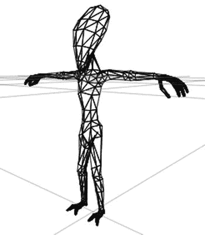

图 5-5. 外星角色模型线框

`Asset Store` 中对模型最常用的描述之一就是模型中使用的“`polys`”或“`tris`”（多边形数量）。支持 Unity 的增强现实 SDK `Metaio` 说得最好：“在设计 3D 模型时，请记住要使用尽可能少的多边形，但要满足需要。” 为您的游戏选择现成模型也是如此。

虽然您会学到诸如此类的优化游戏最佳实践，但您还需要查阅目标平台的文档以了解更具体的限制。例如，`Metaio` 为了将其建议付诸实践，还提供了一个关于多平台（和多设备）上性能与多边形数量的优秀摘要供开发者参考（图 5-6）。

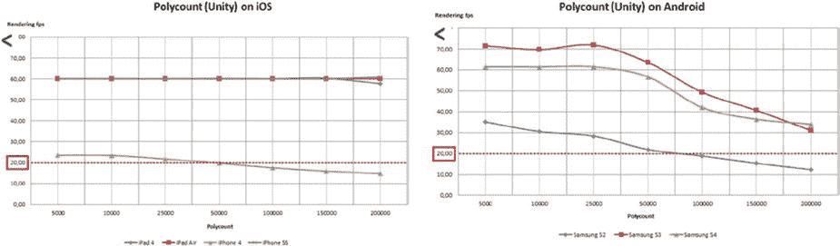

图 5-6. `Metaio` 增强现实 SDK 的性能与多边形数量对比

如果您与创建自定义角色的艺术家合作，告知他们是否存在特定的多边形数量限制会很有帮助。

骨骼用于控制角色的运动。它们构成一个骨架或关节层级结构，定义了骨骼之间如何相互移动，这与父子游戏对象非常相似。骨骼绑定（`Rigging`）就是创建这个关节层级结构的过程（图 5-7）。

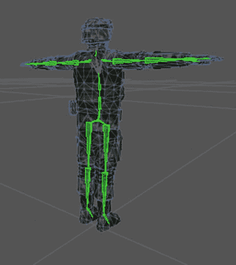

图 5-7. 以亮绿色显示的骨骼

一旦创建了关节层级结构，就必须将其连接到角色网格上，以便网格能够响应关节的动画而移动。将网格连接到关节层级结构的骨骼上称为蒙皮（`Skinning`）（图 5-8）。

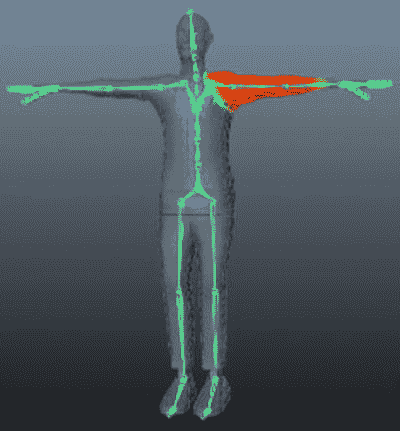

图 5-8. Unity 用户手册中的交互式蒙皮绑定示意图

如果您打算自己制作角色模型，可以在 Unity 用户手册中找到有用的指南。

# 资源商店

对于独立游戏开发者来说，幸运的是存在 Unity 资源商店。资源商店是模型、脚本、纹理、音频、完整项目等资源的宝库。别被它的名字骗了——上面有许多免费资源可供使用，非常适合学习和制作原型，更不用说这是一个了解各位艺术家和工作室能提供什么的好方法。

Unity 资源商店的运作方式很像应用商店，其中的资源可能来自独立艺术家或开发者、工作室，甚至 Unity Technologies 本身。你可以找到从简单的零散部件到完整的已完成项目。Unity 编辑器旨在与资源商店轻松集成。要访问资源商店，请在编辑器顶部菜单中，选择 `Window` ➤ `Asset Store`（图 5-9）。

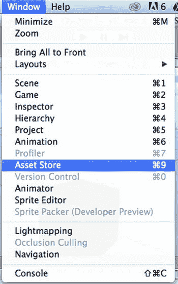

图 5-9。通过编辑器菜单访问 Unity 资源商店

资源商店主页会在一个单独的窗口中打开（图 5-10）。左侧前两行展示特色资源，右侧是商店分类菜单。分类菜单下方是“24 小时特惠”，每天都会有一款不同的资源以大幅折扣特价出售。

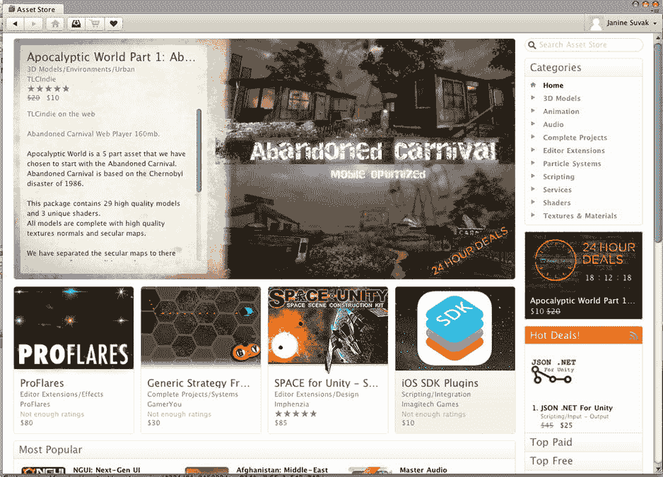

图 5-10。Unity 资源商店主页

在分类中，选择 `3D Models` ➤ `Characters` ➤ `Humanoids`。左上方是该子分类下的特色资源，下方是所有可用的 3D 人形模型的完整列表。列表顶部是排序选项；选择 `PRICE`（价格）。这将按价格从低到高对资源进行排序，将免费资源置于列表顶部（图 5-11）。

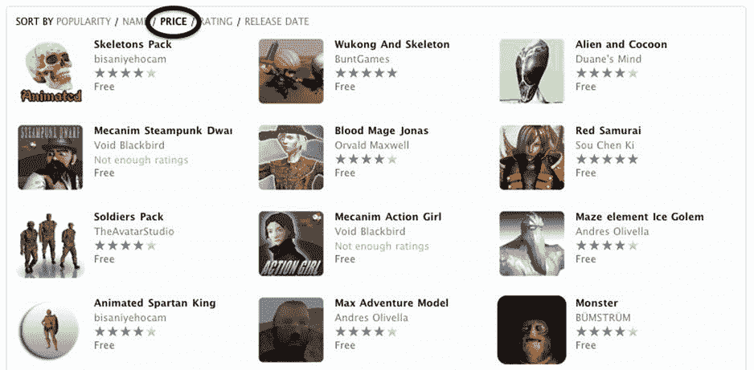

图 5-11。Unity 资源商店中可用的 3D 人形模型，按价格排序

点击其中任何一个，都将进入产品页面，该页面包含简要描述、一张图片、一个可选的展示角色更多图片的区域，以及最后可下载包的详细内容。出于比较目的，请查看 Alien and Cocoon 和 Animated Spartan King（图 5-12）。

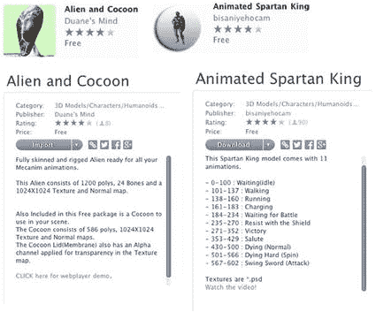

图 5-12。在 Unity 资源商店中比较 3D 模型

这些简要描述由发布者提供，内容可能有所不同。通常会提到多边形数量，因为这会影响性能，或可能限制支持你游戏的设备。Mecanim 相对较新，是 Unity 旧版动画系统的重大升级，因此你可能会看到类似针对 Alien 的评论，指定它实际上与 Mecanim 兼容。

动画可能单独提供，或者是长动画的一部分，此时你需要知道单个剪辑中各个动画的位置。在 Spartan King 的描述中，发布者给出了每个动画剪辑的特定帧范围。

最棒的是，这两个发布者都提供了在下载前实际查看动画的方式。Alien and Cocoon 的链接会带你到一个 Unity Web 播放器，你可以作为玩家与之互动，在几个简单的关卡中移动外星人；而 Spartan King 的链接则会带你去一个 YouTube 视频，你可以在那里观看角色执行每个可用动画（图 5-13）。

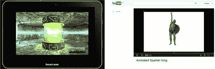

图 5-13。资源商店的贡献者以多种方式展示他们的动画：Web 播放器对比 YouTube 视频

## 导入角色模型

在资源商店窗口中，向下滚动一点，直到你找到 Mixamo 提供的免费 Zombie Character Pack（僵尸角色包），选中它以打开产品页面（图 5-14）。

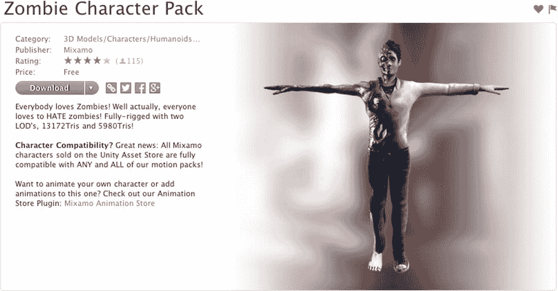

图 5-14。Unity 资源商店中的 Zombie Character Pack 图标和产品描述

点击蓝色的下载按钮。如果你还没有设置 Unity 账户，请按照指示立即设置。如果你有，下载按钮将变为“请稍候”，然后显示一个百分比数字，表示下载进度。最后，将弹出导入包窗口，其中所有包内容都已选中准备导入。保持所有这些选项处于勾选状态，然后点击窗口右下角的导入按钮（图 5-15）。

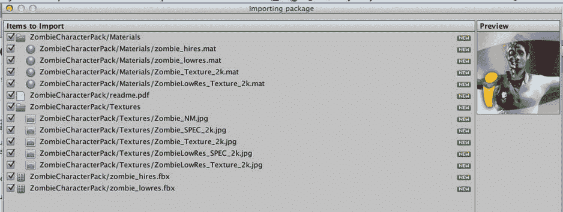

图 5-15。显示 Zombie Character Pack 内容的导入窗口

现在，`ZombieCharacterPack` 文件夹出现在 Project 面板的 `Assets` 文件夹中。

## 创建并配置 Avatar

在 Project 面板的 `ZombieCharacterPack` 文件夹中，选择 `zombie_lowres` 模型。在 Inspector 视图中，选择 `Rig` 选项卡。将动画类型更改为 `Humanoid`，并将 Avatar 定义保留为 `Create From This Model`。点击 `Apply`。现在 `Configure…` 按钮变为活动状态，点击它。在出现的对话框中选择 `Save`。配置完成后，`Configure…` 按钮左侧将出现一个小对勾（如图 5-16 所示）。

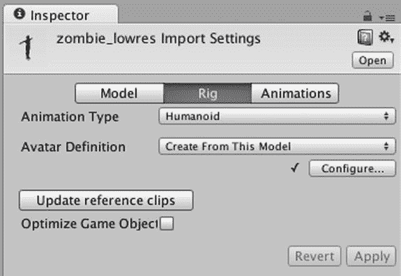

图 5-16。在 Inspector 中配置 Avatar

哇——编辑器中的几乎每个视图都发生了变化，以显示新的 Avatar 及其细节。Avatar 游戏对象临时出现在 Hierarchy 中用于配置，并且可以展开以显示组成它的所有子游戏对象。其图像出现在 Inspector 中（图 5-17）。在 Avatar 图像下方是一个列表，显示哪些 Avatar 骨骼与哪些对应的角色骨骼匹配。有一种方法可以手动分配任何未正确匹配的骨骼，但在这种情况下它们都是正确的，所以继续点击 Inspector 右下角的 `Done` 按钮关闭此视图，编辑器将返回到之前的状态。你的 Avatar 已准备就绪！

Avatar 不再出现在 Hierarchy 中，因为你还没有将僵尸角色放入游戏场景中。它暂时只在那里用于配置 Avatar 的目的。

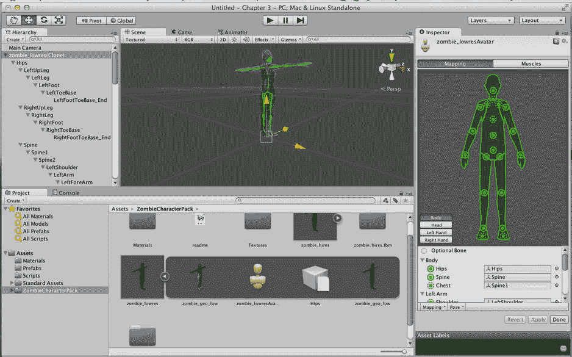

图 5-17。新创建的 Avatar 出现在编辑器中

## 导入动画

角色通常自带许多现成的动画，但添加其他动画资源也很简单。返回资源商店，搜索“creature zombie running”（图 5-18），然后像导入 Zombie Character Pack 一样下载并导入它。在 Project 面板中，选择 `Assets` 根文件夹，然后点击 `Create` ➤ `Folder`，将其命名为 `Animations`。将新导入的 `alpha@zombie_running` 动画剪辑移动到 `Animations` 文件夹中，以保持项目组织有序。

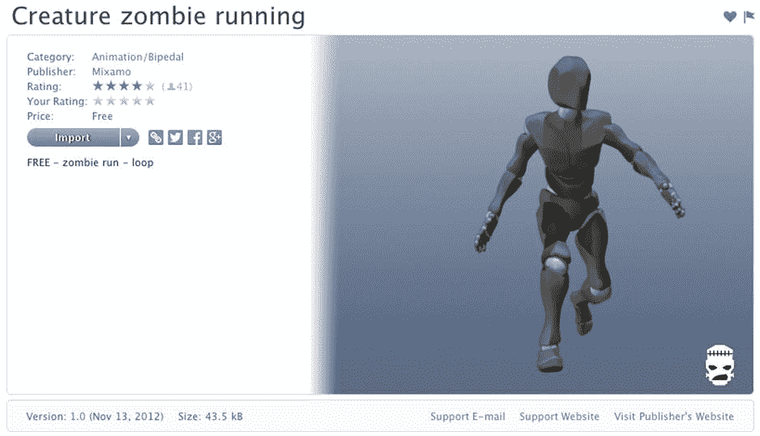

图 5-18。Unity 资源商店中的僵尸奔跑动画剪辑

选中 `Animations` 文件夹中的动画剪辑，以便其属性显示在 Inspector 中。在顶部，勾选 `Loop Time`（循环时间）复选框。如果不勾选，僵尸只会执行左右腿交替的一个步伐周期。循环播放动画意味着僵尸将持续奔跑。

# 创建动画控制器

现在你有了角色和动画，还需要一个控制器来播放动画。动画控制器是一种游戏对象组件，用于将动画剪辑的行为连接到游戏对象模型。

首先选择 `Assets` 文件夹，然后依次选择 Create ➤ Folder 并将其命名为 `Animator Controllers`，接着双击打开该文件夹。接下来选择 Create ➤ Animator Controller 并将其命名为 `zombieController01`。双击 `zombieController01` 在动画器视图中打开它（图 5-19）。

将鼠标光标置于动画器视图中，右键点击网格，在上下文菜单中选择 `Create State ➤ Empty`。

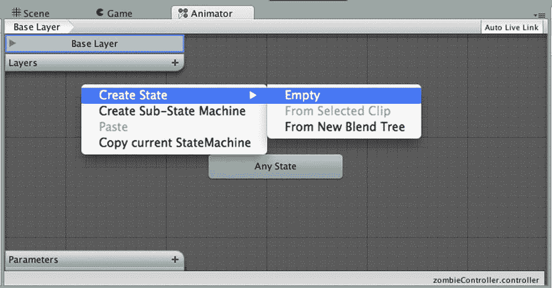

`图 5-19. 动画器窗口中的可视化编程工具`

动画器窗口中会出现一个名为 `New State` 的新方框。橙色表示默认状态。选中该方框，在检查器中将名称改为 `Zombie Run`。然后将 `Animations` 文件夹中的 `alpha@zombie_running` 剪辑拖拽到 `Motion` 字段中（图 5-20）。

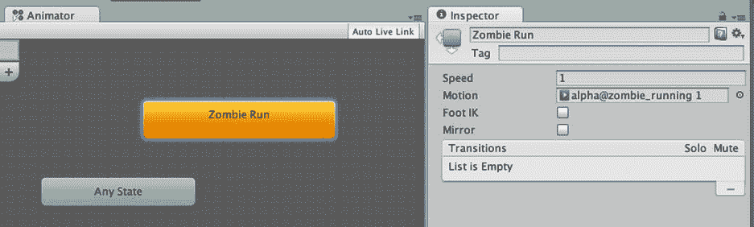

`图 5-20. Zombie Run 动画剪辑的默认动画状态显示为橙色`

> **注意：** 各种动画被称为状态。例如，当角色处于闲置状态时，它就处于“`Idle` 状态”。从一个状态移动到另一个状态称为过渡，用箭头表示。你在动画器窗口中为动画控制器设计的这些状态和过渡的集合，就构成了所谓的状态机。

以上就是这个简单动画控制器的全部内容，它将把 `alpha@zombie_running` 动画剪辑作为默认状态进行播放。

# 僵尸快跑

首先设置场景。在层次视图中，选中 `Cube` 游戏对象，然后在检查器中通过取消选中其名称旁边的复选框来停用它。现在将 `zombie_lowres` 模型从项目面板拖拽到层次视图中，以将其添加到场景。选中 `Main Camera` 查看预览效果。将摄像机重新定位到 `(0, 1, –3)`。僵尸角色出现在场景中，背对摄像机，因此请在层次视图中选中它，并在检查器中将其 `Rotation` 属性的 `y` 值改为 `180`，使其转身。重新选中 `Main Camera` 预览这个新的朝向。

现在看一下检查器中僵尸角色的 `Animator` 组件，你会注意到它的 `Controller` 属性是空的。将 `zombieController01` 从项目面板拖拽到 `Controller` 字段中（图 5-21）。保存场景。播放游戏，现在僵尸正在追赶你！

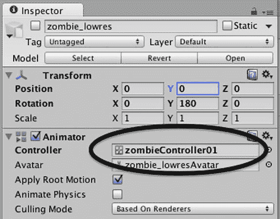

`图 5-21. 检查器中的 zombie_lowres 动画器组件和 zombieController01`

# 像僵尸一样奔跑

开发中的一个基本概念是 `DRY`，即 Don't Repeat Yourself（不要重复自己）。你已经在第 4 章中看到了这个概念的应用，当时你通过将一段重复的代码块提取出来，并将其制作成一个独立的函数来重构脚本。这个概念也是 `Mecanim` 强大功能和灵活性的基础，只不过这里不是不重复代码块，而是不必为不同的、但具有相似骨骼绑定的角色重复创建相同的动画。化身的使用使这成为可能。

化身是 `Mecanim` 能够理解并驱动动画的简化人体骨骼结构。化身的骨骼与角色模型中的对应骨骼相匹配，因此移动化身就会以与底层动画剪辑相同的动作来移动角色。一个简单的类比是，移动线控木偶的线会以特定方式移动木偶，无论木偶是什么角色。如果你将一个木偶换成另一个，第二个木偶也会以相同的方式对相同的线控动作做出反应（图 5-22）。使用 `Mecanim`，你可以类似地使用相同的动画剪辑来重新定位不同的角色。这极大地简化了 Unity 中的动画工作流程。

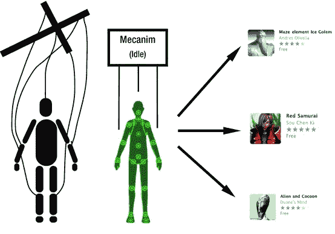
*图 5-22. 线控木偶与标准化身的对比*

现在你将看到 `Mecanim` 的真正效率。在资源商店中，找到 Maze 元素 Ice Golem（图 5-23）。下载并将其导入到你的项目中。一个名为 `player` 的文件夹将出现在你的资源文件夹中。深入打开该文件夹找到 golem 角色并选中它。

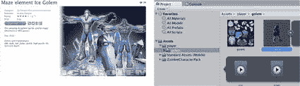
*图 5-23. 资源商店和项目面板中的 Golem 角色*

按照创建和配置化身的相同步骤处理这个 golem 角色。完成后，将带有新化身的 golem 角色拖拽到层次视图中。在场景视图中，移动 golem 直到它站在僵尸旁边。你会在检查器中看到 golem 的 `Animator` 组件的 `Controller` 字段是空的。将 `zombieController01` 拖拽到这里，然后点击播放。现在 golem 也像僵尸一样奔跑了（图 5-24）！

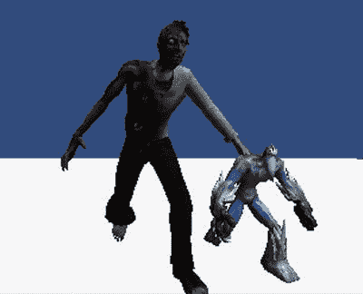
*图 5-24. 僵尸和 golem 角色一起奔跑*

# 更多动画

终于能看到角色动起来确实很有趣，而且你已经领略到将动画片段转移给其他角色是多么简单。我们将为僵尸角色添加更多动画，所以现在先把石像鬼角色停用吧。一个只循环播放单个动画片段的角色对游戏来说没什么用，那么去哪里为僵尸寻找更多动画呢？

你可以在资源商店中找到更多动画，它们可以是独立的动画片段或资源包，也可以包含在完整项目中，比如 Unity Technologies 制作的 Mecanim 演示项目。你现在已经熟悉了在资源商店中浏览的方法，所以我想介绍另一个动画来源，它能让你更进一步，提供一些编辑功能。

动画片段和角色模型一样，通常在导入 Unity 之前就已经准备好了。Mixamo 是我们这个示例中使用的僵尸角色的发布者。除了提供大量兼容 Mecanim 的角色和动画目录外，Mixamo 还提供了一些不错的免费工具，其中包括一个为你的角色应用动画的工具。

使用你的网络浏览器，前往 `www.mixamo.com`。要注册一个免费账户，只需提供你的电子邮件地址并创建密码即可。注册完成后，从顶部菜单选择“动画”（图 5-25）进入预制动画目录（图 5-26）。

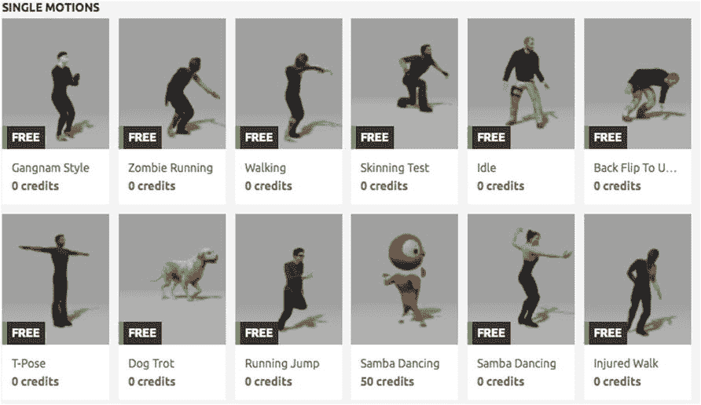
图 5-26。Mixamo 提供的动画示例

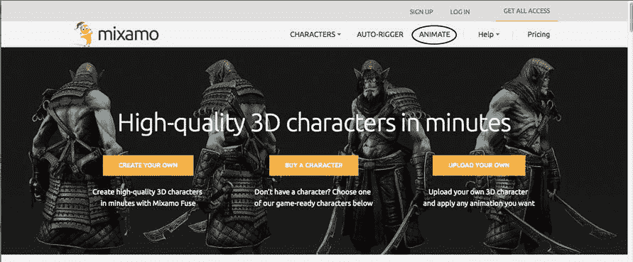
图 5-25。Mixamo 主页上的“动画”顶部菜单选项

很酷，对吧？谁不想让自己的角色跳江南 Style 呢？去吧，花些时间浏览一下这些动画。在为自己的游戏选购时，就像在 Unity 资源商店里一样，一定要看看资源包，因为它们通常性价比很高。

在右上角，选择橙色的“上传 3D 角色”按钮。选择“上传文件”。选择 `zombie_lowres.fbx` 角色进行上传。这个僵尸角色是 Mixamo 制作的免费角色，所以你很快就会看到“你的角色已成功映射！”的消息。选择“应用动画”，这会带你回到动画目录。

对于这个示例，选择“行走”，Mixamo 编辑器页面将加载行走动画（图 5-27）。

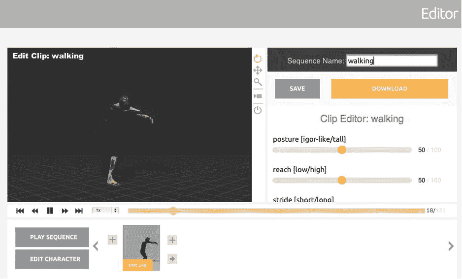
图 5-27。Mixamo 动画编辑器

将序列名称保留为 `walking`。在左下角，如果“编辑片段”未选中，请选中它。尝试使用滑块，看看如何自定义动画（图 5-28）。

完成实验后，使用“到达”滑块将手臂降低到与僵尸奔跑动画大致相同的角度。这为两个动画片段之间的平滑过渡做好了准备。我更喜欢脚步较慢、拖沓的僵尸，但你可以根据自己的喜好配置其他参数。当你调整到满意后，选择“保存”，然后“下载”。

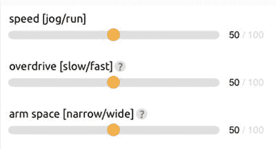
图 5-28。用于编辑动画片段的简单滑块

会出现一个结账弹出窗口，动画在你的购物车中，总价为 0 美元。选择“结账”，然后会出现一个“下载托盘”弹出窗口，其中包含你的动画角色。选中它，然后在靠近底部的位置，对于“下载格式”选择“FBX for Unity”，然后点击橙色的“下载”按钮（图 5-29）。

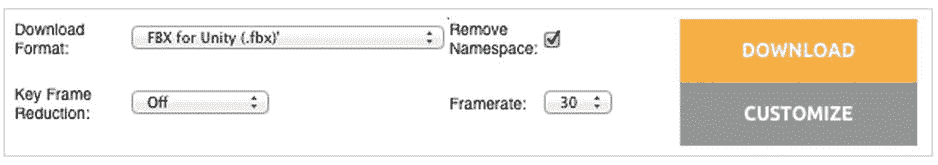
图 5-29。Mixamo 动画角色下载设置

你可以将下载的动画角色模型添加到你的 Unity 项目中，方法是将其拖放到“项目”面板中，或者通过 Unity 编辑器顶部菜单选择“资源” ➤ “导入新资源”。将你新创建的动画角色模型拖放到 `Assets ➤ Animations` 文件夹中。保存场景并保存你的项目。

你还需要为这个项目准备几个动画片段。首先，重复创建行走动画的过程，但将其命名为 `walkingWithMotion`。编辑完成后，向下滚动到滑块下方，将“原地”设置改为“关闭”（图 5-30）。保存并下载。

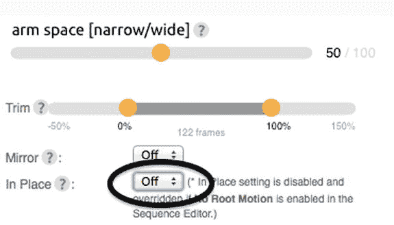
图 5-30。在 Mixamo 动画编辑器中，“原地”设置设为“关闭”

以同样的方式创建、保存并下载“空闲”动画。在这种情况下，没有“原地”设置选项，因为这个动画本身就是僵尸角色站立在一个地方。和之前一样，将这些动画下载到你项目的 `Assets ➤ Animations` 文件夹中。保存你的项目。

## 配置动画

现在，你的“动画”文件夹中应该已经有了僵尸角色的“空闲”、“行走”和 `walkingWithMotion` 动画。由于它们与 `zombie_lowres` 模型结合在一起，它们的标签显示为 `zombie_lowres@动画名称`。在您使用它们之前，每个都需要进行配置。在“动画”文件夹中选择 `zombie_lowres@walkingWithMotion`。

在检查器中，选择“骨骼”选项卡（图 5-31）。就像你对 `zombie_running` 动画所做的那样，将“动画类型”改为 `Humanoid`，并将“Avatar 定义”改为“从此模型创建”。

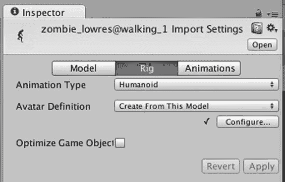
图 5-31。在检查器中配置动画骨骼设置

## 根运动

动画涉及角色头部、身体和四肢相对于自身坐标系的运动，而根运动则涉及角色相对于游戏世界坐标系的运动。例如，你会看到没有根运动的僵尸行走动画会让角色原地踏步，而有根运动的 `walkingWithMotion` 动画则让角色在游戏场景中向前移动。与动画运动一样，动画是否包含根运动，是在导入 Unity 之前创建角色和动画时确定的。

选择 `Animations` 选项卡。注意底部有一个预览区域，你可以在此播放动画。留意僵尸角色所站平面的网格，你会注意到僵尸正在原地行走。

在 Inspector 中向下滚动，直到看到可以勾选 `Loop Time` 的位置，其正下方是 `Loop Pose`。对于 `Root Transform Rotation`，勾选 `Bake Into Pose`，然后将 `Based Upon` 设置为 `Body Orientation`。接下来，对于 `Root Transform Position (Y)`，勾选 `Bake Into Pose`，并在其下方将 `Based Upon (at Start)` 设置为 `Original`。对于 `Root Transform Position (XZ)`，不要勾选 `Bake Into Pose`。最后，点击 `Apply`（图 5-32）。

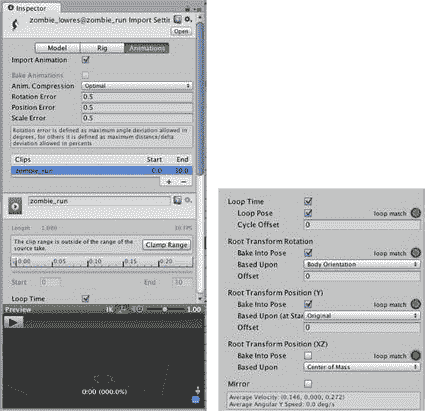
图 5-32. 在 Inspector 中配置动画设置

按设置分解这些选项，勾选 `Loop Pose` 意味着动画剪辑将重复或循环播放。如果未勾选，动画剪辑将只播放一次。

`Root Transform Rotation` 描述了动画剪辑期间动画旋转模型的程度。通过勾选 `Bake Into Pose`，你将原始旋转坐标“烘焙”到角色中，并防止它在动画剪辑期间旋转。这是你希望防止它在行走动画期间发生漂移的方法，因为你希望角色只沿直线向前移动。

在 `Mirror` 下方，你可以看到来自根运动的平均速度。除了你感兴趣的轴之外，其他轴上的分数速度是可能发生漂移的指标。你可以选择此动画剪辑是应基于模型的**身体方向**（`Body Orientation`），还是应基于该剪辑播放时角色拥有的**原始向前运动矢量**（`Original forward movement vector`），从角色的前一个运动矢量继续播放。

`Offset` 允许你进一步微调变换，以解决动画剪辑可能引入的任何差异。

`Root Transform Position (Y)` 的工作方式与旋转类似。在这种情况下，对于行走动画，你应该勾选 `Bake Into Pose` 以防止向上或向下漂移，但对于跳跃动画，则应保持不勾选，以允许跳跃时上下运动。

`Root Transform Position (XZ)` 处理沿 xz 平面的运动，这与“地面”相同。回想一下，在 Unity 中，y 轴表示游戏世界中的上下方向。通过保持不勾选 `Bake Into Pose`，角色在执行动画时将在场景中的 xz 平面上移动。`Idle`（待机）是常见动画剪辑的一个例子，在这种情况下你会想要勾选 `Bake Into Pose` 以防止意外的移动。

绿色圆圈指示动画循环的平滑程度，其依据是模型在剪辑的第一帧和最后一帧中的变换属性的相似度。当从一个循环的结束到下一个循环的开始的过渡差异增大时，警告指示器会变为黄色，然后变为红色。`Root Transform Position (XZ)` 的指示器是红色的，因为每次动画循环时，僵尸都会向前移动一步到新位置。

现在你的动画已经准备好进行测试，但为了更好地观察行走的根运动效果，为视角提供一些背景而不是纯色平面会更容易。为你的场景创建一个平面，并将其变换设置为 `(0, 0, 0)`，缩放设置为 `(30, 1, 30)`。在顶部菜单中选择 `Assets` ➤ `Import Package` ➤ `Terrain Assets`，然后点击 `Import`。在此包中找到 `Terrain Textures` 文件夹，并将 `Grass&Rock` 纹理拖到 Hierarchy 视图中的 Plane 上。该纹理应显示在 Scene 视图的平面上。在平面的 `Mesh Renderer` 组件中，将 x 和 y 的 `Tiling` 值设置为 5。

在 Project 面板的 `Animators` 文件夹中找到 `zombieController01`。双击它以在 Animator 窗口中打开。选择 `Zombie Run` 状态。在 Inspector 中将其重命名为 `Walk`，然后将 `walkWithMotion` 动画剪辑从 Project 面板的 `Animations` 文件夹拖到 Inspector 中的 `Motion` 字段。请注意，你需要的不是整个 `zombie_lowres@walkWithMotion` 文件，而只是动画剪辑。点击 `zombie_lowres@walkWithMotion` 图标上的箭头以展开它，并找到动画剪辑（图 5-33）。

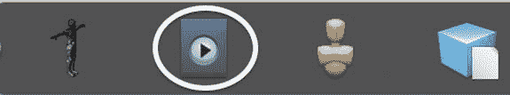

**图 5-33.** `zombie_lowres@walkWithMotion` 中的动画剪辑图标

点击播放，你会看到僵尸在游戏世界中穿过平面向前移动时执行行走动画。很酷！

在专业级游戏中，游戏对象的动画运动通常是基于动画的根运动、脚本运动、物理等等的组合。具体如何应用这些取决于游戏，但目标始终是提供最佳的游戏体验——最逼真或风格最合适、一致且响应迅速的动画。

# `OnAnimatorMove`

你可以使用脚本为没有应用 Root Motion 的动画剪辑提供运动，或者通过 `OnAnimatorMove` 在动画剪辑中进一步自定义 Root Motion。为了实现最精细的控制，你可能希望创建并使用 Unity Pro 中提供的动画曲线，但以下示例将让你初步体验如何直接通过脚本控制角色运动。

在此示例中，首先在 Project 面板中创建一个新的 Animator Controller，命名为 `ZombieMotionController`。将行走动画剪辑拖入 Animator 窗口，此时它应显示为橙色，作为新的默认状态。在 Hierarchy 视图中选中 `zombie_lowres` 游戏对象，然后在其 Animator 组件中更改 Controller：将 `ZombieMotionController` 拖入 Controller 字段，或使用 Controller 字段右侧的圆形选择按钮。播放以确认僵尸在原地行走。

在 Project 面板中，通过 Create ➤ Javascript 创建一个新脚本，命名为 `ZombieMotionScript`。双击在 MonoDevelop 中打开。删除空的 `Start()` 和 `Update()` 函数，然后添加以下代码：

```
public var WalkX:float = 0;
public var WalkZ:float = 0;

function OnAnimatorMove()
{
    var animator : Animator = GetComponent(Animator);
    if (animator)
    {
        var newPosition:Vector3 = transform.position;
        newPosition.x += WalkX * Time.deltaTime;
        newPosition.z += WalkZ * Time.deltaTime;
        transform.position = newPosition;
    }
}
```

代码解析如下：

1. `public var WalkX:float = 0;`
   `public var WalkZ:float = 0;`
   声明了用于僵尸变换位置 x 和 z 分量的公共浮点变量，以便你可以在 Game 视图中实时调整它们。

2. `function OnAnimatorMove()`
   如你在查看脚本参考后所了解的（咳咳，你确实看过了，对吧？），`OnAnimatorMove()` 函数在状态机之后的每一帧被调用。这发生在 `OnAnimatorIK()` 之前，其中 IK 代表“反向动力学”，是 Unity Pro 中提供的另一种动画方法。

3. `var animator : Animator = GetComponent(Animator);`
   `if (animator)`
   如果 `animator` 游戏对象上未附加 Animator 组件，则 `animator` 变量为 null，因此在下一行中，它被用于条件 `if` 语句。如果游戏对象有 animator，则执行后续代码块；如果没有，则跳过。

4. `var newPosition:Vector3 = transform.position;`
   在条件语句内，声明了 `newPosition` 的 Vector3 类型变量，然后将其赋值为 `animator` 游戏对象的当前变换位置。

5. `newPosition.x += WalkX * Time.deltaTime;`
   `newPosition.z += WalkZ * Time.deltaTime;`
   每一帧通过 `WalkX` 和 `WalkZ` 因子更新变换的 x 和 z 坐标，并使用熟悉的 `Time.deltaTime` 进行平滑处理。

6. `transform.position = newPosition;`
   最后，用新的 x 和 z 属性值更新 `animator` 游戏对象的变换位置。

保存脚本。在 Unity 编辑器中，将脚本从 Property 面板拖到 Hierarchy 视图中的 `zombie_lowres` 游戏对象上以附加它。当你这样做时，Inspector 中会发生两件事：`ZombieMotionScript` 作为组件出现；此外，当 Animator 组件检测到脚本中的 `OnAnimationMove()` 函数时，其 Apply Root Motion 属性更改为 Handled by Script（图 5-34）。保存场景和项目。

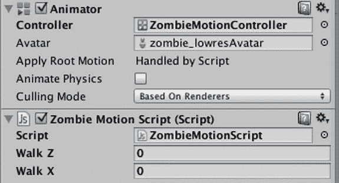

**图 5-34.** 新附加的 `ZombieMotionScript` 组件，以及 Animator 组件的 Apply Root Motion 属性更新为 Handled by Script

选中 `zombie_lowres` 游戏对象，播放以进行测试。僵尸仍然在原地行走，因为 `ZombieMotionController` 脚本中的 `WalkX` 和 `WalkZ` 初始值为 0。在 Play 模式下，尝试在 Inspector 中调整 `WalkX` 和 `WalkZ` 的值。微调它们，直到僵尸看起来在平面上行走且没有漂移。请记住在退出 Play 模式前记下最终值，因为你的更改不会保存在 Inspector 中。

# Transitions

到目前为止，你只处理了默认的动画状态。状态机可能相当复杂，可以包含角色可能需要的任意数量的动画状态。从一个动画状态移动到另一个动画状态称为过渡。

## 准备工作

对于最后一个动画控制器，你需要从 Asset Store（图 5-35）下载并导入 Unity 的 Mecanim Locomotion Starter Kit。这个包为你提供了现成的 Mecanim 骨架和控制器，但为了理解其工作原理，你将使用其中的一些动画从头构建一个控制器。

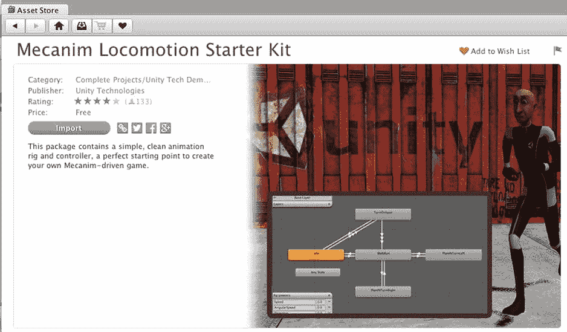

**图 5-35.** Unity Asset Store 中的 Mecanim Locomotion Starter Kit

导入此包的操作方式与你处理 Zombie Character Pack 时完全相同。在 Unity 编辑器顶部菜单中，选择 Window ➤ Asset Store 以打开 Unity Asset Store 的单独窗口。在搜索栏中，输入 Mecanim Locomotion Starter Kit，然后点击蓝色 Download 按钮。Importing Package 窗口将打开，其中包含所有需要导入的包内容。保持所有这些选项勾选，然后点击窗口右下角的 Import，`Locomotion Setup` 文件夹（包含 Mecanim Locomotion Starter Kit）将出现在 Project 面板中。

## 创建动画控制器

在 Project 面板中，选择 `Animators` 文件夹。创建一个新的 Animator Controller，命名为 `ZombieLocomotionController`，然后双击打开。

## 配置动画剪辑

要查找 Idle 动画剪辑，在 Project 面板的搜索栏中输入 Idle。选择 `DefaultAvatar@Idle_Neutral` 图标，并通过查看底部出现的面包屑导航（图 5-36）确认它是 `Setup/Locomotion/Animations/DefaultAvatar@Idle_Neutral.fbx`。

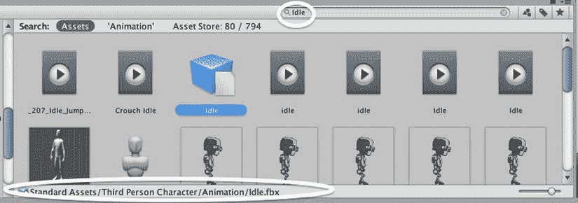

**图 5-36.** 在 Project 面板中选中的 `DefaultAvatar@Idle_Neutral` 图标

首先，配置动画：在 Project 面板中仍选中 Idle 图标时，在 Inspector 中选择 Rig。Animation Type 应为 Humanoid，然后将 Avatar Definition 更改为 Create From This Model，并点击 Apply（图 5-37）。Configure… 按钮旁边应出现一个对钩标记。Animation 设置可以保持原样。现在，该动画剪辑与你之前在本章中创建的僵尸模型动画 Avatar 兼容。

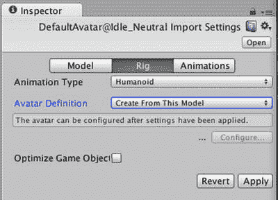

**图 5-37.** Inspector 中的 `Animation.fbx` Rig 设置

重复这些步骤，配置你将在此示例中使用的另外两个动画：`DefaultAvatar@WalkForward_NtrlFaceFwd.fbx` 和 `DefaultAvatar@WalkForwardTurnRight_NtrlWide.fbx`。对于第二个，选择 Animations ➤ `DefaultAvatar@WalkForwardTurnRight_NtrlWide`，以在 Inspector 中找到 WalkRightWide 和 WalkLeftWide 两个 Clip（图 5-38）。

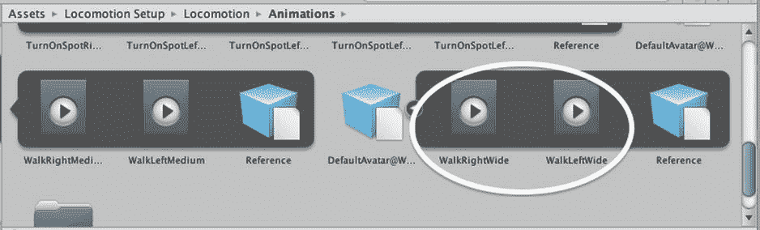

**图 5-38.** Project 面板中的 WalkRightWide 和 WalkLeftWide 动画剪辑

如果你选择 WalkLeftWide，然后在 Inspector 中向下滚动，你会看到 Mirror 框被勾选。此剪辑是 WalkRightWide 的镜像反射，这是一个巧妙的属性，可以让你无需另一组 `.fbx` 文件。如果你正在为游戏创建自己的动画剪辑，镜像属性可以节省大量时间和精力，用于从单个动画剪辑创建两个对称的动画。

# Animator 控制器配置

现在你已经配置好了所需的动画，回到 Project 面板中的 `DefaultAvatar@Idle_Neutral` 图标。点击箭头展开它以显示 Idle 动画剪辑。在 Project 面板中选中 Idle 动画剪辑后，你可以在 Inspector 底部通过播放来预览它。将动画剪辑图标从 Project 面板拖放到 Animator 窗口，然后松开。它现在应该是控制器的橙色默认状态。

采用相同的方式，找到并展开 `DefaultAvatar@WalkForward_NtrlFaceFwd` 动画以显示 Walk 动画剪辑。将其拖放到 Animator 窗口中。由于 Idle 已经是默认动画状态，Walk 状态将显示为灰色框。你可以通过右键点击并从出现的上下文菜单中选择 **设为默认（Set As Default）** 来将其更改为默认状态，但暂时保持原样。

现在你有了 Idle 状态和 Walk 状态。要在两者之间创建过渡，右键点击 Idle 状态并从出现的上下文菜单中选择 **创建过渡（Make Transition）**。现在，如果在窗口内移动鼠标光标，它会拖出一条从 Idle 状态延伸出的白色箭头。点击 Walk 状态以设置过渡。点击白色箭头，它应该会变成蓝色，同时在 Inspector 中显示其属性（图 5-39）。你可以通过过渡属性设置从一个动画状态切换到另一个的条件。`Atomic` 属性默认处于选中状态，这意味着动画剪辑不能被中断。保持其选中状态。

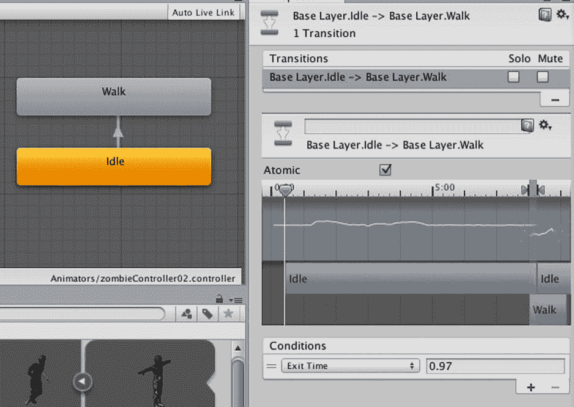

**图 5-39.** Inspector 中的过渡属性

**提示：** 你可以拖拽状态框以保持其有序排列，在 Animator 窗口中按住 `Alt` 键拖拽可以移动整个网格。

你有不同的条件可供选择来触发过渡。默认的 `Exit Time` 属性值为 0.92，这意味着当剪辑播放到 92% 时，过渡将被触发。在 Hierarchy 面板中，选择 `zombie_lowres` 游戏对象，然后在 Inspector 中，通过将控制器从 Project 面板拖拽到 Inspector 中的属性字段，或点击 `Controller` 属性右侧的圆形选择按钮并从弹出菜单中选择 `ZombieLocomotionController`，将 Animator Controller 更改为 `ZombieLocomotionController`。

进行游戏测试，你会看到僵尸从 Idle 状态开始，然后基于 `Exit Time` 条件自动过渡到 Walk 状态。你可以在 Inspector 中通过拖拽 Idle 和 Walk 剪辑之间图形重叠的蓝色起始值和结束值来实验平滑过渡效果。退出 Play 模式并保存场景。

你还可以创建参数，用于在脚本中根据用户输入或游戏中的任何其他条件来触发过渡。点击 **Animator** 窗口选项卡，在左下角通过点击 **Parameters** 的 **+** 符号并选择 **Float** 来创建一个浮点参数。将名称从 **New Float** 改为 `Speed`。在 Inspector 中选择过渡箭头，将 `Exit Time` 改为 `Speed`，并选择 **Greater**（大于）和 **0.1**。

你还需要实现从 Walk 回到 Idle 的过渡。采用相同的方式，右键点击 **Walk**，创建一个新过渡，并将其连接到 **Idle** 状态。选择该过渡，对于 **Conditions** 属性选择 `Speed`，这次选择 **Less**（小于）和 **0.1**。

如果现在进行游戏测试，僵尸会停留在 Idle 状态。你需要创建一个脚本，定义哪些用户输入满足触发状态间过渡的条件。在 Project 面板中，创建一个新的 JavaScript 脚本并将其命名为 `ZombieLocomotion`。将其拖放到 Hierarchy 视图中的 `zombie_lowres` 游戏对象上，以将其附加到僵尸角色上。`ZombieLocomotion` 脚本将作为新组件出现在 Inspector 中。双击 Project 面板中的 `ZombieLocomotion` 脚本图标，在 MonoDevelop 中打开它，然后按如下方式编辑代码：

```javascript
#pragma strict

private var animator : Animator;

function Start () {
    animator = GetComponent(Animator);
}

function Update () {
    animator.SetFloat("Speed", Input.GetAxis("Vertical"));
}
```

这段代码的分解说明如下：

1. `private var animator : Animator;`

声明一个 `Animator` 类型的引用变量。如果你像之前在 `ZombieMotion` 脚本的 `OnAnimatorMove()` 函数中那样，在 `Start()` 函数内一行完成此操作，那么 `animator` 变量的作用域将仅限于 `Start()` 函数。通过在此处声明，你可以使其在 `ZombieLocomotion` 类内的任何函数中可用。

2. `animator.SetFloat("Speed", Input.GetAxis("Vertical"));`

这里你根据用户输入设置之前创建的 `Speed` 参数。进行游戏测试，你会发现当按下上箭头键或 **W** 键时，僵尸会向前行走。

## 任意状态（Any State）

**任意状态**是 Unity 遵循 DRY 原则提供的一种特殊状态，在前面的“像僵尸一样奔跑”部分已有讨论。它作为一种快捷方式，允许你从控制器中的任何动画状态过渡到某个其他特定状态。一个常见的用法是死亡状态，假设你的角色无论处于哪个动画状态，都可能承受某种打击。设置此过渡的方式与设置其他任何过渡相同，区别在于你只需直接从 **Any State** 框到 **Death** 框设置一次，而无需从每个单独的动画状态分别设置。

反之则不成立。你不能从动画状态过渡到 **Any State**，因为它代表的不是一个唯一的动画状态，而是所有动画状态，因此 Unity 引擎将不知道具体过渡到哪个动画状态。它没有被配置用于过渡到随机动画状态。因此，如果你尝试创建指向它的过渡，箭头将无法连接。

# 用户输入与输入管理器

这个`Input.GetAxis`到底是怎么回事？Unity的强大特性之一，就是你可以构建一个游戏，然后将其部署到多种不同的平台上。这给处理用户输入带来了特殊的挑战，因为输入可能来自键盘、鼠标、摇杆、游戏手柄，或者移动设备的触控和加速度计输入。

无需在脚本中硬编码每一种可能性，Unity的输入管理器（Input Manager）可以帮你解决这个问题。通过输入管理器，你可以配置各种输入设备，然后通过脚本接口（就像这里使用的`Input.GetAxis`）来访问它们。

当你创建一个项目时，会得到表5-1所示的默认输入轴。

**表5-1.** 输入管理器默认设置

| 输入轴 | 输入 |
| --- | --- |
| 水平/垂直（Horizontal/Vertical） | WASD键和方向键 |
| Fire1, Fire2, Fire3 | Ctrl、Option/Alt、 |
| 鼠标X/鼠标Y（Mouse X/Mouse Y） | 鼠标移动增量 |
| 窗口晃动X/窗口晃动Y（Window Shake X/Window Shake Y） | 窗口移动 |

在Unity编辑器的顶部菜单中，选择**编辑** ➤ **项目设置** ➤ **输入**即可更改这些设置或添加新的虚拟轴。请记住，作为良好游戏体验的一部分，用户期望一定程度的标准化，即常见的输入会触发常见的操作。他们期望方向键和WASD键能控制移动。同时，输入管理器也允许最终用户配置键盘，以便他们能根据自己的个人偏好进行调整（图5-40）。

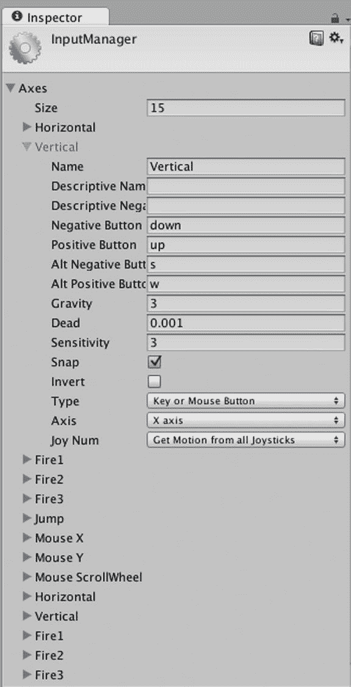

**图5-40.** 检视面板中显示的输入管理器提示

对于射击武器或拾取物体等动作事件，请使用`Input.GetButton`。对于移动，请使用`Input.GetAxis`。

对于键盘输入和摇杆输入，中立位置等于0，每个轴的值在-1到1之间。正方向按钮给出正值。要观察实际效果，请在`ZombieLocomotion`脚本的`Update()`函数中添加以下几行代码：

```
var inputValue : float = Input.GetAxis("Vertical");
Debug.Log(inputValue);
```

保存脚本。在Unity编辑器的项目面板中，选择控制台（Console）选项卡，以便观察`Debug.Log`的输出。进入播放模式。注意`inputValue`为0。按住上箭头或W键，观察它变为1。由于你在动画控制器中将过渡条件设置为“大于0.1”，因此一旦`inputValue`超过0.1，就会触发从空闲（Idle）状态到行走（Walk）状态的过渡。松开按键，你会看到`inputValue`降至0，当它低于0.1时，就会触发回到空闲状态的过渡。

## 混合树

过渡用于从一个动画状态切换到另一个动画状态，而混合树则将多个动画剪辑结合在一起，通过混合来产生更平滑的动画动作。

混合树通常与行走和奔跑动画一起使用。为了获得最佳效果，需要混合的剪辑在标准化时间（normalized time）上的动作必须相似且发生在相同的节点上。“标准化时间”意味着剪辑长度可以不同，其中第一帧的标准化值为0.0，最后一帧的标准化值为0.99。只要在每个剪辑中，左脚都在相同的标准化时间（例如0.2）着地，右脚都在相同的标准化时间（例如0.7）着地，那么这些剪辑就能很好地混合。

在下图中，行走动画与奔跑动画进行了比较。你知道，手臂和腿交替摆动的一般动作是相似的，并且在现实时间中，奔跑循环比行走循环耗时更短是有道理的，因为奔跑比行走快。标准化时间解释了速度差异，并着眼于循环中相同相对点（以百分比表示）的位置。请注意左下角现实时间的差异和右侧标准化时间（以百分比表示）的差异（图5-41）。

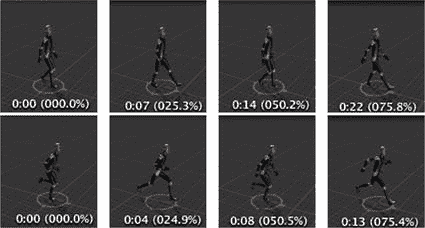

**图5-41.** 在标准化节点上行走动画（上）和奔跑动画（下）的比较

你将通过创建一个混合树来为僵尸角色增加更多移动方式，该混合树包含向前行走、向前行走同时右转以及向前行走同时左转。在项目窗口中，选择`ZombieLocomotion`控制器，并在动画器窗口中打开它。按照之前创建速度参数的方式，创建一个名为`Direction`的新浮点参数。

选择“行走”状态，然后右键单击并选择**在状态中创建新混合树**。注意检视面板中的“运动”属性已从“行走”更改为“混合树”。现在双击“行走”状态，打开带有根混合树节点的混合树图。注意节点上出现了一个带有滑块的速度参数。首先，选择混合树节点，并将检视面板中的“参数”从“速度”更改为“方向”，然后点击最小值0并将其改为-1（图5-42）。根据定义，当使用输入管理器时，一个轴的值范围是-1到1。

其下方将是一个空的“运动”列表。点击**+**并添加“运动字段”三次，以添加三个运动字段。从项目面板的“运动动画”文件夹中，将`WalkLeftWide`、`Walk`和`WalkRightWide`拖放到这些字段中。

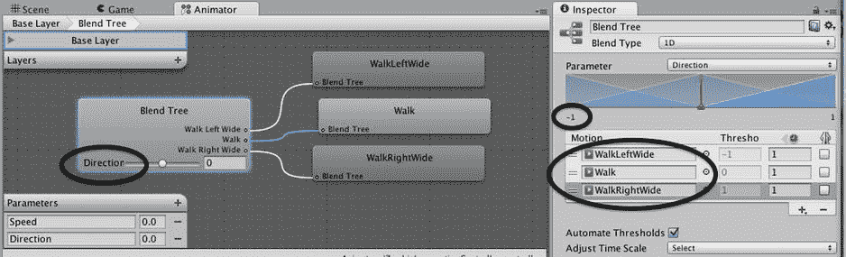

**图5-42.** 动画器窗口和检视面板中的行走混合树

蓝色金字塔代表每个运动，红色标记表示图中该特定点的参数值，而该点金字塔的高度显示了子运动在混合中的相对影响或权重。如果你将混合树根节点中“方向”参数的滑块移动到0，检视面板中的图表会显示“行走”运动的权重最大，而“行走右转”和“行走左转”的权重最小。当“方向”参数值为-1时，“行走左转”的权重最大；当“方向”参数值为1时，“行走右转”的权重最大。

在MonoDevelop中，将以下几行代码添加到`ZombieLocomotion`脚本的`Update()`函数中：

```
animator.SetFloat("Direction", Input.GetAxis("Horizontal"));
var directionInputValue : float = Input.GetAxis("Horizontal");
Debug.Log(directionInputValue);
```

保存脚本。在编辑器中保存场景。在项目面板中，选择控制台选项卡，以便观察速度和方向参数如何响应你的输入而改变。请注意，你必须按下W键或上箭头键，僵尸角色才能响应左或右箭头键进行转向。这正是你设置动画控制器的方式：行走右转和行走左转剪辑是行走混合树的一部分，因此僵尸角色必须处于“行走”状态才能转向。

# 不要重复造轮子

你导入的 Mecanim 移动入门工具包资源是一套开箱即用的基础动画骨架和控制器。虽然这只是 Mecanim 功能的冰山一角，但既然你已经扎实理解了动画片段、动画控制器和脚本如何协同工作，现在完全可以将这类现成资源加以定制，融入你的游戏项目，而无需从零开始。接下来让我们深入审视这套移动系统，检验你的学习成果。

你应该能识别出图 5-43 所描绘的移动动画状态机的各个组成部分。

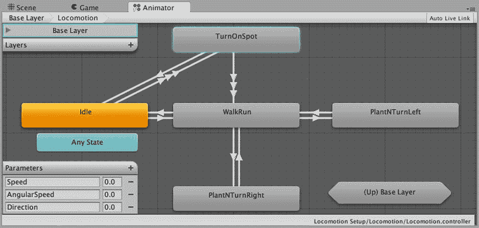

图 5-43. Unity Mecanim 移动入门工具包中的移动动画控制器

双击任意动画状态即可查看混合树（图 5-44）。虽然混合的动画片段更多，但混合树的基本构成要素是相同的。

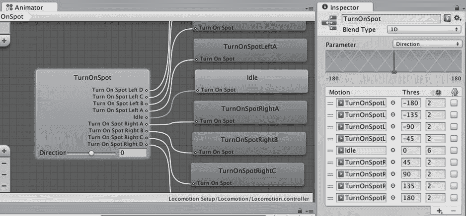

图 5-44. Unity Mecanim 移动入门工具包中的原地转身混合树

在项目面板中，依次展开 `Locomotion Setup ➤ Locomotion ➤ Scripts` 找到 `Locomotion` 脚本。该脚本恰好是用 C# 编写的，因此语法略有不同，但通过对比这里的 UnityScript 版本，你也能轻松解读：

```
#pragma strict

private var m_Animator : Animator = null;

private var m_SpeedId : int = 0;

private var m_AgularSpeedId : int = 0;

private var m_DirectionId : int = 0;

public var m_SpeedDampTime : float = 0.1f;

public var m_AnguarSpeedDampTime : float = 0.25f;

public var m_DirectionResponseTime : float = 0.2f;

function Locomotion(animator : Animator)

{

m_Animator = animator;

m_SpeedId = Animator.StringToHash("Speed");

m_AgularSpeedId = Animator.StringToHash("AngularSpeed");

m_DirectionId = Animator.StringToHash("Direction");

}

function Do(speed : float, direction : float)

{

var state : AnimatorStateInfo = m_Animator.GetCurrentAnimatorStateInfo(0);

var inTransition : boolean = m_Animator.IsInTransition(0);

var inIdle : boolean = state.IsName("Locomotion.Idle");

var inTurn : boolean = state.IsName("Locomotion.TurnOnSpot") || state.IsName("Locomotion.PlantNTurnLeft") || state.IsName("Locomotion.PlantNTurnRight");

var inWalkRun : boolean = state.IsName("Locomotion.WalkRun");

var speedDampTime : float = inIdle ? 0 : m_SpeedDampTime;

var angularSpeedDampTime : float = inWalkRun || inTransition ? m_AnguarSpeedDampTime : 0;

var directionDampTime : float = inTurn || inTransition ? 1000000 : 0;

var angularSpeed : float = direction / m_DirectionResponseTime;

m_Animator.SetFloat(m_SpeedId, speed, speedDampTime, Time.deltaTime);

m_Animator.SetFloat(m_AgularSpeedId, angularSpeed, angularSpeedDampTime, Time.deltaTime);

m_Animator.SetFloat(m_DirectionId, direction, directionDampTime, Time.deltaTime);

}
```

这段代码的解析如下：

`private var m_Animator : Animator = null;` (1)

声明一个值为 `null` 的 `Animator` 类型引用变量。

`private var m_SpeedId : int = 0;` (2)

`private var m_AgularSpeedId : int = 0;`

`private var m_DirectionId : int = 0;`

声明用于参数 ID 的 `int` 类型变量，作为哈希标识符使用。此处不展开讨论哈希标识符的细节，但它是一种使用整数而非字符串引用参数的方式。使用哈希标识符效率更高，因此有助于提升性能。

`public var m_SpeedDampTime : float = 0.1f;` (3)

`public var m_AnguarSpeedDampTime : float = 0.25f;`

`public var m_DirectionResponseTime : float = 0.2f;`

声明 `float` 类型变量并设置默认值。这些是各种动画过渡的平滑系数。

`function Locomotion(animator : Animator)` (4)

`{`

`m_Animator = animator;`

`m_SpeedId = Animator.StringToHash("Speed");`

`m_AgularSpeedId = Animator.StringToHash("AngularSpeed");`

`m_DirectionId = Animator.StringToHash("Direction");`

`}`

`Locomotion()`函数接受一个`Animator`参数，并以此设置之前声明的`animator`和`parameter`ID 变量的值。

`(5)   function Do(speed : float, direction : float)`

`Do()`函数接受两个浮点参数`speed`和`direction`。

`(6)          var state : AnimatorStateInfo = m_Animator.GetCurrentAnimatorStateInfo(0);`

声明一个`AnimatorStateInfo`引用变量`state`，并将其设置为`Animator`的状态。通过此变量，您可以获取当前动画状态的更详细信息，例如动画状态的长度、是否循环等。

请记住

您可以使用`A978-1-4302-6587-0_5_Figc_HTML.jpg` + `'`打开脚本参考文档，以获取更多详细信息，例如`AnimatorStateInfo`可用的完整变量和函数列表。

`(7)          var inTransition : boolean = m_Animator.IsInTransition(0);`

声明布尔变量`inTransition`。如果当前`Animator`处于动画状态之间的过渡中，则此变量将被设置为`true`，否则为`false`。

`(8)          var inIdle : boolean = state.IsName("Locomotion.Idle");`

声明布尔变量`inIdle`，如果当前动画状态是`Locomotion`动画器的`Idle`状态，则将其设置为`true`。

`(9)          var inTurn : boolean = state.IsName("Locomotion.TurnOnSpot") || state.IsName("Locomotion.PlantNTurnLeft") || state.IsName("Locomotion.PlantNTurnRight");`

## 变量声明与条件运算符

声明布尔变量`inTurn`，如果当前动画状态是转弯动画之一，则将其设置为`true`。请注意，`||`是逻辑或运算符，因此这一行将`inTurn`声明为布尔值，如果当前动画状态的名称是`Locomotion.TurnOnSpot`或`Locomotion.PlantNTurnLeft`或`Locomotion.PlantNTurnRight`，则将其设置为`true`。

```csharp
(10)         var inTurn : boolean = state.IsName("Locomotion.TurnOnSpot") || state.IsName("Locomotion.PlantNTurnLeft") || state.IsName("Locomotion.PlantNTurnRight");
```

声明布尔变量`inWalkRun`，如果当前动画状态是`Locomotion`动画器的`WalkRun`状态，则将其设置为`true`。

```csharp
(11)         var inWalkRun : boolean = state.IsName("Locomotion.WalkRun");
```

这些语句用于根据动画器的状态（无论是动画状态还是过渡状态）设置相应的阻尼因子。这里的语法是一种非常简化的条件形式，可读性不如您之前看到的那么高——请记住，代码越少，效率越高，性能越好。

问号`?`及其后的冒号被称为条件运算符。要评估的条件放在问号之前。如果条件评估为`true`，则第一个表达式（问号之后、冒号之前）的结果即为整个操作的结果。如果为`false`，则第二个表达式（冒号之后）的结果为操作的结果。

例如，在这段代码的第一行中，新声明的浮点变量`speedDampTime`在`inIdle`为`true`时被设置为 0。如果角色处于 Idle 状态，则没有速度。如果`inIdle`为`false`，则角色正在移动，因此`speedDampTime`被设置为`m_SpeedDampTime`的当前值。

在第二行中，新声明的浮点变量`angularSpeedDampTime`将在动画器处于 WalkRun 状态或过渡状态时被设置为`m_AngularSpeedDampTime`的当前值；否则评估为`false`并被设置为 0。

类似地，在第三行中，新声明的浮点变量`directionDampTime`将在动画器处于 Turn 状态或过渡状态时被设置为 1000000；否则评估为`false`并被设置为 0。

```csharp
(12)         var speedDampTime : float = inIdle ? 0 : m_SpeedDampTime;
            var angularSpeedDampTime : float = inWalkRun || inTransition ? m_AngularSpeedDampTime : 0;
            var directionDampTime : float = inTurn || inTransition ? 1000000 : 0;
```

## 计算与参数设置

声明`angularSpeed`变量，并将其设置为计算`direction / m_DirectionResponseTime`的结果。

```csharp
(13)         var angularSpeed : float = direction / m_DirectionResponseTime;
```

最后，一旦您确定了动画器的状态并确定了适当的阻尼因子，就可以设置动画器的参数。如您在脚本参考文档中所见，`Animator.SetFloat`接受以下参数：参数名称、参数的新值、参数达到该值所允许的时间（平滑因子）以及当前帧的`deltaTime`。

```csharp
(14)         m_Animator.SetFloat(m_SpeedId, speed, speedDampTime, Time.deltaTime);
            m_Animator.SetFloat(m_AngularSpeedId, angularSpeed, angularSpeedDampTime, Time.deltaTime);
            m_Animator.SetFloat(m_DirectionId, direction, directionDampTime, Time.deltaTime);
```

如果您想更深入地研究动画，Unity 还提供了许多其他示例，包含更多动画、控制器和脚本，以及 Asset Store 上免费提供的包含示例场景的完整项目。这些是动画常见用途和最佳实践的优秀工作示例。请尝试这些示例，并且不要羞于在 Unity 论坛上搜索问题的答案。

## 总结

呼——这一章真是相当紧张！您从使用脚本移动基本游戏对象开始，这些脚本改变了`transform.position`和`transform.rotation`属性，然后添加了用户交互来驱动运动。您还学习了使用`Lerp()`函数来平滑这些运动过渡。

接下来，您回顾了 Unity 的 Mecanim 动画系统，并学习了使用动画控制器驱动的动画剪辑来为角色模型添加动画。接着您学习了如何使用 Mecanim 和相应的脚本在不同的动画状态之间进行过渡。在此过程中，您发现并利用了 Unity 在 Asset Store 中提供的便捷现成动画资源。

Unity 的 Mecanim 是一个出色的工具，它使学习和应用动画比以往任何时候都更容易。尽管如此，这绝非易事——为 3D 模型制作动画本身就是一个职业领域。您绝对值得为出色的工作而受到赞扬！
