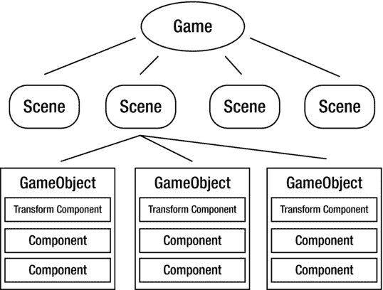
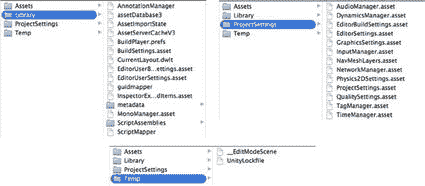
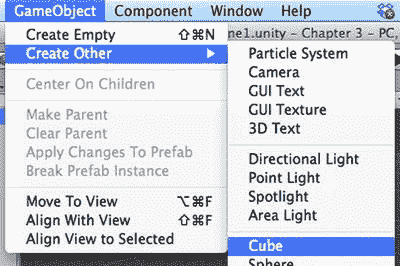
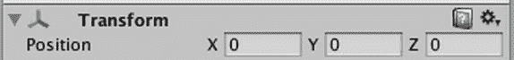

# 3. 制作一个简单场景

到目前为止，你已经设置好了游戏开发环境，并且对编程基础、脚本工具 MonoDevelop 以及 Unity 脚本参考有了初步了解。本章的重点是你的主要游戏开发工具——Unity，以及如何创建和管理构成基础游戏场景的基本部分。

一个游戏由多个场景组成，一个场景由多个游戏对象组成，一个游戏对象由多个组件组成，而组件具有由其内部函数控制的属性，如图[3-1]所示。在本章中，你将通过 Unity 编辑器界面动手实践如何将这些元素组合成一个场景，同时还会介绍 Unity 为你提供的便利的`Standard Assets`资源包。

**图 3-1.** Unity 中游戏的组成元素

## 新建项目，新建场景

是时候动手了。和[第 2 章]一样，使用 Unity 编辑器顶部菜单选择`File ➤ New Project`来创建一个新项目。此时将打开`Project Wizard`窗口。命名你的项目，确保选中`Create new Project`选项卡，保持默认设置（3D），然后创建你的新项目。和之前一样，你的新项目及其空场景将会出现在 Unity 编辑器中。通过这个快速而简单的过程，Unity 为你搭建了一个可立即运行的骨架游戏。

如果你好奇，可以在 Finder 或资源管理器中查看游戏所需基本文件的内容（图[3-2]）。资源是你创建或导入到项目中的项目，例如模型、动画、脚本和音频片段；这些资源会被自动放入`Assets`文件夹。Unity 接受多种文件类型，然后在内部将其转换为兼容版本。同时，Unity 会生成称为元数据的额外数据，放在`Library`文件夹中，这些数据除其他功能外，还有助于 Unity 在你在游戏中使用这些资源时知道在哪里找到它们以及它们之间的关联方式。Unity 以特定方式自动组织这些文件夹和文件，因此如果你移动这些文件夹或文件，Unity 编辑器将无法找到它们。

**图 3-2.** Unity 自动创建的新项目文件

**注意**

始终使用`Project`视图来组织`Assets`文件夹中的资源。

回到 Unity 编辑器，你要做的第一件事是命名并保存你的场景。Unity 处理保存的方式与文字处理器等其他程序略有不同。当你在处理游戏场景时，使用`Save Scene`来保存对其所做的更改。尽管根据名称你可能认为`Save Project`会保存项目中的所有内容，包括你正在处理的场景，但实际上它保存的是项目中除当前场景之外的所有内容，例如资源或整体项目设置。与任何计算机操作一样，养成经常保存工作的好习惯是明智的。

从视觉上看，场景是 Unity 编辑器`Scene`视图中显示的二维或三维空间，它以游戏对象的形式包含游戏内容。虽然一个场景可以构成整个游戏，但通常游戏的不同关卡和菜单会使用各自独立的场景。

场景的维度空间使用笛卡尔坐标系定义。要查看这一点，在 Unity 编辑器顶部菜单中选择`GameObject ➤ Create Other ➤ Cube`（图[3-3]）。

**图 3-3.** Unity 顶部菜单 `GameObject ➤ Create Other ➤ Cube`

新的游戏对象会作为`Cube`出现在`Hierarchy`视图中，其线框（gizmo）会出现在`Scene`视图中，而其组件则出现在`Inspector`视图中。在`Inspector`视图中，你会在`Transform`组件中看到游戏对象的位置用其坐标`(x, y, z)`来描述。默认情况下，Unity 将新游戏对象放置在原点`(0, 0, 0)`，即世界零点（图[3-4]）。

**图 3-4.** 在`Inspector`面板中显示的 Cube 游戏对象位置