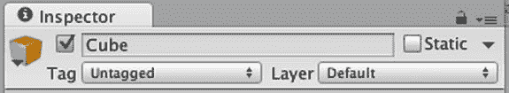
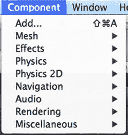
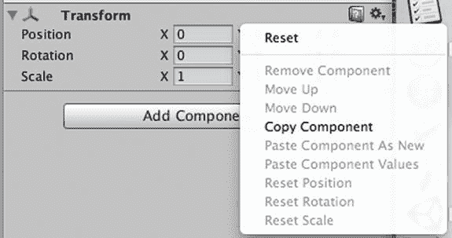
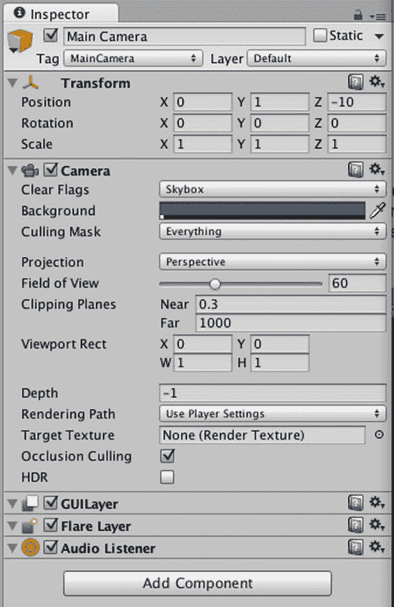
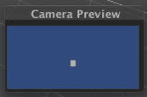
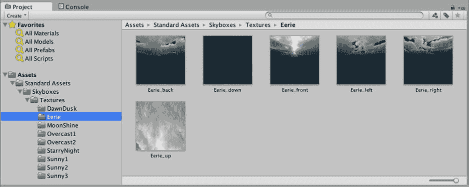
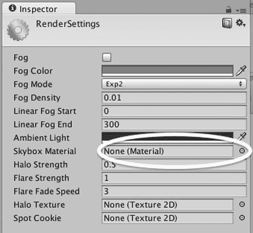
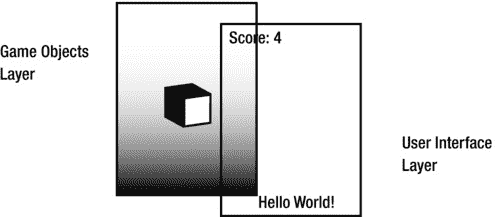
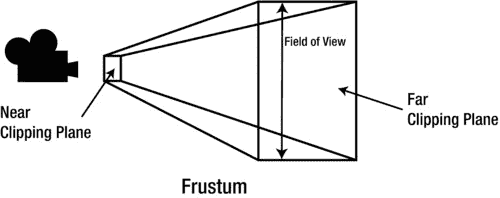
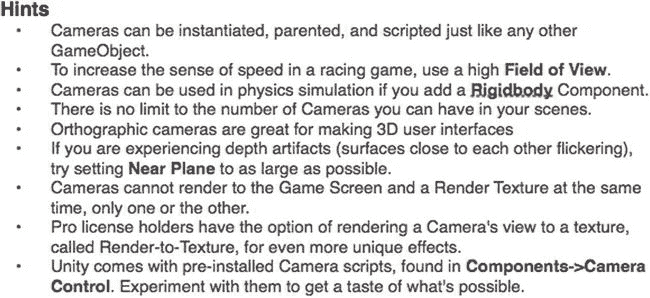

# 游戏对象

虽然游戏对象最适合被视为组件的容器，但为了方便，Unity 提供了像立方体这样的基本游戏对象形状，它们预先配备了一些基础组件，你可以在检视面板中看到它们（图 3-5）。

图 3-5. 检视面板中显示的立方体游戏对象头部

从检视面板的头部开始，如图 3-5 所示，第一个复选框表示该游戏对象在场景中处于激活状态。如果你取消选中它，你会注意到立方体从场景视图中消失，但不会从层级视图中消失。它并未从你的项目中删除；取消选中它允许你在处理其他内容时将其移出视野。请保持此复选框为选中状态。

接下来，游戏对象的默认名称是 `Cube`。如果你在检视面板中更改名称，你会看到层级视图中的名称也随之改变，反之亦然。

标签用于标识游戏对象组，例如`玩家`或`敌人`。这使你能够编写脚本，轻松地找到并仅影响你感兴趣的游戏对象组。

`Layers`（图层）是另一种为其他目的对对象进行分组的方式，例如仅针对场景中特定对象组的光线投射、光照和渲染。

对于场景中不会移动的环境对象，应勾选 `Static`（静态）复选框。使用 `Layers` 和 `Static` 复选框有助于 Unity 减少渲染游戏时所需的总体计算量，从而使你的游戏运行更加流畅。

检视面板中的其余内容，是组成立方体游戏对象的组件列表。

## 组件

Unity 游戏引擎的真正强大之处在于其组件。组件控制着游戏对象的外观、行为和交互。Unity 为你提供了大量现成的组件，用于构建你的游戏对象。请查看“组件”顶级菜单及其下拉菜单中的内容（图 3-6）。

图 3-6. Unity 组件顶级菜单

你可以通过此菜单向游戏对象添加组件，或者像在第 2 章中添加脚本那样，使用检视面板中的 `Add Component`（添加组件）按钮。

最重要的是 `Transform`（变换）组件，这是每个游戏对象都必须拥有的一个组件。`Transform` 的位置、旋转和缩放属性定义了游戏对象在场景中的位置、相对于场景的方向和大小。即使是空游戏对象也必须拥有一个 `Transform` 组件。

检视面板不仅仅显示附加到游戏对象上的组件列表；它也是配置组件属性的界面。你可以输入新值来更改 `Transform` 三个属性的任何默认设置。或者，你可以在场景视图中通过单击并拖动游戏对象控件的操作手柄来直观地操作游戏对象，并在检视面板中看到这些变化。尽管试试看。记住，你可以使用 `W`、`E` 和 `R` 键快速在 `Transform` 的属性之间切换。

在右上角，带问号的小蓝书是 Unity 组件参考文档的链接。齿轮图标为你提供了一种快速将组件重置为默认值的方法，以及其他编辑功能（图 3-7）。当你测试完立方体的变换控件后，请重置 `Transform` 属性。

图 3-7. 组件齿轮图标下拉菜单

Unity 通过提供游戏开发者最常用的现成组件，加速了游戏开发过程。脚本也是组件——它们同样影响游戏对象的外观、行为或交互。脚本本质上是你为游戏的独特需求创建的自定义组件。

## 主摄像机

新场景并非完全为空创建；它预先填充了一个游戏对象，即主摄像机游戏对象。与任何游戏对象一样，你可以移动它，对其应用脚本，并执行通常适用于游戏对象的任何其他操作。主摄像机是玩家观察场景的视口。如果看不到游戏，那还算不上游戏，因此新场景中始终包含它是合理的。在场景视图或层级视图中选择主摄像机，即可在检视面板中显示其内容（图 3-8）。

图 3-8. 检视面板中的主摄像机组件

### Transform（变换）

和往常一样，强制性的 `Transform` 组件排在首位。

> **提示：** 养成一个良好的习惯，即以一致的顺序列出组件，使其更容易找到。

虽然你创建的任何新游戏对象都会自动放置在原点位置，但主摄像机的 `Transform` 放置位置使得这些新对象能够出现在其视野中，这在场景视图右下角的摄像机预览中会友好地显示出来（图 3-9）。进入“播放”模式，你会发现游戏视图被准确呈现，然后退出“播放”模式。

图 3-9. 显示立方体游戏对象的摄像机预览

### Camera（摄像机）

主摄像机是一个包含摄像机组件的游戏对象。为简单起见，通常直接称之为“摄像机”。实际的摄像机组件有许多属性，下面简要介绍一下。

#### 清除标志

`清除标志`用于设置背景。背景是指绘制完所有游戏元素后剩余的部分。默认值为`天空盒`，但该项目中尚未设置天空盒资源。现在我们来处理这个问题。

在 Unity 顶部菜单中选择`资源` → `导入包` → `天空盒`。导入窗口将选中标准资源中的所有天空盒选项。保留选中状态，点击`导入`，你会看到它们出现在项目视图中。你可能只会看到一个`标准资源`文件夹。展开`标准资源/天空盒/纹理`文件夹，直到看到天空盒纹理列表（图 3-10）。花点时间浏览它们，并决定要将哪个应用于场景。

*图 3-10. 项目视图中显示的天空盒*

再次在 Unity 顶部菜单中选择`编辑` → `渲染设置`。检查器现在显示应用于该场景的渲染属性。每个场景的渲染属性设置都是该场景独有的。你可以通过单击检查器中`天空盒材质`属性右侧的小目标图标，在弹出的天空盒材质窗口中选择设置你选定的天空盒材质，或者从属性视图的天空盒文件夹中拖动材质，直接将其放入检查器的`天空盒材质`属性中（图 3-11）。当材质拖动到正确位置时，属性字段会变为蓝色。

*图 3-11. 检查器中显示的渲染设置*

在场景视图中旋转查看新的天空盒背景，注意它也会出现在摄像机预览中。屏幕中未被游戏元素占据的部分现在将由天空盒填充。

你可以在一个场景中拥有多个摄像机。在检查器面板中，`清除标志`的`仅深度`下拉设置用于这种情况，不同的摄像机可用于平视显示器（HUD）或小地图。每个不同摄像机的视图按玩家所见的方式层层叠放。附加摄像机的`清除标志`设置为`仅深度`，而主摄像机的`清除标志`设置通常保持为`天空盒`，并且具有最低深度设置，使其成为场景的最终背景。

`不清除`下拉设置意味着在绘制下一帧之前不清除上一帧，从而产生涂抹效果。这种情况不常用。

#### 背景

当选择`纯色`作为`清除标志`属性时，你可以使用`背景`属性来选择一种颜色，用于指示绘制游戏元素后剩余的屏幕区域。

#### 剔除遮罩

`剔除遮罩`指定场景中的哪些图层将由摄像机渲染。图层用于对对象进行分组。你可能只希望一个摄像机渲染某个特定图层的对象，而其他图层由另一个摄像机渲染。例如，Unity 建议将用户界面（UI）放在单独的图层中作为良好实践（图 3-12）。

*图 3-12. 将游戏对象图层和用户界面图层分开*

#### 投影

`投影`属性在摄像机的`透视`和`正交`视图之间切换。摄像机将渲染一个称为视锥体的特殊形状内的所有内容（见图 3-13）。

*图 3-13. 显示近裁剪面和远裁剪面的视锥体*

在`透视`模式下，当近裁剪面小于远裁剪面时，渲染的场景会给人一种透视缩小或前景缩短的效果，即物体甚至物体的部分距离越远显得越小。这是 3D 游戏中更常用的投影方式。在`正交`模式下，近裁剪面和远裁剪面大小相同，导致摄像机以平行方式观察物体。这种模式更常用于 2D 游戏或游戏的 2D 图层（如 UI）。在 Unity 编辑器中，当选中主摄像机时，你可以在场景视图中看到视锥体的轮廓。

#### 视野

摄像机的垂直视角，以本地 y 轴为基准，以度为单位测量。

#### 裁剪面

`裁剪面`垂直于摄像机，界定了金字塔状视锥体的顶部和底部。只有位于裁剪面之间且处于视锥体体积内的对象才会被渲染。

#### 视口矩形

最终，摄像机观察到的游戏视图被渲染到二维屏幕上。`视口矩形`是一个归一化的坐标尺度，将屏幕左下角定义为`(0, 0)`，右上角定义为`(1, 1)`。归一化意味着无论实际屏幕尺寸如何（例如在显示器或手持设备上），`(0, 0)`始终是屏幕左下角，`(1, 1)`是右上角。它用于指定摄像机视图在屏幕上要绘制的相对位置。

#### 深度
如之前在`清除标志`中讨论的那样，当使用多个摄像机时，`深度`用于指定每个摄像机的图层级别，数值最低的位于底层，因此其视图先被渲染。

### 组件参考
其余摄像机组件属性的使用远超本书范围。若需这些属性的详细描述，请点击蓝色书籍/问号图标，在网页浏览器中打开摄像机的组件参考。

#### 提示
你应该始终查阅文档以熟悉新组件。

说真的，花点时间查阅文档。你会发现，与脚本参考中有用的示例代码片段类似，Unity 提供了超级便捷的使用组件实用提示（图 3-14）。

*图 3-14. Unity 组件参考中提供的摄像机提示*

### GUI 图层
附加到主摄像机的`GUI 图层`允许渲染`GUIText`和`GUITextures`，这些是常作为 UI 部分的 2D 对象。复选框用于启用或禁用`GUI 图层`。

### 光晕图层
镜头光晕是真实摄像机中玻璃透镜产生的光学效果。此效果通过`光晕图层`组件模拟，将在本章后面演示。

## 音频监听器
声音对用户体验也很重要。Unity 提供了 2D 和 3D 声音之间的选择。音频源是包含你分配的声音片段并充当其扬声器的游戏对象。你可以在场景中放置任意数量的音频源。2D 声音在整个游戏中以恒定音量播放，更适合环境背景音效或音乐。3D 声音在场景中依赖于位置；靠近时声音变大，远离时声音变弱。这种用于产生 3D 效果的音量变化由 Unity 自动处理，因此音频监听器中没有需要调整的属性。

音频监听器收集来自各个音频源的声音，通过玩家设备的扬声器传递给玩家。每个场景只需要一个音频监听器。Unity 将其附加到主摄像机，这样任何新场景都将具备音频功能，但你可以根据游戏需求将其移动到另一个游戏对象（通常是玩家角色）。