# 6. 开始编码物理

使用游戏物理是很有趣的，Unity 的物理引擎使其变得非常简单。物理定义了物体之间如何相互作用或对外部力做出响应的物理属性。Unity 强大的物理引擎允许您为游戏对象分配物理属性，以实现一致、逼真的游戏玩法。有两个物理引擎，一个用于 2D，另一个用于 3D。尽管它们使用不同的组件（如 `Box Collider 2D` 和 `Box Collider 3D`）实现，但工作方式大致相同。在本章中，您将创建一个简单的游戏，学习如何设置 3D 游戏对象的物理属性，然后添加脚本以实现更复杂的交互行为。

## 刚体（Rigidbody）

游戏对象必须带有 `Rigidbody` 组件，物理引擎才能识别它。物理引擎会计算对象的行为方式，最终体现在对象 `Transform` 的变化上。与之前在第 4 章中直接使用 `Transform` 组件的 `translate` 和 `rotate` 属性来操控对象的位置和朝向不同，这一次你将使用物理力来操控对象。

> **注意：** 虽然你也可以直接修改 `Transform`，但这可能会干扰游戏引擎的计算，并导致不可预期的行为——所以请避免这样做。

新建一个项目，并创建新场景。添加一个平行光，一个 `Transform` 位置为 `(0, 0, 0)` 的平面，然后添加一个 `Transform` 位置为 `(0, 3, 0)` 的立方体游戏对象。运行后，可以看到平面上方有一个静态的原始立方体。通过顶部菜单选择 **Component ➤ Physics ➤ Rigidbody**，或在 Inspector 中点击 **Add Component ➤ Physics ➤ Rigidbody**，为立方体添加 `Rigidbody` 组件。再次运行，立方体会落到平面上，因为它现在受到了重力的影响。

### 刚体属性

让我们更仔细地查看一下 Inspector 中显示的 `Rigidbody` 组件及其属性（图 6-1）。

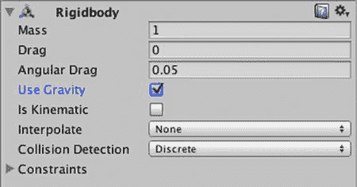

`图 6-1.` Inspector 中的刚体组件

在物理学中，`质量`描述的是物体所含物质的多少。这与重量不同——重量是重力对物体拉力的度量。例如，地球上的一个高尔夫球和月球上的一个高尔夫球质量相同，但由于地球和月球的重力不同，它们的重量也不同。

如果你现在尝试调整 `Mass` 属性，比如将质量改为 100 后运行，或改为 0.1 后运行，会发现立方体下落的速度似乎是一样的。重力是对物体施加的一个恒定力。不深入数学原理的话，如果排除空气阻力等其他因素，不同质量的物体因重力产生的加速度（加速）是相同的。这意味着，在实际情况下，一枚硬币和一颗保龄球的下落速度是一样的。质量是碰撞和施加任意力时的一个重要因素。

`阻力`是一种对抗力，其作用类似于空气阻力。尝试将 `Drag` 属性值改为 10，然后运行，观察它对下落立方体的影响。

`角阻力`的作用方式与阻力基本相同，只是它对抗的是旋转运动。

取消勾选 **Use Gravity**，立方体将不再下落，因为它不再受重力影响。

在游戏中，有时你可能希望通过对象的 `Transform` 而不是物理引擎来移动它。启用 **Is Kinematic** 意味着游戏对象虽然带有 `Rigidbody` 组件，但不再由物理引擎驱动。

`Interpolate` 用于平滑对象的运动。优化性能的一般经验法则是，除非你确实看到游戏对象的运动出现抖动，否则不要使用此功能。`Interpolate` 选项会根据对象前一帧的 `Transform` 来平滑运动，而 `Extrapolate` 选项则根据对象下一帧的预估 `Transform` 来平滑运动。

`碰撞检测` 决定了物理引擎用于计算碰撞的方法。`Discrete` 是普通碰撞的默认值。`Continuous` 用于高速移动的对象，如果它们的碰撞检测不正确的话。使用 `Continuous` 碰撞检测可能会对游戏性能产生不利影响，因此仅在必要时使用。`Continuous Dynamic` 是 `Continuous` 碰撞检测的一种组合：它会对使用 `Continuous` 或 `Continuous Dynamic` 检测的其它对象以及没有刚体的静态网格碰撞体使用 `Continuous` 检测，而对其他所有情况使用 `Discrete` 检测。由于 `Continuous Dynamic` 也会使用 `Continuous`，因此它也可能对性能产生很大影响。

你已经看到 **Constraints** 用于动画的根运动，在这里它的作用方式相同。展开 **Constraints** 并勾选 **Freeze Position** 的某个轴，可以阻止对象沿该轴移动；而勾选 **Freeze Rotation** 的某个轴，则可以阻止对象绕该轴旋转。

### 使用力控制刚体

`AddForce()` 和 `AddTorque()` 是脚本中用于对刚体施加力的函数。扭矩（Torque）是一种能产生旋转运动的力。

在 Project 面板中，创建一个新文件夹并命名为 `Scripts`。选中 `Scripts` 文件夹，然后选择 `Create ➤ Javascript`，并将脚本命名为 `Forces`。将脚本拖拽到 Hierarchy 中的 Cube 游戏对象上进行挂载。双击 Project 面板中的脚本图标，在 MonoDevelop 中打开并编辑。删除 `Start()` 和 `Update()` 函数，然后添加以下代码：

```
public var aForce : float = 5;

function FixedUpdate () {

rigidbody.AddForce (Vector3.right * aForce);

}
```

物理计算依赖于离散的时间增量，因此应使用基于时间的 `FixedUpdate()` 函数，而非基于帧率的 `Update()` 函数。保存后，在编辑器中运行。注意观察，随着方块向右移动，其速度会逐渐加快。这是因为每次调用 `FixedUpdate()`（在每个固定帧率帧上触发）都会施加力。`aForce` 是一个可在 Inspector 中调整的系数，通过它可以精确控制 `AddForce` 的响应效果。

现在，将 `FixedUpdate()` 中的代码修改为以下内容：

```
rigidbody.AddTorque (Vector3.right * aForce);
```

回顾（或查阅脚本参考文档）可知，`Vector3.right` 是 `(1, 0, 0)` 的简写。此时方块不再沿 x 轴向右移动，而是绕 x 轴旋转，从而导致其向后运动。

虽然上述方法适用于施加恒定力，但如果希望在游戏运行过程中实时控制力该怎么办？请注释掉 `FixedUpdate()` 函数，并添加以下代码：

```
function OnMouseDown () {

rigidbody.AddTorque (Vector3.forward * aForce);

}
```

运行游戏，点击静止的方块，它便会开始绕 z 轴旋转。请注意，使用 `OnMouseDown()` 时，必须先点击游戏对象（此处为方块），代码才会执行。持续点击，每次点击都会让方块旋转速度更快。退出 Play 模式。

选中 Hierarchy 中的 Cube 游戏对象。将其 Transform 位置改为 `(0, 1, 0)`。然后创建一个 Transform 位置为 `(0, 2, 0)` 的 Sphere 游戏对象。在 Inspector 中，选择 `Add Component ➤ Physics ➤ Rigidbody` 来添加刚体组件。取消勾选 `Use Gravity`。从 Project 面板的 `Scripts` 文件夹中，将 `Forces` 脚本拖拽到 Hierarchy 中的 Sphere 上以添加脚本；或者，选中 Hierarchy 中的 Sphere，然后将 `Forces` 脚本图标从 Project 面板拖拽到 Inspector 底部，将其添加为 Sphere 游戏对象的组件。将 `OnMouseDown()` 中的代码行从 `AddTorque` 改为 `AddForce`：

```
rigidbody.AddForce (Vector3.forward * aForce);
```

保存脚本。返回编辑器的 Inspector 视图，将 `aForce` 的值改为 1000。进入 Play 模式并点击球体，它会沿 z 轴直线向前运动。勾选 `Use Gravity`，球体便会呈现向前并向下方的弧线运动。

使用何种方式完全取决于游戏需求。魔法火球可能会沿直线飞行，而投石机发射的橡胶鸡则应受到重力影响。但如果希望魔法火球像火箭一样加速呢？或者希望火箭真如火箭般加速呢？

有几种方法可以实现。一种是在 `FixedUpdate()` 中持续施力，而不是通过鼠标单击一次性施加。

另一种方法是 `AddForce()` 函数在 `Vector3` 参数之后接受第二个参数，名为 `ForceMode`。如果未显式指定，则默认为 `Force`。如果在学习过程中查阅了 Unity 文档，你可能已经发现它还有 `Acceleration`、`Impulse` 和 `VelocityChange` 等选项。`AddTorque()` 函数同样具有这个可选的第二个 `ForceMode` 参数。

可以通过以下方式使用 `AddForce.Acceleration` 使球体加速：

```
rigidbody.AddForce (Vector3.forward * aForce, ForceMode.Acceleration);
```

另一种方法不是通过脚本，而是借助一个可与刚体配合使用的便捷物理组件，名为 `Constant Force`。

首先，在检视面板中取消勾选球体的 `Forces` 脚本组件以禁用它。然后依次选择 `添加组件 ➤ 物理 ➤ 恒定力`，它将出现在检视面板中（图 6-2）。

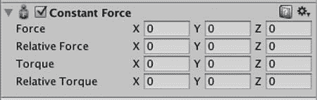

图 6-2. 检视面板中的恒定力组件

`力`和`扭矩`属性定义了相对于世界空间坐标的力向量，而`相对力`和`相对扭矩`属性则定义了相对于物体局部空间坐标的向量。例如，当你的玩家角色拿着一把火箭筒跑来跑去并指向任意方向时，如果你将`相对力`的 `z` 坐标设为正值，火箭就会朝着指向的方向向前移动。我们先用一个粗略的原型来试试。

选择 `Cube` 游戏对象，将其`变换`位置改为 `(1, 1, 0)`，旋转改为 `(350, 0, 0)`，缩放改为 `(1, 1, 3)`。在层级视图中创建一个 `Capsule` 游戏对象，并将其`变换`位置设为 `(0, 1, 0)`。再次在层级视图中，将 `Cube` 拖放到 `Capsule` 游戏对象上，使其成为子对象。注意 `Cube` 的`变换`已经改变；现在它的位置被指定为相对于其父对象 `Capsule`，而不是相对于世界空间的原点。`Capsule` 游戏对象代表玩家，`Cube` 游戏对象代表火箭筒。

`Sphere` 游戏对象将代表被发射的火箭。选中 `Sphere`，点击齿轮图标并选择`移除组件`来删除 `Forces` 脚本组件。然后在`恒定力`组件中，将球体的`相对力` `z` 坐标改为 `35`，接着将其`Transform.position` 改为 `(1, 1, 2)`。在层级视图中，将 `Sphere` 拖放到 `Cube` 上，使其成为 `Cube` 的子对象，这样它就能始终从 `Cube` 火箭筒的末端发射，无论玩家指向哪个方向。

你会想要发射多枚火箭，因此需要将球体制作成预制体。按照第三章创建炫酷立方体预制体的方法操作即可。在项目面板中创建一个 `Prefabs` 文件夹。将层级视图中的 `Sphere` 拖入 `Prefabs` 文件夹，并将预制体命名为 `Rocket`。右键点击层级视图中的 `Sphere` 并选择删除。

在项目面板中，打开 `Scripts` 文件夹，然后选择 `创建 ➤ Javascript`，并将新脚本命名为 `RocketLaunch`。双击脚本图标在 MonoDevelop 中打开。将代码编辑如下：

```
#pragma strict

public var rocket : GameObject;

function Update () {

    if(Input.GetButtonUp("Fire1")) {

        var rocketInstance : GameObject = Instantiate(rocket);

    }

}
```

这些内容在前几章中应该都很熟悉。首先声明一个名为 `rocket` 的 `GameObject` 类型引用变量。然后，在 `Update()` 函数中使用 `if` 语句检查条件：由`输入管理器`管理的默认“Fire1”按钮是否已被松开。如果此条件为 `true`，则创建一个新的火箭实例。保存脚本。

在编辑器中，将 `RocketLaunch` 脚本从项目面板拖放到层级视图的主摄像机上。选中主摄像机后，你会看到 `RocketLaunch` 脚本已作为一个组件添加进来。`Rocket` 字段是空的，所以如果你现在运行游戏，尝试发射火箭时将不会有任何反应。将项目面板 `Prefabs` 文件夹中的 `Sphere` 预制体拖放到检视面板的 `Rocket` 字段中。保存场景。

使用默认的 `Fire1` 按钮（即左 Ctrl 键）进行游戏测试。太棒了！你正在发射像火箭一样加速的球体。刚体的`阻力`属性会对抗任何一种加速方式，并且可以用来限制最大速度。

这里向你展示了几种实现加速效果的方法。使用哪种方法始终取决于你游戏的具体情况。重要的一点是，Unity 通常有多种解决方案，其中一种可能比另一种更适合你的游戏场景和性能要求。在文档中查找这些方法，进行实验，并在 Unity 社区论坛中交叉搜索，以快速扩展你的游戏开发者技能库。

与此同时，观察一下层级视图中发生了什么——每次新实例化都会出现一个 `Sphere(Clone)`。物理引擎会追踪每一个实例，这最终会拖慢系统并严重影响游戏性能。

在第四章中，你使用 `Destroy()` 函数解决了这个问题。然后，你使用了 `Destroy()` 函数的时间延迟参数。在 `RocketLaunch` 脚本的 `Update()` 函数末尾添加 `Destroy(rocketInstance, 2);`，保存并运行。正如预期，火箭在三秒后消失。发射火箭的全部意义在于炸毁某些东西。击中一些目标如何？游戏对象之间的物理交互正是碰撞器发挥作用的地方。

# 碰撞体

虽然`Rigidbody`（刚体）组件能让游戏对象响应物理力，但`Collider`（碰撞体）组件则能让游戏对象在与其他游戏对象接触时做出反应。Unity 的原始对象已附带了碰撞体组件。在层级视图中选择`Cube`，你会在场景视图中看到盒碰撞体的绿色轮廓。

你既可以在检查器中通过选择`Add Component ➤ Physics`然后选择碰撞体类型来添加碰撞体，也可以通过编辑器顶部菜单选择`Component ➤ Physics`再选择碰撞体类型来添加。

`Mesh Collider`（网格碰撞体）选项会采用游戏对象网格的形状。虽然这听起来很理想，但网格碰撞体通常会对游戏性能产生负面影响，并且 Unity 对允许的多边形数量有限制。解决方案是使用多个原始碰撞体来近似你的 3D 模型形状。

**注意：** 最佳实践建议对场景几何体使用网格碰撞体，对移动对象使用复合原始碰撞体。

碰撞体的属性非常直观（图 6-3）。将碰撞体用作触发器将在本章的“触发器”部分进行说明。物理材质更详细地定义了对象碰撞时的行为。你可以很容易地想象出一个金属球、一个橡胶球和一个肥皂泡在与同一物体碰撞时，即使它们都是简单的球体，其反应也会截然不同。物理材质将在本章稍后的同名部分中介绍。`Center`（中心）是该碰撞体在局部空间中的 (x, y, z) 坐标。这意味着你可以将碰撞体相对于游戏对象进行偏移。尺寸也不必与游戏对象相同，因此其余字段涉及根据你拥有的原始类型来调整碰撞体大小——盒体用 x、y、z 值表示尺寸；胶囊体用半径和高度表示；球体用半径表示。

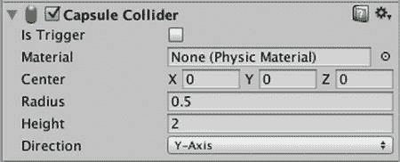

*图 6-3. 检查器中的胶囊碰撞体组件*

请按照以下每一条指令操作后，暂停并试玩测试。首先，添加一个原始游戏对象立方体，将其命名为`Target`，并将其变换位置改为`(1.4, 1, 7)`，缩放改为`(2, 2, 0.2)`。碰撞中涉及的至少一个游戏对象必须具有`Rigidbody`组件。在检查器中，选择`Add Component ➤ Physics ➤ Rigidbody`。运行游戏，`Target`会根据重力下落。

在`Rigidbody`组件中，取消勾选`Use Gravity`（使用重力）。运行游戏，弹丸击中立方体，然后在重力作用下下落，而立方体则飞离出去，其位置和旋转的变化率由物理引擎控制。这里你可以看到，尽管你禁用了目标立方体对重力的响应，但凭借`Box Collider`组件，它仍然会对碰撞力做出响应。

改变目标刚体的约束条件，使其在受到撞击时能够原地旋转。在检查器中，找到`Rigidbody`组件并展开 Constraints（约束）属性。勾选`Freeze Position`（冻结位置）的`X`、`Y`和`Z`选项，这将在目标被撞击时将其固定在原位。运行游戏，目标仍然会响应弹丸的撞击，但相对于世界空间保持位置不变。

仍在检查器中，勾选`Freeze Rotation`（冻结旋转）的`Y`和`Z`选项。运行游戏，现在目标保持位置不变并绕 X 轴旋转。保存场景并保存项目。

Unity 提供的原始对象带有匹配游戏对象渲染外观尺寸和形状的碰撞体，但你不必局限于此。你可以将碰撞体相对于游戏对象进行偏移，更改碰撞体相对于游戏对象的尺寸，甚至可以使用与游戏对象形状不同的碰撞体，以实现更加多样的行为。请继续边试验边学习！

## OnCollision

虽然这对于物理引擎可以对你的游戏对象做什么来说是一个不错的小演示，但让我们回到脚本编写，看看幕后发生了什么。在弹丸首次撞击目标的那一帧，物理引擎会调用`OnCollisionEnter()`函数。在随后的两物体保持接触的帧中，它会调用`OnCollisionStay()`。最后，当物体不再相互接触时，会调用`OnCollisionExit()`。

创建一个新场景并添加一个方向光。创建一个立方体，并将变换位置设置为`(0, 0.5, 0)`，旋转设置为`(0, 0, 10)`。创建一个球体，变换位置设置为`(0, 3, 0)`，并通过选择`Add Component ➤ Physics ➤ Rigidbody`添加`Rigidbody`组件。保存场景并为其命名。

在项目面板的`Assets ➤ Scripts`文件夹中，创建一个新脚本并将其命名为`CollisionColors`。双击其图标打开进行编辑。删除`Start()`和`Update()`函数，然后添加以下代码行：

```
private var red : float;

private var green : float;

private var blue : float;

private var color : Color;

function OnCollisionEnter() {
     Debug.Log("OnCollisionEnter");
     color = GetRandomColor();
     gameObject.renderer.material.color = color;
}

function OnCollisionStay() {
     Debug.Log("OnCollisionStay");
}

function OnCollisionExit() {
     Debug.Log("OnCollisionExit");
     color = GetRandomColor();
     gameObject.renderer.material.color = color;
}

function RandomColorValue() {
     var randomValue : float;
     randomValue = Random.Range(0.000, 1.000);
     return randomValue;
}

function GetRandomColor() {
     red = RandomColorValue();
     green = RandomColorValue();
     blue = RandomColorValue();
     color = Color(red, green, blue);
     return color;
}
```

保存脚本，然后返回编辑器。将脚本拖放到球体上以附加它，然后保存场景。运行游戏，你会看到球体落到立方体上，改变颜色，然后滚过立方体倾斜的顶面并掉下边缘，再次改变颜色。在控制台中，你会看到一条`"OnCollisionEnter"`，多行`"OnCollisionStay"`，以及最后一条`"OnCollisionExit"`。

分解一下，改变颜色的代码你在第 4 章中已经很熟悉了。你声明了`float`值来保存各个颜色值，以及一个`Color`类型的引用变量来保存随机生成的颜色的 RGB 值。`GetRandomColor()`调用`RandomColorValue()`来为颜色的每个 RGB 值生成随机数，然后将它们赋值给`color`变量。

当球体在重力作用下下落时，它会与立方体发生碰撞。物理引擎会调用`OnCollisionEnter()`，此时`"OnCollisionEnter"`会打印到控制台，并且调用`GetRandomColor()`生成一个随机颜色，然后将其赋值给球体的材质属性。

当球体滚过立方体时，物理引擎会在球体与立方体接触的每一帧调用`OnCollisionStay()`，并且`"OnCollisionStay"`会在控制台中被多次打印。

最后，球体滚离立方体，碰撞体不再接触。发生这种情况时，物理引擎会调用`OnCollisionExit()`。`"OnCollisionExit"`会打印到控制台，并生成一个新的随机颜色赋值给球体。

### 另一个游戏对象

你还可以获取碰撞本身的信息，包括脚本对象与之碰撞的其他对象的引用。在 MonoDevelop 中，按如下方式编辑`OnCollisionEnter()`：

```
function OnCollisionEnter(other : Collision) {
     Debug.Log("OnCollisionEnter");
     color = GetRandomColor();
     other.gameObject.renderer.material.color = color;
}
```

保存脚本。返回编辑器，保存场景，然后播放。现在，在初次碰撞时，立方体会改变颜色，而不是球体。

改变颜色只是一个示例，方便在编辑器中观察。请记住，游戏对象由组件构成，你可以通过脚本影响任何组件的属性。MonoDevelop 的自动补全功能会在此处提供帮助。输入`other.gameObject.`即可查看可用选项（图 6-4）。

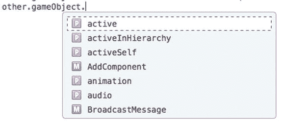

图 6-4. `gameObject` 的自动补全选项

现在让我们将这些内容整合成一个简单的游戏原型，但首先请花点时间确保你的项目结构规整：脚本放在 `Scripts` 文件夹，预制体放在 `Prefabs` 文件夹，场景放在 `Scenes` 文件夹。如果缺少这些文件夹，请选择 `Assets` 文件夹，然后依次点击 Create ➤ Folder 并命名。

### 打靶练习

创建一个新场景，保存并命名为 `TargetPractice`，然后添加一个定向光。现在，设置一个 3×3 的九个靶标网格。在 `Hierarchy` 中，选择 Create ➤ `Cube` 并将其 `Transform` 位置设为 `(0, 0, 0)`。将其重命名为 `Target`，`Transform` 缩放设为 `(2, 2, 0.2)`。在 `Inspector` 面板中，选择 Add Component ➤ Physics ➤ `Rigidbody`。在 `Rigidbody` 组件中，取消勾选 `Use Gravity` 属性。展开 `Constraints` 属性，勾选所有三个 `Freeze Position` 坐标轴。对于 `Freeze Rotation`，勾选 Y 和 Z 坐标（图 6-5）。

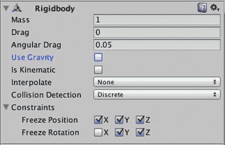

图 6-5. 靶标游戏对象 `Rigidbody` 属性设置

要复制此游戏对象，请在 `Scene` 视图中选中它，然后按 +D 进行复制。将其紧邻第一个靶标放置（`Transform` 位置 x 为 2），然后重复操作，在原始靶标的另一侧再放置一个 `Target` 游戏对象（`Transform` 位置 x 为 –2），这样就有了三个 `Target` 游戏对象组成的一行。按住  键，依次点击每个 `Target` 游戏对象以选中整行。再次按 +D，这次复制整行。在 `Inspector` 中，将 `Transform` 位置 y 坐标改为 2。

你可能注意到，`Hierarchy` 中的三个 `Target` 游戏对象在首次选中时变为蓝色高亮，在修改 `Transform` 位置 y 值后又变为深灰色。点击这个灰色区域一次，使其重新变为蓝色高亮。再次按 +D 创建第三行，并将其 `Transform` 位置 y 坐标设为 4（图 6-6）。

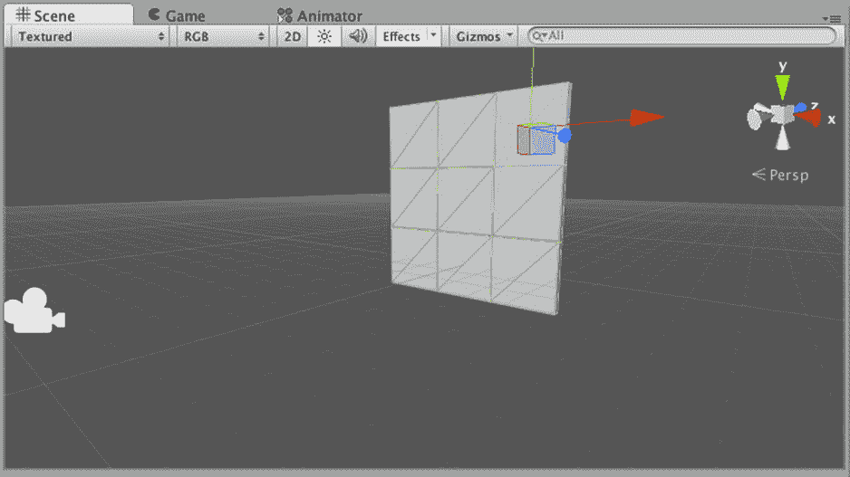

图 6-6. 3×3 九个靶标游戏对象网格

### 设置发射器

靶标网格设置完成后，接下来设置发射器。我们将使用主摄像头作为瞄准和发射弹丸的源。在 `Project` 面板中，选择 Assets ➤ `Scripts` 文件夹，然后依次点击 Create ➤ Javascript，将新脚本命名为 `ProjectileLauncher`。双击在 `MonoDevelop` 中打开编辑。将 `ProjectileLauncher` 脚本编辑如下：

```
#pragma strict

public var projectile : GameObject;
public var cameraSpeed : float = 5;

function Update () {
    var horiz : float = Input.GetAxis("Horizontal") * Time.deltaTime * cameraSpeed;
    var verti : float = Input.GetAxis("Vertical") * Time.deltaTime * cameraSpeed;
    transform.Translate(horiz, verti, 0);

    if(Input.GetButtonUp("Fire1")) {
        var projectileInstance : GameObject = Instantiate(projectile, transform.position, transform.rotation);
        Destroy(projectileInstance, 2);
    }
}
```

保存脚本，然后在 `Unity` 编辑器中将其拖拽到主摄像头上进行挂载。在 `Hierarchy` 中选中主摄像头，转到 `Project` 面板，打开 Assets ➤ `Prefabs` 文件夹。将 `Rocket` 预制体拖拽到 `Inspector` 中 `Rocket Launcher` 脚本组件的 `Projectile` 属性上。

以下是对这段代码的分步解析，你应该已经比较熟悉了：

```
(1)     public var projectile : GameObject;
```

`GameObject` 类型的引用变量被声明为公共变量，这样你就可以在 `Inspector` 中访问它，方便拖拽不同的预制体。

```
(2)     public var cameraSpeed : float = 5;
```

同样地，`cameraSpeed` 因子被声明为公共变量，以便通过 `Inspector` 使用。

```
(3)     var horiz : float = Input.GetAxis("Horizontal") * Time.deltaTime * cameraSpeed;
        var verti : float = Input.GetAxis("Vertical") * Time.deltaTime * cameraSpeed;
        transform.Translate(horiz, verti, 0);
```

在 `Update()` 函数中，首先处理玩家输入，以确定新的水平和垂直坐标，通过 `transform.Translate` 移动摄像机。`z` 坐标保持为 0，以维持主摄像机（作为发射器）与目标网格之间的距离。

```
(4)     if(Input.GetButtonUp("Fire1")) {

var projectileInstance : GameObject = Instantiate(projectile, transform.position, transform.rotation);

Destroy(projectileInstance, 2);

}
```

接下来，`Update()` 函数测试以确定默认的 `Fire1` 按钮是否已释放，如果为 `true`，则创建一个新的投射物游戏对象实例（实例化）。然后设置条件，使该投射物实例在两秒后被销毁。

### 投射物脚本

投射物游戏对象也需要一个脚本。在 `Project` 面板中，回到 Assets ➤ `Scripts` 文件夹，选择 Create ➤ Javascript，然后将新脚本命名为 `Projectile`。双击脚本图标，在 `MonoDevelop` 中打开进行编辑。将代码编辑如下：

```
#pragma strict

public var aForce : float = 500;

private var redColor : Color = Color (1, 0, 0);

private var greenColor : Color = Color (0, 1, 0);

function FixedUpdate () {

rigidbody.AddForce (Vector3.forward * aForce);

}

function OnCollisionEnter(other : Collision) {

var checkColor : Color = other.gameObject.renderer.material.color;

if (checkColor == greenColor) {

other.gameObject.renderer.material.color = redColor;

}  else {

other.gameObject.renderer.material.color = greenColor;

}

}
```

保存脚本，并通过在 `Project` 面板中打开 Assets ➤ `Prefabs` 文件夹，选择 `Projectile` 预制体，将其附加到 `Rocket` 预制体上。在 `Inspector` 中，选择 Add Component ➤ Scripts，然后在下拉菜单中找到 `Projectile` 脚本并选中。`Projectile` 脚本应作为 `Rocket` 预制体的一个新组件出现在 `Inspector` 中。

此代码分解如下：

```
(1)     public var aForce : float = 500;

private var redColor : Color = Color (1, 0, 0);

private var greenColor : Color = Color (0, 1, 0);
```

用于确定投射物游戏对象发射力的`aForce`变量被声明为`public`，以便在 Inspector 中进行调整，并赋予一个初始值。`redColor`和`greenColor`变量（类型为`Color`）被赋予红和绿对应的 RGB 值。

```
(2)     rigidbody.AddForce (Vector3.forward * aForce);
```

在`FixedUpdate()`函数中，对投射物施加一个向前的力。

```
(3)     var checkColor : Color = other.gameObject.renderer.material.color;

if (checkColor == greenColor) {

other.gameObject.renderer.material.color = redColor;

}  else {

other.gameObject.renderer.material.color = greenColor;

}
```

当`Rocket`预制体投射物与目标碰撞时，会调用`onCollisionEnter()`函数，并且目标会改变颜色。声明类型为`Color`的引用变量`checkColor`，并将其赋值为目标游戏对象的颜色值。然后任意测试目标对象的颜色是否为绿色；如果为`true`，则将其改为红色。如果为`false`，表示目标对象不是绿色，则将其改为红色。

在编辑器中，保存场景，保存项目，然后进入 Play 模式进行测试（图 6-7）。就是这样——你的第一个游戏原型！

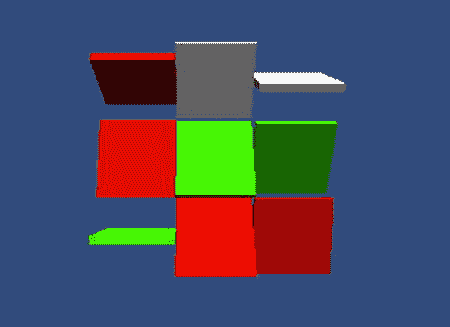

图 6-7. Game 视图中的 Target Practice

## 物理材质

你可以通过使用物理材质进一步优化游戏对象在碰撞中的碰撞行为。物理材质是定义弹跳性和表面摩擦属性的资源。两个相互滑动的物体会因摩擦而损失能量，而弹跳的物体在每次弹跳中撞击其他表面时也会损失能量。

这个场景是一种测试物理材质的方法。首先，你将测试在平面上推动一个立方体。创建一个新场景并命名为`PhysicMaterialsTest`，并像往常一样添加一个方向光。选择 Main Camera 并将其 Transform 位置更改为`(0, 1, –7)`。创建一个平面，然后创建一个 Transform 位置为`(0, 0.5, 0)`的`Cube`游戏对象。在 Inspector 中通过 Add Component ➤ Physics ➤ Rigidbody 或从顶部菜单选择 Component ➤ Physics ➤ Rigidbody，为`Cube`添加一个`Rigidbody`组件。

在 Project 面板中，首先选择 Assets，然后选择 Create ➤ Folder 并将文件夹命名为`Physic Materials`。选中`Physic Materials`文件夹后，现在选择 Create ➤ Physic Material。你可能需要向下滚动一些才能找到它。将新的物理材质命名为`Icy`（图 6-8）。

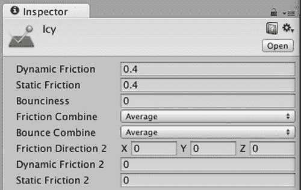

图 6-8. Inspector 中的 Physic Material 资源

`Dynamic Friction`属性用于物体已经在移动时。值为 0 表示没有能量损失——也就是说，这是最滑的情况，因此物体会滑行很远。值为 1 是另一个极端：移动中的物体会很快停止移动。

`Static Friction`用于物体处于静止状态时。这是必须克服的摩擦才能使物体移动。这个属性的范围也是 0 到 1，其中 0 几乎是无摩擦，而 1 需要很大的力才能使物体移动。

`Bounciness`也有一个从 0 到 1 的范围，其中 0 表示所有能量都损失了——没有弹跳——而 1 表示没有能量损失，物体超级有弹性。

`Friction Combine`和`Bounce Combine`为你提供了如何组合两个碰撞游戏对象的摩擦力的选项。你可以选择`Average`来取两个值的平均值，`Minimum`使用最小值，`Maximum`使用最大值，以及`Multiply`将两个值相乘。

`Friction Direction 2`允许你为游戏对象在其表面上的不同方向创建不同的摩擦。一个例子是木纹的顺纹或逆纹方向。如果你选择了这种第二方向摩擦，你可以像使用`Dynamic Friction`和`Static Friction`一样，通过`Dynamic Friction 2`和`Static Friction 2`来修改行为。

是时候试试了。选中`Ice`物理材质资源，将`Dynamic Friction`和`Static Friction`都设为 0。现在，通过从 Project 面板拖放到 Scene 视图中的对象上，或者在 Inspector 中使用 Collider 组件 Material 属性字段右侧的圆形选择按钮并从出现的菜单中选择，将此物理材质应用于立方体和平面游戏对象。

测试所需的最后一件事是能够对立方体施加力。在 Project 面板中选择 Create ➤ JavaScript，并将新脚本命名为`Push`。双击它以在 MonoDevelop 中打开进行编辑。删除`Start()`和`Update()`函数，然后添加以下代码：

```
public var aForce : float = 50;

function OnMouseDown () {

rigidbody.AddForce (Vector3.forward * aForce);

}
```

你之前已经使用过这段代码。你可以通过公共变量`aForce`在 Inspector 中调整推动的力的大小。在`OnMouseDown()`函数中，你将`aForce`应用于物理引擎正在跟踪的游戏对象的`rigidbody`组件。保存脚本并将其附加到`Cube`游戏对象上。保存场景。播放以测试，当你点击立方体时，它开始滑动。

由于立方体和平面基本上都是无摩擦的，它会继续滑动直到掉落。测试改变`Icy`物理材质的`Dynamic Friction`和`Static Friction`值，然后在 Play 模式下推动`Cube`游戏对象。当你完成实验后，将`Icy`物理材质的`Dynamic Friction`和`Static Friction`属性重置为 0。

### 弹跳性

要测试弹跳性，请在场景中添加一个变换位置为 `(0.5, 2, 0)` 的`Sphere`游戏对象。就像你对`Cube`游戏对象所做的那样，为其添加一个`Rigidbody`组件。保存场景并播放。球体下落并撞击到立方体的边缘，然后落到平面上。球体和立方体的运动由物理引擎根据每个游戏对象的物理属性计算得出。立方体受到下落球体的冲击，朝一个方向滑动，而球体则朝另一方向滚开。注意球体完全没有弹跳起来。

Unity 在其标准资源包中确实提供了一些基本物理材质。在编辑器顶部菜单中，选择 `资源` ➤ `导入包` ➤ `物理材质`。继续导入所有材质，以便你将其保存在项目中用于实验。

> **注意**
>
> 在撰写本文时，Unity 的标准资源和示例资源（测试版）正在合并中。如果这里的物理材质无法正确导入，请从资源商店下载并导入示例资源（测试版）包，然后在项目面板中使用搜索栏找到弹跳物理材质。

从项目面板的 `标准资源` ➤ `物理材质` 文件夹中将 `Bouncy` 拖拽到检查器中`Sphere Collider`组件的`材质`属性上。保存场景。现在你进行测试时，`Sphere`游戏对象在与`Cube`和`Plane`碰撞时会表现出明显的弹跳性。

标准资源包中的物理材质旨在作为起点。为了让你的游戏和游戏对象具有独特性，你应该进一步自定义和完善它们的物理特性。

### LookAt

暂时离开物理话题。既然你已有对象在移动，你可能会希望摄像机始终指向移动中的对象。`LookAt` 正是实现此功能的便捷函数。仍然使用你的`PhysicMaterialsTest`场景，在项目面板中通过`创建` ➤ `JavaScript` 创建一个新脚本，并将其命名为`PointCamera`。双击在 MonoDevelop 中打开并编辑内容如下：

```
#pragma strict

var cameraTarget : Transform;

function Update () {
     transform.LookAt(cameraTarget);
}
```

保存脚本并将其附加到主摄像机。分解说明如下：

`(1)    var cameraTarget : Transform;`

如果你不指定`public`或`private`作用域，你在此声明的`Transform`类型变量`cameraTarget`默认将是一个公共变量，可通过检查器进行访问。

`(2)    transform.LookAt(cameraTarget);`

在`Update()`函数中，脚本所附加的游戏对象（此处为主摄像机）的`Transform`会进行旋转，使其前向矢量位置指向`cameraTarget`的位置。

在检查器中，使用其字段右侧的圆形选择按钮将`Sphere`游戏对象指定给`摄像机目标`属性。保存并播放。摄像机跟随球体落到立方体上，弹起穿过平面，然后落下。摄像机位置在跟随`Sphere`运动时不发生变化。现在尝试跟随`Cube`。

### 访问其他游戏对象

你已使用过`OnCollision()`来修改碰撞中涉及的两个游戏对象。你还可以为一个游戏对象编写脚本，使其影响任何其他游戏对象。在此示例中，当`Sphere`游戏对象撞击`Cube`游戏对象时，你的脚本会指示主摄像机跟随`Cube`而不是`Sphere`。

在项目面板中，通过`创建` ➤ `JavaScript` 创建一个新脚本，并将其命名为`ChangeCameraTarget`。双击在 MonoDevelop 中打开并编辑如下：

```
#pragma strict

function OnCollisionEnter() {
     var cameraScript : PointCamera = GameObject.Find("Main Camera").GetComponent(PointCamera);
     cameraScript.cameraTarget = GameObject.Find("Cube").transform;
}
```

这段代码分解如下：

`(1)     var cameraScript : PointCamera`

声明`cameraScript`引用变量，类型为`PointCamera`，即附加到主摄像机游戏对象上、指示其跟随`Sphere`游戏对象的脚本。

`(2)     = GameObject.Find("Main Camera").GetComponent(PointCamera);`

`cameraScript`变量被声明为脚本引用。由于此脚本附加到`Sphere`游戏对象上，你使用`GameObject.Find`函数查找名为 Main Camera 的任何对象。然后通过点符号深入查找主摄像机游戏对象的`PointCamera`脚本组件，并将其赋值给`cameraScript`。

`(3)     cameraScript.cameraTarget`

使用点符号标识`cameraTarget`公共变量，

`(4)     = GameObject.Find("Cube").transform;`

通过指定 Cube 游戏对象的变换来更改主摄像机的目标。

保存脚本并将其附加到`Sphere`游戏对象。保存场景并进行测试。摄像机跟随`Sphere`下落，然后在碰撞时切换到跟随`Cube`。

### 触发器

物理引擎会根据你为游戏对象分配的物理特性自动调整其位置和旋转。`OnCollision()`函数调用允许你控制碰撞开始、持续和结束时发生的事情。在许多游戏场景中，你希望当游戏对象到达特定位置时触发游戏行为。这可能是为了让门在游戏对象接近时自动打开，让游戏对象穿过门口时触发陷阱，或者当游戏对象离开门口进入房间时结束场景。游戏对象实际上并未与任何物理对象发生碰撞，因此在这样的场景中，你需要使用触发器碰撞器。

> **注意**
>
> 最佳实践要求带有触发器碰撞器的游戏对象是静态对象。由物理引擎控制的带有`Rigidbody`组件的游戏对象可以穿过触发器碰撞器。

`Is Trigger`是`Collider`组件的一个属性。当勾选`Is Trigger`框时，碰撞器会检测碰撞但调用一系列不同的方法：`OnTriggerEnter()`、`OnTriggerStay()`和`OnTriggerExit()`。刚体穿过触发器碰撞器的体积期间不会发生物理碰撞。你使用这些方法与使用`OnCollisionEnter()`、`OnCollisionStay()`和`OnCollisionExit()`非常相似。

### `OnTrigger`

在 Project 面板的 Assets ➤ Scene 文件夹中，创建一个新场景，命名为 `TriggerTest`，然后保存。添加一个方向光，以及一个 `Plane`，其 Transform 位置为 `(0, 0, –5)`。创建一个 `Sphere` 游戏对象，其 Transform 位置为 `(0, 0.5, –7)`。你将推动 `Sphere` 游戏对象，使其滚过触发器碰撞体。从 Project 面板的 Scripts 文件夹中，将 `Push` 脚本拖放到 `Sphere` 游戏对象上。游戏对象必须具有 `Rigidbody` 才能使物理力作用于其上，因此在 Hierarchy 中选择 `Sphere` 游戏对象，在 Inspector 中选择 Add Component ➤ Physics ➤ Rigidbody。

回到 Hierarchy，创建一个 `Cube` 游戏对象，命名为 `Trigger`。设置其 Transform 位置为 `(0, 0.5, –3)`，Transform 缩放为 `(3, 3, 1)`。现在，通过创建一个 `Cube` 游戏对象（命名为 `Cube1`，Transform 缩放为 `(1, 3, 1)`）来在 `Trigger` 游戏对象两侧设置一对门柱。将 `Cube1` 的 Transform 位置设置为 `(2, 0.5, –3)`。通过选择顶部菜单的 Edit ➤ Duplicate 或按下 +D 来复制它，将新游戏对象命名为 `Cube2`，并将其 Transform 位置设置为 `(–2, 0.5, –3)`。

保存场景并进行游戏测试。推动球体，你会看到它从 `Trigger` 游戏对象上弹开。请记住，只需一个对象具有 `Rigidbody` 即可检测碰撞。退出 Play 模式。

选择 `Trigger` 游戏对象，在 Inspector 中勾选 Box Collider 组件的 `Is Trigger`。保存并再次进行游戏测试。这次，没有物理反应发生，球体在你推动后会直接穿过 `Trigger` 游戏对象。

在 Project 面板中，创建一个名为 `TriggerScript` 的新脚本。编辑并添加以下代码：

```
#pragma strict

function OnTriggerEnter() {
   Debug.Log("OnTriggerEnter");
}

function OnTriggerStay() {
   Debug.Log("OnTriggerStay");
}

function OnTriggerExit() {
   Debug.Log("OnTriggerExit");
}
```

保存脚本。在 Unity 编辑器中，将 `TriggerScript` 附加到 `Trigger` 游戏对象上。选择 Project 面板中的 Console 选项卡。播放游戏，点击球体使其向前移动。在 Console 面板中，你将看到与 `OnCollision()` 类似的结果：一次 `OnTriggerEnter()` 调用，多次 `OnTriggerStay()` 调用（当球体滚过 `Trigger` 游戏对象的触发器碰撞体体积时），以及最后的一次 `OnTriggerExit()` 调用。

在测试 `OnCollision()` 函数时，你通过修改 Renderer 的 Color 属性来改变了游戏对象组件的属性。你也可以启用和禁用整个组件。将 `OnTriggerEnter()` 函数编辑如下：

```
function OnTriggerEnter() {
   var triggerRenderer : Renderer = GetComponent(Renderer);
   triggerRenderer.enabled = false;
}
```

这段代码分解如下：

`(1) var triggerRenderer : Renderer = GetComponent(Renderer);`

声明了一个名为 `triggerRenderer` 的 Renderer 引用类型变量，然后将对 `Trigger` 游戏对象 Renderer 组件的引用赋值给它。

`(2) triggerRenderer.enabled = false;`

通过将 Renderer 组件的布尔属性 `enable` 设置为 `false` 来禁用它。

保存并播放游戏。如预期一样，当 `Sphere` 游戏对象的碰撞体与 `Trigger` 游戏对象的触发器碰撞体接触时，`Trigger` 游戏对象从视野中消失。

在游戏过程中，你经常需要将一个布尔值切换为其相反值。与其显式地将其赋值为 `true` 或 `false`，不如使用 `!` 逻辑运算符。

将 `OnTriggerEnter()` 函数中的第二行代码改为：

```
triggerRenderer.enabled = !triggerRenderer.enabled;
```

这里你将 `Renderer` 组件的启用状态重新赋值为其相反的布尔值。如果当前为 `true`，它将被改为 `false`；如果当前为 `false`，则改为 `true`。

保存并再次进行游戏测试，你会看到 `Trigger` 游戏对象像之前一样消失。现在将此代码复制到 `OnTriggerExit()` 中：

```
function OnTriggerExit() {
   var triggerRenderer : Renderer = GetComponent(Renderer);
   triggerRenderer.enabled = !triggerRenderer.enabled;
}
```

保存并再次进行游戏测试。推动球体，现在当 `Sphere` 游戏对象进入触发器碰撞体体积时，`Trigger` 游戏对象消失；当 `Sphere` 游戏对象退出触发器碰撞体体积时，`Trigger` 游戏对象重新出现。

现在，编写一些代码来处理与 `Trigger` 游戏对象发生碰撞的游戏对象。在 `#pragma strict` 之后，声明一个名为 `triggerForce` 的公共浮点变量，并将其赋值为 10：

```
public var triggerForce : float = 10;
```

现在将你的 `OnTriggerStay()` 函数编辑如下：

```
function OnTriggerStay(other : Collider) {
   other.rigidbody.AddForce(Vector3.up * triggerForce);
}
```

这是对你在 `OnCollision()` 中所做内容的二次组合，其中 `other` 参数指的是与触发器碰撞体发生碰撞的另一个游戏对象（在本例中为 `Sphere` 游戏对象）。当球体位于触发器碰撞体体积内时，对其施加一个向上的力。

保存并再次进行游戏测试。`Trigger` 游戏对象在 `Sphere` 进入和退出其体积时仍然会消失和重新出现，但现在，由于在 `OnTriggerStay()` 中对其施加了力，`Sphere` 会向上移动。由于最初的推动，`Sphere` 仍然具有向前的运动，因此在几次弹跳后，它将越过触发器碰撞体的边界。

当你查阅脚本参考中的 `OnTriggerStay()` 函数时，你会发现该力是在条件语句内应用的（图 6-9）。

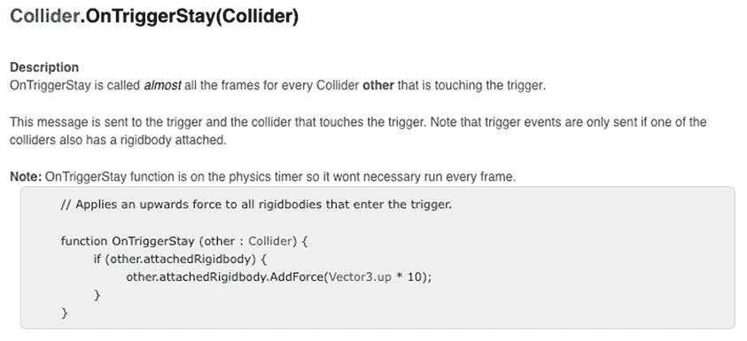

图 6-9。`OnTriggerStay()` 函数的 Unity 脚本参考

当你开始剖析示例项目时，你会经常看到这种检查。如果某个没有 `Rigidbody` 组件的其他游戏对象偶然穿过了触发器碰撞体，你会得到一个错误，因为你的代码告诉物理引擎要施加一个向上的力，但没有 `Rigidbody` 就无法施加。通过添加此条件语句，游戏引擎会检查 `Rigidbody` 组件，如果不存在，则跳过这行代码以避免错误。

你现在对 Unity 的一般机制有了良好的认识：在游戏过程中，Unity 游戏引擎会调用诸如 `Awake()`、`Start()` 和 `Update()` 之类的函数，而物理引擎会调用诸如 `OnCollision()` 和 `OnTrigger()` 之类的函数。在这些调用中，你编写代码来指导游戏进程。你的代码可以对脚本所附加的游戏对象、正在物理交互的其他游戏对象或任何其他游戏对象执行操作。由于脚本也是组件，一个游戏对象的脚本可以与附加到不同游戏对象的脚本进行交互。

# 快速原型制作

在撰写本文时，Unity 刚刚在其资源商店的 `Sample Assets (beta)` 包中为你添加了大量实用内容。Beta 测试是指软件版本发布给原始编程团队以外的用户进行测试的阶段。测试群体可能是小规模人群，甚至是普通公众，其目的是在正式版本发布前收集反馈意见，以便对产品进行最后的打磨完善。

如果你阅读本文时 `Sample Assets` 仍处于测试版，并且你发现了从“无法运行”到“意外行为”，甚至遇到“希望它能实现这个功能”的情况，请前往资源商店产品页面底部的评论区告诉 Unity 团队（图 6-10）。

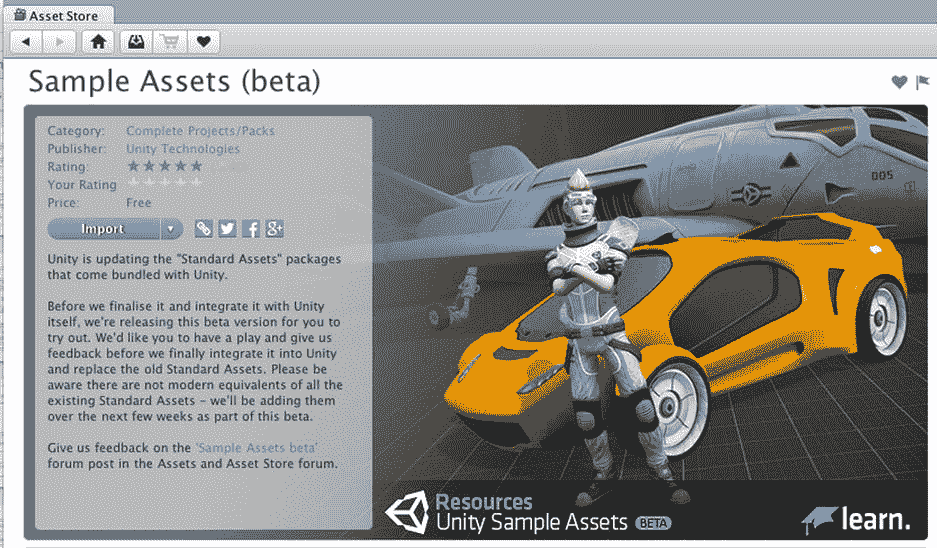

图 6-10. Unity 资源商店中的 `Sample Assets (beta)` 包

到目前为止，你已经取得了很大进展。你对编程概念和语法、Unity 编辑器、游戏对象、动画和物理系统有了基本了解。与其每次都从头开始，不如使用现成的资源并根据你的需求进行定制，从而更快速地推进游戏开发。这是学习最佳实践和解决常见问题不同方法的好途径。

Unity 的开发者们正是为你而设计了这些新资源——他们并非从一个大型特定主题项目中抽取零散部件，而是将这些资源设计为开箱即用，或者作为稳固且易于定制的入门工具包。

将 `Sample Assets (beta)` 包下载并导入到你的项目中。如果你找不到它，那说明它可能不再是测试版，这些资源已被迁移到了 Unity 编辑器自带的 `Standard Assets` 包中。看看这些精彩内容吧！（图 6-11）

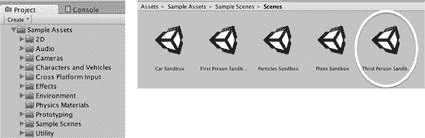

图 6-11. `Sample Assets (beta)` 或 `Standard Assets` 包中新增的资源与场景

从 `Third Person Sandbox` 作为你的第一个场景模板开始（图 6-12）。回顾一下，在第一人称游戏中，你扮演主角，游戏世界的视角直接通过玩家角色的眼睛呈现；而在第三人称游戏中，你则是“第三者”，作为游戏主角在游戏世界中移动和互动时的隐形观察者。

在 `Project` 面板中，进入 `Sample Scenes` 文件夹，双击 `Third Person Sandbox`（`SceneAsset`）。在编辑器顶部菜单中，选择 `File` ➤ `Save Scene As`，将其命名为 `MyFirstPrototype`，并保存到你的 `Assets` ➤ `Scenes` 文件夹中。

Unity 每次只显示一个场景。`MyFirstPrototype` 场景现在应该是活动场景，但请快速查看一下编辑器顶部确认这一点。你需要保留 `Third Person Sandbox` 场景的原始状态，以便将其作为一个未经修改的模板，供未来项目再次复制使用。

首先，查看 `Hierarchy` 中 `Scene` 视图的内容。

`Floor_Tile` 非常基础，包含必须的 `Transform` 组件和一个用于与其他游戏对象进行物理交互的 `Collider` 组件。展开它查看 `prototype_floor`，它带有渲染器和着色器，你可以修改这些来改变地板的外观。

展开 `Free Look Camera Rig` 找到 `Main Camera`。这个 rig 的组件定义了摄像机在游戏中的运作方式。附加的脚本具体描述了摄像机的行为，而 rigidbody 则表明摄像机在游戏中具有物理存在。

场景中有两个 `Lights`：一个 `Main Directional` 灯光从上方提供基础白光，还有一个 `Ambient Directional` 灯光从下方发出柔和的蓝光，增强了游戏对象的 3D 特性。第二个灯光对游戏外观影响显著。在现实世界中，光线会在一定程度上被地面、墙壁、窗户以及任何其他物体反射。灯光的颜色对于游戏的外观和氛围都至关重要。

`Mobile Character Control Rig` 主要由处理移动设备不同输入方式的脚本以及应对移动设备图形处理能力降低的着色器替代方案组成。

展开 `Obstacles` 可以看到一长串用于该场景的单个方块、立方体、平台和斜坡构建块。你可以在 `Prototyping` ➤ `Prefabs` 文件夹中找到这些以及其他可用于你自己的原型环境的资源。

`Third Person Character` 得到了极大的改进（图 6-12）。它过去只是一个代表玩家角色的简单 `Capsule` 游戏对象，但现在它附带 Unity 基于 Mecanim 的 Ethan 模型，并嵌入了根运动动画。你可以轻松地将 Ethan 替换为你自己的人形骨骼绑定模型。

在进行修改之前，花几分钟时间运行这个模板版本，感受一下它的能力。除了使用标准输入进行前进、后退、左移、右移以及（同时按下 `Shift` 键）行走外，Ethan 角色还可以在按下 `C` 键时蹲伏移动，并通过按下空格键跳跃。

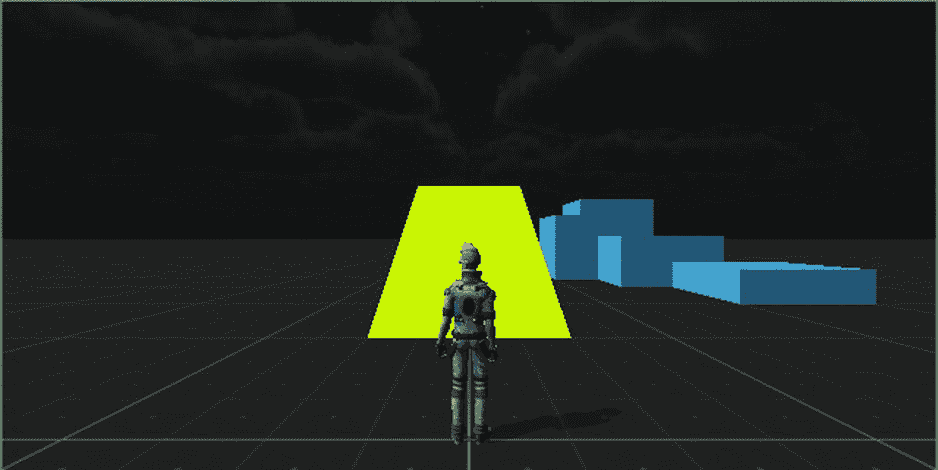

图 6-12. Unity `Sample Assets (beta)` 包中的 `Third Person Character` 示例场景

## 生成与生成点

`生成`（Spawning）是指在游戏过程中创建角色或游戏对象的过程。游戏对象出现的位置称为生成点。生成是许多游戏中的常见功能，不过在这个模板场景中，玩家角色在游戏初始化时就已经存在了。

虽说让角色在场景中跑来跑去探索一番挺有趣，但这严格来说算不上一个游戏。游戏需要某种终点——无论是达成目标、获得分数、计时结束，还是诸如此类的机制。假设这里的目标是让玩家到达最高的蓝色立方体顶部。在模板中这相当简单：角色可以依次跳上逐个增高的立方体，或者从黄色平台跳过去。通过抬高蓝色立方体，使其底部紧贴下一级较低立方体的顶部，可以增加一点难度（图 6-13）。

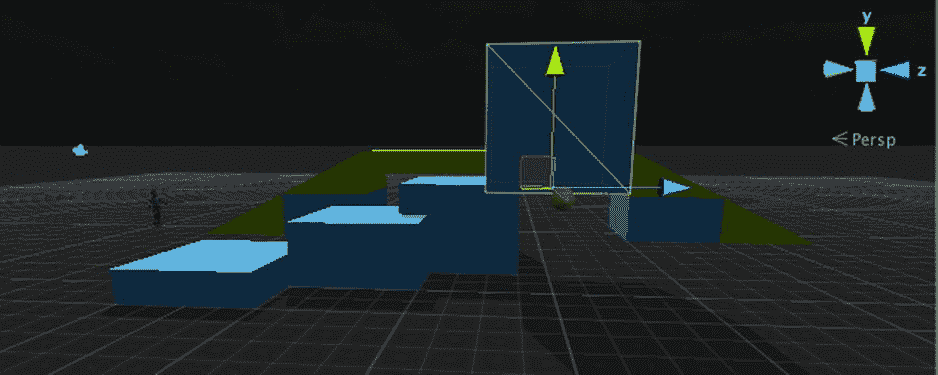

图 6-13. 使用变换控件将最高的立方体抬高，使其靠在相邻的立方体上

如果现在进行试玩，这个立方体太高了，无论是从蓝色立方体还是平台都无法跳上去。一个无法通关的游戏可没什么意思，因此你需要创建一个触发器碰撞体，将玩家角色传送到立方体顶部的某个生成点。

首先，指定生成点。使用顶部菜单「游戏对象 ➤ 创建空对象」创建一个空的游戏对象，并将其放置在立方体顶部。将其重命名为 `SpawnPoint01`。

其次，创建一个触发器点，用于让角色在立方体顶部重生。再次使用顶部菜单「游戏对象 ➤ 创建空对象」，然后在检视面板中选择「添加组件 ➤ 物理 ➤ 球体碰撞体」。勾选「是触发器」，并将半径改为 1。将其命名为 `RespawnPoint01Trigger01`。这个名字虽然有点长，但如果你后续添加更多重生点和触发器，每个都会有独特的描述性名称。现在，将该游戏对象放置在黄色平台上。

在项目面板中，选择「创建 ➤ JavaScript」，将新脚本命名为 `Respawn01`，然后在 MonoDevelop 中打开进行编辑。删除 `Start()` 和 `Update()` 函数，然后添加以下代码：

```
#pragma strict

public var respawnPosition: Transform;

function OnTriggerEnter(other : Collider) {

    other.gameObject.transform.position = respawnPosition.position;

}
```

其解析如下：

`(1)     public var respawnPosition: Transform;`

声明了一个名为 `respawnPosition` 的公共 `Transform` 类型引用变量。

`(2)     other.gameObject.transform.position = respawnPosition.position;`

在这种情况下，与触发器碰撞体发生碰撞的 `other` 对象就是玩家角色。这里你将 `respawnPosition` 变量所持有的位置引用赋值给了玩家角色游戏对象的变换位置。

保存脚本，并将其附加到 `RespawnPoint01Trigger01` 游戏对象上。在层级面板中选中 `RespawnPoint01Trigger01` 游戏对象后，从层级面板中拖拽 `SpawnPoint01` 游戏对象，放入 `Respawn01` 脚本组件的「重生位置」字段中。这样会将 `SpawnPoint01` 的 `transform.position`（x, y, z）坐标值赋给 `respawnPosition` 变量。

# 场景测试与角色更换

保存场景并运行游戏。让角色在平台周围跑动，直到它触发了触发器，从平台上消失，然后立即在最高蓝色立方体顶部的指定点重生。成功了！

你的玩家群体可能根本不知道有这种神奇的方法能到达立方体顶部，因此你需要给出某种提示。在项目面板中，进入「Prototyping ➤ Prefabs」文件夹并打开它。将一个「问号金币」拖拽到场景中，并将其放置在 `RespawnPoint01Trigger01` 触发器碰撞体的上方。不要在检视面板中点击「应用」，因为你不希望将这些更改应用到所有问号金币预制件上。在层级面板中，将其重命名为「Question Coin 01」。

> **注意**
> 这个问号金币预制件似乎有点大。为了快速原型制作，你可以使用变换组件的缩放属性来调整其大小，但请记住，对于最终的游戏美术资源，最好在导入之前就对模型进行合适的缩放。

如果让问号金币动起来，它将更能吸引玩家的眼球。在项目面板中，创建一个新脚本并将其命名为 `SpinCoin`。双击在 MonoDevelop 中打开，将代码编辑如下：

```
#pragma strict

public var spinSpeed : float = 50;

function Update () {

    transform.Rotate(Vector3.up * spinSpeed * Time.deltaTime);

}
```

这是一个你之前接触过的简单旋转动画。其解析如下：

`(1)     public var spinSpeed : float = 50;`

声明了一个公共的 `spinSpeed` 浮点型变量，你可以在运行时通过检视面板访问该变量，以调整问号金币游戏对象的旋转速度。

`(2)     transform.Rotate(Vector3.up * spinSpeed * Time.deltaTime);`

每帧更新问号金币的变换旋转属性，围绕 `Vector3.up` 轴（即 y 轴）旋转，乘以 `spinSpeed` 因子，并用 `Time.deltaTime` 进行平滑处理。如果没有 `spinSpeed` 因子，金币将以每秒 1 度的速度旋转。

保存脚本并将其附加到问号金币上。保存场景并运行游戏。现在，金币在原地旋转，明显成为一个吸引人的目标对象。

如果你进一步深入查看「Prototyping ➤ Prefabs」文件夹，你会遇到「Compound Prefabs」文件夹（图 6-14）。这里面有一些盒子堆和粉碎平台，玩家角色和盒子会在碰撞时产生相互作用，还有超级酷的轨道、坡道和阶梯。

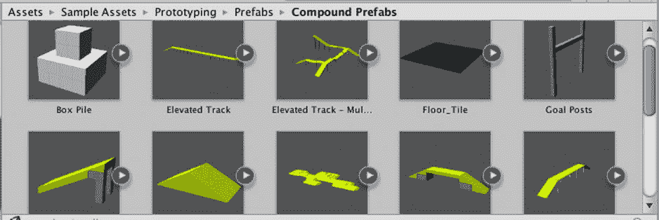

图 6-14. 示例资源包中的复合预制件

在场景中找点乐子，看看这些预制件是如何工作的——例如，添加一个环形轨道，测试你的角色是否能完整走一圈。

## 更换角色模型

制作原型的目的在于能够测试游戏机制中的布局和流程，而最终的美术素材将在后续的制作过程中呈现。你可以看到，如何利用碰撞器和触发器作为障碍物、收集品等，快速搭建一个供角色穿越的迷宫。作为游戏开发者，你对游戏的外观有着清晰的构想：阴暗的后末日风格、明亮欢快的卡通风格，抑或任何符合你口味的设定。然而，你的家人和朋友往往看法模糊得多。在听你兴奋地谈论了几周游戏设计后，他们对你制作的原型可能并不怎么感冒。

别灰心；这种情况屡见不鲜，而且不仅限于独立游戏开发者。有一次，我与全球顶尖的电子设备制造商之一合作开发游戏原型。当我们展示各种原型版本时，项目经理对简陋的占位美术素材表达了失望——即便她正是负责从外包工作室获取最终美术素材的人！

这确实说明了当今游戏视觉冲击力的重要性。精美细致的高分辨率图形提高了用户的期望值，因此功能精简的原型可能是一个新概念。请花些时间向他们讲解游戏设计理念，并确保他们理解当前重点是游戏机制而非外观。

话虽如此，如果你已经准备好了角色模型，为什么不把它们放进去呢？动画模型也需要测试，从确保网格对动画的正确响应，到确保角色的特殊肢体、道具等表现得当。例如，如果你混搭使用资源商店中的动画和道具，可能会发现某些剑术动画因为道具剑过长，导致角色看似在切割自己的肢体。

在层级视图中，展开第三人称角色并删除 Ethan 角色的子游戏对象。如果你的当前项目中还没有，请选择 `Assets ➤ Import New Asset`，找到你在第 5 章中使用的 `zombie_lowres.fbx` 模型。它应该已经配置好骨架并可以投入使用，但以防万一，请在项目面板中选择它，并在检视面板中查看一下。

选中 Rig（骨架）后，Animation Type（动画类型）应为 Humanoid，并将 Avatar Definition（动画头像定义）设置为 `Create From This Model`，然后点击 Apply（应用）。现在，从项目面板中拖动 `zombie_lowres.fbx` 并放到层级视图中的 Third Person Character（第三人称角色）游戏对象上，使其成为子对象（图 6-15）。

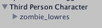

图 6-15. 作为第三人称角色子对象的 `zombie_lowres` 模型（层级视图中）

选择 Third Person Character（第三人称角色），然后在检视面板中向下滚动到 Third Person Character（第三人称角色）脚本（图 6-16）。

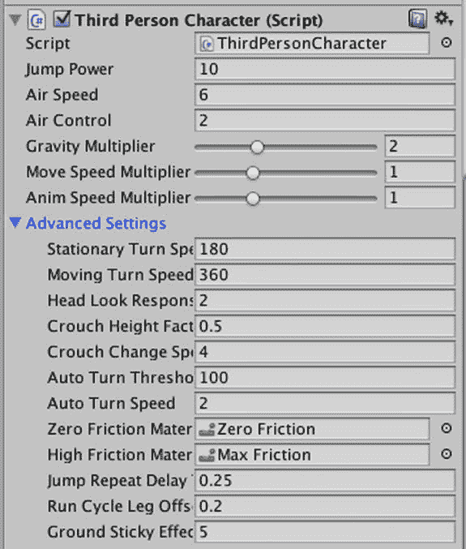

图 6-16. 检视面板中的 Third Person Character（第三人称角色）脚本组件

展开 Advanced Settings（高级设置），将显示大量可供你自定义特定角色行为的属性。

如果你点击书本图标以访问参考文档，脚本参考文档将打开并显示 `MonoBehavior` 父类的描述。脚本参考文档包含脚本中使用的类和函数的信息，而非任何特定脚本的内容。即使添加了新功能，参考文档也可能不反映测试版本的新内容，因为这些内容仍有可能更改。

这是一个很好的例子，说明了养成良好命名规范习惯以及在编写脚本时添加注释的重要性。检视面板中列出的属性具有描述性的名称，因此你可以大致猜测它们的功能。如果打开脚本本身，你会发现 Unity 团队出色地通过大量详细的注释分解了脚本变量和函数（图 6-17）。

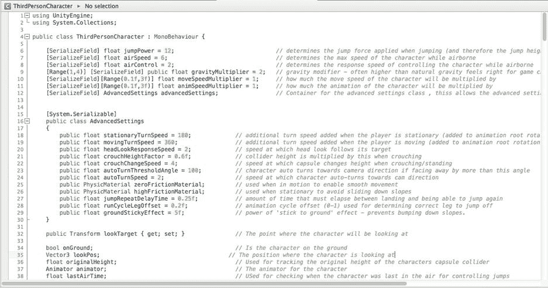

图 6-17. `ThirdPersonCharacter` 脚本中的详尽文档

在项目面板中，找到 `Sample Assets ➤ Prototyping ➤ Prefabs ➤ Compound Prefabs` 文件夹下的 Smash Boxes Platform。将一个 Smash Boxes Platform 拖入你的场景中。

移动你的 `SpawnPoint01` 游戏对象，让你的角色站上 Smash Boxes Platform，然后尝试跳到箱子堆的顶部。尝试创建更多的生成点和触发器。将 `SpawnPoint01` 游戏对象重新定位到平台顶部、箱子前方。

保存场景并播放，让你的角色站到平台上，以测试一些额外行为。如果你试图让角色走入箱子之间的空隙，你会发现它会自动蹲下来通过狭小空间。如果你让角色撞向一个箱子，与静态平台不同，这些白色箱子会对与玩家角色的碰撞做出反应。看看你是否能让角色到达箱子堆的顶部而不将其撞倒。祝你好运！

## 本章小结

本章你收获颇丰，学习了刚体与物理引擎、使用物理材质自定义游戏对象的行为，以及使用碰撞器和触发器实现游戏对象间的交互。

`OnCollision()` 和 `OnTrigger()` 函数是你脚本知识库中的新成员，同时你还学习了用于对游戏对象施加力、引导摄像机跟随游戏对象、切换摄像机跟随的目标、更改组件属性、启用/禁用组件、使用 `!` 逻辑运算符翻转布尔值，以及通过条件语句避免错误的方法。

你将脚本代码的应用范围从脚本所依附的游戏对象，扩展到影响碰撞中涉及的第二个对象，乃至访问场景中的任何游戏对象。

最重要的是，你正在运用所学知识，踏上设计功能性游戏原型的道路。干得漂亮！前方还有更多精彩内容，包括使用关节和射线投射的高级物理效果、爆炸和声音等特效，以及如何将这些整合到游戏规则中，从摆弄场景到玩转并赢下一款功能完整的游戏。呜呼！
