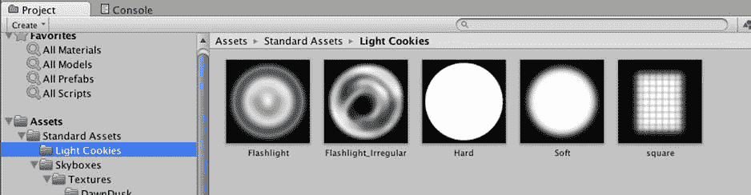
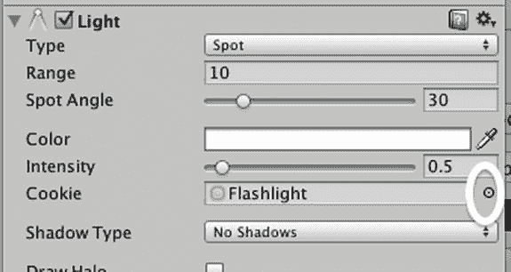
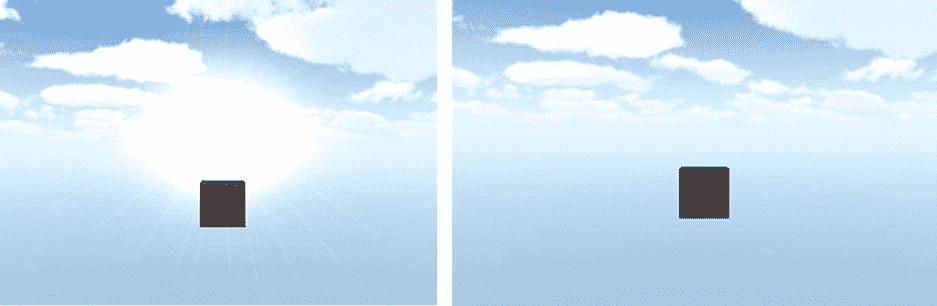

# 光照

目前，你的新场景包含了天空盒背景和一个`Cube`游戏对象。若进入 Play 模式，立方体仍会保持黑暗。无论天空盒纹理中包含多少光线，它本质上只是一张天空的纹理或图像，并不会向场景中的游戏对象投射光线。要解决这个问题，你需要一个`Light`游戏对象。例如：

- `方向光（Directional light）`：类似于太阳光，可照亮场景中的每一个游戏对象，但它并非来自单个点光源。
- `聚光灯（Spot light）`：从单个点发出的锥形光区域，类似于聚光灯或手电筒。
- `点光源（Point light）`：类似于灯泡，从中心点向所有方向发光。
- `区域光（Area light）`：用于烘焙光照贴图，不在本书讨论范围内。

使用层级视图中的`Create`按钮或顶部菜单中的`Game Object ➤ Create Other`，向场景中添加一个方向光。如果选择`Main Camera`，你会在`Camera Preview`中看到立方体明显变亮。重新选择`Directional light`，并在 Inspector 中查看其属性。

第一个属性是`Type`。尽管你创建的是方向光，但可以通过此下拉菜单将其更改为其他类型的光。请注意，Inspector 会保持上下文相关，并会根据所选类型改变属性，但层级视图中的名称“Directional light”并不会反映此处所做的任何更改。

## 通用光照属性

我想再次强调亲手操作 Unity 进行实验的重要性。以下对光照属性的描述并非枯燥乏味的说教——这些属性更适合观察和实践，而非被动阅读。虽然我不会为每个属性提供逐步指导，但我强烈建议你在 Unity 中测试每一个属性，以便在 Scene 视图和 Play 模式下观察其效果。记住，你始终可以使用`Light`组件的齿轮图标来重置属性。

### `Color`（颜色）

点击颜色框会弹出一个颜色选择器，用于选择任意颜色的光。如果点击吸管图标，颜色框中的颜色会随鼠标悬停位置的颜色而变化——例如，使用鼠标从电脑屏幕其他窗口显示的图像中抓取一个颜色样本。

### `Intensity`（强度）

这是光的亮度，其中 8 为最亮，0 则为完全无光。虽然更改光的`Type`不会改变其值，但当你创建新光时，方向光（`Directional`）的默认值为`0.5`，而点光源（`Point`）和聚光灯（`Spot`）的默认值为`1`。

### `Cookie`（遮罩）

`Cookie`起到光前掩模或屏幕的作用，为光赋予阴影图案。在 Unity 编辑器中，使用`Transform`组件的齿轮图标选择`Reset`。然后将光的`Transform`位置设置为`(0, 0, –2)`，`Type`设置为`Spot`。从顶部菜单中选择`Assets ➤ Import Package ➤ Light Cookies`。此时会打开`Import Packages`窗口，其中列出了 Unity 标准资源（Standard Assets）中可用的 Cookie。点击`Import`，然后检查`Project`面板中的`Assets`文件夹，会发现`Light Cookies`文件夹已加入`Standard Assets`文件夹中的`Skyboxes`文件夹内（图 3-15）。

图 3-15. Unity 标准资源中`Light Cookies`包的内容

将其中任意一个拖动到 Inspector 面板的`Cookie`属性中，观察光图案如何显示在`Cube`游戏对象上。

要清除`Cookie`属性，请点击属性字段右侧的目标图标，打开`Select Texture`弹出窗口（图 3-16）。这里会显示你已导入的所有包中的纹理。在列表顶部选择`None`，即可看到`Cookie`属性随之变化，然后关闭弹出窗口。

图 3-16. 用于打开`Select Texture`弹出窗口的目标图标

如果你恰好会使用 Photoshop，可以在 Unity 手册中的`Frequently Asked Questions ➤ Graphics Questions ➤ How do I make a Spot Light Cookie?`部分找到制作自定义 Cookie 的说明。

### `Shadow Type`（阴影类型）（仅限 Pro 版本）

当你准备好提升游戏品质时，务必查看 Unity Pro 中提供的众多额外效果。除了新功能、改进的开发工具和更多目标平台外，Unity 还最近调整了其定价结构，使 Pro 版本对独立开发者更加友好。你可以在 Unity 网站上通过选择顶部菜单中的`Buy`来获取更多信息。

### `Draw Halo`（绘制光晕）

当勾选`Draw Halo`属性时，其“光晕”会在光源周围的空气中产生粒子效果。

### `Flare`（光晕）

将光的`Transform`位置设置为`(0, 2, 3)`，`Type`设置为`Point`。从顶部菜单中选择`Assets ➤ Import Package ➤ Light Flares`。此时会打开`Import Packages`窗口，其中列出了 Unity 标准资源（Standard Assets）中可用的光晕（Light Flares）。点击`Import`，然后检查`Project`面板中的`Assets`文件夹，会发现`Light Flares`文件夹已加入`Standard Assets`文件夹中的`Light Cookies`和`Skyboxes`文件夹内。将`Sun`资源拖动到`Flare`属性窗口中，并在 Scene 视图或 Game 视图中观察其效果（图 3-17）。

图 3-17. 分别显示有和没有太阳光晕效果的 Game 视图

### `Render Mode`（渲染模式）

该属性指定了光源的重要性。在运行时，计算光照和阴影会消耗大量计算能力。当这些消耗大量计算能力的元素影响游戏质量和性能时，它们被称为“昂贵（expensive）”。评估光源的相对重要性有助于 Unity 优化游戏性能，这是本书后续会讨论的一个主题。

### `Culling Mask`（剔除遮罩）

其工作方式与`Camera`组件中的`Culling Mask`属性相同，你可以在此指定哪些层会受到该光源的影响。

### `Lightmapping`（光照映射）

`Realtime Only`表示该光源用于在运行时动态照亮场景。`Baked Only`指的是光照贴图（lightmapping），这超出了本书的讨论范围。`Auto`则允许两者兼用。

## 其他属性

还有一些属性特定于你选择的光源类型。这些属性会根据你的选择出现在上下文相关的 Inspector 中。

### `Range`（范围）

对于`Point`（点光源）和`Spot`（聚光灯），`Range`指的是从光源发出的有效照射距离。超出该范围的游戏对象将不会被照亮。当选中光源时，其范围会在 Scene 视图中以黄色球体形式直观显示。

### `Spot Angle`（聚光角度）

仅适用于`Spot`（聚光灯）。`Spot Angle`以度为单位，决定了从`Spot`（聚光灯）发出的锥形光束的宽度。