# 7. 使用高级物理概念

在本章中，你将利用已学知识开始搭建一个障碍赛道，并加入新的物理概念，包括在障碍赛道中使用关节、为玩家添加布娃娃物理效果，当然，还有将它们整合到一起的新函数和脚本。

## 搭建障碍赛道

在项目面板中，选择 `Assets ➤ Sample Assets ➤ Sample Scenes ➤ Scenes` 并打开 Third Person Character。在编辑器顶部菜单中，选择 `File ➤ Save Scene as`；将新场景命名为 Obstacle Course。在层级视图中，删除 Obstacles（障碍物）父级游戏对象，这也会删除其所有子对象。此时在场景视图中，只有玩家角色站在地面上。

在项目面板的 `Assets ➤ Sample Assets ➤ Prototyping ➤ Prefabs ➤ Compound Prefabs` 文件夹中，找到 `Elevated Track`，将其拖入场景视图，并将其 Transform 坐标设置为 `(0, 0, 22)`。你的玩家角色坐标应为 `(0, 0, 0)`，当你点击播放时，它应面向 `Elevated Track` 的斜坡（图 7-1）。

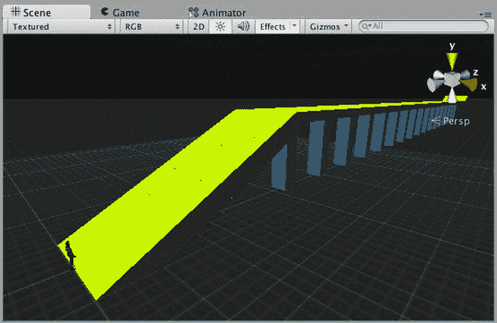

图 7-1. 障碍赛道的 `Elevated Track` 预制件

# 降低平台障碍

现在你已经有了一条漂亮的架空轨道，角色可以轻松地从起点跑到终点。最简单的起步障碍就是移除一段轨道。删除第三个 `Platform 8 × 1 × 8` 游戏对象及其支撑柱（`Pillar 8 × 2 × 8`）。你可以在层级视图中选中该游戏对象并右键单击，在弹出菜单中选择“删除”；也可以在层级视图中选中该游戏对象，然后通过编辑器顶部菜单选择 `编辑` ➤ `删除`（图 7-2）。

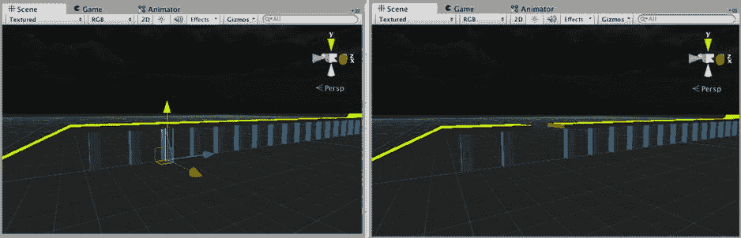

图 7-2. 删除第三个 `Platform 8 × 1 × 8` 平台预制体及其支撑柱

如果现在运行关卡，你的角色将无法跨越这个缺口。在无法获胜的游戏中设置不可能完成的障碍毫无乐趣可言。为了解决这个缺口，在项目面板的 `Assets` ➤ `Sample Assets` ➤ `Prototyping` ➤ `Prefabs` 文件夹中找到 `Platform 4 × 1 × 4` 预制体，将其拖放至场景视图。设置其变换位置为 `(0,12, 38)`。这样它就会位于缺口的中间位置，比架空轨道略高一些。现在进行游戏测试，你可以通过空格键引导玩家角色跳过缺口、落在这个平台上，然后从平台远端跳回架空轨道。

一个有用的垫脚石是帮助玩家跨越缺口、继续前进所必需的，但如果让平台上下移动，它就能变成更具挑战性的障碍。在项目面板的 `Assets` ➤ `Scripts` 文件夹中，新建一个名为 `MovePlatform` 的脚本。在 MonoDevelop 中打开它，并编辑代码如下：

```
#pragma strict

private var platformStartPosition : Vector3;
private var platformEndPosition : Vector3;
public var lowLevel : float = 6;
public var duration : float = 5.0f;
private var step : float = 0.0f;
private var movingBack : boolean = false;

function Start () {
    platformStartPosition = transform.position;
    platformEndPosition = (transform.position - Vector3(0, lowLevel, 0));
}

function FixedUpdate() {
    var delta : float = (Time.deltaTime / duration);
    if(movingBack) step -= delta;
    else step += delta;
    step = Mathf.Clamp01(step);
    rigidbody.MovePosition(Vector3.Lerp(platformStartPosition, platformEndPosition, step));
    if(step == 1.0f) movingBack = true;
    else if(step == 0.0f) movingBack = false;
}
```

这个脚本的编写方式有很多种。本质上，你需要平台从 A 点移到 B 点，然后再返回。不过，你还需要考虑其他因素，例如脚本的可复用性以及行为调试/测试的便捷性。

基于以上考虑，本脚本的分解如下：

```
(1)     private var platformStartPosition : Vector3;
...
function Start () {
    platformStartPosition = transform.position;
    ...
```

与其在变量声明时为 `platformStartPosition` 分配具体的坐标值，你的脚本在 `Start()` 函数中直接获取平台游戏对象当前所在的位置。通过这种方式编写，你可以在场景视图中重新调整平台的位置，而无需返回编辑脚本更新起始位置坐标。

```
(2)     private var platformEndPosition : Vector3;
public var lowLevel : float = 6;
function Start () {
    ...
    platformEndPosition = (transform.position - Vector3(0,
lowLevel, 0));
}
```

同样地，`platformEndPosition` 变量被声明但未分配具体坐标。平台将沿着 Y 轴垂直向下移动，移动距离由 `lowLevel` 变量指定。虽然 `lowLevel` 已显式赋值为 6，但更重要的是 `lowLevel` 变量是公开的，因此你可以直接在编辑器中调整平台的移动范围。`platformEndPosition` 在 `Start()` 函数中被赋值为 `platformStartPosition` 的 Y 坐标减去 `lowLevel` 值的结果。

```
(3)     public var duration : float = 5.0f;
```

`duration` 变量决定了平台从 `platformStartPosition` 移动到 `platformEndPosition` 的速度。将其设为公开变量，你就可以直接从编辑器中调整平台的移动速度。

```
(4)     private var step : float = 0.0f;
private var movingBack : boolean = false;
```

`step` 和 `movingBack` 都用于改变平台运动方向，以便在游戏过程中保持重复的上下移动。

```
(5)     function FixedUpdate() {
```

由于这是基于物理的刚体运动，此处使用 `FixedUpdate()` 函数而非 `Update()`。新手常犯的错误是忘记为游戏对象添加刚体组件。请确保 `Platform 4 × 1 × 4` 拥有刚体组件。如果没有，请在层级视图中选中它，然后在检视面板中选择 `添加组件` ➤ `物理` ➤ `刚体`。当刚体组件出现在检视面板中后，取消勾选“使用重力”（这并非必需），并勾选“运动学模式”，这样平台移动就不会受到玩家角色跳上来的影响。

```
(6)     var delta : float = (Time.deltaTime / duration);
```

`Time.deltaTime` 是完成上一帧所花费的秒数，因此通过除以 `duration` 可以得到一个归一化的分数赋值给 `delta`，以便：

```
(7)     if(movingBack) step -= delta;
```

如果布尔值 `movingBack` 为 true，则从 `step` 中减去这个归一化的分数值 `delta`；否则：

```
(8)     else step += delta;
```

将归一化的分数值 `delta` 加到 `step` 上。

```
(9)     step = Mathf.Clamp01(step);
```

`Mathf.Clamp01` 是一个将数值“限制”在 0 和 1 之间并返回浮点值的函数。在本例中，如果 `step -= delta` 后的值降到 0 以下，`Mathf.Clamp01` 就返回 0。如果 `step += delta` 后的值大于 1，`Mathf.Clamp01` 就返回 1。对于任何介于 0 和 1 之间的值，`Mathf.Clamp01` 返回其本身。

```
(10)    rigidbody.MovePosition(Vector3.Lerp(platformStartPosition,
platformEndPosition, step));
```

此处并非通过设置 Transform 位置来移动平台游戏对象，而是使用 `Rigidbody.MovePosition` 方法告知物理引擎将游戏对象移动到新位置。通过使用物理引擎，其他对象会根据自身的物理属性被推开，从而在这个游戏对象移动时保持行为的一致性。使用 `Vector3.Lerp` 可以平滑化游戏对象的移动。

```
(11)    if(step == 1.0f) movingBack = true;
```

回顾一下：如果 `movingBack` 为 `false`，则 `step` 的值会增加 `delta` 的值，然后在 (9) 中，若 `step` 的值等于或大于 1，`step = Mathf.Clamp01(step)` 会返回 1。当 `step` 达到值 1 时，`movingBack` 被重新赋值为 `true`，因此在下次调用 `FixedUpdate()` 执行到 (7) 时，平台将开始朝相反方向移动。

```
(12)    else if(step == 0.0f) movingBack = false;
```

这与 (11) 相反。当 `step` 递减到 0 时，布尔值 `movingBack` 被重新赋值为 `false`，因此在下次调用 `FixedUpdate()` 执行到 (8) 时，平台将再次反向。保存脚本，将其附加到 `Platform 4 × 1 × 4` 游戏对象上，然后点击运行。尝试调整 `duration` 和 `lowLevel` 的值，直到你感觉这是一个足够有挑战性的障碍。保存场景并保存项目（图 7-3）。

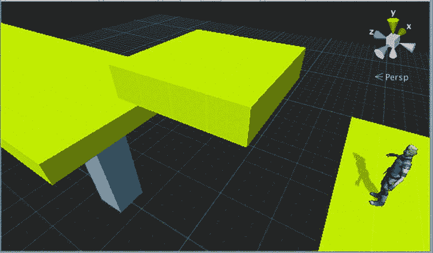

图 7-3. 玩家角色与移动平台障碍物

请注意，由于脚本的编写方式，你可以删除架空轨道的另一部分，并使用同样的脚本放入另一个移动平台障碍物。在进行此操作之前，请继续阅读后续内容，了解更多障碍物！

# 关节与摆锤障碍物

关节（Joint）仅仅是两个物体交汇的点。父子关系通过`Transform`连接两个或多个游戏对象，而关节则通过物理系统连接两个对象。这是Unity在构建游戏时提供多种解决方案供你选择以实现精确行为的又一个例子。

## 固定关节

`Fixed Joint`（固定关节）是最简单的关节。它将一个游戏对象的运动绑定到另一个游戏对象的运动上，与父子关系非常相似，只不过它使用的是物理引擎而非父子`Transform`关系。在层级面板中，创建一个`Sphere`游戏对象，并将其`Transform`位置设置为`(11.4, 20.3, 60)`，`Transform`缩放设置为`(11, 11, 11)`。将其重命名为`Pendulum Sphere`。请记住，任何游戏对象首先都需要一个`Rigidbody`（刚体）组件才能被物理引擎识别，因此在检查器中依次选择`Add Component` ➤ `Physics` ➤ `Rigidbody`。将其`Mass`（质量）属性设置为`20`。再次在检查器中，依次选择`Add Component` ➤ `Physics` ➤ `Fixed Joint`（如图 7-4 所示）。

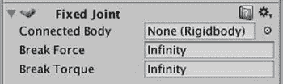
图 7-4. 检查器中的`Fixed Joint`组件

`Connected Body`（连接刚体）属性持有球体通过`Fixed Joint`连接的游戏对象的引用。如果留空，关节将连接到游戏世界。`Fixed Joint`具有物理特性，包括可能断裂的特性。`Break Force`（断裂力）和`Break Torque`（断裂扭矩）告诉物理引擎需要多大的力或扭矩才能使关节断裂。默认值为`Infinity`（无穷大），指示物理引擎该关节是不可断裂的。

现在创建一个`Cube`游戏对象，其`Transform`位置为`(6.5, 24, 60)`，并将其重命名为`Link01`。添加一个`Rigidbody`组件。在层级面板中，选择`Pendulum Sphere`。将`Link01`游戏对象从层级面板拖放到检查器中`Fixed Joint`组件的`Connected Body`字段中，或者使用字段右侧的圆形选择按钮，然后选择`Link01`。现在`Pendulum Sphere`和`Link01`游戏对象通过一个`Fixed Joint`连接起来了。

## 铰链关节

`Hinge Joint`（铰链关节）正如其名：一个连接两个游戏对象并允许其围绕单个轴运动的关节，就像门上的铰链一样。在层级面板中选择`Link01`游戏对象，然后在检查器中依次选择`Add Component` ➤ `Physics` ➤ `Hinge Joint`（如图 7-5 所示）。

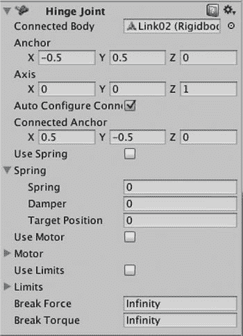
图 7-5. 检查器中的`Hinge Joint`组件

`Connected Body`与`Fixed Joint`中的相同。默认的`None`（无）将其连接到世界，或者你也可以选择要连接到关节的特定游戏对象。

`Anchor`（锚点）是铰链轴在局部空间中的位置。对于`Link01`游戏对象，将`Anchor`位置设置为`(–0.5, 0.5, 0)`。在场景视图中，你会看到一个代表铰链关节的橙色小箭头（如图 7-6 所示）。

被连接的游戏对象围绕铰链关节的`Axis`（轴）摆动。将`Link01`的`Hinge Joint`的轴设置为`(0, 0, 1)`。

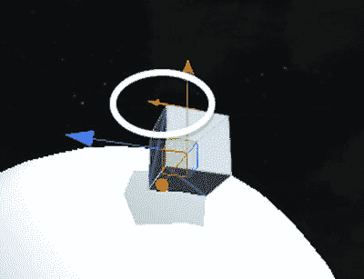
图 7-6. 代表`Hinge Joint`位置和轴的橙色箭头

`Hinge Joint`可以通过`Use Spring`（使用弹簧）表现出带弹簧的行为。游戏对象可以通过`Use Motor`（使用马达）像被马达驱动一样自动绕关节摆动。`Limits`（限制）允许你约束物体绕铰链关节旋转的范围，以及到达极限时是否反弹。摆锤链不需要用到这些属性中的任何一个，但你可以选择蓝色的书本图标以了解更多关于它们及其各自设置的信息。

最后，`Hinge Joint`也有`Break Force`和`Break Torque`属性，它们决定了克服关节作用力、使游戏对象彼此分离所需的力的大小。

## 构建摆锤链

`Link01`是构成驱动`Pendulum Sphere`摆动的“链”的七个链接中的第一个。既然它已经有了`Rigidbody`组件和`Hinge Joint`，你就可以用它来创建一个预制件。在项目面板中，打开`Assets` ➤ `Prefabs`文件夹。将`Link01`游戏对象从层级面板拖放到`Prefabs`文件夹中，并将这个新的预制件命名为`Link`。当你重命名预制件时，原始的`Link01`游戏对象也会变成`Link`。在层级面板中选择它，并将其重命名为`Link01`。现在将`Link`预制件拖到场景视图中，将其命名为`Link02`，并设置`Transform`位置为`(5.5, 25, 60)`。选择`Link01`，然后在检查器中为`Hinge Joint`组件的`Connected Body`属性选择`Link02`。继续以这种方式添加链接，直到你有七个链接，如图 7-7 所示。请注意，对于每个新的`Link`，其`Transform`的`x`值应递减`1`，`y`值应递增`1`，而`z`值应保持在`60`。`Link07`的`Connected Body`属性应为`None`。

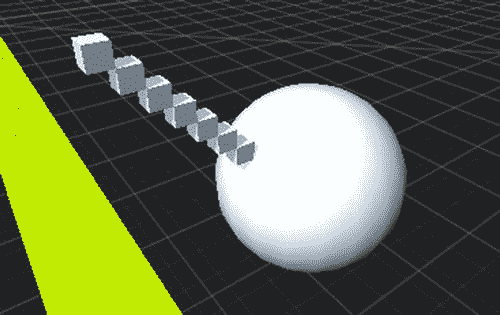
图 7-7. `Pendulum Sphere`与“链”

保存场景并尝试运行。注意，`Link07`的`Hinge Joint` `Connected Body`属性设置为`None`，它会自动悬挂在世界中的一个固定点上。退出播放模式。

在场景视图中，按住鼠标左键，拖动光标穿过所有立方体链节和`Pendulum Sphere`游戏对象以选中它们。按`Ctrl + D`复制整个摆锤结构，然后将复制的摆锤拖到`Transform Position`的`z`坐标为`72`的位置。重复这些步骤，将第三个摆锤放置在`Transform Position`的`z`坐标为`84`的位置。

看一下层级面板。现在你有三个编号从`1`到`7`的链接游戏对象，以及三个`Pendulum Sphere`——真是一团糟。这很好地说明了在开发游戏时保持组织有序的必要性。在编辑器顶部菜单中，选择`Game Object` ➤ `Create Empty`并将其命名为`Pendulum_01`。在层级面板中，找到第一个摆锤的每个链接以及球体，然后将它们拖放到`Pendulum_01`游戏对象中。以同样的方式创建`Pendulum_02`和`Pendulum_03`空游戏对象，以容纳构成第二个和第三个摆锤障碍物的游戏对象。这样好多了——现在你的层级面板中有了易于识别、带编号的摆锤父游戏对象，可以根据需要展开以进一步调整构成摆锤子游戏对象的构建模块。

为了给障碍物增加变化，将第二个摆锤移动到从障碍赛道左侧开始摆动的位置。将所有链接和`Pendulum Sphere`游戏对象的`Transform Position`的`x`坐标符号更改为负值（如图 7-8 所示）。

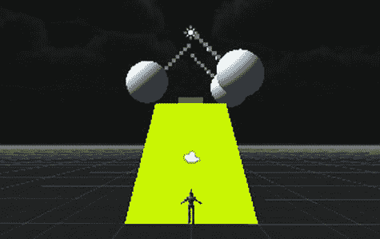
图 7-8. 摆锤障碍物

保存场景并试一下。不那么同步的摆锤摆动增加了这些障碍物的挑战性。你可以重新定位它们的起始点，或者为了快速测试，调整`Pendulum Sphere`游戏对象上的质量设置。

### 角色关节（Character Joint）

角色关节允许你为角色的关节设置限制。目前，角色的身体运动由`Animator`驱动。当角色整体与另一个游戏对象碰撞时，物理引擎会追踪`Rigidbody`和`Capsule Collider`。角色关节更常用于布娃娃效果，即角色的身体和四肢完全由物理引擎而非`Animator`组件控制。关节本身的工作原理类似于一个扩展的球窝关节，可以在原地旋转（扭转）和弯曲（摆动），通过设置各种限制属性，你可以自定义其巨大的运动范围（图 7-9）。

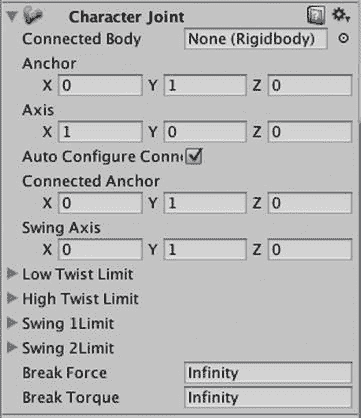
图 7-9. 检查器中的`Character Joint`组件

# Character Joint 属性

`Connected Body` 属性指的是 `Character Joint` 所连接到的刚体。如果其值为 `None`，则该关节会连接到世界空间，如同 `Hinge Joint` 那样。关节在游戏对象的局部空间中围绕 `Anchor` 点旋转。作为一个球窝关节，它有一个用于扭转的 `Axis`，以及一个用于“摆动”或弯曲的 `Swing Axis`。

使用 `Low Twist Limit` 和 `High Twist Limit` 属性来约束关节围绕 `Axis` 的扭转运动，使用 `Swing 1 Limit` 和 `Swing 2 Limit` 属性来约束围绕 `Swing Axis` 的运动。`Break Force` 和 `Break Torque` 决定了破坏关节所需的力量大小，其中 `Infinity` 表示关节无法被破坏。

## 布娃娃物理（Ragdoll Physics）

你可能已经注意到，当钟摆击中玩家角色时，它可能只会推动角色移动一点点，仅此而已。一个巨大的钟摆理应对角色产生更大的影响，比如将他击倒，让他像一堆——你猜对了——布娃娃一样瘫倒在地。

你的玩家角色拥有一个 `rigidbody` 和简单的 `Capsule Collider` 组件，以便与其他游戏对象交互。为了让物理引擎赋予角色身体和四肢逼真的物理属性，每个离散的身体部位都需要有自己的 `rigidbody` 和 `collider`。Unity 一如既往地提供了 `Ragdoll Wizard` 来帮助你创建这些子级刚体与碰撞体。布娃娃配置完成后，你可以将其保存为预制件以便后续重用。

首先，在层级视图中选择 `Third Person Character`，并将其重命名为 `Third Person Character Ragdoll`。展开所有内容，以便看到所有子级身体部位（图 7-10）。（你可能会发现使用方向键比鼠标更容易导航和展开树状层级结构。）

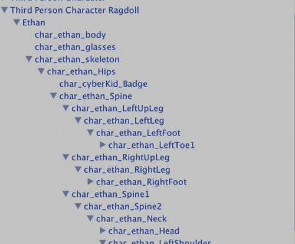

图 7-10. 在层级视图中展开的 `Third Person Character Ragdoll` 游戏对象

在编辑器顶部菜单中，选择 `Game Object` ➤ `Create Other` ➤ `Ragdoll...` 以打开 `Ragdoll Wizard`。将相应的身体部位拖放到 `Ragdoll Wizard` 中。此处，将 `char_ethan_Hips` 用于 `Root`，其余部分参照图 7-10。请注意 `Ragdoll Wizard` 窗口顶部的辅助提示。如果角色尚未处于 T 型姿势，可以通过在层级视图中选择 `Third Person Character Ragdoll`，然后将鼠标光标移至场景视图，再按下 `F` 键来设置（图 7-11）。

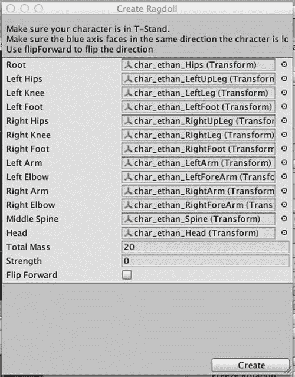

图 7-11. `Third Person Character Ragdoll` 的 `Ragdoll Wizard` 选择

并非所有名称都与 `Ragdoll Wizard` 中的相应字段完全匹配。如有疑问，可在层级视图中选择感兴趣的身体部位，并查找指示关节位置的橙色箭头（图 7-12）。所有字段填写完毕后，选择 `Create` 按钮。

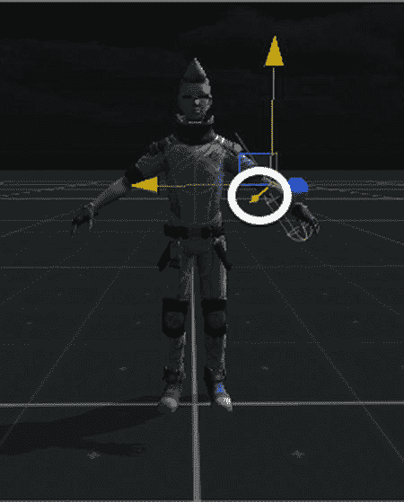

图 7-12. 橙色箭头指示 `char_ethan_LeftForeArm` 在肘部的关节位置

创建布娃娃到此就完成了。如果你有一个新导入的角色模型并遵循了这些步骤，此时按下播放键，角色就会像预期的那样像布娃娃一样瘫倒。然而，`Third Person Character Ragdoll` 已经附加了许多其他组件，包括控制动画的脚本，所以如果你现在按下播放键，你会看到玩家角色出现一些非常奇怪的行为。

`Third Person Character` 已经附带了一个 `rigidbody` 和 `Capsule Collider`。`Third Person Character` 脚本有一个功能检查，用于判断角色是否可以通过下蹲来钻到与其碰撞的物体下方。当钟摆从角色头顶摆过时，你可能见过这种情况。这里的奇怪行为源于原始玩家角色 `Capsule Collider`、`ThirdPersonCharacter` 脚本以及新的布娃娃刚体/碰撞体之间的相互作用（图 7-13）。

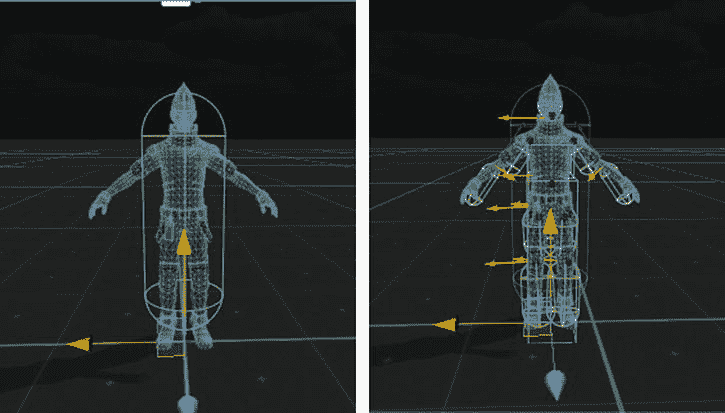

图 7-13. 原始 `Capsule Collider`（左）和布娃娃碰撞体（右）

# Unity 布娃娃系统脚本详解

## 启用布娃娃组件

在`Hierarchy`中，依次选择用于`Ragdoll Wizard`的每个子身体部位，取消勾选以在`Inspector`中禁用`Collider`组件，并为每个新的`Rigidbody`组件勾选`Is Kinematic`框。保持父级`Third Person Character Ragdoll`的`Rigidbody`和`Capsule Collider`组件启用。玩家角色在`Play`模式下将再次正常运行。

## 创建切换脚本

要从正常的玩家控制动画和运动切换到物理引擎驱动的布娃娃状态，需要一个脚本。在`Project`面板的`Assets ➤ Scripts`文件夹中，选择`Create ➤ Javascript`并将新脚本命名为`GoRagdoll`。添加以下代码：

```javascript
#pragma strict

private var childRigidBodies : Rigidbody[];
private var childColliders : Collider[];

function Start ()
{
    childRigidBodies = gameObject.GetComponentsInChildren.<Rigidbody>();
    childColliders = gameObject.GetComponentsInChildren.<Collider>();
}

function GotoRagdoll ()
{
    if (childRigidBodies != null)
    {
        for (var childRigidBody : Rigidbody in childRigidBodies)
        {
            childRigidBody.isKinematic = false;
        }
    }
    if (childColliders != null)
    {
        for (var childCollider : Collider in childColliders)
        {
            childCollider.enabled = true;
        }
    }
    gameObject.collider.enabled = false;
    gameObject.rigidbody.isKinematic = true;
    gameObject.GetComponent(Animator).enabled = false;
    gameObject.GetComponent(ThirdPersonCharacter).enabled = false;
    gameObject.GetComponent(ThirdPersonUserControl).enabled = false;
}
```

## 脚本代码解析

该脚本分解如下：

```javascript
(1) private var childRigidBodies : Rigidbody[];
(2) private var childColliders : Collider[];
```

这里介绍另一个编程概念：数组。数组是一组相同类型的项，称为元素。在(1)中，声明了一个名为`childRigidBodies`的数组私有引用变量，它将持有`Rigidbody`类型的元素。方括号`[]`是使其成为数组的语法，而非单个`Rigidbody`变量声明。在此示例中，`childRigidBodies`数组将把布娃娃的子刚体作为元素持有。

类似地，在(2)中，声明了一个名为`childColliders`的数组私有引用变量，它将持有`Collider`类型的元素，在此情况下是布娃娃的子碰撞体。

在`Start()`函数中：

```javascript
(3) childRigidBodies = gameObject.GetComponentsInChildren.<Rigidbody>();
(4) childColliders = gameObject.GetComponentsInChildren.<Collider>();
```

`GetComponentsInChildren`名称恰如其分，因为它返回游戏对象及其任何子对象的所有指定类型组件。这里，角色和由`Ragdoll Wizard`创建的子刚体的刚体组件被分配为`childRigidBodies`数组的元素。

同样，`Third Party Character Ragdoll`游戏对象的`Collider`组件和由`Ragdoll Wizard`创建的子碰撞体组件被分配为`childColliders`数组的元素。

在`GotoRagdoll()`函数中：

```javascript
(5) if (childRigidBodies != null)
(6) for (var childRigidBody : Rigidbody in childRigidBodies)
    {
        childRigidBody.isKinematic = false;
    }
(7) if (childColliders != null)
(8) for (var childCollider : Collider in childColliders)
    {
        childCollider.enabled = true;
    }
(9) gameObject.collider.enabled = false;
(10) gameObject.rigidbody.isKinematic = true;
(11) gameObject.GetComponent(Animator).enabled = false;
(12) gameObject.GetComponent(ThirdPersonCharacter).enabled = false;
(13) gameObject.GetComponent(ThirdPersonUserControl).enabled = false;
```

(5)测试以确保`childRigidBodies`包含元素。没有元素将等于`null`状态。

(6)是一个`for`循环的运作，对于`childRigidBodies`数组中的每个元素，创建一个`Rigidbody`类型的引用变量`childRigidBody`，然后将其`isKinematic`属性设置为`false`。将`isKinematic`设置为`false`意味着刚体现在被物理引擎识别。

(7)测试以确保`childColliders`包含元素。

(8)是另一个`for`循环，对于`childColliders`数组中的每个元素，创建一个`Collider`类型的引用变量`childCollider`，然后启用它。

(7)和(8)激活布娃娃子对象以使其可被物理引擎访问，但运行玩家角色动画和运动的`Animator`和脚本也需要被停用。

(9)和(10)是简单的点符号属性更改语句，其中父级`Capsule Collider`组件（`Third Person Character Ragdoll`的）被禁用，父级`Rigidbody`组件被设置为`isKinematic`——意味着不被物理引擎识别。

(11)、(12)和(13)的语法略有不同，因为`Collider`和`Rigidbody`类直接继承自`gameObject`类。`Animator`和脚本属于`MonoBehavior`类，因此必须通过名称使用`GetComponent`函数来获取，以访问其属性并禁用它们。

## 应用脚本

保存`GoRagdoll`脚本并将其附加到`Third Person Character Ragdoll`。

**注意**

如果`Sample Assets (beta)`资产已集成到`Standard Assets`文件夹中，则可以跳过以下步骤。

如果您使用的是`Sample Assets (beta)`包，您将收到`"Unknown identifier: Third Person Character"`错误。编译器首先编译 JavaScript 文件，因此它无法识别从`GoRagdoll`脚本的`GotoRagdoll()`函数调用的`"Third Person Character"`或`"Third Person User Control"` C#脚本（尚未编译）的引用。

此规则有一个例外：`Standard Assets`文件夹中的脚本甚至在 JavaScript 文件之前编译。此处快速解决方案是在`Project`面板中：将`Sample Assets ➤ Characters ➤ Third Person Character`文件夹拖放至`Standard Assets`文件夹中，同时将`Sample Assets ➤ Cross Platform Input`文件夹也拖放至`Standard Assets`文件夹中。接下来，在`Project`面板搜索栏中找到`CrossPlatformInputInitialize`脚本并删除它。回顾一下，在撰写本文时，`Sample Assets (beta)`是一个单独的文件夹，但最终这些资产将被集成到`Standard Assets`中。如果您的情况如此，则可以跳过此步骤。

在`Project`面板中，打开`Assets ➤ Prefabs`文件夹。将`Third Person Character Ragdoll`从`Hierarchy`拖到`Assets ➤ Prefabs`文件夹中，将其保存为预制件。

现在编写一个脚本，用于在玩家角色受到钟摆撞击时激活布娃娃物理效果。

在`Project`面板的`Assets ➤ Scripts`文件夹中，选择`Create ➤ JavaScript`，将其命名为`KillOnCollision`，并在`MonoDevelop`中打开。将代码编辑为以下内容：

```
#pragma strict

function OnCollisionEnter(other : Collision) {
    if (other.gameObject.name == "Third Person Character Ragdoll")
    {
        other.gameObject.GetComponent(GoRagdoll).GotoRagdoll();
    }
}
```

这部分内容在第 6 章中已熟悉。代码分解如下：

`(1)     function OnCollisionEnter(other : Collision)`

当此脚本所附加的游戏对象的`Collider`组件检测到碰撞时，`OnCollisionEnter`函数被调用，并传入一个引用`other`，指向其碰撞到的游戏对象（玩家角色）。

`(2)     if (other.gameObject.name == "Third Person Character Ragdoll")`

检查碰撞到的游戏对象是否是`Third Person Character Ragdoll`。

`(3)     other.gameObject.GetComponent(GoRagdoll).GotoRagdoll();`

使用`GetComponent`函数访问`GoRagdoll`脚本，然后调用`GotoRagdoll()`函数。

在此特定情况下，条件判断是必要的，因为当玩家角色被钟摆击中时，钟摆可能会继续与一个或多个布娃娃碰撞器发生碰撞，从而导致错误。如果你有其他移动物体（非玩家角色）撞向钟摆，也会发生同样的情况。

保存脚本，并将其分别附加到三个钟摆球体上。保存场景，保存项目，然后进行游戏测试。现在，被钟摆击中后得到的反馈可真是令人满意！（参见图 7-14）

如果仔细观察，你会注意到玩家角色的头部和脚后跟似乎陷入了其躺卧的表面。你可以通过调整各个布娃娃碰撞体的大小和位置，来针对你的游戏玩家角色模型进行微调。

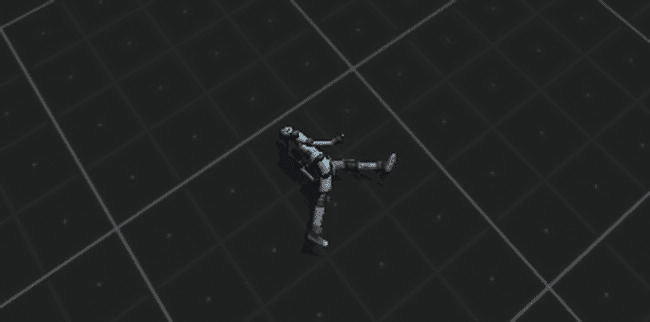

图 7-14.

玩家角色根据布娃娃物理效果倒地

### 击杀区域

你也可以编写一个`KillOnTrigger`脚本，用于不可见的击杀区域。由于障碍赛道是一条高架轨道，如果玩家角色坠落，应该会发生一些糟糕的事情，例如在地板上方设置一个不可见的击杀区域，当玩家角色撞击时立即死亡。在项目面板的`Assets ➤ Scripts`文件夹中，选择`Create ➤ JavaScript`，将新脚本命名为`KillOnTrigger`，并在`MonoDevelop`中打开。你可以从`KillOnCollision`中复制粘贴代码，然后将函数名从`OnCollisionEnter(other : Collision)`更改为`OnTriggerEnter(other : Collider)`，如下所示，然后保存脚本：

```
#pragma strict

function OnTriggerEnter(other : Collider) {

        if (other.gameObject.name == "Third Person Character Ragdoll")

        {

        other.gameObject.GetComponent(GoRagdoll).GotoRagdoll();

        }

}
```

在层级面板中选择`Create ➤ Cube`，并将其命名为`KillZone_Floor`。在检查器中，将其变换位置设置为`(0, 0, 120)`，缩放设置为`(30, 1, 200)`。取消勾选网格渲染器组件以禁用它，使其成为一个不可见的击杀区域。在盒碰撞体组件中勾选`Is Trigger`。选择`Add Component ➤ Scripts`并选择`KillOnTrigger`。保存场景，保存项目，然后进行游戏测试。当玩家角色从高架赛道坠落时，布娃娃物理效果会在其撞击地板前生效。

### 弹簧关节

弹簧关节用于连接两个刚体，使它们的运动就像通过弹簧连接一样。弹簧有一个平衡位置，在此位置时处于静止状态。如果两个刚体被拉开，弹簧会通过回拉来抵抗这种运动。你可以在图 7-15 中看到弹簧关节组件的属性。

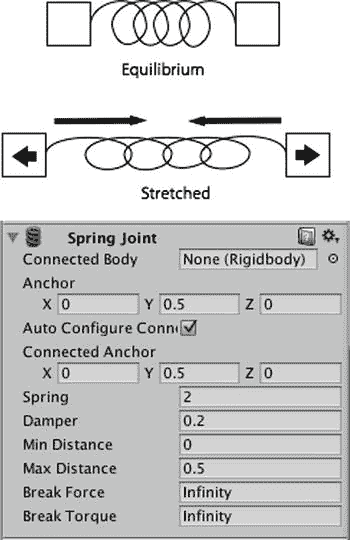

图 7-15.

检查器中的弹簧关节组件

弹簧关节的`Connected Body`属性同样指明了该弹簧关节所连接的刚体；如果为`None`，则连接至世界空间。`Anchor`是关节相对于游戏对象本地空间的中心点，而`X`、`Y`、`Z`属性则是关节的本地中心。当你添加一个`Connected Body`时，可以看到这些值的变化。

`Spring`属性设置了弹簧抵抗相反作用力的回拉力度。`Damper`抗拒`Spring`，类似于`Drag`抗拒作用力。`Damper`值越高，弹簧在静止前的振荡或“弹跳”次数就越少。

`Min Distance`和`Max Distance`设置了一个范围，在该范围内弹簧动作不会激活，即只有当刚体移动到此范围之外时，弹簧关节才会回拉。`Break Force`和`Break Torque`决定了破坏弹簧关节所需的作用力。

### 可配置关节

可配置关节是一种高度可定制的关节，其详细内容超出了本书的范围。Unity 组件参考文档是获取更多信息的最佳起点。你可以在图 7-16 中查看可配置关节组件的属性。

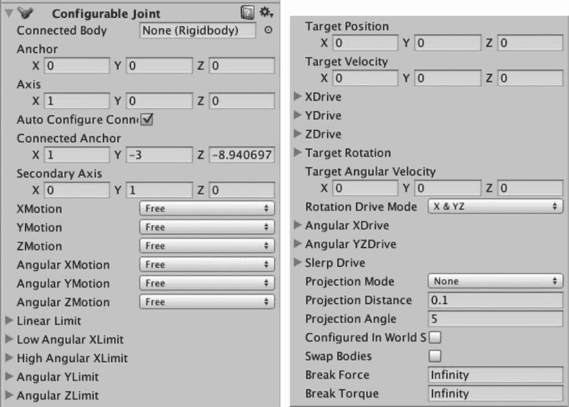

图 7-16.

可配置关节组件的众多属性。

# 射线投射

射线投射是一种从游戏对象向世界延伸射线，以检测其路径上是否存在碰撞体的技术。它通常用于瞄准、计算距离等场景。该名称源于其坐标几何原理：射线是一种线，其一端在空间中具有特定点，另一端可延伸至无穷远。

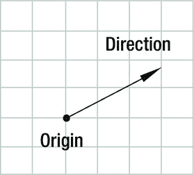

`Ray` 结构体包含作为 `Vector3` 的起点和作为 `Vector3` 的方向。

在 Unity 编辑器的 Project 面板中，打开 `Assets` ➤ `Sample Assets` ➤ `Sample Scenes` ➤ `Scenes` 文件夹，并打开第三人称角色场景。在顶部菜单中选择 `File` ➤ `Save Scene as . . .`，将场景另存为 `RaycastTest`。

同样在 Project 文件夹中，选择 `Assets` ➤ `Scripts` 文件夹，然后选择 `Create` ➤ `Javascript`，将新脚本命名为 `RaycastFun`，并在 MonoDevelop 中打开。在正常游戏中你无法看到射线，但 `Debug.DrawRay(origin, direction, color)` 在开发过程中非常有帮助。将代码编辑如下：

```
public var rayLength : float = 2;

function Update () {
Debug.DrawRay(transform.position + Vector3(0, 0.5, 0), transform.forward * rayLength, Color.white);
}
```

分解说明：

(1) `public var rayLength : float = 2;`

声明一个 float 类型变量 `rayLength`，并将其设为 public，以便在 Inspector 中访问。

(2) `Debug.DrawRay(transform.position + Vector3(0, 0.5, 0), transform.forward * rayLength, Color.white);`

以游戏对象的 `transform.position` 作为射线的起点，然后向 y 坐标增加 0.5，以将其从地面略微抬高。射线的方向是玩家角色面向的方向，即游戏对象的本地 `transform.forward`，其长度由因子 `rayLength` 调整。你可以更改射线的 `color` 以达到最佳可见度。还有一些我们不会使用的参数，例如射线可见的时间以及相对于其他游戏对象的绘制方式。

 有关完整详情，请查阅 `DrawRay` 的脚本参考。

保存脚本，将其附加到第三人称角色布娃娃物体上，保存场景，然后进行测试。根据你的编辑器设置，你可能看不到任何变化。如果出现这种情况，请在播放模式下选择 Game 视图顶部的 `Gizmos` 按钮。现在进行测试，所有东西都可见，包括代表从玩家角色向前延伸射线的细白线（图 7-17）。

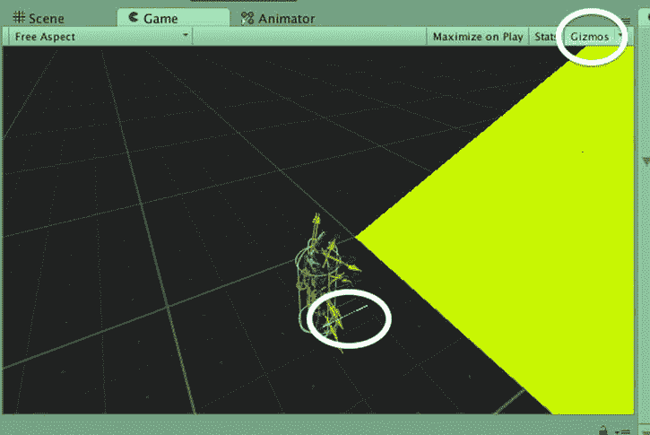

图 7-17. 在游戏视图中显示辅助图标

Gizmos 按钮上的小箭头会按类型显示一个辅助图标上下文菜单，以便你控制测试期间希望看到和不希望看到的内容（图 7-18）。

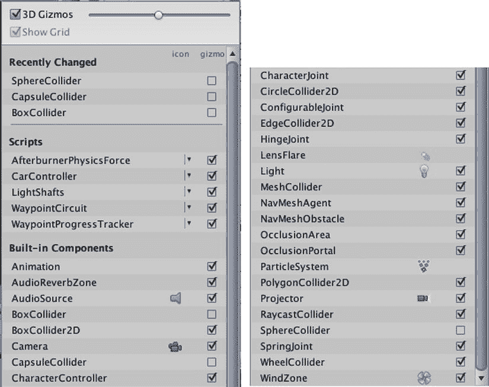

图 7-18. 可在游戏视图中查看的各种辅助图标选择菜单

各种 `Raycast` 方法让你可以控制射线可以击中哪些碰撞体，以及是否希望获取关于射线投射所命中碰撞体的信息。

在编辑器中，通过将 `Transform.rotation` 的 y 坐标改为 180 来转动玩家角色。创建五个原始球体对象，并赋予它们 `transform.position` 坐标分别为 (0, 0.5, -5)、(4, 0.5, 5.5)、(0.7, 0.5, -4)、(-3, -0.5, -11) 和 (-4, 0.5, -2)。使用标准命名约定，将它们依次命名为 `Sphere_001` 到 `Sphere_005`。在 MonoDevelop 中，将你的 `RaycastFun` 脚本编辑如下：

```
function Update () {
var hit : RaycastHit;
if(Physics.Raycast(transform.position + Vector3(0, 0.5, 0), transform.forward, hit))
{
print ("Collided with game object " +
hit.collider.gameObject.name);
}
}
```

分解说明如下：

(1) `var hit : RaycastHit;`

声明 `RaycastHit` 类型引用变量，该变量将存储关于射线所击中的碰撞体的信息。

(2) `if(Physics.Raycast(transform.position + Vector3(0, 0.5, 0), transform.forward, hit))`

当射线与碰撞体相交时，`Raycast()` 函数返回布尔值 `true`，当没有相交时返回 `false`。如果 `Raycast()` 返回 `true`，则会执行条件内的代码块。

射线的起点被设置为游戏对象的 `transform.position`，同时将起点的 y 坐标增加 0.5，使其大致达到角色的膝盖高度。

射线的方向对应于游戏对象的正向。省略射线长度意味着它默认为无限长的射线，因此你可以从玩家角色面向的任何游戏对象处获取命中信息。

(3) `print ("Collided with game object " + hit.collider.gameObject.name);`

打印射线检测到的任何游戏对象的名称。

保存脚本。保存场景并进行测试。注意，射线会检测所有带有碰撞体的物体，包括斜坡和场景中的其他游戏对象。

假设你想摧毁这些邪恶的球体。尝试在 `Update()` 函数中添加一个“Destroy”命令：

```
function Update () {
var hit : RaycastHit;
if(Physics.Raycast(transform.position+ Vector3(0, 0.5, 0),
transform.forward, hit)) {
print ("Collided with game object " +
hit.collider.gameObject.name);
Destroy(hit.collider.gameObject);
}
}
```

保存脚本并进行测试。操控角色到处跑动，摧毁邪恶的球体。但要小心——你也会摧毁射线命中的较低斜坡和障碍物游戏对象。

你已经在条件语句中使用过 `gameObject.name` 来检测游戏对象，但现在你需要处理五个邪恶的球体。你可以使用以下方法摧毁这些球体：

```
function Update () {
var hit : RaycastHit;
if(Physics.Raycast(transform.position+ Vector3(0, 0.5, 0), transform.forward, hit)) {
print ("Collided with game object " + hit.collider.gameObject.name);
if (hit.collider.gameObject.name == ("Sphere_001"))
{
Destroy(hit.collider.gameObject);
}  else if (hit.collider.gameObject.name == ("Sphere_002"))
{
Destroy(hit.collider.gameObject);
}  else if (hit.collider.gameObject.name == ("Sphere_003"))
{
Destroy(hit.collider.gameObject);
}  else if (hit.collider.gameObject.name == ("Sphere_004"))
{
Destroy(hit.collider.gameObject);
}  else if (hit.collider.gameObject.name == ("Sphere_005"))
{
Destroy(hit.collider.gameObject);
}
}
}
```

但你可以看到，仅仅处理几个邪恶球体，代码就已经变得非常繁琐和庞大。如果邪恶球体的数量多得多，该怎么办？

## 标签

# 标签

标签是一种重要的脚本工具，它允许你对游戏对象（例如邪恶球体）进行排序和分组标识，从而简化你的代码。

在层级视图中，选择 `Sphere_001`，然后查看检视面板，你会看到靠近顶部、游戏对象名称正下方有一个标签选项（图 7‑19）。

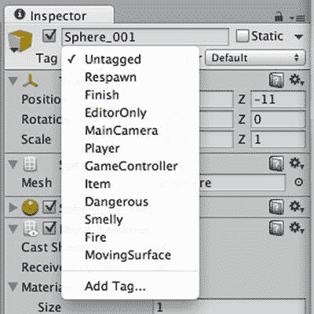

*图 7‑19.* 检视面板中的标签下拉菜单选择器

打开标签下拉菜单，你会看到一系列常用标签。虽然有一些内置标签，但你需要创建一个名为 `Enemy` 的标签，因此选择菜单底部的“添加标签...”，以在检视面板中打开标签管理器（图 7‑20）。

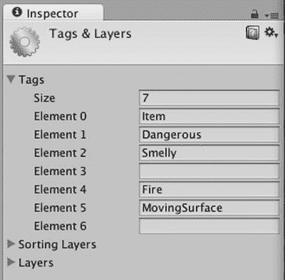

*图 7‑20.* 检视面板中的标签和层级管理器

如果所有元素都不是空的，你可以增加“大小”的值。请记住，一个游戏对象只能有一个标签，但你可以根据需要为游戏创建任意数量的不同标签。将 `Enemy` 添加到标签列表中的一个空元素中，然后在层级视图中重新选择 `Sphere_001`。现在，当你选择检视面板中的标签下拉菜单时，`Enemy` 会作为一个选项出现，因此选择它。也将其余四个球体游戏对象的标签设置为 `Enemy`。

在 MonoDevelop 中，将你的 `Update()` 函数编辑为以下内容：

```
function Update () {   var hit : RaycastHit;

        if(Physics.Raycast(transform.position+ Vector3(0, 0.5, 0), transform.forward, hit)) {

                print ("Collided with game object " + hit.collider.gameObject.name);

                if (hit.collider.gameObject.tag == ("Enemy"))

                {

                        Destroy(hit.collider.gameObject);

                }       

        }

}
```

保存并运行测试，现在任何与射线相交的邪恶球体都会被销毁。在各个方向操纵玩家角色，注意平台和障碍物方块不会被销毁，只有球体被销毁。

标签并非射线检测专用；它们是为了在你的脚本中更方便地管理游戏对象组。

## 层

标签通过处理游戏对象组来减少冗长的代码，而层也同样处理游戏对象组。层有助于提升游戏性能，因为它们最常被用作约束条件，有选择地忽略某些游戏对象组或场景区域，从而减少处理负载。

层可用于限制摄像机渲染场景的哪一部分、实现基于层的碰撞检测，或确定场景的哪些区域会被照亮，这同样减少了处理负载。与标签不同，前七个层是 Unity 必需的，并且你总共只能使用 31 个层。

如果你在 `RaycastFun` 脚本的 `Update()` 函数中注释掉或修改你的代码为以下内容：

```
function Update () {

    var hit : RaycastHit;

        if(Physics.Raycast(transform.position+ Vector3(0, 0.5, 0),

        transform.forward, hit)) {

                print ("Collided with game object " +

                hit.collider.gameObject.name);

                Destroy(hit.collider.gameObject);

        }

}
```

这次，射线检测到的平台和障碍物方块将与球体一起被销毁。在层级视图中选择 `Obstacles`。在检视面板中，在标签菜单右侧，选择“层”下拉菜单并选择“忽略射线检测”（图 7‑21）。

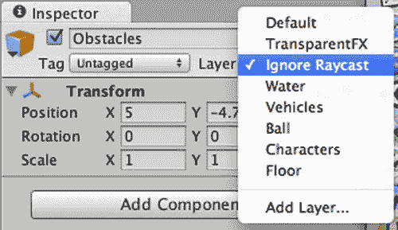

*图 7‑21.* 在层下拉菜单中选择“忽略射线检测”

一个弹出窗口将询问你是否要将所有子对象的层设置为“忽略射线检测”。选择“是，更改子对象”，这样组成 `Obstacles` 的所有较小的预制件方块都将被包含在“忽略射线检测”层中。

保存场景并运行测试。再次，只有当射线检测到碰撞体时，邪恶球体才会消失。现在的区别在于，游戏引擎不必检查射线相交的每一个碰撞体，而是直接忽略“忽略射线检测”层上的任何碰撞体。

## 角色控制器

你已经使用脚本、动画和物理力移动过游戏对象。你也花了一些时间使用 Unity 的示例资产控制器，例如第三人称角色，但你也可以使用角色控制器组件创建自己的控制器。对于你不希望受刚体物理影响的第一人称或第三人称角色，角色控制器组件可能正是你需要的。

在编辑器中，创建一个新场景，并添加一个平面和一个方向光。在层级视图中选择“创建 ➤ 立方体”。注意，原始游戏对象 `Cube` 没有刚体组件。回顾一下，刚体运动是由物理引擎控制的，因此，角色控制器组件和刚体组件同时试图控制同一个游戏对象的运动会导致异常行为。

注意，`Cube` 游戏对象已经有一个盒子碰撞体。角色控制器本质上是一个胶囊碰撞体，其运动可以通过脚本控制。它继承自 `Collider` 类，这意味着它包含了 `Collider` 类的功能，并通过更多的自定义函数在此基础上进行构建。在层级视图中选中 `Cube` 游戏对象，在检视面板中选择“添加组件 ➤ 物理 ➤ 角色控制器”。在场景视图中，你会看到胶囊碰撞体的辅助图标出现在 `Cube` 游戏对象内部（图 7‑22）。

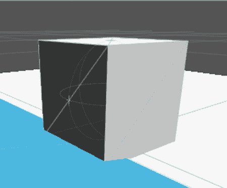

*图 7‑22.* `Cube` 游戏对象内部的角色控制器胶囊碰撞体

在检视面板中，你会找到角色控制器。控制器无法攀爬超过“坡度限制”的斜坡。“步进偏移”是一个类似的垂直约束，它决定了控制器可以从地面爬上台阶的高度。“皮肤宽度”设置了表面内部的余量，另一个碰撞体在检测到碰撞之前可以穿透到控制器碰撞体内部。一般经验法则是角色控制器半径的 10%，因此将其更改为 0.1。为了减少抖动，如果控制器被告知移动的距离小于“最小移动距离”，它将保持原地不动。数值越大，所需的控制输入越多。与标准碰撞体一样，胶囊碰撞体可以使用“中心”进行偏移，并使用“半径”和“高度”调整大小（图 7‑23）。

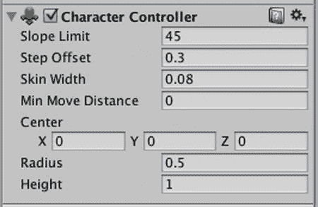

*图 7‑23.* 检视面板中的角色控制器组件

要测试其中一些属性，你需要用更多物品来填充场景。在项目面板中，选择 `Assets ➤ Sample Assets ➤ Prototyping ➤ Prefabs` 文件夹，并向场景中添加一个 `Loop`。将 `Loop` 的 y 轴旋转设为 90。`Loop` 和 `Plane` 的变换位置都应为 `(0, 0.5, 0)`，而 `Cube` 的变换位置应为 `(0, 0, 0)`。将 `Plane` 的缩放设为 `(20, 20, 20)`，并通过从 `Assets ➤ Sample Assets ➤ Prototyping ➤ Prefabs ➤ Textures` 文件夹中拖动 `prototype_grey_dff` 纹理并将其放到场景视图中的 `Plane` 上来增加一点对比。再深入一级文件夹进入 `Compound Prefabs`，将一个 `Box Pile` 拖入场景；将其变换位置设为 `(2, 0, –8)`。

最后，在 `Assets ➤ Standard Assets ➤ Scripts ➤ Camera Scripts` 文件夹中，找到鼠标轨道脚本。如果该文件夹不存在，请从顶部菜单中选择 `Assets ➤ Import Package ➤ Scripts` 来获取它。将其拖放到 `Main Camera` 上。在层级视图中选择 `Main Camera`。将 `Cube` 游戏对象从层级视图拖到 `Main Camera` 的鼠标轨道脚本组件上，并将其放入目标属性字段中。

场景已搭建完成，角色控制器属性也已设置好。现在需要编写一个脚本让 `Cube` 游戏对象动起来。在 Project 面板中选择 `Assets ➤ Scripts` 文件夹，然后依次选择 `Create ➤ New Script ➤ Javascript`。将其命名为 `CCScript`，并在 MonoDevelop 中打开。将代码编辑为以下内容：

# Unity 角色控制器与物理交互详解

## 代码示例

```csharp
#pragma strict

private var contr : CharacterController;

private var moveVector : Vector3 = Vector3.zero;

public var speed : float = 10.0f;

function Start () {

contr = gameObject.GetComponent.<CharacterController>();

}

function Update () {

moveVector.x = Input.GetAxis("Horizontal") * speed;

moveVector.z = Input.GetAxis("Vertical") * speed;

contr.Move(moveVector * Time.deltaTime);

}
```

## 代码分解说明

### (1) 变量声明

`private var contr : CharacterController;`

声明一个类型为 `CharacterController` 的引用变量 `contr`。

### (2) 变量声明

`private var moveVector : Vector3 = Vector3.zero;`

声明一个类型为 `Vector3` 的引用变量 `moveVector`，用于存储每帧游戏对象的移动距离信息。

### (3) 变量声明

`public var speed : float = 10.0f;`

声明一个公共浮点变量 `speed`，用于在 Inspector 中调整游戏对象的速度。

### (4) Start 函数

```csharp
function Start () {

controller = gameObject.GetComponent.<CharacterController>();

}
```

访问 `CharacterController` 组件的引用，并将其赋值给 `controller`。

### (5) Update 函数

```csharp
function Update () {

moveVector.x = Input.GetAxis("Horizontal") * speed;

moveVector.z = Input.GetAxis("Vertical") * speed;

}
```

这里将用户的输入乘以 `speed` 因子，并分别存储到 `Vector3` 变量 `moveVector` 的 x 轴和 z 轴分量中。

### (6) Move 函数调用

`controller.Move(moveVector * Time.deltaTime);`

首先将 `moveVector` 信息乘以 `Time.deltaTime` 平滑因子，然后传递给角色控制器的 `Move()` 函数。

`Move()` 函数移动游戏对象，并以 `CollisionFlags` 变量的形式返回移动过程中发生的碰撞信息。这些信息可以让你大致了解碰撞发生的位置。`CollisionFlags` 变量是一个位掩码，其解释超出了本文的范围。不过，你可以点击 MonoDevelop 中的 `CollisionFlags` 打开脚本参考文档，了解如何过滤 `CollisionFlags` 信息（图 7-24）。

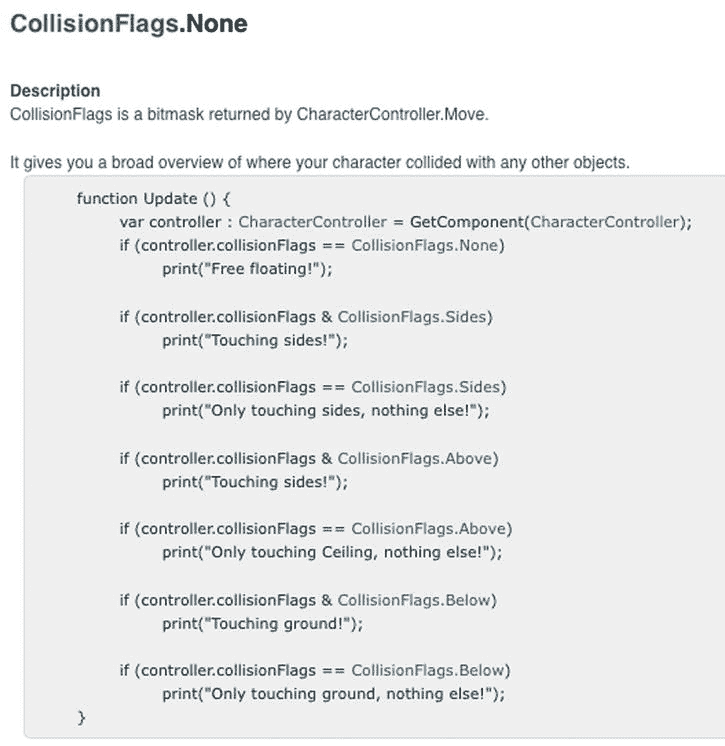

图 7-24. Unity 脚本参考文档中的 `CollisionFlags` 包含了示例布尔逻辑条件语句，用于提取感兴趣的碰撞信息

## 测试与扩展

保存脚本并将其附加到 Cube 游戏对象上。保存场景并播放。尝试让 Cube 沿环形坡道向上移动。一旦环形坡道的坡度超过坡度限制值，Cube 就无法继续前进了。你还可以通过 Cube 靠近环形坡道一侧的边角被遮挡的程度，观察到皮肤宽度设置的效果。

你还会发现 Cube 会撞到箱子堆并停下来，但箱子堆对碰撞没有反应。要实现这种交互，你需要手动向脚本中添加相应功能。在 MonoDevelop 中，在其他变量声明之后添加一个变量声明：

`public var pushPower : float = 2.0;`

这将为你提供一个因子，用于通过 Inspector 调整碰撞效果。

在 `Update()` 函数下方添加以下函数：

```csharp
function OnControllerColliderHit (hit : ControllerColliderHit) {

var body : Rigidbody = hit.collider.attachedRigidbody;

if (body == null || body.isKinematic)

return;

if (hit.moveDirection.y < -0.3)

return;

var pushDir : Vector3 = Vector3 (hit.moveDirection.x, 0,

hit.moveDirection.z);

body.velocity = pushDir * pushPower;

}
```

## OnControllerColliderHit 函数分解说明

### (1) 函数定义

`function OnControllerColliderHit (hit : ControllerColliderHit) {`

角色控制器组件有一个 `OnControllerColliderHit` 函数，当胶囊体在移动过程中碰撞到其他碰撞体时，该函数会被调用。`ControllerColliderHit` 提供关于碰撞的更详细信息。

### (2) 获取刚体

`var body : Rigidbody = hit.collider.attachedRigidbody;`

声明一个 `Rigidbody` 类型的变量 `body`，用于存储 Cube 碰撞到的游戏对象的刚体引用。

### (3) 条件检查

`if (body == null || body.isKinematic)`

`return;`

检查另一个对象是否确实具有刚体组件，或者是否已设置为“是否运动学”。如果这两个条件中有一个为真，则 Cube 无法推动它，因此通过 `return` 语句退出函数。

### (4) 碰撞方向检查

`if (hit.moveDirection.y < -0.3)`

`return;`

此条件用于检查碰撞方向，以防止推动 Cube 下方的任何对象。

### (5) 计算推力方向

`var pushDir : Vector3 = Vector3 (hit.moveDirection.x, 0,`

`hit.moveDirection.z);`

声明一个 `Vector3` 类型的引用变量 `pushDir`，用于存储碰撞中 x 轴和 z 轴方向的 `moveDirection` 信息。

### (6) 应用推力

`body.velocity = pushDir * pushPower;`

对 Cube 推力的最终响应是通过将推力方向乘以你的 `pushPower` 因子，并将此速度应用于被碰撞对象的刚体来计算的。

## 测试与观察

保存脚本并进行游戏测试。这次当你将 Cube 撞向箱子堆时，箱子会对 Cube 的碰撞做出反应（图 7-25）。

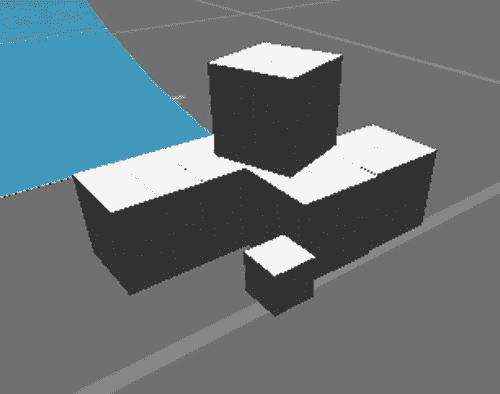

图 7-25. 较小的游戏对象 Cube 推动箱子堆中的立方体

老规矩，尽情尝试修改属性，观察 Cube 的行为如何变化吧。

## 本章小结

在本章中，你开始构建一个障碍赛道，并运用目前已学到的知识搭建了第一个障碍物。你将关节（Joints）添加到物理知识库中，并设计了几个钟摆式障碍物。凭借对刚体、碰撞体、关节和动画的基本理解，你学会了使用布娃娃向导（Ragdoll Wizard）为玩家角色应用布娃娃物理效果，以实现逼真且令人满意的“死亡”表现。你还将角色控制器组件添加到了控制玩家游戏对象的选项菜单中。针对上述每一个类别，你都学习了相应的函数和变量，以及如何在基础脚本中使用它们。此外，你还将标签（Tags）和层（Layers）的使用纳入了你的通用游戏开发技能体系。

这真是了不起的成就！请坚持下去，随着我们在下一章中将这些新的物理功能与粒子发射器和特效相结合，事情会变得更加有趣和激动人心。
