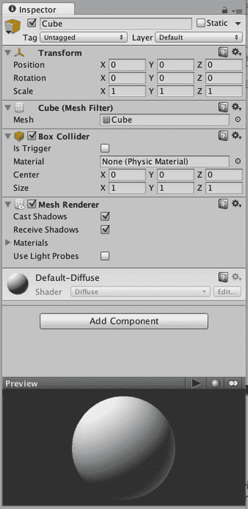
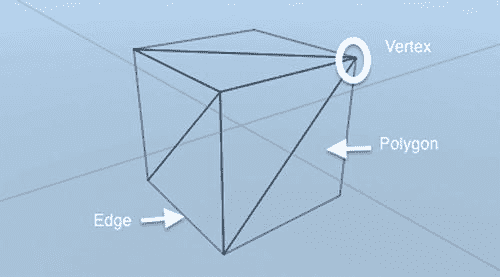
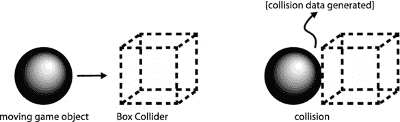
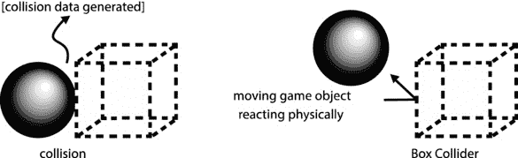
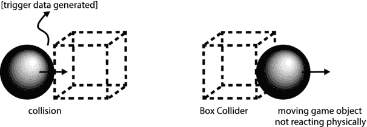
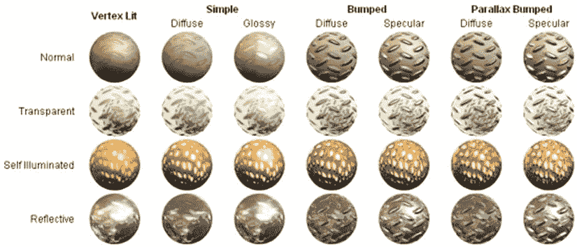

# 立方体

现在，让我们仔细看看`Cube`游戏对象。选中它以在 Inspector 中显示其组件（图 3-18）。

图 3-18. Inspector 中的`Cube`游戏对象组件

## Transform

到现在为止，你应该已经熟悉了`Transform`组件及其`Position`、`Rotation`和`Scale`属性，以及它们各自的热键和操作手柄。你可能已经注意到，Unity 对这些操作手柄进行了颜色编码以便于记忆：`(x, y, z)` 对应 `(r, g, b)`，即红、绿、蓝。

关于缩放游戏对象的一点说明：出于性能考虑，最好在将模型导入 Unity 之前，就根据你的游戏需求将其缩放至合适的尺寸。

### 网格过滤器

在讨论网格过滤器属性之前，先简单聊聊什么是网格。所有 3D 游戏对象的形状本质上都是由相互连接的三角形（称为多边形）构成的。每个多边形由三条边（或边缘）定义，而这些边相交的点称为顶点。网格就是构成游戏对象 3D 几何形状的多边形集合。要查看组成立方体游戏对象的多边形，可以在场景视图控制栏中选择`线框`（如图 3-19 所示）。

图 3-19. 立方体游戏对象的场景视图线框

`网格过滤器`的`网格`属性中命名的网格资源，存储着顶点坐标和其他以数学方式描述模型几何的数据。多边形越多，计算机需要处理的数据就越多。这意味着多边形数量会对游戏性能产生影响。`网格过滤器`将这些网格数据传递给`网格渲染器`，以便模型被渲染，使其显示为浅灰色对象，就像你现在看到的立方体一样。

### 盒碰撞器

`盒碰撞器`使用类似的立方体网格数据，其目的并非在屏幕上渲染模型。虽然`网格过滤器`和`网格渲染器`使游戏对象可见，但碰撞器是一个不可见的组件，用于检测与其它带有碰撞器或`刚体`组件的游戏对象的接触。当这两个游戏对象碰撞时，碰撞器组件会将有关游戏对象的信息传递给游戏引擎。

碰撞器利用游戏对象模型的体积来检测是否与另一个游戏对象发生了碰撞。至少其中一个涉及的游戏对象必须附加有`刚体`组件，它们才能在游戏世界空间中产生物理反应。

触发器用于脚本中检测碰撞，以便触发除通过代码管理的物理交互之外的游戏事件。当两个游戏对象接触时，会生成关于这些对象的数据，这些数据可以用于多种方式影响游戏玩法，但游戏对象看起来不会发生物理交互。

当在至少一个游戏对象也附加有`刚体`组件的物理交互中用作碰撞器时，附加到`材质`属性上的`物理材质`会影响物理引擎确定碰撞行为的方式。例如，`物理材质`可能会让游戏对象具有更多或更少的“弹性”。

碰撞器的形状不必与它所附加的游戏对象的形状完全匹配。简单的碰撞器形状也可以组合在一起，用于更复杂的 3D 模型。`中心`和`大小`属性用于相对于游戏对象模型定位和缩放此碰撞器。你将在第 6 章了解更多关于碰撞器、触发器、`物理材质`和物理引擎的内容。

### 网格渲染器

`网格渲染器`将从`网格过滤器`传递过来的、决定了模型形状的几何数据组装起来，并将其与材质、纹理、光照和阴影结合，以将模型渲染到屏幕上。这些属性面向 Unity Pro 用户，超出了本书的讨论范围。

### 材质

材质通过结合着色器脚本和纹理图像来设置模型的外观，例如哑光或闪亮反射质感之间的差异。图 3-20 展示了 Unity 提供的数十种着色器中的一些示例。

图 3-20. Unity 用户手册中显示的部分可用着色器示例

是时候让立方体变得更有趣一点了。在 Unity 编辑器顶部菜单中，选择`资源` ➤ `导入新资源`……以打开一个弹出窗口。浏览你的文件，选择一张你喜欢的图片，或者使用本书可下载资源中包含的粉红玫瑰图片（你可以在 [`http://www.apress.com/9781430265863`](http://www.apress.com/9781430265863) 找到这些资源）。点击`导入`，图片文件将出现在项目面板中。将图片拖拽到场景视图中的立方体上，就会发生几件事情。一个包含新纹理图像的材质被创建出来，并出现在项目视图的“材质”文件夹中，同时这个新材质被应用到立方体的各个面上，正如你在场景视图中看到的那样。最初导入到`资源`文件夹中的图片文件仍然以原始形式保留在那里。