# 8. 粒子发射器与特效

好的，作为高级文档工程师和翻译员，我将遵循您的格式要求，将给定的英文文本翻译成中文。

# 手里剑粒子系统引擎

## 粒子系统简介

Unity 从 3.5 版本开始引入了手里剑粒子系统引擎。虽然 3D 模型和动画必须在 Unity 外部创建，但手里剑粒子引擎让您能够创建自己的粒子效果，例如火焰、雨水等。在本章中，您将学习如何使用粒子系统创建特殊效果，然后进一步学习如何通过脚本控制它们。

粒子系统在视觉上非常动态。您最好打开编辑器，以便查看粒子的运动状态以及它们如何响应系统模块的设置（图 8-1）。

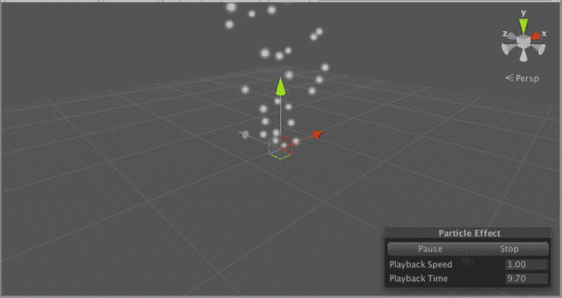

图 8-1. 场景视图中的默认粒子系统

在 Unity 编辑器中，打开“障碍赛道”场景。从顶部菜单中选择 `Game Object ➤ Create Other ➤ Particle System`。在场景视图中，新创建的粒子系统会出现，并立即开始按照默认设置发射粒子。

您会注意到粒子系统的控制按钮也出现在场景视图的右下角。暂停和停止按钮的功能不言自明。当您将 `Playback Speed`（播放速度）分别更改为 10、0.1 然后改回 1.00 时，可以观察其中的差异。播放时间有助于协调构成粒子效果的系统以及进行常规的微调。

在进一步深入之前，先介绍一些术语。粒子是由粒子系统成组发射的对象。它们通常由简单形状的纹理组成，以 2D 广告牌的形式发射。广告牌是一个带有纹理的平面，它始终面向摄像机，从而用 2D 对象呈现出 3D 效果。

请记住，游戏性能取决于场景的“繁忙”或“沉重”程度。根据游戏的需求，粒子可以是 3D 的，甚至可以使用 `Texture Sheet Animation`（纹理表动画）模块制作成动画（图 8-2）。虽然尝试它们很有趣，但请在游戏中合理使用：只使用您需要的粒子，并且只在使用它们的时间内使用。

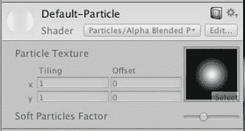

图 8-2. 在检视面板中看到的默认粒子及其右侧显示的纹理

## 粒子系统组件

粒子系统是发射粒子的组件。它拥有许多模块和设置，可以实现各种各样的效果。粒子系统还可以组合成组，以创建更复杂的粒子效果。

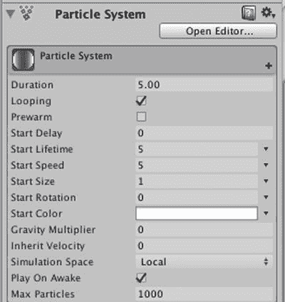

图 8-3. 检视面板中粒子系统组件的初始模块

当您在检视面板中查看 `Particle System`（粒子系统）组件时（图 8-3），您会发现它提供了强大的编辑能力。在阅读属性描述时，请花时间调整其值，并使用场景视图中粒子系统控制器的 `Simulate/Stop`（模拟/停止）按钮，观察默认粒子系统如何响应。

前几个属性控制粒子系统发射粒子。`Duration`（持续时间）是粒子系统发射粒子的时间（秒）。要获得持续效果，您可以勾选 `Looping`（循环）复选框。如果您使用 `Looping`（循环）并勾选 `Prewarm`（预热）复选框，粒子将显示为仿佛一直在发射。如果您希望在粒子发射开始前有一段延迟，则在不勾选 `Prewarm`（预热）的情况下使用 `Start Delay`（起始延迟），指定发射粒子前等待的时间（秒）。

接下来的一组属性控制单个粒子的行为。您可以使用 `Start Lifetime`（起始生命周期）指定每个粒子的生命周期（秒）。`Start Speed`（起始速度）、`Start Size`（起始大小）和 `Start Rotation`（起始旋转）顾名思义：分别是粒子首次发射时的初始速度、大小和旋转。这四个属性都可以在相应的字段中指定数值，也可以使用随机范围或曲线进行进一步自定义。

`Start Color`（起始颜色）也是如此，它提供了更多控件来改变粒子的颜色（包括不透明度的 Alpha 值）在其生命周期内的变化。

通过使用 `Gravity Multiplier`（重力乘数），您可以实现诸如向上漂浮的烟雾或落向地面的流体飞溅等效果。

粒子系统像任何其他游戏对象一样可以运动。当它们移动时，您可以使用 `Inherit Velocity`（继承速度）来决定粒子应继承多少速度。

`Simulation Space`（模拟空间）允许您在 `Local`（局部）空间或 `World`（世界）空间之间进行选择。当勾选时，`Play on Awake`（唤醒时播放）选项会告诉粒子系统在创建后自动启动。最后，`Max Particles`（最大粒子数）是系统在一个周期内发射的粒子总数。

## 模块详解

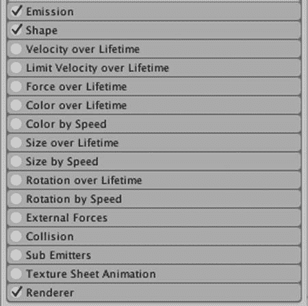

图 8-4. 检视面板中粒子系统组件的更多模块

检视面板中的其余项目是更多模块。单击每个模块可以查看其可控的属性（图 8-4）。请记住，虽然单个粒子系统并不每次都使用每个模块，但手里剑为您提供了丰富的选项（表 8-1）。

表 8-1. 检视面板中额外的手里剑粒子系统模块

| 模块 | 描述 |
| --- | --- |
| 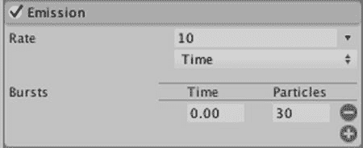 | 发射模块 `Rate`：每秒粒子数。同时也可作为`粒子/米`的可选参数。`Bursts`：指定时间（秒）及在此时间内要发射的粒子数量。使用`+`可添加更多爆发点。 |
| 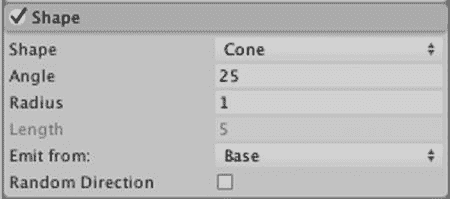 | 形状模块 发射器形状选项：`球体`、`半球体`、`锥体`、`立方体`和`网格`。根据所选形状，还会有更多可调参数来进一步细化粒子的发射方向。每种形状还提供`随机方向`选项。 |
| 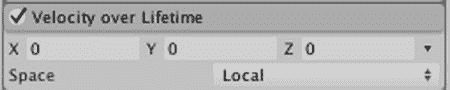 | 生命周期内速度模块 可控制粒子在生命周期内沿各轴线的速度。 |
| 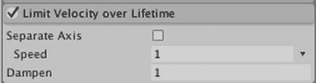 | 生命周期内速度限制模块 速度限制是阻尼或阻力的另一种说法。`速度限制`是粒子受阻尼量影响的阈值。 |
| 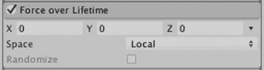 | 生命周期内力模块 使用常数值或曲线沿任意轴施加力，或勾选模块底部的`随机化`复选框。可指定`局部`或`世界`空间。 |
| 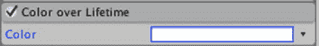 | 生命周期内颜色模块 提供`渐变`或`两个渐变间随机`选项。点击该字段将打开`渐变编辑器`。 |
| 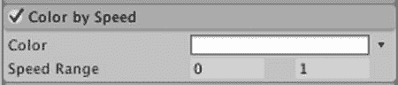 | 速度控制颜色模块 基于速度显示颜色可有效模拟多普勒成像。使用`颜色`属性设置颜色渐变，其中`最小速度`代表颜色渐变的左边界，`最大速度`代表右边界，颜色渐变按比例映射到速度范围上。 |
| 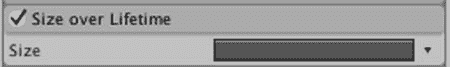 | 生命周期内大小模块 你可以选择使用曲线编辑器，或在两个常量或两条曲线之间进行随机化。 |
| 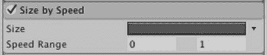 | 速度控制大小模块 选项与生命周期内大小模块相同：使用曲线编辑器，或在两个常量或两条曲线之间进行随机化。 |
| 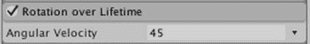 | 生命周期内旋转模块 使用常量或曲线指定粒子在其生命周期内的角速度。还提供在两个常量或两条曲线之间随机化的选项。 |
| 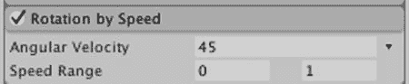 | 速度控制旋转模块 选项与生命周期内旋转模块相同，但你必须指定速度范围，因为它不像前一个模块那样由`持续时间`属性预先确定。 |
| 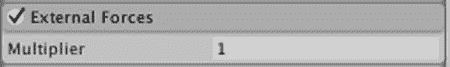 | 外力模块 此模块专门用于指定粒子受风场影响的程度。 |

### 碰撞模块
首先选择粒子是否与每个游戏对象都检测碰撞，还是仅限于平面。尽可能使用平面对游戏性能最有利。平面可视化让你可以选择使用线框状或实心网格。其余参数对粒子行为的影响类似于`刚体`和`物理材质`。勾选`发送碰撞消息`时，将调用`OnParticleCollision()`函数。

### 子发射器模块
粒子可被指定在碰撞时或在生命周期的开始/结束时转换为另一个粒子系统。使用`碰撞`选项需要启用`碰撞模块`。你可以在示例资源粒子系统演示中的`粒子沙盒`场景里找到烟花中使用子发射器的绝佳范例。

### 纹理表动画模块
可以使用一张纹理表文件中所包含的图像阵列来为粒子设置动画。请参见示例资源包中的`part_fireball_sheet_dff`粒子纹理。

### 渲染器模块
此模块包含决定粒子如何绘制或渲染的`ParticleSystemRenderer`属性。最简单的模式`广告牌`使用一个始终面向摄像机的 2D 图形。其他`广告牌`选项无需真正 3D 粒子的开销即可提供增强的视觉效果（`网格`是真正的 3D 粒子）。影响材质、光照、阴影和绘制顺序的属性适用于所有`渲染器模块`模式。操作这些设置超出了本书的讨论范围。

# 华丽登场

此示例将通过让玩家在能量闪光中以北欧神祇般的华丽方式登场（图 8-5），为场景增添炫酷效果。

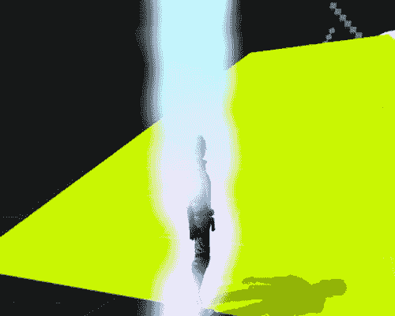

图 8-5. 玩家在游戏开始时华丽登场

为了了解即将实现的效果，首先你将查看 Unity 示例资源中的各种粒子特效。对于你的第一个粒子系统，你将从一个示例资源预制件开始并进行修改。接着，你将从头开始创建一个自定义粒子系统，并最终将这些系统组合成一个复杂的粒子效果。最后，你将使用脚本将粒子效果及与其他游戏对象的交互整合到障碍赛场景中。

为了直奔主题，请在项目面板中进入 `Assets ➤ Sample Assets ➤ Sample Scenes ➤ Scenes`，打开`粒子`场景，然后试玩一番。爆炸、火焰、沙尘暴、烟花、水花喷射等等，尽在指尖——太棒了！

好了，当你准备好继续时，仔细观察沙尘暴，注意整个区域是如何被覆盖的。这是一个简单的粒子系统，其发射器的大小使用有着显著的不同。

在层级面板中，选择 `Particle Systems ➤ DustStorm`。接着，在检查器中展开`粒子系统`组件的`形状`模块。注意它是一个立方体形状——一个非常大的立方体，`x`和`z`值均为 100。这个整个`100×100`的立方体就是粒子发射器，它在该立方体表面区域上发射整个沙尘暴，因此播放时看起来覆盖了整个场景。

你将在障碍赛场景中构建你的粒子效果。继续在编辑器中重新打开障碍赛场景，并删除默认的粒子系统。

在项目面板中，选择 `Assets ➤ Sample Assets ➤ Effects ➤ Particle Systems ➤ Prefabs` 文件夹，将`DustStorm`粒子系统预制件的一个副本拖入场景，并将其重命名为`DustPuff`。玩家角色的着陆将通过一团灰尘的扬起得到强调。我们将从这里开始，因为它是最简单的。

# 灰尘爆裂

这里的目标是产生一股突如其来的灰尘，以强调玩家撞击地面的力度。选中`DustPuff`后，将注意力转向检视面板中的粒子系统组件（图 8-6）。

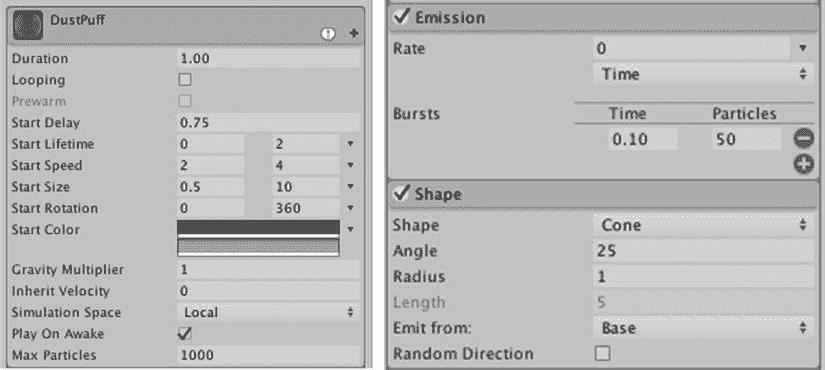

图 8-6. `DustPuff` 粒子系统组件设置

其时序为：能量爆发首先出现，玩家从其中下落至地面，双脚着地，而灰尘则在撞击的瞬间扬起。

要实现单一的短暂灰尘爆裂，请将 `Duration` 设置为 1 秒，并取消勾选 `Looping`。将 `Start Delay` 设置为 0.75。这将为能量爆发和玩家出现留出一些时间，特别是为了与玩家落地的时刻同步。

打开 `Start Lifetime` 的下拉菜单，选择 `Random Between Two Constants`，并在相应字段中输入 0 和 2。为粒子的 `Start Lifetime`、`Start Speed` 和 `Start Size` 引入一些随机性，可以使粒子系统看起来更“自然”。将 `Start Size` 的值改为 0.5 和 10。

为了让灰尘向上喷涌然后落回地面，而不是像吹散一样，请将 `Gravity Multiplier` 改为 1。如果你想实现烟雾或蒸汽效果，可以将其设为负值，使粒子向上飘散开。

为了实现爆裂效果，在 `Emission` 模块中将 `Rate` 改为 0。现在在 `Bursts` 中，点击 +，然后将 `Time` 设置为 0.10，`Particles` 设置为 50。

使用 `Shape` 模块，使灰尘爆裂更集中于玩家角色落地区域周围。将 `Shape` 属性设置为 `Cone`，其 `Angle` 应为 25，`Radius` 为 1，并将 `Emit from:` 属性设置为 `Base`。

在场景视图中使用 `Simulate` 和 `Stop` 按钮，测试你在更改过程中对 `DustPuff` 粒子系统的改动。现在将第三人称角色布娃娃的 `Transform.position` 移动到 (0, 4, 0)，并确保 `DustPuff` 的 `Transform.position` 为 (0, 0, 0)，`Transform.rotation` 为 (90, 0, 0)。保存场景并运行测试。

# 能量爆发

接下来要添加到“盛大登场”中的粒子系统是能量爆发（图 8-7）。在编辑器顶部菜单中，选择`Game Object` ➤ `Create Other` ➤ `Particle System`，并将其命名为`EnergyBurst`。将`Transform.position`改为`(0, 4, 0)`，以使爆发来自玩家角色最终着陆点的上方。

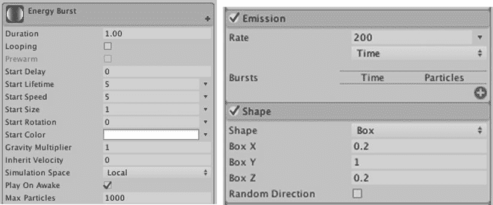

图 8-7. `EnergyBurst`粒子系统组件设置

检视面板中`Initial`模块的设置只需要更改少数几项。虽然这不会是一次真正瞬间的能量爆发，但会是一次短暂的、一次性粒子发射，产生类似等离子体的光流。将`Duration`改为1秒并取消勾选`Looping`。将`Gravity Multiplier`增加到1，否则玩家角色下落速度会比粒子到达地面的速度更快。

在`Emission`模块中，将`Rate`改为200。接下来，在`Shape`模块中，选择`Box`。为了获得更集中的粒子流，将`Box X`和`Box Z`设置为0.2。

最后，勾选并展开`Color Over Lifetime`模块。双击`Color`字段以打开渐变编辑器（图 8-8）。根据图 8-8选择并移动各个游标，更改它们的颜色和Alpha值。图中左下角的游标以浅电蓝色开始，过渡到右下角第二个游标的淡薰衣草色。左上角的游标Alpha值为100%，右上角的游标Alpha值为0%。你也可以根据需要点击添加更多游标，以实现更多变化。

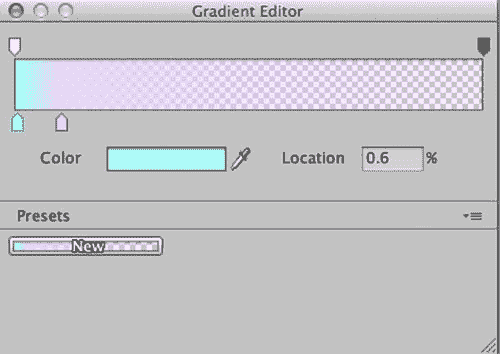

图 8-8. `Color Over Lifetime`模块的`Color`属性所使用的渐变编辑器

虽然本书中的示例使用的是现成的资源，但若想获得更接近闪电的效果，你需要创建一个使用更尖刺形状纹理的材质。要制作粒子材质，请在`Project`面板中创建一个新材质，然后在其`Shader`属性的下拉菜单中，将默认的`Diffuse`更改为从`Particles`类别中选择一个（图 8-9）。

如需粒子系统自定义材质和纹理的更多示例，请打开`Assets` ➤ `Sample Assets` ➤ `Effects` ➤ `Particle Systems`文件夹，查看`Materials`和`Textures`文件夹中的内容。

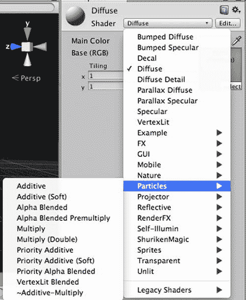

图 8-9. 在检视面板中为粒子系统选择着色器

# 粒子效果

要将 `DustPuff` 和 `EnergyBurst` 这两个粒子系统组合成一个单一的粒子效果，请在编辑器顶部菜单中，选择 Game Object ➤ Create Empty。将其命名为 `GrandEntrance`，并设置其 `Transform.position` 为 (0, 4, 0)。在层级视图中，将 `DustPuff` 和 `EnergyBurst` 粒子系统拖放到 `GrandEntrance` 游戏对象上。

仔细检查它们的位置，作为子游戏对象，其位置现在是相对于父游戏对象的。`DustPuff` 的 `Transform.position` 应为 (0, –4, 0)，而 `EnergyBurst` 应为 (0, 0, 0)。保存场景并保存项目。

# 强力着陆

虽然 DustPuff 粒子系统在视觉上强调了玩家角色着陆的力度，但附近的物体也可以受到一种力的扩散影响。在项目面板的 `Assets ➤ Scripts` 文件夹中，选择 `Create ➤ JavaScript` 并将其命名为 `ImpactForce`。将其附加到 `GrandEntrance` 游戏对象上，然后在 MonoDevelop 中打开它。将代码编辑为以下内容：

```
#pragma strict

function Start () {
    Invoke ("ImpactForce", 0.75);
}

function ImpactForce () {
    var colliders : Collider[] = Physics.OverlapSphere(transform.position - Vector3(0, 4, 0), 10);
    for(var cldr : Collider in colliders)
    {
        if(cldr.rigidbody == null) continue;
        cldr.rigidbody.AddExplosionForce(10, transform.position - Vector3(0, 4, 0), 10, 0, ForceMode.Impulse);
    }
}
```

保存脚本。这段代码的分解说明如下：

`(1) Invoke ("ImpactForce", 0.75);`

`Invoke` 函数允许你在函数执行之前，通过一个时间延迟来调用函数。它接受两个参数：要调用的函数，以及以秒为单位的时间延迟。在此示例中，力的作用时间应与玩家角色落地以及 DustPuff 粒子系统开始发射的时间一致，根据其起始延迟可知，这个时间是 0.75 秒。

`(2) (3) var colliders : Collider[] = (4) (5) (6) Physics.OverlapSphere(transform.position - Vector3(0, 4, 0), 10);`

在 `ImpactForce()` 函数内部，声明一个用于存储 `Collider` 类型数组的引用变量 `colliders`。将 `Physics.OverlapSphere` 边界内找到的所有碰撞器赋值给它，该球体的位置是它所附加到的 `GrandEntrance` 游戏对象的位置减去其 y 坐标值 4，以便将其定位在地面 DustPuff 粒子系统发射的中心位置，半径为 10。

`(7) for(var cldr : Collider in colliders)`

这个 `for` 循环会遍历碰撞器数组。

`(8) if(cldr.rigidbody == null) continue;`

检查碰撞器上是否附加了刚体。记住，使用物理力时必须要有刚体。如果没有刚体，`continue` 意味着不执行接下来的代码块，而是继续处理 `for` 循环中的下一个项目。

`. (9) (10) (11) cldr.rigidbody.AddExplosionForce(10, transform.position - Vector3(0, (12)(13) (14) 4, 0), 10, 0, ForceMode.Impulse);`

如果附加了刚体，则应用 `AddExplosionForce`，力的大小为 10，力的来源位置与 DustPuff 粒子系统发射位置相同，爆炸半径为 10，不添加额外的向上力（当你想要一点额外的向上“弹起”效果时可以使用此参数），并使用 `ForceMode.Impulse` 模式，该模式会瞬间施加全部力，而不是在一段时间内施加。这个力会随着距指定位置的距离增加而减小，并在指定的半径处降为零。

如果你现在进行游戏测试，什么也不会发生，因为 `Physics.OverlapSphere` 的半径内没有游戏对象。为了看到效果，请在项目面板中依次展开 `Assets ➤ Sample Assets ➤ Prototyping ➤ Prefabs ➤ Compound Prefabs` 文件夹。将一个 `Smash Boxes` 预制体拖拽到场景视图中，然后将其 `Transform.position` 设置为 (–5, 0, –5)，`Transform.rotation` 设置为 (0, 90, 0)。

在层级面板中使用 Ģ+D 复制此游戏对象，然后将此副本的 `Transform.position` 设置为 (8, 0, –5)。创建第三个副本，将其 `Transform.position` 设置为 (0, 0, –11)，`Transform.rotation` 设置为 (0, 0, 0)。保存场景，保存项目，然后进行游戏测试。

轰！注意第一堆 Smash Boxes 被完全炸飞，而第二堆中最远的盒子组件几乎没被碰到，第三堆 Smash Boxes 则完全没有被触碰到。这是由于它们相对于 `ImpactForce` 脚本中指定的 10 爆炸半径的位置所决定的。

就游戏设计和风格而言，这对于我们的玩家来说是一个相当夸张的登场方式，但它作为构建粒子效果的一个很好的练习。

# 炸弹障碍物

戏剧性的火焰爆炸效果创建方式大致相同，只是使用了火和烟雾粒子系统，并添加了光和声音等额外的特殊效果。`Sample Assets` 包中有一个极好的爆炸示例，包含了完整的火焰和烟雾材质与纹理。

`Sample Assets` 包中的 `Ball` 预制体看起来阴暗且不祥，因此它可以成为一个很棒的炸弹。将其从 `Assets ➤ Sample Assets ➤ Vehicles ➤ Rolling Ball ➤ Prefabs` 文件夹拖拽到场景中，命名为 `Bomb`，将 `Tag` 设置为 `Untagged`，并为其设置 `Transform.position` 为 (0, 9.5, 20)。点击齿轮图标并从下拉菜单中选择“移除组件”，移除 `Ball` 和 `Ball User Control Script` 组件。

在项目面板的 `Assets ➤ Scripts` 文件夹中，创建一个名为 `BombExplosion` 的新脚本，并在 MonoDevelop 中打开它。将代码编辑为以下内容：

```
#pragma strict

public var victim : GameObject;
public var prefab : GameObject;

function Start () {
    victim = GameObject.Find("Third Person Character Ragdoll");
}

function OnCollisionEnter (collision : Collision) {
    if (collision.gameObject.name == "Third Person Character Ragdoll") {
        Explosion();
    }
}

function Explosion () {
    victim.GetComponent(GoRagdoll).GotoRagdoll();
    Instantiate (prefab, transform.position, Quaternion.identity);
    Destroy(gameObject);
}
```

保存脚本并将其附加到 `Bomb` 游戏对象上。分解说明如下：

`(1) public var victim : GameObject; public var prefab : GameObject;`

声明两个引用变量，`victim` 和 `prefab`，类型为 `GameObject`。

`(2) victim = GameObject.Find("Third Person Character Ragdoll");`

在 `Start()` 函数中，将 `Third Person Character Ragdoll` 的引用赋值给 `victim`。

`(3) if (collision.gameObject.name == "Third Person Character Ragdoll") { Explosion(); }`

如果玩家角色与炸弹发生碰撞，则调用 `Explosion()` 函数。

`(4) victim.GetComponent(GoRagdoll).GotoRagdoll();`

`(5) Instantiate (prefab, transform.position, Quaternion.identity);`

`(6) Destroy(gameObject);`

在 `Explosion()` 函数内部，将玩家角色转换为 ragdoll（布娃娃系统），在炸弹的 `transform.position` 和旋转位置实例化一个新的爆炸预制体，然后销毁炸弹游戏对象。

如果你现在进行游戏测试，玩家角色会倒下，炸弹会根据与玩家角色的碰撞而滚动，但没有爆炸效果，因为尚未将预制体指定为要在 `Explosion` 函数中实例化的对象。在控制台中，你会看到一个 `UnassignedReferenceException` 警告，提示 `prefab` 变量尚未分配，并建议你进行分配。

选中 `Bomb` 游戏对象，在检查器中找到 `BombExplosion` 脚本组件，注意 `Prefab` 属性的字段是 `None`。在项目面板的 `Assets ➤ Sample Assets ➤ Effects ➤ Particle Systems ➤ Prefabs` 文件夹中找到 `Explosion` 预制体。将其拖拽并放入检查器的 `Prefab` 属性字段中。

保存场景和项目。进行游戏测试，让玩家角色撞向炸弹。太棒了！稍后你会用到更多炸弹，所以请将 `Bomb` 游戏对象从层级面板拖拽到项目面板的 `Assets ➤ Prefabs` 文件夹中。

## 暴风雪障碍

这个简单的障碍物用于演示粒子碰撞的使用方法。在编辑器顶部菜单中，选择“游戏对象 ➤ 创建其他 ➤ 粒子系统”，并将其命名为 `Blizzard`。将其 `Transform.position` 设置为 (–11, 11.5, 106)，`Transform.rotation` 设置为 (0, 90, 0)。

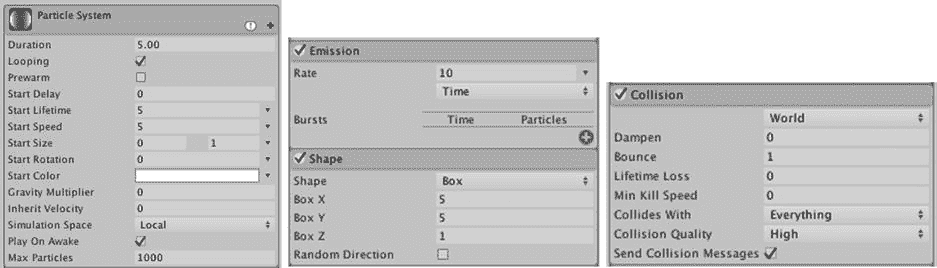

图 8-10. 暴风雪粒子系统设置

在暴风雪粒子系统的初始模块中，使用“起始大小”下拉菜单选择“两个常量之间随机”。保留默认设置 0 和 1。在“发射”模块中，确保“速率”设置为 10。

其思路是让玩家需要应对更大体积的粒子。在“形状”模块中选择“盒子”，并将其比例中的盒子 X 和盒子 Y 都改为 5。

勾选“碰撞”模块并展开它。“世界”意味着粒子将与任何物体发生碰撞。请注意，此设置对游戏性能的消耗比使用平面更高。保留所有其他默认设置不变，但**勾选**“发送碰撞消息”复选框（图 8-10）。

在项目面板的“资源 ➤ 脚本”文件夹中，找到 `KillOnCollision` 脚本并在 MonoDevelop 中打开。添加以下函数：

```
function OnParticleCollision(other : GameObject)
{
    if (other.gameObject.name == "第三人称角色布娃娃")
    {
        other.gameObject.GetComponent(GoRagdoll).GotoRagdoll();
    }
}
```

当粒子系统碰撞模块中的“发送碰撞消息”复选框被勾选时，会调用 `OnParticleCollision()` 函数。函数内的代码块会检查碰撞中的另一个游戏对象是否是玩家角色，如果是，则调用玩家角色的 `GotoRagdoll` 函数。

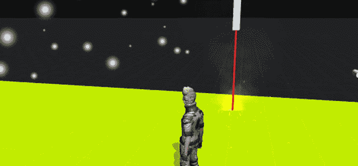

图 8-11. 玩家角色面对暴风雪障碍

保存脚本并将其附加到 `Blizzard` 游戏对象上。与炸弹类似，将暴风雪粒子系统拖放到项目面板的“资源 ➤ 预置”文件夹中。保存场景（图 8-11）并保存项目。进行游戏测试，躲避致命的雪花吧！

## 激光障碍

对于激光障碍，你将学习使用线条渲染器（图 8-12）。线条渲染器的作用就是在两点之间绘制一条线。它也可以使用点数组，在每两个点之间绘制线段，从而形成更复杂的图案。

线条本身是一个二维公告板，就像粒子纹理一样，因此根据你的场景，它在旋转以始终面向相机时，可能会显得有些动态效果。你可以调整其宽度和颜色，甚至可以使用纹理。

这个障碍由一个位于障碍赛道上方的激光发射器组成，它向下朝高架轨道表面发射激光，并来回移动。

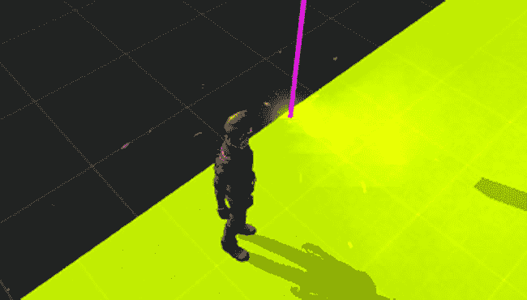

图 8-12. 玩家角色与激光障碍

## 激光发射器

为了模拟激光发射器，在层级面板中创建一个基本的立方体游戏对象，将其命名为 `LaserCube`，并设置其 `Transform.position` 为 (–3.8, 12, 100)，`Transform.scale` 为 (0.2, 1, 0.2)。

`LaserCube` 游戏对象需要一个简单的脚本为其添加移动功能。在项目面板的“资源 ➤ 脚本”文件夹中，选择“创建 ➤ JavaScript”，将其命名为 `MoveLaser`，并在 MonoDevelop 中打开。将代码编辑为以下内容：

```
#pragma strict

public var speed : float = 1;
public var offset : float;

function Start () {
    offset = transform.position.x - 0.2;
}

function Update () {
    transform.position = Vector3(Mathf.PingPong(Time.time * speed, 8) + offset, transform.position.y, transform.position.z);
}
```

保存脚本并将其附加到 `LaserCube` 上。

这段代码分解如下：

`(1)` `public var speed : float = 1;`

`public var offset : float;`

首先，声明变量：一个公共浮点型变量，允许你在检视面板中调整 `LaserCube` 的速度；以及一个偏移量变量，用于在 `LaserCube` 移动时正确定位它。

`(2)` `offset = transform.position.x - 0.2;`

在 `Start()` 函数中，将 `LaserCube` 游戏对象的位置减去其宽度，赋值给偏移量，这样激光束就能从高架轨道的精确边缘开始移动。

`(3)` `transform.position = Vector3(Mathf.PingPong(Time.time * speed, 8) + offset, transform.position.y, transform.position.z);`

你之前已经修改过游戏对象的 `Transform.position`。本示例引入了使用 `Mathf.PingPong()` 函数来设置 `Vector3` 的 x 坐标值，从而实现来回移动。

`Mathf.PingPong` 接受两个浮点数，并返回一个在 0 和第二个值之间来回移动的值，该值会通过偏移量进行调整，并将结果赋值给 `LaserCube` 的 `Transform.position.x` 的 x 坐标。不深入探讨其背后的数学原理，第一个浮点数必须每帧都变化才能产生乒乓移动效果，因此通常使用 `Time.time`。`Time.time` 就是自游戏开始以来的时间（以秒为单位）。

# 激光束

激光束是通过线条渲染器（`Line Renderer`）创建的。线条渲染器不能与已使用渲染器的游戏对象一同使用，因此最佳实践是创建一个空的游戏对象来承载线条渲染器，然后将其作为子游戏对象附加到 `LaserCube` 上。

在编辑器顶部菜单中，选择 **Game Object** ➤ **Create Empty**。在层级面板（Hierarchy）中，将其命名为 `LaserBeam`，然后拖拽到 `LaserCube` 游戏对象上，使其作为子游戏对象嵌套其中，并将其 `Transform.position` 设置为 `(0, –0.5, 0)`。由于它是子对象，这个 `Transform.position` 会使其在 y 轴上略微低于父级 `LaserCube` 游戏对象。继续选中这个空的游戏对象，在检查器（Inspector）中选择 **Add Component** ➤ **Effects** ➤ **Line Renderer**（图 8-13）。你会注意到场景视图（Scene view）的世界原点处出现了一条品红色线条。你将在游戏过程中通过脚本来协调渲染的线条与移动的激光发射器。

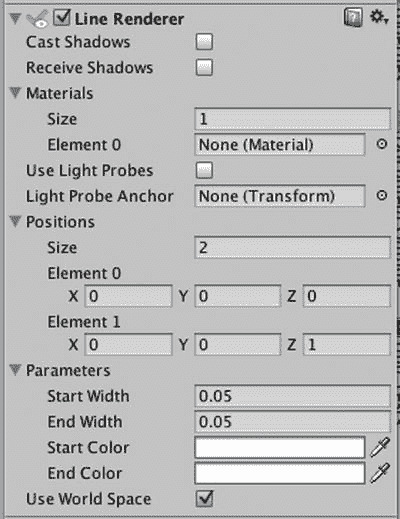

图 8-13. 检查器中的线条渲染器组件

在检查器中，取消勾选 **Cast Shadows** 和 **Receive Shadows**。Unity 基础版本不使用阴影，因此保留勾选也不会增加阴影效果。

**Materials** 表示用于绘制线条的材质。如果为 `None`，则默认使用你在场景视图中看到的品红色线条。若要改变激光束的颜色，你必须指定一种材质。在项目面板（Project）中选择 **Create** ➤ **Material**，将其命名为 `SimpleLaser`。将 `SimpleLaser` 材质拖拽到检查器中的 **Element 0** 属性中。选中该材质后，在检查器中使用着色器（Shader）下拉菜单选择 **Particles** ➤ **Alpha Blended**。线条渲染器使用粒子材质；否则你只会得到一条黑色线条。

重新选中 `LaserBeam` 游戏对象，以在检查器中再次显示其属性。**Light Probes** 是另一个 Unity Pro 功能。**Positions** 指定了线条的绘制端点。一条线条至少需要两个点（起点和终点），但你可以通过增加 **Size** 属性的值来添加更多点。

展开 **Parameters** 以获取更多自定义选项。将 **Start Width** 和 **End Width** 的值改为 `0.05` 以使线条更细，将 **Start Color** 和 **End Color** 改为亮红色，并勾选 **Use World Space**。

接下来，你需要一个脚本来控制激光的行为。在项目面板的 `Assets ➤ Scripts` 文件夹中，选择 **Create** ➤ **JavaScript**，将其命名为 `Laser`，并在 MonoDevelop 中打开。将代码编辑为如下内容：

```
#pragma strict

public var line : LineRenderer;

function Start () {

line = gameObject.GetComponent.<LineRenderer>();

}

function Update () {

ShowLaser();

}

function ShowLaser () {

var ray : Ray = Ray(transform.position, -transform.up);

line.SetPosition(0, ray.origin);

line.SetPosition(1, ray.GetPoint(50));

}
```

保存脚本，将其附加到子级空游戏对象上，并进行游戏测试。你会看到 `LaserCube` 左右移动，并发射出一道红色激光。

此代码分解如下：

```
(1)     public var line : LineRenderer;
```

声明了一个 `LineRenderer` 类型的引用变量 `line`。

```
(2)     line = gameObject.GetComponent.<LineRenderer>();
```

获取对线条渲染器组件的引用，并将其赋值给 `line` 变量。

```
(3)     ShowLaser();
```

在之前的示例中，代码主要写在 `Update()` 函数内。在本例中，采用了更好的代码编写实践，将代码分解为更小的模块。这里调用了 `ShowLaser()` 函数，该函数仅包含绘制激光的代码。

```
(4)     var ray : Ray = Ray(transform.position, -transform.up);
```

在 `ShowLaser` 函数中，创建了一个引用变量 `Ray`，并将游戏对象的 `transform.position` 作为其原点，`-transform.up` 作为向下的方向。

```
(5)     line.SetPosition(0, ray.origin);
```

线渲染器的第一个点（元素 0）设置为射线起点的位置。

`line.SetPosition(1, ray.GetPoint(50));`

待绘制线的第二个点（元素 1）设置为沿射线方向再延伸 10 个单位的位置。

这算是个好的开端，但激光会直接穿过高架轨道，因此不够真实。按如下方式编辑 `Laser` 脚本的 `ShowLaser()` 函数：

```
function ShowLaser () {
    var ray : Ray = Ray(transform.position, -transform.up);
    var hit : RaycastHit;
    line.SetPosition(0, ray.origin);
    if(Physics.Raycast(ray, hit, 50))
    {
        line.SetPosition(1, hit.point);
    }  else {
        line.SetPosition(1, ray.GetPoint(50));
    }
}
```

保存脚本。现在进行试玩测试时，你会看到激光在轨道表面处停止。

这段代码解析如下：

`var hit : RaycastHit;`

声明一个类型为 `RaycastHit` 的引用变量 `hit`。

`if(Physics.Raycast(ray, hit, 50))`

测试射线检测是否在 10 个单位内检测到碰撞体。

`line.SetPosition(1, hit.point);`

如果检测到碰撞体，则将待绘制线的第二个点设置在射线检测到碰撞体的位置。

`}  else {`

`line.SetPosition(1, ray.GetPoint(50));`

`}`

否则，照常将线绘制到沿射线方向 50 个单位的位置。

目前唯一能看到的效果是激光在击中轨道时停止。通过使用射线检测，如果有任何带有碰撞体的其他游戏对象与射线相交，激光就会终止于该游戏对象表面上的交点位置。要进行测试，可以在试玩时将玩家角色置于激光束的路径中。

添加粒子系统后，激光看起来会更逼真且更具威慑力。在项目面板中，打开 `Assets ➤ Sample Assets ➤ Effects ➤ Particle Systems ➤ Prefabs` 文件夹。找到 `Flare` 预制体，拖动一个副本到层级面板，并通过拖放到 `LaserCube` 上，使其成为 `LaserCube` 的子对象。

在 MonoDevelop 中，编辑 `Laser` 脚本，按如下方式添加三行代码：

# 激光与曳光弹障碍物

## 激光脚本

```csharp
#pragma strict

public var line : LineRenderer;
public var sparks : GameObject;

function Start () {
    sparks = GameObject.Find("Flare");
    line = gameObject.GetComponent.<LineRenderer>();
}

function Update () {
    ShowLaser();
}

function ShowLaser () {
    var ray : Ray = Ray(transform.position, -transform.up);
    var hit : RaycastHit;
    line.SetPosition(0, ray.origin);
    if(Physics.Raycast(ray, hit, 50))
    {
        line.SetPosition(1, hit.point);
        sparks.transform.position = hit.point;
    }  else {
        line.SetPosition(1, ray.GetPoint(50));
    }
}
```

保存脚本并进行试玩。这才像是一道激光！

这段代码解析如下：

`public var sparks : GameObject;` 声明一个类型为 `GameObject` 的引用变量 `sparks`。

`sparks = GameObject.Find("Flare");` 找到对 Flare 粒子系统预制体的引用，并将其赋值给 `sparks`。

`sparks.transform.position = hit.point;` 将 `sparks` 粒子系统的位置设置在激光射线检测到碰撞体的位置。

超级酷，对吧？请注意，在试玩时，如果玩家角色被激光击中，火花会从他身上飞溅出来，仿佛他是无敌的。虽然这在其他设定中可能很酷，但这里的激光障碍物本应更具杀伤力。

在 `Laser` 脚本中，在变量声明部分添加以下内容：

`public var victim : GameObject;` 这声明了一个类型为 `GameObject` 的引用变量 `victim`。

要为玩家角色分配引用，请在 `Start()` 函数中添加以下代码行：

`victim = GameObject.Find("Third Person Character Ragdoll");`

最后，在 `ShowLaser()` 函数中插入以下代码行：

```csharp
function ShowLaser () {
    var ray : Ray = Ray(transform.position, -transform.up);
    var hit : RaycastHit;
    line.SetPosition(0, ray.origin);
    if(Physics.Raycast(ray, hit, 50))
    {
        line.SetPosition(1, hit.point);
        if (hit.collider == victim.collider) {
            victim.GetComponent(GoRagdoll).GotoRagdoll();
        }
        sparks.transform.position = hit.point;
    } else {
        line.SetPosition(1, ray.GetPoint(50));
    }
}
```

如果射线检测到碰撞体，它会检查该碰撞体是否为玩家角色的碰撞体。如果是，则调用玩家角色的 `GotoRagdoll()` 函数来消灭该玩家。

保存脚本。在项目面板中，打开 `Assets` ➤ `Prefabs` 文件夹。将层级面板中的 `LaserCube` 拖动并放入 `Prefabs` 文件夹中，以备将来使用。现在就可以进行试玩了。

对于这个障碍物来说，简单的材质和红色就足够了，但如果你想通过脚本来设置颜色，样例代码片段是将以下代码行放入 `Start()` 函数中：

```csharp
line.material = new Material (Shader.Find("Particles/Additive"));
line.SetColors(Color.green, Color.blue);
```

这里你正在新建一个简单的材质，然后设置线条的起始和结束颜色。

## 曳光弹障碍物

另一个用于视觉效果的精美渲染器是轨迹渲染器组件（图 8-14）。顾名思义，它会在移动的游戏对象后方绘制一条轨迹。它通常用作视觉提示来表示速度，例如飞机的凝结尾迹，甚至可以是速度与逼真图像（如曳光弹）的组合。曳光弹障碍物将在玩家沿高架轨道前进的路径上随机生成曳光弹。

快速演示一下，在层级面板中选择 `Pendulum_01`。在检视面板中，选择“添加组件 ➤ 效果 ➤ 轨迹渲染器”。

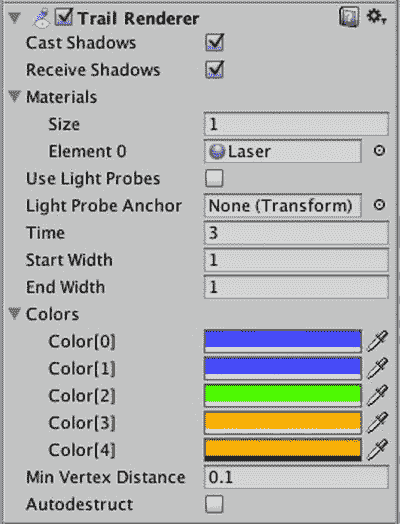

**图 8-14.** 检视面板中的轨迹渲染器组件

轨迹渲染器可以使用不同的材质数组来实现多种效果。与线渲染器一样，轨迹渲染器也使用粒子材质。将材质数组的大小（由 `Size` 属性指示）保留为 1。对于元素 0，选择您为激光障碍物创建的 `SimpleLaser` 材质。

“时间”是轨迹持续的时间（以秒为单位）。“起始宽度”和“结束宽度”调整轨迹的宽度，这类似于线渲染器，也是一个 2D 广告牌。如果您的材质中包含颜色，则可以保留颜色属性的元素不变。由于我们的 `Laser` 材质是白色的，请继续为所有五个元素选择颜色，创建一个绚丽的色彩光谱。

如果游戏对象在时间指定的时间段内没有移动，并且勾选了“自动销毁”，则游戏对象将被销毁。

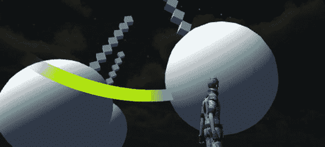

**图 8-15.** 旋转摆锤障碍物后方绘制的轨迹

当您完成对摆锤轨迹（图 8-15）的实验后，请禁用或删除轨迹渲染器组件。

# 弹丸预制体

## 基础设置
创建一个基本球体游戏对象并命名为 `Projectile`。将其 `Transform.position` 设为 `(0, 0, 0)`，`Transform.rotation` 设为 `(0, 0, 0)`，缩放设为 `(0.05, 0.05, 0.05)`。在 Inspector 中，通过选择 `添加组件 ➤ 物理 ➤ Rigidbody` 来添加 `Rigidbody` 组件。

## 视觉效果
接下来，通过选择 `添加组件 ➤ 特效 ➤ 拖尾渲染器` 添加 `Trail Renderer` 组件。在材质属性中，将尺寸保持为 1。使用元素 0 字段右侧的圆形选择按钮定位并选择 `part_afterburner` 材质。这是一个来自示例资源包的粒子材质。将时间设为 0.5，并将起始宽度和结束宽度均设为 0.1。在颜色属性中，为 `Color[0]` 指定浅黄色。为其余颜色元素依次选择渐深的黄色到橙色。

## 功能实现
为了使它成为更致命的障碍物，玩家角色被弹丸击中时应被击杀。你可以使用与钟摆障碍物相同的 `KillOnCollision` 脚本，通过选择 `添加组件 ➤ 脚本 ➤ KillOnCollision` 来添加。

最后，将 `Projectile` 游戏对象从层级视图拖拽到项目面板中的 `Assets ➤ Prefabs` 文件夹中，使其成为预制体。现在你可以安全地从场景视图中删除 `Projectile` 游戏对象。

# 弹丸发射器

创建一个基本圆柱体游戏对象并命名为 `Cannon`。将其 `Transform.position` 设为 `(4, 10.5, 95)`，`Transform.rotation` 设为 `(0, 0, 90)`，`Transform.scale` 设为 `(0.2, 0.2, 0.2)`。现在创建一个空游戏对象并命名为 `Launcher`。这个空游戏对象将是弹丸实例化的位置。在层级视图中将 `Launcher` 拖拽到 `Cannon` 上方，使其成为 `Cannon` 的子对象。此时其变换坐标将相对于 `Cannon` 游戏对象而非世界坐标。将其 `Transform.position` 设为 `(0, 1.25, 0)`，`Transform.rotation` 设为 `(270, 270, 0)`，其缩放应已重置为 `(5, 5, 5)`。

在项目面板的 `Assets ➤ Scripts` 文件夹中，创建一个名为 `LaunchProjectile` 的脚本。将其附加到 `Launcher` 游戏对象上，然后在 `MonoDevelop` 中打开。将代码编辑为以下内容：

```csharp
#pragma strict

public var projectile : GameObject;

public var force : float = 25;

public var frequency : float = 2.0;

private var nextLaunch : float = 0.0;

function Update () {

    if (Time.time > nextLaunch) {

    nextLaunch = Time.time + frequency;

            var projectileInstance : GameObject = Instantiate(projectile, transform.position, transform.rotation);

            projectileInstance.rigidbody.AddForce (projectileInstance.transform.forward * force, ForceMode.Impulse);

        Destroy(projectileInstance, 2);

    }

}
```

保存脚本。其分解如下：

`(1)     public var projectile : GameObject;`

        `public var force : float = 25;`

        `public var frequency : float = 2.0;`

        `private var nextLaunch : float = 0.0;`

变量声明：`projectile` 用于持有对 `GameObject` 的引用，而浮点变量 `force` 和 `frequency` 供你在 `Inspector` 中微调弹丸行为。浮点变量 `nextLaunch` 跟踪每次弹丸发射之间的时间。

`(2)     if (Time.time > nextLaunch)`

`Time.time` 是游戏开始以来的秒数。`if` 条件语句用于测试经过的时间是否大于计算出的下一次弹丸发射时间。如果大于，

`(3)     nextLaunch = Time.time + frequency;`

`nextLaunch` 重置为当前已流逝的游戏时间加上浮点变量 `frequency` 指定的每次发射间隔秒数。

`(4)     var projectileInstance : GameObject = Instantiate(projectile,`

        `transform.position, transform.rotation);`

在 `transform.position` 和 `transform.rotation` 处（即此脚本附加到的父级 `Launcher` 游戏对象的位置和旋转）实例化 `Projectile` 预制体游戏对象的克隆。

`(5)     projectileInstance.rigidbody.AddForce`

        `(projectileInstance.transform.forward * force,`

        `ForceMode.Impulse);`

使用 `AddForce()` 函数向弹丸预制体的刚体施加力，赋予其一个 `Vector3` 前向方向，大小由可调节的 `force` 因子决定，并使用 `ForceMode.Impulse` 瞬间施加所有力。

`(6)     Destroy(projectileInstance, 2);`

出于性能考虑，你不希望这些弹丸游戏对象在视野之外堆积，因此每个克隆将在两秒后被销毁。

在层级视图中选择 `Launcher` 游戏对象。将 `Projectile` 预制体从 `Assets ➤ Prefabs` 文件夹拖拽到 `LaunchProjectile` 脚本的弹丸属性字段中。曳光火障已完成。将 `Cannon` 游戏对象从层级视图拖拽到项目文件夹中的 `Assets ➤ Prefabs` 文件夹，使其成为预制体资源。保存脚本，保存场景，并保存项目。进行游戏测试，现在你拥有了一个致命的弹丸式曳光火障。做得好！

## 总结

现在你已经掌握了使用 `Shuriken` 创建粒子系统和特效的方法，并且开始想象你的障碍赛道将如何形成一个游戏。你已在视觉特效工具包中新增了 `LineRenderer` 和 `TrailRenderer`，并为障碍赛道场景创建了大量新的障碍物预制体。

在将这些障碍物随机分布到赛道之前，在下一章中，你将学习游戏设计理论等相关内容，这反过来将指导你如何以及为何要像障碍赛道那样设计场景布局。
