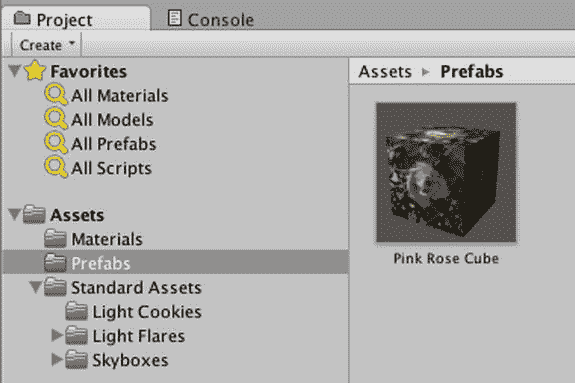
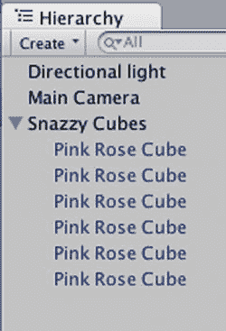
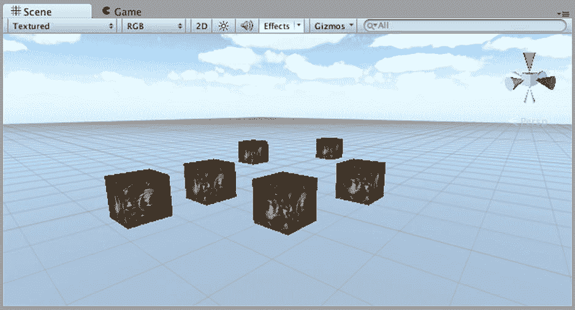
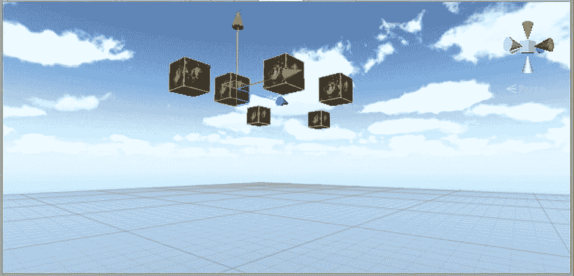
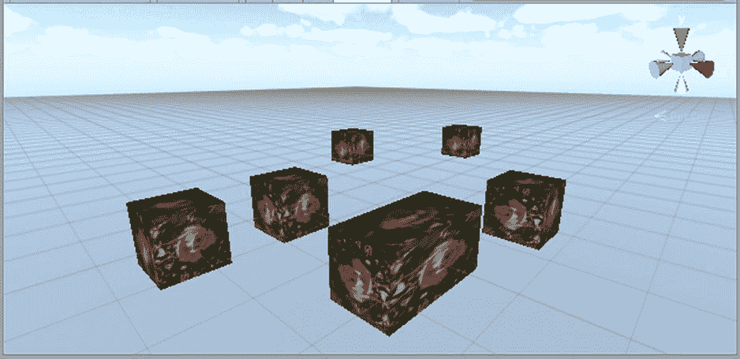
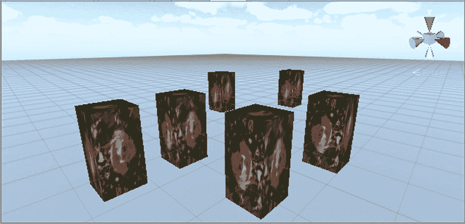

# 预制件

Unity 的核心是高效的游戏开发。既然你已经配置好了一个炫酷的立方体，就可以将其存储为预制件，以便在游戏中快速创建更多炫酷的立方体。组织有序是高效的关键，因此首先创建一个 `Prefabs` 文件夹来存放这个预制件以及你为此场景创建的未来所有预制件。

在项目面板中，选择 `创建 ➤ 文件夹`，并将其命名为 `Prefabs`。在层级视图中，首先通过慢速双击将 `Cube` 重命名为 `Pink Rose Cube`。重命名后，将其从层级视图拖拽到 `Prefabs` 文件夹中。这样便为这个游戏对象创建了一个模板，使其与原始立方体区分开来（图 3-21）。在层级视图中，选中该游戏对象，然后按 `⌘+Backspace` 键将其删除。

图 3-21. 项目面板 `Prefabs` 文件夹中的预制件游戏对象

在场景中填充预制件立方体克隆体之前，这里有一个巧妙的组织技巧：为了保持层级视图井井有条，空游戏对象可以像文件夹一样使用。使用 `Shift+⌘+N` 快捷键，或者在 Unity 编辑器顶部菜单中，选择 `游戏对象 ➤ 创建空对象`。将其重命名为 `Snazzy Cubes`。

从项目面板的 `Prefabs` 文件夹中，将一个 `Pink Rose Cube` 拖拽到层级视图中的 `Snazzy Cubes` 上。新的预制件游戏对象会出现在场景视图的原点位置。选中这个新游戏对象，按 `⌘+D`（D 代表复制），或者从顶部菜单中选择 `编辑 ➤ 复制`，以创建该游戏对象的新实例。层级视图中会出现第二个 `Pink Rose Cube` 游戏对象，并缩进显示在 `Snazzy Cubes` 下方，表明它是 `Snazzy Cubes` 父对象的子对象（图 3-22）。

图 3-22. 层级视图中显示的父子关系

场景视图看起来是一样的，因为第二个游戏对象也像第一个一样被放置在了原点。使用变换工具重新定位这些对象。重复此操作，直到在场景中分散放置了大约六个游戏对象，并使它们彼此靠近，以便能同时看到它们（图 3-23）。

图 3-23. 预制件填充场景

当游戏对象与父对象存在子级关系时，其 `Transform` 位置将变为相对父对象，而非世界原点。如果移动父对象，子对象将保持相对位置。在层级视图中选中 `Snazzy Cubes` 空游戏对象。使用场景视图中出现的变换工具，抓住一个手柄并移动它。正如你所见，所有立方体都随之移动（图 3-24）。

图 3-24. 子对象随父对象移动

选中一个预制件，然后在检查器中将其 `Transform` 的 `Scale` 参数的 `z` 值改为 `2`。现在你有了一个矩形块，而不是立方体（图 3-25）。尽管这个游戏对象是由预配置的预制件创建的，你仍然可以单独编辑它。将 `z` 的缩放值改回 `1`。

图 3-25. 单独编辑的预制件游戏对象

现在，在 `Prefabs` 文件夹中选中 `Pink Rose Cube` 预制件游戏对象。在检查器中，将其 `Transform` 的 `Scale` 参数的 `y` 值改为 `2`。这一次，场景视图中所有预制件都变成了高大的矩形块（图 3-26）。如果你修改了预制件模板的属性，这些更改将反映在该预制件的所有实例中。

图 3-26. 编辑预制件模板影响所有预制件

## 总结

你在本章取得了长足的进步。你理解了构成场景的结构，以及必不可少的游戏对象——主摄像机。你了解了游戏对象是组件的容器，以及如何在 Unity 的组件参考文档中快速找到组件。你熟悉了 Unity 基本形状的游戏对象、摄像机和光源的默认组件。你学会了如何导入资源，并通过天空盒为场景添加色彩，使用材质为游戏对象添加颜色。你甚至尝试了使用遮罩与光晕的一些特殊效果。你正在培养保持项目组织有序的良好习惯。通过创建预制件，你变得更高效，并且知道如何单独或成组地编辑预制件。太棒了！

不过，有趣的是，对于一本关于脚本编写的书来说，本章竟然一个脚本都没有。这是有意为之。首先，我希望你有机会熟悉 Unity 编辑器的操作。其次，尽管你可以做很多有趣的事情来设置场景，但我想让你注意到，你能做的也仅限于此。如果没有脚本，当你尝试运行它时，它几乎什么都不做。

别担心——如果你想体验充满动作感的内容，你将在第 4 章中将脚本引入游戏场景时初尝滋味。脚本驱动着游戏对象之间的动作，更不用说玩家与游戏间的交互了。你将循序渐进，开始构建实用的 Unity 开发和脚本编写技能基础。从这里开始，随着你添加动画、真实的物理行为、粒子效果等等，一切会变得越来越好。