# 9. 游戏设计与逻辑——蓝图

对于初学开发者，最常见的建议是：“要想提高游戏制作水平，就制作更多游戏。”一个同样常见的回应是：“没错，但我该从何入手？”

在坐到电脑前之前，你必须先有你正在构建的游戏的蓝图。游戏设计就是创建这个蓝图的过程。既然你已经熟悉了 Unity 编辑器并掌握了一些脚本编写技能，现在是时候来了解游戏设计和游戏制作流程了。

> **注意**
>
> 在任何事情之前，准备是成功的关键。——亚历山大·格拉汉姆·贝尔

# 游戏

究竟什么是游戏？从实用角度出发，一款游戏需要满足以下基本条件：

- **玩家**：电影和电视剧等其他形式的视频娱乐可以面向一个或多个观众播放，甚至可以在空无一人的房间里放映，但游戏需要至少一名玩家的互动和输入。

- **规则**：规则既界定了玩家可以做什么，也设定了玩家不能做什么的限制，从而规定了游戏如何进行。

- **目标**：目标决定了游戏如何结束。它可以是达成即获胜、未达成即失败的目标，也可以是在特定时间内成功完成一项任务或尝试一项活动。

以你在前几章一直在构建的障碍赛道场景为例。它是一款游戏吗？

- **玩家**：是的，游戏玩法需要玩家的输入。

- **规则**：是的：玩家总是从赛道最低处开始游戏。玩家可以行走、奔跑、跳跃和下蹲。危险会杀死玩家。从高架轨道上掉落或跳下也会杀死玩家。

- **目标**：没有。“不死”并非一个目标。至少对于一款游戏来说，这不是一个很好的目标。玩家可以通过不移动角色来达成这个目标，或者干脆从不玩预期的障碍赛道游戏，只是从高架轨道上跑开。“到达障碍赛道的远端”才是一个目标。

没有任何一种定义是包罗万象的。例如，谜题也符合这些标准，并且是游戏的一个类型，但略有不同之处在于，谜题通常只有一个正确答案，而非谜题类游戏每次游玩的结果都是不可预测的。除了极少数例外情况，这三要素普遍存在于所有类型的游戏之中，并构成了基础游戏设计的一个实用出发点。

# 游戏、小游戏与迷你游戏

游戏时长可长可短。一端是像`World of Warcraft`这种可能永无止境的游戏，而另一端则是只需几秒钟就能完成的迷你游戏。

流行的、高品质的主机和 PC 游戏拥有数小时的纯粹游戏时间，这还不包括菜单、过场动画、说明、对话等内容。内容越多越好，但任何特定项目的最终规模都将由预算和发行截止日期决定。

当前“休闲游戏”的兴起趋势虽常被提及，但定义模糊。受移动设备作为游戏平台日益普及的影响，休闲游戏通常以分钟而非小时为单位进行游玩。游戏玩法本身可能千差万别，但休闲游戏通常具有明确的关卡、线性的进程和简单的计分系统。

小游戏是更短的游戏，游戏时间约为 5 到 10 分钟一个回合，通常类似于经典的街机游戏。它们可以独立存在，也可以嵌入到大型游戏之中。在大型游戏里，它们用途广泛：可以作为奖励解锁，成为获取奖励的独立活动；可以用来介绍新道具或如何使用新功能；或者仅仅作为主线游戏完成后的额外内容。小游戏不一定要完成才能通关其所属的主游戏。当在像`Legend of Zelda`这样的大型游戏中发现它们时，它们在操作和复杂度上通常更为简单。即便如此，一个小游戏仍然具备玩家、规则和终点这三个基本要求。

迷你游戏旨在几秒钟而非几分钟内完成游玩。`Wario Ware`是迷你游戏合集的一个经典例子。它们在游戏玩法和设计上都提出了独特的挑战，即需要在如此短的时间内既搞懂玩法又赢得游戏。

# 游戏设计考量

在设计任何游戏时，都有几个方面需要你深思熟虑。

## 目标受众与 ESRB 分级

娱乐软件分级委员会（ESRB）是一个行业自律组织，负责定义并执行分级系统。

你的目标受众年龄以及相应的 ESRB 分级会影响你的游戏设计。敏感内容（包括血腥、暴力、裸体和粗俗语言）的程度会影响你游戏的分级，如果你不了解这些标准，可能会导致你的游戏被排除在你预期受众之外。

分级系统包含三个部分：

- **分级类别**：类似于电影分级，用于建议适龄人群（图 9-1）。

- **内容描述符**：这些描述符提供了关于导致该分级的游戏具体内容的更详细信息。例如，一款游戏可能被评为`E10+`，即“可能包含动画暴力”。如果你觉得这相当模糊，ESRB 的内容描述符会确切告诉你他们对诸如“动画暴力”等术语的定义（表 9-1）。

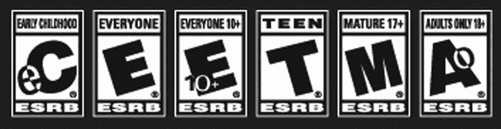

**图 9-1.** ESRB 分级类别图示

**表 9-1.** ESRB 电子游戏内容描述符

| 内容描述符 | 定义 |
| --- | --- |
| 酒精参考 | 提及和/或展示酒精饮料的图像。 |
| 动画血液 | 变色和/或不逼真的血液描绘。 |
| 血液 | 对血液的描绘。 |
| 血腥暴力 | 对血液或身体部位残缺的描绘。 |
| 卡通暴力 | 涉及卡通式情境和角色的暴力行为。可能包括角色在遭受暴力行为后毫发无损的场景。 |
| 滑稽恶搞 | 涉及闹剧或暗示性幽默的描绘或对话。 |
| 粗俗幽默 | 涉及粗俗行为的描绘或对话，包括“卫生间”幽默。 |
| 毒品参考 | 提及和/或展示非法药物的图像。 |
| 幻想暴力 | 幻想性质的暴力行为，涉及容易与现实生活区分开来的情境中的人类或非人类角色。 |
| 强烈暴力 | 对肢体冲突的写实且逼真的描绘。可能涉及极端的和/或逼真的血液、血腥、武器以及对人体受伤和死亡的描绘。 |
| 语言 | 轻度到中度的亵渎用语。 |
| 歌词 | 音乐中轻度提及亵渎、色情、暴力、酒精或药物使用。 |
| 成人幽默 | 涉及“成人”幽默的描绘或对话，包括性暗示。 |
| 裸体 | 对裸体的细致或长时间的描绘。 |
| 部分裸体 | 短暂和/或轻微的裸体描绘。 |
| 真实赌博 | 玩家可以赌博，包括用真实现金或货币下注或打赌。 |
| 性内容 | 非露骨的性行为描绘，可能包括部分裸体。 |
| 性主题 | 提及性行为或性。 |
| 模拟赌博 | 玩家可以赌博，但不用真实现金或货币下注或打赌。 |
| 粗俗语言 | 露骨和/或频繁使用亵渎用语。 |
| 强烈歌词 | 音乐中露骨和/或频繁提及亵渎、性、暴力、酒精或药物使用。 |
| 强烈性内容 | 露骨和/或频繁描绘性行为，可能包括裸体。 |
| 暗示性主题 | 轻微的挑逗性参考内容或素材。 |
| 烟草参考 | 提及和/或展示烟草制品的图像。 |
| 使用酒精 | 饮用酒精饮料。 |
| 使用药物 | 服用或使用非法药物。 |
| 使用烟草 | 使用烟草制品。 |
| 暴力 | 涉及攻击性冲突的场景。 |
| 暴力参考 | 提及暴力行为。 |

- **交互元素**：包括位置共享通知、与第三方的其他信息共享，以及与其他用户的交互（这种交互本身往往不受审查）（图 9-2）。

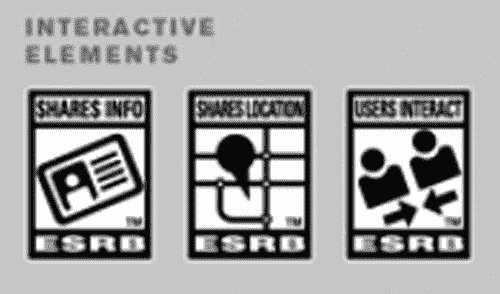

图 9-2. ESRB 互动元素示意图

请注意，虽然 AO（仅限成人）评级与 M（成熟）评级在年龄适宜性上仅相差一岁，但它是电影领域 X 评级在软件娱乐中的对应版本，对发行商和消费者而言具有同样的污名效应。

### 游戏类型

你应该制作什么样的游戏？制作一款你自己会喜欢的游戏——毕竟，这本来就应该是有趣的事。无论你是否已经有一个正在构思的概念，了解现有的游戏类型及其各自的玩法风格，都能帮助你充实游戏设计，并凭借对用户期望的更深入理解来进一步完善设计。

一个不错的起点是，从你喜欢的游戏类型中选取一个简单示例，以便将学习重点集中在最相似的游戏行为上。你当然不必强迫自己的游戏符合任何一种特定的分类。动作游戏是一个类型，冒险游戏也是一个类型。有些资料将“动作冒险”视为一个类型，而另一些资料则称之为混合类型。

从根本上复制一款现有游戏并发布可能会招致法律纠纷。然而，通过研究、剖析和学习如何重构一款现有游戏来提升自己的技能，则是完全可行的。

表 9-2 列出了一些宽泛的游戏类型分类。还有更多类型，包括派对、音乐、教育和 trivia（问答）类。你大概能想到许多游戏是类型的混合体，或者融合了多种类型。

**表 9-2. 电子游戏类型**

| 类型 | 特征 | 示例 |
| --- | --- | --- |
| 动作 | 需要良好的手眼协调能力和快速反应才能游玩。玩法通常涉及战斗。 | 射击游戏、平台游戏、潜行游戏、格斗游戏 |
| 冒险 | 不需要快速反应即可游玩。玩法涉及通过游戏角色和环境的互动来解决谜题。 | 角色扮演游戏、MMORPG*、图形冒险游戏、文字冒险游戏、生存恐怖游戏 |
| 策略 | 需要谨慎的长期思考和规划。玩家通常拥有“上帝视角”。 | 回合制策略游戏、即时战略游戏、塔防游戏、战争游戏 |
| 体育 | 玩法基于某项体育竞技或运动。 | 扮演运动员、扮演教练/经理、竞速游戏 |
| 模拟 | 玩法模拟现实。 | 载具模拟、生活模拟、宠物模拟、建造模拟、经营模拟 |
| 解谜 | 玩法基于问题解决。 | 逻辑谜题、模式完成、文字游戏 |

*MMORPG = 大型多人在线角色扮演游戏。

### 主题

选择主题的主要依据可能是特定的时代背景、环境、科技或角色类型。

| 时代背景 | 环境 | 科技 | 角色类型 |
| --- | --- | --- | --- |
| 中世纪 | 游乐园 | 中世纪 | 天使 |
| 维多利亚时代 | 丛林 | 科幻 | 恐龙 |
| 现代 | 地牢 | 奇幻/魔法 | 机器人 |
| 架空历史 | 学校 | 蒸汽朋克 | 有组织犯罪 |
| 后末日 | 派对 | 时间旅行 | 忍者 |
| | 空间站 | | 海盗 |
| | 外星世界 | | 牛仔 |
| | | | 恶魔 |
| | | | 超级英雄 |
| | | | 侦探 |
| | | | 僵尸 |
| | | | 动物 |
| | | | 疾病 |

确定了游戏的目标准受众（及对应的 ESRB 评级）、类型和主题后，这反过来将指导你对其他游戏设计元素的选择，例如配色方案、音乐、角色名称、服装和装备，以及宝藏类型、能力、武器和危险物。

## 乐趣与游戏体验

如果能简单地定义什么是“乐趣”并加以应用，那么游戏设计将会变得容易。不幸的是，“乐趣”是主观的——你觉得有趣的东西，对别人来说可能毫无乐趣。即使是同一款游戏，在你玩了很多次之后，也可能不再觉得它有趣。一个简单的事实是：你无法预测游戏玩家大众是否认为你的游戏有趣。

虽然没有具体的“乐趣公式”，但有一些众所周知的工具可以用来避免玩法机制中的常见问题，这些问题必定会降低游戏的潜在乐趣。

### 地图

一个好的起点是，在一张纸上或使用你最喜欢的绘图工具来绘制你的游戏地图。为了了解地图如何帮助你发现游戏设计问题，让我们看看障碍赛场景的地图（图 9-3）。

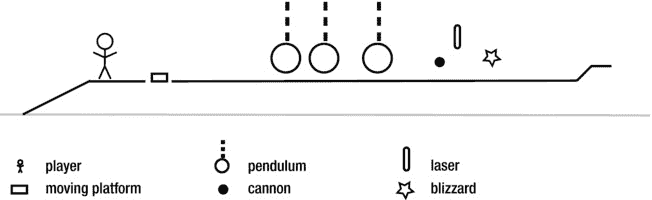

图 9-3. 障碍赛的初始地图

现在，你可以轻松地看到玩家角色、从起点到终点的架空赛道，以及各种障碍物都集中在一起。

为了达到最佳效果，地图应按比例绘制。在这个例子中，相对于障碍物和赛道，玩家角色过大。通过同时标示出玩家的起点，玩家图标为地图增加了更多信息（图 9-4）。

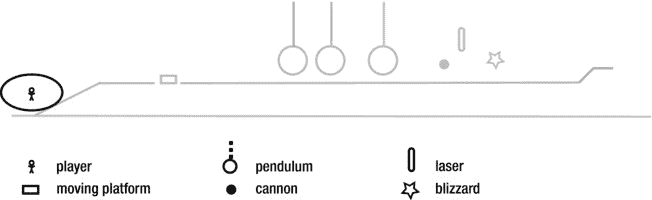

图 9-4. 按比例绘制了玩家角色的障碍赛地图

现在地图上的玩家图标已经按比例缩放，让我们用批判的眼光看看整个障碍赛的布局。

赛道上有很多空白区域，玩家除了行走无事可做。这很不好——仅仅行走是无聊的。没有太多障碍物的障碍赛是无聊的。无聊就不好玩。

在钟摆之后，加农炮、激光和暴风雪障碍物都挤在了一起。在地图上将赛道划分为区域后，这种拥挤现象就更加明显了（图 9-5）。

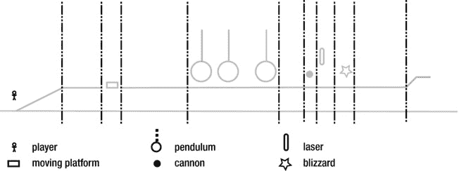

图 9-5. 将障碍赛划分为区域

为了解决这个问题，首先将赛道划分为大小更均匀的区域（图 9-6）。

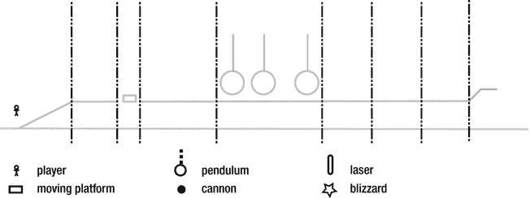

图 9-6. 将障碍赛重新划分为大小相近的区域

移动平台不需要更大的区域，而钟摆在一个大小合理的区域里算是较大的障碍物，因此这些障碍物及其区域边界可以保持不变。

现在区域已经划分好，出于多种原因，按类型设置障碍物区域，而不是每种类型只放一个，会更有意义。利用布满相似障碍物的区域是更有效地利用时间和资源的方式。在这种情况下，你可以在各自的区域中使用一组加农炮和激光，而暴风雪则可以简单地调整大小来适配一个区域。在分配这些区域之前，还有几个游戏设计因素需要考虑。

### 节奏

人类的大脑非常擅长适应几乎任何事情。即使你将游戏设计成从头到尾都是令人震惊的、达到曲速 10 级的、令人毛发直竖的激烈体验，一旦玩家的大脑适应了这种节奏，它可能会因为感觉“平淡”而被视为无聊（图 9-7）。

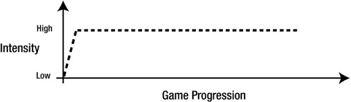
图 9-7. 持续高强度输出随着时间的推移会显得平淡

玩家的大脑需要不断调整，才能更投入、受到更多刺激，因此你需要将情感上的强烈高潮和低谷融入游戏体验中（图 9-8）。

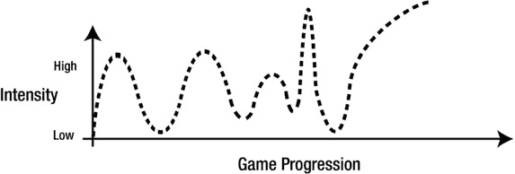
图 9-8. 随时间变化的、具有不同情感强度级别的游戏玩法

在障碍赛的例子中，障碍赛内的每个区域都可以是一个独特的强度级别，由检查点隔开。检查点处提供刚好足够的空间，让玩家站立并评估下一个障碍物。这个喘息空间让玩家在情感上平静下来，在玩家投入下一个相对更高强度的区域之前，将感知到的强度重置到一个较低的水平。

### 平衡

由于这个示例项目是一个包含机械障碍的越野赛道，因此相似的障碍物不应连续放置。这个概念基于与节奏相同的原理——大脑需要调整的越多，感知到的差异就越大。

在一个极端情况下，想象一个非常相似的加农炮区和暴风雪区。加农炮的间隔大约等同于暴风雪“雪片”的浓度，射弹的速度相同，并且两个区域的射弹都是从右向左水平移动（图 9-9）。

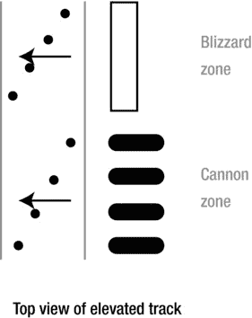
图 9-9. 加农炮区和暴风雪区看起来像是相似的障碍物

从玩家的角度来看，当玩家从加农炮区过渡到暴风雪区时，通过模式识别及后续角色控制来穿越这两个区域所需的心智能力几乎相同。

在另一个极端情况下，首先想象加农炮区。它是一排加农炮，每个加农炮以特定频率发射一枚射弹，加农炮之间有规则的间距，并且射弹是从右向左移动的。

在这种情况下，射弹的规则间距和频率意味着成功穿越这一区域基于模式识别——即，分析发射弹丸的规律以找到向前安全路径。

如果紧随加农炮区之后的是钟摆区，那么玩家现在必须调整自己以适应一个具有不同机械模式的新障碍，并且在钟摆区之后，还需再次调整以适应激光区（图 9-10）。

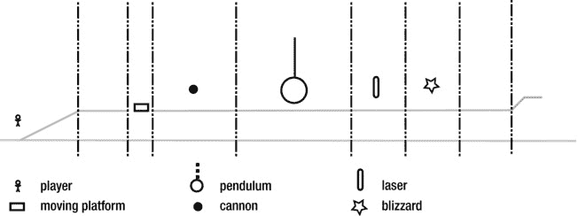
图 9-10. 分布障碍区域，使相似障碍物不相邻

经过激光区后，玩家最终到达暴风雪区，在这个场景中，该区域会以随机的大小发射雪片状射弹以使其看起来不同，射弹速度在一定范围内随机，生成点也是随机的。尽管它们水平移动，但这次它们是从左向右穿越赛道。

玩家又一次需要从激光区做出重大的评估和策略调整，才能在暴风雪区生存下来。由于玩家在完成加农炮区后已经经历了三次重大调整，并且暴风雪射弹的属性细节现在与加农炮弹丸不同，因此玩家觉得加农炮区和暴风雪区之间的玩法机制差异远大于它们在机械细节相似且紧挨着放置时的差异（图 9-11）。

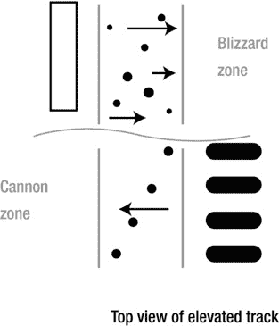
图 9-11. 重新配置和定位加农炮区和暴风雪区，以减少这两个障碍物之间的相似性

### 进程

进程指的是游戏玩法随时间的演变。从根本上说，玩家想玩，也想赢。“想玩”也意味着“不想看说明、不想听冗长的 `NPC`（非玩家角色）对话、也不想找教程”。他们想玩，并且更倾向于能够通过游戏玩法本身来弄清楚如何玩游戏。

他们希望感受到挑战，但不要过多的挫败感，然而，一款过于简单的游戏很快就会变得无聊。胜利应该是可实现的，并且对玩家而言感觉像是来之不易的成就，而非唾手可得。游戏设计的艺术在于为你的目标受众中的大多数人找到恰当的平衡点。

最直接的游戏进程是从玩家没有任何技能或能力开始游戏。最初的挑战——谜题、敌人、障碍——为玩家提供了学习曲线。在越野赛道示例项目中，玩家必须学习如何控制镜头和移动角色，包括发现角色可以蹲伏，并感受角色可以跳多高、多远，或跑多快。

以我们的越野赛道为例，由于玩家正在学习如何移动镜头和角色，像地雷这样的简单固定障碍物是第一个区域的不错选择。这些障碍物为玩家提供了需要避开的致命危险，但只需要简单的控制器操作。玩家只需学会移动和转向玩家角色就能成功穿越这个区域。

如果玩家更具冒险精神，他可能已经发现了跳跃的能力。如果没有，第二个区域的移动平台障碍则会强迫他学会跳跃，因为准确地跳跃到平台上，然后再跳到高架轨道上，是穿越的唯一方法。

随着玩家沿着高架轨道前进，后续的障碍区域需要更好的模式识别和角色控制能力。最后，暴风雪区引入了随机元素，使得模式识别不如更好的手眼协调能力有用。

作为该关卡的最终大挑战，最后一个区域引入了真正的敌人，这些敌人具有脚本控制的 `AI` 元素，可以跟踪并响应玩家的移动（图 9-12）。

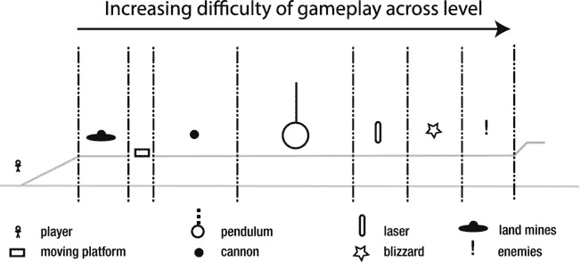
图 9-12. 按难度递增顺序分布的障碍物

前面的示例展示了一个关卡从开始到结束的进程。进程也可以应用于关卡内的子集，例如越野赛道中的各个区域（图 9-13）。

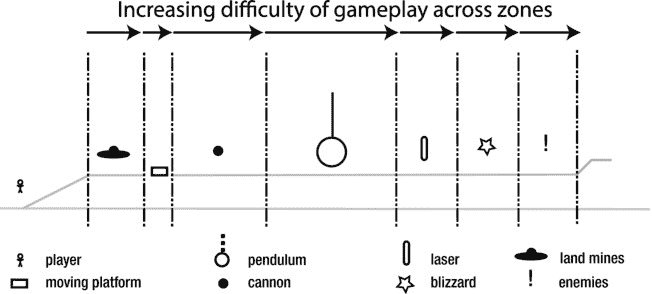
图 9-13. 在每个区域内按难度递增顺序分布的障碍物

例如，你可以通过在玩家穿越时使区域内的障碍物变得更大、更快或更密集，从而在越野赛道的每个区域内应用进程。

进程也指从一个关卡到下一个关卡的玩法演变（图 9-14）。

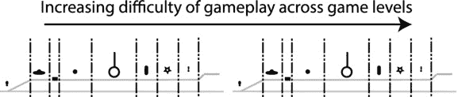
图 9-14. 在整个游戏中从一个关卡到另一个关卡的难度递增

当你开始创建多个关卡时，你会发现一个简单的电子表格可以帮助你跟踪游戏中不同关卡的各个方面，并在整个游戏中应用相同的平衡和进程概念。根据游戏类型的不同，需要考虑跟踪以便进行比较的元素包括关卡目标、游戏时间、以及玩家进程和能力相对于敌人和危险的对比。

### 惩罚与奖励

平衡是游戏设计中一个反复出现的主题，它不仅应用于游戏的物理布局。另一个需要考虑的方面是强化。玩家想要一款他们能赢的、有趣的游戏，并且希望他们足够喜欢，以至于会再玩一遍并告诉他们的朋友。当你将节奏中讨论的不同强度级别整合到你的游戏中时，你需要考虑你为玩家提供的情感体验质量。考虑一下玩家在游戏中可能会体验到的一系列情感（图 9-15）。

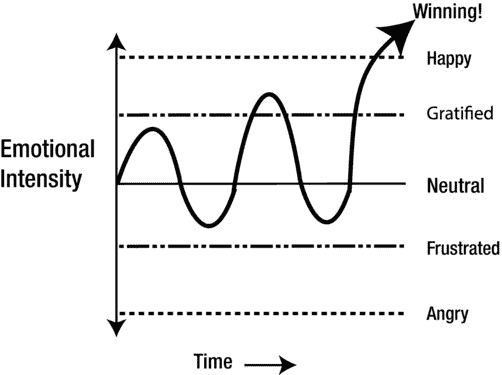
图 9-15. 玩家随着时间经历不同程度的情感强度

虽然情绪的起伏增加了游戏的整体体验，但挫败感和愤怒感肯定属于大多数玩家“不有趣”的范畴。

# 挑战还是挫败？

障碍赛道显然提供了负强化——玩家若未能清除障碍便会死亡，游戏随之结束。这使得游戏相当困难，尤其是对初次玩家而言：一次失误就会导致失败。反复重启游戏的过程不断强调玩家失败的事实，这充其量只能让人感到恼火。如果挫败感足够强烈，玩家可能会选择转而玩其他游戏，而不是冒着遭受更多挫折的风险。

如果你给玩家更多条命会怎样？尽管玩家在未能清除障碍时仍会死亡，但玩家无需任何操作，角色就会自动复活，准备再次尝试。这一次，“死亡”仅仅是一次小挫折，而非彻底失败，不会引发玩家如此强烈的负面情绪反应。同时，复活机制通过将玩家直接送回游戏中，鼓励他们再次尝试。

另一种实现方式可以是让玩家角色每次受击都损失生命值，因此需要累积多次攻击才能最终杀死玩家角色。这样一来，玩家在尝试通过障碍时就能承受几次失误。

# 正强化

摆脱负面后果能将情绪导向积极方向，但可能仅限于此，让玩家停留在中性区域。中性嘛，就是中立。平淡。无聊。好过愤怒或沮丧，但算不上特别有趣。

正强化是有趣的，它可以有多种形式。最常见的是为了获得高分这一经典成就而赚取积分。解锁小游戏或新关卡、收集战利品或金钱、达到更高技能等级、获得更强大的武器或更好的装备、赢得成就，以及激活增强道具，这些都是正强化形式。根据你游戏的性质，你还可以加入一些喜剧调剂，或者干脆是纯粹的搞怪元素。

彩蛋（Easter eggs）得名于经典的复活节寻蛋活动——找到的蛋里藏着一个惊喜。这个惊喜可以是任何东西：额外能力、一个笑话、一条秘密信息、一张有趣的图片或视频片段、一个作弊码，或任何你喜欢的东西。彩蛋增添了乐趣，但不一定对游戏玩法相关的内容进行正强化。事实上，由于彩蛋本质上是隐藏在游戏环境中不寻常的位置，玩家可能会出于偶然碰到一个的渺茫希望，而去探索看似无趣的角落。

明确的赞扬也是正强化——谁不喜欢听到自己有多厉害呢？赞扬可以是文字、对话、NPC 的回应，或通过声音和粒子特效等其他形式呈现。

在我们的障碍赛道示例中，正强化可能采取收集硬币的形式（因为我们在示例资源中已经有一个现成的硬币资源），收集一定数量的硬币意味着增加一条命或更多生命值。坡道下方是藏匿彩蛋的绝佳位置。

## 游戏设计文档

游戏设计文档（`GDD`）是游戏的实际蓝图。我们是如何从脚本编写一路讲到游戏设计文档的？`GDD`描述了游戏玩法——即玩家如何与游戏互动。“游戏玩法”与“趣味性”类似，都很难找到清晰、全面的定义。其定义包括玩家面临的抉择与任务、游玩时的情感联系与反应、故事情节以及整体的游玩体验等因素，但多数人认为玩家互动是游戏玩法的基本组成部分。由于玩家互动由脚本控制，`GDD`解释了游戏设计师希望代码——也就是你，程序员，将要编写的内容——达成怎样的结果。

`GDD`描述了关于游戏的一切。它没有特定的格式，但通常包含三部分：摘要、概念概述和具体细节。它传达了游戏体验以及开发团队整合游戏所需的各种组件，并可用于向潜在投资者或发行商推介游戏。

在深入探讨`GDD`之前，这里简要介绍一下你的游戏开发团队成员的角色，他们将与你一起根据`GDD`开展工作。

### 游戏开发团队

游戏设计文档的作用在于将游戏设计愿景传达给游戏开发团队。一个典型的团队包括游戏设计师、开发者和美术师。

游戏设计师通常是游戏本身的原创者——初始概念、规则以及游玩体验的愿景。设计师也负责创建游戏设计文档，并利用它来协调其他团队成员的工作。

`GDD`是一份动态文档——在开发过程中，游戏设计的许多方面发生变化是很正常的。这可能源于团队成员的反馈、测试员的意见，或是预算限制。游戏设计师引导这些变化，使其符合游戏的总体愿景，并更新`GDD`以将任何变更传达给其他团队成员，因为某一领域的改动通常需要其他团队成员做出相应调整。

美术师负责创建游戏的视觉元素，包括角色、动画、游戏世界中的地形与物体，以及`GUIs`。

程序员也可被称为工程师或开发者。玩家与游戏之间的所有交互都由程序员编写的代码定义。这种交互包括将游戏控制器映射到角色动作、控制摄像机、定义敌人的`AI`，甚至编写用于测试游戏某些方面的“作弊码”。从根本上讲，程序员编写的代码实现了游戏设计师对玩法的愿景。

测试员分为不同类型的 Bug 测试员和玩法测试员。Bug 测试员也被称为质量保证人员，他们负责测试其他团队成员的产品，以确保其达到`GDD`中规定的预期结果。质量保证侧重于技术准确性，而玩法测试员则测试游戏体验——一个没有 Bug 且符合`GDD`描述的游戏，并不保证它一定有趣。

随着团队规模的扩大，每个类别中都会出现更专业的角色。关卡设计师、敌人 AI 开发者、骨骼绑定师和动画师，只是大型游戏开发项目中众多专业领域中的几个例子。

尽管你可能身兼整个团队，并在必要时扮演每个角色，但创建游戏设计文档对你仍有诸多益处。首先，`GDD`能帮助你厘清游戏概念，并提供一个框架，让你可以进一步充实这个想法。当你在纸面上构建游戏设计时，即使是一个相对简单的游戏，也会看到涉及大量细节。`GDD`帮助你跟踪这些细节。由于时间或预算限制而缩减某些期望的功能是常见情况，但你仍将保留原始概念的记录，这可能在制作原版游戏的升级版或完整续作时派上用场。

在某些时候，你可能会引入其他人参与开发过程，而通过`GDD`你可以让他们快速上手。当你到了这一步，你会更清楚地认识到自己在`GDD`中想表达的内容，与别人可能如何解读之间的差距。不同的解读可能优于或劣于你的原始版本，因此要对来自外界的想法持开放态度。

另一方面，当你作为团队中的程序员时，你应该在团队会议中积极沟通，以确保自己充分理解游戏设计师的意图。游戏开发非常像一项团队运动，积极的协作和沟通能营造出最佳的游戏开发环境。

如果你的意图是向发行商推销你的游戏，那么你绝对需要一个能立即引起他们兴趣的专业级`GDD`，然后有效而简洁地传达游戏概念。熟能生巧，所以你最好在游戏开发技能培养计划的早期就加入撰写`GDD`的练习。

虽然游戏设计文档没有固定的格式，但通常包含三个部分，细节程度递增：一页概述、概念概览，以及`GDD`本身的详细内容。

### 一页概述

一页概述是`GDD`的第一页，是对游戏概念的简要总结。虽然它不必严格限制在一页之内，但能在一页纸上以有趣、引人注目的方式呈现你的游戏创意，会让读者更容易理解你的愿景。如果你能用一页概述抓住他们的注意力，他们就会想翻到下一页，在概念概览中了解更多信息。

一页概述通常包含以下内容：

-   标题

-   类型

-   目标受众与`ESRB`评级

-   几段总结游戏概念的段落，重点强调玩法

-   平台

-   授权信息（如有）

-   独特功能

-   营销摘要

你必须要以一种能让人兴奋的方式来呈现你的游戏概念，无论对方是潜在投资者、发行商、团队成员、营销人员，还是制作过程中的任何其他人。如果你是单干，你绝对需要能够吸引目标玩家群体的注意力。无论如何，你必须能够以富有感染力的方式传达游戏体验。

你可以快速搜索互联网，找到许多`GDD`的例子。另一个可以找到真实游戏推销案例的地方是`Kickstarter`。项目通常以书面和视频描述两种方式呈现。一个有趣的练习是比较成功获得资金的项目和未获得资金的项目的推销方式。观看这些视频并记录你的反应。它们能吸引你，还是让你打哈欠翻白眼？是什么抓住了你的注意力，是什么让你想玩那个游戏，或者是什么方面让你反感？是游戏概念本身，还是呈现方式？你觉得概念艺术和开发团队（如果介绍了的话）怎么样？你觉得介绍者哪些地方有吸引力？

虽然从一页概述开始，然后充实你的游戏创意是一种方法，但有时一个简单的总结似乎很难写出来。这可能是你的概念需要进一步完善的信号。如果你发现自己卡住了，可以随时跳到概念概览部分来理清思路，让你的游戏创意得到一些充实，然后再回头进行总结。

### 概念概览

你通过一页概述吸引了注意力，现在你的读者正在翻页以了解更多信息。`GDD`的这一部分在保持宏观视角的同时，为一页概述的初始内容增加了细节。目的是在不让读者被大量琐碎细节淹没的情况下，保持他们的兴趣。保持简洁易懂。如果使用视觉素材——图片、图表、故事板或线框图节选、简短的 Flash 动画等——只要它们相关且能更好地传达信息，都是可以的。在提供对比游戏的例子时，请使用那些易于辨认的近期成功作品。

#### 核心游戏概念

简要描述你的游戏从开始到结束的故事大纲。这应包括定义玩家的目标（记住，你必须有一个胜利条件），扩展玩家角色和其他角色，描述环境，并展示游戏玩法如何通过挑战、奖励、技能、获取物、战斗、载具等方式融入故事中。

### 玩家角色与控制器

在此描述角色，类似简介，但除了年龄和性别等属性外，还需包含更多关于其个性的内容。你可以在此提供背景故事，以及贯穿游戏过程的角色发展。请展示角色的个性和背景如何与游戏玩法相关联，包括独特技能、武器使用，以及角色在游戏中实现的其他任何玩法。

请包含一张示意图，详细说明角色移动控制的具体细节，包括战斗动作；角色如何与世界中的其他角色和对象互动；以及适当时如何使用物品栏、HUD（平视显示器）和地图。

### 玩法描述

“玩法”是一个相当通用的术语，涵盖了最小的游戏对象和交互、一系列交互之间的流程，直至基于玩家、规则和目标这三个基本要素的完整游戏宏观背景。无论你从微观视角还是鸟瞰全局，都应能描述出玩法的乐趣所在。

一个精心策划的高潮场景（设定片段）旨在让玩家叹为观止，没有它，游戏将不完整。此处的目标是激发读者的想象力，因此请使用设定片段和独特的玩法特色来吸引他们，并让他们继续阅读。

### 世界/关卡

描述游戏世界的物理布局。根据你的游戏，你可能希望在概述中使用图片来描绘游戏世界中的环境或关卡，以及它们如何与游戏故事联系起来，玩家将如何找到路径并在游戏中推进。

### 关卡流程攻略

顾名思义，你正在引导读者通过游戏的一个关卡。在此，你通过故事与玩法的融合来描述游戏体验。本节可能需要几页的篇幅来涵盖玩家的关键行动、挑战和进度。请包括摄像机、音效、特效和过场动画的运用如何有助于游戏玩法和整体体验。

### 障碍与敌人

列出玩家必须解决或克服才能完成游戏的障碍、敌人、谜题以及任何其他事项。

### 奖励与收藏品

# 游戏设计文档

列出成就、能力增强道具和物品栏物品，包括玩家如何获取它们以及它们如何为游戏玩法做出贡献。如果游戏世界使用货币或其他形式的交易，请描述游戏世界经济体系如何运作。

### 过场动画

如果您的游戏使用视频序列或过场动画，请描述它们是如何在游戏中使用的。

# 音频

列出游戏的音频要求，包括音乐、音效和配音对话。

## 概念艺术

不要将你的艺术仅限于此部分。如前所述，视觉效果增加了你演示的冲击力，并且通常能单独或配合文字描述有效地传达概念。概念艺术可以是图像、故事板、图表、地图，甚至是简短的动画。它可以描绘角色、物品栏物品、游戏世界和关卡地图、图形用户界面（`GUI`）以及菜单。

## 结论

这是你将所有内容汇总，为你的游戏做出最终推介的地方。

## 游戏设计文档

一页纸概述和概念概览可以独立存在，也可以作为游戏设计文档的引言部分。游戏设计文档本身包含了游戏的所有细节，可能长达数百页。虽然它主要关乎玩法，但也可以包含营销信息、法律协议、财务数据以及详细的技术规格。

即使是构思最周密的游戏设计文档，在游戏制作过程中也会经历无数变化：一个绝妙的想法可能在实践中行不通；预算限制导致资源、功能甚至整个关卡被修改或删除；测试人员的反馈指出了改善游戏体验的方法；或者团队中的某个人提出了一个必须包含在内的、极具启发性的伟大想法。游戏设计文档就是向游戏开发团队记录和传达这些变化的工具。

## 总结

要想更擅长制作游戏，你需要制作更多的游戏，现在你知道从哪里开始了。你已经掌握了游戏设计和游戏开发流程的基础知识，并且有了一些模板作为起点。保持简单，从小处着手。制作一些游戏。玩更多的游戏。留意你在游戏体验中喜欢和不喜欢的地方。制作更多的游戏。更深入地挖掘 `Unity` 的广阔能力，并制作更多种类的游戏。

如果你对游戏设计感兴趣，请在提升编程技能的同时，同步发展你的规划和文档编写技能，而不是用后者取代前者。学习编程就像学习任何一门新语言，定期练习至关重要。

现在，你已经从概念上了解了如何将游戏设计概念应用于障碍赛道示例，以识别缺陷并制定解决方案，是时候回到脚本编写了。
