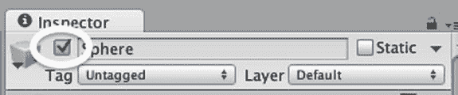
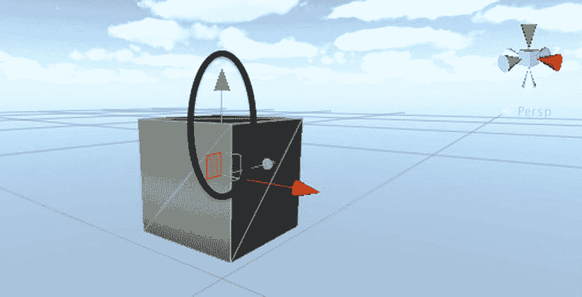
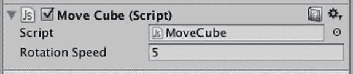
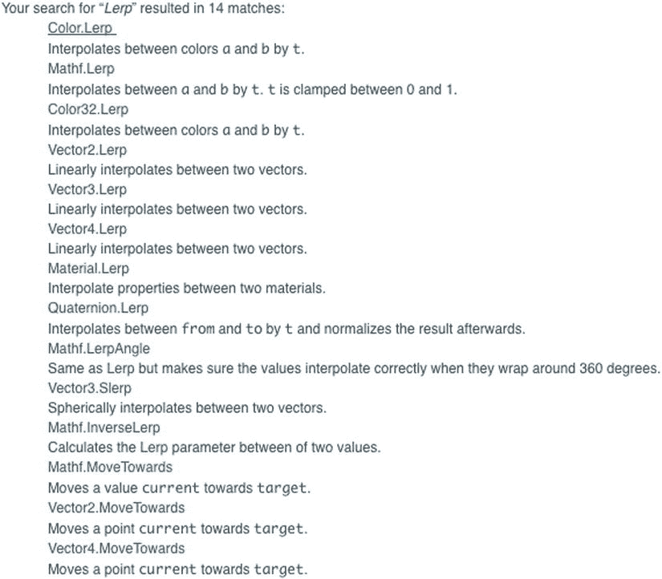

# 5. 移动游戏对象

你已经构建了一个基本场景，并用游戏对象充实了它。你添加了脚本，允许用户交互来添加和销毁游戏对象，以及改变它们的外观。现在，是时候加入移动功能了。

首先，你将学习如何使用游戏对象的变换组件通过脚本来移动游戏对象。然后，你将初步了解如何使用 Unity 的 Mecanim 系统来处理资源商店中更复杂的游戏对象角色。这些角色带有内置动画，你将学习如何通过脚本操控它们。

Unity 游戏引擎还提供了游戏对象在响应重力或与其他游戏对象碰撞等作用力时的移动和交互。这些由 Unity 游戏引擎的物理系统控制，将在第 6 章和第 7 章中介绍。

## 旋转

由于球体从任何角度看起来都一样，因此它并不是演示旋转运动的最佳形状。与其删除它，不如先禁用它。在项目面板的资源文件夹中找到的预制件子文件夹中，选择球体预制件。在检查器顶部附近，取消选中预制件名称“Sphere”左侧的复选框以禁用它（图 5-1）。



图 5-1. 在检查器中禁用球体预制件

在层级视图中，选择“创建 ➤ 立方体”。Unity 的原始对象立方体将出现在场景视图的 (0, 0, 0) 位置。

在检查器视图中，选择“添加组件 ➤ 新建脚本”，将其命名为 `MoveCube`，并确保语言属性为 JavaScript。点击“创建并添加”按钮，它将作为组件出现在检查器中。在项目面板中，该脚本出现在资源根文件夹中。为了保持项目整洁，将其移动到脚本文件夹。

现在在 MonoDevelop 中打开 `MoveCube`。为了获得移动的错觉，你希望 Unity 在每一帧中将立方体渲染到略微不同的位置，这意味着你需要使用 `Update()` 函数。在 `Update()` 函数的花括号之间，添加以下代码行：`transform.Rotate(Vector3.up);`。保存脚本，点击播放进行测试，你的立方体正在旋转——好极了！

让我们分解这行代码，以理解究竟发生了什么：

`(1)      (2)    (3)   (4)`

`transform.Rotate(Vector3.up);`

`Transform` 是每个游戏对象必备的组件；它包含位置、旋转和缩放信息。在这行代码中，你可以使用小写的 `transform`，编译器知道这指的是附加此脚本的游戏对象的变换组件。从一个附加到第二个游戏对象的脚本中影响第一个游戏对象的 `Transform` 组件会稍微复杂一些，将从第 6 章“访问其他游戏对象”开始介绍。

`Rotate()` 是 `Transform` 类的一个函数。你可以使用 `#` 阅读脚本参考。它围绕其 `Vector3` 参数的轴应用旋转，单位是欧拉角。欧拉角是一个高级数学术语，指的是围绕游戏对象轴线的旋转度数。

`Vector3` 参数定义了旋转将要围绕的轴。`.up` 是向量 (0, 1, 0) 的 `Vector3` 静态变量快捷方式。

仔细观察立方体的平移操纵杆，记住在 Unity 的世界空间中，y 轴是“向上”的。再次播放，从视觉上确认立方体的旋转是围绕 y 轴发生的。查看检查器，你可以看到 `Transform` 组件的旋转属性的 y 值正在根据立方体的旋转变化而变化（图 5-2）。



图 5-2. `Vector3.up` 平行于正 y 轴

向量确实有方向，因此虽然 `Vector3.up` 和 `Vector3.down` 都平行于 y 轴，但它们指向相反的方向。将 `Vector3.up` 替换为 `Vector3.down`。保存、播放，注意现在立方体似乎正在向相反方向旋转。这是因为旋转现在是围绕向下指向的向量 (0, -1, 0) 计算的。

你不仅限于使用 `Vector3` 快捷方式，实际上你可以传入任何值的 `Vector3` 变量。将 (`Vector3.down`) 替换为 (x, y, z) 值 (2, -5, 4)，保存并播放。现在你会看到立方体以一个角度翻转，因为旋转是围绕这个随机向量计算的。由于应用于所有三个轴的旋转计算累加在一起，立方体看起来也翻转得更快了。

### 在游戏测试中编辑属性

既然你可以让游戏对象围绕任何你喜欢的轴旋转，那么如果也能控制速度就好了。更好的是能够直接在 Unity 编辑器中测试和调整速度，而不是在脚本和编辑器之间来回切换。

回到 MonoDevelop，在 `#pragma strict` 下，声明公共浮点变量 `rotationSpeed` 并赋予其初始值 5：

`public var rotationSpeed:float = 5;`

将 `Update()` 函数编辑为：

`transform.Rotate(Vector3.up * rotationSpeed);`

你将默认的旋转计算乘以一个你控制的因子：变量 `rotationSpeed`。保存并返回 Unity 编辑器。在层级视图中选中立方体游戏对象，现在你会看到 `rotationSpeed` 作为 `MoveCube` 脚本组件的一个属性出现，初始值为 5（图 5-3）。



图 5-3. `rotationSpeed` 公共变量作为“旋转速度”属性显示在检查器中

你将 `Vector3` 参数改回 `Vector3.up`，只是为了让你在游戏测试时更容易直观地看到你对 `rotationSpeed` 属性所做的更改并进行调整。

播放，看到立方体再次围绕 y 轴旋转。在保持播放模式的同时，更改 `rotationSpeed` 的值（注意必须选中立方体）。尝试更快的值、更慢的值、零值，甚至负值。这是 Unity 的一个强大功能，你可以在微调游戏体验时立即看到更改的效果。退出播放模式，注意 `rotationSpeed` 值恢复为 5。请记住，在播放模式下所做的更改不会被保存。

在第 4 章中，你学习了帧率和 `Time.deltaTime`。当你调整游戏对象移动时，请记住，基于不同的帧率，游戏对象在不同计算机上的移动方式会有所不同。解决方案是乘以 `Time.deltaTime` 来使运动与帧率无关。将 `Update()` 函数编辑如下：

```javascript
function Update () {
    transform.Rotate(Vector3.up * rotationSpeed * Time.deltaTime);
}
```

### 添加用户交互

保存并运行。立方体的速度因这个新增因素而改变，但你可以重新调整 `rotationSpeed` 属性，恢复到你喜欢的速度。现在不同之处在于，任何在不同机器上玩你游戏的人，都将获得与你在自己机器上创建的游戏相同的体验。

像你在第 4 章中做的那样，通过键盘添加一些用户交互，这次用于控制立方体的旋转。编辑 `Update()` 函数，添加一个条件判断来检查用户是否按下了左箭头键。

```javascript
function Update () {
        if(Input.GetKey(KeyCode.LeftArrow)) {
                transform.Rotate(Vector3.up * rotationSpeed * Time.deltaTime);
        }
}
```

保存并运行。现在立方体仅在按下左箭头键时才旋转。类似地，你可以通过使用 `-rotationSpeed`，让用户用右箭头键使立方体向相反方向旋转。

```javascript
function Update () {
        if(Input.GetKey(KeyCode.LeftArrow)) {
                transform.Rotate(Vector3.up * rotationSpeed * Time.deltaTime);
        }
        if(Input.GetKey(KeyCode.RightArrow)) {
                transform.Rotate(Vector3.up * -rotationSpeed * Time.deltaTime);
        }
}
```

保存并运行。

## 移动（Translate）

`Translate()` 是 `Transform` 的另一个函数，用于移动 `GameObject`。和 `Rotate()` 一样，它也接受一个 `Vector3` 参数，但在这个情况下，`Vector3` 描述了 `GameObject` 将要移动的方向和距离。添加一个公共变量，用作乘法因子，以便在编辑器中调整立方体的速度。在 `rotationSpeed` 变量声明下方，添加一个 `travelSpeed` 变量。

```javascript
public var travelSpeed:float = 5;
```

通过向 `Update()` 函数添加以下代码行，让玩家使用上箭头和下箭头键上下移动立方体。

```csharp
if(Input.GetKey(KeyCode.UpArrow)) {
    transform.Translate(Vector3.up * Time.deltaTime * travelSpeed);
}
if(Input.GetKey(KeyCode.DownArrow)) {
    transform.Translate(Vector3.down * Time.deltaTime * travelSpeed);
}
```

保存并运行。这次，对于向下方向，你使用了 `Vector3.down` 而不是 `-travelSpeed`。两种方法都可行，就像 `-Vector3.up` 也等同于 `Vector3.down` 一样。获得相同结果的方法往往不止一种；这很大程度上取决于个人偏好。如果有选择，请选择最高效的代码，如果其他条件相同，则可读性越强越好。

### `Transform.position`

`Translate()` 是一个移动变换（`Transform`）的函数，而 `position` 则是一个保存变换位置（x, y, z）值的变量。你也可以通过直接分配一个新位置来将 `GameObject` 移动到特定位置。在这个例子中，我们将使用 `O` 键将 `GameObject` 送回原点（0, 0, 0）。

首先，在公共变量声明下方添加一个新的私有变量声明。

```csharp
private var originPosition : Vector3 = new Vector3(0, 0, 0);
```

在 `Update()` 函数中，添加以下代码：

```csharp
if(Input.GetKey(KeyCode.O)) {
    transform.position = originPosition;
}
```

保存并运行。使用箭头键移动立方体，然后按下 `O` 键将其返回到游戏视图中心。注意，这会重置立方体的位置，但对其旋转没有影响。

虽然这种移动是瞬间完成的，但显得相当突兀。如果你希望立方体更缓慢、更平滑地返回原点，Unity 正好有一个专为此目的而设计的出色函数，称为 `Lerp()`。

## 使用 Lerp 实现平滑移动

Unity 的 `Lerp()` 函数可以平滑立方体返回原点的过渡。Lerp 代表线性插值（Linear Interpolation），这是一种在两个值之间逼近平滑线或曲线的数学方法。在这种情况下，我们使用 `Lerp()` 来平滑地将立方体从玩家移动到的位置移回原点。如果你花点时间在脚本参考中搜索“Lerp”，你会发现 `Lerp()` 可用于在两个表示几乎任何内容的值之间进行过渡，包括颜色、材质和四元数（图 5-4）。



图 5-4. Unity 中使用 `Lerp()` 的静态函数

具体来说，你将使用 `Vector3.Lerp`。在脚本参考中选择它，快速阅读一下。

`Vector3.Lerp` 有三个参数：起始 `Vector3`、目标 `Vector3`，以及一个用于实际线性插值计算的浮点值。

首先，在其他变量声明之后声明一个公共浮点变量 `smoothing`，用于从检视面板调整立方体的移动速度：

```csharp
public var smoothing : float;
```

将 `Update()` 函数中用于将立方体返回原点的代码修改如下：

```csharp
//将立方体移回原点
if(Input.GetKey(KeyCode.O)) {
    transform.position = Vector3.Lerp(transform.position, originPosition, smoothing * Time.deltaTime);
}
```

分解关键代码行，我们可以看到以下内容：

`(1) (2) (3) (4) (5)`

`transform.position = Vector3.Lerp(transform.position, originPosition, smoothing *`

`(6)`

`Time.deltaTime);`

设置游戏对象的变换位置，通过 `Vector3.Lerp()` 函数进行平滑处理，从游戏对象的当前位置移动到原点，并使用一个可用于定制的平滑乘数，该乘数基于实时时间而非变化的帧率。

保存并返回 Unity 编辑器。在层级面板中选中立方体游戏对象，在检视面板中将平滑属性（`Smoothing`）更改为 3。进入播放模式。现在，当你按住 `O` 键时，立方体会平滑移动，并且越接近原点，其移动速度会逐渐变慢，最终滑行停止。

现在，你已经通过多种不同的方式为你的原始游戏对象实现了各种移动动画。你玩过一些游戏，它们有效地利用像这样的简单运动来创造有趣、互动的体验，但这只是 Unity 能力的冰山一角。本章的其余部分将向你介绍 Mecanim（Unity 的动画系统），以及可以在资源商店中找到的精彩多样的角色和动画包。