# 11. 提升用户体验：GUI 与音效

“视频游戏”这一术语用于描述通过各种视频监视器或屏幕进行游玩的游戏。早期的视频游戏仅限于在单色显示器上显示文本和键盘字符，但自那以后，它们已演变为使用 3D 图像、立体声，并且根据平台不同，还具备运动检测和感官反馈功能的复杂游戏体验。

图形用户界面（即 GUI）是一种视觉覆盖层，它通过传达分数、库存物品和地图等信息来辅助玩家，同时还能为玩家与游戏进行交互提供额外的方式。

音效对于打造稳健且丰富的游戏体验同样至关重要。音乐用于设定游戏氛围；使用（从简单音效到叙事对话在内的任何形式）向用户传递关于游戏玩法的提示和信息；或者作为音效，增强显示器上发生的相应视觉动作。

## 创建 GUI 控件

创建和使用 GUI 控件是通过脚本和 `OnGUI()` 函数来完成的。虽然你可以将 GUI 脚本添加到任何游戏对象，或将 GUI 代码添加到任何脚本中，但保持它们的组织结构良好，会使编辑、更新和排除项目故障变得更加容易。在 Unity 编辑器顶部菜单中，选择 `GameObject` ➤ `Create Empty` 并将其命名为 `GUI`。与方向光（`Directional Light`）和音频（`Audio`）游戏对象一样，精确的变换（`Transform`）位置并不重要。你创建的 GUI 控件将根据你为其指定的屏幕坐标显示，而不是根据 `GUI` 游戏对象的游戏世界坐标。

### 显示文本

GUI 与用户通信最基本的方式就是显示文本。标签和框正是执行此操作的非常简单的控件。实际上，标签和框之间的唯一区别在于，标签只显示文本，而框则是一个带有深色背景的标签。

#### 标签

要创建一个标签，首先你需要一个脚本。在“项目”面板中，打开 `Assets` ➤ `Scripts` 文件夹，然后创建一个新脚本并将其命名为 `GUIScript`。在 MonoDevelop 中打开 `GUIScript`，并将代码编辑为以下内容：

```
#pragma strict

function OnGUI() {

        GUI.Label(Rect(0, 0, 125, 25), "A label displays text");

}
```

这段代码分解如下：

`(1)     function OnGUI()`

用于创建 GUI 控件的 `OnGUI()` 函数在每一帧都会被调用。

`(2)     GUI.Label(Rect(0, 0, 125, 25), "A label displays text");`

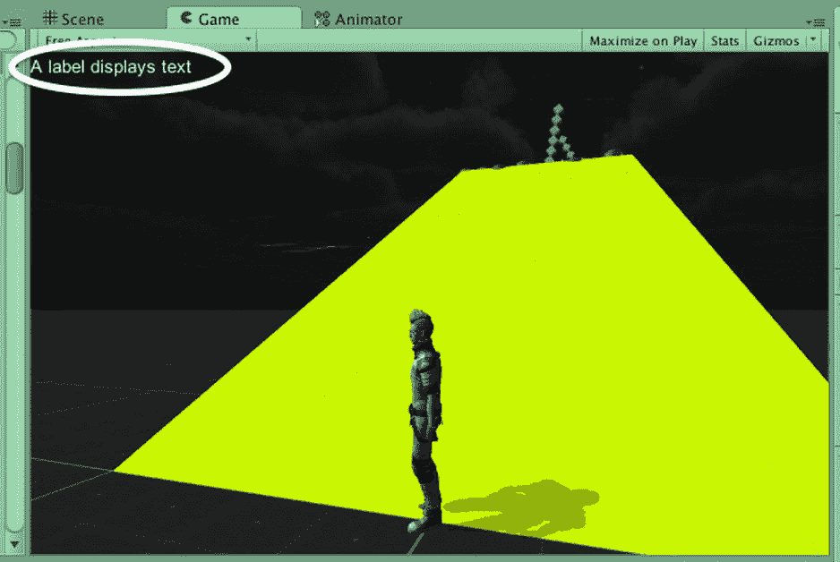

图 11-1. 显示在“游戏”视图左上角的新标签文本

调用 `GUI` 类的 `Label()` 函数，并为其传递标签的 x 和 y 屏幕坐标、宽度和高度，然后是标签中要显示的文本。

保存脚本，将其附加到 `GUI` 游戏对象上，保存场景，然后运行。你将看到标签文本显示在“游戏”视图的左上角（图 11-1）。

##### Rect

`Rect` 变量值得再多加解释一下。它代表一个二维矩形，其中 (x, y) 坐标表示矩形左上角将根据屏幕坐标定位的位置。屏幕坐标基于目标平台显示器的宽度和高度，并且独立于游戏世界的 (x, y, z) 坐标（图 11-2）。

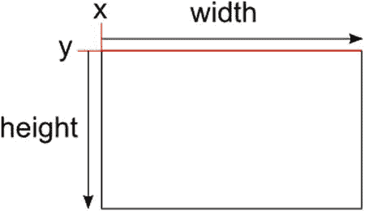

图 11-2. Unity 脚本参考文档中描绘的，定义二维矩形大小和位置的 `Rect` 变量属性

在 `GUIScript` 中，尝试更改 (x, y) 值来重新定位标签。当你同时尝试更改 `Rect` 的大小属性时，你会发现当把标签做小时，文本会被截断，并且不会随着矩形尺寸的缩小而缩小。

##### 淡出

假设你想在游戏开始时，通过一条在 3 秒后淡出的消息，告知玩家如何让角色蹲下和跳跃。将 `GUIScript` 编辑为以下内容：

```
#pragma strict

public var fadeDuration : float = 3;

function OnGUI() {

        var fadingColor : Color;        

        fadingColor = GUI.contentColor;

        var fading : float = (Time.time/fadeDuration);

        GUI.contentColor.a = Mathf.Lerp(1, 0, fading);

        GUI.Label(Rect(0, 0, 250, 25), "Press C to crouch or Space to jump");

}
```

分解一下：

`(1)     public var fadeDuration : float = 3;`

声明一个浮点类型变量 `fadeDuration` 并为其赋值 3。

`(2)     var fadingColor : Color;`

声明一个 `Color` 类型的引用变量 `fadingColor`。回顾一下，`Color` 由 r、g、b、a 值组成，其中 a（alpha 值）代表透明度，1 表示完全不透明，0 表示完全透明。

`(3)     fadingColor = GUI.contentColor;`

将 `GUI` 类的 `contentColor` 变量中保存的当前 GUI 文本颜色值赋给 `fadingColor` 变量。

`(4)     var fading : float = (Time.time/fadeDuration);`

声明一个浮点类型变量 `fading`，用于保存从游戏开始的时间除以 `fadeDuration`（秒）得到的结果。

`(5)     GUI.contentColor.a = Mathf.Lerp(1, 0, fading);`

使用 `Mathf.Lerp()` 函数平滑过渡 alpha 值，然后将新值赋给 `GUI.contentColor.a`，该变量保存将要渲染的 GUI 文本的参考颜色。

`(6)     GUI.Label(Rect(0, 0, 250, 25), "Press C to crouch or Space to jump");`

创建一个标签，其左上角将定位在平台屏幕的左上角，显示的文字指令将使用新计算并赋值的 alpha 值进行渲染。

保存脚本，保存场景，然后进行游戏测试。你将看到消息显示在左上角，然后在 3 秒内淡出。你可以通过在检查器（`Inspector`）中调整 `fadeDuration` 来改变消息保持可见的时间长度。

### 方框（Box）

在 `OnGUI()` 函数的末尾添加以下代码行，以查看标签（`Label`）和方框（`Box`）之间的区别：

```csharp
GUI.Box(Rect (0, 75, 100, 50), "This is a box");
```

其工作方式与 `GUI.Label` 完全相同。保存脚本并运行。方框的深色背景在障碍赛道场景（`Obstacle Course scene`）的深色天空盒背景下较难看清，因此你可能需要稍微平移摄影机才能看到它（图 11-3）。

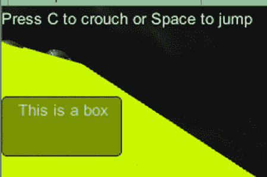

图 11-3. 游戏视图中显示的 `GUI.Label` 和 `GUI.Box`

请注意，标签和方框的文本都会淡出。这是因为你在淡出消息代码中编写的 `GUI.contentColor` 应用于此 `OnGUI()` 函数中的所有内容。解决此问题的一种方法是为不同的 GUI 控件使用不同的脚本。

删除 `GUI.Box(Rect (0, 75, 100, 50), "This is a box");` 代码行并保存脚本。

在项目面板中，选择 `Assets` ➤ `Scripts` 文件夹，然后选择 `Create` 并创建一个名为 `GUIBoxScript` 的新脚本。按如下方式编辑代码：

```csharp
#pragma strict

function OnGUI() {
    GUI.Box(Rect (0, 75, 100, 50), "This is a box");
}
```

保存脚本，将其附加到 `GUI` 游戏对象，保存场景，并进行游戏测试。这次，方框中的文本保持可见，而标签的文本则淡出。

### 图像（Image）

你可以显示图像来代替文本。将 `GUIBoxScript` 编辑如下：

```csharp
#pragma strict

public var boxTexture : Texture2D;

function OnGUI() {
    GUI.Box(Rect (0, 75, 100, 50), boxTexture);
}
```

以下是对其的分解说明：

1. `public var boxTexture : Texture2D;` – 为图像文件声明一个 `Texture2D` 类型的引用变量 `boxTexture`。

2. `GUI.Box(Rect (0, 75, 100, 50), boxTexture);` – 这行代码创建了 GUI 方框控件，但使用的是图像参数，而非先前示例中使用的字符串参数。

保存脚本。在 Unity 编辑器中，选中 GUI 游戏对象后，你会在检查器（Inspector）中的 `GUIBoxScript` 组件里看到 `Box Texture` 属性及其空白字段。在项目面板中，打开 `Assets ➤ Sample Assets ➤ Sample Scenes ➤ Textures` 文件夹。将 `gui_reticule` 图像拖入 `Box Texture` 属性字段。保存场景，进行游戏测试，瞄准图像（reticule）就会出现在方框中。太棒了！

请记住，你可以将光标悬停在 `GUI` 上，然后使用  打开 Unity 脚本参考文档，查找可用于自定义 `GUI.Box` 或任何 GUI 控件内容的各种选项。

### 文本输入（Text Input）

有时你可能需要玩家的输入。`TextField` 和 `TextArea` GUI 控件正为此目的而设计，它们之间的唯一区别在于 `TextField` 只能容纳一行文本，而 `TextArea` 可以容纳多行。

#### TextField

在项目面板中，选择 `Assets ➤ Scripts` 文件夹，创建一个名为 `GUITextInputScript` 的新脚本。在 MonoDevelop 中打开它，并将代码编辑如下：

```csharp
#pragma strict

var textFieldString : String = "A one-line text field";

function OnGUI () {
    textFieldString = GUI.TextField (Rect (0, 130, 120, 30), textFieldString);
}
```

这段代码分解如下：

1. `public var textFieldString : String = "A one-line text field";` – 声明 `String` 类型的 `textFieldString` 变量，并为其分配一个初始消息字符串“A one-line text field”。

2. `textFieldString = GUI.TextField (Rect (0, 130, 120, 30), textFieldString);` – 请记住，`OnGUI()` 在每一帧都会被调用。`String` 变量 `textFieldString` 会反映 `GUI.TextField` 的内容，因为玩家可以对其进行编辑。

保存脚本，将其附加到 GUI 游戏对象，它会在检查器中显示为一个脚本组件。你可以直接在检查器的 `Text Field String` 属性中编辑初始消息，也可以在游戏测试期间观察其变化，以反映游戏过程中对 `GUI.TextField` 所做的任何更改。

#### TextArea

`TextArea` 的工作方式与 `TextField` 类似。在 MonoDevelop 中，将 `GUITextInputScript` 编辑如下：

```csharp
#pragma strict

var textFieldString : String = "A one-line text field";
var textAreaString  : String = "A multi-line text field";

function OnGUI () {
    textFieldString = GUI.TextField (Rect (0, 130, 120, 30), textFieldString);
    textAreaString = GUI.TextArea (Rect (0, 175, 75, 75), textAreaString);
}
```

保存脚本并进行游戏测试。现在，当你在 `TextArea` 中添加更多文字时，它会自动换行以适应其空间内的新文本行。

### 更多控件（More Controls）

许多常见的交互元素都可以作为 GUI 控件使用，包括按钮（Button）、开关（Toggle）和滑块（Slider）。在创建任何 GUI 控件时，你会注意到它们都遵循位置 - 大小 - 内容（position–size–content）的模式。

#### Button

基本按钮在鼠标按钮释放时响应一次点击。点击时返回 `true`，否则返回 `false`。在你的脚本中，你可以使用条件语句来测试 `true` 状态；当按钮被点击时，它会执行其代码块。

在项目面板中，选择 `Assets ➤ Scripts` 文件夹，创建一个名为 `GUIButtons` 的新脚本。在 MonoDevelop 中打开它，并将代码编辑如下：

```csharp
#pragma strict

function OnGUI () {
    if (GUI.Button (Rect (25, 260, 100, 30), "Click Me")) {
        Debug.Log("Button has been clicked");
    }
}
```

这段代码分解如下：

1. `if (GUI.Button (Rect (25, 260, 100, 30), "Click Me"))` – 这行高效的代码同时创建了 GUI 按钮并测试了其状态。

2. `Debug.Log("Button has been clicked");` – 如果按钮状态返回 `true`（意味着它被点击了），`Debug.Log` 语句将出现在控制台（Console）中。

保存脚本，将其附加到 GUI 游戏对象，并进行游戏测试。点击按钮以确认“Button has been clicked”出现在控制台中。

你可以将任何类型的代码放入此条件语句中。由于你已经知道如何编写影响脚本所附加的游戏对象以及场景中任何其他游戏对象的代码，因此这里的代码可以影响任何游戏对象的行为。保存场景和项目。

#### Repeat Button（重复按钮）

重复按钮与按钮的不同之处在于，只要重复按钮被按住，它就会在每一帧返回 `true`。

在 MonoDevelop 中，将 `GUIButtons` 脚本代码编辑如下：

```csharp
function OnGUI () {
    if (GUI.Button (Rect (25, 260, 100, 30), "Click Me")) {
        Debug.Log("Button has been clicked");
    }
    if (GUI.RepeatButton (Rect (25, 300, 100, 30), "Click and Hold")) {
        Debug.Log("The repeat button is being pressed");
    }
}
```

保存脚本并进行游戏测试。比较两个按钮的动作，注意只要按住重复按钮，其 `Debug.Log` 语句就会在每一帧打印到控制台。

#### 屏幕

游戏视图的左侧已经挤满了控件，所以在添加更多控件之前，你需要将按钮移动到右侧。Unity 为你提供了一个便捷的 `Screen` 类，它可以提供诸如屏幕分辨率和尺寸，或鼠标光标是显示还是隐藏等信息。在本示例中，你将使用 `Screen.width` 和 `Screen.height` 变量来辅助 GUI 控件的放置。

要将按钮移动到右上角，请在 `GUIButtons` 脚本中将其位置修改为以下内容：

```
if (GUI.Button (Rect (Screen.width - 100, 0, 100, 30), "点击我")) {
```

由于按钮的位置坐标与其左上角重合，因此你必须减去按钮的宽度。否则，它的左侧会从屏幕右侧的最后一个像素开始。

将其下方的重复按钮也移动过去，请在 `GUIButtons` 脚本中将其位置修改为以下内容：

```
if (GUI.RepeatButton (Rect (Screen.width - 100, 50, 100, 30), "点击并按住")) {
```

保存场景并运行测试以查看新的按钮位置。

同样地，你可以将标签中的玩家指示重新定位到屏幕中央，方法是在 `GUIText` 脚本中将代码修改如下：

```
GUI.Label(Rect(Screen.width/2, Screen.height/2, 250, 25), "按 C 键蹲下，或按空格键跳跃");
```

# Unity GUI 控件示例

如果你现在保存并运行测试，会发现标签位置过低且偏右。这同样是因为标签的左上角被定位在了 (`Screen.width/2`, `Screen.height/2`) 坐标处。你可以像处理按钮一样处理这个问题，但为了保持居中，这次需要减去标签宽度和高度的一半。代码行现在应如下所示：

```
GUI.Label(Rect(Screen.width/2 - 125, Screen.height/2 - 12.5, 250, 25), "按 C 键蹲下，或按空格键跳跃");
```

保存脚本，保存场景，然后运行测试，会看到淡出的消息显示在屏幕中央。

### 工具栏

工具栏是一组按钮行，同一时间只能选中其中一个按钮。

在 `GUIButtons` 脚本中，将代码编辑为以下内容：

```
#pragma strict

private var toolbarSelectedButton = 0;

private var toolbarButtonNames : String[] = ["工具栏按钮 1", "工具栏按钮 2", "工具栏按钮 3"];

function OnGUI () {
    if (GUI.Button (Rect (Screen.width - 100, 0, 100, 30), "点击我")) {
        Debug.Log("按钮已被点击");
    }

    if (GUI.RepeatButton (Rect (Screen.width - 100, 50, 100, 30), "点击并按住")) {
        Debug.Log("重复按钮正在被按住");
    }

    toolbarSelectedButton = GUI.Toolbar (Rect (25, 25, 250, 30), toolbarSelectedButton, toolbarButtonNames);
}
```

分解如下：

`(1) private var toolbarSelectedButton = 0;`

声明一个私有变量 `toolbarSelectedButton`，用于指定创建工具栏时哪个按钮将处于选中状态。和之前一样，计算机从 0 开始计数，而不是 1，因此这行代码指定第一个按钮将被选中。

`(2) private var toolbarButtonNames : String[] = ["工具栏按钮 1", "工具栏按钮 2", "工具栏按钮 3"];`

声明一个引用变量 `toolbarButtonNames`，它将持有一个字符串类型的数组，然后是引号内实际名称字符串的赋值。方括号 `[]` 代表一个数组。名称字符串的数量同时指定了要在工具栏中创建的按钮数量。

`(3) toolbarSelectedButton = GUI.Toolbar (Rect (25, 25, 250, 30), toolbarSelectedButton, toolbarButtonNames);`

`toolbarSelectedButton` 变量与工具栏初始化代码一起保存当前选中按钮的状态。对于工具栏，此处的模式为：位置、工具栏尺寸、选中的按钮、然后是按钮名称。

保存脚本，保存场景，然后运行测试。注意第一个按钮初始处于选中状态，并且你一次无法选中多个按钮。

### 开关

开关控件在其初始化时的模式略有不同，因为它始终持有一个布尔值，表示它是“开”还是“关”。在项目面板的 Assets ➤ Scripts 文件夹中创建一个名为 `GUIToggleAndSliders` 的新脚本。在 MonoDevelop 中打开它，并将代码编辑为以下内容：

```
#pragma strict

var toggle : boolean = false;

function OnGUI () {
    toggle = GUI.Toggle (Rect (Screen.width - 100, Screen.height - 100, 100, 30), toggle, "开关控件");
    Debug.Log(toggle);
}
```

分解如下：

`(1) var toggle : boolean = false;`

声明一个私有布尔变量 `toggle`，用于保存开关控件的当前状态。

`(2) toggle = GUI.Toggle (Rect (Screen.width - 100, Screen.height - 100, 100, 30), toggle, "开关控件");`

你之前在 `TextField` 和 `TextArea` 中见过这种代码配置，变量在一行代码内被赋予所创建的控件的值。开关的模式是：位置、尺寸、开关状态、以及显示在开关旁边的文本字符串。

`(3) Debug.Log(toggle);`

在控制台中显示开关控件的当前状态。

保存脚本，将其附加到 `GUI` 游戏对象上并运行测试。当你选中和取消选中开关时，开关的相应状态会在每一帧打印到控制台。

### 滑块

滑块有一个可滑动的旋钮，可以沿您指定的范围从滑块的一端移动到另一端，滑块的两端分别代表范围的最小值和最大值。滑块可以水平或垂直放置。

要创建水平滑块和垂直滑块的示例，请在 MonoDevelop 中编辑 `GUIToggleAndSliders` 脚本的代码如下：

```
#pragma strict

var toggle : boolean = false;
var horizSlider : float = 0.0;
var vertSlider : float = 0.0;

function OnGUI () {
    toggle = GUI.Toggle (Rect (Screen.width - 100, Screen.height - 100, 100, 30), toggle, "Toggle switch");
    Debug.Log(toggle);
    horizSlider = GUI.HorizontalSlider (Rect (Screen.width/2, 25, 100, 30), horizSlider, 0.0, 10.0);
    Debug.Log(horizSlider);
    vertSlider = GUI.VerticalSlider (Rect (Screen.width/2, 50, 100, 30), vertSlider, 0.0, 10.0);
    Debug.Log(vertSlider);
}
```

其分解如下：

```
(1)     var horizSlider : float = 0.0;
        var vertSlider : float = 0.0;
```

声明一个 `float` 类型变量来保存水平和垂直滑块旋钮的位置。

```
(2)     horizSlider = GUI.HorizontalSlider (Rect (Screen.width/2, 25, 100, 30), horizSlider, 0.0, 10.0);
```

浮点数 `horizSlider` 会被赋予滑块的新位置，并据此在每一帧重新绘制滑块。这里的模式是：位置、尺寸、滑块当前值、最小值、最大值。

```
(3)     Debug.Log(horizSlider);
```

将水平滑块的值记录到控制台。

```
(4)     vertSlider = GUI.VerticalSlider (Rect (Screen.width/2, 50, 100, 30), vertSlider, 0.0, 10.0);
```

垂直滑块与水平滑块采用相同的参数，遵循的模式是：位置、尺寸、滑块当前值、最小值、最大值。

```
(5)     Debug.Log(vertSlider);
```

将垂直滑块的值记录到控制台。

保存脚本，保存场景，然后进行游戏测试以观察当您移动水平和垂直滑块旋钮时其值的变化。

此时，游戏视图已经变得相当拥挤（图 11-4）。

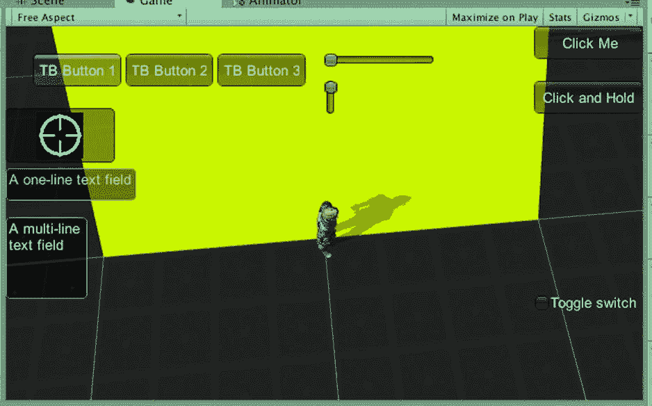

图 11-4. 游戏视图中混杂的示例控件

这是一个很好的反例——过多的控制器会降低玩家观察游戏的能力，并且如果实现不当，会损害游戏体验。游戏控制器的使用应在游戏设计阶段决定，远在您坐到电脑前之前。无论您是使用控制器来显示地图、库存、分数、弹药、血量或任何您想传达给玩家的信息，都要尽可能高效。

在此示例中，与障碍赛道原型相关的唯一控制器是淡入淡出标签。您可以将所有示例控制器的代码放在一个脚本中，但创建几个脚本有助于保持示例代码的组织性，并且现在您可以选择 `GUI` 游戏对象，并禁用除 `GUIScript` 之外的所有脚本。保存场景并测试，只剩下淡入淡出的标签。

Unity 提供了广泛的 GUI 方法，例如 `GUI.SelectionGrid`，它作为一个多行工具栏，配合 `GUI.changed` 可以快速测试读者是否与任何控件进行了交互。Unity 还提供更高级的控件，例如复合控件、滚动视图和窗口。如果您的 GUI 需要更复杂的功能，您可以随时查阅文档，了解 Unity 还能为您提供哪些帮助。

### 自定义控件

游戏设计既要考虑功能，也要考虑外观。到目前为止，您已经处理了 GUI 控件的功能和布局，但您可能还希望为您的游戏自定义控件的外观。这就是 GUI 样式和 GUI 皮肤发挥作用的地方。

#### GUI 样式

使用 GUI 样式来更改单个控件的外观。在 MonoDevelop 中打开 `GUIScript`，并添加以下代码行：

```
public var fadeDuration : float = 3;
var guiStyle : GUIStyle;
```

保存脚本。在 Unity 编辑器中，选中 GUI 游戏对象后，您将在 Inspector 中的 `GUIScript` 脚本组件中看到 Gui Style 属性。展开 Custom Gui Style 以显示自定义属性。您可以在 Name 字段中为此样式输入一个名称。展开 Normal 以显示 Background 和 Text Color 属性（图 11-5）。

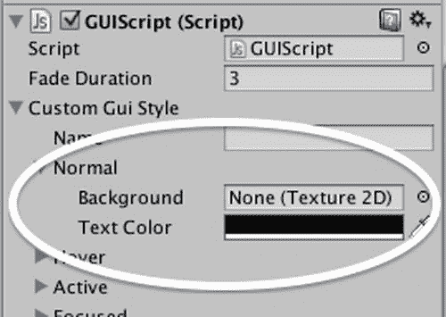

图 11-5. Inspector 中 `GUIScript` 脚本组件的 Custom Gui Style 属性

选择一种新的文本颜色。要使该样式应用于淡入淡出标签，您需要编辑 `GUIScript`，并将 `guiStyle` 参数传递给 `GUI.Label`，如下所示：

```
GUI.Label(Rect(Screen.width/2 - 125, Screen.height/2 - 12.5, 250, 25), "Press C to crouch or Space to jump", guiStyle);
```

保存脚本并播放。这次，GUI 标签中对玩家的提示将以新的文本颜色显示。

#### GUI 皮肤

您可以为游戏中的每个控件创建一个 GUI 样式。如果您有一个包含许多控件的更复杂的游戏，使用 GUI 皮肤可能是一种更高效的自定义方法。GUI 皮肤是一套将应用于所有控件的样式。

由于皮肤是一种资源，您将通过在 Project 面板中选择 Create ➤ GUISkin 并命名为 `myGUISkin` 来创建它。在 Inspector 中，您会看到一个 GUI 控件列表（图 11-6），每个控件都可以展开以显示其可自定义的属性。请记住保持项目组织有序，因此花点时间创建一个名为 `MyGUISkins` 的新文件夹，然后将 `myGUISkin` 资源拖放到其中。

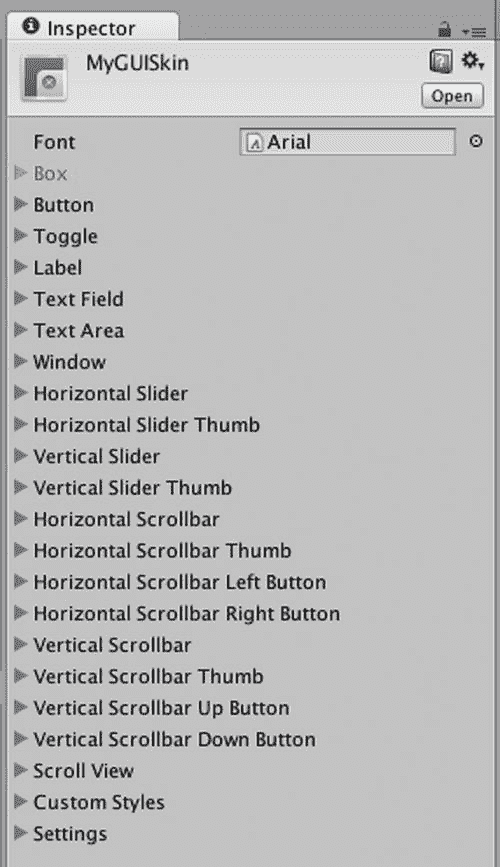

图 11-6. Inspector 中显示的 GUI 皮肤属性

在 Inspector 中，展开 Label ➤ Normal 属性，并将文本颜色更改为与您在前一个示例中使用的 GUI 样式不同的颜色。在 MonoDevelop 中，编辑 `GUIScript` 如下：

```
#pragma strict

public var fadeDuration : float = 3;
var guiStyle : GUIStyle;
var myGuiSkin : GUISkin;

function OnGUI() {
    GUI.skin = myGuiSkin;
    ...     
    GUI.Label(Rect(Screen.width/2 - 125, Screen.height/2 - 12.5, 250, 25), "Press C to crouch or Space to jump", guiStyle);
}
```

分解如下：

(1) `var guiStyle : GUIStyle;`
`guiStyle`

首先，删除与 `GUIStyle` 相关的代码。

(2) `var myGuiSkin : GUISkin;`
声明一个类型为 `GUISkin` 的引用变量 `myGuiSkin`。

(3) `GUI.skin = myGuiSkin;`
将自定义的 `myGuiSkin` 分配为活动的 `GUI.skin`。

保存脚本，然后在 Hierarchy 中选择 GUI 游戏对象。在 Inspector 中，您将看到 `GUIScript` 组件中出现了一个 Gui Skin 属性。将 `myGUISkin` 资源从 Project 面板的 `Assets` ➤ `MyGUISkins` 文件夹拖放到 Gui Skin 字段中。保存场景并测试，以查看应用了新的文本字体颜色。

您甚至可以按需混合搭配 GUI 样式和 GUI 皮肤。恰到好处的细节对于游戏质量至关重要。本节介绍了 GUI 控件及其自定义方法。请自由实验，并深入阅读 Unity 文档，以获取更高级的工具和如何应用它们的示例。祝您玩得开心！

# 音频

音频对于游戏体验至关重要，并以多种方式发挥巨大作用。背景音乐设定情绪基调，并且可以在游戏过程中变化，以反映玩家体验的各种情境，例如，悬疑音乐预示着危险将至，而战斗场景中则充满激昂的音乐。

它还能给玩家提供线索，比如通过加快音乐节奏来传达渐强的紧迫感。角色和非玩家角色的对话会向玩家提供与游戏剧情一致的提示和指示。即使在简单的街机类游戏中，以升调结束的短促音效也能对玩家起到正向强化作用，而降调则会强化负面事件或行动。

有时，声音的缺失也能被有效利用。例如，在射击游戏中，当附近的闪光弹爆炸后紧接着一片寂静，然后出现真实的耳鸣声，随着玩家角色恢复，正常的游戏音效逐渐淡入，耳鸣声也随之消失，这有助于保持真实感。

音效与游戏环境和动作结合使用。在写实主题的游戏中，你会听到环境背景噪音，无论是夜晚的蟋蟀声、背景交通声、附近运转的机械声，或是路过的非玩家角色声。更具体的游戏动作音效包括所驾驶车辆的引擎轰鸣声、战斗场景中的撞击和碎裂声，或玩家角色移动时的脚步声。

有些游戏将声音作为核心玩法，例如像《西蒙》和《吉他英雄》这样的流行游戏。游戏 `Lurking` 利用声音创造了一种新颖而诡异的应用方式，其中来自玩家动作（白色）和敌人（红色）的声波照亮了游戏世界（图 11-7）。请花点时间查看 `www.lurking-game.com` 上的预告片，这是一个极佳的例子，展示了声音如何既用于设定游戏情绪，又用于驱动实际游戏玩法。

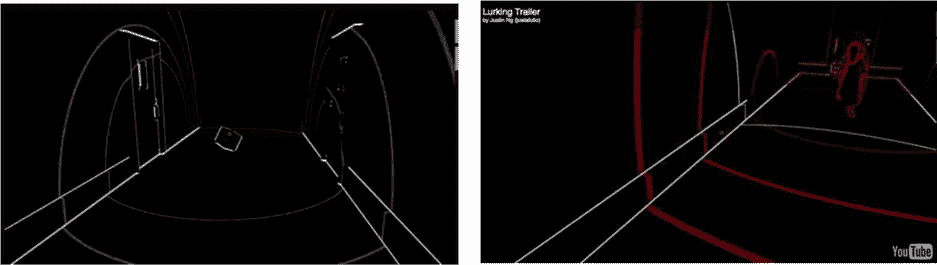

图 11-7. 来自 `www.lurking-game.com` 的《Lurking》预告片截图

## 音频监听器

就像主摄像机是游戏的眼睛一样，音频监听器组件则是游戏的耳朵。当您创建新场景时，音频监听器默认会添加到主摄像机上。在层级视图中，选择 `Free Look Camera Rig ➤ Pivot ➤ Main Camera`。在 Inspector 中，您将找到音频监听器组件。如果您尝试展开音频监听器，什么也不会发生，因为它没有任何属性（图 11-8）。

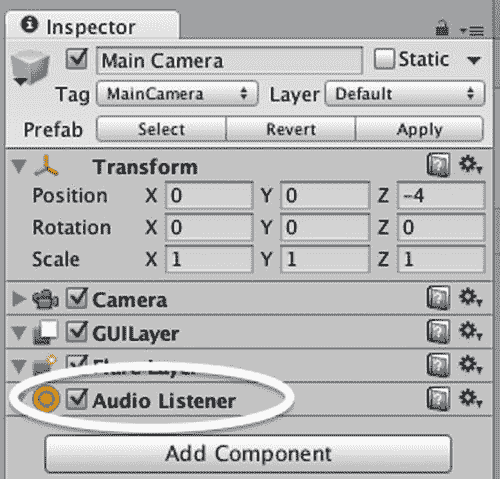

图 11-8. 音频监听器组件在 Inspector 中没有可显示的属性

它按原样工作，用于接收或“听到”游戏场景中任何音频源的输入，然后通过游戏平台的扬声器播放声音。根据游戏需要，音频监听器也可以改为附加到主要玩家角色或某些其他游戏对象上，但随后必须将其从主摄像机上移除，因为每个场景中只能存在一个音频监听器组件。

## 音频源

音频源是负责播放声音的游戏对象组件。在项目面板中，打开 `Assets ➤ Prefabs` 文件夹，展开 `Land Mine` 预制件以显示 `Explosion` 图标。选择 `Explosion` 以在 Inspector 中显示其音频源（图 11-9）。

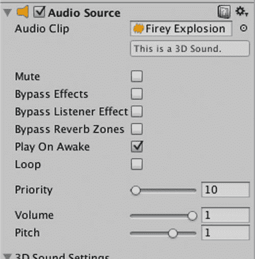

图 11-9. Inspector 中的爆炸音频源组件

与音频监听器不同，您可以在游戏中拥有任意数量的音频源。声音性能，如同游戏性能一样，受到目标平台处理能力以及其特定声音处理和扬声器功能的限制。

音频源的功能类似于游戏中的扬声器，其中音频剪辑是音频源播放的实际声音文件。脚本可用于调整音频源组件中的任何属性，包括更改要播放的音频剪辑。

`静音` 是一个简单的启用/禁用切换，用于静音。各种 `Bypass` 效果仅限专业版。启用了 `唤醒时播放` 的音频源将在创建包含音频源组件的游戏对象时开始播放。音频可以像动画剪辑一样循环播放，即每次完整播放完毕后，音频剪辑会重新开始。

分配优先级允许 Unity 适应平台的音频能力。如果超出性能限制，优先级较低的声音将被优先级更高的声音替换。在 Unity 中，0 表示最重要。

声音剪辑的相对响度由音量属性控制，该属性使用 0 到 1 的比例表示音量的 0% 到 100%，而音调则控制声音波形的频率，其中较高的音调对应于音阶上较高的音符。

您可以在 2D 和 3D 声音之间进行选择，这两种声音又各自具有各种可调整的属性。2D 声音最适合背景音乐等音频，无论玩家在游戏世界中的哪个位置，都能统一播放。3D 声音则根据玩家的位置而变化。

## 3D 与 2D 声音属性

音频剪辑是 2D 还是 3D 取决于其导入设置。3D 音频指的是 3D 游戏世界中的声音。音频源可以附加到整个游戏场景中的游戏对象上。3D 声音的音量会随着音频监听器的距离和移动而变化。

无论音频监听器的位置如何，2D 声音都以相同音量播放。其唯一属性 `声像` 控制两个扬声器之间的音量，默认值 0 表示两个扬声器以相同音量播放声音。将滑块向左移动会增加左扬声器的音量，而将滑块向右移动则会增加右扬声器的音量（图 11-10）。

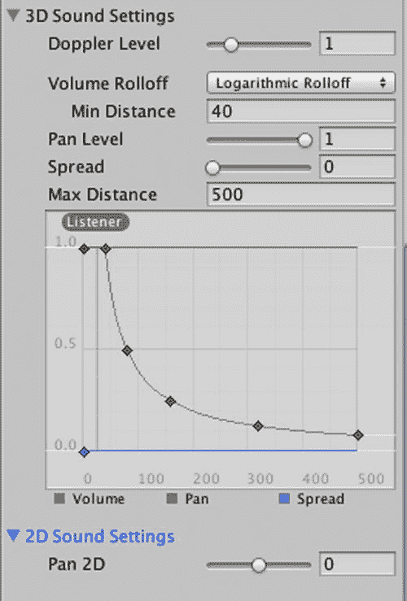

图 11-10. Inspector 中的 3D 和 2D 声音设置属性

3D 声音可以通过 3D 声音设置属性进行微调。`多普勒级别` 会根据运动扭曲声音，以产生类似多普勒效应的效果，即靠近声源时音调较高，远离声源时音调较低。

3D 声音表现如同从游戏世界中的特定位置发出，因此声音在声源处最响，并随着远离而减弱。`音量衰减` 属性决定了声音随距离减弱的速率。默认值为 `对数衰减`，与现实世界一致。您还有 `线性衰减` 和 `自定义衰减` 选项。

`最小距离` 是音量达到 100% 时与音频源的最小距离。3D 声音由 Unity 游戏引擎根据 `声像级别` 进行管理，其中 0 基本上是 2D 声音，1 则是完全 3D。`扩散角` 是一个更高级的音频设置，与扬声器系统有关。`最大距离` 是音量衰减导致的声音变化结束的最大距离。通常情况下，这也是您仍能听到声源任何声音的最远点。

## 音频剪辑

源音频文件就是音频剪辑，无论文件类型如何。Unity 支持 `.aif`、`.wav`、`.mp3` 和 `.ogg` 格式。您的项目中已经有一个包含在 `Land Mine` 预制件中的音频剪辑（图 11-11）。

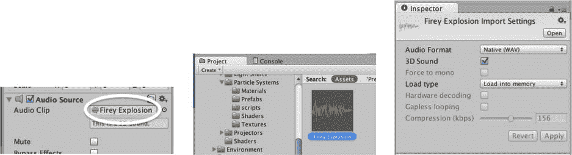

图 11-11. Land Mine 预制件音频源组件中的剧烈爆炸音频剪辑及其属性

### 音频设置

Unity 中有些设置会影响整个项目的音效。你可以通过 Unity 编辑器顶部的菜单选择 `Edit ➤ Project Settings ➤ Audio` 来访问 `Audio Manager`（音频管理器），随后 `Audio Manager` 会出现在 Inspector（检视面板）中（图 11-12）。

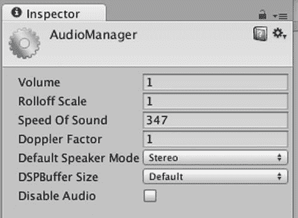

图 11-12. 由 `AudioManager` 处理的全局音频设置

`Audio Source`（音频源）组件的音量设置允许你调整其相对音量。`AudioManager Volume`（音频管理器音量）属性则控制所有正在播放声音的整体音量。

对于 3D 音频，`Volume Rolloff`（音量衰减）允许你在 `Linear`（线性）、`Logarithmic`（对数）和 `Custom`（自定义）之间进行选择。在 `AudioManager` 中，`Rolloff Scale`（衰减缩放）用于调整 `Logarithmic`（对数）曲线的形状，从而影响衰减速度。

`Speed of Sound`（声速）默认值为海平面声速，并会影响启用了多普勒效应的声音。`Audio Source`（音频源）的 `Doppler Level`（多普勒等级）属性设置了应用于音频片段的多普勒失真程度，而 `AudioManager`（音频管理器）的 `Doppler Factor`（多普勒因子）则设置了失真效果的明显程度，其中 `0` 表示完全关闭，`1` 表示最明显。

`Default Speaker Mode`（默认扬声器模式）设置可用的声道数，对于立体声扬声器，默认值为 `2`。

`DSPBuffer Size`（DSP 缓冲区大小）最好保持默认，因为它与 CPU 如何处理聚合音频文件有关，属于本书范围之外的高级话题。

### 音频测试

在 `Scene view`（场景视图）的顶部，你会找到一个带有扬声器图标的按钮，它代表 `Audio Preview mode`（音频预览模式）（图 11-13）。不必为了测试游戏音频而进行游戏试玩，你只需切换开启 `Audio Preview mode`（音频预览模式），并在游戏世界中移动场景摄像机即可。

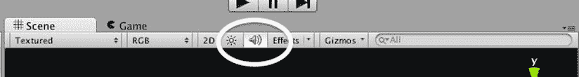

图 11-13. `Scene view`（场景视图）中的 `Audio Preview`（音频预览）切换开关

## 为障碍赛道添加音频

在将音频添加到障碍赛道原型之前，你需要先从 `Asset Store`（资源商店）下载一些免费资源。在 Unity 编辑器顶部菜单中选择 `Window ➤ Asset Store`。搜索“Free music pack”，找到 Alchemy Studio 提供的示例音频包（图 11-14）。点击蓝色的 `Download`（下载）按钮，然后在提示时点击 `Import`（导入）。

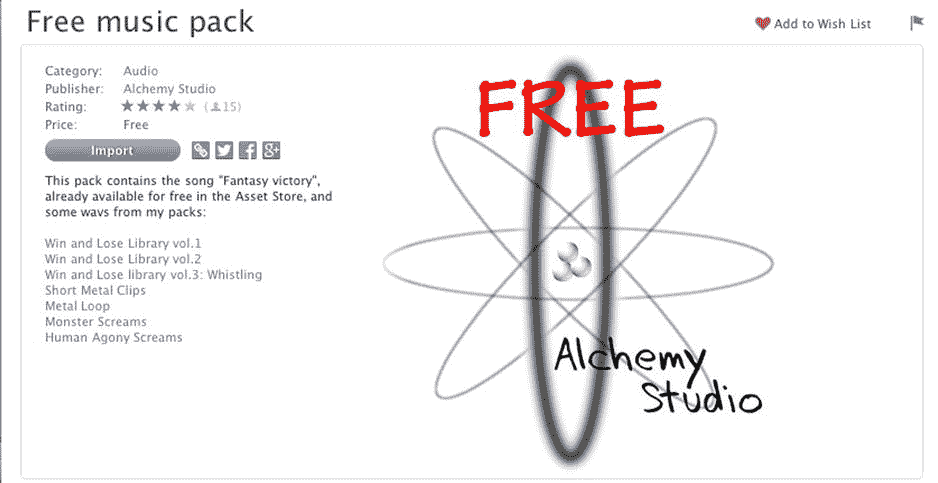

图 11-14. Unity 资源商店中的免费音乐包

首先，请保持项目结构清晰。在 `Project panel`（项目面板）中选择 `Assets`（资源）文件夹，然后选择 `Create ➤ Folder`（创建 ➤ 文件夹），并将其命名为 `Audio`。将你刚刚导入的 `Free Pack`（免费包）文件夹移动到 `Audio` 文件夹中，然后选中它查看其内容。

### 权限与鸣谢

在游戏中使用的 `Asset Store`（资源商店）资源时，务必查看任何 `Readme`（自述）文件，确认是否有任何要求或限制（图 11-15）。要求可能包括在鸣谢中列出资源创建者，而限制则可能包括你不能转售或再销售你下载的资源，无论是免费还是购买的。

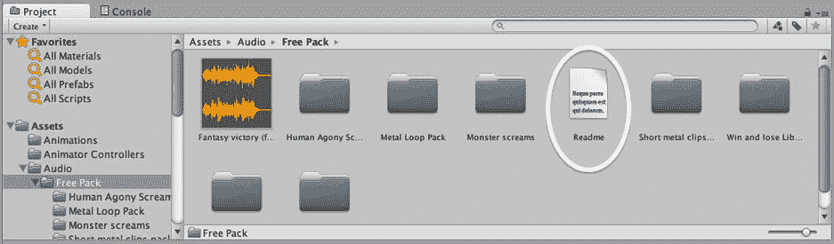

图 11-15. `Free Pack`（免费包）文件夹中的 `Readme`（自述）文件

单击 `Readme`（自述）文件可在 `Inspector`（检视面板）中查看其内容，或双击在 MonoDevelop 中打开（图 11-16）。

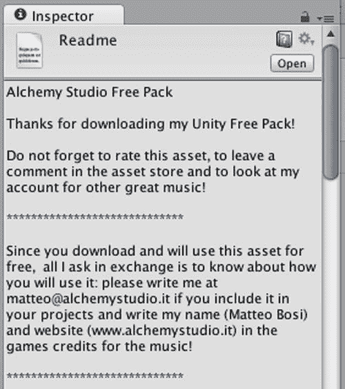

图 11-16. 在 `Inspector`（检视面板）中显示的 `Readme`（自述）文件内容

首先是感谢，并邀请你在资源商店中对此资源进行评分和评论。反馈对于了解用户需求至关重要，尤其有助于帮助遇到任何问题的人，包括识别新的 Bug。你的游戏同样需要反馈，因此请花时间提供相同的支持。

接下来是请求发送电子邮件，告知用户如何使用该资源，以及希望在鸣谢中包含的信息。了解自己的作品如何被使用是件有趣的事，得知人们喜欢自己倾注心血的产品，也会获得个人满足感。

将资源商店中的贡献者视为你扩展的团队成员。Alchemy Studio 的 Matteo Bosi 慷慨地允许我们在此项目中使用这个包。给 Matteo 快速发一封邮件，做个自我介绍，并告诉他你正在使用他的免费包制作原型。养成这个习惯，不久你就会结识来自世界各地同样热爱游戏制作的新朋友。游戏开发社区对开发过程中的艰辛和磨难非常支持且理解。他们会帮助你、为你加油，并在你发布游戏时与你一同庆祝。一定要通过回馈来分享这份关爱。

继续阅读 `Readme`（自述）文件，你会找到 Alchemy Studio 提供的更多音效资源的链接，以及可以在导入到项目之前试听的地址。这是常见做法，正如你从 Alien 和 Spartan King 动画剪辑的示例视频中回忆的那样，这可以避免为了测试而导入所有资源。

### 音乐

音乐有多种用途，包括背景音乐和根据游戏玩法做出的响应。对于几乎所有行为比 `Play On Awake`（唤醒时播放）更复杂的音效，你将使用脚本来指导其行为。

### 背景音乐

首先，从一个最简单的例子开始。在 Unity 编辑器顶部菜单中，依次选择 `GameObject` > `Create Empty`，将其命名为 `Audio`，并将 `Transform` 位置设置为 `(0, 0, 0)`。在层级面板中选中 `Audio` 游戏对象，然后在 `Inspector` 面板中选择 `Add Component` > `Audio` > `Audio Source`。

在项目面板中打开 `Free Pack` 文件夹，你会看到一个 `Metal Loop` 文件夹。打开该文件夹，可以看到四个音频剪辑和另一个 `Readme` 文件。从 `Readme` 文件中你将了解到，第一个剪辑是一段完整的音乐轨道，另外三个则是同一轨道拆分出的**前奏**、**为循环播放设计的中间部分**以及**结尾**。选择 `“Loop 16 - 145 bpm - complete”` 文件，在 `Inspector` 面板中查看其属性（图 11-17）。

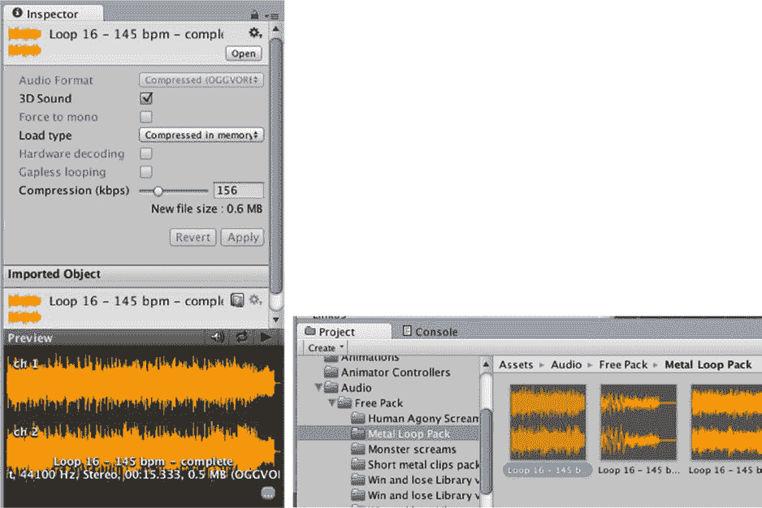

图 11-17. 项目面板和 `Inspector` 面板中的 `“Loop 16 - 145 bpm - complete”`

取消勾选 `3D Sound`，这样无论玩家角色的位置或移动如何，音量都会保持一致。在层级面板中选中 `Audio` 游戏对象，如果弹出 `Unapplied import settings` 对话框，请选择 “Apply”，然后将 `“Loop 16 - 145 bpm - complete”` 音频剪辑拖拽到 `Audio Source` 组件的 `Audio Clip` 属性字段中。`Play On Awake` 默认应已勾选。如果没有，请手动勾选。由于这是你希望在游戏全程始终均匀播放的背景音乐，因此为其设置最高优先级 `0`。保存场景并播放。

音频剪辑会从头播放到尾，然后停止。尝试勾选 `Audio Source` 的 `Loop` 属性并再次播放。现在音频剪辑会重复播放，但循环之间的衔接不太平滑，这正是部分音频剪辑发挥作用的地方。

要实现连续播放的背景音乐，你希望前奏在开始时只播放一次，接着是循环部分持续循环播放。要实现这种行为，你需要一个脚本。

在项目面板中，选择 `Assets > Scripts` 文件夹，然后创建一个名为 `BackgroundMusic` 的新脚本。在 MonoDevelop 中打开它，并将代码编辑如下：

```
#pragma strict

function Start () {
    PlayBackgroundMusic();
}

function PlayBackgroundMusic () {
    if(audio.isPlaying == true) {
        audio.Stop();
    }
    audio.Play();
}
```

代码分解如下：

(1) `PlayBackgroundMusic();`

保持 `Start()` 函数的简洁，将播放背景音乐的代码块放入其自身的函数 `PlayBackgroundMusic()` 中，该函数从 `Start()` 函数中调用。

(2) `if(audio.isPlaying == true)`

检查音频剪辑是否已经在播放。添加这个测试是良好的实践，而不是简单地单独使用 `audio.Play()`，以避免出现奇怪的音频行为。

(3) `audio.Stop();`

如果音频剪辑已经在播放，则将其停止。

(4) `audio.Play();`

从头开始播放音频剪辑。

在 `Inspector` 面板中，取消勾选 `Audio Source` 组件的 `Play On Awake` 和 `Loop` 属性。将 `BackgroundMusic` 脚本附加到 `Audio` 游戏对象上。保存场景并进行播放测试。此时，你已实现了等同于 `Play On Awake` 的脚本功能。

接下来，通过将项目面板中的 `“Loop 16 - 145 bpm - intro”` 前奏剪辑拖拽到 `Inspector` 中 `Audio Source` 组件的 `Audio Clip` 属性字段中，来更换音频剪辑。保存并播放测试，现在前奏剪辑会立即播放且只播放一次。

在 MonoDevelop 中，将 `BackgroundMusic` 脚本编辑为：

# Unity 音频播放教程

## 代码分解

```csharp
#pragma strict

public var musicLoop : AudioClip;
private var introMusicIsPlaying : boolean = true;
private var looping : boolean = false;

function Start () {
    PlayBackgroundMusic();
}

function Update() {
    if (!audio.isPlaying) {
        introMusicIsPlaying = false;
    }
    if (!introMusicIsPlaying && !looping) {
        looping = true;
        LoopBackgroundMusic();
    }
}

function PlayBackgroundMusic () {
    if(audio.isPlaying == true) {
        audio.Stop();
    }
    audio.Play();
}

function LoopBackgroundMusic () {
    if(audio.isPlaying == true) {
        audio.Stop();
    }
    audio.clip = musicLoop;
    audio.loop = enabled;
    audio.Play();
}
```

代码分解如下：

(1) `public var musicLoop : AudioClip;`
声明一个类型为 `AudioClip` 的引用变量来容纳将要播放的第二个音频剪辑，并将其命名为 `musicLoop`。

(2) `private var introMusicIsPlaying : boolean = true;`
声明一个名为 `introMusicIsPlaying` 的私有布尔变量，并将其设置为 `true`，因为 `PlayBackgroundMusic()` 是从 `Start()` 函数中调用的，它将立即开始播放前奏剪辑。

(3) `private var looping : boolean = false;`
声明一个名为 `looping` 的私有布尔变量，并将其设置为 `false`。

(4) `if (!audio.isPlaying)`
在 `Update()` 函数中，检查前奏剪辑何时播放完毕。记住 `!` 表示“非”，所以这行代码可以理解为“如果音频剪辑没有在播放”，当前奏剪辑结束时，这个条件将为真。

(5) `introMusicIsPlaying = false;`
一旦前奏剪辑播放完毕，将 `introMusicIsPlaying` 布尔变量切换为 `false`。

(6) `if (!introMusicIsPlaying && !looping)`
如果前奏音乐没有在播放，且 `looping` 仍为 `false`，那么是时候切换音频剪辑了。

(7) `LoopBackgroundMusic();`
调用 `LoopBackgroundMusic()` 函数，你将在下一步编写这个函数。

(8) `if(audio.isPlaying == true) {` `audio.Stop();` `}`
在更换音频剪辑之前调用 `audio.Stop()` 函数是一个良好的实践。

(9) `audio.clip = musicLoop;`
将当前音频剪辑切换为 `musicLoop` 所引用的音频剪辑。

(10) `audio.loop = enabled;`
启用 `Audio Source` 的 `Loop` 属性。

(11) `audio.Play();`
播放新的音频剪辑。

在 Unity 编辑器中，将 `"Loop 16 - 145 bpm - loop"` 音频剪辑拖放至 `Audio` 游戏对象的 `BackgroundMusic` 脚本组件中的 `Music Loop` 属性字段。保存场景并播放测试。现在，前奏音频剪辑会无缝衔接到循环音频剪辑，而循环剪辑则会持续循环播放。

然而，这里有些不对劲：随着玩家角色在障碍赛道中不断前进，音乐声逐渐减弱了。这是因为音频剪辑的初始导入设置是 3D 模式。在项目面板中，打开 `Assets > Free Pack > Metal Loop Pack`，在 Inspector 面板中依次选中每个音频剪辑，取消勾选 `3D Sound` 属性。如果弹出 `Unapplied Import Settings` 对话框，请选择 `Apply`。保存场景，进行播放测试，现在无论玩家角色在障碍赛道中的哪个位置，背景音乐都能连续且均匀地播放了。

### 事件触发的音效

通过触发器是在游戏过程中播放短音频片段的一种方法。

Free Pack 文件夹中有一个 Fantasy Victory (free) 音频片段。玩家成功躲避敌方无人机并抵达高架轨道的最终平台，标志着障碍赛的成功完成，因此当玩家角色到达此处时，你将播放这个音频片段。

如果你事先想到先创建一个空游戏对象，添加一个音频源组件，然后将 Fantasy Victory (free) 音频片段拖入音频剪辑属性中，那你就想对了。更棒的是，Unity 提供了一些便捷的快捷方式，可以省去这些步骤。

将 Fantasy Victory (free) 音频片段拖放到层次结构中。请务必将其放置在游戏对象之间，而不是放在游戏对象上（那样会高亮显示）。Fantasy Victory (free) 游戏对象将出现在层次结构中，并附带一个音频源组件，且 Fantasy Victory (free) 音频片段已自动分配给音频剪辑属性。

再次将音频片段拖入场景视图，注意当你在场景中将其拖到其他游戏对象上时，会出现一个带有 + 符号的绿色圆圈。如果你将音频片段放到某个游戏对象上，Unity 会自动创建一个音频源组件并将其附加到该游戏对象上。请注意——如果该游戏对象已有一个分配了剪辑的音频源，而你又将这个片段拖上去，那么新的音频剪辑将替换之前分配的剪辑。现在先不要真的将 Fantasy Victory (free) 拖入场景视图。如果你已经拖了，请使用删除组件选项将其删除，这样你只保留第一个，即仅包含变换和音频源组件的 Fantasy Victory (free) 游戏对象。

将这个游戏对象的变换位置设置为 `(0, 11.5, 150)`，使其位于最终坡道顶部的中心位置。如果你现在进行试玩，由于默认勾选了“唤醒时播放”，该剪辑会立即播放。在检查器中取消勾选它。仍在检查器中时，选择添加组件 ➤ 物理 ➤ 盒子碰撞体。勾选 `是触发器`，并将“中心”的值改为 `(0, 1, 0)`，“大小”的值改为 `(8, 2, 0.2)`。

你需要一个脚本，当玩家与这个触发碰撞体接触时播放音频，因此在检查器中选择添加组件 ➤ 新建脚本并将其命名为 `VictoryMusic`，然后点击创建并添加。请注意，通过此方法创建的新脚本会位于资源根文件夹中。通过将其移动到 `Assets ➤ Scripts` 文件夹来保持项目组织有序，然后在 MonoDevelop 中打开它。将代码编辑如下：

```csharp
#pragma strict

public var backgroundMusic : GameObject;

function OnTriggerEnter () {

backgroundMusic.GetComponent(BackgroundMusic).PlayVictoryMusic();

}
```

你之前见过这类代码。其分解如下：

(1) `public var backgroundMusic : GameObject;`
声明一个类型为 `GameObject` 的公共引用变量 `backgroundMusic`，用于持有对音频游戏对象的引用。

(2) `function OnTriggerEnter ()`
当玩家角色进入碰撞体体积时，由于碰撞体设置为 `是触发器`，因此会调用 `OnTriggerEnter()`。

(3) `backgroundMusic.GetComponent(BackgroundMusic).PlayVictoryMusic();`
获取附加到音频游戏对象上的 `BackgroundMusic` 脚本组件的引用，并调用你接下来要编写的 `PlayVictoryMusic()` 函数。另一种方法是停止背景音乐，然后使用此游戏对象和脚本播放胜利音乐音频剪辑，但由于这是背景音乐，为保持项目组织有序，更好的做法是将其包含在一个专用的游戏对象中。

保存脚本，然后将其附加到 Fantasy Victory (free) 游戏对象上。在层次结构中选择 Fantasy Victory (free) 游戏对象，然后将层次结构中的音频游戏对象拖到胜利音乐脚本组件的背景音乐字段中。

在 MonoDevelop 中，返回到 `BackgroundMusic` 脚本并添加以下代码行：

# UnityScript 音频系统详解

## 代码示例与分解

```csharp
#pragma strict

public var musicLoop : AudioClip;

private var introMusicIsPlaying : boolean = true;

private var looping : boolean = false;

public var victoryMusic : AudioClip;

function Start () {

PlayBackgroundMusic();

}

function Update() {

}

function PlayBackgroundMusic () {

}

function LoopBackgroundMusic () {

}

function PlayVictoryMusic () {

if(audio.isPlaying == true) {

audio.Stop();

}

audio.clip = victoryMusic;

audio.Play();

}
```

分解如下：

`(1) public var victoryMusic : AudioClip;`

创建一个类型为 `AudioClip` 的引用变量 `victoryMusic`。作为公共变量，你可以轻松地通过将不同音频剪辑拖放到检查器的胜利音乐字段中来测试它们。

`(2) function PlayVictoryMusic () {`

创建一个新的 `PlayVictoryMusic()` 函数。

`(3) if(audio.isPlaying == true) { audio.Stop(); } audio.clip = victoryMusic; audio.Play();`

这些步骤与你之前替换音频剪辑的步骤相同，只是这次新的音频剪辑是 Fantasy Victory (free) 音频片段。

保存脚本。在层次结构中选中音频游戏对象，将项目面板中 Assets ➤ Free Pack 文件夹中的 Fantasy Victory (free) 音频片段拖到背景音乐脚本组件的胜利音乐字段中。保存场景并保存项目。

让玩家角色四处跑动，你会注意到当玩家角色进入触发体积时，音频剪辑会播放，这正是你想要的，但你也会注意到，如果玩家角色远离 Fantasy Victory (free) 游戏对象附近，音乐会逐渐消失。该音频剪辑设置为 3D 音效，音量衰减设置为对数衰减。

在项目面板中选择 Fantasy Victory (free) 剪辑，然后在检查器中取消勾选 3D 音效，如果提示则点击应用。保存场景，再次试玩，现在设置为 2D 音效后，无论玩家角色如何移动，音乐都会保持相同音量。甜蜜的胜利！

## 音效

音效一词通常指非音乐或非对话的音频片段。音效更常使用 3D 声音，因为它们通常与场景中的特定游戏对象相关联。

打开 `Assets` ➤ `Sample Assets` ➤ `Vehicles` ➤ `Car` ➤ `Audio` 文件夹，找到 `Low Acceleration` 音频片段。选中它并在 `Inspector` 中确认 `3D Sound` 复选框已勾选。在 `Hierarchy` 中选择 `Enemy Drone` 游戏对象，然后将光标移至 `Scene` 视图并按 `F` 键，将 `Enemy Drone` 游戏对象显示在视图中。

将 `Low Acceleration` 音频片段从 `Project` 面板拖放到 `Drone` 上。此时会自动创建一个 `Audio Source` 组件，当其在 `Inspector` 中显示时，`Low Acceleration` 文件已自动分配给 `Audio Clip` 属性。在 `Scene` 视图中，还会出现一个由扬声器符号组成的音频源辅助图标（图 11-18）。

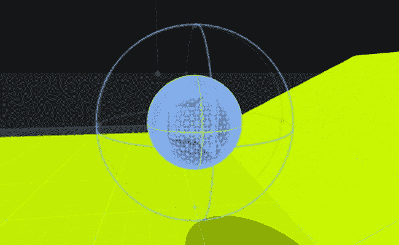

图 11-18. `Scene` 视图中 `Drone` 游戏对象的音频源辅助图标

在 `Inspector` 中，勾选 `Play On Awake` 和 `Loop`。在 `3D Sound Settings` 部分将 `Min Distance` 设置为 `2`，`Max Distance` 设置为 `20`。

暂时取消勾选 `Audio` 游戏对象上的 `Audio Source` 组件以禁用背景音乐。保存场景并进行试玩测试。

当玩家接近最终区域时，您会开始听到无人机的音频。当玩家进入该区域且敌方无人机开始移动时，音量会随着无人机靠近而增大。由于 `Volume Rolloff` 属性默认设置为 `Logarithmic Rolloff`，无人机越近，音量增加速率越快。添加音效后，敌方无人机无疑更具威慑力。

目前，`Audio Listener` 挂载在 `Free Look Camera Rig - Pivot` 的 `Main Camera` 子对象上。请记住，每个场景只能有一个 `Audio Listener`，因此在 `Hierarchy` 中找到 `Main Camera`，然后在 `Inspector` 中取消勾选其名称旁的复选框以禁用 `Audio Listener` 组件。

返回 `Hierarchy`，找到 `Third Person Character Ragdoll` 并选中。在 `Inspector` 中选择 `Add Component` ➤ `Audio` ➤ `Audio Listener`。再次试玩，您会发现当无人机靠近时，其声音效果更好，因为玩家角色比摄像机更接近无人机。

在 `Hierarchy` 中找到 `Audio` 游戏对象，重新启用背景音乐的 `Audio Source`。使用 `Audio Source` 组件中的 `Volume` 设置来平衡背景音乐与音效的合适音量。

每一个细节都至关重要，决定了游戏是优秀还是卓越。激光火花的噼啪声应从火花产生的位置发出，而非玩家上方的激光源。为抛射体添加多普勒效应能增强其速度感，而带有厚重低音的“嗖嗖”声则能让人感受到摆锤的沉重。

## 总结

请为自己鼓掌——您已经掌握了 UnityScript 的基础知识，正走在成为游戏开发者的康庄大道上。您能够与玩家沟通，并使用 GUI 控件和 `OnGUI()` 函数增加交互性，还能自定义这些控件以匹配游戏的外观。您还添加了多种形式的音频，包括音效和背景音乐，丰富了游戏体验的深度。

您已在 `Asset Store` 中找到了更多资源，并记得在游戏最终版本中使用的任何作品上注明资产创建者。同时，您也在游戏开发社区中结识了新伙伴。在下一章中，您将学习更多关于测试和优化游戏以便发布的技巧。胜利在望！
