# 12. 优化你的游戏

优化是游戏开发中一个广泛的分支，如同动画一样，它可以成为一个独立的职业领域。简单来说，它是提升游戏运行效率的过程。至少听起来很简单。

每个目标平台在 CPU（中央处理器）和 GPU（图形处理器）的处理能力方面都存在限制。无论场景是由少量高精度模型还是大量低精度运动部件构成，场景越精细，对处理器的需求就越高。

当需求过高时，游戏性能就会受到影响：玩家会遇到加载时间过长、卡顿或其他游戏错误，最糟糕的是，游戏会崩溃。优化过程就是在维持游戏性能与图形质量之间做出的一系列决策或权衡。

## 目标性能

目标性能通常以期望的帧率或每秒帧数（fps）来表示。如第 4 章所述，帧率过低会破坏动画运动的错觉。虽然通常情况下，更高的帧率会带来更好的视觉体验，但需要每帧进行更多处理的复杂游戏，在可接受的 fps 目标范围的低端运行可能会更流畅。

主机和 PC 的处理能力远强于移动平台，因此我们以移动设备为例来探讨，因为它们限制最多。不同的移动平台具有不同的性能，同一平台不同版本的移动设备也会有所差异，通常较老的设备内存更小、处理器更慢。您必须在设计阶段早期就确定平台内的目标市场，这将反过来指导您选择目标帧率。

最流行的两大平台，Apple 和 Android，采用了不同的方法。Apple 是一个由 Apple 公司设计的闭源操作系统，运行在 Apple 制造的设备上。Android 是一个由 Google 设计的开源操作系统，被众多不同的设备制造商使用。当新版本操作系统发布时，旧设备能否支持新系统的功能取决于其处理能力。

Apple 在任何特定时间通常只有少数几款 iPhone 或 iPad 设备在市场上销售，其用户在几个月内采用操作系统升级的比例超过 90%。Android 用户拥有的设备来自众多不同制造商，在任何特定时间其性能各不相同。随着制造商不断推出新设备，而部分用户仍保留旧设备，Android 移动设备类别内的性能范围要广泛得多，特别是考虑到 Android 用户更新新版 Android 系统的采用率并不稳定（图 12-1），较旧的系统版本可能无法支持您希望在游戏中使用的某些功能。

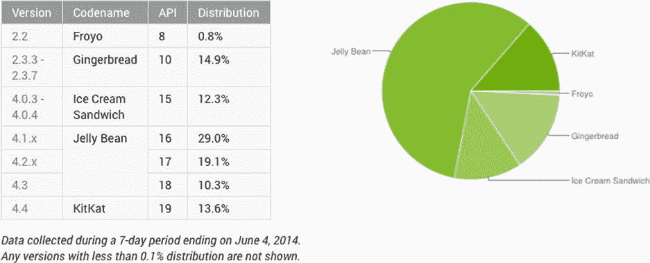

图 12-1. 运行在特定 Android 版本上的设备相对数量

您必须根据希望覆盖的 Android 移动设备市场份额来考虑这些信息，这反过来将指导您设定目标性能帧率的位置。所有这些决策都应在游戏设计阶段早期完成。

## 追踪目标帧率

在 Unity 编辑器中，运行障碍赛场景。在游戏视图的顶部菜单中，你会找到一个“统计信息”按钮。点击它，一个包含各种性能统计数据的覆盖层将会出现，其中包括 FPS（图 12-2）。

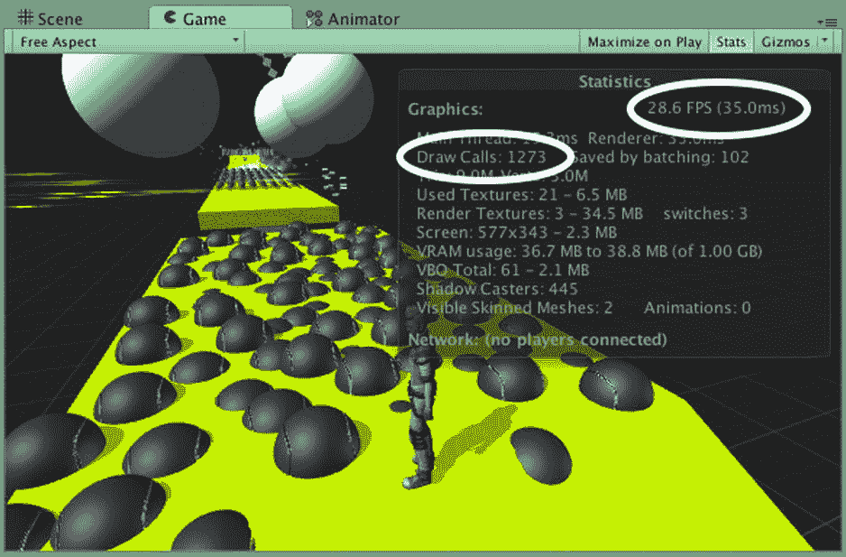

图 12-2. 游戏视图顶部菜单中显示的统计信息

“Draw Calls”（绘制调用）统计数据更为详细，它指明了 CPU 需要渲染的内容数量。理解这一点很重要：一个游戏对象可能会因为其应用的每种效果（如像素光照、阴影和反射）而在每一帧中被多次渲染。通过仅在效果对游戏外观有显著贡献时才使用这些效果，从而减少使用量，可以降低绘制调用，这意味着 CPU 的工作量也因此减少。

### 设置目标帧率脚本

你可以使用一个简单的脚本来设置目标帧率。在项目面板中，打开 `Assets` ➤ `Scripts` 文件夹，并创建一个名为 `SetTargetFrameRate` 的新脚本。在 `MonoDevelop` 中打开它，并将代码编辑为以下内容：

```
#pragma strict

public var frameRate : int = 50;

function Awake () {
    Application.targetFrameRate = frameRate;
}
```

这段代码的解析如下：

`(1) public var frameRate : int = 50;`

声明一个类型为 `int` 的公有变量 `frameRate`，以便你可以从检视面板中调整它。

`(2) Application.targetFrameRate = frameRate;`

将 `Application` 类的 `targetFrameRate` 属性设置为 `frameRate` 所持有的值。

保存脚本。在 Unity 编辑器顶部菜单中，选择 `Game Object` ➤ `Create Empty`，并将其命名为 `TargetFrameRate`。挂载 `SetTargetFrameRate` 脚本，保存场景，然后运行。注意 FPS 并不会精确地保持在 50，甚至可能看起来没有效果。这是因为目标帧率不是一个绝对的限制。为了在统计信息中看到更明显的差异，将帧率改为 25，再次运行，你会看到统计窗口中的 FPS 在一个更接近 25 的范围内变化。

当你查阅脚本引用中的 `Application.targetFrameRate` 文档时，你会发现将其设置为 –1 是默认值，这会将网络播放器游戏的目标帧率设为 50–60 fps，并告知独立平台尽可能快地渲染。完成后不要忘记将帧率改回 50。

## 何时何地进行优化

在设计阶段做出的优化决策，很大程度上基于目标平台已知的限制。在开发过程中，遵循最佳实践建议可以避免因低效的开发技术而导致性能下降。除此之外，随着无数可能影响性能的细节汇集在一起，优化过程会根据游戏的独特特性变得非常动态。

## 设计阶段

在设计阶段所做的决策远不止选择目标帧率。在考虑游戏美术时，目标平台的能力也起着作用。一个普遍的做法是，模型使用的顶点数不应超过必要数量，但 CPU 渲染限制是基于场景中的所有内容，包括其他因素（如颜色、光照和阴影的使用），而不仅仅是单独某个模型。请参考目标平台的文档以了解具体细节。

移动设备通常无法处理超过 100,000 个顶点，而 PC 则可以处理数百万个。你可能需要为移动游戏选择比基于 PC 的游戏低得多的背景细节，以保留主要游戏对象模型的细节。

另一个移动设备的限制是用于下载的文件大小。在游戏设计中融入模型、纹理和材质的复用，有助于控制整体文件大小。

## 开发阶段

遵循“如果没坏，就别修它”这一历久弥新的格言，请记住优化的目的是维持你设定的游戏性能水平。当你的游戏从头到尾都能以此水平运行时，你的工作就完成了！

对玩家的视觉冲击是游戏体验的重要组成部分，这就是为什么游戏图形工具会深入到逐像素级别，并需要进行多次渲染以融入光照、反射、阴影等每一个细节。视觉图形并非唯一可能阻碍游戏性能的因素。物理、动画、音频等也可能造成性能瓶颈。

在构建游戏并进行迭代测试时，瓶颈可能会在明显的游戏条件下出现，例如当复杂模型进入视野时、在特定的动画序列期间，或者在使用高发射率的粒子系统时，最好直接针对这些问题进行处理。

如果瓶颈的原因不那么明显，Unity 有多种工具可以帮助你识别它。编辑器分析器是一个极好的工具，可用于在编辑器或测试设备上评估你的游戏，但它仅在专业版中可用。iOS 和 Android 平台有内置的分析器。尽管如此，你仍然可以从构建日志中获取关于游戏的有用信息。

## 创建构建日志

### 生成和查看构建日志

在 Unity 编辑器顶部菜单中，选择 `File` ➤ `Build Settings`（图 12-3）。将障碍赛场景从项目面板拖入“Scenes in Build”窗口。确保在平台窗口中选中了 `PC, Mac & Linux Standalone`，以便 Unity 为你正在构建的目标平台生成正确的文件类型。点击 `Build`，然后在提示时选择你想要保存文件的位置，并点击 `Save`。

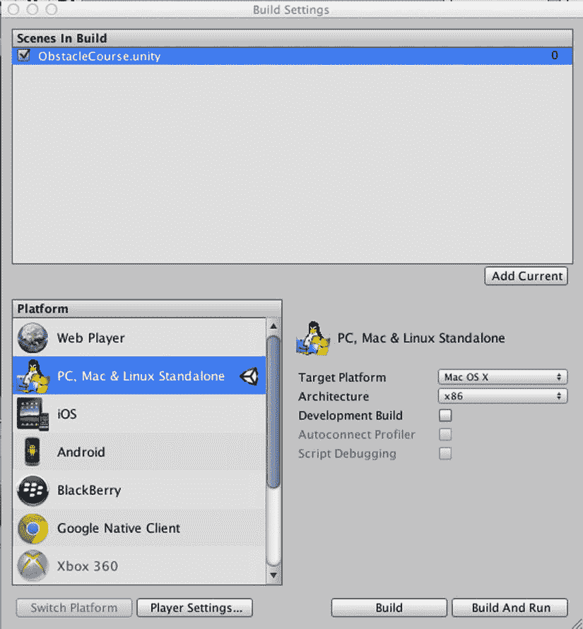

图 12-3. 构建设置对话框

当 Unity 完成游戏构建后，你可以通过选择项目面板中的控制台选项卡来访问构建日志。找到右上角的下拉菜单图标，然后选择 `Open Editor Log`（图 12-4）。

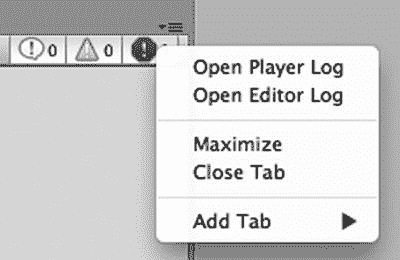

图 12-4. 控制台下拉菜单

构建日志将出现在控制台应用程序窗口中。除了其他信息外，你可以找到一个构成游戏的资源类型列表及其相对大小（图 12-5）。

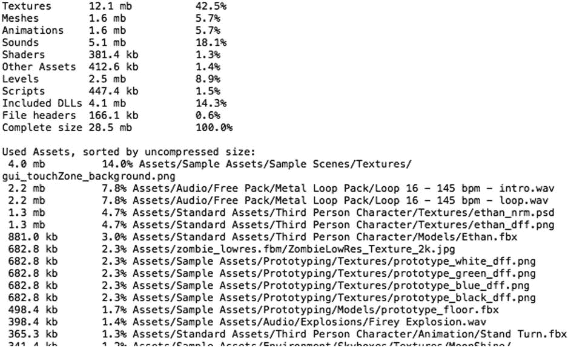

图 12-5. 构建日志中显示的信息

在其下方，你会找到一个“已使用资源”列表。加载时间受大小影响，而游戏玩家希望直接开始游玩。这意味着可以通过移除开发过程中在项目中积累的未使用资源来进行优化。移动设备用户在其设备上有更大的内存限制，以及其服务提供商指定的下载大小限制，因此应用大小是他们选择购买或下载你的游戏时的一个考虑因素。通过将“已使用资源”列表与你的 `Assets` 文件夹内容进行比较，你可以安全地移除任何未使用的资源。

## 脚本

本书多次通过提及良好的编码实践、高效代码和重构，间接地涉及了脚本优化。有多种技术可以用来优化你的代码。你可以将其中一些技术融入你的标准编码实践中，而其他示例则展示了在优化过程中，你可以采取的不同方法，直到达到目标性能。

## 静态类型与 `#pragma strict`

你一直遵循的一项实践，现在需要更详细的解释。

MonoDevelop 为你创建的每个脚本都以 `#pragma strict` 开头。这一行代码告诉编译器“严格”地解释后续代码，从而强制你使用静态类型，否则会抛出编译器错误。

静态类型是指在声明变量时指定其类型。在下面这行代码中，你显式地将 `myVariable` 声明为 `int` 类型：

```
var myVariable : int = 2;
```

你也可以这样声明变量：

```
var myVariable = 2;
```

Unity 会通过一种称为类型推断的方法，自动将其转换为静态类型代码。虽然这种能力可以编写更简洁的代码，但如果变量无法被类型推断，Unity 就会依赖动态类型。在动态类型中，Unity 必须根据赋予变量的值来“推断”其类型。“推断”需要时间，而耗费时间会影响游戏性能。坚持使用静态类型有助于提升性能，而 `#pragma strict` 则能确保你做到这一点。

## 缓存组件查找

这种脚本技术对于频繁使用的脚本尤其有效，但代价是代码量会稍多一些。`GetComponent()` 函数就是一个查找的例子。在游戏对象中查找组件需要时间，并影响性能。这里的思路是只查找一次引用，然后将该引用缓存或存储在私有变量中，以便后续在脚本中使用。换句话说，尽量避免在 `Update()` 或 `FixedUpdate()` 函数中使用 `GetComponent()`。你在自己的 `GoRagdoll` 脚本中就用到了这种技术：

```
#pragma strict

private var childRigidBodies : Rigidbody[];
private var childColliders : Collider[];
public var invincible : boolean = false;

function Start ()
{
    childRigidBodies = gameObject.GetComponentsInChildren.<Rigidbody>();
    childColliders = gameObject.GetComponentsInChildren.<Collider>();
}
...
```

布娃娃系统的刚体和碰撞体通过 `GetComponentsInChildren()` 函数查找找到，然后在 `Start()` 函数中分别赋值给各自的数组。

## 更多脚本优化替代方案

任何能减少或避免逐帧计算的地方都能提升性能。其中一些方法较为高级，这里不做详细说明，但当与特定项目相关时，你可以更深入地探索它们。

### 使用触发器

在 `LaunchProjectile` 脚本中，你通过使用 `Destroy()` 函数在实例化每个射弹 2 秒后将其销毁，减少了 Unity 需要追踪的射弹游戏对象的数量：

```
Destroy(projectileInstance, 2);
```

虽然这比任由射弹克隆体堆积要好，但 Unity 仍然需要追踪每个对象并检查其生命周期，直到达到 2 秒。`Destroy()` 函数的一种替代方案是使用触发器。首先，注释掉这行代码。

在你的障碍赛场景中，创建一个立方体游戏对象，并命名为 `DestroyProjectileTrigger`。将其变换位置设置为 (–12, 10.5, 47)，缩放设置为 (1, 3, 10)。移除网格过滤器和网格渲染器组件，这样你就只剩下一个简单的盒碰撞体。在盒碰撞体组件中勾选“是触发器”。

在项目面板的 `Assets ➤ Scripts` 文件夹中，创建一个名为 `DestroyProjectile` 的新脚本，并在 MonoDevelop 中打开。编辑代码如下：

```
#pragma strict

function OnTriggerEnter(other : Collider) {
    Destroy(other.gameObject);
}
```

将脚本附加到 `DestroyProjectileTrigger` 游戏对象上并保存场景。播放并观察射弹在进入触发器体积时消失。在后台，Unity 像以前一样实例化游戏对象，并由物理引擎处理其运动，但现在 Unity 无需再对该游戏对象进行其他计算，直到它进入触发器体积。

将触发器体积放置在紧邻高架轨道的位置，可以最大限度地缩短射弹的生命周期，从而更有效地提升游戏性能。将变换位置改为 (–4, 10.5, 47) 并播放。

射弹在轨道的远端消失，但原本仍在轨道上方的拖尾痕迹会立即消失，这看起来不如之前痕迹贯穿整个轨道时效果那么好。这是优化中涉及取舍的一个例子。哪个更重要？是拖尾的视觉效果，还是将触发器体积紧靠高架轨道所带来的效率提升？由你来决定。

此外，从游戏玩法角度来看，如果玩家角色跑动或跳跃进入它会发生什么？呃哦——这可不好。你从 `KillOnTrigger` 脚本中已经知道如何检查 `other` 的身份，因此如果你选择将触发器体积保持在玩家角色可触及的范围内，你可以实现一个解决方案：

```
#pragma strict

function OnTriggerEnter(other : Collider) {
    if (other.gameObject.name == "Projectile")
    {
        Destroy(other.gameObject);;
    }
}
```

你可能会想，玩家一开始为什么要从侧面跳下去。可能是意外，可能是他们在探索，也可能只是随便玩玩。在开发游戏时，除了考虑游戏对象“应该”做什么之外，还必须考虑它们还“可能”做什么，并采取适当措施来消除错误，就像你刚才做的那样。

### 对象池

随着你编程技能的不断提升，你将学到更高级的解决方案。对象池在优化射弹预制体方面更进了一步。实例化和销毁对象也会带来显著的计算开销。与其反复实例化和销毁游戏对象，不如创建一个游戏对象预制体的数组作为“池”，在需要时从中抽取，在不使用时归还。

### 协程

协程可以在某一帧暂停其执行，然后在下一帧恢复并继续执行，可以跨越任意数量的帧。当你在 `Update()` 或 `FixedUpdate()` 函数中调用另一个函数时，你调用的那个函数每帧都会从头到尾运行一遍。在 60fps 的帧率下，这意味着该函数每秒也被调用和执行 60 次。很多时候，你并不需要每帧都调用某个函数，尽管你可能希望它定期运行。相比之下，如果函数每十分之一秒调用一次——这对于许多游戏任务来说仍然足够快——那么每秒只需调用 10 次，调用次数减少了六倍。使用协程可以实现这种显著的效率提升。

# Mecanim 优化技巧

与脚本类似，Unity 的脚本参考手册提供了使 Mecanim 动画更高效的一般性指南（表 12-1）。其中大部分内容超出了本书涉及的难度范围，但掌握这些信息有助于你在角色设计过程中（无论是自己创建还是与美术师合作）做出更好的决策。

-   使用哈希值而非字符串来查询 `Animator`。

-   实现一个小型 AI 层来控制 `Animator`。你可以让它为 `OnStateChange`、`onTransitionBegin` 等事件提供简单的回调。

-   使用状态标签轻松地将你的 AI 状态机与 Mecanim 状态机匹配。

-   使用附加曲线来模拟事件。

-   使用附加曲线来标记你的动画（例如，与目标匹配结合使用）。

## 运行时优化

-   始终通过将动画器的剔除模式设置为“基于渲染器”，并禁用蒙皮网格渲染器的“屏幕外仍更新”属性来优化动画。这样，当角色不可见时，动画将不会更新。

-   另一个良好的动画实践是使用哈希 ID。在使用动画器时，使用哈希标识符是一种优化方法，即将状态和参数的名称分配给整数。使用整数代替字符串可以减少处理开销。

如果你有兴趣深入挖掘 Mecanim 优化，可以在 Unity 手册中找到更多信息：`http://docs.unity3d.com/Manual/MecanimPeformanceandOptimization.html`。

# 项目设置

一旦你最小化了各个性能瓶颈的影响，如果尚未达到目标游戏性能，你可以从项目全局的角度来处理更通用的优化决策点。

Unity 中用于优化的设置是全局设置，这意味着它们适用于整个项目（图 12-6）。你是否想要或需要调整任何特定类别的设置，取决于从目标性能、游戏本身、目标平台，到开发过程中出现的性能问题类型等各种因素。采取逻辑方法，首先调整那些能带来最大改变的设置。

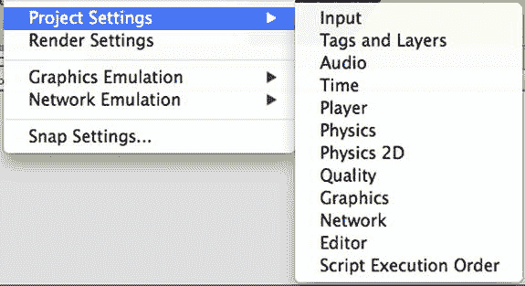
*图 12-6. Unity 编辑器中的项目设置菜单 (Edit ➤ Project Settings)*

### 质量设置管理器

图形质量与渲染速度需要权衡：你选择的质量越高，渲染越复杂，帧率就越低。质量设置管理器允许你为各种目标平台（如网页播放器、独立平台、iPhone、Android、Blackberry 和 Google Native Client）选择不同的图形质量级别（图 12-7）。

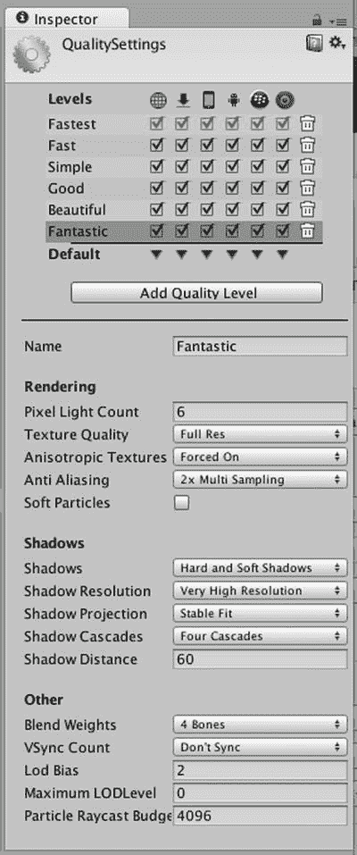
*图 12-7. 项目设置*

绿色勾选标记表示默认设置。你可以通过其默认菜单，点击目标平台列中“默认”行的箭头来更改此设置（图 12-8）。

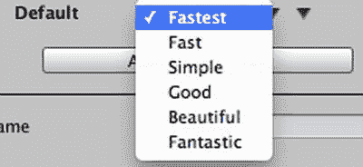
*图 12-8. 质量设置管理器中的默认菜单*

**名称**字段是为了方便你引用自己指定的特定质量设置组合。你可以通过“添加质量级别”按钮来添加新质量级别，或通过点击垃圾桶图标来删除它。

**逐像素光照**是一种为每个屏幕像素计算光照效果的渲染方法。**逐顶点光照**效率更高，因为它只计算模型顶点上的光照效果，模型表面的其余光照则根据这些值进行插值计算。

**逐像素光照**意味着光照对游戏对象的效果每帧都会计算，无论是像素光照还是顶点光照。如果一个网格被多个逐像素光照照亮，那么该网格会为每个光照渲染一次，这会迅速增加处理开销。

质量设置管理器中的**像素光数量**用于设置在标准渲染过程“前向渲染”中使用的像素光数量。建议不要让任何游戏对象被超过一个像素光照射，尤其是在移动设备上。

替代方案包括对静态游戏对象使用**光照贴图**，即预先计算游戏对象表面的亮度。你可以在 Unity 手册中找到光照贴图的详细步骤。最终结果是，游戏运行速度可以比仅使用动态光照快三倍。

继续介绍质量管理器设置，**纹理质量**全局设置分辨率，即针对整个项目。更高的分辨率需要更多处理能力。要实现更定制化的方法，你可以使用纹理导入设置为每个纹理指定分辨率。

**各向异性纹理**是指对纹理应用过滤过程以改变其外观。这通常用于平坦表面（如地面），使其在浅角度下看起来更好。

其余设置深入到光照和阴影的更多技术层面，其中一些需要 Unity Pro 版本才能使用。光照和阴影是实现出色视觉效果的关键，但它们在性能方面可能代价高昂。目前，以下要点足以概括：

- 质量设置可用于根据目标平台和纹理分辨率以及光照和阴影来优化图形质量。
- 使用光照贴图来烘焙静态光照。
- 限制游戏对象仅被一个逐像素光照照射，尤其是在移动设备上。

### 物理管理器

物理引擎内置了性能优化功能，例如“睡眠”。当一个 `rigidbody` 的移动和旋转低于某个阈值时，物理引擎会认为它已停止。在该 `rigidbody` 再次被移动（例如，被另一个力作用或与另一个游戏对象碰撞）之前，物理引擎不会浪费处理能力去更新它。

物理设置管理器中的“睡眠速度”和“睡眠角速度”属性值指定了“睡眠”阈值（图 12-9）。如有必要，你可以通过在脚本中使用 `rigidbody.WakeUp()` 函数来访问并唤醒一个 `rigidbody`。

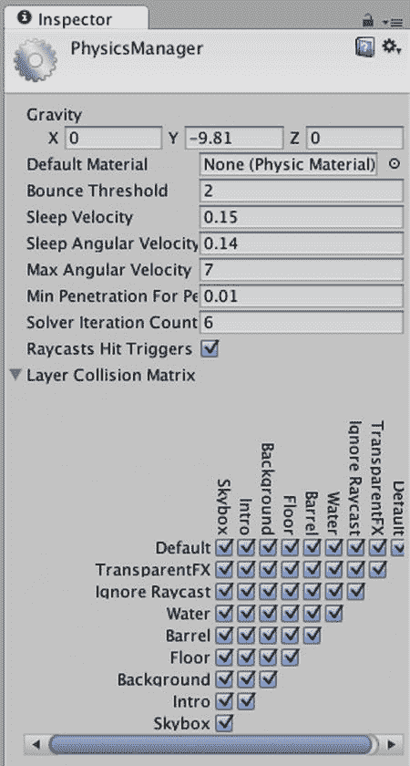
*图 12-9. 项目设置*

提高物理计算效率的另一种方法是使用层。层是 Inspector 中的一个属性，用于按组对游戏对象进行分类。就像游戏对象可以有相同的标签一样，游戏对象也可以共享相同的层。物理管理器底部的碰撞矩阵用于选择场景中哪些层会与哪些其他层发生交互。只有处于相互交互的层中的游戏对象才能发生碰撞，从而减少处理负载。

处理需要碰撞体的复杂游戏对象时，一个标准做法是尽可能使用子基本碰撞体的集合，而不是网格碰撞体。网格碰撞体会占用大量处理能力，并且有局限性，例如无法注册与其他网格碰撞体的碰撞。你已经在用于布娃娃效果的原始碰撞体集合示例中看到了这种技术。

# 时间管理器

该管理器具有两项有助于物理优化的属性（图 12-10）。您已了解，在物理相关代码中应使用 `Fixed Timestep` 属性，因为物理计算依赖固定的时间间隔来生成逼真的游戏对象行为。您可以通过 `Fixed Timestep` 属性调整固定的时间间隔。此处的优化权衡在于：增大更新间隔可降低处理器的计算需求，但物理模拟的精度会相应下降。

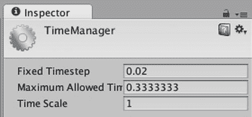

图 12-10. 项目设置 - 时间管理器

`Maximum Allowed Timestep` 属性通过限制物理计算的最大耗时，也有助于维持固定的时间间隔。这样，即使在固定时间间隔内需要进行过多的固定更新，物理引擎也不会拖慢帧率。

# 音频管理器

在音频管理器中，`DSPBuffer Size` 属性用于优化（图 12-11）。延迟是指声音播放前的滞后时间。各选项含义明确：`Best latency` 优先保证声音的快速响应而非性能，`Best performance` 优先保证音质而非低延迟，而 `Good latency` 则在延迟与性能之间取得平衡。

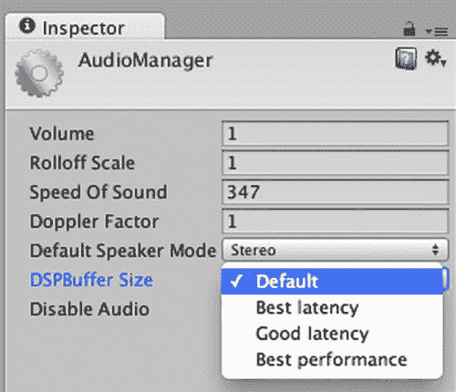

图 12-11. 项目设置

良好的音频使用实践包括：对较小的音效采用原生 WAV 或 AIFF 格式。这些文件已解压缩，运行时无需解码。与所有未使用的资源一样，项目开发阶段遗留的未用音频文件应及时删除。

# 播放器设置管理器

最直接实用的跨平台设置位于首个区域（图 12-12）。其他区域则因目标平台而异，在着手调整前需要充分了解该平台的特性。

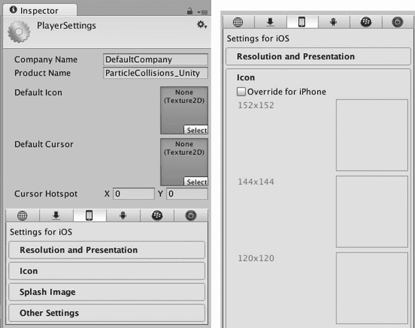

图 12-12. 项目设置 - 播放器设置管理器及展开的图标字段

此处包含游戏标题的产品名称，以及图标和启动画面的纹理字段。在添加图标纹理前，务必确认已选择正确的目标平台——每个平台都有各自的尺寸要求。若未使用正确尺寸，轻则显示异常，重则可能导致应用商店拒绝上架。

# 标签与图层管理器

该管理器用于创建和编辑标签与图层（图 12-13）。对游戏对象进行分组管理，特别是通过对无需处理的组限制操作，可以有效降低处理开销。

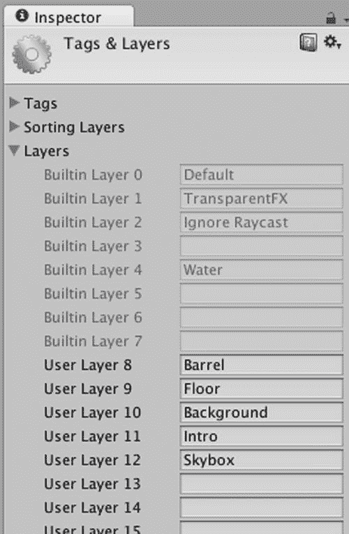
图 12-13. 项目设置

# 项目设置

可通过脚本访问项目设置管理器，并利用相应的类（如 `Physics`、`AudioSettings` 和 `PlayerSettings`）来修改其任何属性。所有详细信息（包括示例代码）均可在 Unity 脚本参考中找到。尽管这些是全局设置，但您可能会遇到需要在不同场景之间更改这些全局设置的情况。

## 更多图形优化

光照优化已在之前的质量设置管理器部分讨论过。摄像机、纹理、着色器、网格等所有归入图形总类的项目，均可通过微调来提升游戏性能。

## 摄像机

有若干优化策略可应用于摄像机。在第 3 章对摄像机组件的介绍中，您了解到只有位于摄像机视锥体（介于近裁剪面与远裁剪面之间）内的游戏对象才会被渲染（图 12-14），这种内置操作称为视锥体剔除。通过调整裁剪面，使其不覆盖超出所需的范围，可以最大限度地减少需要渲染的游戏对象数量。

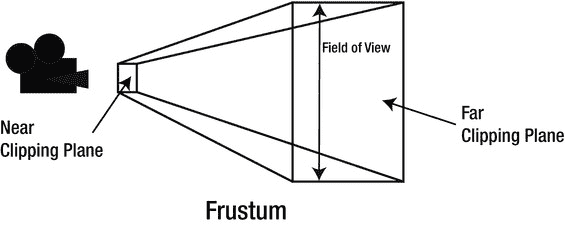

图 12-14. 近裁剪面与远裁剪面定义了摄像机的渲染体积

本章前面讨论的图层功能，可与摄像机组件的 `Culling Mask` 属性结合使用，将渲染范围限制在指定图层中的游戏对象。或者，如果您需要对某一层对象进行更精细的控制而非全有或全无的渲染，可以在脚本中使用 `Camera.layerCullDistances()` 函数，为不同图层分配不同的剔除距离。

细节层次是 Unity 专业版独有的功能，可根据物体距离摄像机的远近来减少其渲染的三角形数量。需要渲染的三角形越少，处理器负载就越低。

## 纹理

良好的纹理使用实践始于基础规范。纹理尺寸应为 2 的幂次方，例如 2、4、8、16 等。宽度和高度不必相同。非 2 的幂次方尺寸会消耗更多内存，从而拖慢 GPU 速度。另一种优化方法是使用压缩纹理格式来减少内存占用。

通过调整纹理导入设置中的属性，可以实现进一步的优化。在项目面板中搜索 Textures 并选择一个纹理（如有需要，可临时将 `Texture Type` 改为 `Advanced`），即可在检视面板中查看这些属性（图 12-15）。

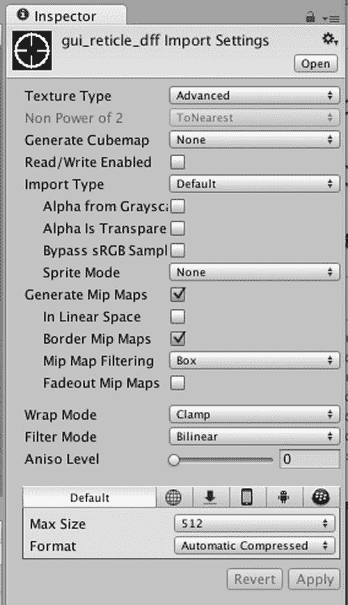

图 12-15. 检视面板中的高级纹理类型属性

在项目面板中选中纹理后，在检视面板中使用 `Max Size` 属性，将其减小到仍能保持所需细节质量的最小值。

Unity 可以为尺寸为 2 的幂次方的纹理生成较小的版本，并在游戏对象距离摄像机较远时，为较小的三角形使用这些版本。此过程称为 Mip 贴图，通过勾选 `Generate Mip Maps` 复选框启用。Mip 贴图会占用更多内存，但通常为了换取更好的性能，这种代价是值得的。此规则的例外情况是 UI 元素或 2D 游戏，因为这些纹理与摄像机的距离是固定的。

## 着色器

着色器是自定义程序，通常针对 GPU 编写，用于实现自定义视觉特效。虽然着色器主题超出本书范围，但如果您深入研究这一图形领域，可以在 Unity 文档中找到许多优化技巧。

# 发布

如果你想在 Unity 编辑器之外查看游戏的效果，可以在开发过程中的任何时刻将其作为独立程序运行。在编辑器中打开“障碍赛”场景后，从顶部菜单选择“文件 ➤ 生成设置”，打开“生成设置”窗口，操作方式与你之前在本章生成构建日志时相同（图 12-15）。“障碍赛”场景仍会出现在“场景在构建中”部分，右侧索引为 0。

首先选择一个平台，本例中选择`PC, Mac & Linux Standalone`。请注意右侧（图 12-16）。如果未显示，请点击“切换平台”按钮。Unity 会对项目中特定于你所选平台的资源进行评估和处理，待所有内容为所选平台准备就绪后，Unity 徽标将出现在右侧。

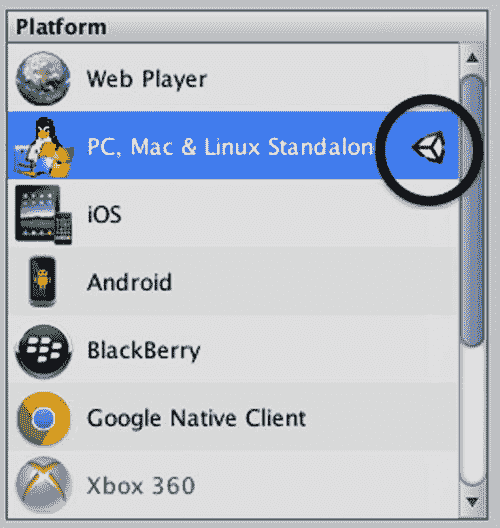

图 12-16. Unity 徽标出现在所选目标平台右侧

现在你可以点击“生成”按钮，选择保存游戏独立版本的名称和位置，然后点击“保存”让 Unity 生成游戏。最终生成的游戏文件取决于构建目标。在 Mac 上你会得到一个应用包，在 Windows 上则会得到一个包含`.exe`文件的资源文件夹。你可以自行试玩，或者将这些文件分发出去分享你的游戏。现在就来试试你的新独立版本吧。

你首先会看到一个带有 Unity 徽标的黑屏（图 12-17）。虽然所有游戏都会以此作为默认的启动画面，但只有专业版用户才能更改它。

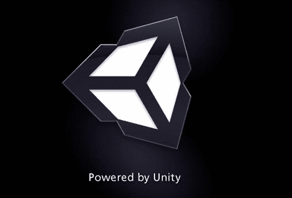

图 12-17. 独立游戏加载时首先出现 Unity 徽标

## 切换场景

即使是最简单的游戏也有启动画面，因此你需要知道如何使用。

返回 Unity 编辑器，保存“障碍赛”场景并保存项目。然后从顶部菜单选择“文件 ➤ 新建场景”来创建一个新场景。再次在顶部菜单中，选择“游戏对象 ➤ 创建空对象”，并将其命名为`GUI`。

在项目面板的“资产 ➤ 脚本”文件夹中，创建一个名为`SplashGUI`的新脚本，在 MonoDevelop 中打开它，并将代码编辑为以下内容：

```
#pragma strict

function OnGUI() {

        GUI.Label(Rect(0, 0, 125, 25), "Splash screen");

        if (GUI.Button (Rect (Screen.width/2 - 50, Screen.height/2 - 15, 100, 30), "Start")) {

                Application.LoadLevel(1);

        }

}
```

保存脚本，将其附加到`SplashGUI`游戏对象上，并将场景保存为`SplashScene`。你在第 11 章中使用过并创建了 GUI 标签和按钮。在这行代码中，数字 1 对应的是在“生成设置”屏幕中分配的索引：

```
Application.LoadLevel(1);
```

你希望启动画面排在第一位，因此它的索引应为 0，紧随其后的“障碍赛”场景索引为 1。

为此，在 Unity 编辑器顶部菜单中再次选择“文件 ➤ 生成设置”打开“生成设置”窗口。从项目面板的“资产 ➤ 场景”文件夹中，将`SplashScene`拖入“场景在构建中”部分。拖入后，它会被添加到“障碍赛”场景之后，并分配索引 1。只需点击并拖动列表中的任意项目到你想要的位置，即可重新排列它们（图 12-18）。

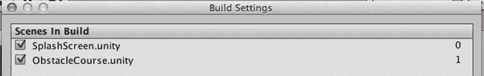

图 12-18. 在“生成设置”窗口中重新排序场景，使启动画面排在首位

点击“生成”，在提示时保存并替换旧的“障碍赛”构建版本。现在，当你运行独立版本时，Unity 徽标淡出后，启动画面场景就会出现（图 12-19）。

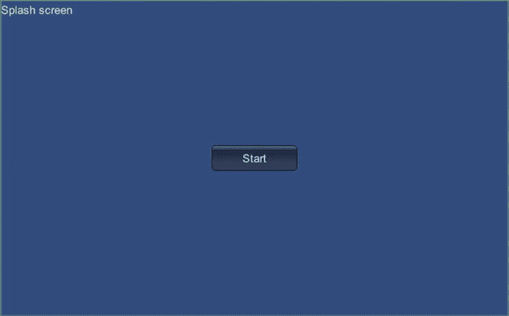

图 12-19. 启动画面场景自动出现

点击“开始”按钮，你就看到——障碍赛场景出现了。

## 总结

干得漂亮——你已经冲过终点线了！你可以微调游戏的性能，已经了解了用于场景切换的`Application.LoadLevel()`函数，并且发布了独立版本。

不要被优化涉及的大量细节吓倒；只需知道你有许多工具可以用来处理游戏性能问题。现在，一个好的起点是致力于遵循脚本编写的最佳实践，并遵循 Unity 文档中提供的一个便捷检查清单中收集的一些基本原则（表 12-1）：

表 12-1. 让游戏运行更快的简易检查清单，来自 Unity 脚本参考

| 以 PC 为目标时，保持每帧顶点数低于 20 万至 300 万，具体取决于目标 GPU。 |
| --- |
| 如果使用内置着色器，请从“移动”或“无光照”类别中选择。它们同样适用于非移动平台，但只是更复杂着色器的简化近似版本。 |
| 保持每场景的不同材质数量较少——在不同对象之间尽可能多地共享材质。 |
| 对所有非移动对象设置“静态”属性，以启用静态批处理等内部优化。 |
| 在非必要情况下不要使用像素光照——选择仅使用一个（最好是方向光）像素光照影响你的几何体。 |
| 在非必要情况下不要使用动态光照——改为选择烘焙光照。 |
| 尽可能使用压缩纹理格式，否则优先选择 16 位纹理而非 32 位。 |
| 在非必要情况下不要使用雾效。 |
| 学习遮挡剔除的优势，并在具有大量遮挡的复杂静态场景中使用它来减少可见几何体和绘制调用的数量。规划你的关卡以受益于遮挡剔除。 |
| 使用天空盒来“伪造”远处几何体。 |
| 使用像素着色器或纹理组合器来混合多个纹理，而不是采用多通道方法。 |
| 如果编写自定义着色器，始终使用尽可能小的浮点格式：`fixed/lowp`用于颜色、光照信息和法线。`half/mediump`用于纹理 UV 坐标。`float/highp`避免在像素着色器中使用，适用于顶点着色器中的位置计算。 |
| 尽量减少像素着色器中复杂的数学运算，如`pow`、`sin`、`cos`等。 |
| 选择每个片段使用更少的纹理。 |

除了硬件和编译器限制外，这些建议中的大部分更像是指导方针而非硬性规则。你可以选择不遵循本章中的某些建议，但这没问题。当你对游戏的性能感到满意时，你可以决定是否再花更多时间进行进一步的优化，因为这可能是一种收益递减的练习。

重要的是，你了解了提升性能的良好实践，并且知道在开发过程中遇到性能问题时，如何从文档中找到优化方面的帮助。

你现在已经掌握了使用 UnityScript 进行基础编程以及使用 Unity 编辑器的基本知识。这仅仅是更多乐趣和兴奋的开始。在下一章中，你将获得许多资源，继续你的游戏开发之旅，结识同行，并且最重要的是——享受制作游戏的乐趣。
