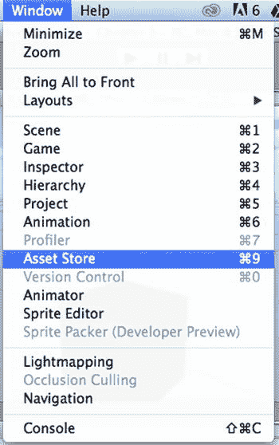
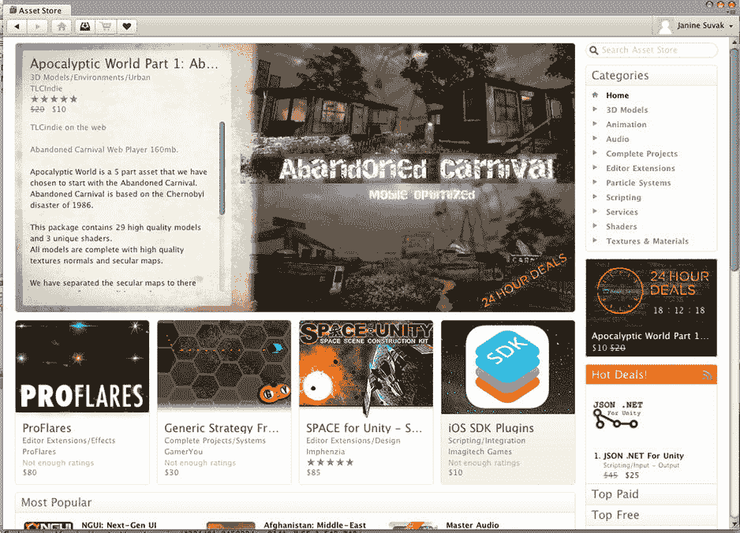
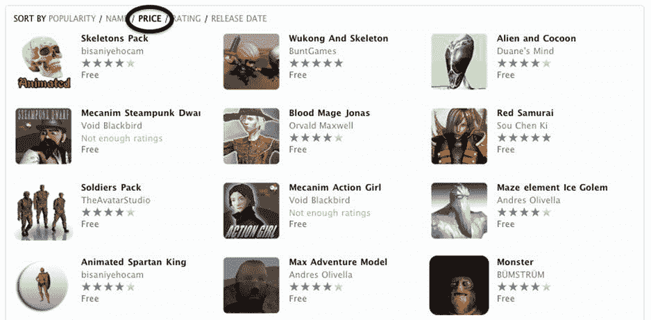
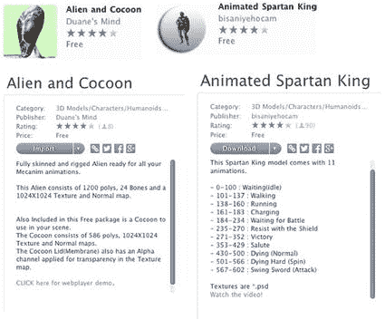
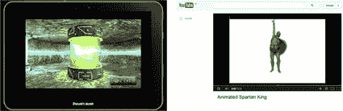
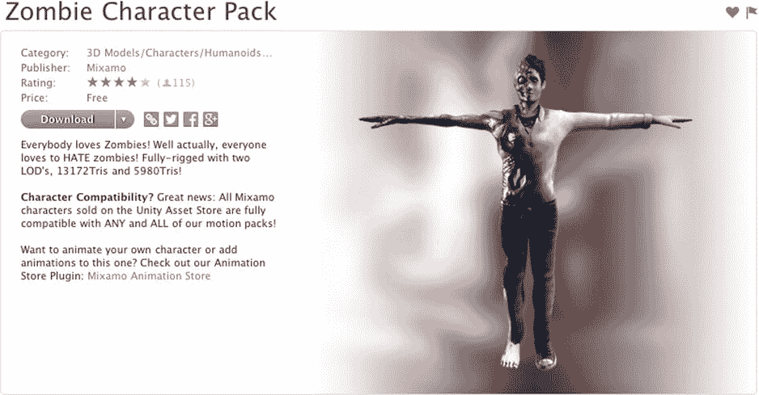
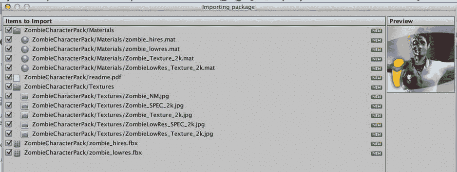
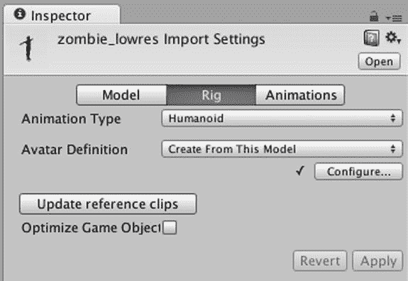
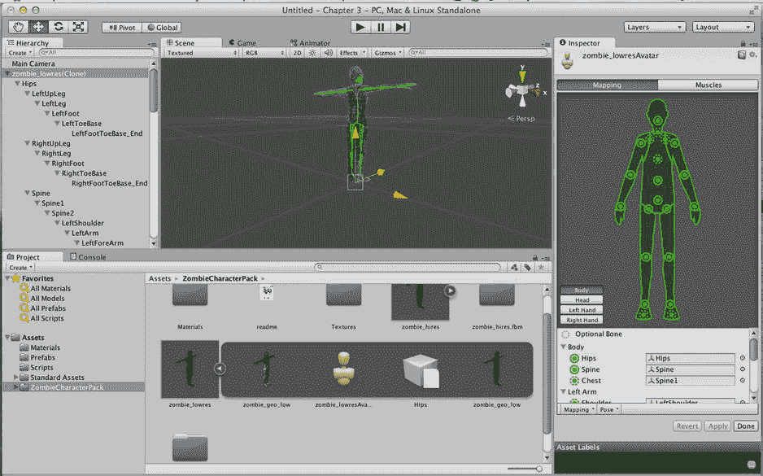
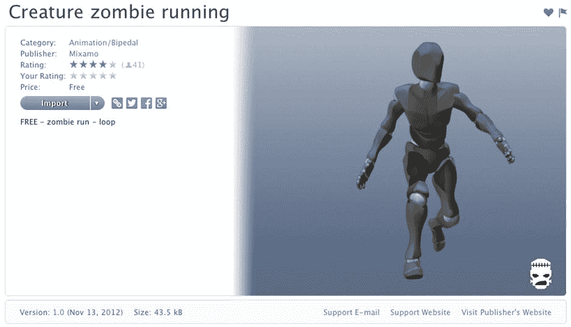

# 资源商店

对于独立游戏开发者来说，幸运的是存在 Unity 资源商店。资源商店是模型、脚本、纹理、音频、完整项目等资源的宝库。别被它的名字骗了——上面有许多免费资源可供使用，非常适合学习和制作原型，更不用说这是一个了解各位艺术家和工作室能提供什么的好方法。

Unity 资源商店的运作方式很像应用商店，其中的资源可能来自独立艺术家或开发者、工作室，甚至 Unity Technologies 本身。你可以找到从简单的零散部件到完整的已完成项目。Unity 编辑器旨在与资源商店轻松集成。要访问资源商店，请在编辑器顶部菜单中，选择 `Window` ➤ `Asset Store`（图 5-9）。

图 5-9。通过编辑器菜单访问 Unity 资源商店

资源商店主页会在一个单独的窗口中打开（图 5-10）。左侧前两行展示特色资源，右侧是商店分类菜单。分类菜单下方是“24 小时特惠”，每天都会有一款不同的资源以大幅折扣特价出售。

图 5-10。Unity 资源商店主页

在分类中，选择 `3D Models` ➤ `Characters` ➤ `Humanoids`。左上方是该子分类下的特色资源，下方是所有可用的 3D 人形模型的完整列表。列表顶部是排序选项；选择 `PRICE`（价格）。这将按价格从低到高对资源进行排序，将免费资源置于列表顶部（图 5-11）。

图 5-11。Unity 资源商店中可用的 3D 人形模型，按价格排序

点击其中任何一个，都将进入产品页面，该页面包含简要描述、一张图片、一个可选的展示角色更多图片的区域，以及最后可下载包的详细内容。出于比较目的，请查看 Alien and Cocoon 和 Animated Spartan King（图 5-12）。

图 5-12。在 Unity 资源商店中比较 3D 模型

这些简要描述由发布者提供，内容可能有所不同。通常会提到多边形数量，因为这会影响性能，或可能限制支持你游戏的设备。Mecanim 相对较新，是 Unity 旧版动画系统的重大升级，因此你可能会看到类似针对 Alien 的评论，指定它实际上与 Mecanim 兼容。

动画可能单独提供，或者是长动画的一部分，此时你需要知道单个剪辑中各个动画的位置。在 Spartan King 的描述中，发布者给出了每个动画剪辑的特定帧范围。

最棒的是，这两个发布者都提供了在下载前实际查看动画的方式。Alien and Cocoon 的链接会带你到一个 Unity Web 播放器，你可以作为玩家与之互动，在几个简单的关卡中移动外星人；而 Spartan King 的链接则会带你去一个 YouTube 视频，你可以在那里观看角色执行每个可用动画（图 5-13）。

图 5-13。资源商店的贡献者以多种方式展示他们的动画：Web 播放器对比 YouTube 视频

## 导入角色模型

在资源商店窗口中，向下滚动一点，直到你找到 Mixamo 提供的免费 Zombie Character Pack（僵尸角色包），选中它以打开产品页面（图 5-14）。

图 5-14。Unity 资源商店中的 Zombie Character Pack 图标和产品描述

点击蓝色的下载按钮。如果你还没有设置 Unity 账户，请按照指示立即设置。如果你有，下载按钮将变为“请稍候”，然后显示一个百分比数字，表示下载进度。最后，将弹出导入包窗口，其中所有包内容都已选中准备导入。保持所有这些选项处于勾选状态，然后点击窗口右下角的导入按钮（图 5-15）。

图 5-15。显示 Zombie Character Pack 内容的导入窗口

现在，`ZombieCharacterPack` 文件夹出现在 Project 面板的 `Assets` 文件夹中。

## 创建并配置 Avatar

在 Project 面板的 `ZombieCharacterPack` 文件夹中，选择 `zombie_lowres` 模型。在 Inspector 视图中，选择 `Rig` 选项卡。将动画类型更改为 `Humanoid`，并将 Avatar 定义保留为 `Create From This Model`。点击 `Apply`。现在 `Configure…` 按钮变为活动状态，点击它。在出现的对话框中选择 `Save`。配置完成后，`Configure…` 按钮左侧将出现一个小对勾（如图 5-16 所示）。

图 5-16。在 Inspector 中配置 Avatar

哇——编辑器中的几乎每个视图都发生了变化，以显示新的 Avatar 及其细节。Avatar 游戏对象临时出现在 Hierarchy 中用于配置，并且可以展开以显示组成它的所有子游戏对象。其图像出现在 Inspector 中（图 5-17）。在 Avatar 图像下方是一个列表，显示哪些 Avatar 骨骼与哪些对应的角色骨骼匹配。有一种方法可以手动分配任何未正确匹配的骨骼，但在这种情况下它们都是正确的，所以继续点击 Inspector 右下角的 `Done` 按钮关闭此视图，编辑器将返回到之前的状态。你的 Avatar 已准备就绪！

Avatar 不再出现在 Hierarchy 中，因为你还没有将僵尸角色放入游戏场景中。它暂时只在那里用于配置 Avatar 的目的。

图 5-17。新创建的 Avatar 出现在编辑器中

## 导入动画

角色通常自带许多现成的动画，但添加其他动画资源也很简单。返回资源商店，搜索“creature zombie running”（图 5-18），然后像导入 Zombie Character Pack 一样下载并导入它。在 Project 面板中，选择 `Assets` 根文件夹，然后点击 `Create` ➤ `Folder`，将其命名为 `Animations`。将新导入的 `alpha@zombie_running` 动画剪辑移动到 `Animations` 文件夹中，以保持项目组织有序。

图 5-18。Unity 资源商店中的僵尸奔跑动画剪辑

选中 `Animations` 文件夹中的动画剪辑，以便其属性显示在 Inspector 中。在顶部，勾选 `Loop Time`（循环时间）复选框。如果不勾选，僵尸只会执行左右腿交替的一个步伐周期。循环播放动画意味着僵尸将持续奔跑。