# 13. 下一步该怎么走

恭喜你——现在你已经掌握了 UnityScript 的基础知识。学习任何一门新语言，真正精通都需要时间，以及反复的练习、练习、再练习。像任何技术领域一样，游戏开发也在持续且快速地发展，这意味着将一部分编程时间用于学习，应该成为你游戏开发生涯中的标准环节。这对游戏开发者来说意味着什么？去制作更多的游戏吧！

本章提供了丰富的资源，包括从哪里获得特定技术问题的答案，如何与游戏开发社区建立联系，如何跟上最新动态，以及如何建立你的专业作品集。如果你尚未加入，本书的配套网站是[`www.learn-unityscript.com`](http://www.learn-unityscript.com/)，在那里你可以介绍自己、参与讨论、结识志同道合的游戏开发者、获得鼓励，以及分享你的游戏——尽情炫耀你的成果吧！

信息很容易铺天盖地，所以请将不断提升技能作为你的首要任务。这意味着要投入大量时间亲手实践 Unity。没有游戏创意？那就继续阅读，了解更多关于游戏开发大赛和竞赛的信息。探索特定平台，或者专注于深入学习游戏开发中某个吸引你的特定领域，比如动画或人工智能。

## 脚本编写及其他技术资源

在线论坛已成为全球游戏开发者聚集的主流场所，这一点毫不意外。论坛主要分为两类：纯技术论坛和讨论论坛。

纯技术论坛侧重于为实际项目解决问题，并具有特定的格式；而讨论论坛则可以包含任何与开发者相关的话题，包括最佳实践、新闻、公告、工作机会，或者仅仅是轻松的闲聊。

## 技术论坛

Unity 网站是 Unity 开发者首屈一指的资源。Unity Answers 是位于[`http://answers.unity3d.com`](http://answers.unity3d.com/)的技术论坛。图 13-1 展示了其布局：问题以帖子标题形式呈现，并附有关联的话题标签、问题被查看的次数、是否已有回答、原帖发布者是否已接受某个答案，以及来自开发者社区的投票（通常基于问题的质量和有用性）。

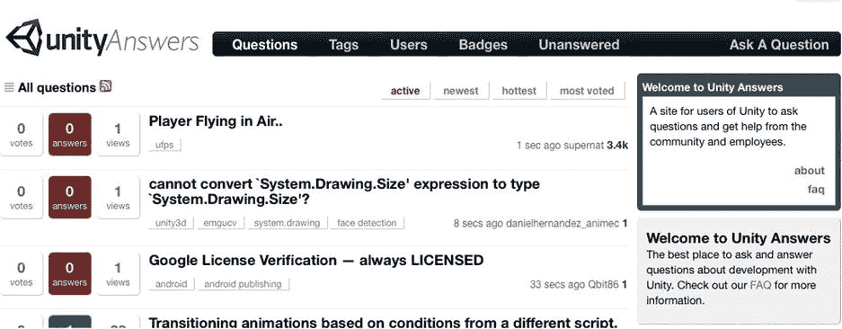

图 13-1. 在 Unity Answers 上发布的问题

虽然问题没有愚蠢之分，但使用论坛也有其礼仪。开发者社区通常很友好且乐于助人，但重点是帮助你学习，而不是替你编写脚本。技术论坛成员的立场是，在提问之前，你应该已经尽一切努力自己找到解决方案。最重要的是，这意味着你为自己的脚本编写了一些代码，并进行了初步研究，例如在 Unity 文档中自行搜索解决方案。如果你已经尽力而为但仍然卡住了，那么就该向 Unity Answers 求助了。

在提问之前，先搜索一下。留意搜索结果中类似问题附带的标签，它们或许能帮助你优化搜索。很可能同样的问题以前已经被问过，答案已经存在。

如果你找不到针对特定问题的解决方案，那么就该自己提问题了。一个好的问题应该非常具体，详细描述你尝试过的方法及结果，并包含一段实际的代码片段。使用超链接来引用你查阅过的文档并描述你的理解，同时引用论坛上你参考过解决方案的问题链接以及你的结果。通常，提出一个好问题的过程本身就能引导你自己找到答案。在提问表单的工具栏中，可以找到添加超链接、代码格式化、文件附件等功能（图 13-2）。

大多数论坛都提供积分或声望点数的累积机制，以及针对不同参与形式的有趣徽章。你可以通过提出好问题和给出好答案来获得积分。尽你所能去回答问题，即使你不觉得自己是专家。能够以易于理解的方式传达解决方案，不仅能让你因帮助他人而感到温暖，也能巩固你头脑中的概念，并增强你的信心。

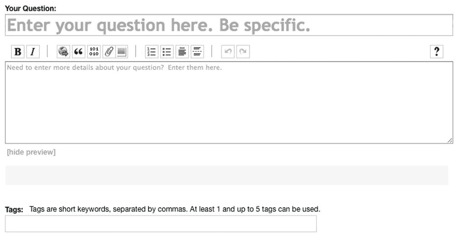

图 13-2. Unity Answers 的提问表单

Stack Exchange 是一个庞大的开发者资源，包含多个论坛类别。你或许能猜到，位于[`http://gamedev.stackexchange.com`](http://gamedev.stackexchange.com/)的 GameDev 是为游戏开发者服务的。位于[`http://stackoverflow.com`](http://stackoverflow.com/)的 StackOverflow 则更侧重于纯粹的编程问题，对于关于游戏目标平台编码的问题可能很有帮助。

GameDev Stack 和 Stack Overflow 网站也采用社区评级的直接问答形式（图 13-3）。

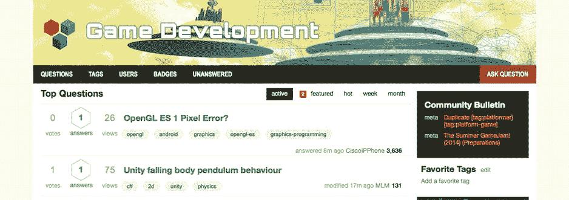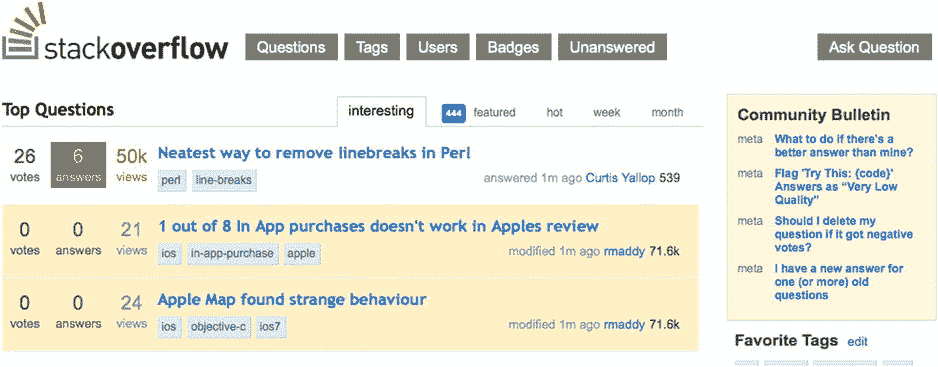

图 13-3. Stack Exchange 论坛采用社区评级的问答形式

## 其他开发者论坛

另一个流行的游戏开发者资源是 Gamasutra。与编程相关的话题可以在[`www.gamasutra.com/category/programming`](http://www.gamasutra.com/category/programming)找到。它包含编程特写、编程动态、编程博客和编程职位等子类别（图 13-4）。Gamasutra 更像是博客形式，更适合帮助你了解游戏开发者社区的最新动态，而不是寻找具体的技术答案。

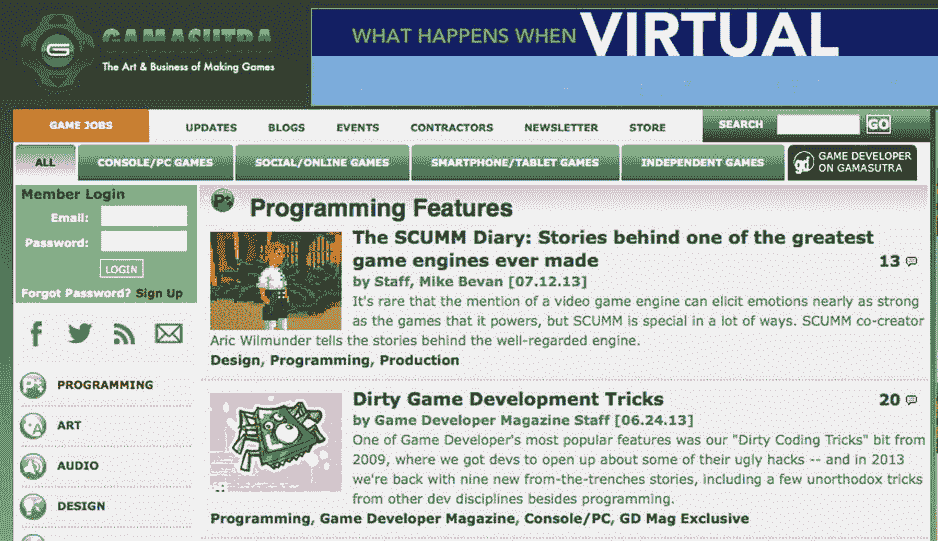

图 13-4. Gamasutra 的结构比纯技术论坛更非正式，话题也更广泛

虽然 Unity 已经跨越了成为大多数游戏开发者首选的门槛，但在这里你也会看到对其他游戏引擎的提及。开发者在游戏发布后撰写的“项目复盘”，分析开发和发布过程中哪些做对了、哪些做错了，这些内容提供了来自实战一线的极佳实践学习点。

# 各平台专属开发者资源

各目标平台的制造商希望开发者能为其系统制作游戏，因此提供了大量开发者支持。至少他们会提供文档，但大多数平台也都拥有自己的类似论坛。通常，这些论坛会以某种组合形式提供技术文档、教程、技术论坛以及开发者社区论坛。

虽然大多数这类论坛都要求你创建一个用户账户，但具体要求差异很大。有些在注册时就需要提供合法的商业实体信息，例如纳税识别号，而另一些则在你准备发布游戏时才需要提供。有些论坛会收取费用，不过同样可能要到准备发布时才会涉及。没有一家论坛要求你必须购买硬件，但最佳实践并强烈建议在发布前，不仅要在虚拟模拟器上，还要在目标平台硬件上测试你的游戏。

以下是一些较为常见的网站：

- **索尼**：[`http://us.playstation.com/develop`](http://us.playstation.com/develop)（图 13-5）。如果你不在美国，索尼还为其他地区设有论坛，因此请花点时间快速搜索你所在地区的论坛。

  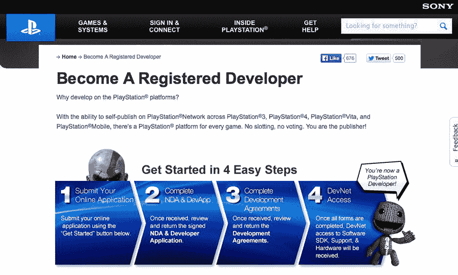

  图 13-5. 索尼 PlayStation 开发者注册

- **微软**：[`www.xbox.com/en-US/developers`](http://www.xbox.com/en-US/developers)（图 13-6）。这是 Xbox 开发者网站，但也涉及针对 Web、Kinect 以及 Windows 电脑、平板和手机的应用开发。

  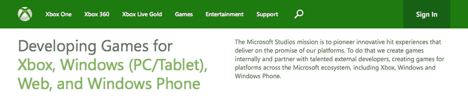

  图 13-6. 微软 Xbox 开发者注册，并提供其其他设备的更多信息

- **任天堂**：[`http://wiiu-developers.nintendo.com`](http://wiiu-developers.nintendo.com/)（图 13-7）。任天堂开发者网站上显著展示了其主机与 Unity 的兼容性。

  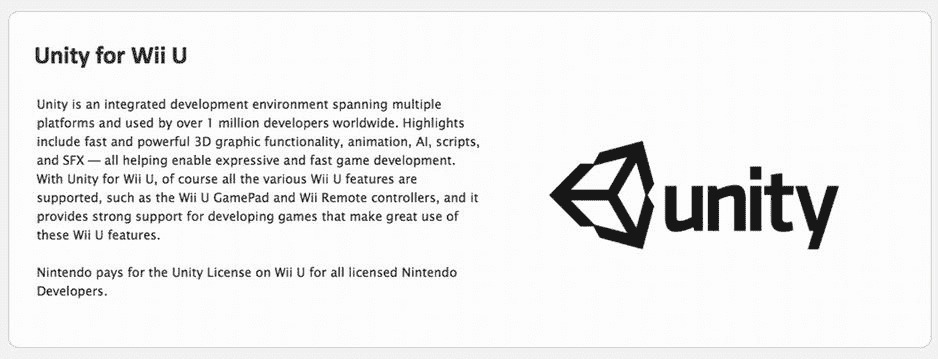

  图 13-7. 任天堂开发者网站展示对 Unity 的支持

- **苹果**：[`http://developer.apple.com`](http://developer.apple.com/)（图 13-8）。在其开发者网站内，苹果为 iOS 和 OS X 开发者设立了独立的论坛，但其软件开发工具 Xcode 则有一个通用论坛。

  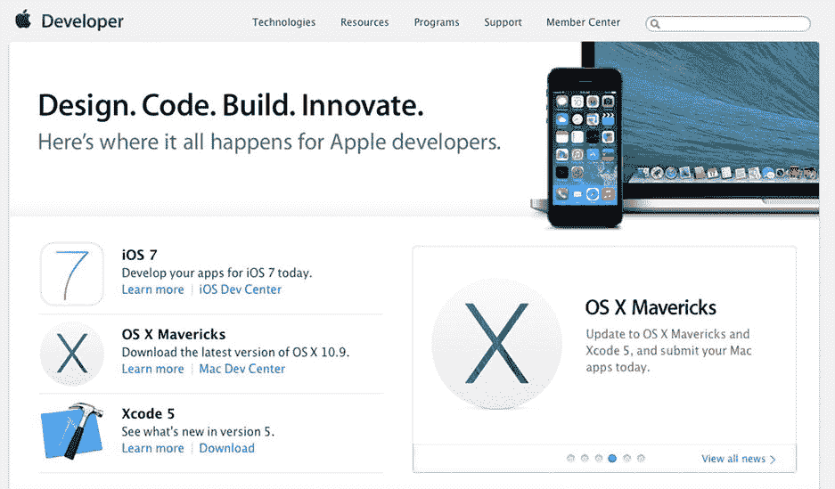

  图 13-8. 面向 Xcode 开发者的苹果核心网站

- **安卓**：[`http://developer.android.com`](http://developer.android.com/)（图 13-9）。安卓与苹果和微软在移动设备方面有所不同，因为它是谷歌发布的操作系统，并被多家不同的制造商使用，从而产生了各种基于安卓的开发者论坛。三星是国际市场上占主导地位的硬件制造商，并在 [`http://developer.samsung.com/forum/en`](http://developer.samsung.com/forum/en) 为其安卓开发者提供额外支持，以便特别利用其设备（从手机到电视和可穿戴技术）的功能。

  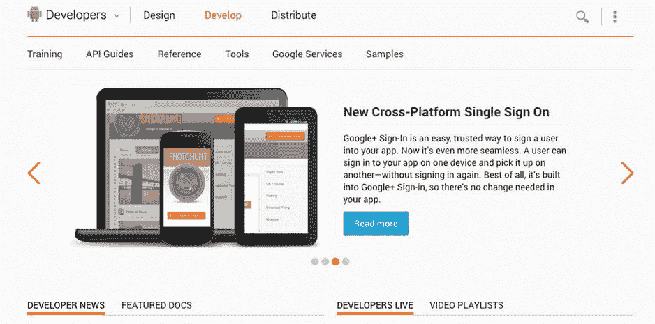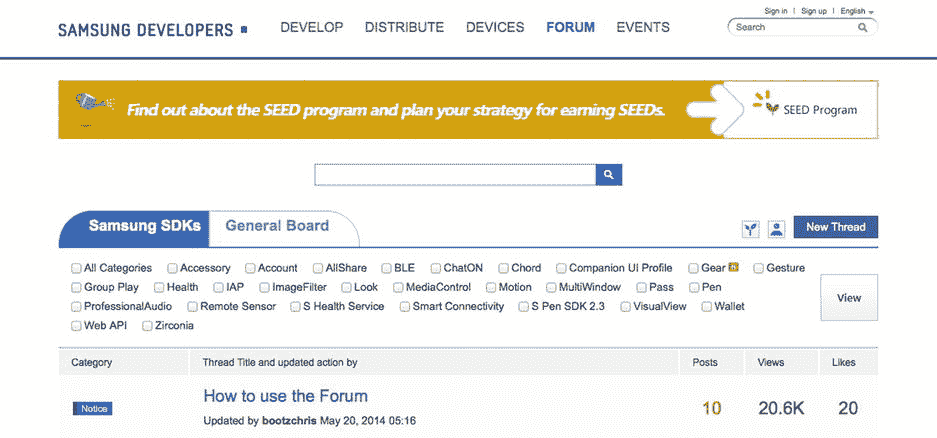

  图 13-9. 安卓及基于安卓的三星产品开发者网站

从市场营销的角度来看，为那些成熟且流行的游戏平台制作游戏，无疑能让你的投入获得最大回报。如果你对新兴技术感兴趣，或者只是想尝试一些不同的东西，还有其他一些不太知名的游戏平台也支持 Unity：

- **Sphero**：[`http://developer.gosphero.com`](http://developer.gosphero.com/)。Sphero 是一个机器人球类游戏平台，由安卓或 iOS 设备控制，它将真实世界的机器人动作与设备摄像头输入和图形用户界面显示整合成一个混合遥控/增强现实游戏环境——或者反过来，它也可以通过自身的传感器用作游戏控制器。插件是一种软件组件，能为已有的软件应用程序添加一个或多个新功能。Sphero 的 Unity 插件可直接通过 Unity 资源商店获取（图 13-10）。

  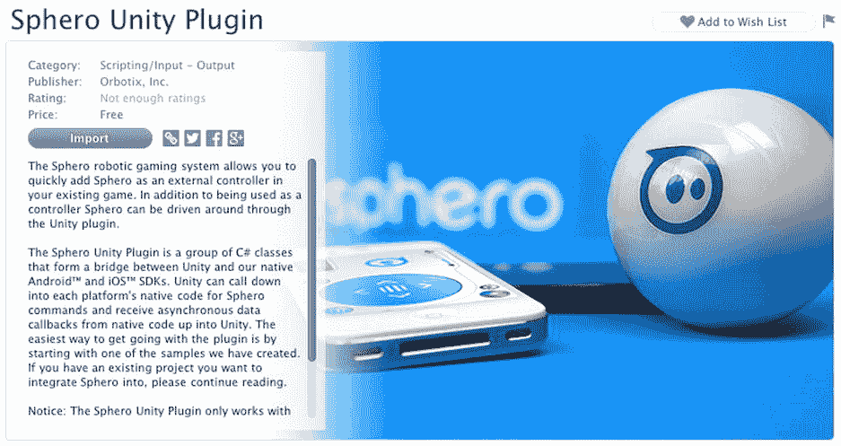

  图 13-10. Unity 资源商店中的 Sphero 插件

- 两个领先的增强现实软件开发工具包，Vuforia（网址为 [`http://developer.vuforia.com/resource/skd/unity`](http://developer.vuforia.com/resource/skd/unity)）和 Metaio（网址为 [`http://dev.metaio.com/sdk/getting-started/unity3d`](http://dev.metaio.com/sdk/getting-started/unity3d)）也支持 Unity，不过你需要直接访问它们各自的网站，而不是通过 Unity 资源商店（图 13-11）。

  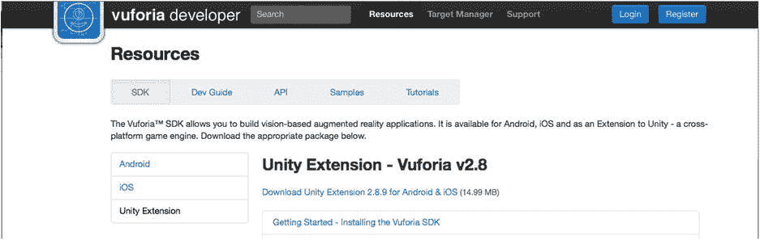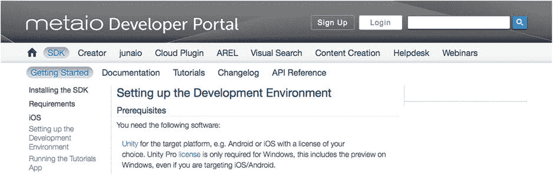

  图 13-11. 使用 Unity 创建基于 Vuforia 或 Metaio 的增强现实游戏

- **Leap Motion**：[`http://developer.leapmotion.com`](http://developer.leapmotion.com/)。Leap Motion 是一款运动检测控制器。开发者支持直接在其网站上提供。Unity 资源商店上可用的专有和独立创建的 Leap Motion 资产数量持续增长（图 13-12）。

  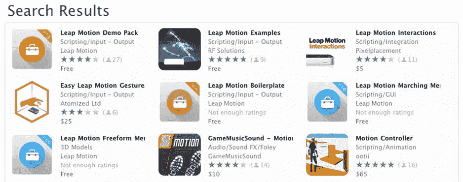

  图 13-12. Unity 资源商店上提供的 Leap Motion 控制器资产

- **Oculus Rift**：`http://developer/oculusvr.com/forums`。这款虚拟现实头显通过沉浸式视觉显示增强基于 Windows、Mac OS 或 Linux 系统的游戏体验，并能对玩家的头部运动做出响应（图 13-13）。

  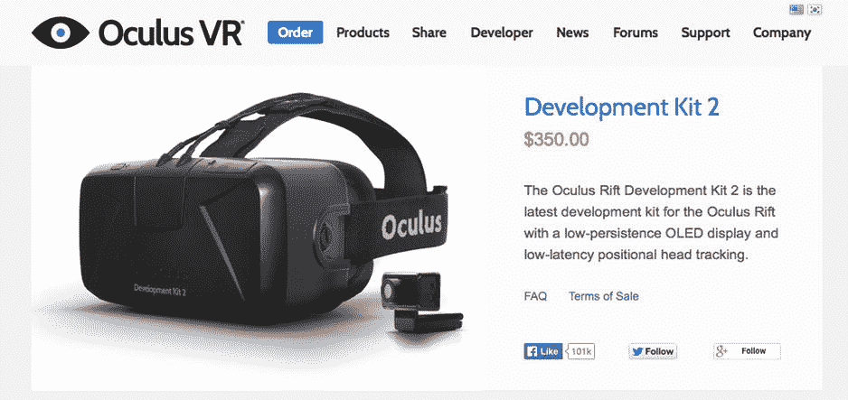

  图 13-13. Oculus Rift 头显和运动检测器

即使有如此众多的游戏开发者支持论坛，`Unity Answers` 仍然是你获取 Unity 游戏开发技术帮助的最佳首选。你可以根据需求，将搜索范围扩大到通用游戏开发和编程论坛，或者联系针对特定平台的开发者群体。随着你缩小兴趣范围并选定几个最喜爱的论坛，你肯定会在这个游戏开发者社区的任何一个角落找到友好的帮助。

# 非正式团体、组织与聚会

Unity 开发者遍布各地，有许多场合可供你与新同行们相聚。不那么技术化的 Unity 论坛就位于 Unity 社区菜单中“答案”选项卡的旁边（见图 13-14）。

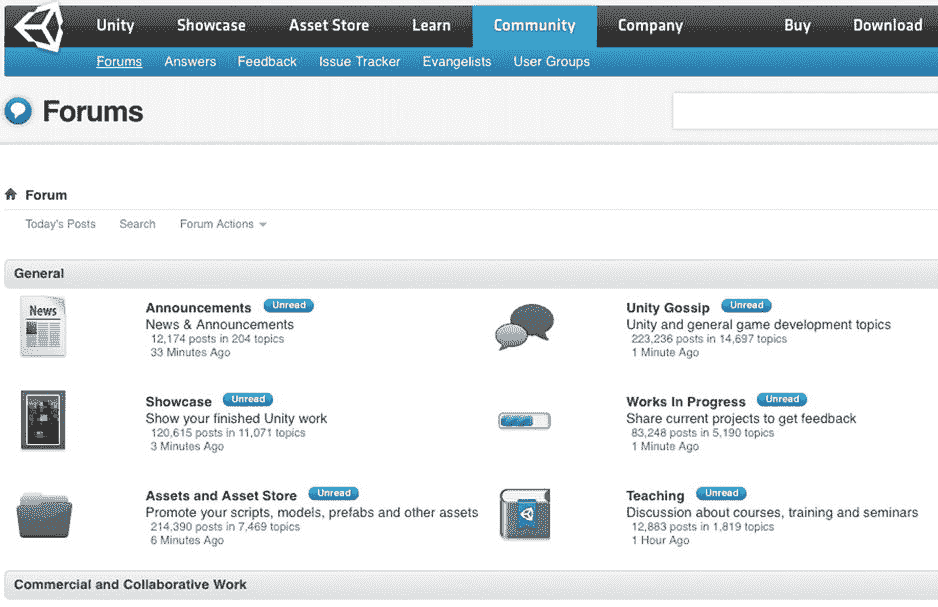

图 13-14. Unity 社区论坛

在这里，你可以与在线 Unity 开发者社区交流。如果你想线下见面，可以选择“用户组”选项卡来寻找本地小组。你会发现许多这类小组都列在 Meetup 上，该网站是一个中心化平台，用于寻找任何共同兴趣的本地人群。

如果在 Unity 用户组列表中看不到你所在地区的小组，不妨直接搜索 `www.meetup.com`。在这里，你可以找到较新、较小的本地 Unity 小组；如果没有找到，你可以将 Unity 游戏开发列为兴趣领域，这样当你的地区有小组成立时，你会收到通知。你甚至可以考虑自己创建一个。本地小组的活动形式多种多样，可以是纯粹的社交聚会、技术演示、针对小组成员项目的反馈会议、实践教程课程，或者成员感兴趣的任何内容。

## GDC（游戏开发者大会）

GDC（游戏开发者大会）是游戏开发行业的年度盛会，数以万计的游戏开发行业人士在此聚集。在这个大型聚会期间，会有讲座与教程、竞赛与奖项、工作坊、社交活动、派对等。所有详情可在 `www.gdconf.com` 找到。

## Unite 会议

Unity 有自己的年度会议，名为 Unite。Unite 每年在北美不同城市举办，并在全球设有其他地区性会场（见图 13-15）。在此，你会找到与 Unity 相关的所有内容：技术、艺术以及商业方面。有实践培训工作坊、行业资深人士的演讲，以及新功能和产品的预览。你无需达到一定经验水平或发布过游戏即可参加。事实上，在 Unite 开始之前，还有一个额外的 Unity 培训日，专为完全没有经验的人提供，让他们在主要会议开始前对 Unity 有一个入门了解。关于 Unite 和 Unity 培训日的更多信息，请访问 Unity3D 网站 `http://unity3D.com/unite`。

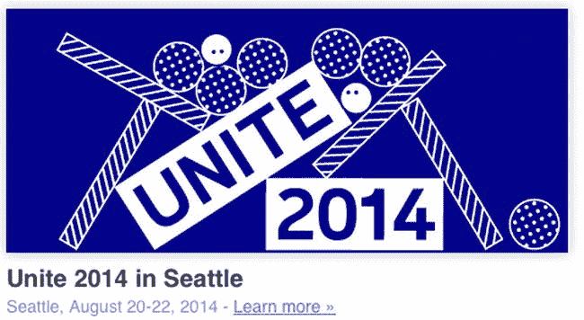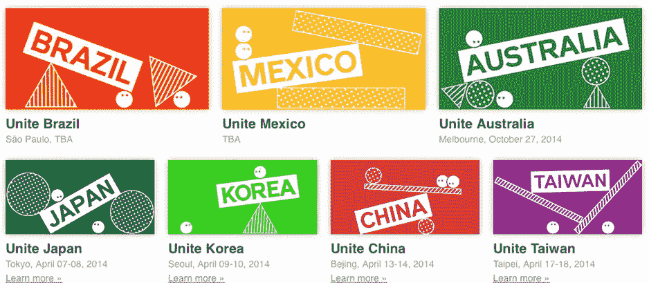

图 13-15. 2014 年 Unite 的主会场与地区会场

## IGDA（国际游戏开发者协会）

IGDA（国际游戏开发者协会）是一个大型的非营利专业组织，致力于为行业发声，并为会员提供全年赞助活动、折扣、教育网络研讨会等福利。其官方网站为 `www.igda.org`。

# 游戏开发限时挑战（Game Jams）

游戏开发限时挑战（Game Jams）是一种在超级有趣且高强度的环境中提升技能的绝佳方式。它们本质上是组织化的团体挑战，个人或团队必须在短时间内（通常为 24 到 48 小时）从零开始创作一个游戏。

团队在游戏开发限时挑战开始时由参与者组成。他们的目标是制作出一个可运行的游戏原型。该原型必须符合挑战的指导方针，这些方针可能会指定必须使用的主题或功能等。

参与者可以是任何参与游戏开发的人，包括程序员、美术师和游戏设计师，但熟练程度各不相同。无论你是多么新手，或者能参与多少小时，你总能找到自己能贡献的事情。像搜索素材或录制音效这样简单的事情也是有价值的贡献。有些挑战允许通过互联网参与，但挑战的真正意义在于聚在一起结交朋友并享受乐趣。

-   Global Game Jam：`http://globalgamejam.org`。每年一月举行的大型年度游戏开发限时挑战活动。这是一个在全世界数百个地点同步进行的协调活动。

-   Ludum Dare：`http://ludumdare.com`。每四个月举行一次的在线游戏开发限时挑战，包含两个并行的活动（竞赛组和挑战组）。竞赛组是两者中强度较大的，你必须独自工作，在 48 小时内根据主题创建所有游戏代码和资源。挑战组则更轻松，允许团队合作和复用现有资源，并给予 72 小时完成。

-   Nordic Game Jam：`http://nordicgamejam.org`。全球最大规模的游戏开发限时挑战之一，在丹麦举行。

如果大型活动令人生畏、不便参加或实在距离太远，可以尝试从“一月一游戏”开始：`http://onegameamonth.com`（见图 13-16）。它对所有人开放，但可能是最友好、最不吓人、最鼓舞人心的游戏开发限时挑战网站。活动在线进行，每月都有一个新挑战。

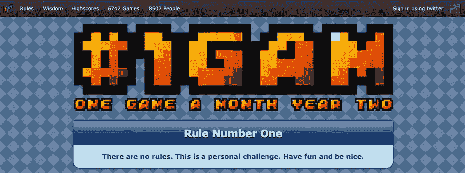

图 13-16. 一月一游戏：一个友好、低调的在线游戏开发限时挑战网站

如果你对某个限时挑战感兴趣，应该能在像 `http://gamejamcentral.com` 这样的网站上，或者通过简单的在线搜索，找到适合自己的挑战。

关于赞助活动的一句话：务必仔细阅读细则。通常，奖品仅仅是炫耀的资本，外加游戏开发限时挑战组织方提供的游戏推广奖励。有些挑战的规则可能包括将活动期间制作游戏的部分或全部权利转让，因此请务必了解相关要求。

# 竞赛与奖项

一般来说，竞赛是一种为获胜者（有时也包括亚军）提供奖励的竞争，而奖项和颁奖典礼则是对某种重大成就的认可。你可能会发现有些竞赛的唯一奖品就是炫耀的资本，而有些颁奖典礼则在奖项本身之外，还提供丰厚的奖品包。

# 竞赛

竞赛通常由赞助方举办，并为获胜者提供奖品。与游戏开发冲刺活动类似，这些竞赛可以是本地或在线形式，奖品套餐有大有小，但通常截止日期为数月左右，因为主办方期望的是精良的最终产品，而非仓促拼凑的原型。高额现金奖励通常由公司赞助，以此激励开发者专注于制作利用其软件或硬件产品的游戏。奖品套餐可能包含免费许可证、额外推广机会以及其他有价值的赠品。

举例来说，在撰写本文时，Unity 与微软联合举办了一场面向 Windows 和 Windows Phone 平台的 Unity 游戏竞赛（图 13-17）。

图 13-17. 竞赛及其奖品示例

请密切关注 Unity、游戏平台制造商以及行业组织的活动网站，以获取竞赛公告信息。将搜索范围从“游戏开发者”扩大到“应用开发者”，因为许多应用竞赛都设有游戏类别。如果您居住在大都市区，请查询当地会议中心的日程表，关注电子游戏、电子产品及应用相关活动。竞赛结果通常会在活动上公布，因此请记住，竞赛规则的公布日期和作品提交截止日期将远早于实际活动举办时间。

请仔细阅读细则。了解截止日期、规则以及参与协议可能产生的后果。如果错过了截止日期，就无法获胜。如果不遵守规则，可能会被取消资格。如果不阅读细则，您根本无法预料会发生什么。我曾见过有人因参加竞赛而意外失去了其游戏的所有权。

以 Windows 商店为例，要符合竞赛资格，您的游戏必须在 2014 年 5 月 1 日至 2014 年 7 月 20 日期间发布于 Windows 商店，因此游戏的所有权毫无疑问仍属于您。另一方面，这也意味着您的游戏必须完成 Windows 商店的提交流程，这或许意味着您应该已经设立了您的商业实体。如果您习惯于在截止日期前几分钟才将刚完成的作业交给老板或教授，那么您的游戏很可能无法及时送到评委手中。

# 奖项

奖项通常与特定活动挂钩，尽管它们本身可能就是颁奖典礼举办的缘由。

前面提到的年度 Unite 大会设有奖项，旨在表彰基于 Unity 开发的游戏所取得的成就与进步。表 13-1 列出了多种奖项类别及其描述。

表 13-1. 2014 年 Unite 活动奖项类别与描述

| 类别 | 描述 |
| --- | --- |
| 最佳 3D 视觉体验 | 该类别参赛作品将依据艺术价值进行评判，包括主题与风格的一致性、创意性，以及/或技术技巧。 |
| 最佳 2D 视觉体验 | 该类别参赛作品将依据艺术价值进行评判，包括主题与风格的一致性、创意性，以及/或技术技巧。 |
| 最佳游戏玩法 | 直观的操作、创新、创意、复杂性和趣味性是让游戏令人愉悦和着迷的因素——我们寻找的是在上述一个或多个方面表现出色的游戏。 |
| 最佳视觉仿真项目 | Unity 项目形式多样、规模各异；今年我们寻找的是在可视化、仿真及培训领域具有实际应用价值的项目。 |
| 最佳非游戏项目 | 使用 Unity 创作的、不属于游戏或视觉仿真范畴的产品，例如艺术、广告、互动书籍与漫画、数字玩具、互动实体装置以及信息类程序，均可提交参与此类奖项评选。 |
| 最佳学生项目 | 本奖项面向由在校学生作为教育机构课程一部分正在完成的项目。项目将根据创意、技术价值，以及图形、音效和呈现方面的整体艺术连贯性进行评判。 |
| 技术成就 | 任何在 Unity 中展现出卓越技术水平的项目，包括但不限于图形、脚本、用户界面和/或音效方面。 |
| 社区选择奖 | 该类别将由游戏开发者社区投票选出，代表社区中广受喜爱的项目。 |
| 金立方奖（总冠军） | 该奖项颁发给过去一年中使用 Unity 制作的最佳整体项目。从技术成就、视觉风格，到音效制作和趣味程度，所有因素都将被考虑以选出总冠军。 |

E3（电子娱乐展）由娱乐软件协会举办，每年在洛杉矶会议中心举行。随后在同年晚些时候，游戏评论家奖将进行评选，该奖项由一家覆盖电子游戏行业的独立媒体集团从 E3 最佳展品中选出。

在电子游戏中扮演角色的专业行业也开始认识到游戏开发行业在其领域内的重要性。安妮奖是动画行业版的“学院奖”，历史上主要表彰电视和电影中的动画作品，而近年来新增了“最佳动画电子游戏”类别。

当您考虑到 2014 年苹果设计奖的六个获奖游戏中有四个是使用 Unity 制作的，您就会明白关注这些会议和颁奖典礼能让您了解最新趋势，以及您应该在游戏中追求何种品质水准。

# 代码来源

您不会通过阅读词典来学习外语，也不会一口气从头到尾读完 Unity 文档来提升脚本编写技能。相反，您会在制作更多游戏的过程中编写更多脚本。

有大量的 Unity 脚本类可以充实您的知识库，但别担心——您会在实践中逐渐掌握。现在，您已经掌握了使用 UnityScript 编程的坚实基础，并且知道如何查阅文档以获取更详细的解释和示例代码片段。在实践中参考这些内容能巩固基本概念，而游戏的上下文则能让您更轻松地记住如何使用以及为何使用该类或方法。

同时，您既不必也不应一切从零开始。通常情况下，总有其他程序员尝试过解决您在自己游戏某方面遇到的类似问题，而他们的解决方案可供您使用。利用这些脚本能快速推进您的游戏开发，而学习任何新的 UnityScript 类或解决实际问题的不同方法，则能迅速提升您的技能水平。

脚本的一个来源是 Unity 资源商店。脚本也是资源，因此您会在这里找到大量涵盖众多子类别的脚本（图 13-18）。

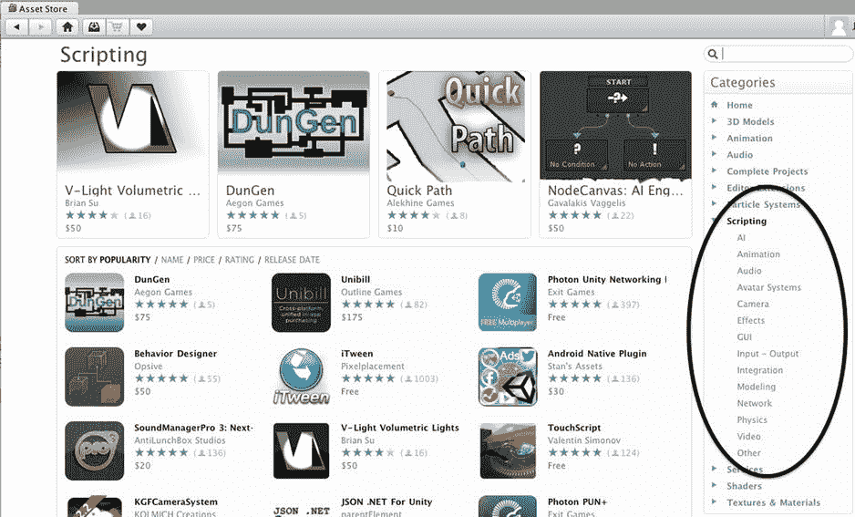

图 13-18. 资源商店中可用的脚本资源类别

GitHub 是一个在线代码仓库集合，开发者在此分享与协作，它也是另一个存放开源代码的绝佳库。各种开发者论坛亦是针对特定问题的精准代码解决方案的资源平台，以及就解决问题的替代方案进行激烈辩论的场所。

# 不止是爱好

如果你的目标是成为一名游戏开发从业者，那么思考如何构建作品集和简历永远都不嫌早。无论你是否接受过正规教育，潜在雇主都希望看到你具备哪些技能。即便你不清楚雇主的期望值，了解这些期望也能为你提供指引，帮助你精进开发技能，以满足行业标准。

## 作品集

简历与作品集的区别在于，简历是对你专业技能和教育背景的书面总结，而作品集则是你工作成果的实物展示，例如代码、演示程序，甚至是完整的游戏。

无论你是自学成才的编程者还是拥有学位，作品集都是进入游戏行业必不可少的敲门砖。事实上，在初级职位的要求中，你经常会看到“计算机科学学士学位或同等工作经验”这一条。如果你能通过作品集证明自己拥有他们寻找的能力，那么正规教育并非必需。无论哪种情况，作品集的内容都是相同的，唯一的区别在于，对于学生而言，课程作业中的项目应与独立项目区分开来。

作品集是你游戏开发工作中最佳样品的集合。说实话，你最初制作的几款游戏很可能不会获奖，但它们在其他方面意义重大。它们展示了你的技能，也体现了你学习能力和坚持完成项目的能力。

我是在一次针对开发者的聚会活动中，通过结识的一位朋友获得了第一份付费游戏开发工作。当时我的作品集并不多，但我为一家本地初创公司开发了几款小型移动生产力应用。他评价说：“这让我知道你能够完成并发布一个项目。”这句话让我很惊讶，因为我从未以这种方式思考过。

事实上，当时我们正在聊天，我向他展示了手机上的应用，我完全不知道他参加那次会议正是为了物色人选。我当时觉得自己技能和知识都还不足，因为我痛苦地意识到自己还有很多东西要学。那第一个项目后来发展成了第二个项目，我都成功完成了，并且在此过程中学到了很多东西。正如我提到的，鉴于视频游戏开发领域发展如此迅速，总有学不完的东西。

你的作品集里应该包含几个完整的游戏。“完整”意味着要包含启动画面；涵盖开始、暂停和退出游戏等基本功能的菜单；玩家选项；以及除了核心玩法之外，游戏与玩家交互的所有辅助功能。涵盖多种类型（2D 和 3D）的游戏，能展示你的深度和多样性。

你还可以准备功能演示：专注于特定功能的游戏片段，用以展示你在某一方面的技能，比如 AI 或特效。程序员并不被期望拥有专业级别的美术技能；因此才有了“程序员美术”这个术语，它指代那些用于演示游戏功能的、通常是质量较低的占位美术资源。话虽如此，还是要尽最大努力留下良好的第一印象。使用资源商店里的资源，或者与美术师合作来提升演示质量都是可以的，只是要确保注明那些并非你亲自创建的内容的来源。

既然你现在是一名游戏开发者，你的作品集必须包含源代码。当你查看初级职位招聘信息时，会看到如下所示的期望技能：

-   “按照要求的编码标准进行代码的设计、实现、测试、调试和维护。”

-   “测试、调试和扩展其他软件工程师的代码。”

-   “将现有技术移植到新平台。”

游戏开发是一项团队协作活动，你将与其他开发者共事，可能会接替前任开发者的工作，而其他人也会基于你的代码进行开发。组织有序、高效、易读的代码对专业开发者至关重要。如果你对某个游戏开发问题的绝妙解决方案深埋于凌乱、难懂的代码之中，潜在雇主是不会花时间去解读的。请记住，他们收到的求职咨询非常多，只有最优秀的才会获得进一步考察的机会。

## 网站

网站只是为公众提供访问你作品集的一种途径。虽然通过电子邮件发送作品集的`.zip`文件往往会导致一系列麻烦，比如文件可能永远无法被接收，或者目标收件人无法打开，但发送一个链接则简单直接。

无论你的目标是作为潜在员工还是自由职业者获得专业认可，你的网站也必须显得专业。不要掺杂个人博客或私人信息，但一定要让联系方式易于查找。

网站设计应简洁明快，让用户只需最少点击就能轻松访问你的演示作品，同时布局和背景图片也不应分散对演示内容本身的注意力。

## 量身定制你的展示内容

根据职位描述，定制你的作品集，重点展示与之最相关的演示内容。你的作品集应突出该职位所需的核心技能集。可以想象，除了通用的“玩法程序员”之外，各种初级职位之间存在差异，例如“多人游戏玩法程序员”、“图形程序员”或“工具程序员”。

研究一下这家公司及其产品。研究一下将对你进行面试的开发者，并熟悉他们的工作。游戏开发者都是超级发烧友。因此，你应该熟悉他们的游戏，并准备好讨论你喜欢玩哪些游戏。

## 获取诚恳的反馈

游戏开发者社区是打磨你游戏、获取反馈的极好来源，也能为你提供良好编码实践方面的指导。Unity 在 [`https://store.unity3d.com/products/support`](https://store.unity3d.com/products/support) 提供专业支持服务（图 13-19）。

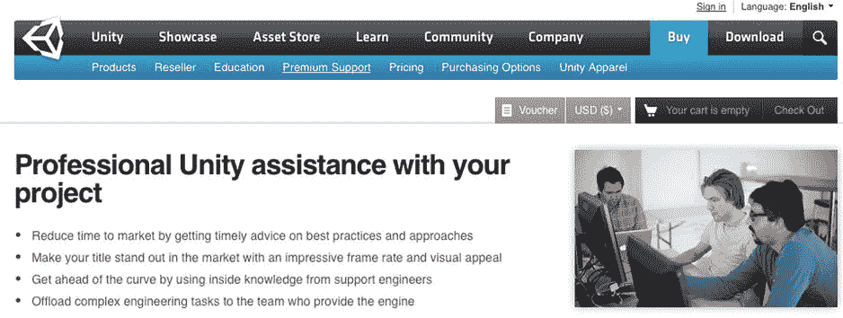

图 13-19. Unity 提供针对美术、脚本编写、调试等方面的专业支持

我在一次创业合作中参与的第一个项目，对整个团队（全是新手）来说都是一次学习经历。当我们认为可以发布时，我们聘请了一位专业开发者来审查我们的工作。这是一次有趣的体验，既让我们对自己做得好的方面有了信心，又为我们需要改进的领域提供了快速、集中的学习途径，同时也显著缩短了发布审批时间。

请记住，当你看到同行开发者们为他们的项目征求反馈时，你也要给予回报：提供经过深思熟虑的详细评论，说明你认为哪些地方做得好，并尽可能地提出改进建议。

### 墨菲定律无处不在

墨菲定律指出：凡是可能出错的事，就一定会出错，而且会错得一塌糊涂。第一次参加重要面试时，我紧张得要命——一边反复练习精心准备的回答，一边攥着口袋里的幸运硬币等待叫号。面试进行到一半时，我衬衫的纽扣突然崩开，不偏不倚落在面试官的桌上。我们俩都惊恐地盯着这颗纽扣，陷入了片刻的死寂，随后我连忙抓住衬衫，他则抓起了手机。幸好他的秘书有安全别针，等我镇定下来后，面试才得以继续。我没有羞愧到无地自容，还成功进入了初选名单，尽管最终未能入选。经历过这次之后，后续的面试简直小菜一碟。

无论是求职咨询还是面试，务必准备好备用截图和视频，以备演示失败时使用（实际演示出问题的频率可能比你想象的更高，原因五花八门）。请记住：对方很忙，你的求职只是众多申请之一，你要让招聘方轻松看到你的能力。演示失败确实会发生，但优质的截图、视频以及你的源代码，都能为求职提供有力支持，或避免面试陷入尴尬的僵局。

这一点同样适用于个人作品集网站：除了可玩的演示版本外，也请准备好截图和游戏视频作为备选。

## 招聘平台

前面提到的大多数开发者在线社区都提供职业指导，许多还设有招聘板块，供雇主发布职位信息。即便你尚未准备好求职，关注招聘要求也能帮你明确学习方向。

Unity Technologies 在其官网 [`http://unity3d.com/company/jobs`](http://unity3d.com/company/jobs) 发布职位信息，同时也允许求职者和招聘方在社区论坛 [`http://forum.unity3d.com`](http://forum.unity3d.com/) 发布信息，其中包含为非商业项目寻找团队成员的板块（见图 13-20）。

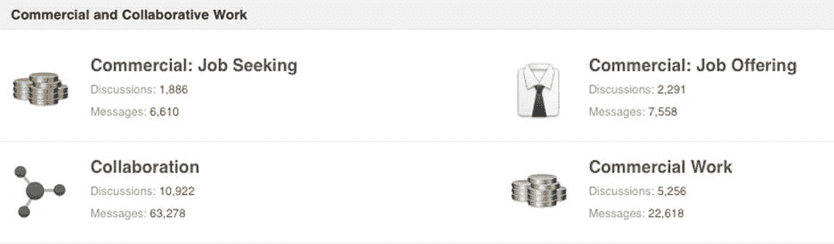

图 13-20.

Unity 论坛商业及协作项目板块

Stackoverflow 设有 [`http://careers.stackoverflow.com`](http://careers.stackoverflow.com/) ，GitHub 有 [`http://jobs.github.com`](http://jobs.github.com/) ，Gamasutra 则有 [`http://jobs.gamasutra.com`](http://jobs.gamasutra.com/) 。各大游戏机制造商也在各自官网或其子公司（如索尼旗下的《最后生还者》开发商顽皮狗、动视旗下的暴雪等）发布招聘信息。此外还有独立游戏工作室，从 EA Games 这类 AAA 级大厂到本地初创团队，应有尽有。

还有许多面向开发者的职业网站，既有 CareerBuilder.com 这类综合平台，也有面向求职者和自由职业者的技术或在线领域专业站点，如 Startupers、Authentic Jobs 和 We Work Remotely。

对于自由职业者，[`www.freelancer.com`](http://www.freelancer.com/) 设有专门的 Unity3D 类别。其他自由职业平台如 Elance 和 oDesk，不仅提供项目竞标机会，还支持管理项目流程和处理付款。

资源商店（Asset Store）是脚本的优质来源，也是分享你个人脚本解决方案的场所。如果你觉得某个脚本特别实用且具有通用性，可以考虑提交到资源商店。这也能达到与你发布游戏作品集相同的目的——发布原创、已上架的作品。

## 总结

就是现在，你作为一位初出茅庐的游戏开发者，即将开启新世界的大门。从小处着手，循序渐进地巩固所学知识。不要一开始就想着那个需要 AAA 级工作室投入几十位开发者、耗资数百万美元并花费数年才能完成的梦想项目，那只会打击你的信心。无论你在游戏开发上的目标是什么，请享受旅程中的每一步，将每个小成就都视为胜利。

积极参与社区，尤其是 Unity 论坛、问答平台和维基。无论你偏爱 Facebook 还是其他平台，都很容易找到 Unity 和游戏开发者。Twitter 是开发者常用的交流方式，也是推广你游戏的好渠道。关注 `@unity3d` 了解 Unity 最新动态，你可以在 `@j9suvak` 找到我，我的 Twitter 关注列表里还有更多开发者。别害羞，快来加入吧。

欢迎来到欢乐的世界！
