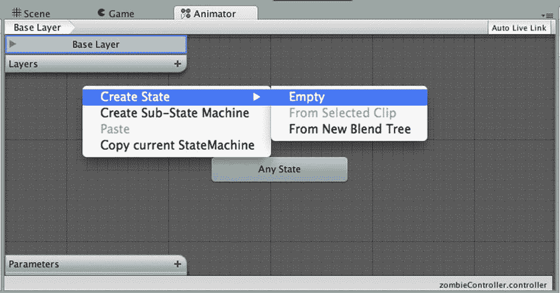
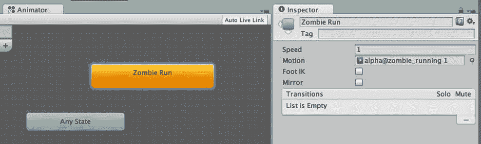

# 创建动画控制器

现在你有了角色和动画，还需要一个控制器来播放动画。动画控制器是一种游戏对象组件，用于将动画剪辑的行为连接到游戏对象模型。

首先选择 `Assets` 文件夹，然后依次选择 Create ➤ Folder 并将其命名为 `Animator Controllers`，接着双击打开该文件夹。接下来选择 Create ➤ Animator Controller 并将其命名为 `zombieController01`。双击 `zombieController01` 在动画器视图中打开它（图 5-19）。

将鼠标光标置于动画器视图中，右键点击网格，在上下文菜单中选择 `Create State ➤ Empty`。

`图 5-19. 动画器窗口中的可视化编程工具`

动画器窗口中会出现一个名为 `New State` 的新方框。橙色表示默认状态。选中该方框，在检查器中将名称改为 `Zombie Run`。然后将 `Animations` 文件夹中的 `alpha@zombie_running` 剪辑拖拽到 `Motion` 字段中（图 5-20）。

`图 5-20. Zombie Run 动画剪辑的默认动画状态显示为橙色`

> **注意：** 各种动画被称为状态。例如，当角色处于闲置状态时，它就处于“`Idle` 状态”。从一个状态移动到另一个状态称为过渡，用箭头表示。你在动画器窗口中为动画控制器设计的这些状态和过渡的集合，就构成了所谓的状态机。

以上就是这个简单动画控制器的全部内容，它将把 `alpha@zombie_running` 动画剪辑作为默认状态进行播放。