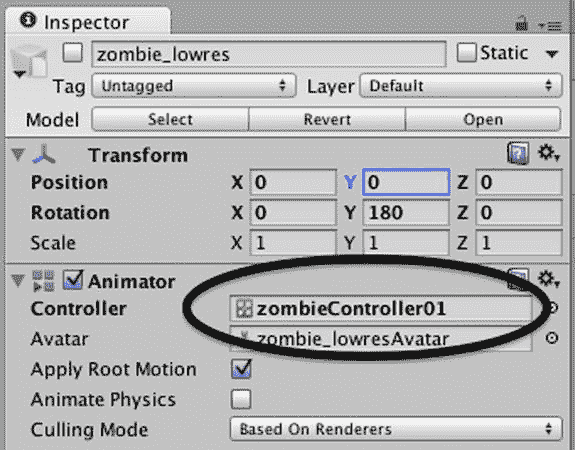

# 僵尸快跑

首先设置场景。在层次视图中，选中 `Cube` 游戏对象，然后在检查器中通过取消选中其名称旁边的复选框来停用它。现在将 `zombie_lowres` 模型从项目面板拖拽到层次视图中，以将其添加到场景。选中 `Main Camera` 查看预览效果。将摄像机重新定位到 `(0, 1, –3)`。僵尸角色出现在场景中，背对摄像机，因此请在层次视图中选中它，并在检查器中将其 `Rotation` 属性的 `y` 值改为 `180`，使其转身。重新选中 `Main Camera` 预览这个新的朝向。

现在看一下检查器中僵尸角色的 `Animator` 组件，你会注意到它的 `Controller` 属性是空的。将 `zombieController01` 从项目面板拖拽到 `Controller` 字段中（图 5-21）。保存场景。播放游戏，现在僵尸正在追赶你！

*图 5-21. 检查器中的 zombie_lowres 动画器组件和 zombieController01*

