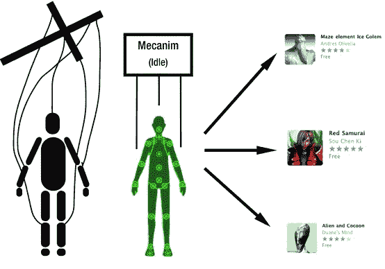
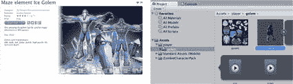
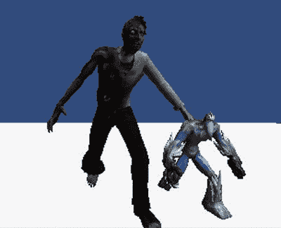

# 像僵尸一样奔跑

开发中的一个基本概念是 DRY，即 Don't Repeat Yourself（不要重复自己）。你已经在第 4 章中看到了这个概念的应用，当时你通过将一段重复的代码块提取出来，并将其制作成一个独立的函数来重构脚本。这个概念也是 Mecanim 强大功能和灵活性的基础，只不过这里不是不重复代码块，而是不必为不同的、但具有相似骨骼绑定的角色重复创建相同的动画。化身的使用使这成为可能。

化身是 Mecanim 能够理解并驱动动画的简化人体骨骼结构。化身的骨骼与角色模型中的对应骨骼相匹配，因此移动化身就会以与底层动画剪辑相同的动作来移动角色。一个简单的类比是，移动线控木偶的线会以特定方式移动木偶，无论木偶是什么角色。如果你将一个木偶换成另一个，第二个木偶也会以相同的方式对相同的线控动作做出反应（图 5-22）。使用 Mecanim，你可以类似地使用相同的动画剪辑来重新定位不同的角色。这极大地简化了 Unity 中的动画工作流程。

*图 5-22. 线控木偶与标准化身的对比*

现在你将看到 Mecanim 的真正效率。在资源商店中，找到 Maze 元素 Ice Golem（图 5-23）。下载并将其导入到你的项目中。一个名为 `player` 的文件夹将出现在你的资源文件夹中。深入打开该文件夹找到 golem 角色并选中它。

*图 5-23. 资源商店和项目面板中的 Golem 角色*

按照创建和配置化身的相同步骤处理这个 golem 角色。完成后，将带有新化身的 golem 角色拖拽到层次视图中。在场景视图中，移动 golem 直到它站在僵尸旁边。你会在检查器中看到 golem 的 `Animator` 组件的 `Controller` 字段是空的。将 `zombieController01` 拖拽到这里，然后点击播放。现在 golem 也像僵尸一样奔跑了（图 5-24）！

*图 5-24. 僵尸和 golem 角色一起奔跑*

