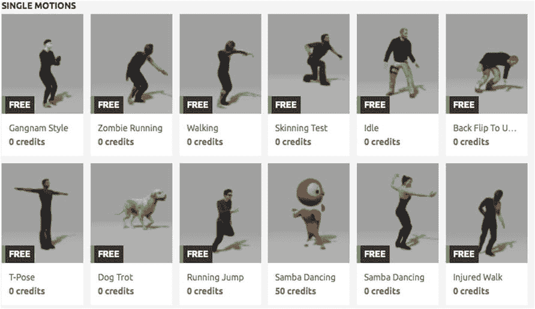
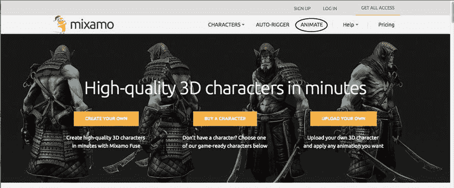
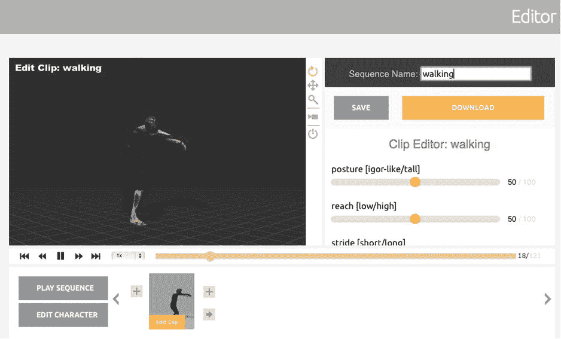
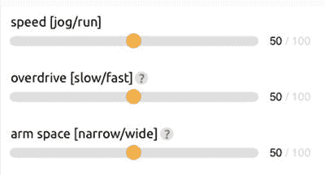
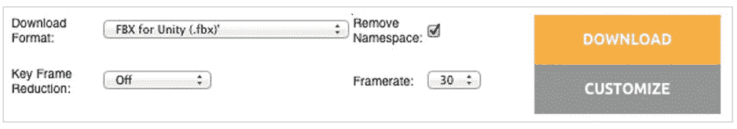
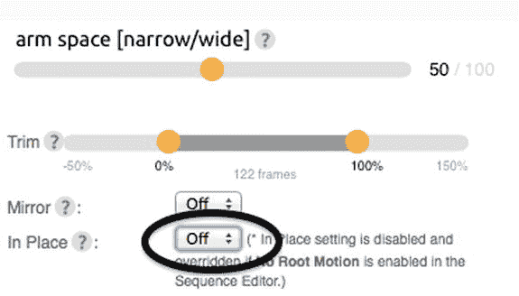
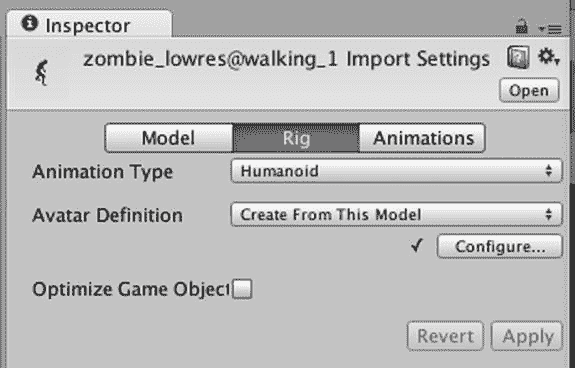
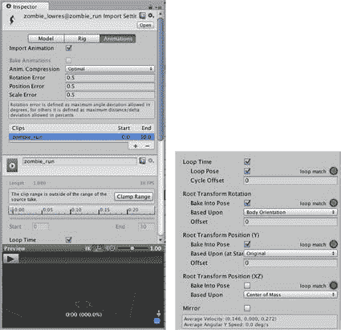
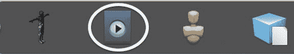

# 更多动画

终于能看到角色动起来确实很有趣，而且你已经领略到将动画片段转移给其他角色是多么简单。我们将为僵尸角色添加更多动画，所以现在先把石像鬼角色停用吧。一个只循环播放单个动画片段的角色对游戏来说没什么用，那么去哪里为僵尸寻找更多动画呢？

你可以在资源商店中找到更多动画，它们可以是独立的动画片段或资源包，也可以包含在完整项目中，比如 Unity Technologies 制作的 Mecanim 演示项目。你现在已经熟悉了在资源商店中浏览的方法，所以我想介绍另一个动画来源，它能让你更进一步，提供一些编辑功能。

动画片段和角色模型一样，通常在导入 Unity 之前就已经准备好了。Mixamo 是我们这个示例中使用的僵尸角色的发布者。除了提供大量兼容 Mecanim 的角色和动画目录外，Mixamo 还提供了一些不错的免费工具，其中包括一个为你的角色应用动画的工具。

使用你的网络浏览器，前往 [`www.mixamo.com`](http://www.mixamo.com/)。要注册一个免费账户，只需提供你的电子邮件地址并创建密码即可。注册完成后，从顶部菜单选择“动画”（图 5-25）进入预制动画目录（图 5-26）。

图 5-26。

Mixamo 提供的动画示例

图 5-25。

Mixamo 主页上的“动画”顶部菜单选项

很酷，对吧？谁不想让自己的角色跳江南 Style 呢？去吧，花些时间浏览一下这些动画。在为自己的游戏选购时，就像在 Unity 资源商店里一样，一定要看看资源包，因为它们通常性价比很高。

在右上角，选择橙色的“上传 3D 角色”按钮。选择“上传文件”。选择 `zombie_lowres.fbx` 角色进行上传。这个僵尸角色是 Mixamo 制作的免费角色，所以你很快就会看到“你的角色已成功映射！”的消息。选择“应用动画”，这会带你回到动画目录。

对于这个示例，选择“行走”，Mixamo 编辑器页面将加载行走动画（图 5-27）。

图 5-27。

Mixamo 动画编辑器

将序列名称保留为 walking。在左下角，如果“编辑片段”未选中，请选中它。尝试使用滑块，看看如何自定义动画（图 5-28）。

完成实验后，使用“到达”滑块将手臂降低到与僵尸奔跑动画大致相同的角度。这为两个动画片段之间的平滑过渡做好了准备。我更喜欢脚步较慢、拖沓的僵尸，但你可以根据自己的喜好配置其他参数。当你调整到满意后，选择“保存”，然后“下载”。

图 5-28。

用于编辑动画片段的简单滑块

会出现一个结账弹出窗口，动画在你的购物车中，总价为 0 美元。选择“结账”，然后会出现一个“下载托盘”弹出窗口，其中包含你的动画角色。选中它，然后在靠近底部的位置，对于“下载格式”选择“FBX for Unity”，然后点击橙色的“下载”按钮（图 5-29）。

图 5-29。

Mixamo 动画角色下载设置

你可以将下载的动画角色模型添加到你的 Unity 项目中，方法是将其拖放到“项目”面板中，或者通过 Unity 编辑器顶部菜单选择“资源” ➤ “导入新资源”。将你新创建的动画角色模型拖放到 `Assets ➤ Animations` 文件夹中。保存场景并保存你的项目。

你还需要为这个项目准备几个动画片段。首先，重复创建行走动画的过程，但将其命名为 `walkingWithMotion`。编辑完成后，向下滚动到滑块下方，将“原地”设置改为“关闭”（图 5-30）。保存并下载。

图 5-30。

在 Mixamo 动画编辑器中，“原地”设置设为“关闭”

以同样的方式创建、保存并下载“空闲”动画。在这种情况下，没有“原地”设置选项，因为这个动画本身就是僵尸角色站立在一个地方。和之前一样，将这些动画下载到你项目的 `Assets ➤ Animations` 文件夹中。保存你的项目。

## 配置动画

现在，你的“动画”文件夹中应该已经有了僵尸角色的“空闲”、“行走”和 `walkingWithMotion` 动画。由于它们与 `zombie_lowres` 模型结合在一起，它们的标签显示为 `zombie_lowres@动画名称`。在您使用它们之前，每个都需要进行配置。在“动画”文件夹中选择 `zombie_lowres@walkingWithMotion`。

在检查器中，选择“骨骼”选项卡（图 5-31）。就像你对 `zombie_running` 动画所做的那样，将“动画类型”改为 Humanoid，并将“Avatar 定义”改为“从此模型创建”。

图 5-31。

在检查器中配置动画骨骼设置

## 根运动

动画涉及角色头部、身体和四肢相对于自身坐标系的运动，而根运动则涉及角色相对于游戏世界坐标系的运动。例如，你会看到没有根运动的僵尸行走动画会让角色原地踏步，而有根运动的 `walkingWithMotion` 动画则让角色在游戏场景中向前移动。与动画运动一样，动画是否包含根运动，是在导入 Unity 之前创建角色和动画时确定的。

选择 `Animations` 选项卡。注意底部有一个预览区域，你可以在此播放动画。留意僵尸角色所站平面的网格，你会注意到僵尸正在原地行走。

在 Inspector 中向下滚动，直到看到可以勾选 `Loop Time` 的位置，其正下方是 `Loop Pose`。对于 `Root Transform Rotation`，勾选 `Bake Into Pose`，然后将 `Based Upon` 设置为 `Body Orientation`。接下来，对于 `Root Transform Position (Y)`，勾选 `Bake Into Pose`，并在其下方将 `Based Upon (at Start)` 设置为 `Original`。对于 `Root Transform Position (XZ)`，不要勾选 `Bake Into Pose`。最后，点击 `Apply`（图 5-32）。

**图 5-32.** 在 Inspector 中配置动画设置

按设置分解这些选项，勾选 `Loop Pose` 意味着动画剪辑将重复或循环播放。如果未勾选，动画剪辑将只播放一次。

`Root Transform Rotation` 描述了动画剪辑期间动画旋转模型的程度。通过勾选 `Bake Into Pose`，你将原始旋转坐标“烘焙”到角色中，并防止它在动画剪辑期间旋转。这是你希望防止它在行走动画期间发生漂移的方法，因为你希望角色只沿直线向前移动。

在 `Mirror` 下方，你可以看到来自根运动的平均速度。除了你感兴趣的轴之外，其他轴上的分数速度是可能发生漂移的指标。你可以选择此动画剪辑是应基于模型的**身体方向**（Body Orientation），还是应基于该剪辑播放时角色拥有的**原始向前运动矢量**（Original forward movement vector），从角色的前一个运动矢量继续播放。

`Offset` 允许你进一步微调变换，以解决动画剪辑可能引入的任何差异。

`Root Transform Position (Y)` 的工作方式与旋转类似。在这种情况下，对于行走动画，你应该勾选 `Bake Into Pose` 以防止向上或向下漂移，但对于跳跃动画，则应保持不勾选，以允许跳跃时上下运动。

`Root Transform Position (XZ)` 处理沿 xz 平面的运动，这与“地面”相同。回想一下，在 Unity 中，y 轴表示游戏世界中的上下方向。通过保持不勾选 `Bake Into Pose`，角色在执行动画时将在场景中的 xz 平面上移动。Idle（待机）是常见动画剪辑的一个例子，在这种情况下你会想要勾选 `Bake Into Pose` 以防止意外的移动。

绿色圆圈指示动画循环的平滑程度，其依据是模型在剪辑的第一帧和最后一帧中的变换属性的相似度。当从一个循环的结束到下一个循环的开始的过渡差异增大时，警告指示器会变为黄色，然后变为红色。`Root Transform Position (XZ)` 的指示器是红色的，因为每次动画循环时，僵尸都会向前移动一步到新位置。

现在你的动画已经准备好进行测试，但为了更好地观察行走的根运动效果，为视角提供一些背景而不是纯色平面会更容易。为你的场景创建一个平面，并将其变换设置为 `(0, 0, 0)`，缩放设置为 `(30, 1, 30)`。在顶部菜单中选择 `Assets` ➤ `Import Package` ➤ `Terrain Assets`，然后点击 `Import`。在此包中找到 `Terrain Textures` 文件夹，并将 `Grass&Rock` 纹理拖到 Hierarchy 视图中的 Plane 上。该纹理应显示在 Scene 视图的平面上。在平面的 `Mesh Renderer` 组件中，将 x 和 y 的 Tiling 值设置为 5。

在 Project 面板的 `Animators` 文件夹中找到 `zombieController01`。双击它以在 Animator 窗口中打开。选择 `Zombie Run` 状态。在 Inspector 中将其重命名为 `Walk`，然后将 `walkWithMotion` 动画剪辑从 Project 面板的 `Animations` 文件夹拖到 Inspector 中的 `Motion` 字段。请注意，你需要的不是整个 `zombie_lowres@walkWithMotion` 文件，而只是动画剪辑。点击 `zombie_lowres@walkWithMotion` 图标上的箭头以展开它，并找到动画剪辑（图 5-33）。

**图 5-33.** `zombie_lowres@walkWithMotion` 中的动画剪辑图标

点击播放，你会看到僵尸在游戏世界中穿过平面向前移动时执行行走动画。很酷！

在专业级游戏中，游戏对象的动画运动通常是基于动画的根运动、脚本运动、物理等等的组合。具体如何应用这些取决于游戏，但目标始终是提供最佳的游戏体验——最逼真或风格最合适、一致且响应迅速的动画。

