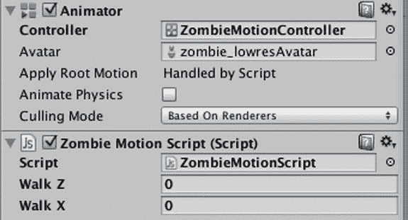

# `OnAnimatorMove`

你可以使用脚本为没有应用 Root Motion 的动画剪辑提供运动，或者通过 `OnAnimatorMove` 在动画剪辑中进一步自定义 Root Motion。为了实现最精细的控制，你可能希望创建并使用 Unity Pro 中提供的动画曲线，但以下示例将让你初步体验如何直接通过脚本控制角色运动。

在此示例中，首先在 Project 面板中创建一个新的 Animator Controller，命名为 `ZombieMotionController`。将行走动画剪辑拖入 Animator 窗口，此时它应显示为橙色，作为新的默认状态。在 Hierarchy 视图中选中 `zombie_lowres` 游戏对象，然后在其 Animator 组件中更改 Controller：将 `ZombieMotionController` 拖入 Controller 字段，或使用 Controller 字段右侧的圆形选择按钮。播放以确认僵尸在原地行走。

在 Project 面板中，通过 Create ➤ Javascript 创建一个新脚本，命名为 `ZombieMotionScript`。双击在 MonoDevelop 中打开。删除空的 `Start()` 和 `Update()` 函数，然后添加以下代码：

```
public var WalkX:float = 0;
public var WalkZ:float = 0;

function OnAnimatorMove()
{
    var animator : Animator = GetComponent(Animator);
    if (animator)
    {
        var newPosition:Vector3 = transform.position;
        newPosition.x += WalkX * Time.deltaTime;
        newPosition.z += WalkZ * Time.deltaTime;
        transform.position = newPosition;
    }
}
```

代码解析如下：

1. `public var WalkX:float = 0;`
   `public var WalkZ:float = 0;`
   声明了用于僵尸变换位置 x 和 z 分量的公共浮点变量，以便你可以在 Game 视图中实时调整它们。

2. `function OnAnimatorMove()`
   如你在查看脚本参考后所了解的（咳咳，你确实看过了，对吧？），`OnAnimatorMove()` 函数在状态机之后的每一帧被调用。这发生在 `OnAnimatorIK()` 之前，其中 IK 代表“反向动力学”，是 Unity Pro 中提供的另一种动画方法。

3. `var animator : Animator = GetComponent(Animator);`
   `if (animator)`
   如果 `animator` 游戏对象上未附加 Animator 组件，则 `animator` 变量为 null，因此在下一行中，它被用于条件 `if` 语句。如果游戏对象有 animator，则执行后续代码块；如果没有，则跳过。

4. `var newPosition:Vector3 = transform.position;`
   在条件语句内，声明了 `newPosition` 的 Vector3 类型变量，然后将其赋值为 `animator` 游戏对象的当前变换位置。

5. `newPosition.x += WalkX * Time.deltaTime;`
   `newPosition.z += WalkZ * Time.deltaTime;`
   每一帧通过 `WalkX` 和 `WalkZ` 因子更新变换的 x 和 z 坐标，并使用熟悉的 `Time.deltaTime` 进行平滑处理。

6. `transform.position = newPosition;`
   最后，用新的 x 和 z 属性值更新 `animator` 游戏对象的变换位置。

保存脚本。在 Unity 编辑器中，将脚本从 Property 面板拖到 Hierarchy 视图中的 `zombie_lowres` 游戏对象上以附加它。当你这样做时，Inspector 中会发生两件事：`ZombieMotionScript` 作为组件出现；此外，当 Animator 组件检测到脚本中的 `OnAnimationMove()` 函数时，其 Apply Root Motion 属性更改为 Handled by Script（图 5-34）。保存场景和项目。



**图 5-34.** 新附加的 `ZombieMotionScript` 组件，以及 Animator 组件的 Apply Root Motion 属性更新为 Handled by Script

选中 `zombie_lowres` 游戏对象，播放以进行测试。僵尸仍然在原地行走，因为 `ZombieMotionController` 脚本中的 `WalkX` 和 `WalkZ` 初始值为 0。在 Play 模式下，尝试在 Inspector 中调整 `WalkX` 和 `WalkZ` 的值。微调它们，直到僵尸看起来在平面上行走且没有漂移。请记住在退出 Play 模式前记下最终值，因为你的更改不会保存在 Inspector 中。