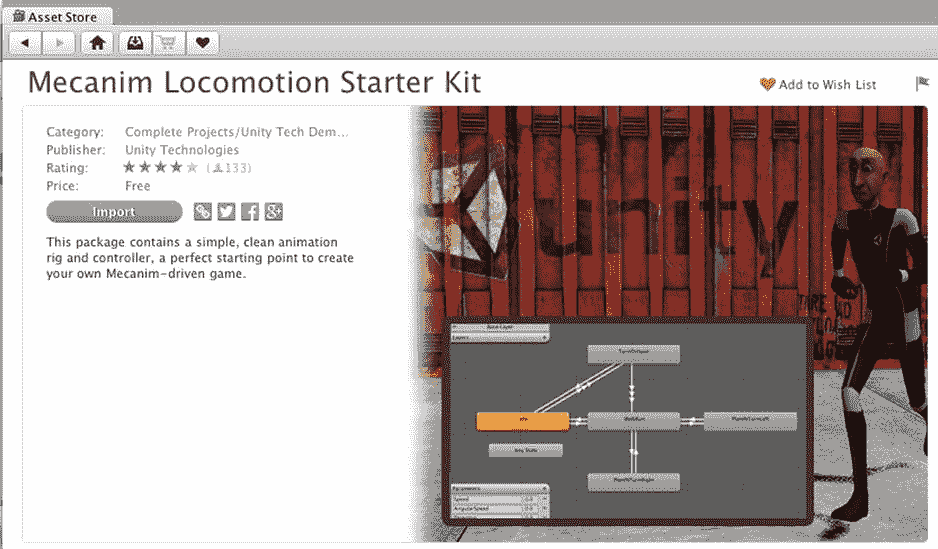
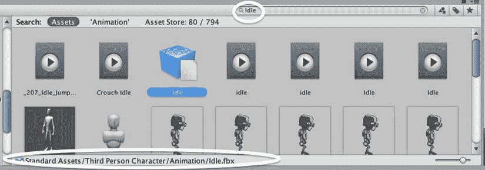
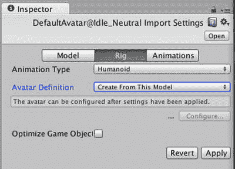
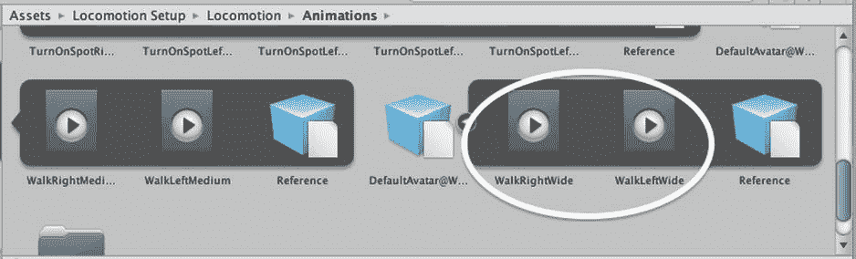

# Transitions

到目前为止，你只处理了默认的动画状态。状态机可能相当复杂，可以包含角色可能需要的任意数量的动画状态。从一个动画状态移动到另一个动画状态称为过渡。

## 准备工作

对于最后一个动画控制器，你需要从 Asset Store（图 5-35）下载并导入 Unity 的 Mecanim Locomotion Starter Kit。这个包为你提供了现成的 Mecanim 骨架和控制器，但为了理解其工作原理，你将使用其中的一些动画从头构建一个控制器。

**图 5-35.** Unity Asset Store 中的 Mecanim Locomotion Starter Kit

导入此包的操作方式与你处理 Zombie Character Pack 时完全相同。在 Unity 编辑器顶部菜单中，选择 Window ➤ Asset Store 以打开 Unity Asset Store 的单独窗口。在搜索栏中，输入 Mecanim Locomotion Starter Kit，然后点击蓝色 Download 按钮。Importing Package 窗口将打开，其中包含所有需要导入的包内容。保持所有这些选项勾选，然后点击窗口右下角的 Import，`Locomotion Setup` 文件夹（包含 Mecanim Locomotion Starter Kit）将出现在 Project 面板中。

## 创建动画控制器

在 Project 面板中，选择 `Animators` 文件夹。创建一个新的 Animator Controller，命名为 `ZombieLocomotionController`，然后双击打开。

## 配置动画剪辑

要查找 Idle 动画剪辑，在 Project 面板的搜索栏中输入 Idle。选择 `DefaultAvatar@Idle_Neutral` 图标，并通过查看底部出现的面包屑导航（图 5-36）确认它是 `Setup/Locomotion/Animations/DefaultAvatar@Idle_Neutral.fbx`。

**图 5-36.** 在 Project 面板中选中的 `DefaultAvatar@Idle_Neutral` 图标

首先，配置动画：在 Project 面板中仍选中 Idle 图标时，在 Inspector 中选择 Rig。Animation Type 应为 Humanoid，然后将 Avatar Definition 更改为 Create From This Model，并点击 Apply（图 5-37）。Configure… 按钮旁边应出现一个对钩标记。Animation 设置可以保持原样。现在，该动画剪辑与你之前在本章中创建的僵尸模型动画 Avatar 兼容。

**图 5-37.** Inspector 中的 `Animation.fbx` Rig 设置

重复这些步骤，配置你将在此示例中使用的另外两个动画：`DefaultAvatar@WalkForward_NtrlFaceFwd.fbx` 和 `DefaultAvatar@WalkForwardTurnRight_NtrlWide.fbx`。对于第二个，选择 Animations ➤ `DefaultAvatar@WalkForwardTurnRight_NtrlWide`，以在 Inspector 中找到 WalkRightWide 和 WalkLeftWide 两个 Clip（图 5-38）。

**图 5-38.** Project 面板中的 WalkRightWide 和 WalkLeftWide 动画剪辑

如果你选择 WalkLeftWide，然后在 Inspector 中向下滚动，你会看到 Mirror 框被勾选。此剪辑是 WalkRightWide 的镜像反射，这是一个巧妙的属性，可以让你无需另一组 `.fbx` 文件。如果你正在为游戏创建自己的动画剪辑，镜像属性可以节省大量时间和精力，用于从单个动画剪辑创建两个对称的动画。