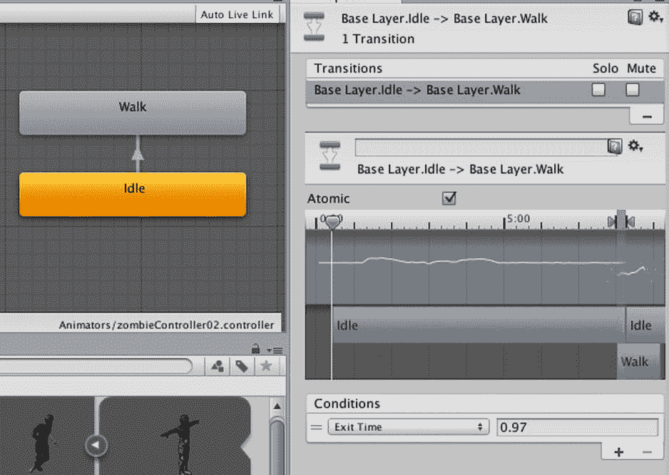

# Animator 控制器配置

现在你已经配置好了所需的动画，回到 Project 面板中的 `DefaultAvatar@Idle_Neutral` 图标。点击箭头展开它以显示 Idle 动画剪辑。在 Project 面板中选中 Idle 动画剪辑后，你可以在 Inspector 底部通过播放来预览它。将动画剪辑图标从 Project 面板拖放到 Animator 窗口，然后松开。它现在应该是控制器的橙色默认状态。

采用相同的方式，找到并展开 `DefaultAvatar@WalkForward_NtrlFaceFwd` 动画以显示 Walk 动画剪辑。将其拖放到 Animator 窗口中。由于 Idle 已经是默认动画状态，Walk 状态将显示为灰色框。你可以通过右键点击并从出现的上下文菜单中选择 **设为默认（Set As Default）** 来将其更改为默认状态，但暂时保持原样。

现在你有了 Idle 状态和 Walk 状态。要在两者之间创建过渡，右键点击 Idle 状态并从出现的上下文菜单中选择 **创建过渡（Make Transition）**。现在，如果在窗口内移动鼠标光标，它会拖出一条从 Idle 状态延伸出的白色箭头。点击 Walk 状态以设置过渡。点击白色箭头，它应该会变成蓝色，同时在 Inspector 中显示其属性（图 5-39）。你可以通过过渡属性设置从一个动画状态切换到另一个的条件。`Atomic` 属性默认处于选中状态，这意味着动画剪辑不能被中断。保持其选中状态。



**图 5-39.** Inspector 中的过渡属性

**提示：** 你可以拖拽状态框以保持其有序排列，在 Animator 窗口中按住 `Alt` 键拖拽可以移动整个网格。

你有不同的条件可供选择来触发过渡。默认的 `Exit Time` 属性值为 0.92，这意味着当剪辑播放到 92% 时，过渡将被触发。在 Hierarchy 面板中，选择 `zombie_lowres` 游戏对象，然后在 Inspector 中，通过将控制器从 Project 面板拖拽到 Inspector 中的属性字段，或点击 `Controller` 属性右侧的圆形选择按钮并从弹出菜单中选择 `ZombieLocomotionController`，将 Animator Controller 更改为 `ZombieLocomotionController`。

进行游戏测试，你会看到僵尸从 Idle 状态开始，然后基于 `Exit Time` 条件自动过渡到 Walk 状态。你可以在 Inspector 中通过拖拽 Idle 和 Walk 剪辑之间图形重叠的蓝色起始值和结束值来实验平滑过渡效果。退出 Play 模式并保存场景。

你还可以创建参数，用于在脚本中根据用户输入或游戏中的任何其他条件来触发过渡。点击 **Animator** 窗口选项卡，在左下角通过点击 **Parameters** 的 **+** 符号并选择 **Float** 来创建一个浮点参数。将名称从 **New Float** 改为 `Speed`。在 Inspector 中选择过渡箭头，将 `Exit Time` 改为 `Speed`，并选择 **Greater**（大于）和 **0.1**。

你还需要实现从 Walk 回到 Idle 的过渡。采用相同的方式，右键点击 **Walk**，创建一个新过渡，并将其连接到 **Idle** 状态。选择该过渡，对于 **Conditions** 属性选择 `Speed`，这次选择 **Less**（小于）和 **0.1**。

如果现在进行游戏测试，僵尸会停留在 Idle 状态。你需要创建一个脚本，定义哪些用户输入满足触发状态间过渡的条件。在 Project 面板中，创建一个新的 JavaScript 脚本并将其命名为 `ZombieLocomotion`。将其拖放到 Hierarchy 视图中的 `zombie_lowres` 游戏对象上，以将其附加到僵尸角色上。`ZombieLocomotion` 脚本将作为新组件出现在 Inspector 中。双击 Project 面板中的 `ZombieLocomotion` 脚本图标，在 MonoDevelop 中打开它，然后按如下方式编辑代码：

```javascript
#pragma strict

private var animator : Animator;

function Start () {
    animator = GetComponent(Animator);
}

function Update () {
    animator.SetFloat("Speed", Input.GetAxis("Vertical"));
}
```

这段代码的分解说明如下：

1. `private var animator : Animator;`

声明一个 `Animator` 类型的引用变量。如果你像之前在 `ZombieMotion` 脚本的 `OnAnimatorMove()` 函数中那样，在 `Start()` 函数内一行完成此操作，那么 `animator` 变量的作用域将仅限于 `Start()` 函数。通过在此处声明，你可以使其在 `ZombieLocomotion` 类内的任何函数中可用。

2. `animator.SetFloat("Speed", Input.GetAxis("Vertical"));`

这里你根据用户输入设置之前创建的 `Speed` 参数。进行游戏测试，你会发现当按下上箭头键或 **W** 键时，僵尸会向前行走。

## 任意状态（Any State）

**任意状态**是 Unity 遵循 DRY 原则提供的一种特殊状态，在前面的“像僵尸一样奔跑”部分已有讨论。它作为一种快捷方式，允许你从控制器中的任何动画状态过渡到某个其他特定状态。一个常见的用法是死亡状态，假设你的角色无论处于哪个动画状态，都可能承受某种打击。设置此过渡的方式与设置其他任何过渡相同，区别在于你只需直接从 **Any State** 框到 **Death** 框设置一次，而无需从每个单独的动画状态分别设置。

反之则不成立。你不能从动画状态过渡到 **Any State**，因为它代表的不是一个唯一的动画状态，而是所有动画状态，因此 Unity 引擎将不知道具体过渡到哪个动画状态。它没有被配置用于过渡到随机动画状态。因此，如果你尝试创建指向它的过渡，箭头将无法连接。