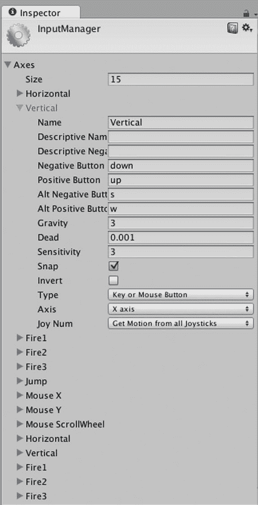
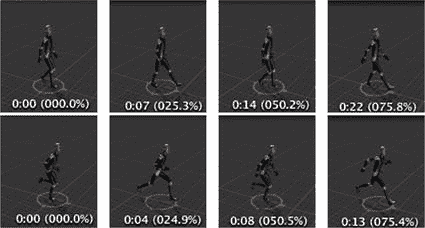
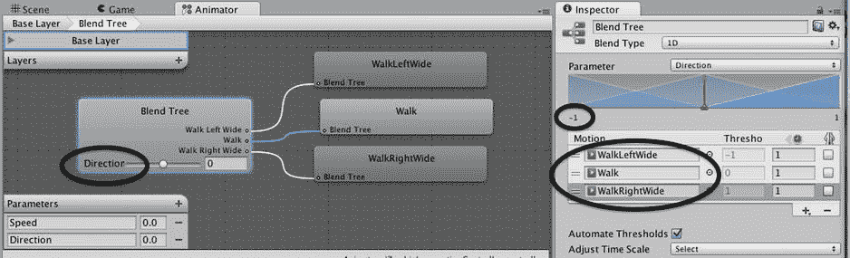

# 用户输入与输入管理器

这个`Input.GetAxis`到底是怎么回事？Unity的强大特性之一，就是你可以构建一个游戏，然后将其部署到多种不同的平台上。这给处理用户输入带来了特殊的挑战，因为输入可能来自键盘、鼠标、摇杆、游戏手柄，或者移动设备的触控和加速度计输入。

无需在脚本中硬编码每一种可能性，Unity的输入管理器（Input Manager）可以帮你解决这个问题。通过输入管理器，你可以配置各种输入设备，然后通过脚本接口（就像这里使用的`Input.GetAxis`）来访问它们。

当你创建一个项目时，会得到表5-1所示的默认输入轴。

**表5-1.** 输入管理器默认设置

| 输入轴 | 输入 |
| --- | --- |
| 水平/垂直（Horizontal/Vertical） | WASD键和方向键 |
| Fire1, Fire2, Fire3 | Ctrl、Option/Alt、 |
| 鼠标X/鼠标Y（Mouse X/Mouse Y） | 鼠标移动增量 |
| 窗口晃动X/窗口晃动Y（Window Shake X/Window Shake Y） | 窗口移动 |

在Unity编辑器的顶部菜单中，选择**编辑** ➤ **项目设置** ➤ **输入**即可更改这些设置或添加新的虚拟轴。请记住，作为良好游戏体验的一部分，用户期望一定程度的标准化，即常见的输入会触发常见的操作。他们期望方向键和WASD键能控制移动。同时，输入管理器也允许最终用户配置键盘，以便他们能根据自己的个人偏好进行调整（图5-40）。



**图5-40.** 检视面板中显示的输入管理器提示

对于射击武器或拾取物体等动作事件，请使用`Input.GetButton`。对于移动，请使用`Input.GetAxis`。

对于键盘输入和摇杆输入，中立位置等于0，每个轴的值在-1到1之间。正方向按钮给出正值。要观察实际效果，请在`ZombieLocomotion`脚本的`Update()`函数中添加以下几行代码：

```
var inputValue : float = Input.GetAxis("Vertical");
Debug.Log(inputValue);
```

保存脚本。在Unity编辑器的项目面板中，选择控制台（Console）选项卡，以便观察`Debug.Log`的输出。进入播放模式。注意`inputValue`为0。按住上箭头或W键，观察它变为1。由于你在动画控制器中将过渡条件设置为“大于0.1”，因此一旦`inputValue`超过0.1，就会触发从空闲（Idle）状态到行走（Walk）状态的过渡。松开按键，你会看到`inputValue`降至0，当它低于0.1时，就会触发回到空闲状态的过渡。

## 混合树

过渡用于从一个动画状态切换到另一个动画状态，而混合树则将多个动画剪辑结合在一起，通过混合来产生更平滑的动画动作。

混合树通常与行走和奔跑动画一起使用。为了获得最佳效果，需要混合的剪辑在标准化时间（normalized time）上的动作必须相似且发生在相同的节点上。“标准化时间”意味着剪辑长度可以不同，其中第一帧的标准化值为0.0，最后一帧的标准化值为0.99。只要在每个剪辑中，左脚都在相同的标准化时间（例如0.2）着地，右脚都在相同的标准化时间（例如0.7）着地，那么这些剪辑就能很好地混合。

在下图中，行走动画与奔跑动画进行了比较。你知道，手臂和腿交替摆动的一般动作是相似的，并且在现实时间中，奔跑循环比行走循环耗时更短是有道理的，因为奔跑比行走快。标准化时间解释了速度差异，并着眼于循环中相同相对点（以百分比表示）的位置。请注意左下角现实时间的差异和右侧标准化时间（以百分比表示）的差异（图5-41）。



**图5-41.** 在标准化节点上行走动画（上）和奔跑动画（下）的比较

你将通过创建一个混合树来为僵尸角色增加更多移动方式，该混合树包含向前行走、向前行走同时右转以及向前行走同时左转。在项目窗口中，选择`ZombieLocomotion`控制器，并在动画器窗口中打开它。按照之前创建速度参数的方式，创建一个名为`Direction`的新浮点参数。

选择“行走”状态，然后右键单击并选择**在状态中创建新混合树**。注意检视面板中的“运动”属性已从“行走”更改为“混合树”。现在双击“行走”状态，打开带有根混合树节点的混合树图。注意节点上出现了一个带有滑块的速度参数。首先，选择混合树节点，并将检视面板中的“参数”从“速度”更改为“方向”，然后点击最小值0并将其改为-1（图5-42）。根据定义，当使用输入管理器时，一个轴的值范围是-1到1。

其下方将是一个空的“运动”列表。点击**+**并添加“运动字段”三次，以添加三个运动字段。从项目面板的“运动动画”文件夹中，将`WalkLeftWide`、`Walk`和`WalkRightWide`拖放到这些字段中。



**图5-42.** 动画器窗口和检视面板中的行走混合树

蓝色金字塔代表每个运动，红色标记表示图中该特定点的参数值，而该点金字塔的高度显示了子运动在混合中的相对影响或权重。如果你将混合树根节点中“方向”参数的滑块移动到0，检视面板中的图表会显示“行走”运动的权重最大，而“行走右转”和“行走左转”的权重最小。当“方向”参数值为-1时，“行走左转”的权重最大；当“方向”参数值为1时，“行走右转”的权重最大。

在MonoDevelop中，将以下几行代码添加到`ZombieLocomotion`脚本的`Update()`函数中：

```
animator.SetFloat("Direction", Input.GetAxis("Horizontal"));
var directionInputValue : float = Input.GetAxis("Horizontal");
Debug.Log(directionInputValue);
```

保存脚本。在编辑器中保存场景。在项目面板中，选择控制台选项卡，以便观察速度和方向参数如何响应你的输入而改变。请注意，你必须按下W键或上箭头键，僵尸角色才能响应左或右箭头键进行转向。这正是你设置动画控制器的方式：行走右转和行走左转剪辑是行走混合树的一部分，因此僵尸角色必须处于“行走”状态才能转向。